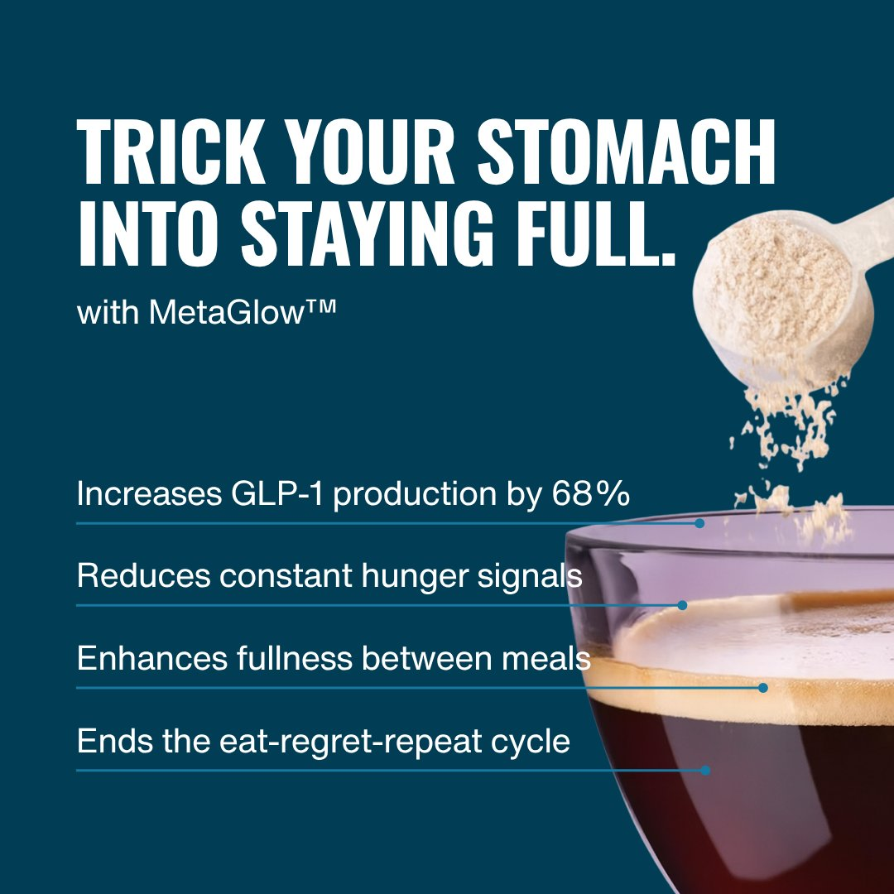

# Static (image) ad workflow
> Three course routes to a finished static: **A. angle-first** (master doc → Claude angle prompt → concept brief → Canva template → research-quote bullets; lesson 67), **B. image-first** (Reddit sub-avatar quotes → pick a proven ad structure → Claude rewrites it "exactly like the ad itself" per sub-avatar → product-truth correction → review after a break; lesson 68), and **C. the Banger Static Ads prompt** (nine headlines modelled on eleven famous ads → pick three → concepts; lesson 65). All three end with the same product-truth QA and the [copy checklist](../rubrics/copy-checklist-scorecard.md).

## 🤖 Agent use
- **Use when:** writing statics for a new angle or sub-avatar test, turning a video winner into statics, or remixing a competitor static's structure for our product.
- **Inputs → outputs:** Master Document (product doc, research, sub-avatars with verbatim quotes, new information, new mechanisms) + chosen route → concept brief (concept, angle(s), testing method, format, 3–4 headline variations with messaging + content) → one built static per variation (headline + sub-line + 3–4 bullets or check-marks + product image + CTA box) → QA log.
- **Rules:**
  - **DO** keep one Master Document per product and feed it to the model; "the more context you give it about who your customer is, the better it's gonna be." [L67 23:40](../lessons/67-how-to-write-image-ads-part-1.md)
  - **DO** write the angle for every concept, even a format or sub-avatar test. [L67 angle-prompt doc](../lessons/67-how-to-write-image-ads-part-1.md)
  - **DO** choose marksman (several angles) or sniper (one angle, several hooks) on purpose and record it in the brief. [L67 01:37; 05:38; 12:27](../lessons/67-how-to-write-image-ads-part-1.md)
  - **DO** give the model the inspiration ad, the headline, the research quotes and the exact count ("I need four", not two). [L67 18:02–20:11](../lessons/67-how-to-write-image-ads-part-1.md)
  - **DO** check every bullet against the product document: "do not call out hormones that our product does not support"; "Be a marketer, don't be an AI regurgitator." [L68 24:27; 30:59–32:30](../lessons/68-how-to-write-image-ads-part-2.md)
  - **DO** lead bullets with a hard fact from the product doc when one exists, and check that the number on the ad matches the source (the course's own ads shipped 68% on one and 56% on others). [L67 25:38–26:09](../lessons/67-how-to-write-image-ads-part-1.md); [L68 42:29](../lessons/68-how-to-write-image-ads-part-2.md)
  - **DON'T** over-claim: "if you're claiming like it's a wonder drug, again, you're going to run into belief issues." [L67 20:54](../lessons/67-how-to-write-image-ads-part-1.md)
  - **DON'T** wait for a designer: "It's okay to have ugly ads"; "the information in it is damn good." [L67 22:02; 27:26](../lessons/67-how-to-write-image-ads-part-1.md)
  - **DO** take a break (20–30 minutes to a day) and optimise the ads you made before making more. [L68 39:59–44:46](../lessons/68-how-to-write-image-ads-part-2.md)
  - **DO** copy the structure of a reference ad, never its words: several Banger-prompt demo outputs follow the reference almost line for line ("Zero stars. Would not recommend. - Mother Nature"), which is the copy-the-asset failure. [L65 Hooks table (derived)](../lessons/65-banger-static-ads-prompt.md)
- **See also:** [Write static image ads (playbook)](../playbooks/write-static-image-ads.md) · [Memo and Growth Guide](mini-breakthrough-memo-and-growth-guide.md) · [Copy checklist scorecard](../rubrics/copy-checklist-scorecard.md) · [Prompts library](../libraries/prompts.md) · [Templates library](../libraries/templates.md) · Tether: [static ad creation](../../../../playbooks/static-ad-creation.md), [visual weight hierarchy](../../../../frameworks/visual-weight-hierarchy.md), [CreativeOS](../../../../tools/creativeos.md)

## Pick a route
| Situation | Route | Why | Source |
|---|---|---|---|
| New product or sub-avatar test; you have research but no headlines | **A. Angle-first** | Angle prompt turns sub-avatars into ranked angles and hooks with "Inspired by" references | [L67 00:54–03:30](../lessons/67-how-to-write-image-ads-part-1.md) |
| You want many distinct statics fast; you have strong verbatim quotes | **B. Image-first** | Start from a proven creative style; the quotes make headlines specific | [L68 08:27–20:21](../lessons/68-how-to-write-image-ads-part-2.md) |
| You want bold, witty, "controversial" cold-traffic headlines | **C. Banger prompt** | Nine headlines modelled on eleven famous ads, each with rationale and alternates | [L65 00:00; 05:13](../lessons/65-banger-static-ads-prompt.md) |
| A video winner exists | Cross-format (DOCX #19–#22): strongest claim, first frame, native, static + congruent LP | Reuse the proven message | [iteration playbook](iteration-playbook.md) |

"The way that you write for image ads and video ads is basically gonna be the exact same... when you do video ads, they're gonna take a little bit longer." [L67 00:00](../lessons/67-how-to-write-image-ads-part-1.md)

## Route A: angle-first (L67)
| # | Step | Detail | Source |
|---|---|---|---|
| 0 | Master Document | Tabs: Product · Research · Avatars (desire, behavior, emotion, quotes) · Angles/Ideas · New Information · New Mechanisms | [L67 00:00](../lessons/67-how-to-write-image-ads-part-1.md); template in [L69](../lessons/69-action-item-write-your-image-ad-briefs.md) |
| 1 | Angle prompt | Paste the angle prompt (verbatim in [L67](../lessons/67-how-to-write-image-ads-part-1.md#1-angle-prompt-google-doc-angle-prompts-used-from-avatar-training)) + product info + sub-avatars → 3 angles × 3 hooks per sub-avatar, strongest first, each hook tagged "Inspired by:" a reference ad | [L67 00:54–03:30] |
| 2 | Pick angles | Keep "emotionally powered" hooks or surprising contrasts ("two things that don't go together... now you're curious"); sanity-check any number (he checked typical calorie intake before "1,200 calories is easy") | [L67 03:30–06:26] |
| 3 | Refine a sniper angle | Tell the model who the avatar is, what they believe, what to simplify; "make it pack more of a punch... shorter and to the point, kind of like the example" | [L67 07:18–10:38] |
| 4 | Concept brief | Copy the brief template; fill concept, angle(s), testing method, format, variations; delete "Hold" for statics | [L67 10:38–13:59] |
| 5 | Visual template | Browse the "13+ Winning Static Ads Templates"; pick a simple layout (product + callouts) | [L67 12:27–14:32] |
| 6 | Build | Copy the Canva file; headline; product image; brand colour sniped from the site with a colour picker | [L67 14:32–17:06] |
| 7 | Bullets | Screenshot the ad + inspiration ad + verbatim research quotes → model; state the count; edit claims for belief | [L67 18:02–21:25] |
| 8 | Sub-line + stat | "...With [ingredient®]" line for authority; lead bullets with a product-doc fact | [L67 22:02–26:40] |
| 9 | Export + test | Export only the page you need; run as a batch (e.g. "S batch - sub avatar test") | [L67 26:40–27:26] |

Final ads built (variation, headline, bullets as published; numbers are the client's claims and include the mismatch):
| # | Headline | Sub-line | Bullets |
|---|---|---|---|
| 1 | EATING ONLY 1,200 CALORIES IS EASY | ...With Dyglomera® | Increases GLP-1 production by 56% / Improves natural fullness signals / Reduces cravings without torture / Enhances ability to say no to junk |
| 2 | STOP NEEDING DISCIPLINE. START LOWERING CORTISOL. | With Suntheanine® | Lowers your stress-eating hormone / Equivalent to 10 cups of green tea / Provides natural calming |
| 3 | TRICK YOUR STOMACH INTO STAYING FULL. | with MetaGlow™ | Increases GLP-1 production by **68%** / Reduces constant hunger signals / Enhances fullness between meals / Ends the eat-regret-repeat cycle |
| 4 | "I JUST IGNORE MY CRAVINGS NOW" | — | Increase GLP-1 production by 56% / ... |
Source: [L67 final ads](../lessons/67-how-to-write-image-ads-part-1.md); the 1,200-calorie ad later became the lesson-70 losing ad ("a pretty empty claim", CTR "below one percent", landing page not about cravings) [L70 00:53–04:07](../lessons/70-how-to-write-video-ads-part-1.md).


*Final ad 3 shipped with "68%"; ads 1 and 4 and the product-page chart say 56%. The instructor later: "this is meant to be 56%. I kind of screwed that up." [L68 42:29]*

## Route B: image-first (L68)
| # | Step | Detail | Source |
|---|---|---|---|
| 1 | Deepen sub-avatars | Google a first-person sentence + "reddit" ("I'm on a diet and can't control cravings reddit"); copy exact quotes, behaviours, emotions | [L68 00:00–03:32](../lessons/68-how-to-write-image-ads-part-2.md) |
| 2 | Write in flow | Draft lines as ideas come ("70% of a script" without AI); validate claims later | [L68 03:32–08:27] |
| 3 | Pick a creative style | Screenshot a winning ad from the template deck or Creative OS **Templates** section; prefer ads outside your niche ("I'm not a big fan of copying exactly what people are doing in my industry") | [L68 09:25–14:57; 11:55–12:34; 17:23] |
| 4 | First model pass | Screenshot + sub-avatars + quotes + product memory → 3 headlines + 1 bullet list per sub-avatar, "5th grade reading level" | [L68 14:57–17:59] |
| 5 | Template-fill pass | "Write it EXACTLY like the ad itself. Just plugged in with our specific product + customer research." | [L68 18:39–20:21] |
| 6 | Feedback loop | Tell the model which line you like and why ("how SPECIFIC it is... I know the 'internal conversation'"); ask for more like it | [L68 20:21–25:25] |
| 7 | Build | Customise template; swap product image; background remover; headline on fitting lines; update template dates (2023 → current year) | [L68 21:41–29:57] |
| 8 | Bullets + truth check | Check each bullet against the product doc; replace unsupported items; add glosses ("(hunger hormone)") | [L68 30:27–36:28] |
| 9 | Break and review | 20 minutes to a day; revisit the ads; fix claims and numbers | [L68 39:59–44:46] |
| 10 | Optional congruent image | Nano Banana (Google AI Studio) image that matches the headline (toddler plate, jug of water) | [L68 46:36–50:33] |

Final Part 2 ads (iPhone Notes layout): "Eating toddler-sized portions?" / "Chugging water instead of eating?" / "Eating because there's nothing else to do?", each with "2 hormones & 1 enzyme behind [problem]:" Low GLP-1 / High Cortisol / High DPP-4 and "This one scoop supports all 3." [L68 Examples](../lessons/68-how-to-write-image-ads-part-2.md)

Headline taste rules from the feedback loop (L68):
- Name a behaviour, not a state: "Chugging water instead of eating?" ("chugging" is "visual and more powerful... slightly more aggressive") [24:27].
- Use the customer's own line: "my portion size will be meant for a toddler" → "Eating toddler-sized portions?" [26:18–27:09].
- Reject generic lines "anybody could say": "Can't control yourself around certain foods?" [21:51–22:47].
- Call out the real driver: none of the gum/crunch lines mentioned boredom, so "Eating because there's nothing else to do?" [28:06–29:57].

## Route C: the Banger Static Ads prompt (L65)
1. Paste the whole prompt ([L65 verbatim](../lessons/65-banger-static-ads-prompt.md#prompts--templates-verbatim)) into a fresh chat.
2. Answer the four intake questions one at a time: research doc + reviews; target avatar (build one first if missing); product name + unique features/benefits; confirmation.
3. Receive nine headlines (prompt says 6–8 words max), each with the reference ad (#1–#11), why it stops the scroll, and two alternates.
4. Strike near-verbatim copies of the reference ads; check the word limit (demo outputs often exceed it) (derived).
5. Pick 3; receive condensed concepts (image description + supporting text).
6. Verify every product claim in the supporting text (the demo's "5500°F", "Handcrafted in the USA", "Thousands of strikes" came from the model and the product page) (derived caution).
7. Log which reference ad each winner borrowed from, so the next iteration can switch mechanism (derived).

The prompt's final rules (verbatim): "1. Assume our target avatar does NOT know about us and does not CARE about us. 2. Congruency for imagery suggestions must match and emphasize the headline 3. Make people FEEL something. Make people feel like you understand them. 4. Be Clear and be concise and keep your language simple" [L65](../lessons/65-banger-static-ads-prompt.md).

## Reference structures to borrow (mechanism, not words)
| Pattern (slide name) | Example headline (reference ad) | Mechanism to reuse | Source |
|---|---|---|---|
| Solution Exaggeration | "14+ HOURS. NO SWELLING." | [Timeline]. No [problem]. | [L67 ref 1](../lessons/67-how-to-write-image-ads-part-1.md) |
| This is NOT [the product] | "This is a meal. Not a protein shake." | Redefine the product (don't overstretch) | [L67 ref 2] |
| Don't Sacrifice X For Y | "Don't change your life, just change lunch" | Minimal sacrifice | [L67 ref 3] |
| Visual Key Word + Problem + Timeline | "Drains Double Chin In 7 Days" | Visual verb + specific problem + time | [L67 ref 5] |
| Avatar Call Out | "MOMS OF 15 YEAR OLDS" | Direct avatar label backed by a real review | [L67 ref 6] |
| Simplified Us vs Them | "This is bread. This is breakfast." | Before/after in two plain words | [L67 ref 7] |
| Accidentally Got Ideal Outcome | "I Accidentally Lost 12 Pounds At 52" | "Accidentally" + unique numbers | [L67 ref 9] |
| Educational - Curiosity Hook | "3 signs your hair is actually wavy" | [N] signs your [thing] is actually [state] | [L67 ref 12] |
| Educational - Fear Angle | "Why millennials are ditching their old wallets" | Real (not malicious) fear, broad label | [L67 ref 16] |
| iPhone Notes | "Kids constantly being rude? 3 nutrient deficiencies are linked to behavior issues:" | Behaviour question + cause sub-line + 3 check bullets + CTA box | [L68 21:41](../lessons/68-how-to-write-image-ads-part-2.md) |
| Stealing Credibility | "Ozempic's New Bestie" | Borrow credibility of a known mechanism | [L68 09:51] |
| Minimal Us vs Them | Competitor with pain labels vs "None of that." | Call out only their pain points | [L68 10:07] |
| Contrast hook | "Eating 1,200 calories is easy" | Call a known-hard thing easy (but explain how, or it reads as an empty claim) | [L67 05:01](../lessons/67-how-to-write-image-ads-part-1.md); [L70 03:09–04:07](../lessons/70-how-to-write-video-ads-part-1.md) |

## Concept brief fields (verbatim template, L67)
```text
—— AD CONCEPT & BRIEF ——
1) 💡Concept/Swing ⇒ The test strategy - what you're testing in this batch
2) 🔗Angle (s)⇒The selling strategy - how you're choosing to sell the product
3) 🧪Testing Method ⇒How you test the angle (marksman, sniper)
4) 🖼️Specific Format ⇒ How you deliver the ad
5) The Brief: THE MOST IMPORTANT PART. Please write out the exact brief leveraging the creative roadmap:
   🏗️Ad Structure (The structure of the ad duplicate for every scene/clip)
   Variation 1: ⇒ Individual executions of the angle(s)
     📝Messaging (what messaging is going ON the video: "The Secret To X", etc.)
     🎥Content (describe the scene/supply the content for it - the images or explanation)
   Variation 2: ... Variation 3: ...
   Hold - Everything that comes after the initial hook/bridge (Videos only )
6) Sizes Needed: ALWAYS → 1080x1920 (9:16) · Image safe zones: 1080x1080(1:1) · Video Safe Zone: 1080x1350 (4:5)
   🧑🏻‍💻Editor Notes (Final notes or comments for the editor)
7) (Optional) - Example Ads + Explanation
8) Link to Folder With Additional Files (If needed)
9) Facebook Ad Copy For This Ad: Copy 1 / Headline 1 / Copy 2 / Headline 2
```
(Condensed to one line per field; full text with the DPP-4 example in [L67](../lessons/67-how-to-write-image-ads-part-1.md#2-ad-concept-and-brief-template-google-doc-here-is-the-brief-template-for-you).) Write copy inside a template that shows the final layout so it fits: "I've seen so many times our team take an ad like this and literally try to write copy that is way too long for it." [L05 11:49–12:40](../lessons/05-why-you-need-to-write-in-the-environment.md)

## Product-truth QA
Run on every static (and every script) before export. Each row is a real failure from the course.

| # | Check | Course failure it prevents | Source |
|---|---|---|---|
| T1 | Every number on the ad matches the product document / study and is the same across variations | Ad 3 shipped "Increases GLP-1 production by 68%"; the product page chart and the other ads say 56%; "this is meant to be 56%. I kind of screwed that up." The AI video draft also used 68%; the final script corrected to 56% "to match the website" | [L67 25:38–26:09; limitations](../lessons/67-how-to-write-image-ads-part-1.md); [L68 42:29](../lessons/68-how-to-write-image-ads-part-2.md); [L71 25:12](../lessons/71-how-to-write-video-ads-part-2.md) |
| T2 | Every scientific term is used correctly (hormone vs enzyme vs "signal") | Claude listed "3 hormone imbalances" including non-hormones; the product targets 2 hormones + 1 enzyme → "2 hormones & 1 enzyme behind..." | [L68 30:59–34:44](../lessons/68-how-to-write-image-ads-part-2.md) |
| T3 | Only benefits the product supports | "do not call out hormones that our product does not support. So make sure you review the product document" | [L68 31:58–32:30] |
| T4 | Unverifiable adjectives dropped | "rare African fruit": nothing showed it was rare, so "rare" was dropped; "Some claims you can push, some claims you don't want to push." | [L71 21:28](../lessons/71-how-to-write-video-ads-part-2.md) |
| T5 | Claims you'd need studies for are flagged | "food stays in your stomach three times longer": "I would have to validate that claim"; "equivalent to 10 cups of green tea" would need studies | [L67 09:51](../lessons/67-how-to-write-image-ads-part-1.md); [L68 40:46–43:12] |
| T6 | Compliance words checked for the platform | "root cause" may not be compliant on Meta (instructor's unverified search); asked for alternatives | [L68 34:44] |
| T7 | Social proof matches real volume | Claude assumed "12,000 women"; corrected to "thousands" from the real 1,000–10,000 range | [L70 12:01–12:44](../lessons/70-how-to-write-video-ads-part-1.md) |
| T8 | No line reads as an empty or bait claim | "Eating 1,200 calories is easy" read as "yeah no shit it's easy" → "Eating only 1,200 calories..."; later diagnosed as "a pretty empty claim" | [L68 40:46–41:35]; [L70 03:09–04:07] |
| T9 | Visual is congruent with the headline and the product sold | Not a requirement to ship, "a nice-to-have"; misleading visuals are code #12 | [L68 44:46–45:40]; [L50 16:30–17:18](../lessons/50-how-to-iterate-on-spend-winners.md) |
| T10 | Reading level ≤ grade 6 (Hemingway) | — | [L13 00:31](../lessons/13-why-you-need-to-write-at-a-6th-grade-level.md) |

Rule behind it: "this is based on the product because we are not scamming people, we are actually trying to help people... if you do that people will realize it, it won't make the money." [L68 32:30–33:16](../lessons/68-how-to-write-image-ads-part-2.md)

## Output template: static concept
```yaml
static_concept:
  batch: "S BATCH#<n> - <concept>"
  route: angle_first | image_first | banger_prompt | cross_format
  concept_swing: "<what we're testing>"
  angles: ["<reason to buy>", "..."]
  testing_method: marksman | sniper
  reference_structure: {name: "<pattern>", source_ad: "<link/screenshot>", copied: "structure only"}
  variations:
    - id: V1
      sub_avatar: "<label>"
      headline: "<line>"          # customer words; behaviour > state
      sub_line: "<line>"
      bullets: ["<fact-led bullet>", "<...>", "<...>"]
      cta_box: "<line that closes the loop>"
      image: "<product photo | congruent generated image | lifestyle>"
      research_quotes_used: ["<quote id>"]
  truth_check: {T1: pass, T2: pass, T3: pass, T4: pass, T5: flagged, T6: pass, T7: n/a, T8: pass, T9: pass, T10: "grade 5"}
  reviewed_after_break: true
  sizes: ["1080x1920", "1080x1080 safe"]
```

## (Derived) Turning a static into on-camera UGC
- Headline → the creator's first spoken line **and** on-screen text in frame 1; bullets → three proof beats; CTA box → closing line. (Lesson 67/68 "derived" notes.)
- Behaviour headlines ("Chugging water instead of eating?") become the opening scene: film the behaviour.
- Keep the same truth checks on every spoken claim; a creator ad-libbing a number is the same T1 failure.

## Where it's taught
| Lesson | Content | Time |
|---|---|---|
| [65. Banger static ads prompt](../lessons/65-banger-static-ads-prompt.md) | Route C, eleven reference ads | [00:00–07:31] |
| [67. Image ads part 1](../lessons/67-how-to-write-image-ads-part-1.md) | Route A, angle prompt, brief template, 16 reference slides | [00:00–29:14] |
| [68. Image ads part 2](../lessons/68-how-to-write-image-ads-part-2.md) | Route B, truth correction, breather, Nano Banana | [00:00–50:58] |
| [69. Action item](../lessons/69-action-item-write-your-image-ad-briefs.md) | Master Document template | page |
| [05. Write in the environment](../lessons/05-why-you-need-to-write-in-the-environment.md) | Write statics inside the template | [11:49–12:40] |

## Cross-course notes
- **Tether Lab** ([static ad creation](../../../../playbooks/static-ad-creation.md)) contributes the *design* rules Evolve leaves to the template: visual weight ranking, 4–7-word headlines, ≤3 call-outs, colour and font psychology, one core emotion. Evolve contributes the *copy* route (angle prompt, research quotes, truth correction). Combine: Evolve route → Tether weight map.
- **Agreement:** Tether's "statics are where a new message gets proven" matches Evolve's sub-avatar static tests; both use CreativeOS for structures ([CreativeOS](../../../../tools/creativeos.md)).
- **Difference:** Tether says every badge must be true and typed ("Trusted by 35,000+ ..."); Evolve's video prompt allows tier words ("thousands") when the real number is in that range. See the contradiction log; default in the [playbook](../playbooks/write-static-image-ads.md).

## Related
[Write static image ads](../playbooks/write-static-image-ads.md) · [Memo and Growth Guide](mini-breakthrough-memo-and-growth-guide.md) · [Video ad script workflow](video-ad-script-workflow.md) · [Hooks library](../libraries/hooks.md) · [Ad teardowns library](../libraries/ad-teardowns.md) · [Show don't tell](../concepts/show-dont-tell.md) · [Labels and customer language](../concepts/labels-and-customer-language.md)

## Sources and limitations
- Product figures (56%/68% GLP-1, "10 cups of green tea") are the client's claims as read by the instructor; none verified. Creative OS pricing and features are as stated in the video and may change.
- The route chooser, truth-QA table (as a list), UGC adaptation and YAML template are derived; each row cites the lesson moment it comes from.
