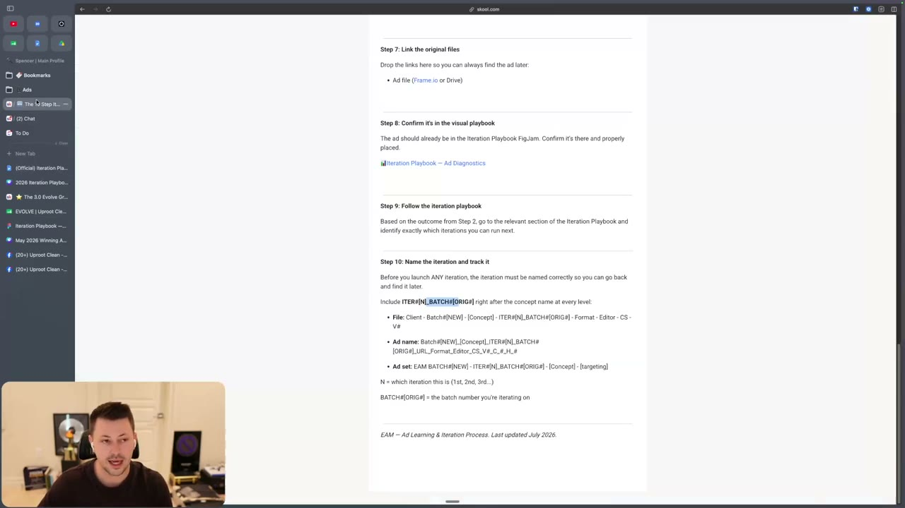

# Ten-step iteration learnings
> Before you make any iteration, run Spencer Pawliw's fixed ten steps: find the batch, label the outcome with spend numbers, tag the ad type, copy every hook verbatim, audit the nine components against the plan, write a hypothesis, link the files, place the ad on the visual board, pick iterations from the playbook for that outcome, and name every iteration `ITER#[N]_BATCH#[ORIG#]` so you can count them.

## 🤖 Agent use
- **Use when:** an ad has run long enough to be judged and someone asks "what do we make next?"; when setting up ad naming and a learnings log an agent can query later; when running (or imitating) the course's `/ad-iteration` Claude Code skill.
- **Inputs → outputs:** the ad in Ads Manager (screenshots per hook variation), ad spend and campaign spend over the same window, account KPI, the tracker row for its batch → a `learning_record` (template below) + a named iteration list ready to brief.
- **Rules:**
  - **DO** run steps 1–8 before step 9: "We have eight steps before we even get to step nine, which is actually doing the iterations ... that is what will make your iterations work." [L46 18:54–19:46](../lessons/46-the-10-step-iteration-process.md)
  - **DO** wait **7 days** and an outcome label before learnings; **IF** an ad "starts ripping and it starts scaling the entire account" within 2–3 days **THEN** start early. [L46 02:05–03:31](../lessons/46-the-10-step-iteration-process.md)
  - **DO** have a clear process for identifying the outcome first: "the most crucial thing ... when it comes to iteration". [L45 00:00–00:57](../lessons/45-overview-of-iteration-section.md)
  - **DO** name ads with at least the batch number: "the only bare minimum ... you need to at least have the batch number." [L46 01:14–02:05](../lessons/46-the-10-step-iteration-process.md)
  - **DON'T** iterate without learnings: "If you didn't do learnings, don't do another iteration. It doesn't make sense." [L48 04:59](../lessons/48-how-to-iterate-on-losing-ads.md) And "if you're just doing empty iterations, you're just hoping for the best." [L46 13:34](../lessons/46-the-10-step-iteration-process.md)
  - **DON'T** call your diagnosis a fact; keep it labelled as a hypothesis until an iteration built on it "pops". [L46 14:17–15:40](../lessons/46-the-10-step-iteration-process.md)
  - **IF** 30 iterations pass on a concept without another winner **THEN** "I would start to be very concerned that the iterations that you're doing are not in depth and they're not with intent". [L46 19:46](../lessons/46-the-10-step-iteration-process.md)
  - **DO** keep client data out of shared prompts/skills (the demo skill was rebuilt because the original surfaced NDA data). [L47 00:00](../lessons/47-claude-code-10-step-iteration-process.md)
- **See also:** [Nine-component audit](nine-component-audit.md) · [Iteration issue codes](iteration-issue-codes.md) · [Iteration playbook](iteration-playbook.md) · [Iterate on test results (playbook)](../playbooks/iterate-on-test-results.md) · [Iteration outcomes](../concepts/iteration-outcomes.md) · Tether: [test and iterate](../../../../playbooks/test-and-iterate.md), [creative testing system](../../../../frameworks/creative-testing-system.md)

## Outcome labels (step 2)
| Outcome | Hits KPI? | Pulls majority of spend? | Instructor's words | Next |
|---|---|---|---|---|
| Loser | No | No | "ads that don't hit your KPI and don't pull a majority of spend" [L45 01:29](../lessons/45-overview-of-iteration-section.md) | [L48](../lessons/48-how-to-iterate-on-losing-ads.md) |
| KPI winner | Yes | No | "hit your KPI, but they're just not pulling majority of spend" [L45 01:29] | [L49](../lessons/49-how-to-iterate-on-kpi-winners.md) |
| Spend winner | No | Yes | majority spend "but ... not hitting your KPI and ... not allowing you to scale your account" [L45 01:29] | [L50](../lessons/50-how-to-iterate-on-spend-winners.md) |
| Breakthrough | Usually ("most of the time they usually do") | Yes | "allow you to scale and increase your ad spend" [L45 02:24] | [L51](../lessons/51-how-to-iterate-on-breakthroughs.md) |

- "Majority of spend" depends on account size: a KPI winner is "not pulling anywhere from 10 to, for some smaller accounts, 60, 70% of spend". The exact percentages live on a Skool definitions page that is not in the course files; definitions for the 100–500K/month range were unfinished at recording [L45 00:57–02:24](../lessons/45-overview-of-iteration-section.md). **Agent default (derived):** state the threshold you assumed in the record.
- In the Growth Guide hit rate, only Breakthrough and Spend Winner count as hits; KPI Winner counts as a miss [L22 Ad Roadmap P2/Q2](../lessons/22-how-to-finalize-your-ad-ideas.md).
- Spencer judges by scale, not purchases: an image ad with "some purchases" but under 10% of spend was logged as a Losing Ad ("all I care about ... is an ad that scales") [L70 00:53–01:47](../lessons/70-how-to-write-video-ads-part-1.md).

## The ten steps
| # | Step | Do exactly this | Output | Source |
|---|---|---|---|---|
| 1 | Identify the batch number | Pull up the batch; find the ad in Meta | `batch` | [L46 01:14–02:05](../lessons/46-the-10-step-iteration-process.md) |
| 2 | Identify the outcome | Label Breakthrough / Spend Winner / KPI Winner / Loser; copy ad-set spend and campaign spend for the same period | `outcome`, `ad_spend`, `campaign_spend` | [L46 02:05–04:14](../lessons/46-the-10-step-iteration-process.md) |
| 3 | Identify the ad type | Ideation (idea from research), Imitation (format or angle from another brand's ad), Iteration (from one of your own ads). It is about where the *idea* came from | `ad_type` | [L46 04:14–06:33](../lessons/46-the-10-step-iteration-process.md) |
| 4 | Identify hooks verbatim | Every hook "exactly as it appears in the ad. So don't just summarize it"; list text-on-screen and voiceover hooks separately; add hook rate and hold rate only if spend is significant (page: $1k after 7 days) | `hooks[]`, rates | [L46 06:33–08:00](../lessons/46-the-10-step-iteration-process.md) |
| 5 | Verify components against the Growth Guide | Run the [nine-component audit](nine-component-audit.md) planned vs executed | component card | [L46 08:00–12:49](../lessons/46-the-10-step-iteration-process.md) |
| 6 | Write hypothesis + iteration ideas | Why did it perform as it did; what worked or not; "Consider what is working in your other ads / winning ads in general to avoid making false learnings." "Be specific." | `hypothesis`, `ideas[]` | [L46 12:49–16:23](../lessons/46-the-10-step-iteration-process.md) |
| 7 | Link the original files | Ad file (Frame.io or Drive); link-to-ad column in the tracker | links | [L46 16:23](../lessons/46-the-10-step-iteration-process.md) |
| 8 | Confirm it's in the visual playbook | Place the ad on the FigJam "Iteration Playbook - Ad Diagnostics" board (learnings, iterations, components, hook variations with valence/intensity; breakthroughs beside losers) | board card | [L46 16:23–17:59](../lessons/46-the-10-step-iteration-process.md) |
| 9 | Follow the iteration playbook | Open the section for the outcome and pick iterations | iteration list | [L46 17:59–18:54](../lessons/46-the-10-step-iteration-process.md); [iteration playbook](iteration-playbook.md) |
| 10 | Name the iteration and track it | Put `ITER#[N]_BATCH#[ORIG#]` after the concept name at file, ad and ad-set level; keep the count | named ads | [L46 18:54–21:22](../lessons/46-the-10-step-iteration-process.md) |

### Why step 3 matters (ad type changes the decision)
| Ad type | Loser | KPI winner | Spend winner | Breakthrough |
|---|---|---|---|---|
| Ideation | Retry "2-3 more times", only with new evidence each time [L48 02:18–03:11](../lessons/48-how-to-iterate-on-losing-ads.md) | Offer-specific and doing its job: done; otherwise 2–3 more tries with evidence [L49 03:06](../lessons/49-how-to-iterate-on-kpi-winners.md) | "We always try that idea three to five more times", with a direction for a better execution [L50 05:23](../lessons/50-how-to-iterate-on-spend-winners.md) | Always iterate [L51 11:22](../lessons/51-how-to-iterate-on-breakthroughs.md) |
| Iteration | Compare with the winning original; "you made the ad worse, or you didn't make it different enough for Meta to really care" [L48 03:11–04:00](../lessons/48-how-to-iterate-on-losing-ads.md) | Same as losers [L49 03:06](../lessons/49-how-to-iterate-on-kpi-winners.md) | Diagnose why it stayed a spend winner (hook? belief? urgency?) [L50 05:23](../lessons/50-how-to-iterate-on-spend-winners.md) | Always iterate |
| Imitation | Usually move on ("especially if it's a visual thing"); a habit, not a ban [L48 04:00–04:59](../lessons/48-how-to-iterate-on-losing-ads.md) | "We rarely do iterations on KPI winning imitation ads" [L49 03:06](../lessons/49-how-to-iterate-on-kpi-winners.md) | 2–3 more executions (page; video "a few") [L50 05:23](../lessons/50-how-to-iterate-on-spend-winners.md) | Always iterate |

## Naming format (verbatim, L46 page)
```text
Include ITER#[N]_BATCH#[ORIG#] right after the concept name at every level:

File: Client - Batch#[NEW] - [Concept] - ITER#[N]_BATCH#[ORIG#] - Format - Editor - CS - V#
Ad name: Batch#[NEW]_[Concept]_ITER#[N]_BATCH#[ORIG#]_URL_Format_Editor_CS_V#_C_#_H_#
Ad set: EAM BATCH#[NEW] - ITER#[N]_BATCH#[ORIG#] - [Concept] - [targeting]

N = which iteration this is (1st, 2nd, 3rd...)
BATCH#[ORIG#] = the batch number you're iterating on
```
Why: "If I said, how many times have you iterated on this ad? You'd be like, we've iterated a ton. I'd be like, how many? And you wouldn't be able to answer." In the anecdote the team had iterated "twice" in a month after a breakthrough, and one of the two was another breakthrough [L46 18:54–21:22](../lessons/46-the-10-step-iteration-process.md). The meaning of the tokens `CS`, `C_#`, `H_#`, `EAM` is not defined in the course files.


*The naming patterns with the highlighted ITER#[N]_BATCH#[ORIG#] token. [L46 20:16]*

## Agent version: the `/ad-iteration` skill flow (L47 demo)
The skill files are not in the course files; this is the order shown on screen [L47 01:32–11:46](../lessons/47-claude-code-10-step-iteration-process.md).
1. Check MCP connections (Figma, Google Drive / Sheets). The tracker can also live in ClickUp or Notion via MCP.
2. Create folders: `screenshots/<brand>/`, `added/` (archive), `patterns/` (learnings log, e.g. `patterns/all-batches.md`).
3. Connect the FigJam board and the tracker sheet.
4. Remind: learnings before iterations. Ask for screenshots: full-page Facebook preview, page name visible, one file per hook variation, named by batch and variation (`59_v2` = batch 59 hook 2; the skill's own convention `1a.png, 1b.png`).
5. Read the hooks from the screenshots; ask "were there any other hooks on screen?"; the human adds voiceover hooks verbatim.
6. Ask outcome, ad spend, campaign spend (demo: "$500" ad, "$25,000" campaign).
7. Pull the batch row from the tracker **before** asking anything; resolve outcome mismatches (sheet said Breakthrough, session said Loser).
8. Nine-question interview, "planned vs hypothesis" per component. For losers the human may skip to a brain dump [L47 08:14](../lessons/47-claude-code-10-step-iteration-process.md).
9. Brain dump → the agent condenses it into a hypothesis → human approves.
10. Write back to the tracker (demo: `'Ad Roadmap'!Q5`) and append to `patterns/`.
11. For winners, propose iterations from the DOCX playbook; the demo skipped iterations on the loser, but "You're not going to always skip iterations just because it's a loser." [L47 09:07](../lessons/47-claude-code-10-step-iteration-process.md)
12. Ask for the video link; build the FigJam card in the outcome's section; move screenshots to `added/`.

Skill message quoted on screen: "Every batch builds evidence. After 10-15 batches, patterns show up in the COMPARE column, and iterations stop being guesses and start being directional bets." [L47 04:05](../lessons/47-claude-code-10-step-iteration-process.md)


*The demo skill's screenshot instructions, file-naming rule and detected hooks Var A/B/C. [L47 04:05]*

## Output template: learning record
```yaml
learning_record:
  batch: "BATCH#<n>"
  ad_name: "<Batch#..._ITER#..._...>"
  window: {start: YYYY-MM-DD, days_live: <n>}          # >= 7, or 2-3 if clearly scaling the account
  outcome: loser | kpi_winner | spend_winner | breakthrough
  spend: {ad: <$>, campaign_same_window: <$>, share: "<%>", majority_threshold_assumed: "<%>"}
  kpi: {target: "<ROAS/CPA>", actual: "<value>"}
  ad_type: ideation | imitation | iteration
  source_ad: "<link if imitation/iteration>"
  hooks_verbatim:
    - {variation: "v1", on_screen: "<...>", voiceover: "<...>", hook_rate: <% or null>, hold_rate: <% or null>}
  rates_trusted: <true if spend >= $1k after 7 days>
  component_audit: "<link to nine-component card>"
  hypothesis: "<I think...>"            # not a fact
  iteration_ideas: ["<specific>", "<specific>", "<specific>"]
  links: {ad_file: "<Frame.io/Drive>", live_ad: "<url>", board_card: "<FigJam>"}
  playbook_section: losers | kpi_winners | spend_winners | breakthroughs
  iterations_planned:
    - {name: "ITER#1_BATCH#<orig>", type: "<iteration name>", change: "<component changed>"}
  iteration_count_on_concept: <n>
```

## Where it's taught
| Lesson | Content | Time |
|---|---|---|
| [45. Overview of iteration](../lessons/45-overview-of-iteration-section.md) | Four outcomes, spend-share range | [00:00–02:24] |
| [46. The 10 step process](../lessons/46-the-10-step-iteration-process.md) | All ten steps, naming, thresholds | [00:00–21:39] |
| [47. Claude Code version](../lessons/47-claude-code-10-step-iteration-process.md) | Skill flow, screenshots, write-back | [00:00–12:46] |
| [48](../lessons/48-how-to-iterate-on-losing-ads.md)–[51](../lessons/51-how-to-iterate-on-breakthroughs.md) | Ad-type rules per outcome | see table |
| [22. Finalize ad ideas](../lessons/22-how-to-finalize-your-ad-ideas.md) | The tracker the learnings write into | workbook |

## Cross-course notes
- **Agreement (Tether Lab):** label before you launch and keep a tracking sheet ("Label before launch so no retro analysis is needed") in [test and iterate](../../../../playbooks/test-and-iterate.md); "why did it win" hypothesis threads in the [creative testing system](../../../../frameworks/creative-testing-system.md) match Evolve's hypothesis-not-fact rule.
- **Difference:** Tether reads results by self, zone and TEEP stage and changes one variable at a time; Evolve reads by outcome class (loser / KPI winner / spend winner / breakthrough) and ad type, then chooses from outcome-specific iteration lists. Use Evolve's label to pick *what kind* of iteration, Tether's lenses to pick *which emotional variable*.
- **Difference:** Tether's naming pattern is `<STAGE>_<EMOTION>_<angle>_<format>_<variant>_v<n>`; Evolve's is batch- and iteration-count-based. Both can coexist (derived): keep Evolve's `ITER#N_BATCH#ORIG#` token inside the Tether name so iteration counts stay queryable.

## Related
[Nine-component audit](nine-component-audit.md) · [Iteration issue codes](iteration-issue-codes.md) · [Iteration playbook](iteration-playbook.md) · [Memo and Growth Guide](mini-breakthrough-memo-and-growth-guide.md) · [Iterate on test results](../playbooks/iterate-on-test-results.md)

## Sources and limitations
- Thresholds (7 days, 2–3 days, $1k, 30 iterations) are instructor numbers without supporting data. The definitions page with exact spend-share percentages, the naming-templates module, the FigJam board and the skill's SKILL.md are linked in the course but not included in the course files.
- The YAML record and the "agent default" notes are derived.
