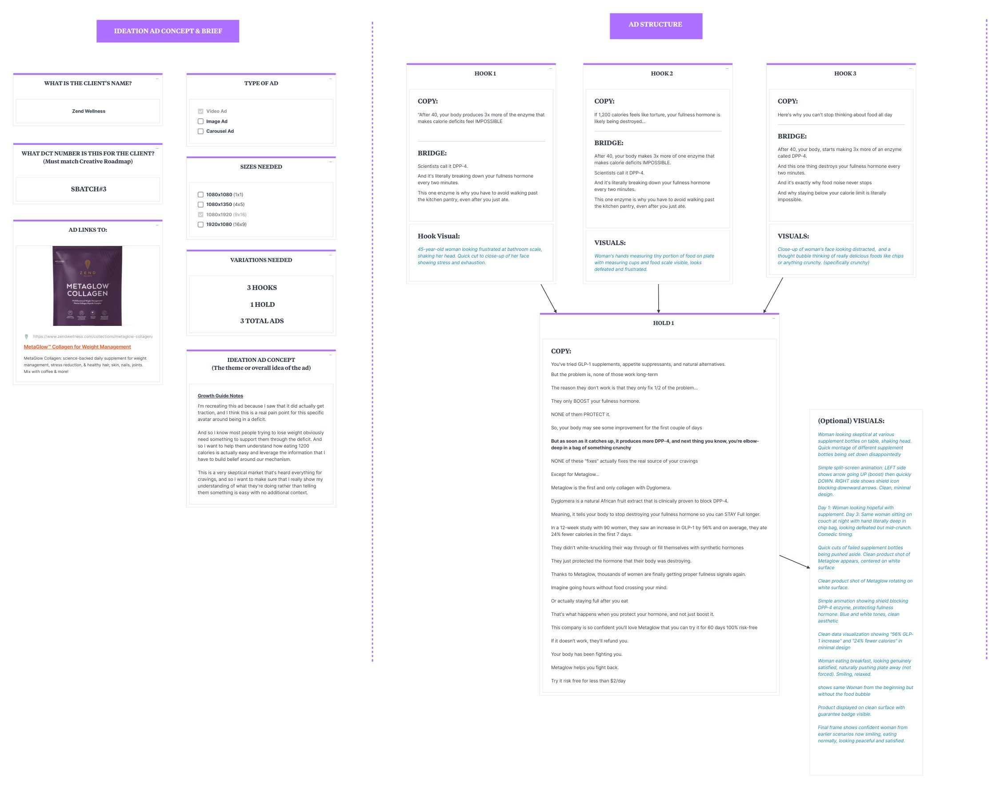

# Video ad script workflow
> Spencer Pawliw's video process: close the feedback loop from the last test, feed the "EVOLVE OPTIMIZED VIDEO AD SCRIPT - FINAL EDITION" prompt four documents, take its modular output (3 hooks, 3 matched bridges, 1 universal hold, 1 universal CTA, 30–45 s, B-roll + AI voiceover), then spend most of the effort editing it line by line with customer language and verified facts, and lay it out as hook cards feeding one hold card. A "(derived)" section adapts it for on-camera UGC creators.

## 🤖 Agent use
- **Use when:** writing a short paid-social video script for one angle (Problem-Aware or Product-Aware cold traffic), editing an AI-drafted script, or assembling the editor/creator brief.
- **Inputs → outputs:** last test's learnings + hypothesis + Product, New Mechanism, New Information and Customer Data documents + angle/avatar + true social-proof volume → `video_script` (3 hook/bridge pairs, 1 hold, 1 CTA, visual per line, strategic explanation) → card brief.
- **Rules:**
  - **DO** answer the five feedback questions before any script is written; "What we're doing here is we're trying to complete the feedback loop." [L70 06:31–09:27](../lessons/70-how-to-write-video-ads-part-1.md)
  - **DO** supply all four documents; if you have no reviews say so and tell the model to use only what you gave it. [L70 09:27–12:01](../lessons/70-how-to-write-video-ads-part-1.md)
  - **DON'T** let the model assume proof volume: it asked "I have 12,000 women in memory. Is that accurate?"; Spencer answered "a thousand to ten thousand" → "thousands of women". "If you don't have the ability to say thousands of women using this ... then it's probably not a good thing to say." [L70 12:01–12:44](../lessons/70-how-to-write-video-ads-part-1.md)
  - **DO** test hook + bridge together; keep hold and CTA identical across the three ads. [L70 15:59–16:39](../lessons/70-how-to-write-video-ads-part-1.md); prompt "Modular Output Check - NON-NEGOTIABLE" [L72](../lessons/72-action-item-write-your-video-ad-briefs.md)
  - **DON'T** ship the first output: "Claude is again going to get you 70, 80% of the way there. You need to ... get it to a hundred percent." [L70 24:58](../lessons/70-how-to-write-video-ads-part-1.md)
  - **DON'T** trust AI facts or terms: it called DPP-4 a hormone; "you guys can't blindly trust AI ... it's not always right." [L71 03:40](../lessons/71-how-to-write-video-ads-part-2.md)
  - **DO** replace every generic line with a specific one from research ("kitchen pantry", "something crunchy", "feels like torture"). [L71 06:18–06:50; 17:32; 19:33](../lessons/71-how-to-write-video-ads-part-2.md)
  - **DO** write one excellent brief a day rather than five ("one brief, I would say even per day, especially if they're videos"). [L71 14:43](../lessons/71-how-to-write-video-ads-part-2.md)
  - **DO** add visuals last, after the copy is locked. [L70 22:12](../lessons/70-how-to-write-video-ads-part-1.md); [L71 25:12](../lessons/71-how-to-write-video-ads-part-2.md)
- **See also:** [Write a video ad script (playbook)](../playbooks/write-a-video-ad-script.md) · [Static ad workflow](static-ad-workflow.md#product-truth-qa) (product-truth QA) · [Copy checklist scorecard](../rubrics/copy-checklist-scorecard.md) · concepts: [hooks](../concepts/hooks.md), [bridges](../concepts/bridges.md), [objection handling](../concepts/objection-handling.md), [value words / Big 4](../concepts/value-words-big-4.md), [show don't tell](../concepts/show-dont-tell.md) · Tether: [UGC script writing](../../../../playbooks/ugc-script-writing.md), [creator brief](../../../../playbooks/creator-brief.md)

## The process (lessons 70–72)
| # | Step | Detail | Source |
|---|---|---|---|
| 1 | Pull last test's learnings | Spend share, hook that got spend, which metrics were off, why people did or did not care; label (Spencer logged his under-10%-spend image ad as Losing) | [L70 00:53–04:07](../lessons/70-how-to-write-video-ads-part-1.md) |
| 2 | Write the hypothesis | Same desire; what changes; what to show instead of tell ("a better version of this ad that explains more, aka video") | [L70 03:09–05:38] |
| 3 | Open the prompt | Fresh chat or a Claude project; the prompt text is verbatim in [L72](../lessons/72-action-item-write-your-video-ad-briefs.md#the-prompt-verbatim) | [L70 05:38] |
| 4 | Answer the 5 feedback questions | Verbatim below; "N/A" where untested | [L70 06:31–09:27] |
| 5 | Supply inputs | Angle + avatar, hypothesis, New Mechanism doc, New Information doc, Product doc, Customer data (or "none") | [L70 09:27–12:01] |
| 6 | Confirm social proof tier | Real volume or fallbacks (clinical data, or skip volume) | [L70 12:01–12:44] |
| 7 | Receive modular output | 3 hooks, 3 bridges, 1 hold, 1 CTA, visuals, strategic explanation; check the Modular Output Check | [L70 12:44–20:20] |
| 8 | Lay out as cards | Google Doc layout, or Milanote/FigJam cards: hook + bridge cards feeding one hold card | [L70 20:20–23:07] |
| 9 | Edit line by line | Customer language, facts, terminology, categorization, readability; rerun through the prompt | [L71 00:00–25:12](../lessons/71-how-to-write-video-ads-part-2.md) |
| 10 | Visuals last | "I need you to now give me the visuals" for the final copy | [L71 25:12] |
| 11 | Log spin-offs | New concepts found while editing ("3 signs your body's working against your diet"; "protect your hormones") | [L71 25:52–27:33] |

### The five feedback questions (verbatim from the prompt)
```text
1. Have you tested any video ad scripts for this angle before?
   - If yes, please paste in the specific scripts and clarify if it was a winner (got spend and hit KPI) or a loser (didn't get spend, or didn't hit KPI)
   - If no, just write "N/A"
2. Which scripts performed BEST? Which performed WORST?
   - Out of the hooks tested, which one got the ad spend? (paste all 3 and clarify which one got the spend)
   - If no, just write "N/A"
3. Were there any metrics that were off that you think need to be improved?
   - If it did not get any spend, just say "did not get significant spend"
   - If it did get spend, you can say things like: CTR was low (less than 1%), hook rate was low (less than 25%), hold rate was low (less than 5%), Conversion Rate was low (didn't get any conversions)
4. What are the main reasons you think people DID or DID NOT care about this ad?
5. Do you have any new learnings in general that you can share with me before writing this new ad?
```
Prompt's use of the answers: low CTR/hook rate → stronger contrarian hooks and visuals; low hold rate → simplify mechanism, tighten slippery slope, better B-roll pacing; low conversion → strengthen offer or trust [L70 docx](../lessons/70-how-to-write-video-ads-part-1.md).

## Structure and timing (prompt)
| Section | Time | Job | Key rules |
|---|---|---|---|
| Hook | 0–3 s | Stop the scroll in 1–2 s with 2–3 of the Big 4 through subtext | ~5 words (3–7), max 2 lines; one of two frameworks ("biggest thing happening now" or "quirky/counter-intuitive"); don't explain |
| Bridge | 3–8 s | Intensify the desire; start Objection → Claim; keep the slippery slope | exact customer frustration language; end on an open loop |
| Hold | 8–35 s | ONE Objection → Claim → Proof → Benefit cycle with ONE mechanism | Objection 8–11 · Claim 11–16 · Proof 16–25 · Benefit 25–32 · optional secondary 32–35 |
| CTA | 35–45 s | Keep momentum; close the loop to the hook | value-framed price, risk reversal with a pattern interrupt, real urgency (not fake scarcity) |
Total 30–45 s, hard cap 45. Problem-Aware 40–45 s (education before solution); Product-Aware 30–40 s (differentiation over education). No unaware hooks, no most-aware retargeting scripts [L72 rule digest](../lessons/72-action-item-write-your-video-ad-briefs.md).

**Why three bridges:** "we are actually kind of extending each hook to almost eight seconds ... to try to add more congruence into our ads and in essentially allowing meta to see that they are more different ... we're testing kind of like three different hooks and bridges." [L70 15:59–16:39](../lessons/70-how-to-write-video-ads-part-1.md) Bridge lesson: "We're definitely not just writing a hook and then having everything go to the same bridge." [L27 23:06–23:52](../lessons/27-how-to-write-a-bridge.md)

### Emotional levers the prompt checks
| Lever | Rule | Source |
|---|---|---|
| Big 4 (NEW/ONLY, EASY/ANYBODY, SAFE/PREDICTABLE, BIG/FAST) | Hit 2–3 per major section; "forcing all four can create clunky, listy copy" | [L72](../lessons/72-action-item-write-your-video-ad-briefs.md); value-word table [L62](../lessons/62-value-words.md) |
| Four U's per hook | UNIQUE (almost always), USEFUL, URGENT, ULTRA-SPECIFIC; hit at least 3 | [L72] |
| Hook trio | (1) discovery from the New Mechanism doc, (2) contrarian / "what they're not telling you" from the New Information doc, (3) pain-point validation from the Customer Data doc | [L72] |
| Categorization | "Never categorize your product. Ever." No "like Ozempic but natural", "best massage gun"; use "The first/only [thing] that [mechanism]" | [L72 Core Rule 2] |
| Show don't tell | Behaviour, not benefit lists; visuals of outcomes, not "animated enzymes" | [L72 Core Rule 3]; [L70 05:38](../lessons/70-how-to-write-video-ads-part-1.md) |
| Slippery slope | Every line creates curiosity for the next; no stopping points before the CTA | [L72 Core Rule 4] |
| Spoken language | 5th–7th grade, contractions, would someone say it | [L72 Core Rule 10]; [L12 01:35–02:38](../lessons/12-why-you-need-to-speak-copy-not-write-it.md) |

### Social proof tiers (prompt)
| If you really have | You may say |
|---|---|
| 10,000+ customers | "Over 10,000 five-star reviews"; "12,000 women trust this" |
| 1,000–10,000 | "Thousands of five-star reviews"; "Trusted by thousands" |
| 100–1,000 | "Hundreds of five-star reviews"; percentages ("94% would recommend") |
| 10–100 reviews | "Rated 4.8/5 stars"; percentages over volume |
| <10 / white-label | Borrowed proof from the real brand only if true and referencable, clinical/study data, "Women report..." patterns, or skip volume claims |
Not allowed: claiming your own 10,000 reviews, inventing customer names or stories, attributing made-up stats to your brand [L72 Borrowed Proof Protocol](../lessons/72-action-item-write-your-video-ad-briefs.md).

### Visual instruction format (prompt)
`VISUAL: [Source] - [Avatar demographic] [specific action/emotion], [context/setting]. Text overlay: "[Hook text]"`. Sources: Gridbank (primary), Storyblocks, Pexels; fal.ai for abstract or "impossible to film" visuals. Pacing: hook = fast cut or one dramatic shot; bridge = 2–3 quick problem cuts; hold = product, mechanism, solution scenes; CTA = clean product shot, price, guarantee badge [L72 Visual Execution System](../lessons/72-action-item-write-your-video-ad-briefs.md).

## The editing pass (lesson 71)
| # | Edit | Example | Source |
|---|---|---|---|
| 1 | Remove distractions; dedicated writing spot | "it requires 100% absolute focus" | [L71 00:00–01:24](../lessons/71-how-to-write-video-ads-part-2.md) |
| 2 | Make one hook slightly lower valence (a self-check: "is something wrong with me?") | "If 1,200 calories feels like torture, your fullness hormone is likely being destroyed..." | [L71 01:24–04:13] |
| 3 | Fix AI facts and terms | "you're missing this hormone" (wrong: DPP-4 is an enzyme) → "your appetite hormone is being destroyed" | [L71 02:51–04:13] |
| 4 | Pull specifics from Reddit / master doc | "the kitchen" → "the kitchen pantry"; "you're back to cravings" → "elbow-deep in a bag of something crunchy" | [L71 06:18–06:50; 19:33–23:47] |
| 5 | Rewrite the hold around the unique mechanism | "they only fix 1/2 of the problem... They only BOOST your fullness hormone. NONE of them PROTECT it." | [L71 08:47–10:17] |
| 6 | Make the objection specific | "I know what you're thinking. You've tried supplements before. They didn't work." ("a terrible line") → "You've tried GLP-1 supplements, appetite suppressants, and natural alternatives." | [L70 23:07–24:04](../lessons/70-how-to-write-video-ads-part-1.md); [L71 18:08–19:33] |
| 7 | Use the customer's word, keep the clinical word for credibility | "I'm full hormone" → "fullness hormone"; "GLP-1" for credibility | [L71 21:28–22:13] |
| 8 | Match voice to format | AI voiceover is third person: "My doctor told me it's called DPP4" → "Scientists call it DPP-4" | [L71 16:01] |
| 9 | Verify claims on the product page | dropped "rare"; corrected 58%/68% → 56%, 25% → 24% | [L71 21:28; 25:12] |
| 10 | Rerun through the prompt | "here's the script that I wrote, let me know where it has issues based off of the prompt"; "does this categorize us?" | [L71 08:47; 18:08] |
| 11 | Readability | Hemingway grade 7 on the mechanism line; kept "clinically" ("sometimes you bend it") | [L71 23:47–24:24] |

## The final script, annotated (L71 "Final Script Written By Spencer", verbatim lines)
| Part | Final line(s) | What it does |
|---|---|---|
| Hook 1 | "After 40, your body produces 3x more of the enzyme that makes calorie deficits feel IMPOSSIBLE" | New information + age + number; implied 40+ demographic from account data ("I'm not going to lie to people and say well this happens when you're 30") [L71 04:13–07:13] |
| Bridge 1 | "Scientists call it DPP-4. And it's literally breaking down your fullness hormone every two minutes. This one enzyme is why you have to avoid walking past the kitchen pantry, even after you just ate." | Names the villain; shows the pain as a behaviour |
| Hook 2 | "If 1,200 calories feels like torture, your fullness hormone is likely being destroyed..." | Lower valence, customer word "torture" |
| Bridge 2 | Hook 1's line + Bridge 1 | In media res: "straight to the point" [L71 07:13–08:10] |
| Hook 3 | "Here's why you can't stop thinking about food all day" | Educational, Problem-Aware |
| Bridge 3 | "After 40, your body, starts making 3x more of an enzyme called DPP-4. And this one thing destroys your fullness hormone every two minutes. And it's exactly why food noise never stops And why staying below your calorie limit is literally impossible." | Same villain, different framing |
| Hold: objection | "You've tried GLP-1 supplements, appetite suppressants, and natural alternatives. But the problem is, none of those work long-term" | Specific past attempts; slight categorization accepted "for building more trust" [L71 14:43; 18:46] |
| Hold: reason-why | "The reason they don't work is that they only fix 1/2 of the problem... They only BOOST your fullness hormone. NONE of them PROTECT it. ... next thing you know, you're elbow-deep in a bag of something crunchy. NONE of these 'fixes' actually fixes the real source of your cravings" | Mechanism gap + comedic, specific relapse |
| Hold: claim | "Except for Metaglow... Metaglow is the first and only collagen with Dyglomera. Dyglomera is a natural African fruit extract that is clinically proven to block DPP-4. Meaning, it tells your body to stop destroying your fullness hormone so you can STAY Full longer." | New-mechanism claim + reason |
| Hold: proof | "In a 12-week study with 90 women, they saw an increase in GLP-1 by 56% and on average, they ate 24% fewer calories in the first 7 days. ... Thanks to Metaglow, thousands of women are finally getting proper fullness signals again." | Study numbers (corrected), tiered social proof |
| Hold: benefit | "Imagine going hours without food crossing your mind. Or actually staying full after you eat. That's what happens when you protect your hormone, and not just boost it." | Behaviour, ties back to protect-vs-boost |
| CTA | "This company is so confident you'll love Metaglow that you can try it for 60 days 100% risk-free. If it doesn't work, they'll refund you. Your body has been fighting you. Metaglow helps you fight back. Try it risk free for less than $2/day" | Third-person "reporter" voice, risk reversal, loop closure, per-day price |


*The finished brief: fields on the left, three hook cards (copy, bridge, visual) feeding one hold card, optional visuals on the right. [L71 PDF p.1]*

## Brief card fields (verbatim from the PDF)
`WHAT IS THE CLIENT'S NAME?` · `WHAT DCT NUMBER IS THIS FOR THE CLIENT? (Must match Creative Roadmap)` · `TYPE OF AD` (Video / Image / Carousel) · `SIZES NEEDED` (1080x1080, 1080x1350, 1080x1920, 1920x1080) · `AD LINKS TO:` · `VARIATIONS NEEDED` ("3 HOOKS / 1 HOLD / 3 TOTAL ADS") · `IDEATION AD CONCEPT (The theme or overall idea of the ad)` + Growth Guide Notes · `HOOK 1–3` (COPY / BRIDGE / VISUALS) · `HOLD 1` (COPY) · `(Optional) VISUALS`. Blank fill-in version with field instructions: [L72](../lessons/72-action-item-write-your-video-ad-briefs.md#brief-card-set-fill-in-template). "DCT" and the "Creative Roadmap" are not defined in the course files. Why cards: "for hooks it's an absolute non-negotiable" to write in the environment [L05 04:42](../lessons/05-why-you-need-to-write-in-the-environment.md).

## (Derived) Adapting this to on-camera UGC creators
The prompt fixes "B-roll compilation + AI voiceover... No talking heads... No direct-to-camera" and tells visuals not to request "filming yourself or others" [L72](../lessons/72-action-item-write-your-video-ad-briefs.md). For our creator-led UGC, keep the copy system and replace the execution model:

| Keep (course) | Change for on-camera UGC (derived) |
|---|---|
| 3 hook/bridge pairs, 1 hold, 1 CTA; hold and CTA identical | Same; film the hold once and the three hook/bridge openings separately, so cuts are cheap |
| Hook 0–3 s, bridge to ~8 s | Same timing, but the first frame must carry the hook as on-screen text too (sound-off viewing) |
| Third-person authority ("Scientists call it DPP-4") | First person only if it is true for this creator ("I forgot to brush my dog's teeth for 4 years" style lines need a creator for whom it is true); otherwise keep "scientists/experts call it" |
| Visual source Gridbank / fal.ai | Shot list for the creator: setting, prop, action, expression per line; B-roll only for mechanism or impossible-to-film moments |
| "Show behaviour" | Have the creator do the behaviour on camera (walk past the pantry, pour, demo) |
| Spoken 5th–7th grade | Creator says it in their own words, but hook words and every claim/number are locked (see Tether [creator brief](../../../../playbooks/creator-brief.md)) |
| Social proof tiers | Same; the creator may not add numbers, results or "before/after" that are not true for them and the product |
| AI UGC honesty ([L53 08:51–09:37](../lessons/53-the-iteration-playbook-formats-styles.md)) | Real creators only make first-person claims they actually experienced |

## Where it's taught
| Lesson | Content | Time |
|---|---|---|
| [70. Video ads part 1](../lessons/70-how-to-write-video-ads-part-1.md) | Feedback loop, inputs, modular output, card layout, 70–80% rule | [00:00–25:42] |
| [71. Video ads part 2](../lessons/71-how-to-write-video-ads-part-2.md) | Editing pass, final script PDF | [00:00–30:34] |
| [72. Action item](../lessons/72-action-item-write-your-video-ad-briefs.md) | Full prompt verbatim, card template, rule digest | page |
| [27. Bridge](../lessons/27-how-to-write-a-bridge.md) | Six bridge patterns; per-hook bridges | [02:15–04:39; 23:06] |
| [28. Objections](../lessons/28-how-to-prevent-handle-objections-in-writing.md) | Objection buckets and techniques for the hold | throughout |

## Cross-course notes
- **Tether Lab** ([UGC script writing](../../../../playbooks/ugc-script-writing.md)) packages **3 hooks × 2 bodies** and spends **~2/3 of the runtime on setup** before the product; Evolve packages **3 hook/bridge pairs × 1 hold** and introduces the claim around 11–16 s of a 30–45 s ad. Both are in the contradiction log; the [video playbook](../playbooks/write-a-video-ad-script.md) gives the agent default.
- **Agreement:** both forbid fabricated proof and both put the core message in the first seconds; Tether's realism beat ("cautiously at first") pairs with Evolve's vulnerability lines ("may still be able to help", [L54 03:53–04:46](../lessons/54-iteration-examples-breakdowns-walkthrough.md)).
- **Different construct, not a conflict:** Evolve's "Big 4" are value words (new, easy, safe, big); Tether's "one core emotion per ad" is about the emotional zone. You can hit 2–3 value words while keeping one core emotion.

## Related
[Write a video ad script](../playbooks/write-a-video-ad-script.md) · [Static ad workflow](static-ad-workflow.md) · [Memo and Growth Guide](mini-breakthrough-memo-and-growth-guide.md) · [Iteration playbook](iteration-playbook.md) · [Prompts library](../libraries/prompts.md) · [Open loops](../concepts/open-loops.md) · [Compression and plain language](../concepts/compression-and-plain-language.md)

## Sources and limitations
- The prompt's attributions (Hopkins, Caples, Schwartz) and claims ("5-10X" headline differences) are its own assertions. The Metaglow/Dyglomera figures are the client's claims. The final script was not shown with results ("I'm very confident in the script", [L71 30:11]).
- Tensions inside the course are logged: the prompt's ~5-word hook and "never categorize" vs Spencer's 13–17-word hooks and "first and only collagen"; lesson 27's "3-2-2" test structure vs lessons 70–72's 3 hooks / 1 hold.
- The UGC adaptation table is derived and labelled as such.
