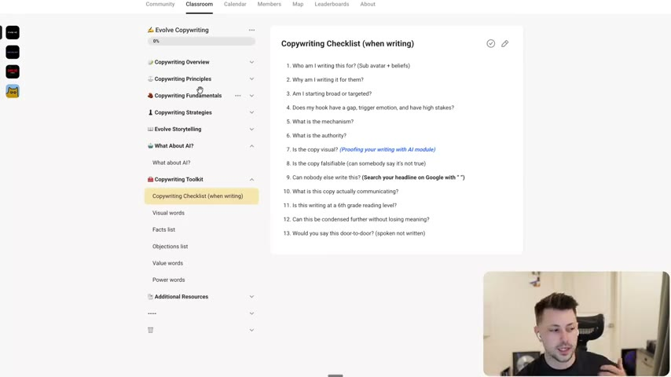

# 01. Overview Of Copywriting Program
> A guided tour of the whole Evolve copywriting course (sections, toolkit, checklist, resources) and the 13-question checklist the instructor wants every script run through before it ships.

## 🤖 Agent use
- **Use when:** you need the map of this course (which lesson answers which question), or you need a quick self-check list to run over a draft ad script or hook.
- **Inputs → outputs:** a draft script/hook/ad → answers to the 13 checklist questions → a list of missing items to fix. Also: a question about "where does the course teach X" → the right lesson.
- **Rules:**
  - **DO** run every draft through the 13-question "Copywriting Checklist (when writing)" (shown on screen in the video). The instructor's logic: "if I'm missing a lot of these things, it's probably not a good script. If I have a lot of these things, it's probably a pretty good script." [03:37]
  - **DON'T** treat the checklist as pass/fail on every line: "It doesn't have to go through each 13 of these things… it's just to kind of check yourself." [03:37]
  - **DO** make copy concrete: run scripts through the "Visual words" AI prompt to flag abstract verbs, nouns and adjectives. [04:08]
  - **DO** keep running lists while researching: a **fact list** (brand, product, market) and an **objection list**, stored in a Google Doc. [04:08]
  - **DO** use "value words" (new, easy, safe, big) to add perceived value, and "power words" to make copy more dramatic and raise the stakes. [04:39]
  - **IF** you need to know the order in which to learn, **THEN** follow the sections as listed under Key ideas: foundations, principles, fundamentals (awareness), strategies, storytelling, AI, toolkit. [00:32–03:06]
- **See also:** [02. The current state of copywriting](02-the-current-state-of-copywriting.md) · [03. How to guarantee you get better at copywriting](03-how-to-guarantee-you-get-better-at-copywriting.md) · [08. The 3 checks for great copywriting](08-the-3-checks-for-great-copywriting.md) · [Creative testing system](../../../../frameworks/creative-testing-system.md)

Lesson page text (Skool): only one line, "I hope you enjoy (:". All content is in the video.

## Key ideas

### The instructor's framing [00:00–00:32; 05:10–06:11]
- He calls this program the one he is "probably the most proud of out of everything that is inside of Evolve for you guys that actually take action on", because of "how many examples are in here" [00:00].
- He says that as agency owner he is "not writing ads every single day for our clients, but I have jumped back into the saddle" and has "been writing ads basically every day" and has "already started to hit top spenders for our brands" (instructor claim, no data shown). [05:10]
- The next phase will be videos of him writing ads live "towards actually writing winning ads for our brands", because members want to watch him do it, not only be told. No timeline is promised. [05:10–06:11]
- He says he went "off the grid from my team" for the build. (Colour only; not operational.) [05:40]

### Course structure as described [00:32–03:06]
The video walks the Skool sidebar, which at the time of recording read as below. Lesson numbers are this knowledge base's numbering.

| Section (as named in the video) | What he says it covers | Lessons here |
|---|---|---|
| Copywriting Overview (the first section) | Current state of copywriting, how to guarantee you get better, why you need to write in the environment (with "updated strategies" on unlocking the templates), why great copy requires boredom [00:32] | 02-07 |
| Copywriting Principles | "All about concepts", "a lot of theory": checks for great copy, importance of how you say it, facts, less fluff, speaking rather than writing, sixth-grade level, unique mechanisms, beliefs, authority, and "one of the biggest ones is positioning", which he calls "a behemoth" [00:32–01:34] | 08-16 and 55-56 |
| Copywriting Fundamentals | "Being aware" of avatars, angles, mechanisms, authorities, market awareness, "so you guys know what you actually are writing" [01:03–01:34] | 17-21 |
| Copywriting Strategies | How to finalize ideas, breaking down phenomenal ads, great hooks and the types of hooks, then "open loops, which is the most powerful one", bridges, preventing/handling objections, pitching without rejection, raising the stakes, show-don't-tell (two lessons), metaphors/similes/analogies, labels, unaware-ad hooks [01:34–02:36] | 22-35 |
| Evolve Storytelling | Why storytelling is powerful, why you "can't rely on education" ("It's like, oh, I just need to educate people. It's like, no, you don't."), what makes a great story, laws, three enemies, arcs/plots, prompts [02:05–03:06] | 38-44 |
| What about AI? | "I'll leave that as a surprise for you guys." [03:06] | 36-37 |
| Copywriting Toolkit | Checklist, visual words, fact list, objections list, value words, power words [03:06–04:39] | 58-63 |
| Additional Resources | Learning more about copywriting, Harry's website, famous campaigns, "Eugene's Headlines" (the 38 headlines from Breakthrough Advertising) [04:39–05:10] | 64-66 |

(Section-to-lesson mapping in the right-hand column is derived from the course file list; the video only names the sections. The iteration, image-ad and video-ad sections are not mentioned in this overview, which was recorded before they were added.)

### The toolkit metaphor [03:06–03:37]
- "Think of yourself as a plumber. You're not going to go to fix somebody's plumbing without your toolkit." The toolkit is the set of questions and lists you carry into every writing session. [03:06]
- He wants to "condense this even further" to "maybe five, six items". [03:37]

### Toolkit items described in the video [03:37–05:10]
- **Visual words:** "a very quick AI prompt" (credit to Harry) that "will help you guys start to write less abstract and more concrete". Paste a script in and it identifies abstract verbs, nouns and adjectives. [03:37–04:08] The prompt text itself is not in this lesson; see lessons 59 and 37.
- **Fact list:** "no video for this". During research, "identify all the facts around your brand, facts around your product, facts are in your market" and keep them in a Google Doc. [04:08]
- **Objection list:** store any objections in the same Google Doc. [04:08]
- **Value words:** "new, easy, safe, big": words that "create extra value because they're what people want". [04:08–04:39]
- **Power words:** a long list (credit to "Davey", as heard; spelling uncertain) used while editing to ask "where can I potentially make this a little bit more dramatic? How can I raise the stakes?" [04:39]
- **Eugene's Headlines:** the 38 headlines from Breakthrough Advertising (shown on screen at roughly 05:20). [04:39–05:10]

## Steps / framework
The 13-question checklist (verbatim from the on-screen page; see the screenshot). The instructor reads out the first ten or so aloud at [03:06–03:37]: who am I writing this for, why am I writing it for them, am I starting broad or targeted, does my hook have a gap, does it trigger a motion, what is the mechanism, what is the authority, is the copy visual, is it falsifiable, can anybody else say this.

Use as a gate on every draft. Where the course teaches each item (derived mapping):

| # | Question | Taught in |
|---|---|---|
| 1-2 | Who / why for them (sub-avatar + beliefs) | [17](17-being-aware-of-avatars.md), [15](15-why-you-need-to-understand-beliefs.md) |
| 3 | Broad or targeted | [23](23-the-framework-behind-great-hooks.md), [24](24-the-2-types-of-hooks.md) |
| 4 | Gap, trigger emotion, high stakes | [23](23-the-framework-behind-great-hooks.md), [30](30-how-to-raise-the-stakes.md) |
| 5 | Mechanism | [14](14-why-you-need-to-use-unique-mechanisms.md), [19](19-being-aware-of-mechanisms.md) |
| 6 | Authority | [16](16-why-you-need-to-understand-authority.md), [20](20-being-aware-of-authorities.md) |
| 7 | Visual | [31](31-how-to-create-ads-that-show-dont-tell.md), [59](59-visual-words.md) |
| 8 | Falsifiable | [10](10-why-you-need-to-write-facts.md) |
| 9 | Can anybody else write this | [08](08-the-3-checks-for-great-copywriting.md) |
| 10 | What is it communicating | [03](03-how-to-guarantee-you-get-better-at-copywriting.md) |
| 11 | 6th-grade reading level | [13](13-why-you-need-to-write-at-a-6th-grade-level.md) |
| 12 | Can it be condensed | [11](11-why-you-need-to-write-less-fluff.md) |
| 13 | Door-to-door test (spoken, not written) | [12](12-why-you-need-to-speak-copy-not-write-it.md) |

(Some of the linked later lessons may not yet exist in the folder when you read this; the mapping is derived from lesson titles.)

## Examples
- No ad examples are shown in this overview. The only concrete example is the checklist itself.

## Structured units
### Templates
| Template | Use for | Example fill | Source |
|---|---|---|---|
| The 13-question "Copywriting Checklist (when writing)" | Pre-flight check on any hook, script or static ad | Run each question; list the ones missing | on-screen at [03:00]; read aloud [03:06–03:37] |

## Prompts / templates (verbatim)
The checklist as displayed on the Skool page (screenshot, [03:00]). Text transcribed from the image; the link text "(Proofing your writing with AI module)" is a hyperlink on the page.

```
Copywriting Checklist (when writing)

1. Who am I writing this for? (Sub avatar + beliefs)
2. Why am I writing it for them?
3. Am I starting broad or targeted?
4. Does my hook have a gap, trigger emotion, and have high stakes?
5. What is the mechanism?
6. What is the authority?
7. Is the copy visual? (Proofing your writing with AI module)
8. Is the copy falsifiable (can somebody say it's not true)
9. Can nobody else write this? (Search your headline on Google with " ")
10. What is this copy actually communicating?
11. Is this writing at a 6th grade reading level?
12. Can this be condensed further without losing meaning?
13. Would you say this door-to-door? (spoken not written)
```

## Screenshots

*The Copywriting Toolkit's first page: the 13 questions to run over every script. Note #9: google the headline in quotation marks to test whether anyone else already says it. [03:00]*

## How to apply
- [ ] Before finalizing any hook or script, answer all 13 checklist questions in writing; list which are missing.
- [ ] Prioritise fixes that are missing the most checklist items, not cosmetic edits.
- [ ] Test uniqueness by searching the exact headline in Google with quotation marks (item 9).
- [ ] Keep a per-brand Google Doc with sections for Facts, Objections, Value words, Power words, and feed it into every brief.
- [ ] Use the "Visual words" AI prompt (lesson 59 / 37) on the script to replace abstract wording.

## Related
- Previous: none (first lesson) · Next: [02. The current state of copywriting](02-the-current-state-of-copywriting.md)
- [Creative testing system](../../../../frameworks/creative-testing-system.md) · [Three Vs of creative](../../../../frameworks/three-vs-of-creative.md)

## Sources and limitations
- Transcript: [1. Overview Of Copywriting Program… .txt](<../../../../../raw/evolve/copywriting/_transcripts/✍️ Evolve Copywriting (NEW)/1. Overview Of Copywriting Program ✍️ Evolve Copywriting (NEW) Evolve.txt>) · Page text: [….html.md](<../../../../../raw/evolve/copywriting/_extracted/✍️ Evolve Copywriting (NEW)/1. Overview Of Copywriting Program_✍️ Evolve Copywriting (NEW)_Evolve.html.md>)
- Machine transcription (Whisper large-v3-turbo). The full recording is covered (last segment 6:26 of 6:27).
- Uncertain names: "Harry" (credited for the visual-words prompt and a website) and "Davey" (power words) are as heard; surnames not given. "Eugene" is Eugene Schwartz's Breakthrough Advertising headlines (inferred from the book title).
- Lesson and section numbering reflects the course as recorded; the instructor says the toolkit and resources will keep growing.
- Several of the "Taught in" links point to lessons written by other passes; they may be missing until those are saved.
