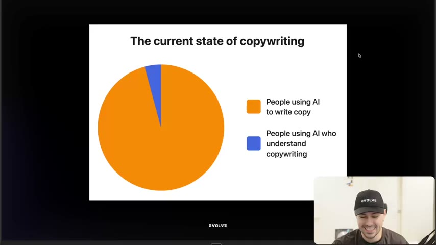
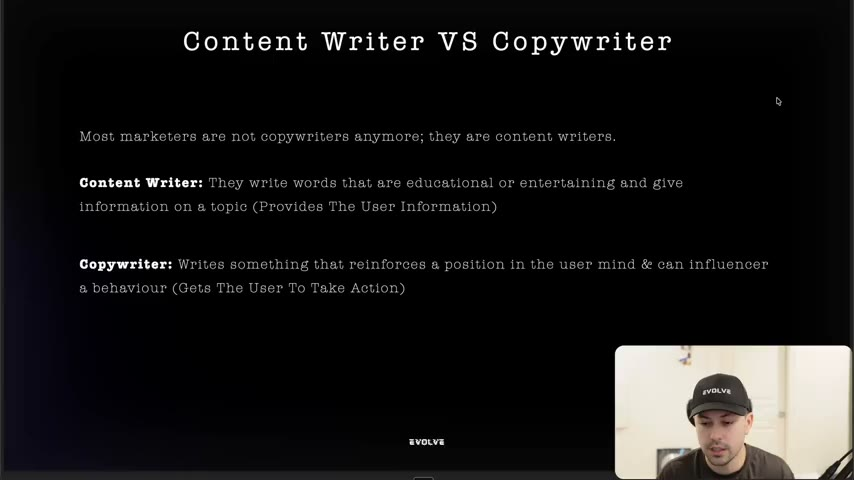
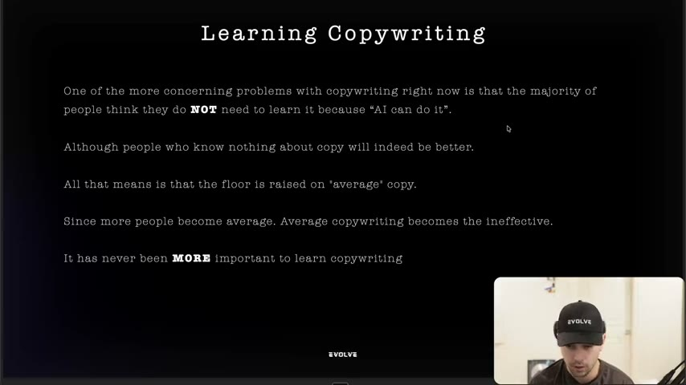
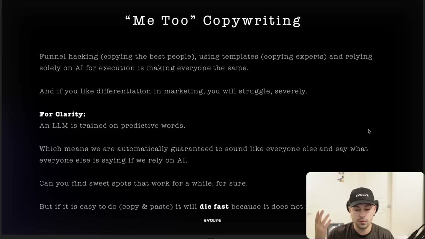

# 02. The current state of copywriting
> Three problems explain why most ads fail: marketers write content instead of copy, nobody learns copywriting because "AI can do it", and AI plus templates makes everyone sound the same. The fix is to write copy that influences behaviour and is genuinely different.

## 🤖 Agent use
- **Use when:** an agent is about to generate ad copy with an LLM and needs the guardrails that stop output becoming average; also when deciding whether a swiped ad template is worth copying.
- **Inputs → outputs:** a draft or a competitor-ad template → a verdict on whether it informs (content) or influences (copy), and whether it is differentiated → a rewrite that takes a position and asks for an action.
- **Rules:**
  - **DO** write to "get somebody to do the action that you want them to do", not to inform. [03:37–04:08]
  - **DO** make each piece "reinforce a position or establish one in the user's mind". [03:05–03:37]
  - **DON'T** fill ad slots with educational or entertaining words just because creatives are a weekly deliverable. [02:32]
  - **DON'T** ship raw LLM output. "LLMs are trained on predictive words… we are automatically guaranteed to sound like everyone else and say what everyone else is saying if we rely on AI." [09:29]
  - **DON'T** build a strategy on copy-and-pasting a trending template (the "native/camouflage ad" wave). It "is going to die fast." [10:01]
  - **IF** every competitor says "we're the best X", **THEN** that is the "me too" trap. Find a point of difference before writing. [08:57–09:29]
  - **IF** using AI to write, **THEN** treat it as an instrument the human "operator" steers with proprietary knowledge of what good looks like. [07:20–07:55]
- **See also:** [03. How to guarantee you get better at copywriting](03-how-to-guarantee-you-get-better-at-copywriting.md) · [08. The 3 checks for great copywriting](08-the-3-checks-for-great-copywriting.md) · [Native advertising](../../../../concepts/native-advertising.md) · [Perception management](../../../../concepts/perception-management.md) · [Angle rut](../../../../concepts/angle-rut.md)

Lesson page text lists credits only: Harry Dry, Jason Fladlien, Al Ries and Jack Trout. The instructor repeats this at [12:08] ("Harry Dry… Jason Flatlin, who's the guy that actually does webinars… Jack Trout from positioning").

## Key ideas

### Opening picture: where the winners are [00:00–01:31]
- Slide pie chart "The current state of copywriting", two slices: orange = "People using AI to write copy", blue = "People using AI who understand copywriting". [00:30]
- He says the orange slice is where "99% of e-commerce brands" are, and the small blue slice is "the top 1%… maybe even top 0.1%, to be honest with you" (instructor claim, no data). [00:30]
- "The only difference is that the people in the blue are people who use AI to write copy who also understand copywriting." This is his stated reason for "doubling down so much on this skill that is so old." [00:30–01:01]
- Counter to "copywriting is dead": customers consume huge volumes of words daily (social, Netflix, magazines, streamers), so the market is over-communicated. [01:01–01:31; 11:05–11:36]
- Most brands "have very little to say, and… are actually very bad at saying it." He borrows the quote "nothing said well is still nothing" from Harry. [01:31–02:01]

*The opening slide. The tiny blue slice is the group the course is trying to put you in. [00:10]*

### Problem 1: most people are content writing, not copywriting [02:01–04:38]
- Marketers have deliverables ("a certain amount of creatives every single week, every single month") and fill them with words. [02:32]
- He says this fill-the-slot process is "something that we still teach", but the course is "trying to build the infrastructure around us to go deeper"; going deeper is how you "transition from a content writer to an actual copywriter." [02:32–03:05]
- Slide definitions: **Content writer** = "write words that are educational or entertaining and give information on a topic (provides the user information)". **Copywriter** = "writes something that reinforces a position in the user mind & can influence a behaviour (gets the user to take action)". [02:40; spoken at 03:05]
- Test: "if you are actually copywriting, you are influencing behavior… and you are likely reinforcing a position or establishing a position in a person's mind." [03:37]
- Analogy: the film Interstellar is "phenomenal content" but does not make him take a specific action, which is the difference. Some inspirational films do prompt action, but that is still content. [04:08–04:38]

*Definition slide used for judging any draft: does it only inform, or does it reinforce a position and push an action? [02:40]*

### Problem 2: nobody is learning copywriting [04:38–08:25]
- Most people think they don't need to learn it "because AI can do it" and "they're not wrong. AI can do copywriting." [05:09]
- What AI changes: "the floor is raised on average copy." People who know nothing "will get better", which is why newcomers can make money quickly. [05:09–05:44]
- But when everyone uses AI "that just starts to become the average". Slide: "Since more people become average. Average copywriting becomes the ineffective." [05:44; slide at 05:00]
- Platform analogy (instructor's reasoning): Facebook ads in 2016-17 had "so much demand and so little supply" that you didn't need to be great at copy, only at making ads. As the barrier fell, the floor rose: "if you just take a random photo of your product and throw it onto meta, depending on the category, it's probably not going to do much." [05:44–06:47]
- Even "good copywriting with AI just becomes ineffective because everybody is using it." So "it has never been more important to learn copywriting… and… to just learn skills in general" so you can "optimize the AI based off of the skillset that you have." [07:20–07:55]
- On AI limits: AI "will never be like fully trained"; "Claude wrappers" are "not at that level yet"; it "is always going to require an operator… because you will know what good looks like." (instructor opinion) [07:20]
- Proprietary knowledge is the moat: even a hypothetical Eugene Schwartz AI would become what "everybody will use" if everyone used it. "That proprietary knowledge… is the skillset that you develop by learning this stuff." [07:55–08:25]

*Slide for problem 2: AI raises the floor, so "average" copy stops working. [05:00]*

### Problem 3: nobody is different ("me too" copywriting) [08:25–11:05]
- "Me too" is a term he says he took from a book (title not stated). Causes: funnel hacking (copying the best people), using the same templates (copying experts), and relying solely on AI for execution. [08:25–08:57]
- Consequence: "if you lack differentiation… you will struggle." With no edge "you'd have to start giving discounts and… try to get the cheapest people to come and buy… it's not a real business, it's not a brand." [08:57–09:29]
- Slide: "Can you find sweet spots that work for a while, for sure. But if it is easy to do (copy & paste) it will **die fast** because it does not…" (the line is cut off in the frame). [10:03]
- He says the best ads in the course "have clear differentiation". [09:29–10:01]
- His example of what not to build a business on: the "native ads or camouflage ads" trend ("copy this template, bro. And just put it into Claude… and take this photo of this bald dude and put it into Higgsfield"). "Can you make some money on [it] for sure? But… do you want to be the guy that's constantly having to catch trends?" He prefers a skill set where "regardless of what's going on, I could still make money." [10:01–10:33] (Higgsfield is as heard; "Higgs field" in transcript.)
- "If something doesn't really require true skill… you're just a me too copywriter… you're going to struggle." [10:33–11:05]

*Slide for problem 3. Funnel hacking, templates, and AI-only execution make everyone the same. [09:00]*

### Closing: copywriting is the #1 skill in marketing [11:05–12:35]
- Slide: "Copywriting is the #1 skill in marketing." Not learning it "means that you're not able to communicate to customers effectively", and in an age of over-communication (books, courses, YouTube, short-form social) that is "setting yourself up for failure." [11:05–11:36]
- "That's what copywriting is about… learning how to communicate and how to position properly." [11:36]
- He says that if "you are struggling to make ads that can actually scale. This is probably the biggest reason why." (instructor claim) [12:08]

## Steps / framework
A three-question diagnostic distilled from the lesson (derived):

| Problem | Symptom in a draft or swipe | Fix the lesson implies |
|---|---|---|
| 1. Content, not copy | Teaches or entertains; no stance, no action ask | State the position the ad reinforces; add a clear behaviour target |
| 2. Average because AI/everyone writes it | Reads like a first LLM pass; generic benefits | Add proprietary facts, specificity, an operator's judgment on what good looks like |
| 3. Me too | Same claims and format as 30 competitors; "we're the best" | Find the point of difference (mechanism, position) before writing; test by searching the line in quotes (checklist, [lesson 1](01-overview-of-copywriting-program.md)) |

## Examples
- **Interstellar vs an ad.** Used to separate content (moves you, changes nothing you do) from copy (moves you to act). [04:08–04:38]
- **Facebook ads 2016-17 vs now.** Low supply, high demand: a product post worked. Now "a random photo of your product" on Meta "probably isn't going to do much". [05:44–06:47]
- **Native/camouflage ad template wave** (named as a trend, no specific ad shown): copy a template, feed it to an LLM, generate a face with an image tool. Predicted to "die fast". [10:01–10:33]

## Structured units
### Rewrites
No before/after rewrites are given in this lesson.

### Rules of thumb
- **DO** define a copywriter as someone who "reinforces a position… and can influence a behaviour" [slide, 02:40].
- **DON'T** equate "using AI" with "writing copy": the floor rises for everyone, so average becomes ineffective [05:09–05:44].
- **IF** a tactic's whole skill is copy and paste, **THEN** expect it to "die fast" [10:01].

## How to apply
- [ ] For each draft, label it content or copy by asking: what position does it reinforce and what action does it ask for? Rewrite any "content" draft.
- [ ] When using an LLM, add what it cannot know: our verified facts, the customer's words, our mechanism. Edit the output; do not publish it as generated.
- [ ] Before adopting a trending template, ask what makes our version different. If nothing, find the difference first.
- [ ] Remove "we're the best"-type claims that 30 competitors could also make.
- [ ] (derived) When tearing down a competitor ad, note whether it is content-style (information) or copy-style (position + action).

## Related
- Previous: [01. Overview Of Copywriting Program](01-overview-of-copywriting-program.md) · Next: [03. How to guarantee you get better at copywriting](03-how-to-guarantee-you-get-better-at-copywriting.md)
- [Native advertising](../../../../concepts/native-advertising.md) · [Perception management](../../../../concepts/perception-management.md) · [Creative testing system](../../../../frameworks/creative-testing-system.md)
- Positioning is expanded in lesson 55 ([55. Why you need to position your brand](55-why-you-need-to-position-your-brand.md)).

## Sources and limitations
- Transcript: [2. The current state of copywriting… .txt](<../../../../../raw/evolve/copywriting/_transcripts/✍️ Evolve Copywriting (NEW)/2. The current state of copywriting ✍️ Evolve Copywriting (NEW) Evolve.txt>) · Page text: [….html.md](<../../../../../raw/evolve/copywriting/_extracted/✍️ Evolve Copywriting (NEW)/2. The current state of copywriting_✍️ Evolve Copywriting (NEW)_Evolve.html.md>)
- Machine transcription (Whisper large-v3-turbo); full recording covered (last segment 12:35 of 12:35). Whisper wrote "Jason Flatlin" where the page credit says "Jason Fladlien", and "Higgs field" for Higgsfield.
- The pie-chart percentages (99% / top 1% / 0.1%) are the instructor's illustration, not measured data.
- The instructor says the lesson "is listed as module one, it probably won't be module one" [00:00]: ordering may have changed after recording.
- The "Me Too" slide text is cut off at the bottom of the captured frame; only the readable part is quoted.
