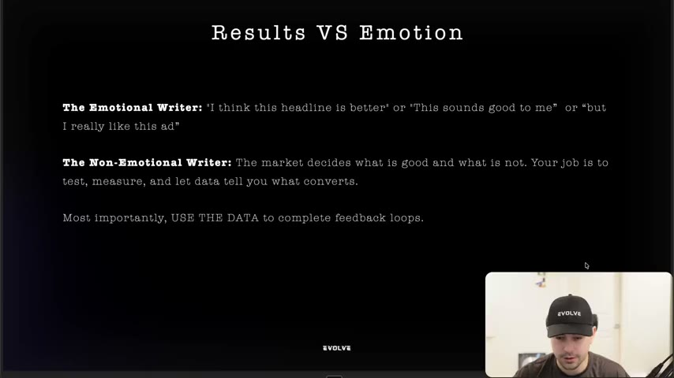
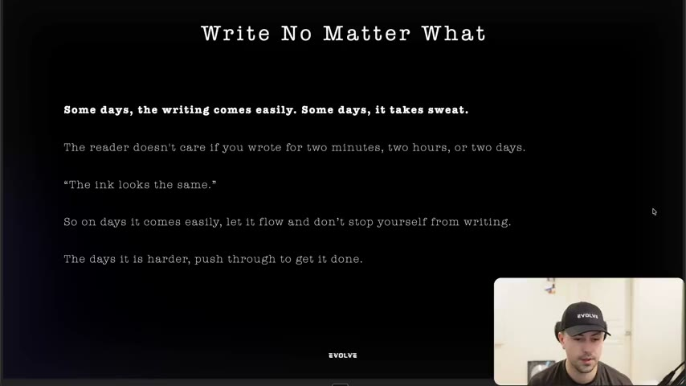
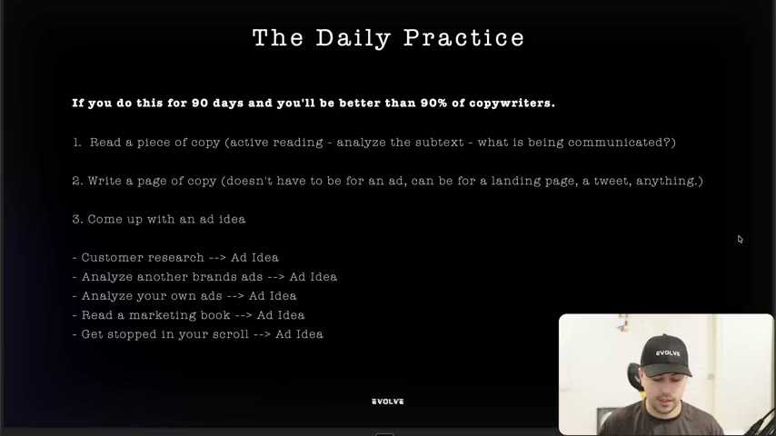
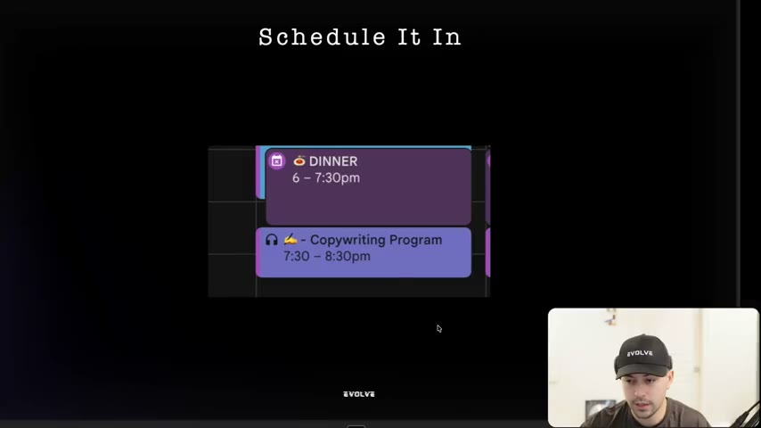

# 03. How to guarantee you get better at copywriting
> Judge copy only by results, write every day no matter how it feels, and run a daily three-part practice (read copy, write copy, generate an ad idea) in a protected calendar block. This is the loop that turns a writer into someone who produces ads that scale.

## 🤖 Agent use
- **Use when:** setting up an agent's (or a human copywriter's) improvement loop: deciding which draft is "better", building an ad-idea backlog, or scheduling recurring ideation and analysis runs.
- **Inputs → outputs:** test results, competitor ads, customer research, and our own ad account → a ranked judgment of drafts based on data, plus a steady stream of new ad ideas logged for writing.
- **Rules:**
  - **DO** rank drafts and ads by performance data, not taste. "Your job as a copywriter is to test, measure, and let the data tell you what converts." [01:01]
  - **DO** feed the results back into the next brief (close the feedback loop), so "better" is defined by what converted. [01:01–01:33]
  - **DON'T** describe an ad as "really good but not converting". The instructor says those "do not belong in the same sentence." [01:33–02:05]
  - **DO** generate at least one new ad idea per working session from one of five sources: customer research, another brand's ads, our own or our team's ads, a marketing book, or an ad that stopped your scroll. [05:10–06:11]
  - **DO** read top ads actively: state what each line *communicates* (the subtext), not just what it says. [04:10–04:40]
  - **IF** a competitor borrows a famous name's authority (e.g. "Is there a better chocolate bar than MrBeast's?") **THEN** save it and test the same structure with an authority relevant to our niche. [05:41–06:11]
- **See also:** [04. Schedule your writing development block](04-schedule-your-writing-development-block.md) · [Creative testing system](../../../../frameworks/creative-testing-system.md) · [Competitor ad teardown playbook](../../../../playbooks/competitor-ad-teardown.md)

Lesson page text: only a credit line, "**Credits:** Kyle Miligan" (likely the copywriter Kyle Milligan, whom lesson 62 also credits).

## Key ideas

### 1. Results are all that matter. Remove your emotion. [00:00–02:05]
- Writers get attached to their ideas and concepts. That attachment "clouds your judgment" and makes you see an ad as "better than it actually is". [00:00–00:30]
- **The emotional writer** says "I think this headline is better", "this sounds good to me", "but I really like this ad". **The non-emotional writer** lets the market decide what is good. [00:30–01:01]
- You will still have a lens for what is good. That lens "needs to be corrected by what is actually converting", or by what establishes or reinforces a position or builds brand. [00:30–01:01] (So non-direct-response goals count as "results" too.)
- **Use the data to complete feedback loops.** Then you can say "this does sound good to me *because of this reason*" and "I really like this ad *because it's converting*." [01:01–01:33]
- Anecdote: a community member said their ads were "really good, but they're not converting." The instructor's verdict: "really good and not converting do not belong in the same sentence." [01:33–02:05]

*Slide "Results VS Emotion": the emotional writer vs the non-emotional writer, and "Most importantly, USE THE DATA to complete feedback loops." [00:40]*

### 2. Write no matter what [02:05–03:39]
- Quote on the slide (the instructor can't recall its source): "Some days, the writing comes easily. Some days, it takes sweat." [02:05]
- "The reader doesn't care if you wrote for two minutes, two hours, or two days… **The ink looks the same.**" The instructor likes the phrase because it's *visual*: "the ink looks the same" beats "the copy looks the same". This previews the course's push for concrete, visual language. [02:05–02:37]
- On easy days let it flow. On hard days push through and write *something*. [02:37–03:08]

*Slide "Write No Matter What": the sweat quote, "The ink looks the same", and the easy-day / hard-day rule. [02:20]*

### 3. The daily practice (credited to Joe Schriefer) [03:39–06:41]
- Run it as a **90-day sprint**. A 30-day version is fine if that's what you can sustain. Claim on the slide (instructor claim, not evidence): "If you do this for 90 days you'll be better than 90% of copywriters." [03:39–04:10]
- The instructor says he is doing it himself, writing "an ad a day" as he moves back from business owner to writer. [03:08–03:39; 05:10]

1. **Read a piece of copy actively.** Analyse the subtext: what is being communicated? His recurring example headline is **"The natural deodorant that performs like a toxin one."** He likes it because it is simple for anyone to understand; ask "what is that actually communicating?" Bad copy is useful too: "this copy communicates nothing." [04:10–04:40]
2. **Write a page of copy with intent.** It doesn't have to be an ad; it can be a landing page, a tweet, a YouTube script or a Discord message. He writes an ad a day. [04:40–05:41]
3. **Come up with an ad idea.** He narrowed Joe's original "come up with an idea" to *ad* ideas. The sources: [05:10–06:11]
   - customer research → ad idea
   - analyse another brand's ads → ad idea
   - analyse your own ads, or your team's → ad idea
   - read a marketing book → ad idea
   - get stopped on your scroll → ad idea

*Slide "The Daily Practice": the three daily steps and the five ad-idea sources. [04:00]*

- Why the three steps matter: you are **analysing, executing and ideating**, which he calls "the three most important things when it comes to actually creating ads that can scale." [09:45]

### 4. Schedule it in [06:41–10:49]
- Create a repeating **one-hour daily calendar block** (a two-hour block, or several, if you're building the skill seriously). He demos it in Google Calendar: a "Copywriting" event with a colour label ("green because it's going to make you money"), set to repeat daily. [06:41–08:44; 09:45–10:17]
- Pick a time when you can turn everything else off: after lunch, before dinner, or after dinner. Avoid early mornings unless you're a morning person. [07:12–07:43]
- His own week: Thursdays are "trench days", 8 a.m. to 8 p.m. of deep work. He also has a "respond to messages" block labelled as task work. [06:41–07:43]
- Lock in with a site and app blocker such as **Opal** (he believes there is a free plan). During the block, block Discord, email, Ads Manager and other distractions. [08:44–09:15]
- Calendar labels give you time insights, e.g. "1 hour copywriting this week". His screenshot shows nightly 7:30–8:30 p.m. "Copywriting Program" blocks. [09:45–10:48]

*Slide "Schedule It In": the instructor's calendar, with a "Copywriting Program" block from 7:30–8:30 p.m. right after dinner. [06:40]*

## Steps / framework

| Step | What to do | Agent version (derived) |
|---|---|---|
| 1. Read | Actively read one piece of copy and write down what it communicates | For each competitor ad pulled, record what each line communicates and the claim behind it |
| 2. Write | Write one page of copy with intent | Draft at least one full script or ad per run, even when inputs are thin |
| 3. Ideate | Log one ad idea from research, a competitor, our own ads, a book or the scroll | Append ideas, each with its source, to the ad-idea backlog (see [22. How to finalize your ad ideas](22-how-to-finalize-your-ad-ideas.md)) |
| 4. Judge | Rank output by results, not taste | Score drafts against past performance data. Never call a non-converting ad "good" |
| 5. Repeat | Daily, for 30–90 days, in a fixed block | Run as a recurring scheduled job |

## Examples
- **"The natural deodorant that performs like a toxin one."** The instructor's go-to example of copy that is simple and communicates a lot. Read it for its subtext: natural *and* effective, set against "toxic" mainstream deodorants. [04:10] (The reading of the subtext is derived.)
- **"Is there a better chocolate bar than MrBeast's?"** A hook that stopped his scroll. He says it leverages MrBeast's authority "in a very ethical way". He saved it as an ad idea for one of his other brands. [05:41–06:11]

## Structured units

### Hooks
| Hook | Heuristic(s) | Emotion / zone | Self targeted | Why it works | Source |
|---|---|---|---|---|---|
| "Can I make a better chocolate bar than MrBeast?" / "Is there a better chocolate bar than MrBeast's?" (instructor unsure of exact wording) | Authority borrowing (derived) | Curiosity (derived) | — | Borrows a famous creator's authority to frame the product as a challenger; instructor calls it "very ethical" use of authority | [05:41–06:11] |

### Templates
| Template | Use for | Example fill | Source |
|---|---|---|---|
| "The [natural / alternative product] that performs like [the mainstream product]" | Positioning a "clean" or alternative product against the category standard | "The natural deodorant that performs like a toxin one" | [04:10] |
| "Is there a better [product] than [famous person]'s?" | Borrowing authority from a well-known competitor or creator | "Is there a better chocolate bar than MrBeast's?" | [05:41] |

### Rules of thumb
- **DO** let the market decide which copy is good, then explain *why* it won. [00:30–01:33]
- **DON'T** defend an ad on taste ("but I really like this ad"). [00:30]
- **DO** write on hard days too. "The ink looks the same" to the reader. [02:05–03:08]
- **DO** set a fixed, protected daily block for reading, writing and ideating. [06:41–09:45]

## How to apply
- [ ] Before calling a draft "strong", find the metric or past test that supports it, or label it untested.
- [ ] For each competitor ad, write one line on what it communicates beyond the literal words.
- [ ] Log at least one new ad idea per session, tagged with its source (research / competitor / own ads / book / scroll).
- [ ] Write at least one complete ad or script per session.
- [ ] Feed each test result back into the next brief, noting why the winner won.

## Related
- Previous: [02. The current state of copywriting](02-the-current-state-of-copywriting.md) · Next: [04. Schedule your writing development block](04-schedule-your-writing-development-block.md)
- [Iteration vs variation](../../../../concepts/iteration-vs-variation.md) · [Creative testing system](../../../../frameworks/creative-testing-system.md)

## Sources and limitations
- Transcript: [3. How to guarantee you get better at copywriting… .txt](<../../../../../raw/evolve/copywriting/_transcripts/✍️ Evolve Copywriting (NEW)/3. How to guarantee you get better at copywriting ✍️ Evolve Copywriting (NEW) Evolve.txt>) · Page text: [….html.md](<../../../../../raw/evolve/copywriting/_extracted/✍️ Evolve Copywriting (NEW)/3. How to guarantee you get better at copywriting_✍️ Evolve Copywriting (NEW)_Evolve.html.md>)
- Machine transcription (Whisper large-v3-turbo). The full recording is covered (last segment 10:48 of a 10:49 video). Whisper writes "copyright" for "copywriting" in places. The slide gives "Joe Schriefer" where the audio only says "Joe".
- The "better than 90% of copywriters" claim is the instructor's motivational claim, with no evidence offered.
