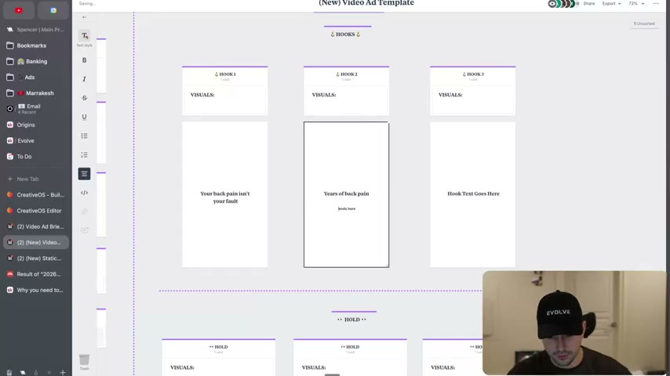
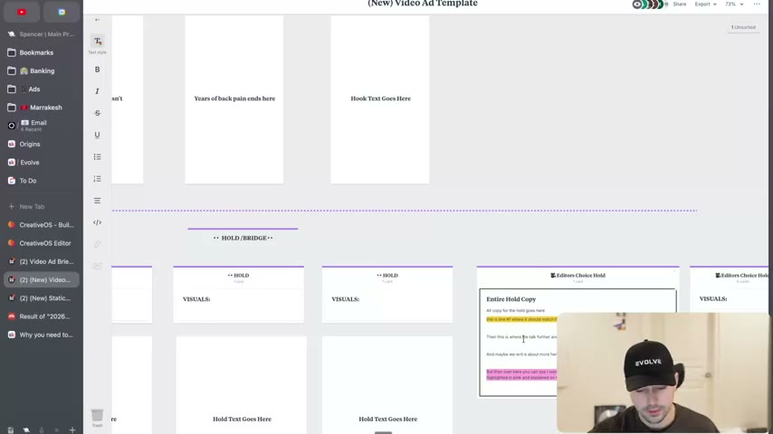
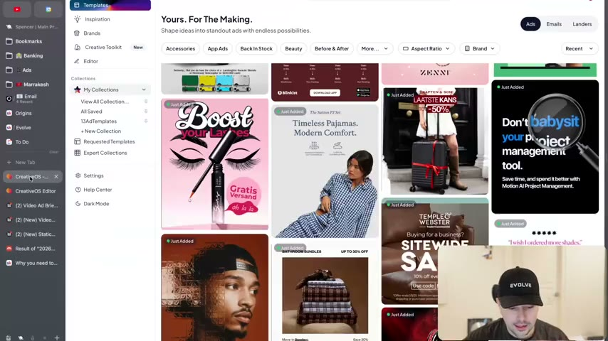
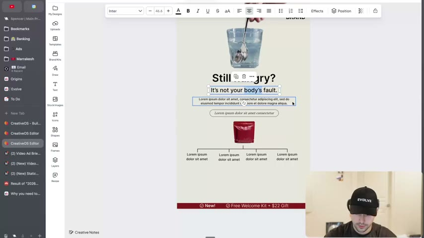
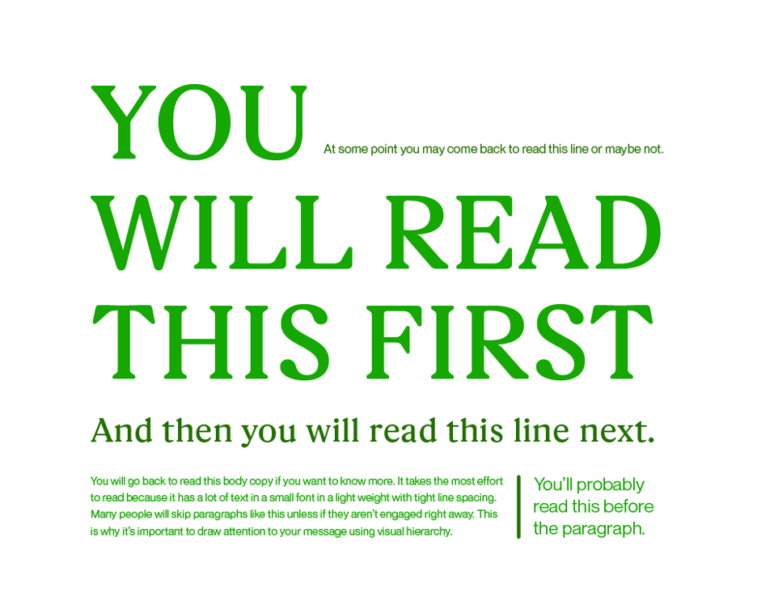

# 05. Why you need to write in the environment
> Write ad copy inside a visual brief that shows how each hook, scene and static headline will actually look in the feed (Milanote/Figma cards, CreativeOS templates), not in a Google Doc, because how copy looks changes what you write.

## 🤖 Agent use
- **Use when:** drafting a video or static ad brief, writing hooks, or handing a script to an editor or designer. Also when an agent outputs a script as plain text and needs a format that exposes line breaks, slide splits and visual pacing.
- **Inputs → outputs:** an ad idea plus research → a brief where each hook/hold/bridge scene is its own card with visual notes and the exact on-screen text, line breaks included → shorter, cleaner copy that can be judged "as it will appear in the feed".
- **Rules:**
  - **DO** write ads in the environment they will appear in: "Copy is like food. How it looks matters." (quote attributed to Harry Dry; instructor is unsure whether it is originally his) [00:00–00:54]
  - **DON'T** write ads in Google Docs, Notion or ClickUp: "it's not the environment." [00:54]
  - **DO** use a brief with defined cards per scene "especially for hooks" (Milanote, or free Figma). [00:54–01:53]
  - **DO** treat hook-card writing as non-negotiable: "for hooks it's an absolute non-negotiable." [04:42]
  - **DO** shorten hooks by editing words in the card: "a great hook is just a good hook made shorter." [03:45]
  - **DO** label bridge/hold cards by their hook ("hook one bridge") and say which lines share a visual and which are separate slides. [05:35–06:20]
  - **DON'T** let an editor decide line breaks on a long hook: "your hook is like four lines long and you're like, oh crap." [02:51]
  - **IF** writing a static, **THEN** draft inside a template that shows the final layout (CreativeOS editor or a Figma template) so copy length fits the design; "I've seen so many times our team take an ad like this and literally try to write copy that is way too long for it." [11:49–12:40]
  - **IF** the video is a long VSL, **THEN** use the "editor's choice hold" and let the editor split scenes, but still write hooks card by card. [06:54–07:49]
- **See also:** [06. Update your Milanote/Figma for writing](06-update-your-milanote-figma-for-writing.md) · [03. How to guarantee you get better at copywriting](03-how-to-guarantee-you-get-better-at-copywriting.md) · [11. Why you need to write less fluff](11-why-you-need-to-write-less-fluff.md) · [Creative primitives](../../../../concepts/creative-primitives.md)

## Key ideas

### Why: copy is like food [00:00–00:54]
- Analogy: a steak or pasta can taste great, but "if you're looking at it, you're like, I don't know, that doesn't look good", you doubt it tastes good. Copy is "even more important" than food because "the chef might tell you to just eat it. Trust me, it's good. Whereas most people don't trust you." [00:00–00:54]
- So the module is about where to write and which tools to use; the "biggest thing that I need you to stop doing" is writing ads in Google Docs, Notion or ClickUp. [00:54]
- Facebook has no briefing tool, so you must "optimize the brief" to get the environment: Milanote (or free Figma) with "defined cards for essentially how each scene should look, especially for hooks". [00:54–01:53]

### The new video brief template [01:53–02:51]
- The Milanote ideation section is unchanged: client name, DCT number (as heard), where the ad links to, ad examples, ad sizes needed. [01:53]
- Change: the old brief had only two blocks, "copy" and "visuals". "We just write the copy here and then we send it to the editors… you don't actually think about what it's going to look like." Result: "you get the video back and your hook is like four lines long." [01:53–02:51]
- New template: hook cards (HOOK 1, 2, 3 with a VISUALS line and a vertical card showing hook text), then HOLD/BRIDGE cards, then an "Editor's Choice Hold" card. [02:51; see screenshots]

### Hook cards force shorter, cleaner copy [02:51–05:35]
- On a vertical card, "Your back pain isn't your fault" may look fine on one line or better split in two. "For example, if I just said this to the editor, the editor would make it look like this. But to me, that doesn't look right." [02:51–03:45]
- Principle: "a great headline is just a good headline made shorter. And so a great hook is just a good hook made shorter." Writing in the card lets you "pick apart words". [03:45]
- Live edit of a hook (see Rewrites): "You struggle with back pain for years" becomes "Years of back pain", then "Years of back pain ends here", and he compares one-line vs two-line layout. [03:45–04:42]
- Hooks are "an absolute non-negotiable" for this treatment "because of how important hooks are". [04:42]


*Hook cards in the "(New) Video Ad Template": hook 1 "Your back pain isn't your fault", hook 2 "Years of back pain ends here" (being typed), hook 3 placeholder. Each card has a VISUALS line above it. [05:00]*

### Hold / bridge scenes [05:35–09:06]
- The "hold" section is best optimized "more towards the bridge", so the card is labelled "HOLD / BRIDGE". If a hook has its own bridge, "you 100% should come in here and optimize how the scene will look." [05:35]
- Why: editor and writer may differ on whether lines "are all on the same slide" or separate. "You're doing more for the editor. That's why it's important to train your editors" so you don't have to. [05:35–06:20]
- Rename cards by hook ("hook one bridge") so each bridge leads to the hold. You do not have to write every scene; if you do, copy and paste cards in Milanote. [06:20–06:54]
- A hold is "all one hold": scene one, scene two, scene three… For a "four or five minute VSL" use the "editor's choice hold" where the editor splits slides; "every new line is probably some kind of new slide," though sometimes "two lines of text on one visual". [06:54–07:49]
- Example of pacing notes: visual "old dude holding his back" for one line; next line "same visual as before… maybe a bit of a quicker pace". [06:54–07:49]
- Hooks are non-negotiable; for bridges "here's the bridges and here's how I want them to pace". Hook can start small and flow into another scene: "You struggle with back pain for years" (hook) then "…and it ends today" (second piece). [07:49–08:33]
- He says an editing guideline section still exists in the brief. "You shouldn't be editing your own videos." [09:06; 09:06]


*Below the hook cards: HOLD / BRIDGE scene cards each with a VISUALS line, plus an "Editor's Choice Hold" card holding the entire hold copy (highlighted lines mark where the editor should match or elaborate). [06:20]*

### Static ads: same idea, with CreativeOS [09:06–12:40]
- In Milanote the static brief has the same structure: visual recommendations, headline cards ("headline text goes here"). [09:06]
- He "highly highly highly" recommends using CreativeOS (or Figma templates) or "templatizing" inspiration found in ad-spy tools or "Atria" (as heard) with AI inside Figma. He says there "definitely is a way to do it with Claude" but he had not built it at filming time. [09:06–10:15]
- Reason: in a plain doc "you're not able to see how it actually looks". In the editor you can play with copy and layout, and "you don't need to do the graphic design but you can at least do the copywriting". [10:15]
- Demo template: "Pajamas that feel like a hug" ("Brand / Pajamas That Feel Like Hug" in the template), written "off the top of my head with zero context about this brand". [10:15]
- Demo concept: a template with a timeline/graphic is repurposed for a "bloated" idea: "Still hungry? question mark. It's not your fault." then "on average, most people eat empty carbohydrates… this one supplement fills the gap and satiates you longer." His brain "went to a timeline of week one, you experience this, week one, you experience that". [10:15–11:49]
- Method: "take the idea that… see somebody else's concept and plug it into that. And I think that's what a lot of great marketers do." The Evolve templates were "pulled from other winning ads" (e.g. a bread ad, a breakfast ad) and turned into templates. [11:36–12:08]
- Warning: fitting copy to a template "sometimes… forces you to make your copy sharper. Sometimes it can make your copy worse. So you've got to study copywriting to get better at it." [12:40]
- The page lists a "Winning Ads Templates" Canva link (not accessed here).


*CreativeOS "Templates" gallery: editable winning-ad layouts (lash ad, pajamas, luggage, project-management tool). Pick a layout, then write copy that fits it. [09:36]*


*Editor view of a template being rewritten live: headline "Still hungry?", subline "It's not your body's fault.", placeholder body, and a four-step timeline below the product. [11:19]*

## Steps / framework
Write-in-the-environment workflow (derived from the demo [01:53–12:40]):

1. Open the video or static brief template (Milanote or Figma; for statics, a CreativeOS or Figma layout).
2. Fill the ideation block: client, test number, landing page, ad examples, sizes.
3. Write each **hook** into its own vertical card, the way it will sit on screen. Check line breaks; try one line vs two.
4. Cut the hook until it is "a good hook made shorter"; re-read the card as a viewer would.
5. Write each **bridge/hold** scene as a card; add a VISUALS note and say which lines share a visual and the pacing.
6. For long videos use one "Editor's Choice Hold" card and let the editor split slides.
7. For statics, draft inside the template so the length fits; brief the designer only after the copy looks right. (Page text: "Images should be optimized ONCE they come back from the graphic designer".)

## Examples
- **Hook line-break test:** "Your back pain isn't your fault": one line vs two, he prefers two for cleanliness. [02:51–03:45]
- **Static concept:** "Still hungry? It's not your fault." for a supplement (concept built live, no real brand). [10:15–11:49]
- **Page-text example:** the lesson page includes an image after "Imagine writing this in a standard Google Doc brief without the clarity of how you want it to look…". It shows a mock layout headed "YOU WILL READ THIS FIRST / And then you will read this line next" with small body copy and a note "This is why it's important to draw attention to your message using visual hierarchy." It is not discussed in the video. (see screenshot)


*Skool page image: size and weight set reading order (big headline, then subline, then body, then side note). Text readable in the image; this is what a Google Doc cannot show you.*

## Structured units
### Rewrites
| Before | After | What changed | Source |
|---|---|---|---|
| You struggle with back pain for years | Years of back pain | Cut verb and subject; noun phrase | [04:09–04:42] |
| Years of back pain. And now it's time to start fighting back (and beat it for good) | Years of back pain ends here | One line; dropped "fighting back" and "beat it for good" | [04:09–04:42] |
| Your back pain isn't your fault (on one line) | Your back pain / isn't your fault (two lines) | Line break for cleaner shape on a vertical card | [02:51–03:45] |

The progression is described in speech; the intermediate wordings are as heard and may not be verbatim.

### Hooks
| Hook | Heuristic(s) | Emotion / zone | Self targeted | Why it works | Source |
|---|---|---|---|---|---|
| Your back pain isn't your fault | — | Relief (derived) | — | Absolves the viewer; short two-line form reads cleanly | [02:51] |
| Years of back pain ends here | — | Hope (derived) | — | Names the problem and promises an end in six words | [04:42] |
| Still hungry? It's not your fault. | — | — | — | Question plus absolution, then supplement as "fills the gap" | [11:13] |

### Templates
| Template | Use for | Example fill | Source |
|---|---|---|---|
| Hook card + VISUALS line | Writing each hook as it appears | "Years of back pain ends here" | [04:42] |
| HOLD / BRIDGE card per scene (label "hook one bridge") | Scene-by-scene pacing | "old dude holding his back" | [06:20–07:49] |
| Editor's Choice Hold card | Long VSLs where the editor splits slides | "All copy for the hold goes here" | [06:54–07:49] |

## Prompts / templates (verbatim)
Page text, verbatim:

```
"Copy is like food. How it looks matters."
- Harry Dry

Where to write:
You shouldn't write in Google Docs
You shouldn't write in Notion/ClickUp
--> it's not the environment

* Milanote/Figma with defined cards for how each scene should look - especially for hooks
* Images can use CreativeOS specifically (writing with Images in mind first)
* Images should be optimized ONCE they come back from the graphic designer
```

Resources named on the page: Winning Ads Templates (Canva), CreativeOS sign-up, Milanote Video Template, Milanote Static Template (links on page; not accessed). Milanote copy steps: see [lesson 6](06-update-your-milanote-figma-for-writing.md).

## How to apply
- [ ] Move every brief out of Google Docs/Notion into a card-based template (Milanote or Figma).
- [ ] Write each hook on a card that matches the 9:16 frame; test one-line vs two-line.
- [ ] Shorten every hook at least once after seeing it laid out.
- [ ] Add a VISUALS note and label per scene; specify shared slides and pacing.
- [ ] For static ads, write inside a layout that fits the final design; if the copy "comes back terrible", shorten the copy.
- [ ] (derived) When an AI agent drafts scripts, output them as a card-by-card structure (hook / hold-bridge / editor's choice) rather than a paragraph.

## Related
- Previous: [04. Schedule your writing development block](04-schedule-your-writing-development-block.md) · Next: [06. Update your Milanote/Figma for writing](06-update-your-milanote-figma-for-writing.md)
- [Creative primitives](../../../../concepts/creative-primitives.md) · [Format variation ladder](../../../../frameworks/format-variation-ladder.md)

## Sources and limitations
- Transcript: [5. Why you need to write in the environment… .txt](<../../../../../raw/evolve/copywriting/_transcripts/✍️ Evolve Copywriting (NEW)/5. Why you need to write in the environment ✍️ Evolve Copywriting (NEW) Evolve.txt>) · Page text: [….html.md](<../../../../../raw/evolve/copywriting/_extracted/✍️ Evolve Copywriting (NEW)/5. Why you need to write in the environment_✍️ Evolve Copywriting (NEW)_Evolve.html.md>) · Skool images [05-img01](../../../../../raw/evolve/copywriting/linked/skool-images/05/05-img01.png), [02](../../../../../raw/evolve/copywriting/linked/skool-images/05/05-img02.png), [03](../../../../../raw/evolve/copywriting/linked/skool-images/05/05-img03.png) (02 and 03 are the Milanote "Save to Home / Duplicate the board" steps, shown in lesson 6)
- Machine transcription (Whisper large-v3-turbo); full recording covered (816.43 s). Whisper wrote "Milano" and "million note" for Milanote; "hold" is the instructor's term for the body section after the hook, "DCT number" is as heard (meaning not explained; possibly a creative-test ID), "Atria" is as heard (ad-spy tool), "textile" at 02:51 is probably "text style" in Milanote.
- The Canva "Winning Ads Templates" link and the Milanote templates were not accessed. The Milanote template passwords are on the page and not reproduced here.
- The card text in the Milanote screenshots is live-edited during the demo; the final hook wordings are those in the Rewrites table.
