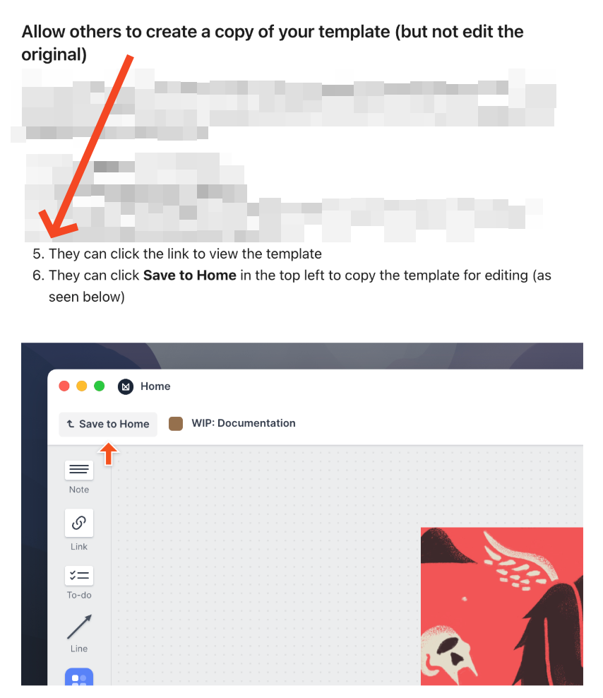
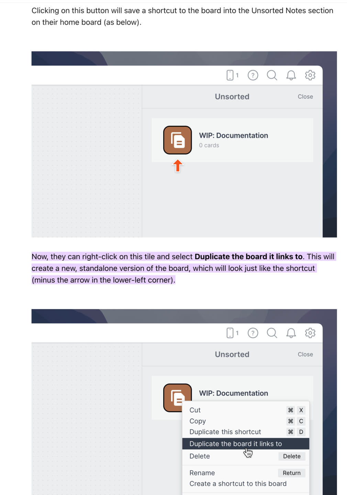

# 06. Update Your Milanote/Figma For Writing
> An action item with no video: copy the course's Milanote video and static brief templates (or rebuild them in Figma) so you can do the "write in the environment" practice from lesson 5.

## 🤖 Agent use
- **Use when:** setting up the brief workspace that [lesson 5](05-why-you-need-to-write-in-the-environment.md) says to write in; or when a task says "use the Evolve video/static brief template".
- **Inputs → outputs:** the two Milanote template share links (video, static) → your own editable copies of both boards, ready for hook / hold-bridge / headline cards.
- **Rules:**
  - **DO** remember the page's one-line reason: "Remember, how your copy looks is CRUCIAL". (verbatim)
  - **DO** make your own copy of each template; do not try to edit the shared original. Per the Milanote help screenshot: "Allow others to create a copy of your template (but not edit the original)": open the link, click **Save to Home**, then duplicate the board from the Unsorted tile.
  - **DO** keep both templates: one for video ads, one for static ads (page lists "Milanote Video Template" and "Milanote Static Template").
  - **IF** you prefer Figma, **THEN** rebuild the same card structure there; lesson 5 says "Figma is free" and works equally. [lesson 5, 00:54–01:53]
  - **DON'T** write ads in Google Docs or Notion after setting this up (lesson 5, [00:54]).
- **See also:** [05. Why you need to write in the environment](05-why-you-need-to-write-in-the-environment.md) · [07. Why great copywriting requires boredom](07-why-great-copywriting-requires-boredom.md)

## Key ideas
This lesson has **no video**. Page content (the course's own text is short):

- Headline instruction: "Remember, how your copy looks is CRUCIAL:"
- Links listed on the page (not followed by this knowledge base): **Sign Up For CreativeOS**, **Milanote Video Template**, **Milanote Static Template**. The page states a password for the two Milanote templates; it is not reproduced here.
- A heading "**Step By Step Instructions For Milanote**" followed by two screenshots.

### The two instruction screenshots (read from the images)
The images are from Milanote's own documentation on sharing a template; steps 1 to 4 (how the template's owner enables sharing) are blurred out in the image, so only the recipient steps are visible.

| Step | Instruction as shown | Where |
|---|---|---|
| 5 | "They can click the link to view the template" | image 1 |
| 6 | "They can click **Save to Home** in the top left to copy the template for editing" | image 1 |
| 7 (unnumbered) | "Clicking on this button will save a shortcut to the board into the Unsorted Notes section on their home board" | image 2 |
| 8 (unnumbered) | "Now, they can right-click on this tile and select **Duplicate the board it links to**. This will create a new, standalone version of the board, which will look just like the shortcut (minus the arrow in the lower-left corner)." | image 2 |

(The images show a Milanote help example board named "WIP: Documentation", not the Evolve template itself.)

## Steps / framework
1. Open the Milanote Video Template link; click **Save to Home** (top left).
2. Open **Unsorted** on your Home board; right-click the new tile; choose **Duplicate the board it links to** to get your own editable board.
3. Repeat for the Milanote Static Template.
4. Optionally sign up for CreativeOS for static layouts (see lesson 5, [09:06–12:40]).
5. Use the boards for every new brief, as in lesson 5 (hook cards, hold/bridge cards, editor's choice hold; static headline cards).

## Examples
None on the page; the filled-in template demo (hooks "Your back pain isn't your fault", "Years of back pain ends here") is in lesson 5.

## Screenshots

*Recipient steps 5 and 6: open the template link, then click "Save to Home" in the top left. Steps 1-4 are blurred in the source image.*

*Right-click the shortcut tile in Unsorted and choose "Duplicate the board it links to" to get an editable, standalone copy.*

## How to apply
- [ ] Save and duplicate both Milanote templates (video, static) into your own workspace.
- [ ] Confirm your copies are editable and the originals are untouched.
- [ ] Rename the boards per brand or test, and start writing hooks into the cards.
- [ ] (derived, agents) If you cannot access Milanote, mirror its structure (ideation block; HOOK 1-3 cards with VISUALS; HOLD / BRIDGE scene cards; Editor's Choice Hold; static headline cards) in any card-based tool.

## Related
- Previous: [05. Why you need to write in the environment](05-why-you-need-to-write-in-the-environment.md) · Next: [07. Why great copywriting requires boredom](07-why-great-copywriting-requires-boredom.md)

## Sources and limitations
- Page text: [6. Update Your Milanote/Figma For Writing….html.md](<../../../../../raw/evolve/copywriting/_extracted/✍️ Evolve Copywriting (NEW)/6. 💥 Update Your Milanote_Figma For Writing_✍️ Evolve Copywriting (NEW)_Evolve.html.md>) · Images: [06-img01](../../../../../raw/evolve/copywriting/linked/skool-images/06/06-img01.png), [06-img02](../../../../../raw/evolve/copywriting/linked/skool-images/06/06-img02.png)
- No video or attachment. The Milanote templates and CreativeOS were not accessed, so their contents are described only through lesson 5's video demo. The same two instruction images are also embedded in lesson 5's page.
