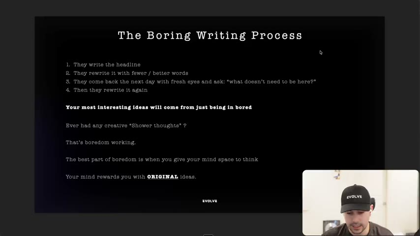
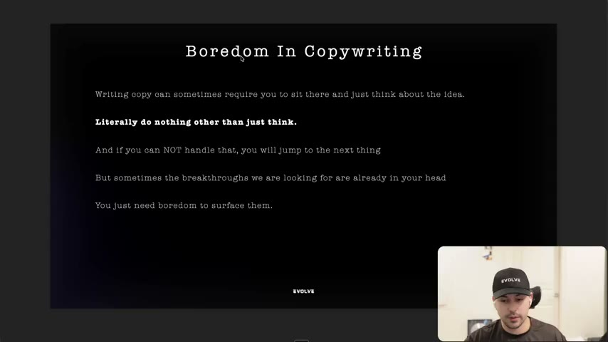
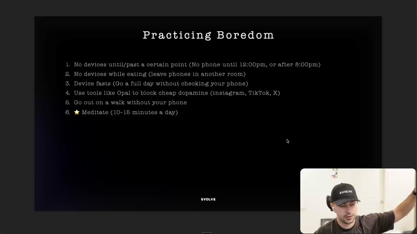

# 07. Why great copywriting requires boredom
> Great headlines come from repeatedly rewriting and sitting with the problem, and original ideas surface only when you let yourself be bored, so practise boredom (no phone, walks, meditation) to improve ad copy.

## 🤖 Agent use
- **Use when:** planning how to get original hooks and headlines (as opposed to remixing competitor ads), and when a human copywriter is stuck. For an agent, use it to structure a multi-pass rewrite loop rather than accepting a first draft.
- **Inputs → outputs:** a draft headline/hook → multiple passes (rewrite shorter, return later with fresh eyes, cut what doesn't need to be there) → one tighter headline. Also: a stuck writer → a boredom practice routine.
- **Rules:**
  - **DO** run the four-step "boring writing process" on every headline: write it, rewrite with fewer/better words, return the next day with fresh eyes and ask "what doesn't need to be here?", rewrite again. [00:00–00:53; slide 00:40]
  - **DO** expect great copywriters to spend "days and some of them even weeks just on a single headline". [00:00]
  - **DON'T** reach for the phone when a script gets hard: "if you're not good at being bored… you're just going to pull up your phone… I'll just do this headline later." [07:22–08:08]
  - **DO** look inside before outside: "sometimes the breakthroughs that you're looking for are not in research… not in copying a competitor ad… [but] in your head." [08:08]
  - **IF** you are stuck on an idea, **THEN** step away from stimulation (walk without phone, no devices, short meditation) and let ideas surface. [08:54–10:34]
  - **IF** a draft feels done in one sitting, **THEN** schedule a second pass later (next-day fresh-eyes rewrite). [00:00–00:53] (derived for agents: run a second revision pass in a separate session/context)
- **See also:** [03. How to guarantee you get better at copywriting](03-how-to-guarantee-you-get-better-at-copywriting.md) · [11. Why you need to write less fluff](11-why-you-need-to-write-less-fluff.md) · [02. The current state of copywriting](02-the-current-state-of-copywriting.md)

Lesson page text: credits and two YouTube links ("Credits + More Resources On Boredom": one YouTube Short, one YouTube video). The links were not opened. The instructor also mentions a YouTube video from a person he calls "Arthur" [10:34].

## Key ideas

### The boring writing process [00:00–01:43]
- Some of the best copywriters spend "days and some of them even weeks just on a single headline… not an entire video, not an entire concept, not an advertorial landing page… just a single headline". "We all know headlines are the most important piece of basically everything." [00:00]
- Slide "The Boring Writing Process": (1) they write the headline; (2) they rewrite it with fewer / better words; (3) they come back the next day with fresh eyes and ask "what doesn't need to be here?" (spoken as "what does it need to be here?"); (4) then they rewrite it again. [00:00–00:53; slide 00:40]
- Claim: "when you allow boredom to take effect, your most interesting ideas will come to you." The "creative shower thoughts" are "boredom working". [00:53]
- "When you give your mind space to think, your mind rewards you with original ideas." Slide: "Being original to you, is differentiation." Your connections come from your own experiences, so the ideas are "original to you". [00:53–01:43]

*Four-step rewrite loop plus the claim that original ideas come from boredom. Note the slide wording of step 3. [00:40]*

### "Side quest": why boredom works [01:43–06:31]
All of this section is the instructor's reasoning and citations of studies he does not name; treat as motivation rather than evidence.
- History: boredom was "a significant catalyst for the development of human imagination" and "triggers the brain's default mode network, which allows for creative thinking by connecting unrelated memories and ideas." Slide lists practical innovation, storytelling and culture, pattern recognition, social bonding. [01:43–02:38]
- Idle human brains "reorganize information… making unexpected connections, and running simulations". He uses the film The Hangover (the "Doug's on the roof" moment) as an illustration of ideas connecting while idle. [02:38–03:21]
- **The shock experiment** (credit "down below", none given): people alone in a room could "sit and be bored" or press a button to "get a painful shock". He says "it was 80%" who chose to shock themselves (instructor claim; the source study is not identified in the course files). He reads it as "proof that people don't know how to be bored". [03:21–04:53]
- Modern life removes boredom (planes with movie players, Wi-Fi); he links this to "a lot of depression and a lot of anxiety" while saying it is not solely due to boredom and "studies are here, there and wherever". [04:53]
- Slide "Boredom & Mental Health": boredom makes you ask big questions, many find them scary, it also triggers "a thirst for dopamine", people take "the easier dopamine" (phone, Netflix, fast food). "Getting better at 'being bored' means you'll be a lot less bored with work." [04:53–06:31; slides at 05:20]
- Buffalo analogy: survival wired us to take the easiest option; now phones and fast food make easy dopamine always available. He says he is "not perfect with this" either. [05:39–06:31]

### Boredom in copywriting [06:31–08:54]
- Slide "Boredom In Copywriting": "Writing copy can sometimes require you to sit there and just think about the idea. **Literally do nothing other than just think.** And if you can NOT handle that, you will jump to the next thing. But sometimes the breakthroughs we are looking for are already in your head. You just need boredom to surface them." [07:22–08:54; slide at 07:40]
- If you can't tolerate the pause "you just divert from it, you back away" and the breakthrough is lost. Most people "can't think about things for an extended period of time because you've just fried your dopamine". [08:08–08:54]

*"Literally do nothing other than just think." The breakthrough is already in your head; boredom surfaces it. [07:40]*

### Practising boredom [08:54–11:32]
Slide "Practicing Boredom" (six items; the instructor's commentary in brackets):
1. No devices until/past a certain point (no phone until 12:00 pm, or after 8:00 pm). He was "religious" about not checking his phone until noon when getting going; now "in between". "If you're locked in… put your phone down." [08:54]
2. No devices while eating (leave phones in another room). [08:54–09:41]
3. Device fasts (go a full day without checking your phone). He does "a couple of times a year", "three or four days" with Do Not Disturb, "not everybody has the luxury". [09:41]
4. Use tools like Opal to block cheap dopamine (Instagram, TikTok, X). Opal greys out apps on desktop and phone; recommended in an earlier lesson (see [lesson 3](03-how-to-guarantee-you-get-better-at-copywriting.md)). [09:41–10:34]
5. Go out on a walk without your phone. [09:41–10:34]
6. Meditate, 10-15 minutes a day (starred). "Literally just sit there with some soothing music with some headphones… and do nothing for 10 minutes." The first minutes feel "stupid", then "you're just going to start thinking about all kinds of stuff." He did this "pretty religiously for the first three to four years" and says it helped him "problem solve". [10:34]

*The six-item practice list. Item 6, meditation, is starred as the one to do if you struggle most. [10:00]*

### Closing quote [10:34–12:22]
- Slide quote: "Get better at 15+ minutes or longer of boredom, and watch your life change." He adapts it: "getting better at 15 plus minutes or longer of boredom can change your copy… Watch your copy change because you're actually going to be able to sit and think about what you're writing and then optimize it." [10:34–11:32]
- Result he promises (instructor claim): you "get faster at that thinking muscle", write better, and make ads "original to you". [11:32]

## Steps / framework

| Step | Action | Notes |
|---|---|---|
| 1 | Write the headline | |
| 2 | Rewrite with fewer / better words | |
| 3 | Return next day; ask "what doesn't need to be here?" | the delay is the point |
| 4 | Rewrite again | repeat until it cannot be cut |
| Parallel | Practise boredom daily | list of six above |

## Examples
- **Headline process** is described, not exemplified: no headline text is shown being rewritten in this lesson (compare the on-screen hook rewrite in [lesson 5](05-why-you-need-to-write-in-the-environment.md)).
- **The Hangover** analogy for sudden idea connection [03:00–03:21].
- **The shock experiment** [03:21–04:53] (see caveats above).

## Structured units
### Templates
| Template | Use for | Example fill | Source |
|---|---|---|---|
| "What doesn't need to be here?" | Fresh-eyes cut on a headline or hook | Run on any line after a break | [00:53; slide 00:40] |
| Rewrite loop: write, rewrite shorter, rest, cut, rewrite | Any hook or headline | n/a (no example shown) | [00:00–00:53] |

### Rules of thumb
- **DO** budget time for a single headline; do not treat a headline as a 5-minute task. [00:00]
- **DON'T** answer idle moments with the phone while writing. [07:22]
- **IF** the answer isn't in research or a competitor ad, **THEN** it may already be in your head; sit with the problem. [08:08]

## How to apply
- [ ] For each hook or headline, run the four-step rewrite loop with at least one gap between passes.
- [ ] Ask "what doesn't need to be here?" and cut at least one word on the second pass.
- [ ] Block a distraction-free session (Opal or similar) before ideating; keep the phone out of reach.
- [ ] Add one non-screen boredom habit: walk without phone, or 10-15 minutes of quiet sitting.
- [ ] (derived, agents) When generating hooks, do an independent second pass that only deletes words, not adds.

## Related
- Previous: [06. Update your Milanote/Figma for writing](06-update-your-milanote-figma-for-writing.md) · Next: [08. The 3 checks for great copywriting](08-the-3-checks-for-great-copywriting.md)
- [Perception management](../../../../concepts/perception-management.md) (differentiation context) · [Creative testing system](../../../../frameworks/creative-testing-system.md)

## Sources and limitations
- Transcript: [7. Why great copywriting requires boredom… .txt](<../../../../../raw/evolve/copywriting/_transcripts/✍️ Evolve Copywriting (NEW)/7. Why great copywriting requires boredom ✍️ Evolve Copywriting (NEW) Evolve.txt>) · Page text: [….html.md](<../../../../../raw/evolve/copywriting/_extracted/✍️ Evolve Copywriting (NEW)/7. Why great copywriting requires boredom_✍️ Evolve Copywriting (NEW)_Evolve.html.md>)
- Machine transcription (Whisper large-v3-turbo); full recording covered (742.49 s). "Arthur" is as heard; the two linked YouTube videos were not opened.
- Psychology and statistics (default mode network, the 80% shock result, links to depression/anxiety) are the instructor's claims; the course files give no study names.
- The lesson is mostly motivation. Its operational content for ad writing is the rewrite loop and the practice list.
