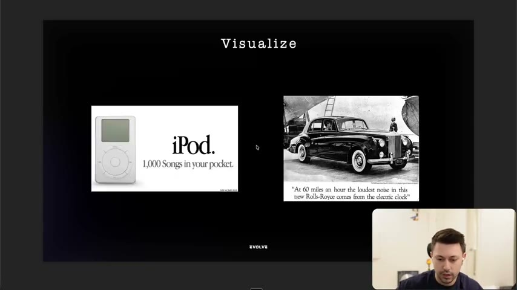
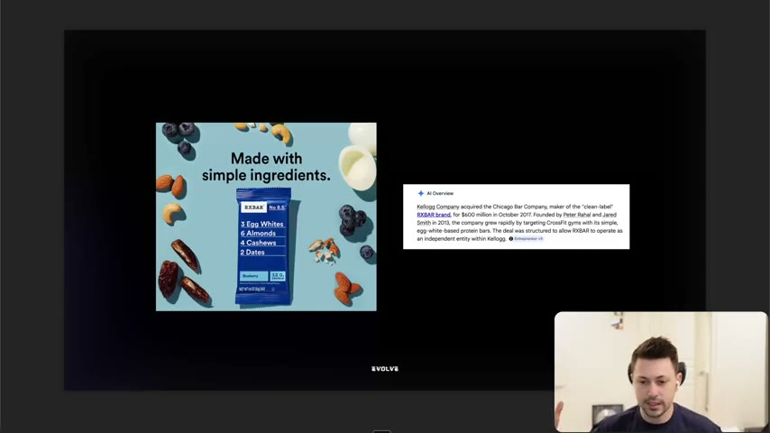
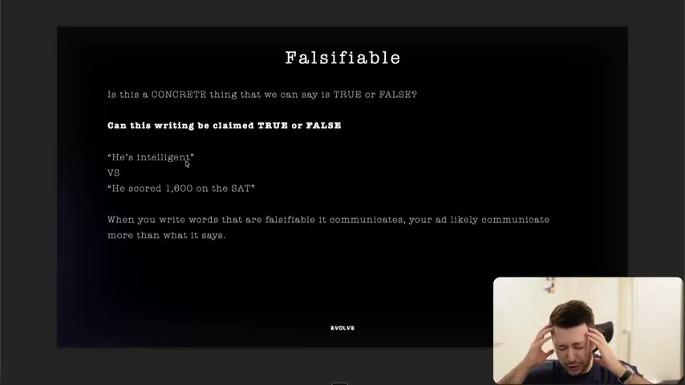
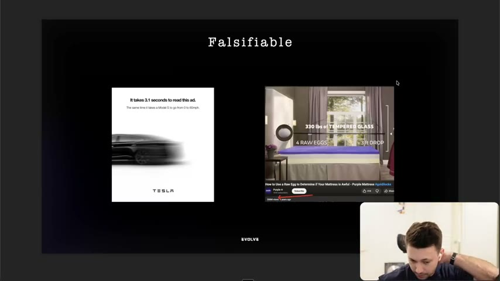
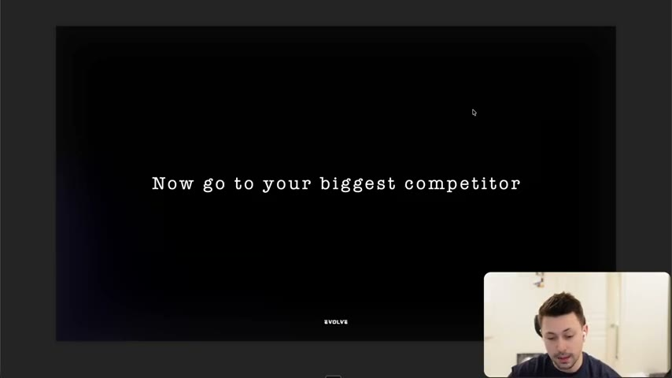
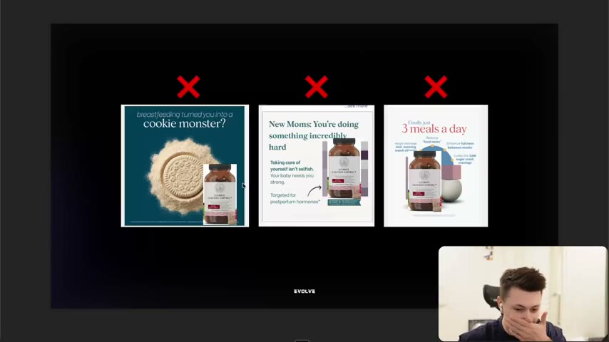
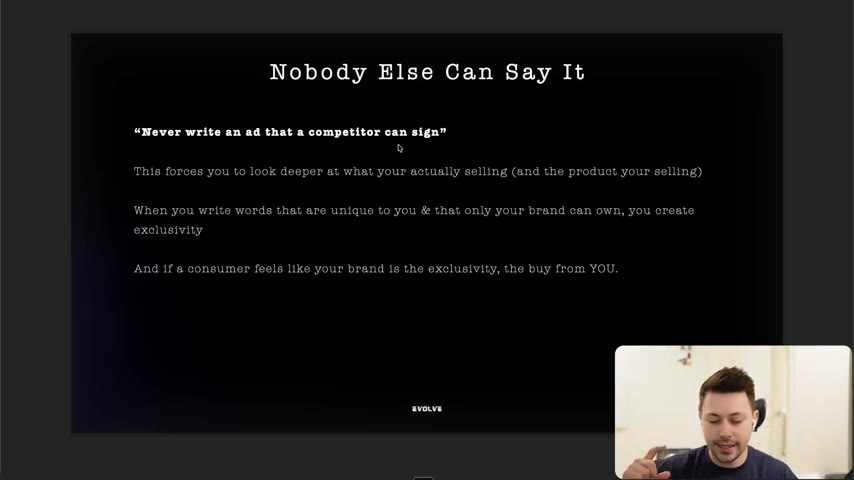
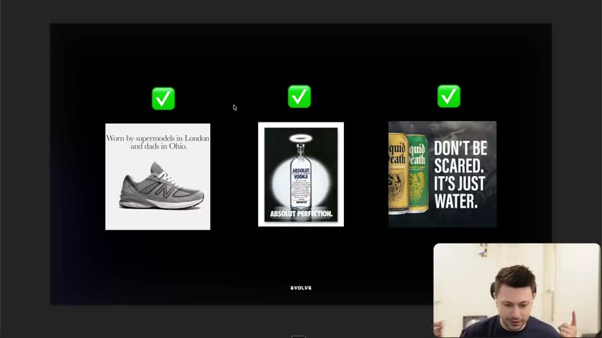

# 08. The 3 checks for great copywriting
> Run any line of copy through three checks, from Harry Dry's framework: can you visualize it, can you falsify it (is it concretely true or false), and can nobody else say it. Three yeses means the copy is probably strong; three noes means it probably isn't.

## 🤖 Agent use
- **Use when:** auditing a hook, headline, script line or static ad (ours or a competitor's), or rewriting copy that is vague, generic, or swappable with a competitor's.
- **Inputs → outputs:** a line/ad → yes/no on each of the three checks, with the failing words quoted → a rewrite that is visual, checkable, and ownable.
- **Rules:**
  - **DO** treat the checks as pattern recognition, not law: "it's not a rule… not every single ad follows this, and not every successful ad follows this, but a lot of them do." [00:00–00:41]
  - **DO** score each line on: (1) Can you visualize it? (2) Can you falsify the words? (3) Can nobody else write this? "If you have three no's, you probably wrote something that is not that great… if you have three yeses, you're probably scaling." (instructor claim) [00:41–01:29]
  - **DO** replace abstract words with pictures. Not "the softest shirt money can buy" but "it feels like cashmere and it's priced like cotton." [03:06–04:01]
  - **DO** state something that can be checked true or false: "He scored 1,600 on the SAT" instead of "He's intelligent". [08:20–10:05]
  - **DO** let the reader draw the abstract conclusion: "Let the abstract thoughts come as a result of the words that you use. Don't tell people it's the softest. Tell them that it feels like cashmere." [04:01]
  - **DON'T** write an ad a competitor could sign: "Never write an ad that a competitor can sign." [slide 13:32]
  - **IF** you can swap a competitor's product into your ad and it still makes sense **THEN** the ad fails the third check. Rewrite around what only your product/brand can claim. [11:22–13:21]
  - **IF** you are stuck on the falsifiable check **THEN** run the "point at it" exercise: if you could only sell the product by pointing at things, what would you point at? [05:34–07:23]
- **See also:** [01. Overview (13-question checklist)](01-overview-of-copywriting-program.md) · [10. Why you need to write facts](10-why-you-need-to-write-facts.md) · [14. Why you need to use unique mechanisms](14-why-you-need-to-use-unique-mechanisms.md) · [Fluency mechanism](../../../../concepts/fluency-mechanism.md) · [Perception management](../../../../concepts/perception-management.md)

Page text: "Full Credits: Harry Dry", plus links to "The Raw Egg Test Ad - Purple Ad" (YouTube) and "Harry's Podcast" (YouTube, with a timestamp). Links not opened. The instructor says the three checks are "all from Harry Dry, I believe, and I don't know where he originally learned them from." [00:00]

## Key ideas

### The three checks at a glance [00:00–01:29]
1. **Can you visualize it?**
2. **Can you falsify the words?** "Can somebody say it's true or false? If someone can't say it's true or false, then that's an issue."
3. **Can nobody else write this?** "If somebody else can write this exact ad that you just wrote", that is a no.
- Three noes = "probably written something that is not that great"; three yeses = "probably scaling" (instructor claim). [00:41–01:29]

### Check 1: Can you visualize it? [01:29–05:34]
- **Memory exercise (Harry's).** Six words read quickly: *optimized process, dumpster fire, dirty dog, value proposition, best practice, wet newspaper.* You'll likely remember "wet newspaper" (last), "dumpster fire", "dirty dog" because they are visual; "best practice", "value proposition", "optimized process" are abstract ("doesn't look like anything"). [01:29–03:06]
- Rule: ask "does it create a visual in that person's mind?" If not, "the user won't clearly understand your message because they can't see it." [03:06]
- **Shirt rewrite:** "the softest shirt money can buy" (what is soft? "so many different things") vs "it feels like cashmere and it's priced like cotton" (soft + cheap, both implied by familiar objects). "If you don't know what cashmere is, then the ad's not for you." [03:06–04:01]
- **iPod:** "a thousand songs in your pocket" vs "the new MP3 player for you". Most people didn't know what an MP3 player was; a thousand songs is a picture, especially for people carrying Walkmans and discs. [04:01–04:56]
- **Rolls-Royce:** "At 60 miles an hour the loudest noise in the new Rolls-Royce comes from the electric clock." You can picture the speed and the near-silence. [04:56–05:34]


*"Visualize" slide with two classic ads: iPod and the Rolls-Royce electric-clock headline. [04:34]*

### Check 2: Can you falsify the words? [05:34–10:59]
- **The pointing exercise (Harry's).** "You can only sell this product by pointing at something… You can't say anything." Applied to a protein bar, the instructor points at agave nectar, peanuts, cocoa powder, which yields "the three ingredient protein bar". [05:34–06:53]
- **RXBAR example.** The ad "Made with simple ingredients." The instructor says "simple" is "slightly more abstract" and he would say "made with four ingredients", which is checkable (the pack shows 3 egg whites, 6 almonds, 4 cashews, 2 dates). He says RXBAR "got acquired for $600 million in 2017" and that founder Peter Rahal later started David Protein (instructor claim). [06:53–07:23; screenshot]
- **David Protein parallel.** "All he does now is he just points at the label": "20 grams of protein, 150 calories, zero sugar" in the product name; positioning is the most protein for the fewest calories. The instructor adds "by the way, they don't taste great, so he's not talking about taste". [07:23–08:20]
- **Definition (slide "Falsifiable"):** "Is this a CONCRETE thing that we can say is TRUE or FALSE? Can this writing be claimed TRUE or FALSE." Example pair: "He's intelligent" vs "He scored 1,600 on the SAT". "When you write words that are falsifiable it communicates, your ad likely communicates more than what it says." [08:20–10:05; slide 08:51]
- **Point:** "Just saying he scored 1600 in the SAT doesn't say 'oh, he's smart', but it communicates that. And… what your writing communicates is far more important than what it actually says." [10:05]
- **Tesla:** "It takes 3.1 seconds to read this ad. The same time it takes a Model S to go from 0 to 60mph." You can time it, so it is true or false. [10:05–10:59]
- **Purple raw egg test:** "How to Use a Raw Egg to Determine if Your Mattress is Awful": 330 pounds of tempered glass, four raw eggs, a three-foot drop; eggs on Purple's mattress don't break, eggs on other mattresses do. The instructor says the ad has "206 million views" (as heard; instructor claim) and that Purple "just made this up" as a test but it is falsifiable ("go and test it"). [10:05–10:59; page link]


*The RXBAR ad "Made with simple ingredients" with an overview of the brand's acquisition. The instructor reads "simple" as slightly abstract and prefers a countable claim. [07:11]*


*Definition slide for check 2. [08:51]*


*Two ads that can be tested true or false: the Tesla "3.1 seconds to read this ad" and Purple's raw egg test. [10:17]*

### Check 3: Can nobody else say this? [10:59–17:43]
- Harry has no exercise for this one, so the instructor invents "Spencer's exercise in honor of Harry" [10:59]:
  1. Pull up your last three static ads (he used three for a postpartum/new-mom supplement brand, brand name blurred; NDAs prevent showing active clients). [10:59–11:52]
  2. Go to your biggest competitor (here Happy Mammoth, product Ultimate Cravings Control). [11:52]
  3. Swap their product into your ads. If the ad "still makes sense", it fails. [11:52–12:50]
- Result: "Breastfeeding turned you into a cookie monster. Try Happy Mammoth Ultimate Cravings Control. Kind of works… New moms, you're doing something incredibly hard. Try ultimate cravings control. Yeah, for postpartum hormones. Sure, makes sense. Finally, just three meals a day, ultimate cravings control. It makes sense." All three fail. (He says "fail the falsifiable test" but the test applied is the "nobody else" check.) [11:52–12:50]
- This is "by far the hardest one". Goal: "never write an ad that I can sign" (that a competitor can sign). You never fully achieve it because "people will copy you no matter what", but you can be first to say something and "own that". Example: once Purple did the egg test, "they already kind of own that." [12:50–14:09]
- Why it matters (slide "Nobody Else Can Say It"): "Never write an ad that a competitor can sign." It "forces you to look deeper at what you're actually selling (and the product you're selling)". Words unique to you create exclusivity, and if a consumer feels your brand is exclusive "they have to buy from you… you're the brand that does that thing." The instructor links this to breakthroughs and positioning. [14:09–15:04]
- Prompt for breakthroughs: "What is something that I can say that nobody else can say?" It "will force you to look for answers that you probably haven't really looked at." [15:04]


*Step 1 of "Spencer's exercise": the three recent statics (brand blurred). [12:13]*


*Step 3: the competitor product (Ultimate Cravings Control) swapped in; all three ads still work, so all three are marked failed. [12:44]*


*"Never write an ad that a competitor can sign." [13:32]*

### Three ads that pass [15:04–16:51]
- **New Balance** (from Harry): "Worn by supermodels in London and dads in Ohio." Passes all three: visual (supermodels, dads), falsifiable (there are photos; "100 percent" dads in Ohio wear New Balance), and ownable ("not many other brands are known for being a dad shoe"). [15:04–15:53]
- **Absolut Vodka**: "Absolut Perfection." Weaker on visual ("you can't really visualize perfection", but "you can visualize absolute, like at least the vodka") and not falsifiable ("this is just a statement"), but **one of one**: it works only because of the brand name. If Grey Goose said "absolute perfection" it wouldn't make sense. [15:53–16:51]
- **Liquid Death**: "Don't be scared. It's just water." Only they can say it; Evian, Dasani and Aquafina "are not going to make it out of this". "It just makes sense. And it's funny." [16:51]


*Three ownable ads. New Balance passes all three checks; Absolut and Liquid Death mainly pass "nobody else can say it". [15:32]*

### Recap and credits [16:51–18:59]
- "Can I see it? Can I say that it's true or false? And can I be the only one who says it?" [16:51]
- The instructor recommends Harry Dry's podcast interview; he has watched it "front to back like four or five times" and says much of the copywriting program fills in gaps from it. [17:43–18:33]

## Steps / framework
Three-check audit (derived from the lesson):

| # | Check | Pass looks like | Fail looks like | Fix |
|---|---|---|---|---|
| 1 | Visualize | A concrete object, scene, or comparison | Abstract noun/verb/adjective: "best practice", "softest" | Replace with a thing you can see ("feels like cashmere") |
| 2 | Falsify | A number, ingredient, test, or measurable event | "simple", "smart", "high quality" | Replace with the countable fact ("four ingredients", "scored 1,600") |
| 3 | Nobody else | A competitor's name swapped in makes it nonsense | Swap works fine | Find a claim, mechanism, name, or history only you have |

Score: three yeses is the target; if all three fail rewrite from scratch.

## Examples
- Covered in Key ideas: shirt, iPod, Rolls-Royce, RXBAR, David Protein, Tesla, Purple, New Balance, Absolut, Liquid Death, and the cookie-monster static swap test.

## Structured units

### Ad teardowns
| Brand / product (niche) | Format | Hook / opening | What works | What fails | Fix suggested | Principle | Source |
|---|---|---|---|---|---|---|---|
| iPod (consumer electronics) | Print | "1,000 Songs in your pocket." | Picture of capacity vs Walkmans and discs | — | — | Visualize | [04:01–04:56] |
| Rolls-Royce (auto) | Print | "At 60 miles an hour the loudest noise in the new Rolls-Royce comes from the electric clock." | Concrete speed + silence | — | — | Visualize | [04:56–05:34] |
| RXBAR (protein bar) | Static | "Made with simple ingredients." | Ingredient list on pack; "pointing" works | "simple" is slightly abstract | "Made with four ingredients" (instructor's suggestion) | Falsify | [06:53–07:23] |
| David Protein (protein bar) | Pack/label | "20 grams of protein, 150 calories, zero sugar" | The label is the claim | Not about taste (instructor aside) | — | Falsify | [07:23–08:20] |
| Tesla Model S | Static | "It takes 3.1 seconds to read this ad. The same time it takes a Model S to go from 0 to 60mph." | Reader can time it | — | — | Falsify | [10:05–10:59] |
| Purple (mattress) | Video | "How to Use a Raw Egg to Determine if Your Mattress is Awful" | Testable demo: 330 lb glass, 4 raw eggs, 3 ft drop | The test itself is invented, not an industry standard | — | Falsify + own it | [10:05–10:59] |
| New Balance (footwear) | Static | "Worn by supermodels in London and dads in Ohio." | Passes all three | — | — | Visual + falsifiable + ownable | [15:04–15:53] |
| Absolut Vodka (alcohol) | Static | "Absolut Perfection." | Name-based, one of one | Perfection not visual or falsifiable | — | Nobody else | [15:53–16:51] |
| Liquid Death (water) | Static | "Don't be scared. It's just water." | Only a brand with this tone can say it | — | — | Nobody else | [16:51] |
| New-mom supplement brand (name blurred) | Static (3 ads) | "Breastfeeding turned you into a cookie monster" / "New moms, you're doing something incredibly hard" / "Finally, just three meals a day" | — | All three work if a competitor's product is swapped in | Find a claim only this product can make | Nobody else | [11:52–12:50] |

### Rewrites
| Before | After | What changed | Source |
|---|---|---|---|
| "the softest shirt money can buy" | "it feels like cashmere and it's priced like cotton" | Abstract superlative to concrete comparison (visual, implies soft and cheap) | [03:06–04:01] |
| "iPod, the new MP3 player for you" | "a thousand songs in your pocket" | Category label to a picture of the benefit | [04:01–04:56] |
| "Made with simple ingredients" | "made with four ingredients" | Vague adjective to a countable claim | [07:23] |
| "He's intelligent" | "He scored 1,600 on the SAT" | Opinion to a checkable fact | [08:20–10:05] |

### Templates
| Template | Use for | Example fill | Source |
|---|---|---|---|
| "[It feels like X] and [it's priced like Y]" | Comparing quality and cost with familiar objects | "feels like cashmere and priced like cotton" | [03:06–04:01] |
| "[It takes X to do Y], the same time it takes [known thing] to [known action]" | Making a time or size claim physical | "3.1 seconds to read this ad, same as a Model S 0 to 60" | [10:05] |
| "Worn by [surprising group A] and [surprising group B]" | Brand with an unexpected, ownable audience mix | "supermodels in London and dads in Ohio" | [15:04] |
| "How to use [everyday object] to determine if [competitor product] is awful" | Self-made test that you win | "How to use a raw egg to determine if your mattress is awful" | [10:05–10:59] |
| Swap test | Check 3 | Replace our product with the competitor's in the last three ads | [11:52] |

(The templates are derived from the quoted examples; the instructor does not present them as named templates.)

### Rules of thumb
- **DO** quote the abstract word and replace it with a visible one. [03:06]
- **DON'T** use "simple", "best", "smart" as the claim; use the number or ingredient behind it. [07:23; 09:07]
- **IF** a competitor can sign your ad **THEN** it is not finished. [13:32]

## Prompts / templates (verbatim)
The memory exercise word list (read aloud at [01:29]):

```
optimized process, dumpster fire, dirty dog, value proposition, best practice, wet newspaper
```

The three checks as stated for recap [16:51]:

```
Can I see it? (Is it visual?)
Can I say that it's true or false? (Is it falsifiable?)
Can I be the only one who says it? (Can you own this? Is this unique to you?)
```

## How to apply
- [ ] Run the six-word test mentally on your script: circle abstract words (best practice, value proposition, optimized).
- [ ] For each key claim, ask: "could a reader say true or false?" If not, add the number, ingredient, test result or time.
- [ ] Do the swap test: paste a competitor's product name into the ad; if it reads fine, rewrite.
- [ ] For competitor ads you tear down, record which of the three checks they pass; copy the mechanism that earns the pass, not the words (derived).
- [ ] Search the headline in quotation marks on Google (lesson 1 checklist item 9) as an additional uniqueness check.

## Related
- Previous: [07. Why great copywriting requires boredom](07-why-great-copywriting-requires-boredom.md) · Next: [09. The importance of how you say it](09-the-importance-of-how-you-say-it.md)
- [10. Why you need to write facts](10-why-you-need-to-write-facts.md) · [Fluency mechanism](../../../../concepts/fluency-mechanism.md) · [Creative primitives](../../../../concepts/creative-primitives.md)

## Sources and limitations
- Transcript: [8. The 3 checks for great copywriting… .txt](<../../../../../raw/evolve/copywriting/_transcripts/✍️ Evolve Copywriting (NEW)/8. The 3 checks for great copywriting ✍️ Evolve Copywriting (NEW) Evolve.txt>) · Page text: [….html.md](<../../../../../raw/evolve/copywriting/_extracted/✍️ Evolve Copywriting (NEW)/8. The 3 checks for great copywriting_✍️ Evolve Copywriting (NEW)_Evolve.html.md>)
- Machine transcription (Whisper large-v3-turbo); full recording covered (1139.78 s). Whisper wrote "X bar" for RXBAR (the slide shows RXBAR). "Happy Mammoth" is as heard and matches the logo on screen. The ad text for iPod and Rolls-Royce comes from the on-screen images. "206 million views" and the $600 million acquisition are the instructor's statements; not verified here.
- Spoken line at [12:50] says the swapped ads "fail the falsifiable test", but the exercise being done is the nobody-else test; treated here as the latter.
- The Purple YouTube link and Harry Dry's podcast link were not opened.
