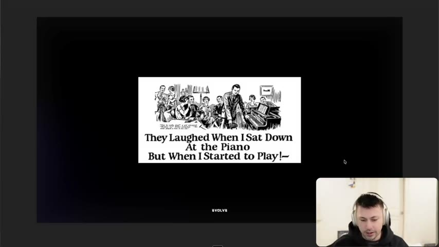
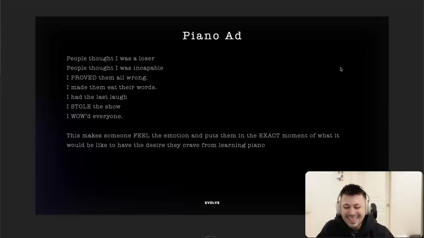
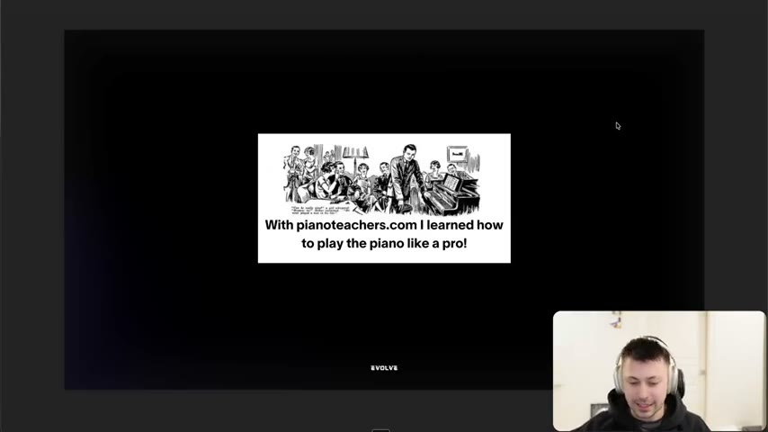
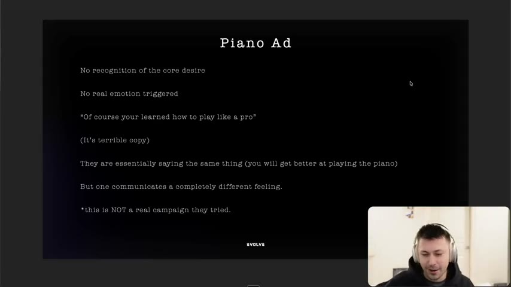
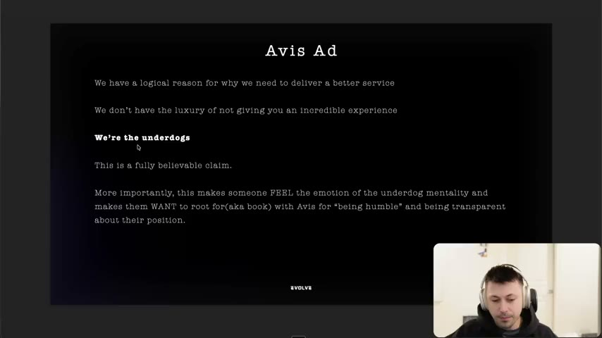
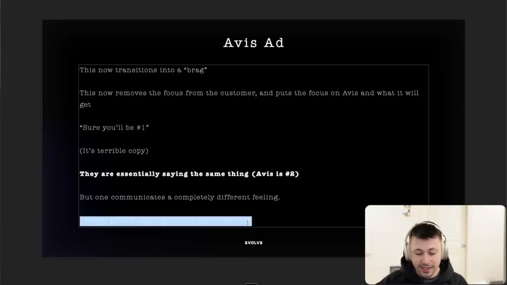
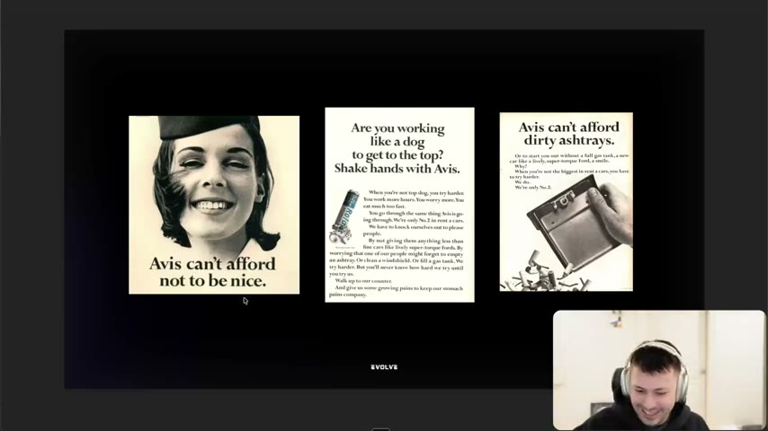

# 09. The importance of /how/ you say it
> What matters is what your copy communicates (the feeling and desire it triggers), not the literal words; two lines can say the same fact and one sells while the other fails. Analyse winners for what they communicate, then rebuild the same feeling with new words.

## 🤖 Agent use
- **Use when:** tearing down a winning competitor ad or hook, and when writing iterations/variations of a hook or script.
- **Inputs → outputs:** an ad or hook line → a one-line statement of what it communicates (feeling + desire + position) → variations with different words that preserve that communication.
- **Rules:**
  - **DO** ask of every line: "what is this actually communicating?" and write the answer in a short phrase. [00:00–01:29; 08:19–08:49]
  - **DO** name the feeling and the desire the line creates before you copy or iterate it. "What is the feeling that it communicates and what is the desire that it's communicating?" [08:49]
  - **DO** build variations by "executing it with different words to communicate the same thing". [08:49]
  - **DON'T** rewrite a hook so the literal facts stay but the feeling changes ("some of you guys will go and rewrite your hook, but it makes no sense. And you lose what your original hook was communicating"). [08:49–09:37]
  - **DON'T** shift the focus from the customer to the brand (a brag): "this now removes the focus from the customer." [06:42]
  - **IF** a copied hook "works", **THEN** do not copy it word for word; find the desire and write it your way. [08:19–08:49]
  - **IF** a variation underperforms **THEN** check whether it still communicates the original feeling or accidentally communicates something else (or nothing). [09:37; 11:16]
- **See also:** [08. The 3 checks for great copywriting](08-the-3-checks-for-great-copywriting.md) · [Iteration vs variation](../../../../concepts/iteration-vs-variation.md) · [Emotional zones](../../../../concepts/emotional-zones.md) · [Creative primitives](../../../../concepts/creative-primitives.md)

Page text: credits only (Al Ries + Jack Trout; Jason Fladlien).

## Key ideas

### It is not what you say, it is what it communicates [00:00–01:29]
- "It's not about what your copy says… it's about what your copy is actually communicating. And the problem with most of you guys is that your copy actually doesn't communicate anything. And that's why it's not good copy." [00:00]
- He says this is "one of the most important modules" for writing iterations and variations and for how to "analyze copy the right way". [00:00]
- Management analogy: telling an employee "hey, you suck" vs "I know you're trying really hard, but it's not actually giving us the outcome that we're looking for… we need to figure out… how to write this differently". Both say the person is underperforming; the experience differs. [00:52–01:29]
- Direct response doesn't allow "overly explaining", "so that's why direct response copy is so hard". [01:29]

### Example 1: the piano ad vs "pianoteachers.com" [01:29–04:59]
- Original headline (classic newspaper ad): **"They laughed when I sat down at the piano, but when I started to play…"** [01:29]
- Slide "Piano Ad" lists what it communicates: "People thought I was a loser / People thought I was incapable / I PROVED them all wrong. / I made them eat their words. / I had the last laugh / I STOLE the show / I WOW'd everyone." and "This makes someone FEEL the emotion and puts them in the EXACT moment of what it would be like to have the desire they crave from learning piano". [02:19; slide 02:30]
- The instructor's reading: it is visual ("you can almost dream that"), puts you in the moment where everyone laughs and then is stunned, and the core desire is **status / recognition**. [02:19–04:04]
- His fake counter-example (he says it is **not a real campaign**; he made it up): **"With pianoteachers.com I learned how to play the piano like a pro!"** [03:12–04:59; slide at 03:30]
- Slide "Piano Ad" (analysis): "No recognition of the core desire / No real emotion triggered / 'Of course you learned how to play like a pro' / (It's terrible copy) / They are essentially saying the same thing (you will get better at playing the piano) / But one communicates a completely different feeling." [04:04; slide 04:00]
- Point: both say "you will get better at the piano". "One communicates a completely different feeling and provides a completely different experience." [04:04]

*The original piano ad headline. [02:00]*

*The subtext list: loser, incapable, proved them wrong, last laugh, stole the show, wowed everyone. [02:30]*

*The weak counter-example the instructor wrote: "With pianoteachers.com I learned how to play the piano like a pro!" (not a real campaign). [03:30]*

*No recognition of the core desire, no emotion; same fact, different feeling. [04:00]*

### Example 2: Avis [04:59–07:34]
- Headline: **"Avis is only No. 2 in rent-a-cars, so we try harder."** (billboard on screen) [04:59]
- What it communicates (slide "Avis Ad"): a logical reason to deliver better service; "We don't have the luxury of not giving you an incredible experience"; "**We're the underdogs**"; "This is a fully believable claim"; and it makes someone "FEEL the emotion of the underdog mentality and makes them WANT to root for (aka book) with Avis for 'being humble' and being transparent about their position." [04:59–06:42; slide 05:20]
- Transparency about position creates the feeling: "most people wouldn't want to admit this, but because they admit it, they now get to actually position themselves". [05:51]
- Failed variant (the instructor's account): **"Avis is going to be number one in rent-a-cars."** Slide: "This now transitions into a 'brag' / This now removes the focus from the customer, and puts the focus on Avis and what it will get / 'Sure you'll be #1' / (It's terrible copy) / They are essentially saying the same thing (Avis is #2) / But one communicates a completely different feeling." [06:42–07:34; slide 07:40]
- He says, unlike the piano example, this "was a real campaign that they tried and it failed miserably" (instructor claim; no source given). [07:34]
- Takeaway: "the best copywriters focus more on what their words communicate versus what the words say." Communication means "what it makes the customer feel and what it makes the customer think." [07:34–08:19]

*"We're the underdogs": the feeling the line triggers and the response it asks for. [05:20]*

*Why "we'll be number one" fails: it is a brag, with focus moved from the customer to the brand. [07:40]*

### Pro tip: apply it to winners [08:19–09:37]
- "The next time you review an ad that's doing well… on AdSpy or you have a new winning ad… don't just copy the ad word for word… Think about what is this hook communicating… What is the feeling that it communicates and what is the desire that it's communicating? And then… execute it with different words to communicate the same thing. And that will actually give you a different hook." [08:19–08:49]
- Connects to his repeated advice to "execute differently or do a variation": many writers change the words and lose the original communication. [08:49–09:37]
- Analysis of the Avis failure: going from "we're number two and we try harder" to "we're going to be number one" loses the underdog ethos; at best it implies good service. [09:37]

### Avis variations that kept the communication [09:37–11:16]
Real Avis ads shown on screen (headlines as read/seen):
- **"Avis can't afford not to be nice."** (smiling flight attendant) [09:37–10:19]
- **"Avis can't afford dirty ashtrays."** Body copy (visible on slide): "Or to start you out without a full gas tank, a new car like a lively, super-torque Ford, a smile. Why? When you're not the biggest in rent a cars, you have to try harder. We do. We're only No. 2." [10:19]
- **"Are you working like a dog to get to the top? Shake hands with Avis."** Body copy: "When you're not top dog, you try harder." [10:19–11:16]
- The instructor's reading: each hook differs but returns to "we're only number two", and the third "identified the underdog ethos" to speak to a **sub-avatar**: the person who feels like the underdog ("we are you as well in rent-a-car form"). "They're not even talking about rental cars." [10:19–11:16]
- Slide at 11:25: "These words 'say' something different" (and, previous slide, "And not just what the words say."), but they "communicate the same thing effectively". [11:16]

*Three Avis ads with different words and the same underlying message (we're number two, so we try harder). [10:00]*

### Action [11:16–12:03]
- "Go and review your ads and ask yourself, what is the feeling that this ad creates… think about how you can create variations that communicate the same thing. Because a lot of you guys create variations that communicate something different or… communicate nothing at all." [11:16]
- He refers to "the valence and intensity stuff" from another module, as an existing frame for feelings [11:16] (not part of this lesson; see [Emotional zones](../../../../concepts/emotional-zones.md) for the related Tether Lab model).

## Steps / framework
Communication-first variation process (derived from [08:19–11:16]):

1. Take the winning hook/ad. Write what it literally **says** (one line).
2. Write what it **communicates**: the feeling, the desire, the position (one to three phrases).
3. Check it: is the claim believable? Does it focus on the customer or the brand?
4. Write 3-5 new hooks with different words that preserve that communication (Avis: "can't afford X" series; piano: other "they laughed, then I..." moments).
5. For each variant, re-state what it communicates; discard any whose answer changed.

## Examples
Covered above: piano ad (original and fake rewrite), Avis (original, failed "number one", three real follow-ups).

## Structured units

### Ad teardowns
| Brand / product (niche) | Format | Hook / opening | What works | What fails | Fix suggested | Principle | Source |
|---|---|---|---|---|---|---|---|
| Piano lessons (classic print ad) | Print | "They laughed when I sat down at the piano, but when I started to play…" | Communicates loser then triumph, status, last laugh; visual moment | — | — | Communicate the desire (status) | [01:29–04:04] |
| pianoteachers.com (made-up by instructor) | Print mock | "With pianoteachers.com I learned how to play the piano like a pro!" | — | No recognition of core desire; "of course you learned"; no emotion | Use the "they laughed" structure | Same facts, different feeling | [03:12–04:59] |
| Avis (car rental) | Billboard | "Avis is only No. 2 in rent-a-cars, so we try harder." | Believable, transparent, underdog, makes you root for them | — | — | Position through admission | [04:59–06:42] |
| Avis (failed variant) | Billboard | "Avis is going to be number one in rent-a-cars." | Says the same position (#2 implied) | A brag; focus on brand; loses the underdog | Keep "only No. 2" framing | Communication lost | [06:42–07:34] |
| Avis (variants) | Print | "Avis can't afford not to be nice." / "Avis can't afford dirty ashtrays." / "Are you working like a dog to get to the top? Shake hands with Avis." | Different words, same underdog message; the dog line targets a sub-avatar | — | — | Variations that preserve communication | [09:37–11:16] |

### Rewrites
| Before | After | What changed | Source |
|---|---|---|---|
| "With pianoteachers.com I learned how to play the piano like a pro!" | "They laughed when I sat down at the piano, but when I started to play…" | From self-congratulation (no emotion) to a scene that delivers status and a last laugh | [03:12–04:59] |
| "Avis is going to be number one in rent-a-cars." | "Avis is only No. 2 in rent-a-cars, so we try harder." (original) / "Avis can't afford dirty ashtrays." | From brag to admission and customer benefit; underdog preserved | [06:42–10:19] |

### Angles
| Angle | Core desire / pain | Heuristic(s) | Best format | Example line | Source |
|---|---|---|---|---|---|
| Underdog / "we try harder" | Want to root for the humble challenger; get better service | — | Print, static, hook | "Avis is only No. 2 in rent-a-cars, so we try harder." | [04:59–06:42] |
| Last laugh / prove them wrong | Status, recognition after being doubted | — | Story hook, video | "They laughed when I sat down at the piano…" | [02:19–04:04] |

### Rules of thumb
- **DO** write "what it says" and "what it communicates" as two separate lines in every teardown.
- **DON'T** brag; keep the customer at the centre of the line [06:42].
- **IF** a variation changes the feeling, **THEN** it is a different ad, not a variation [08:49–09:37].

## How to apply
- [ ] For each competitor hook in the teardown, fill: says / communicates / desire / feeling / customer-focused or brand-focused?
- [ ] Write variations only after the "communicates" line is settled; test variations for the same communication.
- [ ] Remove brag lines ("we will be the best") that shift focus to the brand.
- [ ] When you need a new sub-avatar angle, extend the same message to the sub-group who feels it (Avis: "working like a dog").
- [ ] (derived, UGC) Use the same method on spoken hooks: say what the creator's first line communicates, not just its words.

## Related
- Previous: [08. The 3 checks for great copywriting](08-the-3-checks-for-great-copywriting.md) · Next: [10. Why you need to write facts](10-why-you-need-to-write-facts.md)
- [Iteration vs variation](../../../../concepts/iteration-vs-variation.md) · [Emotional zones](../../../../concepts/emotional-zones.md) · [Perception management](../../../../concepts/perception-management.md)

## Sources and limitations
- Transcript: [9. The importance of how you say it… .txt](<../../../../../raw/evolve/copywriting/_transcripts/✍️ Evolve Copywriting (NEW)/9. The importance of how you say it ✍️ Evolve Copywriting (NEW) Evolve.txt>) · Page text: [….html.md](<../../../../../raw/evolve/copywriting/_extracted/✍️ Evolve Copywriting (NEW)/9. The importance of _how_ you say it_✍️ Evolve Copywriting (NEW)_Evolve.html.md>)
- Machine transcription (Whisper large-v3-turbo); full recording covered (723.67 s). "AdSpy" is as heard (an ad-spy tool). Whisper mis-transcribed "Avis is going to be" fine; quotes were checked against slides.
- The instructor says the "Avis number one" campaign was real and "failed miserably", with no source; treat as an instructor claim. He is explicit that the pianoteachers.com line is his own invention.
- A phone call interrupts the recording at about [09:37]; no content lost.
