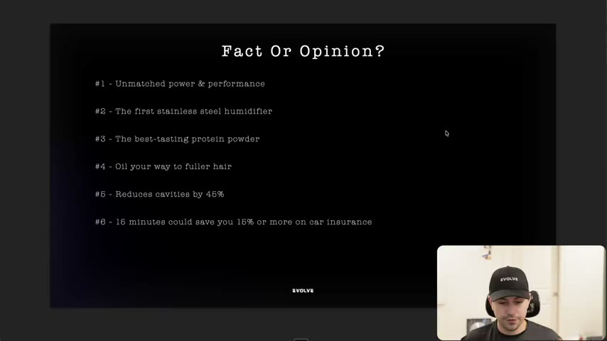
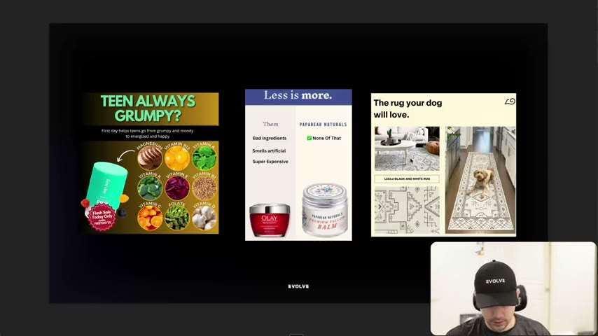
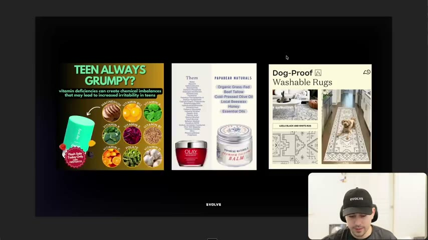
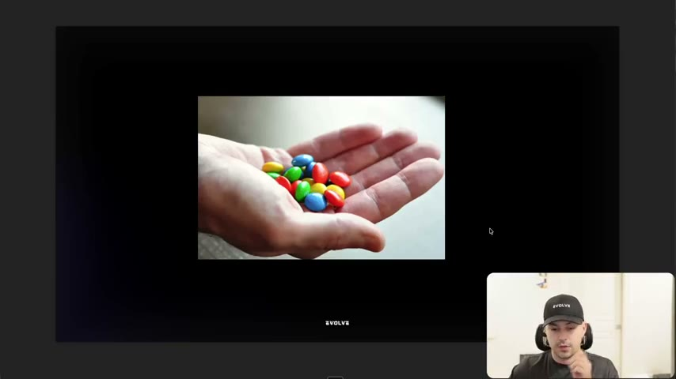
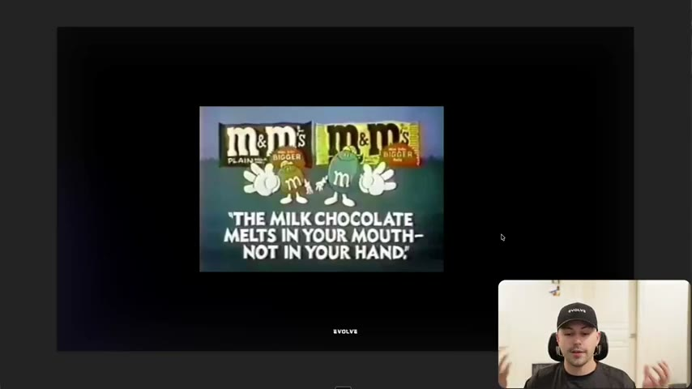

# 10. Why you need to write facts
> Facts are unbiased and communicate more than opinions, so turn every matter of opinion in your copy into a matter of fact (it does not have to be a statistic) and build the ad from a fact that is true of your product.

## 🤖 Agent use
- **Use when:** writing or auditing claims, headlines and bullet points in ads; rewriting vague superlatives; looking for the fact that can anchor a hook or mechanism.
- **Inputs → outputs:** a draft line or product spec sheet → each claim labelled fact/opinion → opinions replaced by the underlying fact (ingredient count, first-ever, physical behaviour, study result) → a hook built from the best fact.
- **Rules:**
  - **DO** ask of every statement: "is this an opinion? If it is an opinion, just try to turn it into a fact." [01:06]
  - **DO** "when in doubt, just give a fact." Facts "are usually going to communicate something more". [01:41]
  - **DO** show the fact and let the customer draw the conclusion (six ingredients vs a long unpronounceable list; no "less is more" needed). [05:56–06:58]
  - **DO** push beyond statistics: "this does not need to be a statistic." A fact can be a first, a count, a physical property, or a mechanism. [08:35–09:36]
  - **DO** check facts with an AI model if unsure: "you guys have Claude, so you can go and ask Claude as well." [03:22–03:53]
  - **DON'T** state bare opinions ("best tasting", "unmatched power and performance"). If you must, follow with a fact. [03:53]
  - **DON'T** assume facts must be numbers; non-numerical facts are harder but more distinctive. [09:06; 12:49]
  - **IF** a claim is slightly opinionated ("dog proof"), **THEN** attach the factual reason ("because it's washable"). [07:32]
  - **IF** you have a fact, **THEN** ask "how can you write something that comes from that fact?" and write from it (M&M's: "melts in your mouth, not in your hand"). [10:36–12:17]
- **See also:** [08. The 3 checks for great copywriting](08-the-3-checks-for-great-copywriting.md) · [60. Facts list](60-facts-list.md) · [11. Why you need to write less fluff](11-why-you-need-to-write-less-fluff.md) · [Perception management](../../../../concepts/perception-management.md)

Page text: credits only (Harry Dry; David Perell).

## Key ideas

### Why facts [00:00–01:41]
- "Facts are unbiased." Saying "I'm five foot 10" is a fact; "if you're five foot 10, you're short" is an opinion people will argue. [00:00–00:32]
- The saying he loves (Harry Dry's): "you want to turn a matter of opinion into a matter of fact." [01:06]
- Facts "are true, opinions are not", and they usually communicate more (links to [lesson 9](09-the-importance-of-how-you-say-it.md)). [01:06–01:41]
- Also: facts carry credibility. "When you are rooted in facts, you have much more credibility… People will believe you." (credited to David Perell, who interviewed Harry). If you say a fact, then another, even an opinion after them may be accepted. [13:20]

### Exercise 1: fact or opinion? [01:41–03:53]
Six statements on screen (slide "Fact Or Opinion?"). The instructor's verdicts:

| # | Statement | Verdict | His reasoning |
|---|---|---|---|
| 1 | Unmatched power & performance | Opinion | "not a fact" [02:16] |
| 2 | The first stainless steel humidifier | Fact | "it can be proven"; "this was an angle that actually murdered for us" for a humidifier brand (heard "stealing", likely "scaling") [02:16] |
| 3 | The best-tasting protein powder | Opinion | "fully an opinion" [02:16] |
| 4 | Oil your way to fuller hair | Opinion | "complete opinion" [02:16] |
| 5 | Reduces cavities by 45% | Fact (if a study shows it) | "if you had a study that showed that, guess what? That's a fact." [02:48] |
| 6 | 15 minutes could save you 15% or more on car insurance | Mixed | "could" adds opinion, but it is rooted in statistics; memorable "15 and 15" slogan [02:48–03:22] |

*Exercise 1 slide. [02:00]*

### Exercise 2: turn opinions into facts [03:53–08:02]
Three static ads are shown "before", the viewer pauses to rewrite, then the instructor shows "after":

| Product | Before | After (instructor's fact version) |
|---|---|---|
| Teen vitamin supplement | "TEEN ALWAYS GRUMPY?" + "First day helps teens go from grumpy and moody to energized and happy" | "TEEN ALWAYS GRUMPY?" + "vitamin deficiencies can create chemical imbalances that may lead to increased irritability in teens"; the ad also lists magnesium, vitamin B12, A, K, E, D, C, folate, etc. ("facts, facts, facts") |
| Papa Bear Naturals balm vs Olay | "Less is more." + Them: bad ingredients / smells artificial / super expensive; Papa Bear Naturals: "None of that" | Same layout showing the full ingredient list of the other brand ("32 and ones that you can't pronounce") vs Papa Bear's six: organic grass-fed beef tallow, cold-pressed olive oil, local beeswax, honey, essential oils; headline "Less is more." removed |
| Washable rug (brand not named) | "The rug your dog will love." | "Dog-Proof Washable Rugs" with a small emoji (he reads it as a poo emoji) |

- Instructor's notes on each: for the teen ad the fact (vitamin deficiencies can create chemical imbalances) is "somewhat of a statistic" and "could we make this better with a percentage potentially". [09:26–05:26; 09:06]
- For Papa Bear: "Less is more is an opinion, but what I love is the ad still works. Even if you just do this… literally says nothing but this." "You're not claiming that you're better by saying less is more. You're just literally stating it." Customers "come to that decision". "People can draw the conclusion that less is more." [05:26–06:58]
- For the rug: "dog proof" is slightly opinionated, but the emoji makes it "dog proof from dog shit", and "the reason why it's dog proof is because it's washable. And you're like, that's valid." [06:58–07:32]

*Before: opinion-led copy. Pause-and-rewrite exercise. [04:18]*

*After: each opinion replaced by a checkable fact (cause, ingredient list, washable). [05:08]*

### Exercise 3: work with facts [08:02–12:17]
- Task: think of a fact about your product or brand. "This does not need to be a statistic." He deliberately chose examples without statistics: "I don't want you guys to think immediately 'my product has X percent of this'… that is the obvious one that every single person will go through." [08:02–09:36]
- Statistics-led ads "usually do well because you're not lying"; he says FTC rules push toward stating facts and TV commercials root messaging in facts (instructor claim, no source). [08:35–09:06]
- His example fact: **M&M's won't melt in your hand** (photo of M&M's in a hand). Caveat: with a blowtorch or in 45-degree weather they might, but versus a chocolate bar in the same environment they would not, due to the candy coating. [09:36–10:36]
- Next step: write from the fact. The famous ad: **"The milk chocolate melts in your mouth, not in your hand."** Many chocolate brands claim "melts in your mouth"; the fact makes it "more unique to their brand and their product". He calls it "iconic" and says it "crushed for them". [10:36–11:46]

*The fact prompt: M&M's do not melt in your hand. [10:34]*

*The ad built from that fact. [11:14]*

### Behind every fact is a story [11:46–13:20]
- "When you say a fact, it guarantees that you say something." Compare "unmatched power and performance" ("what?") with "it has 1100 horsepower". [11:46–12:17]
- Harry's recommendation: start with a fact, then turn it into something else (the M&M's example). [12:17]
- Facts need not be numerical or statistic: Avis' "we're number two" (lesson 9) was a fact "but all facts don't have to be numerical". [12:49]

## Steps / framework
Fact-first copy process (derived from the three exercises):

1. List every claim in the draft. Label each F (fact: can be proven true/false) or O (opinion).
2. For each O, find the fact behind it (what is in it, what is it the first to do, how does it behave, what causes the problem?). Replace or support.
3. Keep slightly opinionated words only when the fact follows ("dog-proof" because washable).
4. Look for non-statistical facts (first-ever, ingredient counts, physical behaviour like "won't melt in your hand", a comparison list).
5. Write the headline from the strongest fact and let the viewer infer the benefit.
6. Check: if you removed the opinion words, does the ad still work (Papa Bear)?

## Examples
Covered in Exercise tables and rewrites below.

## Structured units

### Rewrites
| Before | After | What changed | Source |
|---|---|---|---|
| "First day helps teens go from grumpy and moody to energized and happy" | "vitamin deficiencies can create chemical imbalances that may lead to increased irritability in teens" (plus vitamin list) | Promise/outcome to cause + ingredient facts | [04:25–05:26] |
| "Less is more. Them: bad ingredients, smells artificial, super expensive. Papa Bear: none of that" | Full competitor ingredient list vs six Papa Bear ingredients | Opinion adjectives to countable evidence; viewer concludes | [05:26–06:58] |
| "The rug your dog will love." | "Dog-Proof Washable Rugs" (with a poo emoji) | Feeling claim to function claim with its reason | [06:58–07:32] |
| "Unmatched power and performance" | "It has 1,100 horsepower" (instructor's illustration) | Vague superlative to a number | [12:17] |
| "melts in your mouth" (category cliche) | "The milk chocolate melts in your mouth, not in your hand." | Cliche to a fact only M&M's can claim | [10:36–11:46] |

### Hooks
| Hook | Heuristic(s) | Emotion / zone | Self targeted | Why it works | Source |
|---|---|---|---|---|---|
| "The first stainless steel humidifier" | — | — | — | Provable first; an angle the instructor says "murdered" for a humidifier brand (instructor claim) | [02:16] |
| "Reduces cavities by 45%" | — | — | — | Specific, study-backed result | [02:48] |
| "15 minutes could save you 15% or more on car insurance" | — | — | — | Memorable pairing of two numbers; "could" softens the claim | [02:48–03:22] |
| "TEEN ALWAYS GRUMPY?" with vitamin facts | — | — | — | Question hook plus cause fact | [04:25–05:26] |

### Ad teardowns
| Brand / product (niche) | Format | Hook / opening | What works | What fails | Fix suggested | Principle | Source |
|---|---|---|---|---|---|---|---|
| Teen vitamin gummy/supplement (name not given; "Flash Sale Today Only" badge) | Static | "TEEN ALWAYS GRUMPY?" | Question hook; nutrient grid | Outcome claim "go from grumpy and moody to energized and happy" is an opinion | State the cause: vitamin deficiencies can create chemical imbalances | Opinion to fact | [04:25–05:26] |
| Papa Bear Naturals (skin balm) vs Olay | Static comparison | "Less is more." | Comparison table | "Bad ingredients / smells artificial / super expensive" are opinions | Show the real ingredient lists, drop the adjectives | Show, let viewer conclude | [05:26–06:58] |
| Washable rug (brand not named) | Static | "The rug your dog will love." | Dog in photo | "will love" is an opinion | "Dog-Proof Washable Rugs" | Fact with reason | [06:58–07:32] |
| M&M's | Print | "The milk chocolate melts in your mouth, not in your hand." | Rooted in a physical fact; unique in category | — | — | Start from a fact | [10:36–11:46] |

### Rules of thumb
- **DO** label each claim fact or opinion before shipping. [01:06]
- **DON'T** confuse "fact" with "number". [08:35]
- **IF** unsure whether it's a fact **THEN** ask an LLM or check the source. [03:22–03:53]

## How to apply
- [ ] Extract all product facts into a list (ingredients, firsts, counts, tests, physical behaviours, certifications) before writing. See [60. Facts list](60-facts-list.md) (a course template).
- [ ] Run a fact/opinion pass on every headline, bullet and CTA; fix each opinion.
- [ ] Draft three hooks from non-statistic facts and one from a statistic.
- [ ] When tearing down competitor ads, mark which of their claims are facts and which are opinions; the facts are what make the ad work.
- [ ] For comparison ads, show the underlying lists rather than adjectives.

## Related
- Previous: [09. The importance of how you say it](09-the-importance-of-how-you-say-it.md) · Next: [11. Why you need to write less fluff](11-why-you-need-to-write-less-fluff.md)
- [Perception management](../../../../concepts/perception-management.md) · [Validation over authority](../../../../concepts/validation-over-authority.md)

## Sources and limitations
- Transcript: [10. Why you need to write facts… .txt](<../../../../../raw/evolve/copywriting/_transcripts/✍️ Evolve Copywriting (NEW)/10. Why you need to write facts ✍️ Evolve Copywriting (NEW) Evolve.txt>) · Page text: [….html.md](<../../../../../raw/evolve/copywriting/_extracted/✍️ Evolve Copywriting (NEW)/10. Why you need to write facts_✍️ Evolve Copywriting (NEW)_Evolve.html.md>)
- Machine transcription (Whisper large-v3-turbo); full recording covered (828.03 s). Whisper wrote "Henry" for Harry at [11:46], "David Peril" for David Perell, "Ava" for Avis ([12:49]), "stealing" for probably "scaling" ([02:16]), "saints" for probably "statements" ([01:41]).
- Ad contents were read from slide images; the teen supplement and rug brand names are not legible or not stated. The emoji on the rug ad is interpreted by the instructor as a poo emoji.
- The FTC remark and "ads with statistics usually do well" are instructor claims.
