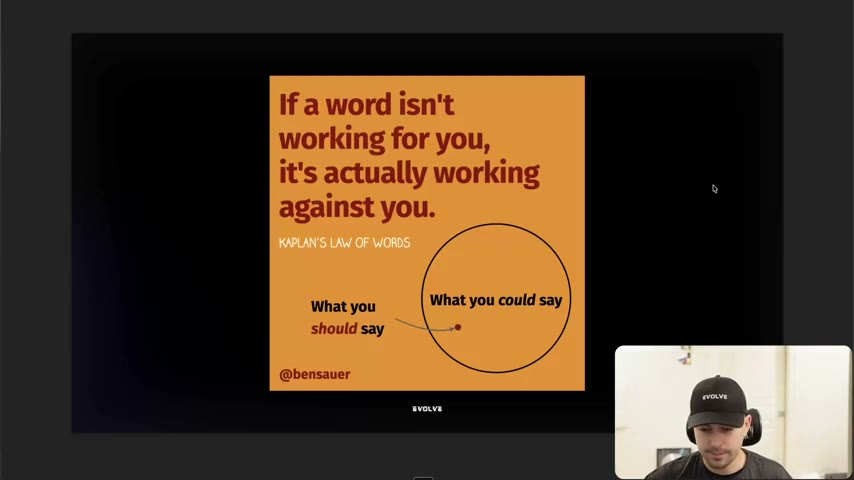
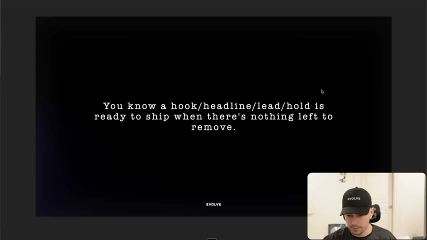
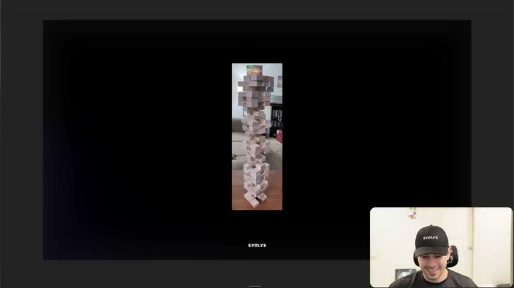
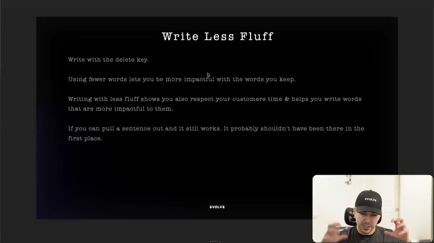

# 11. Why you need to write less fluff
> Great direct-response copy is compressed without losing meaning: write the draft, then delete until removing anything else would collapse the message (the Jenga test), and never ship a first draft.

## 🤖 Agent use
- **Use when:** editing any hook, headline, lead, body ("hold") or script, and when reviewing an agent's first-pass output.
- **Inputs → outputs:** a draft hook/script → a shorter version where every remaining word is load-bearing → a "ready to ship" judgment using the delete test.
- **Rules:**
  - **DO** "write with the delete key": after drafting, go back and delete. [06:37; slide 07:50]
  - **DO** apply the ship test: "you know a hook/headline/lead/hold is ready to ship when there's nothing left to remove." [03:20–03:53]
  - **DO** run the pull-one-block check on each sentence: "what happens if I delete this?" If the flow still works, "it probably shouldn't have been there in the first place." [07:12–07:43]
  - **DON'T** compress into emptiness: "it's one thing to write compact and… say absolutely nothing." Compress "without losing meaning." [01:43–02:14]
  - **DON'T** ship first drafts or unedited LLM output: "the brief or Claude will just give you it and you'll just ship it." [06:07–06:37]
  - **IF** you have several briefs due in a day **THEN** write them all in the morning, take a break (the instructor says "maybe an hour"), then reread and rewrite them. [08:13]
  - **IF** you can write long, **THEN** only because each point needs it: "there's never a thing that's too long, only too boring", but don't write long just to write long. [00:00–00:32]
- **See also:** [05. Why you need to write in the environment](05-why-you-need-to-write-in-the-environment.md) · [07. Why great copywriting requires boredom](07-why-great-copywriting-requires-boredom.md) · [12. Why you need to speak copy](12-why-you-need-to-speak-copy-not-write-it.md) · [13. Why you need to write at a 6th grade level](13-why-you-need-to-write-at-a-6th-grade-level.md)

Page text: "Credit: Harry Dry".

## Key ideas

### Compression is the tool [00:00–02:14]
- He calls this "the direct response copywriter's number one tool": "a lot of people are great at writing thoughts down but very few are good at compacting it." [00:00–00:32]
- Quotes: "A great sentence is a good sentence made shorter" (Harry Dry; he doesn't know if Harry borrowed it) and "If I had more time, I would have written a shorter letter" (he says from "ancient French… an artist or something"; attribution uncertain, the quote is not identified in the course). [00:32–01:06]
- The irony he likes: most people think more time means writing more; it means writing less. [01:06]
- The best direct-response writers "ruthlessly… compress a message… to get it across with more power, more impact", without losing meaning. "Nothing said well is still nothing." [01:06–02:14]

### Kaplan's Law of Words [02:14–03:20]
- Graphic by Ben Sauer (slide shows "@bensauer"; the instructor says "ben sawyer from LinkedIn", found while searching for a visual). Text: "If a word isn't working for you, it's actually working against you. Kaplan's Law of Words." [02:14; frame 02:18]
- The diagram: a big circle "What you could say" containing many dots; a single dot labelled "What you should say". He added a screenshot with red dots to show how many possible things there are versus the one you should say. [02:47–03:20]
- Takeaway: we write excess "because we think it makes our argument better… but a lot of times we don't". [03:20]

*"If a word isn't working for you, it's actually working against you." Many possible things to say; say the one you should. [02:18]*

### The ship test [03:20–03:53]
- Slide: "You know a hook/headline/lead/hold is ready to ship when there's nothing left to remove." [slide 03:30]
- Process: "you're probably going to write out a full idea but then you start to look at it from the lens of 'what can I remove?'" When removing anything else would lose the meaning or flow, "you've probably got something pretty good". [03:20–03:53]

*The ship test for hook, headline, lead, or hold (body). [03:30]*

### The Jenga analogy [03:53–05:31]
- "Copy should be treated like" a Jenga tower: if you pull the wrong block "the whole tower would come crumbling down", meaning you lost the message; but looking closely you might find one more block you can safely pull. [03:53–04:27]
- Most people's copy is "a standard Jenga tower with the easiest ones pulled out" and they haven't asked what else can be removed. "When you remove, you actually clarify your message sometimes." [05:01]
- Goal: every word "heavy hitting"; "the entire thing should collapse if you remove something and that's how you know you've got something basically perfected". Direct response rarely gives "the luxury of just being able to say a bunch of stuff". [05:01–05:31]

*Every block must carry weight; removing the wrong one collapses the message. [04:00]*

### Clear writing costs time; stop shipping drafts [05:31–06:37]
- Slide: "Clear writing requires more time, effort, and thought than writing a long, unedited draft." [05:30]
- "A lot of you are just shipping drafts… you submitted a rough draft, a first draft", then are surprised the ad fails. He ties this to time pressure, calling time an opportunity cost to discuss later. [06:07]
- "You write the brief or Claude will just give you it and you'll just ship it" without challenging "how can I make this better". He says this is where "high intent" comes in. [06:37]

### Write Less Fluff (summary slide) [06:37–08:13]
Slide text (verbatim):
- "Write with the delete key."
- "Using fewer words lets you be more impactful with the words you keep."
- "Writing with less fluff shows you also respect your customers time & helps you write words that are more impactful to them."
- "If you can pull a sentence out and it still works. It probably shouldn't have been there in the first place." [slide 07:50; spoken 06:37–08:13]
- Even winning-ad briefs likely have places to "refine and polish". [07:12]

*Four rules to apply on every edit pass. [07:50]*

### Assignment [08:13–08:45]
- Go back over what you wrote. Write the day's briefs in the morning, break (e.g. an hour), then reread and rewrite: "give your brain a little bit of a break… get the draft done and then you can come back and optimize it". [08:13]

## Steps / framework
Delete-key pass (derived from [03:20–08:45]):

1. Draft the full idea without editing.
2. Take a break (a coffee, an hour, or the next day; see [lesson 7](07-why-great-copywriting-requires-boredom.md)).
3. Reread each hook/headline/lead/hold. For every sentence and word ask "what happens if I delete this?"
4. Delete anything that leaves the flow intact (filler, restatements).
5. Check meaning: did a deletion lose the message (Jenga collapse)? Restore it.
6. Stop when there is nothing left to remove.

## Examples
- No before/after ad copy is given; the lesson is built on visuals (Kaplan graphic, Jenga photo) and rules. See the live hook-cutting example in [lesson 5](05-why-you-need-to-write-in-the-environment.md) ("You struggle with back pain for years" down to "Years of back pain ends here").

## Structured units
### Templates
| Template | Use for | Example fill | Source |
|---|---|---|---|
| "What happens if I delete this?" | Per-sentence edit test | Run on each line of the script | [07:12–07:43] |
| "Is there anything left to remove?" | Ship gate for hook/headline/lead/hold | n/a | [03:30; 03:20–03:53] |

### Rules of thumb
- **DO** write with the delete key. [slide 07:50]
- **DON'T** write long to write long. [00:00–00:32]
- **IF** a sentence can be pulled and the flow works **THEN** it was fluff. [07:12]

## How to apply
- [ ] After every draft, make one pure-deletion pass; log what was removed.
- [ ] Apply the ship test to each section label: hook, headline, lead, body (hold).
- [ ] Verify meaning survives: restate the core message in a line before and after.
- [ ] Add a cooling-off step between drafting and editing (even an hour).
- [ ] (derived, agents) When using an LLM to draft, run a second pass instructed only to delete and tighten, then compare the two versions against the message line.

## Related
- Previous: [10. Why you need to write facts](10-why-you-need-to-write-facts.md) · Next: [12. Why you need to speak copy, not write it](12-why-you-need-to-speak-copy-not-write-it.md)
- [03. How to guarantee you get better at copywriting](03-how-to-guarantee-you-get-better-at-copywriting.md) · Lesson 1 checklist item 12 ("Can this be condensed further without losing meaning?") at [01. Overview](01-overview-of-copywriting-program.md)

## Sources and limitations
- Transcript: [11. Why you need to write less fluff… .txt](<../../../../../raw/evolve/copywriting/_transcripts/✍️ Evolve Copywriting (NEW)/11. Why you need to write less fluff ✍️ Evolve Copywriting (NEW) Evolve.txt>) · Page text: [….html.md](<../../../../../raw/evolve/copywriting/_extracted/✍️ Evolve Copywriting (NEW)/11. Why you need to write less fluff_✍️ Evolve Copywriting (NEW)_Evolve.html.md>)
- Machine transcription (Whisper large-v3-turbo); full recording covered (last segment 8:44 of 8:45). Transcript is lower-case without punctuation in this file. "Ben Sawyer" in the audio vs "@bensauer" on the graphic. "hold" is the instructor's term for the body section after the hook/lead.
- No ad examples are analysed in this lesson. The "ancient French" quote attribution is unverified.
