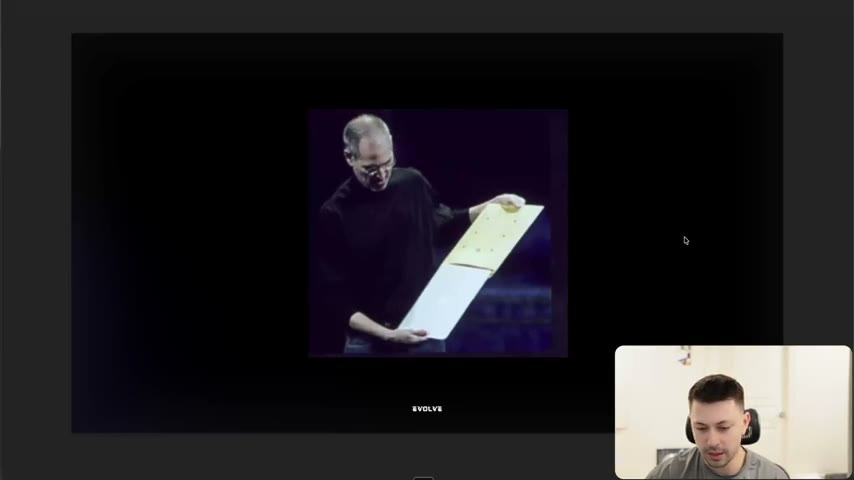
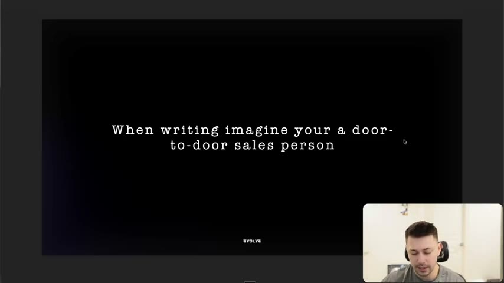

# 12. Why you need to speak copy, not write it
> Write every ad line as something a door-to-door salesperson would actually say (or better, show); this matters most for video scripts, which are spoken by a UGC creator or an AI voice, or read on screen in the viewer's own voice.

## 🤖 Agent use
- **Use when:** writing or reviewing UGC video scripts, voiceovers, on-screen text, and hooks that sound "written".
- **Inputs → outputs:** a draft script line → a spoken-aloud test ("would I say this to a person's face?") → a conversational rewrite, ideally one that shows the fact instead of stating it.
- **Rules:**
  - **DO** imagine you are a door-to-door salesperson and ask Claude Hopkins' question: "Would this help a salesman sell the goods?" [00:30–01:35]
  - **DO** write video scripts as if a person will say them: UGC creators filming themselves, UGC voiceovers, or AI voiceovers all need spoken language. [01:35–02:38]
  - **DO** treat on-screen text as speech too: it is "being read in the consumer's own voice when they're seeing the ad". [02:38]
  - **DON'T** write empty claims you would never say in person: "this is a revolutionary fitness experience… What does it do?" [01:04–01:35]
  - **IF** you can demonstrate the fact, **THEN** demonstrate instead of stating it (MacBook Air in an envelope vs "40 millimeters thin"). [00:30–01:04; 02:38–03:24]
  - **IF** using AI actors or AI voice, **THEN** the script must still "speak like a person". [02:05]
- **See also:** [13. Why you need to write at a 6th grade level](13-why-you-need-to-write-at-a-6th-grade-level.md) · [31. How to create ads that show, don't tell](31-how-to-create-ads-that-show-dont-tell.md) · [08. The 3 checks for great copywriting](08-the-3-checks-for-great-copywriting.md)

Page text: credits only ("HarryDry", "Claude Hopkins").

## Key ideas

### Written vs spoken, with the MacBook Air [00:00–01:04]
- Selling a MacBook Air, "most writers" who want a fact that is visual would write: **"The MacBook Air is just 40 millimeters thin."** Instructor: "Seems fair enough… That is written." [00:00–00:30]
- Spoken version: do "what Steve Jobs did": put the laptop inside an envelope and say "this is how thin the MacBook Air is". "This is spoken." [00:30–01:04] (The slide shows Jobs holding a thin laptop being pulled from an envelope.)
- (Note: the 40 mm figure is the instructor's illustration of a "written" line; the lesson makes no claim about the laptop's actual thickness.)

*The "spoken" version of "just 40 millimeters thin": show it. [00:30]*

### The door-to-door test [01:04–01:35]
- Quote credited to Claude Hopkins (via Harry Dry): **"Would this help a salesman sell the goods?"** [01:04]
- Instruction: "when you're writing your ads, imagine you are a door-to-door salesperson… what are you going to say?" For a fitness product, you would not say "this is a revolutionary fitness experience". "What does it do?" [01:04–01:35]
- Slide: "When writing imagine your a door-to-door sales person" (sic). [slide 01:00]
- "Thinking from this frame of 'I'm going to have to say this to a person in person'… helps you clean up your writing and think about what you're actually saying." [01:35]

*The test to run on every line. This is checklist item 13 in lesson 1. [01:00]*

### Why it matters for video ads [01:35–02:38]
- Video briefs are either: spoken by a UGC creator doing a voiceover, spoken by an AI voiceover ("nowadays it's usually spoken by an AI"), spoken by UGC creators "filming their own videos" (here "you 100% want it to be written like a person is going to speak it"), spoken by AI people ("we're not quite there yet, same thing"), or shown as text on screen. [01:35–02:38]
- Even text on screen is "read in the consumer's own voice when they're seeing the ad. And so your ads are already being spoken, so you need to write like it." [02:38]

### Link to show-don't-tell [02:38–03:24]
- The lesson is "if you ask me kind of more about showing than it is just about telling: 'this is 40 millimeters thin' versus 'let me just show you how thin it is'. It's a much more powerful way, but this kind of falls in the same line of 'hey, your copy needs to be spoken and not just written'." [02:38–03:24]
- He says the show-don't-tell sections follow later in the course.

## Steps / framework
Spoken-copy pass (derived from [00:00–03:24]):

1. Read each line aloud as if at a stranger's front door.
2. Would you really say it? If not, rewrite in the words you'd use ("what does it do?").
3. Can you show it instead (a prop, a demo, a comparison)? If yes, write the visual (the envelope) and keep the line short.
4. For UGC: check the line works as natural speech by a non-actor, then check any on-screen text reads in the viewer's own voice.

## Examples
- **Written:** "The MacBook Air is just 40 millimeters thin." **Spoken/shown:** slide a MacBook Air out of an envelope and say "this is how thin the MacBook Air is." [00:00–01:04]
- **Abstract line the instructor would not say:** "This is a revolutionary fitness experience." [01:04–01:35]

## Structured units
### Rewrites
| Before | After | What changed | Source |
|---|---|---|---|
| "The MacBook Air is just 40 millimeters thin." | Put the laptop in an envelope: "This is how thin the MacBook Air is." | Number stated in writing to a physical demonstration, spoken | [00:00–01:04] |
| "This is a revolutionary fitness experience." (instructor's example of what not to say) | Say what it does (no replacement given) | Adjective-heavy claim to a concrete description of function | [01:04–01:35] |

### Templates
| Template | Use for | Example fill | Source |
|---|---|---|---|
| "Would this help a salesman sell the goods?" (Claude Hopkins) | Per-line spoken-copy test | Ask of every hook and claim | [01:04] |

### Rules of thumb
- **DO** read scripts aloud before approving them. [01:35]
- **DON'T** treat on-screen text as "just written": it is read as speech in the viewer's head. [02:38]
- **IF** you can show it, **THEN** show it. [02:38]

## How to apply
- [ ] Read every UGC script aloud; mark phrases a creator would stumble on or never say.
- [ ] Replace any "revolutionary / premium / game-changing" line with what the product does.
- [ ] For each stated fact, add a demo or visual that proves it (the envelope).
- [ ] Brief creators with spoken-style lines, not copywriter-style sentences.
- [ ] Apply the same test to AI voiceover scripts.

## Related
- Previous: [11. Why you need to write less fluff](11-why-you-need-to-write-less-fluff.md) · Next: [13. Why you need to write at a 6th grade level](13-why-you-need-to-write-at-a-6th-grade-level.md)
- [01. Overview (checklist item 13)](01-overview-of-copywriting-program.md) · [Skeptic format](../../../../frameworks/skeptic-format.md) (UGC format context)

## Sources and limitations
- Transcript: [12. Why you need to speak copy, not write it… .txt](<../../../../../raw/evolve/copywriting/_transcripts/✍️ Evolve Copywriting (NEW)/12. Why you need to speak copy, not write it ✍️ Evolve Copywriting (NEW) Evolve.txt>) · Page text: [….html.md](<../../../../../raw/evolve/copywriting/_extracted/✍️ Evolve Copywriting (NEW)/12. Why you need to speak copy, not write it_✍️ Evolve Copywriting (NEW)_Evolve.html.md>)
- Machine transcription (Whisper large-v3-turbo); full recording covered (204.22 s). Whisper wrote "spensify" at [01:04] (probably "simplify"). The Claude Hopkins quote is as spoken; its book is not named.
- Short lesson; two slides only.
