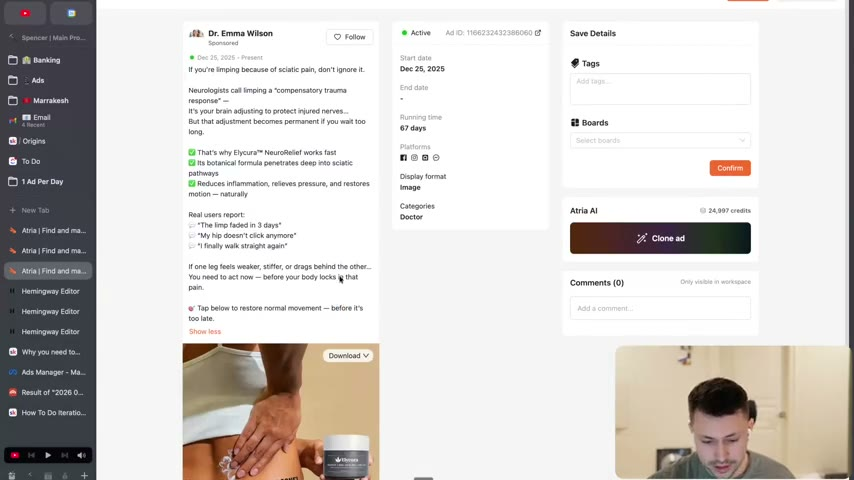
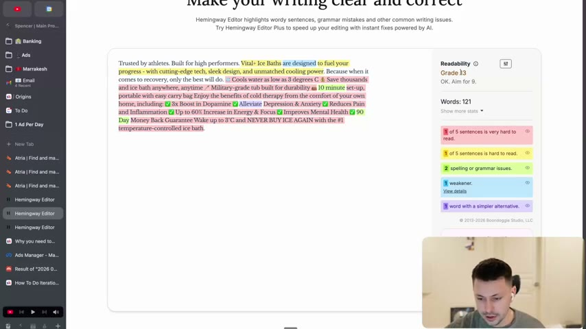
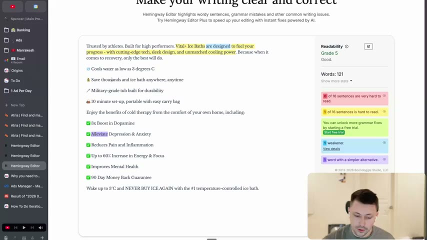

# 13. Why you need to write at a 6th grade level
> Customers want everyday language, so paste every script or ad into the Hemingway app and edit until it reads at grade 6 or below; formatting can drop the score as much as word choice.

## 🤖 Agent use
- **Use when:** finishing any brief, ad text, or script; auditing a competitor ad's readability; fixing walls of text in static ads.
- **Inputs → outputs:** draft text → Hemingway grade and flagged sentences → simplified, well-formatted text at grade 6 or below.
- **Rules:**
  - **DO** run every brief and script through the Hemingway app and aim for "grade 6 or below" (page text). [00:31]
  - **DO** simplify words and break text into short lines/bullets: the same text scored grade 13 as a block and grade 5 when formatted. [01:38]
  - **DON'T** "try to sound smarter than you actually are. There's no point… no benefit." [00:31]
  - **DON'T** accept AI rewrites blindly: "Claude is your friend on this… use Claude with caution… don't just take whatever it gives you, actually analyze it." [00:31–01:05]
  - **IF** a long-form script (e.g. a VSL) comes back at 11th-grade level **THEN** simplify; "if your language is too complicated, nobody's going to understand." [00:31–01:05]
  - **IF** Hemingway flags a "word with a simpler alternative" or a "very hard to read" sentence **THEN** rewrite it. [01:05–02:43]
- **See also:** [12. Why you need to speak copy, not write it](12-why-you-need-to-speak-copy-not-write-it.md) · [11. Why you need to write less fluff](11-why-you-need-to-write-less-fluff.md) · [01. Overview (checklist item 11)](01-overview-of-copywriting-program.md)

Page text (verbatim): "The Tool: hemingwayapp.com. Your customers don't want complicated language. They want easy to understand language. So speak that way to them. Hemingway app → Grade 6 or below. Claude is your friend on this".

## Key ideas

### Why grade 6 [00:00–01:05]
- "No fancy slideshow." Simple writing "has been proven by so many different people" (no source cited; instructor claim). [00:00]
- Tool: the Hemingway app. "You can paste your text in there and it will actually tell you what grade level it's at." [00:00]
- "Your customers don't want complicated language. They don't want to feel like they're reading a… research report" when you show them an ad. They want "easy to understand everyday language that you would use. So speak with them that way." [00:00–00:31]
- Target: "grade six or below." [00:31]
- Using Claude: it can simplify, but analyse its output. If a VSL scores about 11th grade because it is "trying to change everybody's mind", still "if your language is too complicated… nobody's going to understand." [00:31–01:05]

### Live demo with a real ad's text [01:05–02:43]
- He pastes ad text into Hemingway; it reads "grade five". He notes the editor now offers "Editor Plus" (AI fixes, not tried yet) and flags: words with simpler alternatives, hard-to-read sentences. [01:05–01:38]
- **Formatting matters.** A big paragraph of ad text scores "grade 13"; "if you just format it in a clearer way, it goes all the way down to grade five… exact same text… it's not just about the words that you're using. It's also about the actual format." [01:38–02:11]
- Example copy on screen (an ice bath ad): "Trusted by athletes. Built for high performers. Vital+ Ice Baths are designed to fuel your progress - with cutting-edge tech, sleek design, and unmatched cooling power…" with bullet lines like "Cools water as low as 3 degrees C", "Save thousands and ice bath anywhere, anytime", "Military-grade tub built for durability", "10 minute set-up, portable with easy carry bag", and check-marked benefits (3x boost in dopamine, reduces pain and inflammation, up to 60% increase in energy and focus, improves mental health, 90 day money back guarantee). Flagged: "alleviate" (simpler alternative), "are designed" (weakener). Block form: Grade 13, "1 of 5 sentences is very hard to read"; formatted bullets: Grade 5, "0 of 16 sentences are very hard to read". [01:38–02:43; screenshots]
- He calls bits of the ad copy unclear (for example "fuel your progress") and says "this copy… they haven't been to the copywriting program yet". [02:11–02:43]
- "Nobody is going to be mad if something is easy to read. But if something isn't easy to follow, more people are going to be mad." [02:43]
- Close: "Whenever you write a brief, whenever you write a script, drop it in there and check it. This will be part of the copywriting toolkit." [02:43]

*An ad saved in Atria (a sciatica-relief ad with long body copy) on screen as the demo begins; the transcript does not say whether this ad's text was the first text pasted. [01:00]*

*The same ad text as one block: Grade 13, "1 of 5 sentences is very hard to read", "Aim for 9" hint. [01:30]*

*After formatting into short lines and checkmark bullets: Grade 5, 0 of 16 sentences very hard to read. Only formatting changed. [02:10]*

## Steps / framework
1. Paste the text into the Hemingway app (editor view).
2. Read the grade; target grade 6 or lower (the tool itself says "Aim for 9" for general text; the course sets 6).
3. Fix red/yellow sentences; replace purple "simpler alternative" words; remove weakeners.
4. Reformat: short lines, one idea per line, bullets (see the Grade 13 to 5 example).
5. Re-check. If an LLM helped, read the result critically.

## Examples
- **Same text, two grades:** block paragraph = Grade 13; formatted lines/bullets = Grade 5. [01:38–02:11]
- **Word swap:** "alleviate" flagged as having a simpler alternative. [01:38–02:11]
- **Unclear phrase called out:** "designed to fuel your progress" (instructor says he doesn't know what it means). [02:11]

## Structured units
### Rewrites
| Before | After | What changed | Source |
|---|---|---|---|
| Ice-bath ad text as one paragraph (Grade 13) | Same text as short lines and checkmark bullets (Grade 5) | Formatting only: short lines, bullets, whitespace | [01:38–02:11] |
| "alleviate depression & anxiety" | simpler word suggested by Hemingway (not specified) | Word swap | [01:38–02:11] |

### Templates
| Template | Use for | Example fill | Source |
|---|---|---|---|
| Hemingway check: grade <= 6, no "very hard" sentences | Gate for briefs, scripts, ad copy | paste, read grade, fix | page text; [00:31] |

### Rules of thumb
- **DO** grade 6 or below for all copy (page text).
- **DON'T** judge readability by words alone; layout counts. [01:38]
- **IF** the tool and your ear disagree **THEN** read the line aloud (see lesson 12).

## How to apply
- [ ] Paste every brief/script into the Hemingway app before approval; record the grade.
- [ ] Break paragraphs into short lines; use bullets for lists of benefits.
- [ ] Replace flagged words; delete weakeners.
- [ ] If using an LLM to simplify, compare against the original meaning and keep our facts intact.
- [ ] (derived) Add a readability check to the QA step for static ad body copy.

## Related
- Previous: [12. Why you need to speak copy, not write it](12-why-you-need-to-speak-copy-not-write-it.md) · Next: [14. Why you need to use unique mechanisms](14-why-you-need-to-use-unique-mechanisms.md)
- [01. Overview (checklist item 11)](01-overview-of-copywriting-program.md) · [Fluency mechanism](../../../../concepts/fluency-mechanism.md)

## Sources and limitations
- Transcript: [13. Why you need to write at a 6th grade level… .txt](<../../../../../raw/evolve/copywriting/_transcripts/✍️ Evolve Copywriting (NEW)/13. Why you need to write at a 6th grade level ✍️ Evolve Copywriting (NEW) Evolve.txt>) · Page text: [….html.md](<../../../../../raw/evolve/copywriting/_extracted/✍️ Evolve Copywriting (NEW)/13. Why you need to write at a 6th grade level_✍️ Evolve Copywriting (NEW)_Evolve.html.md>)
- Machine transcription (Whisper large-v3-turbo); full recording covered (187.63 s). Whisper garbled some words near [02:11] ("trippish", "feel your part"); those are paraphrased, not quoted.
- The first pasted text ("grade five", [01:05]) is not legible in any captured frame. The Atria ad on screen at [01:00] is a sciatica ad; the Hemingway screenshots at [01:30] and [02:10] show an ice-bath ad (product name on screen: "Vital+ Ice Baths"). The source of the ice-bath copy is not named.
- No attachments. The Hemingway grade numbers (13, 5) are read from screenshots.
