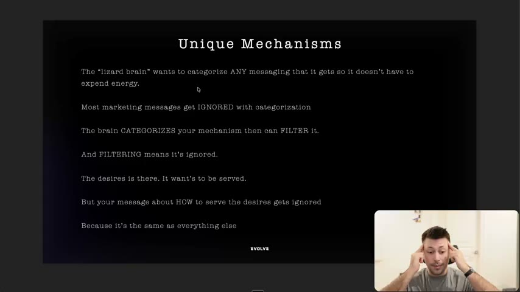
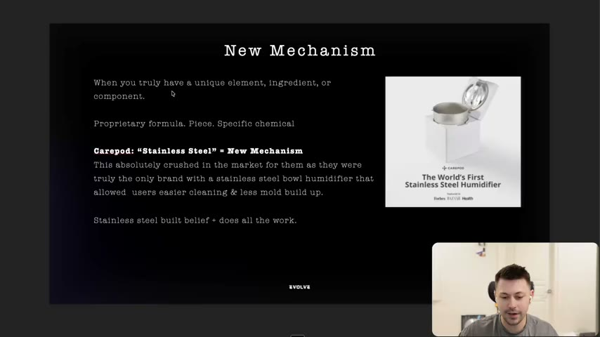
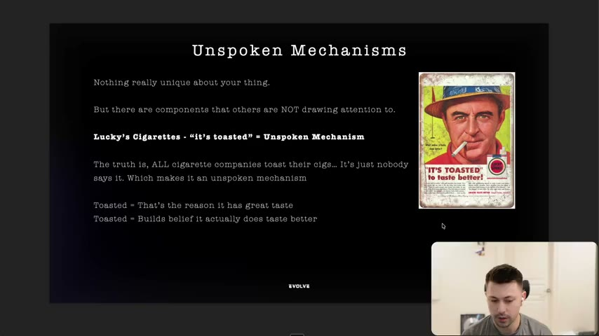
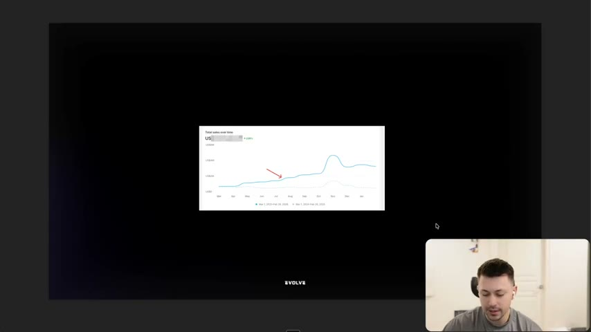
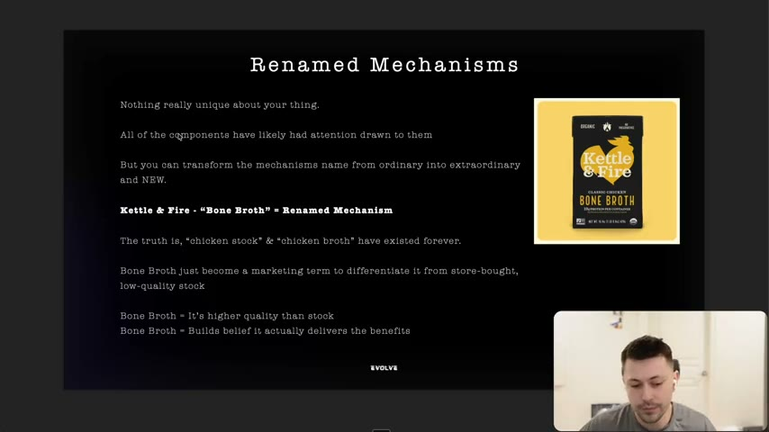

# 14. Why you need to use unique mechanisms
> A mechanism's one job is to "inspire hope" (build belief that this will work and is not like everything else), and there are three types to hunt for in a product: a truly new mechanism, an unspoken mechanism, and a renamed mechanism. It matters because a message the brain files as "the same as everything else" is filtered out and ignored, no matter how real the desire behind it is.

## 🤖 Agent use
- **Use when:** analysing why a competitor ad converts (what is the mechanism doing?), choosing the angle/claim for our own ad, or deciding what to name or emphasise about a product that has no obvious USP.
- **Inputs → outputs:** product facts (components, ingredients, process, technology), competitor ads, the desire the customer wants served → a short list of candidate mechanisms classified as new / unspoken / renamed, each with the belief it builds and the "this is what allows you to get X" sentence used in the ad.
- **Rules:**
  - **DO** make the mechanism carry the claim. "The reason why you can make the claims that you can make... is because of the mechanism." [04:26–05:08]
  - **DO** explain *how* the mechanism produces the result (especially in direct response) so the customer feels it "can actually do the thing", but don't over-explain and lose sight of the desire. [04:26–05:08]
  - **DO** write the mechanism as the agent of the result: "this mechanism is what allows you to get X", and back it with a person who got Y because they used it, rather than "we did it for you". [05:08–05:59]
  - **DO** search a product in this order: (1) truly new mechanisms no other brand has, (2) new mechanisms we could add, (3) unspoken mechanisms (components that are useful but nobody talks about), (4) mechanisms that are worn out but still valued, which can be renamed. [15:36–16:31]
  - **DON'T** add a new feature just to be new. It must be useful to the customer, e.g. stainless steel (easier cleaning, less mould, no plastic) beats LED mood lighting. "Because it's new means that it will grab attention, but if it's not useful, it doesn't matter." [06:49–09:26]
  - **DON'T** assume the mechanism has to be better. "It doesn't have to be better. It just has to be new." But long-term the product should be better too. [02:58–04:26]
  - **IF** nothing about the product is unique **THEN** look for an unspoken mechanism (something all competitors do but none say) or rename an ordinary component. [09:26–13:54]
  - **IF** picking among several unspoken facts **THEN** pick the one that is useful to the customer and makes sense to them, as "toasted" explains taste, while "made in Wyoming" may not. [12:20]
- **See also:** [13. Why you need to write at a 6th grade level](13-why-you-need-to-write-at-a-6th-grade-level.md) · [15. Why you need to understand beliefs](15-why-you-need-to-understand-beliefs.md) · [19. Being aware of mechanisms](19-being-aware-of-mechanisms.md) · [Angle remix playbook](../../../../playbooks/angle-remix.md) · [Competitor ad teardown playbook](../../../../playbooks/competitor-ad-teardown.md)

Lesson page text: only a credit line, "**Credit:** Kyle Milligan". The instructor credits him again at the end as "absolute savage copywriter" who "was part of the Evolve Copywriting 101" mini-module; this lesson is "the full blown version of it" [15:36].

## Key ideas

### 1. The core job of a mechanism is to inspire hope [00:00–01:41]
- Opening quote on the slides: "New and different is better than better." The instructor attributes it to Kyle Milligan ("who's a legend"); Whisper garbled the framing ("in typical Spencer fashion... not from Harry"), so the first part of the attribution is uncertain. [00:00–00:49]
- "Unique mechanisms essentially serve one main job... they inspire hope." Hope = belief that "this will actually work, that this is not like everything else." "If your mechanism does that, you have succeeded." [00:00–00:49]
- Mechanisms decide whether someone buys from you or another brand. Positioned right, it feels like "the only place that has that mechanism", which builds belief *and* "creates this bias that they have to now buy from you." [00:49–01:41]
- If you don't use a mechanism, a competitor will and "probably going to win the customer" by both creating belief and "isolating themselves" as the owner of the mechanism. [01:41]

### 2. Why: the lizard brain categorises and filters [01:41–03:37]
- "Lizard brain" (Kyle's term, per the instructor) = the default brain, which categorises every message so it doesn't spend energy. [01:41–02:19]
- Slide logic (verbatim, the slide "Unique Mechanisms", 02:20): the lizard brain categorises ANY messaging; most marketing messages get ignored with categorisation; the brain categorises your mechanism then can filter it; filtering means it's ignored; "The desires is there. It want's to be served."; but your message about HOW to serve the desire gets ignored "Because it's the same as everything else".
- The instructor's takeaway: the desire exists and wants to be served, but a message that is "the same as everybody else's" is filtered out. The principle extends to copywriting generally: if you can't communicate that you can actually help, it is ignored. [02:19–03:37]

*Slide "Unique Mechanisms": categorise, filter, ignore. This is the reason sameness kills ads. [02:20]*

### 3. New beats better, but better usually produces new [03:37–05:08]
- Slide: "Doesn't even have to be better it just has to be NEW." [03:40]
- If you make a product better, that "will as a result be new". The instructor is not saying don't improve the product. [03:37–04:26]
- Brands with "sophisticated products" that aren't really unique still scale by positioning something as new: a mechanism about newness, or "we've built this for this new avatar." He says this is how "brands who are literally just copying other people's products are scaling super hard" (instructor claim, no named example). [03:37–04:26]
- For a long-term business, make the product better; that then gives you something new. [04:26]

### 4. The mechanism does all of the work, so write it that way [04:26–05:59]
- Kyle's core message as the instructor relays it: "the mechanism does all of the work." It is why the product can make its claims. [04:26–05:08]
- In direct response the job is to show the customer *how* the mechanism delivers; avoid getting so technical that you forget "what desire is and what you're actually trying to help this person accomplish." [04:26–05:08]
- Phrasing pattern the instructor describes (not a verbatim script): "this mechanism is what allows you to get X", "it's what allowed X person to get Y because they also used the mechanism and the mechanism worked for them." Remove yourself from the claim. "If you look closer now at some really great ads, they do this." [05:08–05:59]
- Chain: mechanism inspires hope; hope makes people believe; "the mechanism is what builds belief." [05:08–05:59]

### 5. Type 1: the NEW mechanism [05:59–09:26]
- A truly unique element, ingredient or component: proprietary formula, piece of technology, specific chemical. No other brand in the market has it. [05:59–06:49; 11:40]
- **Kizik** (footwear): invented tech where you push your foot in and the heel "squish[es] down" then pops back up, "100% a new element". [05:59–06:49]
- **CarePod** (humidifier; the instructor says it "took us like a year to crack", i.e. he worked on the brand): the new mechanism is **stainless steel**. The slide says: "Carepod: 'Stainless Steel' = New Mechanism. This absolutely crushed in the market for them as they were truly the only brand with a stainless steel bowl humidifier that allowed users easier cleaning & less mold build up. Stainless steel built belief + does all the work." [06:20, slide; 06:49–08:34]
  - Why it is useful: boil water in the steel bowl or put it in the dishwasher to clean; no mould or gross build-up on a humidifier that blows air; plastics "scare a lot of people" (microplastics). [07:38–08:34]
  - Contrast: most humidifiers are "a nightmare to clean", with crevices, mould and plastic. [08:34–09:26]
  - The instructor says others have since started to copy stainless steel, but CarePod "were first for the stainless steel market". [11:40]
- **Usefulness test.** CarePod also made a version with LED lights underneath (he no longer has account access and says it "wasn't [necessarily] not a good innovation"). Mood lighting is new but doesn't make cleaning easier, reduce microplastics or reduce mould. "Is it actually useful? Is this something that customers actually want and actually care about?" [06:49–09:26]

*Slide "New Mechanism": definition, the CarePod example (box reads "The World's First Stainless Steel Humidifier", press logos), and "Stainless steel built belief + does all the work." [06:20]*

### 6. Type 2: the UNSPOKEN mechanism [09:26–13:10]
- Slide definition: "Nothing really unique about your thing. But there are components that others are NOT drawing attention to." [12:49 slide; 09:26–10:13]
- **Lucky Strike ("Lucky's Cigarettes"): "It's toasted."** The slide: "The truth is, ALL cigarette companies toast their cigs... It's just nobody says it. Which makes it an unspoken mechanism. Toasted = That's the reason it has great taste. Toasted = Builds belief it actually does taste better." Being first to say it made it unique. It is "visual" ("toasted does sound kind of nice, probably enhances the flavor"). [10:13–10:54]
- **Instructor's own client case.** He shows a store "Total sales over time" chart (numbers blurred): his team joined the brand in July, found the unspoken mechanism in August, and revenue scaled hard through August, September and October; he cites "239%" (instructor claim, read from a partly blurred screen). The mechanism itself is withheld because the owner asked him not to share it. He says it was "a very useful new mechanism that solves a very painful problem" and not fully unique, because other brands also had it. [10:54–12:20]
- Distinction he draws: a **new** mechanism = no other brand has it; an **unspoken** one = competitors have it but don't market it, and it still worked "because it was a great marketing angle". [11:40]
- Usefulness applies here too: "toasted" beats an unspoken fact like "made in Wyoming" (his hypothetical) because it explains a benefit (bolder taste, enhanced flavour). [12:20]

*Slide "Unspoken Mechanisms" with the vintage Lucky Strike ad ("IT'S TOASTED to taste better!"). [10:20]*

*Total-sales-over-time chart with a red arrow at the point the new mechanism was found; figures blurred, so only the shape (a climb after the arrow) can be read. [11:13]*

### 7. Type 3: the RENAMED mechanism [12:20–15:36]
- Slide definition: "Nothing really unique about your thing. All of the components have likely had attention drawn to them. But you can transform the mechanisms name from ordinary into extraordinary and NEW." [13:08 slide]
- **Kettle & Fire "Bone Broth".** Chicken stock and broth "have existed forever... since the dawn of time" (stock and broth differ slightly, he notes). Renaming it "bone broth" made it seem "more enhanced", "richer", a marketing term to differentiate from store-bought low-quality stock. Slide: "Bone Broth = It's higher quality than stock. Bone Broth = Builds belief it actually delivers the benefits." The curiosity effect: "I haven't heard that before. What's bone broth? Is that different from chicken broth?" followed by "there's more protein". [13:10–14:50]
- He says renaming is "happening right in front of us" and "absolutely crushing". The earlier version of this lesson used a hiking-footwear example and a "Trump bonus checks" example, which he swapped for bone broth because he finds it funny and current. [12:20–13:10; 14:50]
- Closing slide quote: "If it's presented differently it's new. And because it's new, its better." People assume newest = best (iPhone, a 2026 car, microphone, MacBook), so showing something is new makes them assume it is better, and "it's your job to help them see that as well." [14:50–15:36]

*Slide "Renamed Mechanisms" with the Kettle & Fire bone broth carton. [13:08]*

## Steps / framework

### The three mechanism types

| Type | When you have it | Test | Example (course) | Belief it builds | Source |
|---|---|---|---|---|---|
| **New** | A truly unique element, ingredient or component (proprietary formula, tech, specific chemical); no other brand has it | Is it useful and does the customer care? | CarePod stainless steel humidifier; Kizik heel that pops back up | "Easier to clean, less mould" (stainless steel) | [05:59–09:26] |
| **Unspoken** | Nothing unique, but a component others do not draw attention to | Is it useful and does it make sense and is it clear? | Lucky Strike "It's toasted" | "That's the reason it has great taste" | [09:26–13:10] |
| **Renamed** | All components already have attention; the name is ordinary | Does the new name feel new and imply higher quality? | Kettle & Fire "bone broth" vs chicken stock/broth | "It's higher quality; it delivers the benefits" | [13:10–15:36] |

### Order of attack the instructor recommends [15:36–16:31]
1. Do we have any pure new mechanisms no other company has? Start there.
2. To double down: what new mechanisms could we add? (He refers to "Sean" covering this in product research and product development lessons; identity unverified.)
3. Unspoken mechanisms: what are all the mechanisms the product has? Which are useful but not talked about?
4. Renamed mechanisms: which beaten-down but still popular, sophisticated, valued mechanism can we rename to give a new light and "essentially revive it"?

## Examples
- **Stainless steel (CarePod).** Mechanism = steel bowl. Claim it supports = easier cleaning, less mould, no plastic/microplastics. Belief = "this humidifier won't get gross". [06:49–08:34]
- **LED lights (CarePod variant).** New but not useful: a counter-example for "new for the sake of new". [06:49–09:26]
- **"It's toasted" (Lucky Strike).** All brands toast; only one said it; it became *the reason* for taste. [10:13–10:54]
- **Bone broth (Kettle & Fire).** Same product category as chicken stock; the new name signals richer, higher quality, more protein. [13:10–14:50]
- **Instructor's client brand.** Unspoken mechanism found in month 2 of working with them; sales scaled hard afterwards. Mechanism withheld. [10:54–12:20]

## Structured units

### Angles
| Angle | Core desire / pain | Heuristic(s) | Best format | Example line | Source |
|---|---|---|---|---|---|
| Unique-hardware angle (new mechanism) | Clean, low-effort home product; fear of mould/plastics | — | Static or UGC demo of cleaning | "The World's First Stainless Steel Humidifier" (box copy on the slide) | [06:20] |
| Reveal-the-ordinary angle (unspoken mechanism) | Better taste/performance | — | Any; one-line claim plus visual | "It's toasted" / "IT'S TOASTED to taste better!" | [10:20] |
| Renamed-category angle | Higher quality version of a commodity | — | Product-name/label led | "Bone broth" (vs chicken stock) | [13:08] |

### Ad teardowns
| Brand / product (niche) | Format | Hook / opening | What works | What fails | Fix suggested | Principle | Source |
|---|---|---|---|---|---|---|---|
| CarePod humidifier (home) | Product box/static creative | "The World's First Stainless Steel Humidifier" | A single useful material makes a claim (easy cleaning, less mould) believable | LED-light version is new but not useful (instructor view) | Lead with the useful mechanism, not mood features | Mechanism must be useful, not just new | [06:20; 07:38–09:26] |
| Lucky Strike (cigarettes) | Vintage print ad | "IT'S TOASTED to taste better!" | Names a process every competitor shares; visual and benefit-linked | — | — | Unspoken mechanism | [10:20; 10:13–10:54] |
| Kettle & Fire (broth) | Package | "Bone Broth" | Rename implies richer, higher quality; sparks "what's that?" curiosity | — | — | Renamed mechanism | [13:08; 13:54] |

### Templates
| Template | Use for | Example fill | Source |
|---|---|---|---|
| "This mechanism is what allows you to get [X]." | Mechanism-as-agent claim | (instructor describes the pattern; no fill given for a specific product) | [05:08–05:59] |
| "[Mechanism] is what allowed [person] to get [Y] because they also used it." | Proof tied to the mechanism | (pattern only) | [05:08–05:59] |
| "[Ordinary thing], renamed as [new term]" | Renamed mechanism | "chicken stock/broth" → "bone broth" | [13:10–13:54] |
| "[Everyone does this, nobody says it]" → state it first | Unspoken mechanism | "It's toasted" | [10:13] |

## Prompts / templates (verbatim)
No prompts are supplied. The slide texts are quoted inline in Key ideas 2, 5, 6 and 7 (verbatim where marked "slide").

## How to apply
- [ ] For each competitor ad in a teardown, name the mechanism and classify it new / unspoken / renamed. If none, flag the ad as relying on sameness.
- [ ] List every component, process step and ingredient of our product; mark which ones competitors do not mention (unspoken candidates).
- [ ] For each candidate, write "this is what allows you to get [X]" and check that X is a desire the customer cares about. Drop candidates that are only decorative (the LED-light test).
- [ ] Check whether a commodity component could be renamed to something newer-sounding and higher-quality, but only if the product genuinely delivers the implied benefit (derived caution).
- [ ] In a UGC script, have the creator explain how the mechanism produces the result and name a person for whom it worked (derived adaptation of [05:08–05:59]).
- [ ] Log each mechanism with its type, the belief it builds and the source ad in the course's tracking sheet (see [22. How to finalize your ad ideas](22-how-to-finalize-your-ad-ideas.md)).

## Related
- Previous: [13. Why you need to write at a 6th grade level](13-why-you-need-to-write-at-a-6th-grade-level.md) · Next: [15. Why you need to understand beliefs](15-why-you-need-to-understand-beliefs.md)
- [19. Being aware of mechanisms](19-being-aware-of-mechanisms.md) (the research-side companion) · [Perception management](../../../../concepts/perception-management.md) · [Native advertising](../../../../concepts/native-advertising.md)

## Sources and limitations
- Transcript: [14. Why you need to use unique mechanisms… .txt](<../../../../../raw/evolve/copywriting/_transcripts/✍️ Evolve Copywriting (NEW)/14. Why you need to use unique mechanisms ✍️ Evolve Copywriting (NEW) Evolve.txt>) · Page text: [….html.md](<../../../../../raw/evolve/copywriting/_extracted/✍️ Evolve Copywriting (NEW)/14. Why you need to use unique mechanisms_✍️ Evolve Copywriting (NEW)_Evolve.html.md>)
- Machine transcription (Whisper large-v3-turbo). Full recording covered (last segment 16:48 = duration). The opening attribution ("Spencer fashion... not from Harry... Cal Milligan") is garbled; "Cal Milligan" is read as Kyle Milligan, who is credited on the page. The "Sean" mentioned near the end is not identified in the files. Brand names (Kizik, CarePod, Kettle & Fire) were checked against slides; "Lucky's Cigarettes" is the slide wording (the brand is Lucky Strike, derived).
- The "239%" figure comes from a chart with blurred values; treat it as an instructor claim.
- No linked images or attachments for this lesson; the slides were read from video frames.
