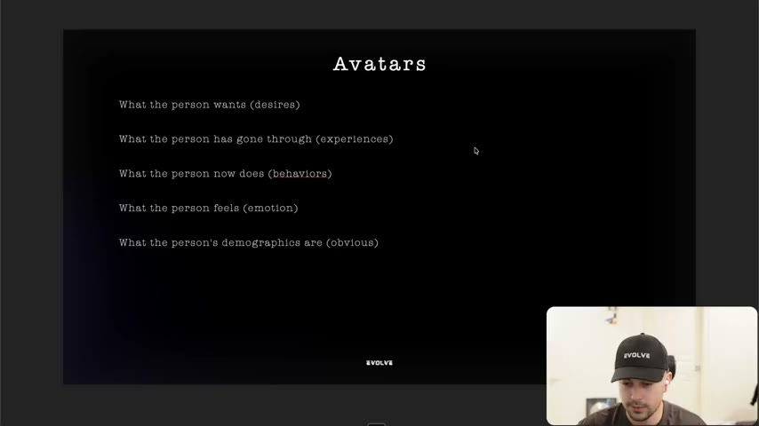
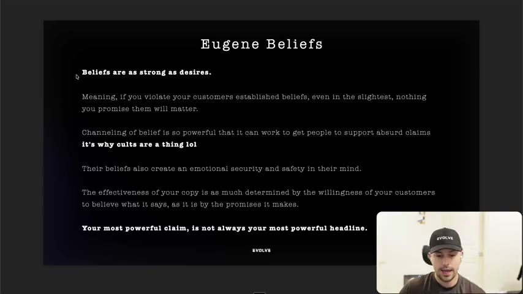
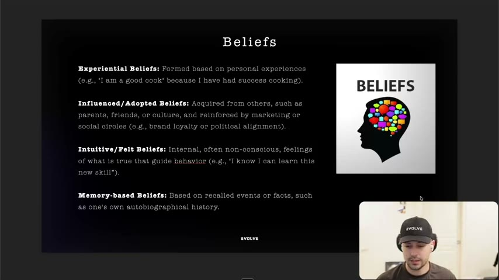
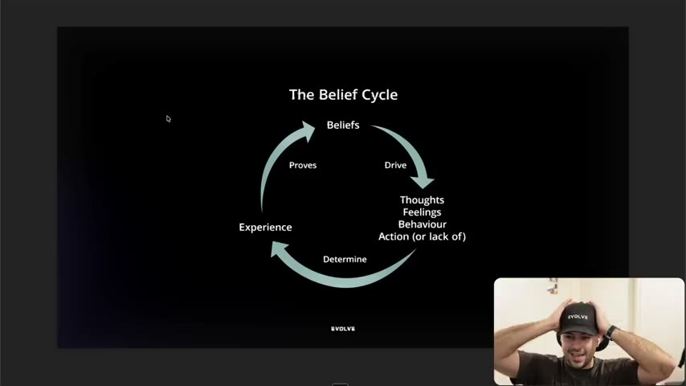
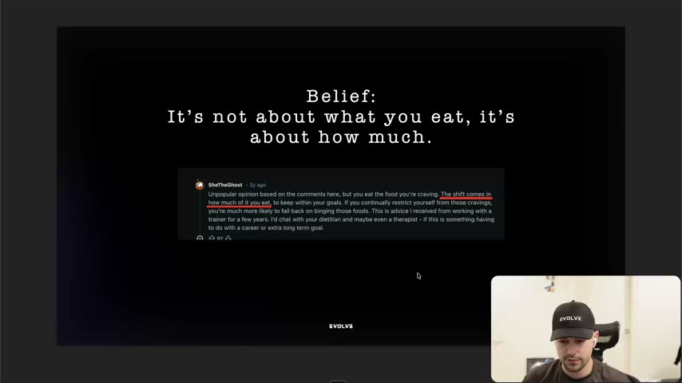

# 15. Why you need to understand beliefs
> A belief is "a feeling of certainty" about what something means, beliefs are "as strong as desires", and a great claim fails if it violates what the customer is already certain of, so you must research the customer's beliefs (via their actions, behaviours, experiences and emotions) before writing copy.

## 🤖 Agent use
- **Use when:** an angle or claim "should" work but doesn't; before writing any hook or script; when mining reviews, Reddit threads, comments or surveys for an avatar; when deciding whether an ad needs to work with a belief or change it.
- **Inputs → outputs:** avatar/sub-avatar research (reviews, Reddit, comments, survey answers) → a list of customer beliefs (with the experience or authority that formed each), plus a decision for each belief: align with it, or change it (which needs an authority, see [16](16-why-you-need-to-understand-authority.md)).
- **Rules:**
  - **DO** record beliefs as a separate field in avatar research, next to desires, experiences, behaviours, emotions and demographics. Desires alone are not enough. [00:34–01:13; 14:53–15:32]
  - **DO** reverse-engineer beliefs from what people do and say: "we look at actions, we look at behaviors, we look at experiences, and we look at emotions." [10:29–12:02]
  - **DO** write the belief as a statement the person is certain of (e.g. "it's not about what you eat, it's about how much"), not as a topic. [12:46]
  - **DON'T** write copy whose claim contradicts a deeply held belief: "if you violate your customer's established beliefs, even in the slightest, nothing you promise them will matter." [03:56–04:40]
  - **DON'T** assume your most powerful claim is your most powerful headline. "Your most powerful claim is not always your most powerful headline." [04:40–05:30]
  - **IF** a good claim is not converting **THEN** suspect a missing or violated belief before changing the claim. [01:13; 14:03]
  - **IF** you want to change a belief **THEN** find who or what formed it (experience vs influence) and bring the matching authority or experience; beliefs formed through experience are strongest and hardest to move. [06:22–08:49; 14:03–14:53]
- **See also:** [16. Why you need to understand authority](16-why-you-need-to-understand-authority.md) · [14. Why you need to use unique mechanisms](14-why-you-need-to-use-unique-mechanisms.md) · [17. Being aware of avatars](17-being-aware-of-avatars.md) · [21. Being aware of market awareness](21-being-aware-of-market-awareness.md) · [Customer research stack](../../../../frameworks/customer-research-stack.md) · [Validation over authority](../../../../concepts/validation-over-authority.md)

Lesson page text: credits only, "Eugene Schwartz" and "Tony Robbins". The instructor says this lesson goes deeper than the belief module in the original Evolve program and "there is a little bit of overlap" [00:00–00:34].

## Key ideas

### 1. Beliefs are the missing piece behind "great claim, no sales" [00:00–01:13]
- Avatar work (the Evolve Avatar training) covers what the person wants (desires), has gone through (experiences), now does (behaviours), feels (emotion) and their demographics. "What you haven't dug into is their beliefs." [00:34–01:13]
- Belief shows up when you write copy. The instructor calls it "the number one reason why most people feel like they're making great claims, like they have a great angle, but they just... are missing something. And that something is usually belief." [01:13]
- Pain points are promised as a separate video. [01:13]

*Slide "Avatars": desires, experiences, behaviors, emotion, demographics. Beliefs are the field this lesson adds. [01:00]*

### 2. What a belief is [01:13–03:56]
- Dictionary version (slide, 05:40 area): "An acceptance that a statement is true or that something exists." [01:13–02:13]
- Tony Robbins version (instructor's preferred, "more actionable"): "a belief is nothing but a feeling of certainty about what something means." You can feel certain about something that is not true: someone may believe they're really smart or not smart at all. [02:13–03:09]
- Most people are not conscious of many of their beliefs. [02:13–03:09]
- Implication for ad writers: some people write ads to change beliefs that are "so set in stone" the ad has "no chance at all". Some of those beliefs are not even true and hold the person back, but they've been reinforced so much that copy going against them will not be believed. [03:09–03:56]
- Schwartz line (from Breakthrough Advertising, per the instructor; Whisper wrote "get all Eugene"): "beliefs build the mental picture of the world that your potential customer lives in." [03:56]

### 3. Beliefs are as important as desires (Eugene Schwartz slide) [03:56–05:30]
- The instructor says: "we did not put enough emphasis on this originally in the Evolve program... beliefs are as important, if not more important than desires." [03:56–04:40]
- Slide "Eugene Beliefs", verbatim: "Beliefs are as strong as desires. Meaning, if you violate your customers established beliefs, even in the slightest, nothing you promise them will matter. Channeling of belief is so powerful that it can work to get people to support absurd claims. it's why cults are a thing lol. Their beliefs also create an emotional security and safety in their mind. The effectiveness of your copy is as much determined by the willingness of your customers to believe what it says, as it is by the promises it makes. Your most powerful claim, is not always your most powerful headline." [04:00 slide]
- The instructor's own analogy: his belief about creatives is so established (his livelihood depends on it) that anyone telling him differently is hard to believe; beliefs give "emotional security and safety that I'm not crazy". [04:40–05:30]

*Slide "Eugene Beliefs": the key rule that violating an established belief cancels the promise. [04:00]*

### 4. Where beliefs come from: four categories [05:30–08:49]
The instructor says other people use different taxonomies; this is the one that made sense to him. [05:30]

| Type | Meaning (slide, verbatim) | Instructor's example | Source |
|---|---|---|---|
| **Experiential** | "Formed based on personal experiences (e.g., 'I am a good cook' because I have had success cooking)." | Win best soccer player in the world, believe you are good at soccer; a terrible restaurant visit, believe the restaurant sucks | [05:30–06:22] |
| **Influenced / Adopted** | "Acquired from others, such as parents, friends, or culture, and reinforced by marketing or social circles (e.g., brand loyalty or political alignment)." | He influences viewers to believe copywriting matters, but it only becomes concrete when they apply it and a winning ad results | [06:22–07:06] |
| **Intuitive / Felt** | "Internal, often non-conscious, feelings of what is true that guide behavior (e.g., 'I know I can learn this new skill')." | "I'm the type of person who can learn a new skill" leads to learning one; "good reader" leads to reading more | [07:06–07:55] |
| **Memory-based** | "Based on recalled events or facts, such as one's own autobiographical history." | "Did you take the garbage out?" "I believe I did." (He calls this the least important.) | [07:55–08:49] |

- Strength ladder: beliefs start as intuitive/felt, get stronger as influenced, and become strongest through experience. "Some are more concrete, some are less, some help us, some hurt us, but we all have them... constantly being reinforced every single day." [07:55–08:49]

*Slide "Beliefs": experiential, influenced/adopted, intuitive/felt and memory-based beliefs with the slide's own examples. [06:00]*

### 5. The belief cycle [08:49–11:22]
- Slide "The Belief Cycle": **Beliefs → (drive) → Thoughts / Feelings / Behaviour / Action (or lack of) → (determine) → Experience → (proves) → Beliefs.** Follow-up slide: "Beliefs drive how we think, feel, behave, act. How we think, feel, behave, and act determine our experience. And our experiences build our beliefs further." [08:49–09:42; 09:20 and 11:40 slides]
- The instructor says seeing this made market sophistication "make more sense" (he does not elaborate here; see [21](21-being-aware-of-market-awareness.md) for sophistication/awareness). [08:49]
- **Worked example: a diet plan.** Desire = lose weight. Belief = "I have no willpower." Thoughts: "I shouldn't try this diet, I'll just fail." Feeling: "I feel defeated before starting." Behaviour: keep eating the same. Action: inaction (never starts). Experience: gains more weight. That experience proves the belief and strengthens it. [09:42–10:29]
- Conversion consequence: "the conversion from your ad will live or die based on belief." The prospect wants to lose weight, but if the ad doesn't handle "I don't have willpower", it cannot convince them. "You have to unpack those." [10:29–11:22]

*Diagram of the belief cycle: beliefs drive thoughts/feelings/behaviour/action; these determine experience; experience proves the belief. [09:00]*

### 6. How to find beliefs: research backwards through the cycle [11:22–14:03]
- "We must identify the beliefs of our customers... through research. More clearly, we look at actions, behaviors, experiences, and emotions." Start from any point on the cycle and walk backwards: given an experience, look for the action or lack of action, behaviours, feelings and thoughts, and "once you start to unpack this then you can really get down to their beliefs." [10:29–12:02]
- **Live exercise on a Reddit comment** (user "SheTheGhost", diet/trainer thread; comment: "Unpopular opinion based on the comments here, but you eat the food you're craving. The shift comes in how much of it you eat, to keep within your goals. If you continually restrict yourself from those cravings, you're much more likely to fall back on binging those foods. This is advice I received from working with a trainer for a few years..."). [12:02–12:46; slide at 13:00]
  - Belief 1: "It's not about what you eat. It's about how much." Behaviour: eat less of what she likes; experience: no weight gain or weight loss; result: belief reinforced. [12:46–13:25]
  - Belief 2: "Restricting yourself leads to binging." Formed through influence (trainer, a few years); she then acted on it, stopped restricting, stopped binging, and the experience reinforced it. [13:25–14:03]
  - Observation: this belief was formed by an *authority*, a trainer she worked with. "If you are going to change belief, that's where authority comes in, which we're going to talk about." [14:03–14:53]

*The belief-extraction exercise: slide headline "Belief: It's not about what you eat, it's about how much." over the underlined Reddit comment. [13:00]*

### 7. Cost of ignoring beliefs [14:03–15:32]
- Closing slide: "Failure to understand your customer beliefs before writing copy" (is a recipe for disaster, per the instructor). [14:03; slide at 14:40]
- "You can have a great claim. But if they don't believe you, they won't buy." Many people believe "no matter what your brand is, that your product won't work." [14:03–14:53]
- Understanding only experiences, behaviours and emotions is "only part of it. There's a deeper cause, which are the beliefs." He says he will double down on beliefs in the copywriting program and the toolkit (not included in the lesson files). [14:53–15:32]

## Steps / framework

**Belief mining routine (derived from [10:29–14:03])**
1. Pick an avatar or sub-avatar and its desire (e.g. lose weight).
2. Collect raw voice-of-customer text (Reddit, reviews, comments).
3. For each item, note: action/behaviour, experience, emotion, thought.
4. Walk backwards: "what must this person be certain of for this to make sense?" Write it as a first-person statement.
5. Tag each belief by source type: experiential, influenced/adopted (name the authority), intuitive/felt, memory-based.
6. Tag each belief **helps / hurts / neutral** for our product, as the instructor says beliefs "help us" or "hurt us" [07:55–08:49] (the tagging is derived).
7. Decide: align copy with the belief, or plan to change it. If changing it, pair with an authority or an experience (see [16](16-why-you-need-to-understand-authority.md)).
8. Write the claim so it does not violate any belief the audience is certain of.

## Examples
- **Diet plan, "I have no willpower".** Full belief cycle walked through (thoughts, feelings, behaviour, action, experience). [09:42–10:29]
- **Reddit diet comment.** Two beliefs extracted: "it's not about what you eat, it's about how much" and "restricting yourself leads to binging". [12:46–14:03]
- **Cults** as the extreme: channelled belief can "get people to support absurd claims". [03:56–04:40]
- **Instructor as example.** His belief about creatives is strong because of experience and livelihood; contradictory messaging is hard to accept. [04:40–05:30]

## Structured units

### Angles
| Angle | Core desire / pain | Heuristic(s) | Best format | Example line | Source |
|---|---|---|---|---|---|
| Quantity-not-restriction ("it's about how much, not what") (belief-aligned) | Lose weight without giving up food | — | UGC testimony or static | Belief stated: "It's not about what you eat, it's about how much." (This is a belief, not a tested ad line.) | [12:46] |
| Anti-restriction ("restricting leads to binging") | Lose weight without bingeing | — | Educational UGC | Belief stated: "Restricting yourself leads to binging." | [13:25] |
| Willpower-removal (belief-handling for "I have no willpower") | Lose weight despite feeling defeated | — | Skeptic/educational UGC (derived) | The instructor gives the belief, not a script; any line would be derived | [09:42–10:29] |

### Rules of thumb
- **DO** treat beliefs as co-equal with desires in the avatar document. [03:56–04:40]
- **DON'T** violate an established belief "even in the slightest." [03:56–04:40]
- **IF** the belief came from an authority **THEN** changing it needs a stronger or better-fitting authority. [14:03–14:53]
- **DO** keep a running list of beliefs while doing research. "Because when you can identify them, you're able to write copy that goes with them." [14:03]

## Prompts / templates (verbatim)
No prompts are supplied in this lesson. The belief cycle and slide texts are quoted above. The toolkit mentioned at the end is not included in the lesson files.

## How to apply
- [ ] Add a "Beliefs" column to every avatar/sub-avatar sheet (see the `avatars` tab in [22. How to finalize your ad ideas](22-how-to-finalize-your-ad-ideas.md)).
- [ ] For each review or comment mined, write one belief in first-person certainty form and tag its source type.
- [ ] Before approving a hook, check it against the belief list; flag any hook that contradicts a belief.
- [ ] For beliefs we must change, name the authority or experience that will carry the change.
- [ ] When an ad with a strong claim underperforms, run a belief check before rewriting the claim.

## Related
- Previous: [14. Why you need to use unique mechanisms](14-why-you-need-to-use-unique-mechanisms.md) · Next: [16. Why you need to understand authority](16-why-you-need-to-understand-authority.md)
- [Three selves](../../../../concepts/three-selves.md) · [Triggering events](../../../../concepts/triggering-events.md) · [Switching behavior](../../../../concepts/switching-behavior.md)

## Sources and limitations
- Transcript: [15. Why you need to understand beliefs… .txt](<../../../../../raw/evolve/copywriting/_transcripts/✍️ Evolve Copywriting (NEW)/15. Why you need to understand beliefs ✍️ Evolve Copywriting (NEW) Evolve.txt>) · Page text: [….html.md](<../../../../../raw/evolve/copywriting/_extracted/✍️ Evolve Copywriting (NEW)/15. Why you need to understand beliefs_✍️ Evolve Copywriting (NEW)_Evolve.html.md>)
- Machine transcription (Whisper large-v3-turbo). Full recording covered (last segment 15:33 = duration). Whisper heard "get all Eugene" (likely a stumble around "Eugene Schwartz"); the slide text is used for Schwartz wording. The instructor says "Tony" for Tony Robbins; the page credits confirm both names. The instructor's quote of Schwartz is as shown on his slide, not verified against the book.
- Attribution of the "feeling of certainty" definition to Tony Robbins is the instructor's. All statistics: none given.
