# 16. Why you need to understand authority
> Authority has one job in an ad, which is to build absolute conviction, and this lesson gives three levels of authority (are the authority / learned from one / know of one), ten ways to put authority into an ad (credential, following, media, award/patent, organization, title, research, experience, borrowed, visual) and two ways to amplify it with words alone (relatability, transparency), each with real ads.

## 🤖 Agent use
- **Use when:** tearing down a competitor ad ("where is the authority and what type is it?"), writing any hook, script or static where the claim needs to be believed, briefing a creator or founder-led video, or when an ad has a good claim but is not converting.
- **Inputs → outputs:** an ad (or our product facts, founder story, proof assets, research, press, awards, partnerships, creator access) → a labelled authority type for each proof element in the ad, or a stack of 2-4 authority types chosen for our product, plus the line or visual that carries each.
- **Rules:**
  - **DO** put authority in every ad. The instructor says the brands that scale hardest have it, and that missing authority is a main reason ads fail. [00:00–00:56]
  - **DO** tag each authority element with its level (1 you are it, 2 you learned from it, 3 you know of it). Level 1 is the strongest, but levels 2 and 3 still work, so a named person does not have to appear. [01:47–04:48]
  - **DO** stack types ("strategic stacking of principles") instead of relying on one. [37:47]
  - **DO** put the authority figure *in* the ad saying the line, not just a caption saying they recommend it. "It's one thing to say David Beckham uses it. It's another to literally have David Beckham in the ad." [07:26–08:23]
  - **DO** weigh loyalty over size of following: "I could have 3,000... but if every single person listens to every single thing that I say" that can beat 100K indifferent followers. [06:44–07:26]
  - **DO** use research facts in a hook ("we lose 150 strands of hair per day", "most kids start school with 40 grams of sugar") but educate without lecturing. [16:13–18:07]
  - **DO** make visuals say authority too: setting, attire, mic, stage, diplomas, workshop. [26:42–29:12]
  - **DO** write relatability after a credential: say "I lost 30 pounds" (experience) then mirror the viewer's behaviours, feelings and beliefs. [29:46–32:55]
  - **DO** be transparent about drawbacks, who it is not for, why it costs more, behind the scenes. [33:36–37:47]
  - **DON'T** claim an endorsement you don't have. Borrowed authority says "we noticed X about Navy SEALs", not "Navy SEALs endorse us". [21:13–23:09]
  - **DON'T** name-drop experts or organisations without compliance review; "experts say" is the safe version. [23:09–23:57; 25:45]
  - **DON'T** rely on a doctor alone in a sophisticated market; "just having a doctor... is not always enough." [05:53–06:44]
  - **IF** you can't have a credentialed person **THEN** use title (founder/CEO), experience, research, relatability, transparency or borrowed authority, all of which a brand can control. [15:39–16:13; 29:12]
  - **IF** the market is very competitive and product-aware **THEN** press/media badges still help ("makes somebody feel a little bit more safer"), even if overused. [09:01–09:42]
- **See also:** [15. Why you need to understand beliefs](15-why-you-need-to-understand-beliefs.md) · [20. Being aware of authorities](20-being-aware-of-authorities.md) · [14. Why you need to use unique mechanisms](14-why-you-need-to-use-unique-mechanisms.md) · [Validation over authority](../../../../concepts/validation-over-authority.md) · [Risk-reduction hooks](../../../../concepts/risk-reduction-hooks.md) · [Competitor ad teardown playbook](../../../../playbooks/competitor-ad-teardown.md)

Lesson page text: no content beyond the title. All content is from the video and its slides and the example ads shown on screen.

## Key ideas

### 1. Why authority: belief needs a carrier [00:00–01:47]
- "If I look at the brands that scale the hardest, authority is very prevalent in all of them because of how important belief is. And when it comes to strengthening belief, authority is by far one of the best ways and clearest ways" to build believability. [00:00–00:56] (instructor claim, no data)
- Quote slide (instructor says he made it up as a joke but "it's a true statement"): "If you are not establishing yourself as an authority in your market, someone else will." [00:00–00:56]
- "Authority has one job in your ad, and that is to build absolute conviction in your potential customer," a phrase he attributes to Eugene (Schwartz). It is "one of the best ways" to build conviction; "you have to have some form of authority." [00:56–01:47]
- He says the lesson covers "basically every single way that I can think of" and is not only "a doctor in your ad", and that it reflects years of studying ads. [00:56–01:47]

### 2. Three levels of authority [01:47–04:48]
Slides "Level Of Authority" (verbatim text):

| Level | Slide text | Instructor's examples | Source |
|---|---|---|---|
| **1. You are the authority** | "You personally have done it" · "I scaled to $100k/day, here's what I did." · "I put on 30lbs of muscle at 45 years old" | Brad Pitt talking about acting | [01:47–02:55] |
| **2. You learned directly from an authority** | "You learned from someone who has done it" · "I learned from someone who scaled to $100k/day, here's what they did" · "My coach put on 30lbs of muscle at 45 years old" | Learned directly from the person; "still a strong level" | [02:55–03:52] |
| **3. You know of an authority** | "You know of someone who has done it" · "I heard someone scaled to $100k/day, here's what I know" · "A man at the age of 45 put 30lbs of muscle on" | "I know Ronaldo does this when he kicks the ball. I know of him, and here's what I pulled away from him." | [03:52–04:48] |

- Why it matters: the authority in your ad does not have to be the person. "You can just learn something from Ronaldo and use that in your ad", which is the basis of *borrowed authority* (type 9). He says this is not a call to name Ronaldo. [03:52–04:48]

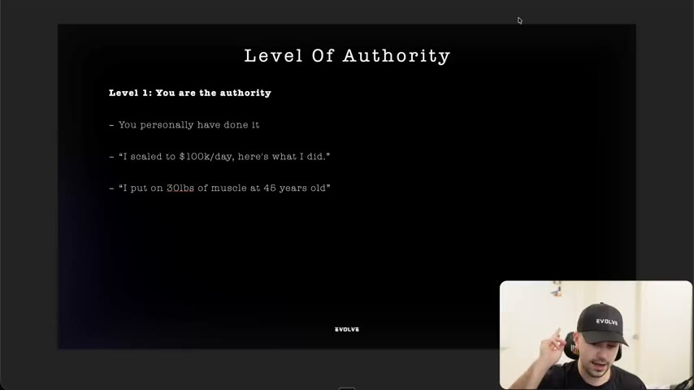
*Level 1: you are the authority (you personally did it). [02:20]*

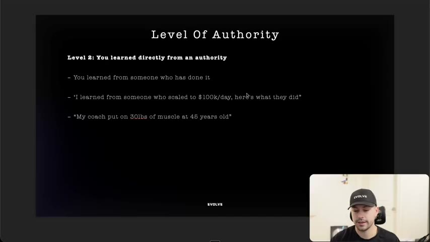
*Level 2: you learned directly from an authority. [03:00]*

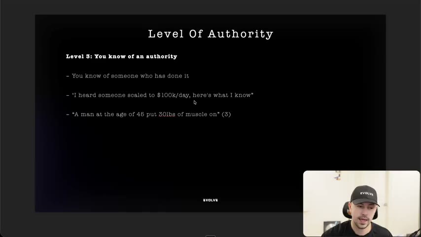
*Level 3: you know of an authority. [03:35]*

### 3. The ten ways to build authority [04:48–29:12]
He says there are "I believe, 10 different ways", with the unusual ones at the end that "a lot of you probably are not thinking about, or maybe you're doing subconsciously." [04:48]

#### 3.1 Credential authority [04:48–06:44]
- Slide: "This is the most common one that you're used to seeing. And you're used to seeing it because it works. Certifications, degrees, licenses that society recognizes as 'Authority'. Doctors, vets, scientists, nutritionists. Professional licenses (RD, MD, PhD, etc.)" [05:20 slide]
- Dawn-of-advertising example: "More Doctors Smoke Camels Than Any Other Cigarette" ("diabolical, but that is essentially where the market was at"). [05:21–05:53]
- Modern example: a creator in a dentist's gown and office reviews a "brush with coconut oil" claim, "DENTIST REVEALS" headline. [05:53–06:44]
- Caveat: it works well but "in a lot of markets, it's very sophisticated... just having a doctor... is not always enough. It depends on the level of the authority of the doctor." [05:53–06:44]

#### 3.2 Following authority [06:44–08:23]
- "This is influencer marketing, the old school influencer or celebrity marketing": celebrities, influencers, short and long-form creators, streamers ("insane authorities nowadays because of how much time people spend watching them"). The more *loyal* the following, the more authority. [06:44–07:26]
- Example 1: the brand **"LifeIn"** (as heard; unverified spelling) paid hairdresser **Brad Mondo** (slide: "8M Subscribers, 1.29 Billion (!) Views") and put him directly in the ad. They also tested "Brad Mondo recommends" style ads. The instructor calls the in-ad version "level one" because "he is there, he is in the ad, he is the authority and he is saying it." [07:26–08:23]
- Example 2: **IM8 Health** (slide) with David Beckham ("David Beckham wanted one supplement that replaced the shelf of pills..."); Whisper heard "IMA". The instructor also names Tavi Castro as one of their celebrities (name as heard). [07:26–08:23]

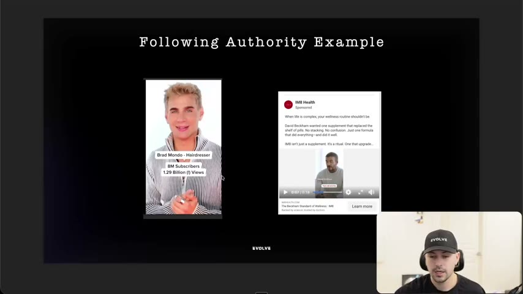
*Following-authority examples: Brad Mondo ("Hairdresser, 8M Subscribers, 1.29 Billion (!) Views") and an IM8 Health ad built on David Beckham. [07:35]*

#### 3.3 Media / press authority [08:23–09:42]
- Slide: "Credible outlets chose to cover you. Shows: you're newsworthy/noteworthy. Featured in online articles (Forbes, Time, etc.). Featured on the news (Fox News, CNN, etc.). These have been incredibly overused and a lot of them can be paid as well so they are not as effective as they once used to be but still are valid authority points. You'll see this working for some brands and very competitive product to wear markets." [08:58 slide]
- "Product-aware" markets (slide typo: "product to wear"): it "makes somebody feel a little bit safer". He has an NDA brand where one of the best ads and best listicles is "all about the media coverage that we got". [09:01–09:42]
- Examples shown: a flag company on Fox News ("American Flags Should Be Made in America", co-founders found... ) and a "This Sleek Humidifier Is Also the Easiest One to Clean" article placement (a press-style listicle from a "random publisher"). [09:42–10:28]

#### 3.4 Award and patent authority [09:42–11:23 area]
- Definition: society, business or companies have validated the product as unique or exceptional. Patents say "this is very unique"; awards say "this is a phenomenal product". Examples: Michelin star, CES award, patented technology. [09:42–10:28]
- Example A: an air purifier ad with a **Consumer Reports** badge, "Best Air Purifier Brand of 2025". [10:28–11:23]
- Example B: **Solawave** (red-light therapy): "40+ patents protect what copycats can't replicate." The instructor: "really strong positioning... only we can say this." He notes copycats are easy to visualise because shoppers see them all the time. [10:28–12:06]

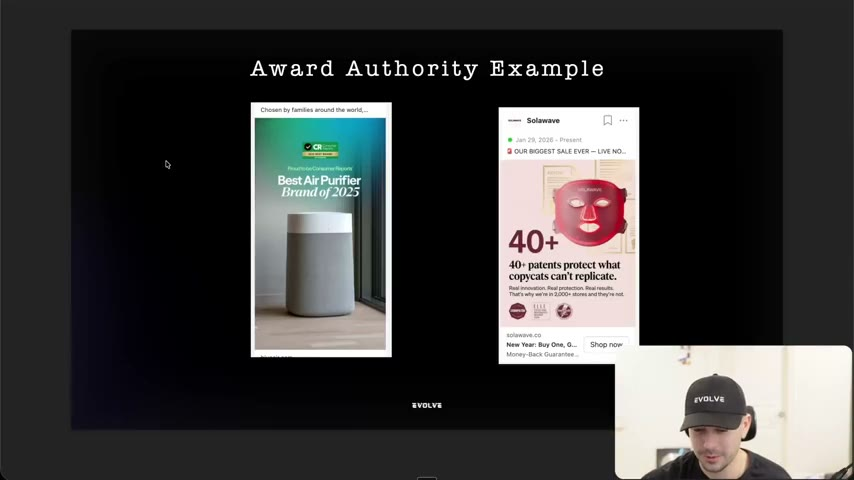
*Award/patent examples: "Best Air Purifier Brand of 2025" and Solawave "40+ patents protect what copycats can't replicate." [10:52]*

#### 3.5 Organization authority [12:06–13:56]
- Slide: "Credible or elite organizations use, develop, or officially endorse your product. 'Developed at MIT' / 'Created in partnership with Stanford researchers'. 'Official supplier to Team USA' / 'Chosen by Olympic athletes'. 'Trusted by Navy SEALs'. Examples: 'Developed in partnership with MIT researchers' 'Worn by NHL players' --> not a specific player," [12:25 slide]
- The instructor's own NDA-adjacent example: shelters feed a dog food because it is nutritious; "it's what vets recommend." An animal-rescue organisation "is an organization. It's not a person. It has a lot of authority." [12:06–13:00]
- Sports examples: a retro NHL tank-top brand with an NHL licence ("they're partners with the NHL") and **Ridge** wallets with an NFL partnership (the ad shows a Detroit Lions card; "Ridgewell" is Whisper's spelling). He also mentions a Disney collaboration he half-remembers (brand name unclear in the audio). [13:00–13:56]

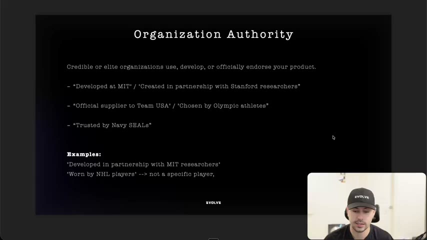
*Slide "Organization Authority" with the MIT/Stanford, Team USA/Olympic and Navy SEALs formulas. [12:25]*

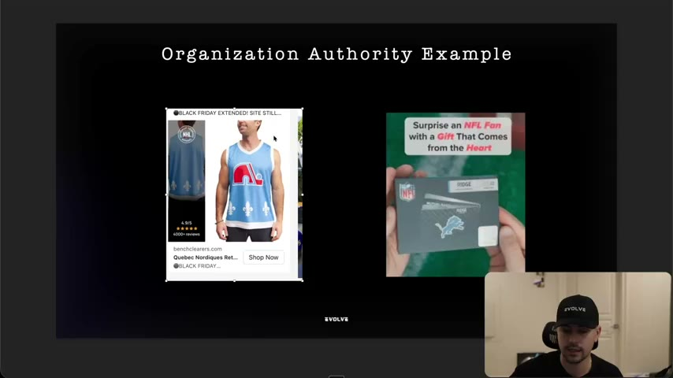
*Organization-authority examples: an NHL-licensed Nordiques tank top and a Ridge wallet for NFL fans ("Surprise an NFL Fan with a Gift That Comes from the Heart"). [13:35]*

#### 3.6 Title authority [13:56–15:39]
- Slide: "Position/role implies expertise and authority. Founders (founder story = authority). CEOs, executives, directors, 'Head of X at Y company'. Example: 'Hi I'm the CEO/founder of EightSleep, I spent 5 years trying to perfect a perfect nights sleep'. More brands we have NDA's with." [14:15 slide]
- "If you've ever wondered why founder stories do well... the founder is an authority." Another NDA brand had its **head of product** film and say "Hi, my name is X, I'm the head of product of X company", then explain how they developed it. [13:56–14:41]
- Examples: **Ross Lohr, co-founder of "Project Repat"** (name as heard; from the winning-ads guide, telling why he started the business) and a **Nexgen Ceramic Spray** CEO ad "MY PRODUCT SUCKS..." / "Hey, let me tell you why my product stinks... my name is Michael [surname unreadable], I'm the CEO of NextGen... already sold 100,000 bottles". The instructor says it has run about two years, and notes he is filmed in the workshop (environment adds authority). [14:41–15:39]
- "You guys can actually do founder videos, just most of you guys are too embarrassed to do it, which is probably an answer to your question of why you can't scale." [14:41–15:39]

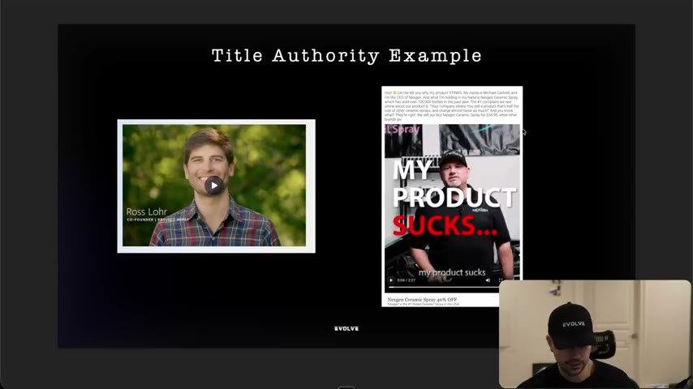
*Title-authority examples: a co-founder story video (Ross Lohr) and the Nexgen Ceramic Spray CEO ad "MY PRODUCT SUCKS...". [15:36]*

#### 3.7 Research authority [15:39–18:07]
- Slide: "Third-party validation through data/science that creates authority. Clinical studies, peer-reviewed research, 3rd party labs. Real data/statistics (info that is publicly available & approved). Example: 'Listerine kills 99.9% of germs that cause bad breath, plaque, and gingivitis. Clinically proven to reduce plaque by 52% more than brushing and flossing alone.'" [15:56 slide; read from the slide]
- Ad examples (all shown on screen, images then a video): **Divi** "DID YOU KNOW? we lose 150 strands of hair per day" ("it only takes one dropper of serum"); a kids-sugar ad: "Here's a stat that'll make you put down... Most kids start school with 40g of sugar." (healthy cereal 12 g, apple juice 22 g, flavoured yogurt 14 g, "before school total 48g sugar. That's double the daily limit"; then "at school" energy crash, can't focus, mood swings, falling behind); and a **Mama Bear Oasis** video: "The mineral is being called neuropathy killer. Of course it's magnesium. Could stop burning and tingling in less than 15 minutes... magnesium can even repair your nerves over time... most people have been using it the wrong way when you take magnesium orally, it often gets broken down." [16:13–17:12; 17:12–18:07]
- Why it works: "if you just read this, I assume this person knows a lot about children's health." Share research "without boring someone to sleep... you're not lecturing them" and it positions you "because you just know more than the average person." He says two of the three are converting per AdSpy; he is unsure about the third. [17:12–18:07]

*Slide "Research Authority" with the Listerine example. [15:56]*

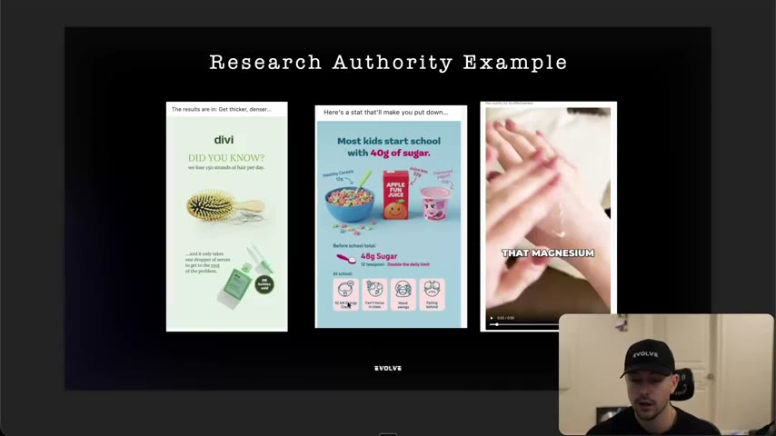
*Research-authority ads: Divi hair-loss fact, the "40g of sugar" stat ad and the magnesium video. [17:02]*

#### 3.8 Experience authority [18:07–21:13]
- Slide "Experience Authority" (text read from the frame at 18:36; the slide's own typo "pre works" is kept): "Personal track record in specific domain. Years in field or specialty from doing the thing - Mom of 5 kids (knows parenting) - 10 years knitting (knows knitting) - Lost 25 pounds (knows weight loss) - I ordered 37 different pre works to test for the best one (Knows pre workouts). Example: 'As a mom of 5, I tried every trick to get my kids to take their. But Grüns is the only one they actually take'" (the slide drops the word "greens" that the instructor says aloud). [18:07–20:00]
- Extra examples: "three of my kids are now Harvard grads or Harvard MBAs" (would you take parenting advice from her?), Subway's Jared ("I lost a hundred pounds... holy shit, I should eat Subway"), "If I tell you I've reviewed a thousand ads, here's what I know about ads." [18:07–19:27]
- Warning: don't "jump straight to the claim." If you say "I ordered 37 pre-workouts, here's the best one" and skip what you learned, you lose the person; share what you went through and learned. [19:27–20:00]
- Ads: a cellulite creator "Reminder to all the moms that summer's right around the corner, and it only takes 4 weeks to smooth out your cellulite" (same-person before/after proved by the same tattoo, "Try a full-size jar of B-TIGHT for 3 weeks and pay only..."), and a bonnet ad ("my white girls... you got to start wearing bonnets... keep your hair so silky", "Wake Up to Smooth, Tangle-Free, Silky Hair"). [20:00–21:13]

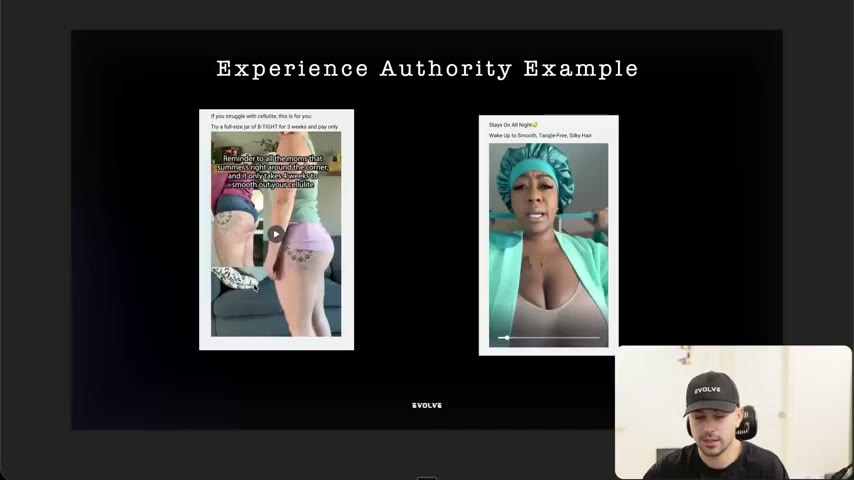
*Experience-authority examples: the cellulite "only takes 4 weeks" creator ad and the bonnet "silky hair" ad. [20:10]*

#### 3.9 Borrowed authority [21:13–26:42]
- Slide definition: "Ethically leveraging another person or entity's authority by explaining how they use/discovered something, which informed your approach. Expert name/organizations (Be very careful). Old stories & tales --> Dog sledding team. Historical figures --> In 1957 the first car had X". [21:30 slide]
- The difference from organization authority: "the NHL specifically supporting and you have an NHL license" versus "you notice something about all NHL players do the specific thing" or "all Stanford grads take this thing." [21:13–21:45]
- Slide examples, verbatim: [21:30 slide]
  - Story-based: "Navy SEALs used cold exposure for recovery. We studied that approach and applied it to our product."
  - Research-based: "MIT researchers discovered X mechanism. We used that research to develop our formula."
  - Expert reference: "Experts say sleep quality matters more than duration. That's why we focused on deep sleep cycles, not just hours."
  - Achievement-based: "The dog sledding team that won the Iditarod used this type of nutrition strategy. We applied the same principles."
- The instructor's reasoning: "I'm not saying that they endorse our product... I'm not lying. I'm just saying that this is something that we noticed. We're in level three of authority." [22:28–23:09]
- Compliance: "if you want to be completely safe, just say experts." Naming a person like Andrew Huberman "may not be worth the risk"; contact compliance (he believes the community has a compliance contact). He hasn't done named endorsements-by-association himself "because we usually don't name drop, we can't with the brands of our size." [23:09–23:57]
- Ads shown: [23:57–26:42]
  - **"Can I make a better chocolate bar than MrBeast?"** (YouTube; "10 million views"). He does not say MrBeast's bar is bad; he asks "can I make a better one?" and documents the attempt. The on-screen channel is Tyler Csatari's "Making the world's best chocolate bar". (Same ad idea the instructor mentions in [lesson 3](03-how-to-guarantee-you-get-better-at-copywriting.md).) [23:57–24:55]
  - **BoomBoom Nasal Sticks** TikTok-shop style: "Listen carefully. They banned this episode for what has been said." He says "I don't think they actually did. A lot of people just make this stuff up"; the creator films his laptop reacting to a talk-show clip. He warns: "This is not something that we do... but we have to understand why they work. It's because they're borrowing authority." [24:55–26:42]
  - **American Recipe Association** (Great Depression recipes cookbook giveaway): "Imagine turning just two eggs into a meal for a family back during the Great Depression. That wasn't any sort of fancy thinking. It was plain old survival." Borrowed authority via history and story. [25:45–26:42]
- Closing: "Careful with this stuff. But it is very powerful." [26:42]

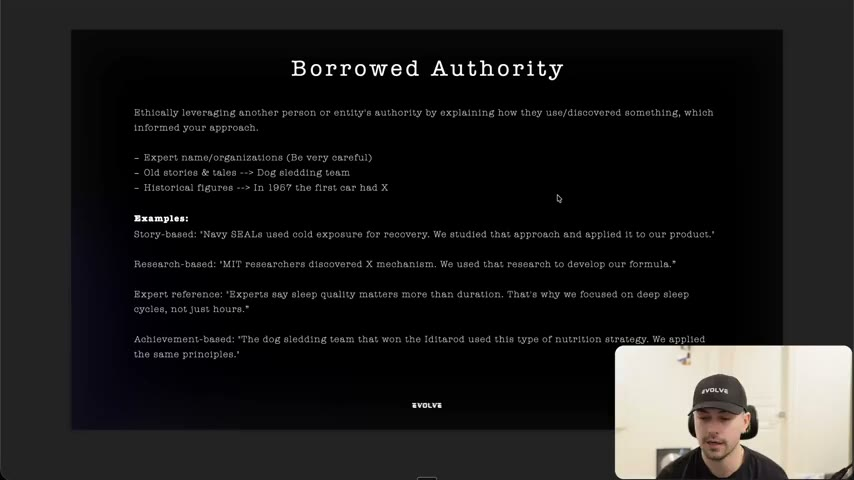
*Slide "Borrowed Authority" with its four example formulas (story, research, expert reference, achievement). [21:30]*

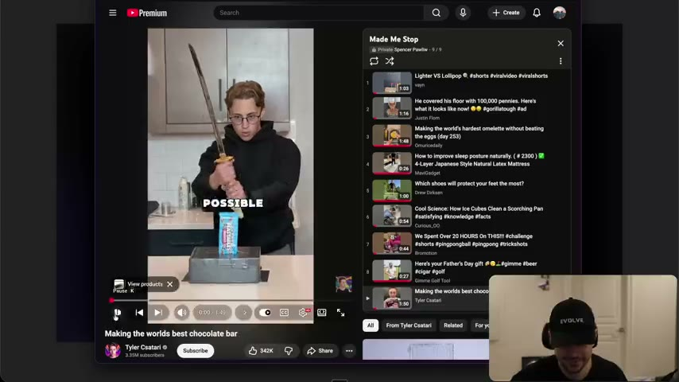
*The "Making the world's best chocolate bar" video used as the borrowed-authority example (frame shows the YouTube player and a saved "Made Me Stop" playlist). [24:44]*

#### 3.10 Visual authority (bonus) [26:42–29:12]
- "This actually doesn't have much to do with copywriting, but... when you guys are copywriting, you need to be aware of it": you *appear* as an authority. Slide: "Speaking on podcasts (In person). In person Interviews (Being interviewed by media or in documentary). Public Speaking (Speaking at events/conferences). Visual signals matter - show diplomas, wear appropriate attire, use professional settings" (slide title is mislabelled "Borrowed Authority"). Zoom podcasts "just don't really work"; in-person does. [27:03 slide; 26:42–27:56]
- Examples: a man with leg scars after two knee replacements ("he's clearly had knee surgeries"; a native-style ad); a woman with wavy hair giving "3 signs your hair is actually wavy" ("the only reason they're listening is because she actually has beautiful wavy hair"); a man in a professional setting with a mic who "looks like some kind of doctor even though he's just wearing jeans and a black long sleeve" (pyrithione zinc leading-brands claim); an actress and dog activist (Katherine Heigl; Whisper "Hegel") filmed in a clean, professional angle talking about dog food (citric acid "isn't good"). "She in herself is also an authority, but the environment even makes it more of an authority." [27:56–29:12]

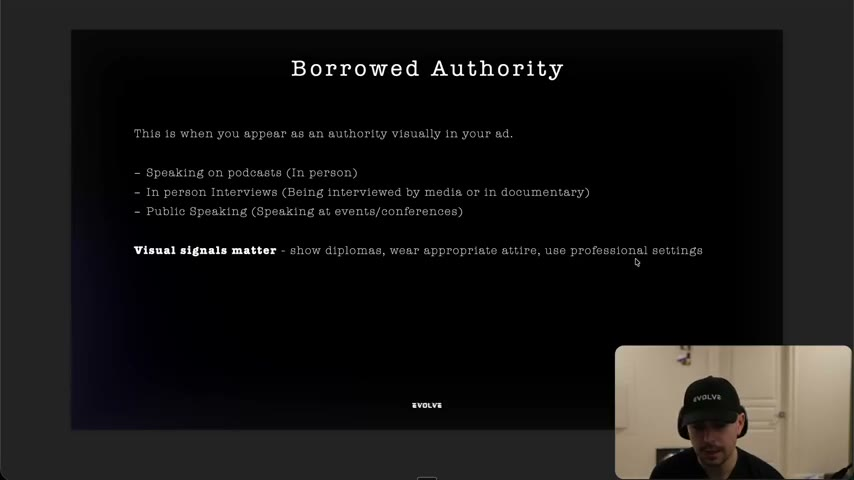
*Slide for visual authority (its heading reads "Borrowed Authority"): podcast, interview, speaking, and "Visual signals matter". [27:23]*

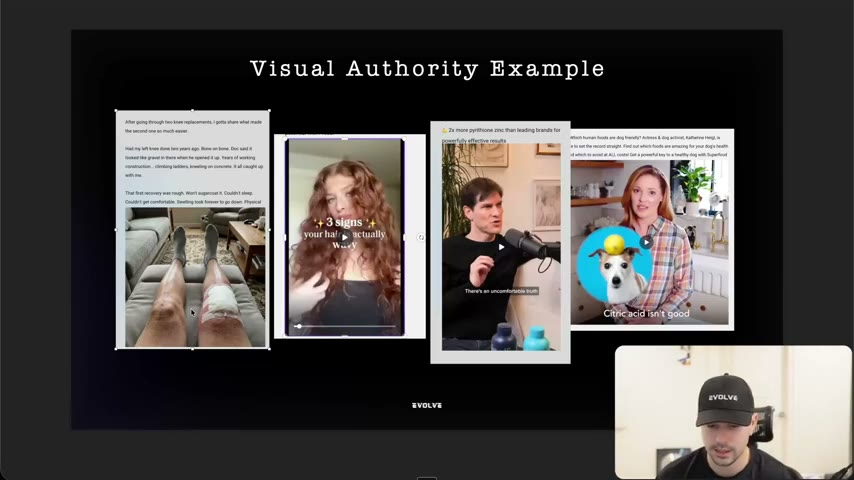
*Four visual-authority ads: knee-replacement legs, a wavy-hair creator, a mic-and-podcast doctor look, and Katherine Heigl with a dog. [28:23]*

### 4. How to enhance authority with words [29:12–37:47]
The slide "How to enhance authority?" introduces two additions that "just require your words." [29:12; 36:48]

#### 4.1 Relatability authority [29:12–33:36]
- Slide: "If you can articulate their pain better than competitors, they will trust you. Pain = articulate their experiences, their behaviors, their emotions, their beliefs, their desires so vividly, they feel like you have been in their exact shoes. **If they feel like you have been in their shoes, and figured it out, you will establish authority.** If it walk like a duck, sounds like a duck, it's probably a duck. If it walks like an authority, sounds like an authority, it's probably an authority" [29:45 slide]
- Pattern: don't just say you lost 30 pounds. State the experience (experience authority), then mirror their experience: "I had the same behaviors of just snacking out of control. I felt terrible about myself. I honestly believed that I would never lose weight, but I wanted it so badly so my husband would love me again." (He says this is "generic off the top of my head"; not a tested ad.) "Not only do you feel like that, but look at me, I am proof." [29:46–30:44]
- Combining relatability with experience or research authority "enhances your overall authority and builds more belief." [30:44]
- **18 Chestnuts landing page** (read from the screen): "Frustrated with Digestive Issues? I was too. No one could pinpoint what was wrong. I tried everything... I began to feel like I couldn't enjoy food anymore. So I turned to what I learned from Cornell's Nutrition and Healthy Living Program about the 'Food as Medicine' philosophy. When I started researching, I was shocked to learn that over 70 million Americans, and women in particular, struggled with GI-related issues. That's why I started 18 Chestnuts... Ilona Kossoff, Co-founder of 18 Chestnuts". The instructor labels the stack: relatability (pain), organization authority (Cornell), research (70 million), title/founder (co-founder). [30:44–32:55]
- **The PocketSpeech video** ("This is how my nonverbal toddler found his voice"): "My three-year-old has always struggled to speak and was recently diagnosed as nonverbal. We've tried everything... speech therapy, early intervention, books, but nothing worked... I silently resigned to a life of him not speaking. Recently, our speech therapist sent me this brand called PocketSpeech." The instructor's point: she says "our speech therapist recommended it", not "I did research" ("night and day difference"), so a borrowed credential authority does the persuading; he also points to the juxtaposition "nonverbal... found his voice" creating a curiosity gap. [32:55–33:36]

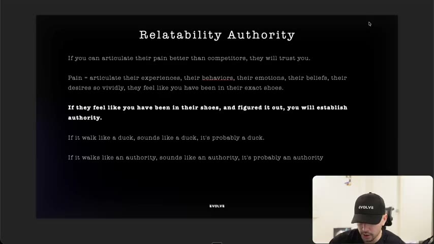
*Slide "Relatability Authority": articulate pain so vividly that they feel you have been in their shoes. [29:45]*

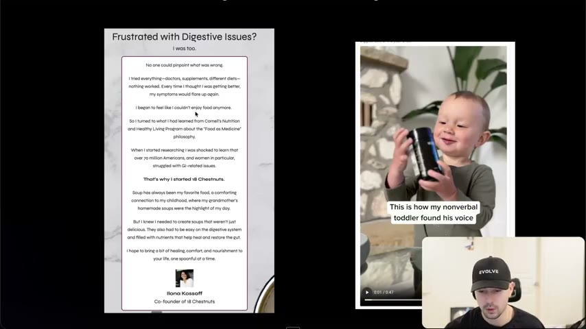
*The 18 Chestnuts founder story and the PocketSpeech "nonverbal toddler found his voice" ad. [31:26]*

#### 4.2 Transparency authority [33:36–36:48]
- Slide: "If you can be transparent where most aren't, more people will trust you. Transparent = product limitations or drawbacks, ingredients used, who it's NOT for, why it costs more, showing behind the scenes, failed prototypes/products. If they feel like you are being honest with them about things you don't need to be, you can establish more authority with customers." [37:32 slide]
- **Buckley's**: "It tastes awful. And it works." [34:35]
- **Strolee Carts** (shopper/walker cart): a roughly six-minute ad where the company's own spokesman, standing in a warehouse, explains the product, says "I listened to you guys", compares models, and demonstrates stability ("this won't tip over regardless how much weight"). Stats shown: "13 million views, 92,000 likes, 11,000 shares", live "like six or seven months ago, probably eight". He loves that it is "show, don't tell", "just yapping, just being real", and filmed in a real company environment. [34:35–36:10]
- **David Protein ("David Cod")**: after claiming the lowest calories per protein, they saw that cod has "slightly more protein per calorie than the bars" and launched "Introducing: David Cod. Slightly more protein per calorie than our bars. We don't recognize limits." He doubts many will buy it but says it "establishes their position even more" as committed to the highest protein per calorie; he calls it "phenomenal, genius marketing" and will cover it again in positioning. [36:10–36:48]
- "Both of those... the transparency and the relatability... just require your words. That's it." [36:48]

*Slide "Transparency Authority" with the list of what to be transparent about. [37:34]*

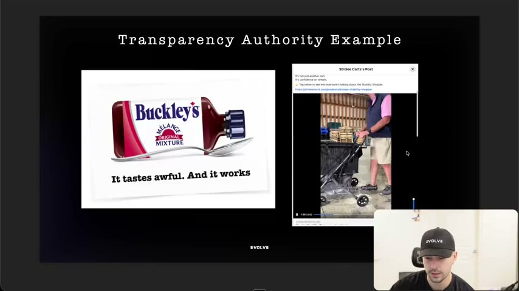
*Transparency examples: Buckley's "It tastes awful. And it works." and the Strolee Carts founder-style product video. [37:32]*

### 5. Summary: authority accelerates trust [37:47–38:37]
- "Authority... is what accelerates trust... You can manufacture authority through strategic stacking of principles." Look in each ad for "where are they creating belief, where are they creating authority?" [37:47]
- The prospect doesn't just believe you, "they see you as an authority", and so they want to buy from you. [37:47]
- Final slide: "You can manufacture authority through strategic stacking of principles". He expects many students to review their ads and find "absolutely no authority here at all." [37:47–38:37]

## Steps / framework

### Authority type cheat sheet (for teardown and for writing)
| # | Type | What it is | Line or visual pattern | Can a brand control it? | Source |
|---|---|---|---|---|---|
| 1 | Credential | Degrees, licences, certified professionals | "Dentist reveals..."; doctor on camera | Only with a real professional | [04:48–06:44] |
| 2 | Following | Audience-holding celebrity/creator/streamer, in the ad | Creator speaks to camera on the product | Paid partnership | [06:44–08:23] |
| 3 | Media / press | Outlets covered you | "As seen in", press-style article ads/listicles | If coverage exists | [08:23–09:42] |
| 4 | Award / patent | Awards or patents | "Best Air Purifier Brand of 2025"; "40+ patents protect what copycats can't replicate." | If won/held | [09:42–12:06] |
| 5 | Organization | Elite org uses, develops or endorses | "Developed at MIT"; "Worn by NHL players"; "Trusted by Navy SEALs" | If partnership/licence is real | [12:06–13:56] |
| 6 | Title | Position implies expertise | "Hi, I'm the CEO/founder of..."; head of product explaining development | Yes | [13:56–15:39] |
| 7 | Research | Third-party data or science | "We lose 150 strands of hair per day"; "Most kids start school with 40g of sugar" | If facts are public and approved | [15:39–18:07] |
| 8 | Experience | Personal track record | "As a mom of 5...", "I ordered 37 pre-workouts" | Yes, if real | [18:07–21:13] |
| 9 | Borrowed | Use another authority's practice or discovery without claiming endorsement | "Navy SEALs use cold exposure. We studied it..."; "Can I make a better chocolate bar than MrBeast?" | Yes, compliance permitting | [21:13–26:42] |
| 10 | Visual | You look/appear authoritative | Podcast mic, in-person interview, stage, professional setting, diplomas | Yes, via production | [26:42–29:12] |
| + | Relatability | Articulate pain so well that they feel you've been there | "I had the same behaviors... I felt terrible..." | Yes, words only | [29:12–33:36] |
| + | Transparency | Share drawbacks, who it's not for, price reasons, behind the scenes | "It tastes awful. And it works." | Yes, words only | [33:36–36:48] |

### Stacking recipe (derived from [30:44–32:55; 37:47])
1. Pick the primary authority we can truthfully claim (title, experience, research, award, organization).
2. Add relatability to the pain (mirror the viewer's behaviours, feelings, beliefs).
3. Add one supporting authority (research stat, borrowed story, third-party recommendation such as a therapist or vet).
4. Add a visual authority cue (setting, attire, environment).
5. Check each element against compliance; swap named experts for "experts say" if unsure.

## Examples
See the per-type sections above for all 25-plus ads and slides; compact teardown table below.

## Structured units

### Hooks
| Hook | Heuristic(s) | Emotion / zone | Self targeted | Why it works | Source |
|---|---|---|---|---|---|
| "Can I make a better chocolate bar than MrBeast?" | Authority borrowing (derived) | Curiosity (derived) | — | Borrows MrBeast's authority as a benchmark without claiming endorsement or insulting him; invites a make-it-yourself documentary | [23:57–24:55] |
| "Here's a stat that'll make you put down..." / "Most kids start school with 40g of sugar." | Statistic/authority (derived) | — | — | A surprising public fact makes the advertiser seem knowledgeable about children's health | [16:13–17:12] |
| "DID YOU KNOW? we lose 150 strands of hair per day" (Divi) | Statistic/authority (derived) | — | — | A fact everyone can accept ("this is just a fact") builds authority before the product pitch | [16:13] |
| "This is how my nonverbal toddler found his voice" (PocketSpeech) | Juxtaposition (instructor's word), curiosity | — | — | "Nonverbal" against "found his voice" creates a gap the viewer wants closed | [32:55–33:36] |
| "Hey, before you skip this video, let me tell you why my product sucks." / "MY PRODUCT SUCKS..." (Nexgen) | Candour, title authority | — | — | CEO in workshop admits the complaint, then answers it | [14:41–15:39] |
| "It tastes awful. And it works." (Buckley's) | Transparency | — | — | Leans into a true drawback | [34:35] |
| "Listen carefully. They banned this episode for what has been said." (BoomBoom) | Borrowed authority | — | — | Instructor says the claim is probably invented; he flags it as not something his team does | [24:55–26:42] |
| "Imagine turning just two eggs into a meal for a family back during the Great Depression." | Borrowed/historical authority | — | — | Story-based authority from history | [25:45–26:42] |
| "DENTIST REVEALS" (coconut oil brushing) | Credential | — | — | Dentist costume and office signal credential | [05:53–06:44] |

### Angles
| Angle | Core desire / pain | Heuristic(s) | Best format | Example line | Source |
|---|---|---|---|---|---|
| Founder admits the flaw | Trust vs sales-y brands | Candour, title authority | UGC / founder video | "Let me tell you why my product sucks" | [14:41–15:39] |
| Patent moat vs copycats | Fear of buying an imitation | Award/patent authority | Static | "40+ patents protect what copycats can't replicate." | [11:23] |
| Organisation-as-benchmark | Choose what pros use | Organization authority | Static / UGC | "Worn by NHL players" (not a specific player) | [12:25 slide] |
| Expert-recommended discovery | Parent worried about child | Borrowed (third-party credential) | UGC testimonial | "Our speech therapist sent me this brand" | [32:55–33:36] |
| Transparent limits | Distrust of hype | Transparency | UGC / static | "It tastes awful. And it works." | [34:35] |
| Beat the famous benchmark | Curiosity about who's best | Borrowed authority | Creator video | "Can I make a better chocolate bar than MrBeast?" | [23:57–24:55] |

### Ad teardowns
| Brand / product (niche) | Format | Hook / opening | What works | What fails | Fix suggested | Principle | Source |
|---|---|---|---|---|---|---|---|
| Brad Mondo x "LifeIn" (hair) | Creator video | Brad Mondo in the ad, "8M subscribers, 1.29 Billion views" | Level 1: the authority speaks to camera (paid ad) | The "Brad Mondo recommends" version (also tested) is "almost like a level two... kind of getting into level three"; no results given | Use the person in the ad | Following authority | [07:26–08:23] |
| IM8 Health (supplement) | Video + static | "David Beckham wanted one supplement that replaced the shelf of pills" | Celebrity as proof of sophistication | — | — | Following authority | [07:26–08:23] |
| Solawave (red light) | Static | "40+ patents protect what copycats can't replicate." | Only they can say it; frames rivals as copycats | Not very visual | Show copycats visually (instructor aside) | Award/patent | [11:23–12:06] |
| Consumer Reports air purifier | Static | "Best Air Purifier Brand of 2025" badge | Third-party award | — | — | Award | [10:28–11:23] |
| Ridge wallet x NFL; NHL tank tops | Static | "Surprise an NFL Fan with a Gift That Comes from the Heart" | Licence/partnership with a league | — | — | Organization authority | [13:00–13:56] |
| Nexgen Ceramic Spray (car care) | Video | "MY PRODUCT SUCKS..." | CEO in workshop; candour; "sold 100,000 bottles" | — | — | Title + transparency | [14:41–15:39] |
| Divi (hair) | Static | "DID YOU KNOW? We lose 150 strands of hair per day" | Fact then one-dropper solution | — | — | Research | [16:13–17:12] |
| Kids-sugar ad (food) | Static | "Here's a stat that'll make you put down..." | Math chain: 40g, 48g, double the limit, then school consequences | — | — | Research | [16:13–17:12] |
| Mama Bear Oasis (magnesium) | Video | "The mineral is being called neuropathy killer..." | Educates with mechanism facts ("it often gets broken down") | Instructor unsure it is converting | — | Research | [17:12–18:07] |
| Grüns (greens) | UGC | "As a mom of five, I tried every trick..." | Experience authority | — | — | Experience | [19:27–20:31] |
| B-TIGHT cellulite ad | UGC | "Reminder to all the moms that summer's right around the corner, and it only takes 4 weeks to smooth out your cellulite" | Same person before/after (tattoo proves it) | — | — | Experience | [20:00–20:31] |
| Bonnet ad (hair) | UGC | "My white girls... you've got to start wearing bonnets" | Creator who lives the problem | — | — | Experience | [20:31–21:13] |
| BoomBoom Nasal Sticks | UGC reaction | "Listen carefully. They banned this episode for what has been said." | Borrows a talk show as authority; went "crazy all over TikTok shop" per instructor | Banned claim probably invented | Borrow authority without false claims | Borrowed | [24:55–26:42] |
| American Recipe Association (cookbook) | Video | "Imagine turning just two eggs into a meal... Great Depression" | Story authority | — | — | Borrowed | [25:45–26:42] |
| 18 Chestnuts (soup) | Landing page | "Frustrated with Digestive Issues? I was too." | Relatability + Cornell + 70M stat + co-founder | — | — | Stacked | [30:44–32:55] |
| PocketSpeech (speech tools) | UGC video | "This is how my nonverbal toddler found his voice" | Relatability + therapist recommendation | — | — | Relatability + borrowed credential | [32:55–33:36] |
| Strolee Carts | Founder-style video, about 6 min | Warehouse explainer ("show don't tell") | Transparency, 13M views / 92K likes / 11K shares (instructor read) | — | — | Transparency | [34:35–36:10] |
| David Protein ("David Cod") | Static | "Introducing: David Cod. Slightly more protein per calorie than our bars." | Admits a rival product, proves commitment to the claim | Few may buy it | — | Transparency + positioning | [36:10–36:48] |

### Templates
| Template | Use for | Example fill | Source |
|---|---|---|---|
| "I [achieved result], here's what I did." | Level 1 authority | "I scaled to $100k/day, here's what I did." | [01:47–02:55 slide] |
| "I learned from someone who [result], here's what they did." | Level 2 | "My coach put on 30lbs of muscle at 45 years old" | [02:55 slide] |
| "I heard someone [result], here's what I know." | Level 3 | "A man at the age of 45 put 30lbs of muscle on" | [03:52 slide] |
| "[Group] [does practice]. We studied that approach and applied it to our [product]." | Borrowed, story | "Navy SEALs used cold exposure for recovery. We studied that approach and applied it to our product." | [21:30 slide] |
| "[Researchers] discovered [mechanism]. We used that research to develop our formula." | Borrowed, research | "MIT researchers discovered X mechanism..." | [21:30 slide] |
| "Experts say [fact]. That's why we focused on [feature]." | Borrowed, safe expert reference | "Experts say sleep quality matters more than duration..." | [21:30 slide] |
| "The [achiever] that won [event] used [practice]. We applied the same principles." | Borrowed, achievement | "The dog sledding team that won the Iditarod..." | [21:30 slide] |
| "Hi I'm the CEO/founder of [brand], I spent [n] years trying to [result]." | Title authority | "...EightSleep, I spent 5 years trying to perfect a perfect nights sleep" | [14:15 slide] |
| "As a mom of [n], I tried [everything] to [outcome]. But [product] is the only one [result]." | Experience | Grüns example | [18:07 slide] |
| "[Product] [drawback]. And it works." | Transparency | "It tastes awful. And it works." | [34:35] |

### Rules of thumb
- **DO** use "experts say", not a named expert, unless compliance has cleared it. [23:09–23:57]
- **DON'T** lecture; "education that actually converts" differs from lecturing (instructor promises to cover it separately). [17:12–18:07]
- **DO** pair research facts with an easy hook ("Here's a stat that'll make you put down...") [16:13–17:12]
- **DO** film the founder or head of product in a real workspace. [14:41–15:39]

## Prompts / templates (verbatim)
No prompts are supplied. The slide formulas used as templates are in "Templates" above and are verbatim from the slides.

## Screenshots
Other frames referenced inline above: levels 1-3, organisation, title, research, experience, borrowed, visual, relatability and transparency slides and example ad boards (22 images in total). Two further slides:

*Slide "Credential Authority". [05:20]*

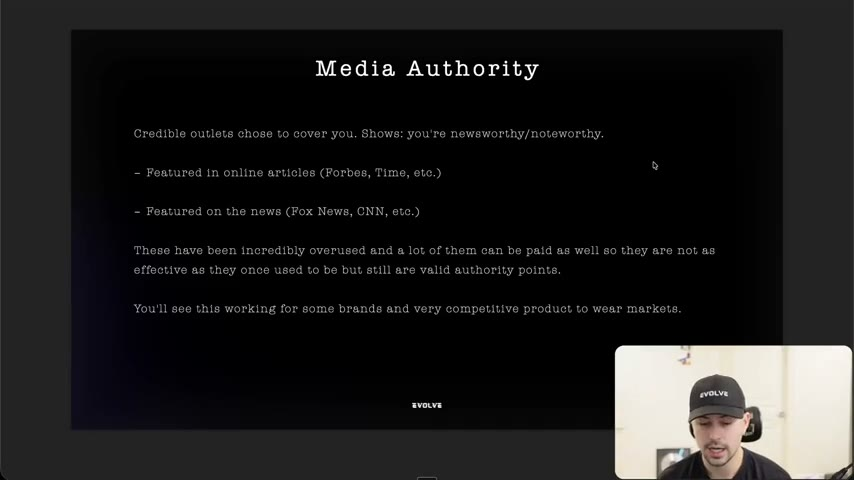
*Slide "Media Authority": outlets chose to cover you, with the instructor's warning that press is overused and can be paid. [08:58]*

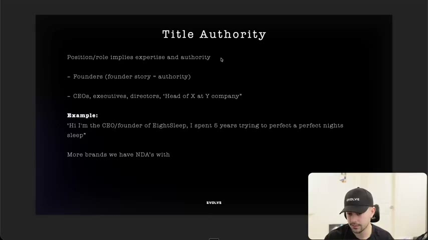
*Slide "Title Authority": founder story = authority, with the EightSleep example. [14:15]*

## How to apply
- [ ] In every competitor teardown, list each proof element and label it with one of the 10 types plus relatability/transparency, and with level 1/2/3.
- [ ] For our product, list all authority assets we can truthfully use: founder/head of product, experience of our creators, research/third-party studies, awards/patents, organisations, press, creator following.
- [ ] Draft each hook or script with at least two stacked authority types; put the strongest one in the first line or first visual.
- [ ] Brief creators to appear in an environment that signals the claim (workshop, clinic, podcast set) and to state personal experience before the claim.
- [ ] For borrowed authority, write it as "we noticed/studied X" and run a compliance check; default to "experts say".
- [ ] Add one transparent line (drawback, who it's not for, why it costs more) to at least one variant per concept.
- [ ] When an ad has no authority, flag it as the likely cause before rewriting the claim.

## Related
- Previous: [15. Why you need to understand beliefs](15-why-you-need-to-understand-beliefs.md) · Next: [17. Being aware of avatars](17-being-aware-of-avatars.md)
- [20. Being aware of authorities](20-being-aware-of-authorities.md) (research companion: finding authorities in the market) · [22. How to finalize your ad ideas](22-how-to-finalize-your-ad-ideas.md) · [Skeptic format](../../../../frameworks/skeptic-format.md) · [Angle remix playbook](../../../../playbooks/angle-remix.md)

## Sources and limitations
- Transcript: [16. Why you need to understand authority… .txt](<../../../../../raw/evolve/copywriting/_transcripts/✍️ Evolve Copywriting (NEW)/16. Why you need to understand authority ✍️ Evolve Copywriting (NEW) Evolve.txt>) · Page text: [….html.md](<../../../../../raw/evolve/copywriting/_extracted/✍️ Evolve Copywriting (NEW)/16. Why you need to understand authority_✍️ Evolve Copywriting (NEW)_Evolve.html.md>) (title only).
- Machine transcription (Whisper large-v3-turbo). Full recording covered (last segment 38:37 = duration). Brand and person names were checked against on-screen text where legible; remaining uncertain: "LifeIn" (hair brand with Brad Mondo), "Tavi Castro", "Ridgewell" (screen shows a Ridge wallet), "Project Repat" (screen text unclear), "Wooblies" (Disney collaboration, unclear), "Katherine Hegel" (Heigl), "NextGen" (screen: Nexgen), "Grunts" (screen: Grüns), and the Nexgen CEO's surname (unreadable). The Facebook UI in the screen recording is logged in as an account whose name reads "Spencer Pawliw" and the instructor says "Spencer" once, but he never states his own name, so the instructor remains unverified.
- Slide text was transcribed from video frames; the slide for visual authority is headed "Borrowed Authority" (a slide typo); "product to wear" on the media slide is as shown.
- The instructor refers to a "winning ads guide/deck" and a "winning ad stock" for several examples; those files are not part of this lesson.
- Statistics (views, units sold, "10 million views", "100,000 bottles") are read off screen or are instructor claims; none were independently verified. NDA brand examples are described but unnamed.
- The instructor references other trainings (positioning, a separate "lecturing vs education" lesson, a compliance contact) that are not included here.
