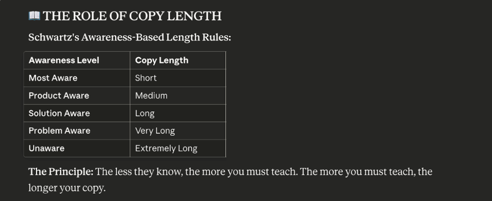
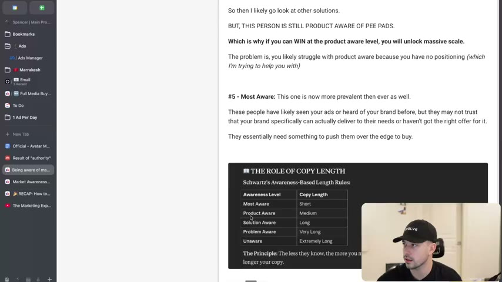

# 21. Being aware of market awareness
> Schwartz's five awareness levels still apply (unaware, problem aware, solution aware, product aware, most aware), but today people move through them in minutes, so the instructor redefines each level for current ad writing: the product-aware level is now the biggest and most sophisticated, and winning it (with positioning, mechanisms, authority and belief-handling) is what unlocks scale.

## 🤖 Agent use
- **Use when:** deciding what kind of ad to write for a chosen audience (what to say first, how long, what to prove); classifying a competitor ad by the awareness level it targets; diagnosing why an offer-led ad or an educational ad underperforms.
- **Inputs → outputs:** avatar + product + where the audience is in their buying journey → an awareness level, the job the ad must do at that level, and the right copy length/structure; for competitor ads, a labelled awareness level and the gap to exploit.
- **Rules:**
  - **DO** decide the awareness level before writing: "am I writing more of an unaware ad? ... a problem aware ad? Am I starting at the solution level? ... at the product-aware level?" [17:23–18:21]
  - **DO** treat **unaware** as still real, and a core reason social platforms work. The job is to make people aware of a problem they aren't consciously thinking about, or "make the desire come more to front of mind". [02:57–03:51]
  - **DO** at **problem aware**, make the prospect see the problem is worth solving, by dramatising the need ("you dramatize the need vividly so the prospect realizes how badly they need the solution" - Eugene, as quoted on the page). [05:30–06:18]
  - **DO** at **solution aware**, discuss all the other options people are weighing; ads can start at this level "without raising somebody's existing beliefs on specific products they may have already seen". [07:50–08:33; 18:21]
  - **DO** at **product aware**, work out whether they have tried your product or category and what they believe because of it, then speak to that belief ("I know you've tried pee pads and here's why they failed"). [13:35–14:32; 18:21]
  - **DO** at **most aware**, push them over the edge with an offer or reassurance; they've seen you but "may not trust that your brand specifically can actually deliver" or lack "the right offer". [15:11–15:45]
  - **DO** keep copy shortest for most-aware and longest for unaware: you must walk people through every stage you skip. [15:45–16:24]
  - **DON'T** assume people sit in problem awareness: they search, ask ChatGPT, and move from problem aware to buying "in 10 minutes", with the product at home the next day. [00:45–02:15; 11:15]
  - **DON'T** assume a headline like "Are you tired?" reaches a *problem-aware* person who knows nothing about solutions: people with common problems are "aware of all the other products that exist... probably aware of your pillow", so "we don't give people enough credit for how aware they are". Naming a problem to someone who didn't know they had it is unaware-level work, not problem-aware. [04:45–05:30]
  - **IF** the audience tried a competitor's category and it failed **THEN** they remain product aware but hold a belief ("pee pads don't work"), so the ad must address that belief or offer a new mechanism. [11:15–13:35]
  - **IF** you struggle at product aware **THEN** the cause is probably no positioning, weak mechanisms or authority, or shallow customer knowledge. [13:35]
- **See also:** [15. Why you need to understand beliefs](15-why-you-need-to-understand-beliefs.md) · [14. Why you need to use unique mechanisms](14-why-you-need-to-use-unique-mechanisms.md) · [16. Why you need to understand authority](16-why-you-need-to-understand-authority.md) · [17. Being aware of avatars](17-being-aware-of-avatars.md) · [Triggering events](../../../../concepts/triggering-events.md) · [Switching behavior](../../../../concepts/switching-behavior.md)

## Key ideas

### 1. Why the 1966 model needs updating [00:00–02:57]
- "If you guys have watched [the original Evolve awareness video] and you're like, I know market awareness, do not skip this." The original model "doesn't really apply to today's market" as written. [00:00–00:45]
- Schwartz wrote *Breakthrough Advertising* "before cell phones, the internet, and widespread information" (page text: "(1966)"). The instructor is amazed how much still applies, but one thing changed: "how fast people progress through these stages nowadays." [00:00–00:45]
- Page text: "If you have a problem, you usually don't just sit in this problem-aware stage. What do you do? You google it, search it on TikTok, you ask chat GPT. When you search for a solution, you're immediately bombarded with tons of different options and become aware of tons of solutions, products and product categories in a matter of minutes." [00:45–01:39]
- Spoken: "You can go from literally problem aware to buying a product and being most aware in 10 minutes. And then the product will be at your house the next day. Thanks to Amazon." [01:39–02:15]
- 1966 contrast (spoken): you'd go to a store for back-pain creams; ads came in newspapers, direct mail and TV; "the stages happened a lot slower... e-commerce wasn't a thing." [02:15–02:57]

### 2. The five levels as redefined [02:57–15:45]

| Level | Instructor's definition (page text, verbatim where quoted) | What the ad must do | Example given | Source |
|---|---|---|---|---|
| **1. Unaware** | "Is still a very real category. And it's why it can dominate on social platforms. Your goal is to still make people aware of a problem they aren't consciously thinking about." | Introduce a problem the viewer doesn't think they have; educate; also identity marketing is used for unaware audiences | Back pain: "Do you sit and work for 12 hours a day?... have you been doing that for two or three years?" He calls the feeling "a high intensity, low valence" ("holy crap, I don't want that to happen") | [02:57–03:51] |
| **2. Problem aware** | "Also still a real category.. BUT, your copy is not to identify the problem (that's unaware) it's to make the prospect understand that they have a problem worth solving." | Dramatise and amplify; "help them understand that this is a problem they need to fix" | A bank account with "one hundred and seventy four dollars in it" and the person is still spending; aware but "not actively doing anything to fix it" | [04:45–06:59] |
| **3. Solution aware** | "People who are aware of the solutions that exist for their problem, they just aren't convinced which one will solve it the best. You can start ads at this solution level without raising their existing beliefs on specific products they may have already seen or researched." | Cover the types of solution available and why one type is best; keep considering products out until the solution type is chosen | Dog peeing indoors: pee pads, meds, leave dog outside, trainer | [07:50–09:25] |
| **4. Product aware** | "People are aware of your types of product & its category, but they aren't completely aware of all YOUR product does, they aren't convinced it does it well, and they aren't convinced it's right for them." | Differentiate: position, mechanism, authority, answer prior-experience beliefs | "Pee pads are what I want to get, but I'm not sure which one is the best" | [09:25–15:11] |
| **5. Most aware** | "This one is now more prevalent than ever as well. These people have likely seen your ads or heard of your brand before, but they may not trust that your brand specifically can actually deliver to their needs or haven't got the right offer for it. They essentially need something to push them over the edge to buy." | Offer, reassurance, push over the edge | "40% off pee pads" to someone comparing pee pads | [15:11–15:45] |

#### Solution aware vs product aware [07:50–10:20]
- Solution aware: "still considering all of the different types of products [and solutions] to solve their problem". Product aware: "know what product they want to solve their problem." [07:50–08:33; page text]
- The "your" in "your types of product" means the person knows the *category*, not your specific product. "They know pee pads are a thing... they aren't completely aware of all that your specific product does." [09:25–10:20]
- Walk-through (page text and spoken, the instructor's own recent experience of getting a dog): *Problem aware* "Dog is peeing in the house every time I leave. What do I do? -> I search how to fix dog peeing in the house when I leave." *Solution aware* "Get pee pads, put the dog on meds, leave the dog outside, get a dog trainer, etc." *Product aware* "Pee pads are what I want to get, but I'm not sure what one is the best." [08:33–10:20]

#### Why product aware is the key level [10:20–14:32]
- Page text: "Product aware is biggest it has ever been and is a lot bigger than you think. But it's also a lot more sophisticated than you think. I can go from problem aware -> most aware in 20 minutes with tools like Amazon." Spoken: "Twelve hours later it's at my house and I try it and it does or doesn't work." [10:20–11:15]
- Continuing example: I search "best pee pads on Amazon", buy the top-rated, they don't work. Now I am "not only aware of pee pad products, I'm most aware of the brand that didn't work AND I now have a biased belief that pee pads don't solve this problem. So then I likely go look at other solutions. BUT, THIS PERSON IS STILL PRODUCT AWARE OF PEE PADS." [11:15–12:42; page text]
- Consequence: an ad saying "Is your dog peeing in the house? Try this pee pad" gets scrolled ("I know they don't work because that's the belief that I have"). [12:06–12:42]
- Opening for a new solution: "the pee pads don't work for you... try giving them this instead. It'll help them be calm like a CBD or something... I'm like, that's kind of like a new mechanism that I haven't tried yet." (The instructor's hypothetical; not a real product.) [12:42–13:35]
- Payoff: "if you can help someone who has had a poor experience with pee pads actually buy yours and have a better experience, you will unlock massive scale." [13:35]
- Why people fail here: "You likely struggle with product aware because you have no positioning... you don't understand how to write with new mechanisms the right way. You don't understand how to build authority. You don't understand your customers deep enough." [13:35–14:32; page text]
- Example copy angles he suggests for the product-aware pee-pad prospect: "I know you've tried pee pads and here's why they failed", "three reasons why most pee pads fail" (wrong spot, not big enough, not ones your dog is attracted to), optionally with authority such as "vets recommend this one". [13:35–14:32]
- Some people are "solidified" in beliefs and will not accept that pee pads can work, "which is why copywriting is so important". [12:42–13:35]
- "Most people that have a problem go from problem aware to most aware of specific brands, but definitely product aware way faster than you think... so many more markets are more sophisticated because of how fast people can get information." [14:32–15:11]

### 3. Copy length by awareness [15:45–17:23]
- Rule: "Most aware is like the shortest copy. Unaware... is the longest form copy, because you have to take people through each customer journey." [15:45–16:24]
- Unaware sequence he describes: introduce the problem -> amplify why it is a problem worth solving -> discuss the solutions that exist -> talk about products and why yours does it better -> introduce your brand -> offer. "The reason the copy goes from longer to shorter is because you have to go through each stage." [16:24–17:23]
- Lesson page image ("THE ROLE OF COPY LENGTH", Schwartz's awareness-based length rules): the instructor does not read this table aloud; it is the image embedded at the end of the page text.

| Awareness level | Copy length (page image) |
|---|---|
| Most Aware | Short |
| Product Aware | Medium |
| Solution Aware | Long |
| Problem Aware | Very Long |
| Unaware | Extremely Long |

Image caption text: "The Principle: The less they know, the more you must teach. The more you must teach, the longer your copy."


*The image embedded in the lesson page: awareness level vs copy length, and "The less they know, the more you must teach." [page text; shown on screen at 16:00]*


*The instructor scrolling to the table at the bottom of the lesson page. [16:00]*

### 4. Closing: how to use it while writing [17:23–18:56]
- He sets the redefinition as the point of the lesson: the changes concentrate on solution aware and product aware, "an area that a lot of people got stuck on". [16:24–17:23]
- At product aware you must ask: "Have they tried my product? Have they not? Are they just aware of the category specifically and they haven't tried anything yet?" [18:21]
- "That's why it's so competitive nowadays. And that's why positioning is more important than ever." [17:23]
- He placed this lesson in the "fundamentals" section instead of principles because it needs deeper treatment; copywriting strategies follow. [17:23–18:56]

## Steps / framework

### Level-by-level writing guide (derived from the lesson)
| Level | First job | Structure of the copy | Length | Proof to bring | Source |
|---|---|---|---|---|---|
| Unaware | Surface a problem they don't think about | Problem -> amplify -> solutions -> products -> why ours -> brand -> offer | Extremely long | Education, vivid scenario, identity | [02:57–03:51; 16:24–17:23] |
| Problem aware | Make it worth solving | Dramatise the need; quantify the consequence | Very long | Vivid consequences ("$174 in your bank account") | [05:30–06:59] |
| Solution aware | Compare solution types | Name the options; why this type; defer product choice | Long | Mechanism explaining why this solution type | [07:50–09:25] |
| Product aware | Be the right product, not just the category | Acknowledge past failures; give reasons they failed; new mechanism, positioning, authority | Medium | Mechanism, authority, belief handling | [13:35–14:32] |
| Most aware | Close | Offer, reassurance, guarantee | Short | Offer, trust signal | [15:11–15:45] |

## Examples
- **Back pain, unaware:** "Do you sit and work for 12 hours a day?..." [02:57–03:51] (illustrative, from the instructor's own mouth; not a tested ad)
- **Bank balance, problem aware:** "your bank account literally has one hundred and seventy four dollars in it... and you're still spending money." [06:18–06:59]
- **Dog peeing indoors:** the full journey: problem aware -> solution aware (pads, meds, outside, trainer) -> product aware (pads, which brand?) -> bought "top rated on Amazon" -> failed -> belief "pee pads don't work" -> still product aware -> receptive to a new solution. [08:33–14:32]
- **Offer to product-aware shopper:** "40% off pee pads" works because they know the category and the discount tips them. [15:45]

## Structured units

### Angles
| Angle | Core desire / pain | Heuristic(s) | Best format | Example line | Source |
|---|---|---|---|---|---|
| Sitting-all-day warning (unaware) | Avoid long-term back problems | High intensity / low valence (instructor's wording) | Education-led UGC or static | "Do you sit and work for 12 hours a day?" | [02:57–03:51] |
| Shock the balance (problem aware) | Fix money | — | Static or VSL | "Your bank account literally has $174 in it..." (spoken scenario) | [06:18–06:59] |
| Why the usual solution failed (product aware) | Stop dog peeing indoors | Belief reversal | Skeptic/educational UGC | "Three reasons why most pee pads fail" | [13:35–14:32] |
| New-solution pivot (solution/product aware) | Stop dog peeing indoors | New mechanism | UGC | "Pee pads don't work for you... try giving them this instead. It'll help them be calm" | [12:42–13:35] |
| Offer push (most aware) | Close the sale | — | Static / retargeting | "40% off pee pads" | [15:45] |

### Templates
| Template | Use for | Example fill | Source |
|---|---|---|---|
| "I know you've tried [category] and here's why they failed" | Product-aware belief reversal | "I know you've tried pee pads and here's why they failed" | [13:35–14:32] |
| "[n] reasons why most [category] fail" | Product-aware education | "Three reasons why most pee pads fail" (wrong spot, too small, not attractive to the dog) | [13:35–14:32] |
| "[Category] doesn't work for [problem]? Try [new solution] instead" | Solution/product-aware pivot with a new mechanism | CBD-style calming aid (hypothetical) | [12:42–13:35] |
| "Do you [habit]? Have you been doing that for [duration]?" | Unaware problem introduction | "Do you sit and work for 12 hours a day?" | [02:57–03:51] |

### Rules of thumb
- **DO** write the shortest copy for most-aware, the longest for unaware. [15:45–16:24]
- **DON'T** lead with "try this [category]" to people whose category experience failed. [12:06–12:42]
- **IF** offers dominate your account **THEN** you are mostly reaching most-aware and product-aware viewers. [15:45]
- **DO** treat Amazon-like instant validation as the reason product-aware audiences are sophisticated. [11:15]

## Prompts / templates (verbatim)
Lesson page text, verbatim excerpts (the full page is the source for the definitions in the table above):

```
#1 - Unaware: Is still a very real category. And it's why it can dominate on social platforms. Your goal is to still make people aware of a problem they aren't consciously thinking about.

#2 - Problem Aware: is also still a real category.. BUT, your copy is not to identify the problem (that's unaware) it's to make the prospect understand that they have a problem worth solving. "You dramatize the need vividly so the prospect realizes how badly they need the solution" - Eugene

#3 - Solution Aware: People who are aware of the solutions that exists for their problem, they just aren't convinced which one will solve it the best. You can start ads at this solution level without raising their existing beliefs on specific products they may have already seen or researched.

#4 - Product Aware: People are aware of your types of product & it's category, but they aren't completely aware of all YOUR product does, they aren't convinced it does it well, and they aren't convinced it's right for them.

#5 - Most Aware: This one is now more prevalent then ever as well. These people have likely seen your ads or heard of your brand before, but they may not trust that your brand specifically can actually deliver to their needs or haven't got the right offer for it. They essentially need something to push them over the edge to buy.
```

## How to apply
- [ ] Label the awareness level of every ad in a teardown and note its length.
- [ ] Before briefing, state the awareness level and what the viewer has already tried (category experience).
- [ ] For product-aware concepts, list prior solutions customers tried and why they failed; use that as the hook.
- [ ] For unaware concepts, plan a longer structure (problem, amplify, solution types, our product, offer) or a series of retargeted ads per stage (derived).
- [ ] For most-aware retargeting, keep copy short and lead with the offer or reassurance.
- [ ] If an offer-led ad underperforms, check whether the audience is actually product aware and needs belief handling first.

## Related
- Previous: [20. Being aware of authorities](20-being-aware-of-authorities.md) · Next: [22. How to finalize your ad ideas](22-how-to-finalize-your-ad-ideas.md) (the `awareness` tab applies this lesson)
- [Creative testing system](../../../../frameworks/creative-testing-system.md) · [Teep journey](../../../../frameworks/teep-journey.md)

## Sources and limitations
- Transcript: [21. Being aware of market awareness… .txt](<../../../../../raw/evolve/copywriting/_transcripts/✍️ Evolve Copywriting (NEW)/21. Being aware of market awareness ✍️ Evolve Copywriting (NEW) Evolve.txt>) · Page text: [….html.md](<../../../../../raw/evolve/copywriting/_extracted/✍️ Evolve Copywriting (NEW)/21. Being aware of market awareness_✍️ Evolve Copywriting (NEW)_Evolve.html.md>) · Page image: [21-img01.png](../../../../../raw/evolve/copywriting/linked/skool-images/21/21-img01.png)
- Machine transcription (Whisper large-v3-turbo). Full recording covered (last segment 18:55 of 18:56). Whisper writes "Chachi BT" for ChatGPT, "prom aware" for problem aware, "P-pads" for pee pads and "Eugene" for Schwartz's first name (the page text confirms "Eugene"). The page text gives "20 minutes" for problem-to-most-aware; the spoken text says both "10 minutes" and "20 minutes".
- The video is a screen recording of the Skool page scrolling; no separate slides, so only the copy-length table is saved as a screenshot.
- The copy-length table is the page's own image ("Schwartz's Awareness-Based Length Rules") and is not read aloud; whether it is a faithful quotation of Schwartz is not verified.
- "Product aware is biggest it has ever been" and other market claims are the instructor's opinion, with no data.
