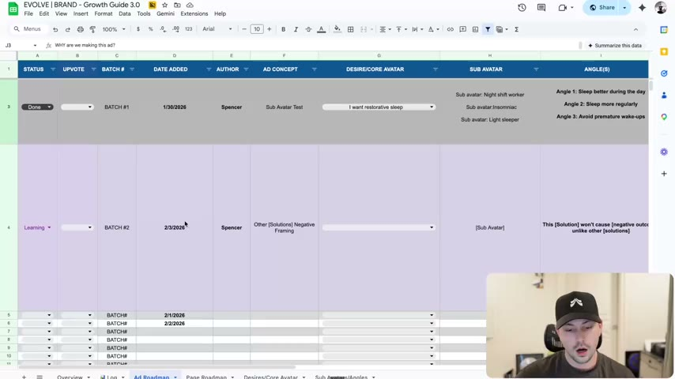
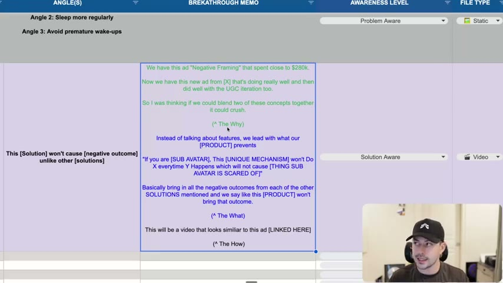

# 22. How to finalize your ad ideas
> Before an ad idea is approved or written, force it through the "mini breakthrough memo" (Why are we making this ad? What is it about? How will we make it?) and log it in the Growth Guide workbook, whose tabs (Ad Roadmap, Page Roadmap, Desires/Core Avatar, Sub Avatars/Angles, Awareness, Creators, CRO, Log, Overview) are the course's ad-idea tracking system.

## 🤖 Agent use
- **Use when:** an agent (or teammate) proposes an ad concept, hook or iteration and needs to finalize, justify and log it before scripting; when setting up a tracking table for ad ideas, tests and learnings; when judging a concept's quality ("is this idea actually good?").
- **Inputs → outputs:** a raw idea ("do an us-versus-them ad") + product, sub-avatar, angle, awareness level, reference ads → a completed memo with **Why / What / How**, a logged row in the Ad Roadmap (status, upvote, batch, avatar, sub-avatar, angle, awareness, format, ad type), and later the result and learning.
- **Rules:**
  - **DO** write the memo as three labelled parts: WHY are we making this ad, WHAT is this ad going to be about, HOW are we going to make it. [00:50–01:21]
  - **DO** state the *why* with evidence from our own ad account: e.g. an existing ad ("Negative Framing", "close to $280,000" spend) plus a new winning ad and its UGC iteration, and a reason to blend the two. [01:21–02:10]
  - **DO** state the *what* concretely, with the structure and a fill-in line. [02:10–03:42]
  - **DO** state the *how* with a reference ad link ("This will be a video that looks similar to this ad [LINKED HERE]"). [03:09–03:42]
  - **DON'T** accept half-baked pitches such as "let's do an us versus them" without "an us versus them about what, and why should we do it?" [01:21; 03:42–04:23]
  - **DO** write down even "assumed" reasons: "you might be like this idea is really weak" once it is on the page. [03:42–04:23]
  - **DO** rank ideas with the upvote column before they are produced. [04:23]
  - **DO** go deep on product, avatar and category first; the principles from this course (angles, mechanisms, authority, beliefs, awareness) are what make the memo credible. [01:21]
  - **IF** you feel inspired and want to just write **THEN** it is fine to write, but ideally think through the memo first. [04:23–05:05]
  - **IF** an idea is an iteration or imitation **THEN** tag it that way and cite the source ad in the Why. (derived from the workbook's AD TYPE column)
- **See also:** [18. Being aware of angles](18-being-aware-of-angles.md) · [17. Being aware of avatars](17-being-aware-of-avatars.md) · [21. Being aware of market awareness](21-being-aware-of-market-awareness.md) · [03. How to guarantee you get better at copywriting](03-how-to-guarantee-you-get-better-at-copywriting.md) · [Creative testing system](../../../../frameworks/creative-testing-system.md) · [Iteration vs variation](../../../../concepts/iteration-vs-variation.md)

Lesson page text: "Breakthrough memo process" and a link to the Google Sheet: "Link to growth guide (also in EVOLVE)". The sheet is the **EVOLVE | BRAND - Growth Guide 3.0**; its export is byte-identical to the attached XLSX (all ten tab CSVs compare equal), so this page documents it once.

## Key ideas

### 1. Do more work up front [00:00–00:50]
- "Genuinely thinking through an idea... you can prevent a lot of the failure by just doing more work upfront." This takes more work and the instructor says so frankly. [00:00–00:50]
- He cannot show the real ads because all three of his current brands asked him not to; the example rows in the sheet are therefore made-up or for "random brands". [00:00–00:50]

### 2. The memo: Why, What, How [00:50–03:42]
- The idea starts with "the angle, the sub-avatar desire, all that kind of stuff", and the memo then asks: **why are we making this ad? what is this ad going to be about? how are we going to make it?** "This is how you get ideas fully finalized and fully fleshed out. And it'll help you realize whether or not this is actually a good idea." [00:50–01:21]
- Reason he likes it: team pitches used to be half-baked ("I saw an ad and then I thought we should do it"), which is "the surface level stuff that I'm trying to avoid". With deep product/avatar/category knowledge plus the copywriting principles, people can explain why and what. [01:21–02:10]
- **Worked example (from the sheet, Batch #2):** [01:21–03:42]
  - **WHY:** "We have this ad 'Negative Framing' that spent close to $280k. Now we have this new ad from [X] that's doing really well and then did well with the UGC iteration too. So I was thinking if we could blend two of these concepts together it could crush." As a strategy lead, hearing this: "OK, I'm interested. That makes sense. It's logical." [02:10]
  - **WHAT:** "Instead of talking about features, we lead with what our [PRODUCT] prevents: 'If you are [SUB AVATAR], This [UNIQUE MECHANISM] won't Do X everytime Y Happens which will not cause [THING SUB AVATAR IS SCARED OF]'. Basically bring in all the negative outcomes from each of the other SOLUTIONS mentioned and we say like this [PRODUCT] won't bring that outcome." [02:10–03:42]
  - **HOW:** "This will be a video that looks similar to this ad [LINKED HERE]." (the memo links a reference ad) [03:09–03:42]
- "Negative framing" here means positioning by what the product will *not* do relative to other solutions. The instructor says the idea came from an ad that explained other solutions, to which they added a negative frame. [03:09–03:42]
- The memo is what lets you go from "do an us versus them ad" to "us versus them about *what*, and why". Even assumptions ("because I want to compare to this specific thing") should be written down. [03:42–04:23]

### 3. Upvoting and the mini breakthrough memo [04:23–05:05]
- "That's why we have the upvoting system as well inside the growth guide." The three-question version is "the mini breakthrough memo process". [04:23]
- Ideal state: "here's why I want to do this idea. Here's what I want to do. And here's how I'm thinking we should do it", so that when you write the actual concept "you've thought about it and now you can just focus on execution". [04:23–05:05]

*The Google Sheet "EVOLVE | BRAND - Growth Guide 3.0" open on the Ad Roadmap tab, with the two example rows (Batch #1 grey, Batch #2 lavender) and tabs Overview, Log, Ad Roadmap, Page Roadmap, Desires/Core Avatar, Sub Avatars/Angles at the bottom. [00:00]*

*The memo cell: green text = the Why (the $280k "Negative Framing" ad), blue = the What (the fill-in line), black = the How (link to a similar ad). Awareness Level and File Type dropdowns sit to the right. [01:00]*

## The workbook (Growth Guide 3.0)

Ten tabs, in workbook order. Four are **hidden** in the attached XLSX (CRO, Avatars, Awareness, Creators) and are not shown in the video; they are still part of the export. Cached example values come from the file; nothing below was added by the author of this page except labelled "(derived)" notes.

### Tab 1: Overview
- Two merged display blocks (A1:G24 and H1:N24, i.e. gauge/score tiles) captioned **"Ad Hit Rate Percentage"** (A25) and **"Page Hit Rate Percentage"** (H25).
- Formulas (verbatim): A1 `=sum('Ad Roadmap'!P2)/('Ad Roadmap'!P2+'Ad Roadmap'!Q2)`; H1 `=sum(('Page Roadmap'!M2/('Page Roadmap'!N2+'Page Roadmap'!M2)))`. Cached value for both: `0.5` (formatted as a percentage, 50%) because the sample data has one win and one loser.
- Use: the share of tracked ads (and pages) that are Breakthrough or Spend Winner. See the Ad Roadmap hit-rate cells below.

### Tab 2: 📊 Log
- Header row 1: `DATE` | `Meta Ads Log`; row 2: `Day` | `Notes`.
- Then one row per calendar day starting `2025-02-03`, with a **"Weekly Recap"** row after every seven days (190 recap rows; dates run in repeated blocks up to 2028-01-02; 1,349 dated rows in total, the blocks restarting from early 2025 several times). **Every Notes cell is empty**, so this tab is a blank daily/weekly diary template for Meta ads notes.
- Representative rows: `2025-02-03 00:00:00 | (empty)` ... `Weekly Recap | (empty)`.
- Use (derived): daily account notes, with a weekly recap line.

### Tab 3: Ad Roadmap (the main idea tracker)
Row 1 header, row 2 counters, row 3 onward = ideas. Columns (A to T), with dropdown values where the workbook defines them:

| Col | Header (as spelled) | What it holds | Dropdown (verbatim) |
|---|---|---|---|
| A | STATUS | Where the idea is | `Working`, `Learning`, `Filming`, `Done` |
| B | UPVOTE | Team vote for prioritisation (the "upvoting system", [04:23]) | `+1` ... `+12` |
| C | BATCH # | Production batch the idea belongs to | free text, e.g. `BATCH #1` |
| D | DATE ADDED | Date | date |
| E | AUTHOR | Who proposed it | free text |
| F | AD CONCEPT | Concept name | free text |
| G | DESIRE/CORE AVATAR | The market desire | list from the `DesiresCore Avatar` tab |
| H | SUB AVATAR | One or several sub-avatars | free text |
| I | ANGLE(S) | The angles (reason to buy) | free text |
| J | BREKATHROUGH MEMO (sic) | The Why / What / How memo | free text |
| K | AWARENESS LEVEL | Awareness level targeted | `Unaware`, `Problem Aware`, `Solution Aware`, `Product Aware`, `Most Aware` |
| L | FILE TYPE | Format | `🖼️ Static`, `🎬 Video` |
| M | AD TYPE | Relationship to existing ads | `🔄 Iteration`, `🎭 Imitation`, `💡 Ideation` |
| N | LINK TO BRIEF | URL | - |
| O | LINK TO AD | URL of the live ad | - |
| P | RESULTS | Outcome class | `Breakthrough`, `Spend Winner`, `KPI Winner`, `Loser` |
| Q | LEARNINGS | What was learnt | free text |
| R | Ad Variable | Variable tested in a follow-up | `🪝Hook`, `🖼️ Visual` |
| S | Test Result | Variable test outcome | `Losing Ad`, `Winning Ad` |
| T | Learnings | Variable-test notes | free text |

(Validation ranges overlap: UPVOTE `+1..+12` applies to B3:B606 and the file-type list `🖼️ Static, 🎬 Video, 👤 UGC` is attached to B607:B1088; this looks like a template quirk, derived.)

- **Row 2 counters (verbatim formulas):** P2 `=COUNTIF(P3:P997, "*Breakthrough*") + COUNTIF(P3:P997, "*Spend Winner*")` (wins) and Q2 `=COUNTIF(P3:P997, "*Loser*") + COUNTIF(P3:P997, "*KPI Winner*")` (non-wins). Note that a "KPI Winner" counts as a miss in the hit rate. Sample values: 1 and 1.
- **Example row 3 (Batch #1, filled):**

| Field | Value (verbatim) |
|---|---|
| STATUS | Done |
| BATCH # | BATCH #1 |
| DATE ADDED | 2026-01-30 |
| AUTHOR | Spencer |
| AD CONCEPT | Sub Avatar Test |
| DESIRE/CORE AVATAR | I want restorative sleep |
| SUB AVATAR | Sub avatar: Night shift worker / Sub avatar:Insomniac / Sub avatar: Light sleeper |
| ANGLE(S) | Angle 1: Sleep better during the day / Angle 2: Sleep more regularly / Angle 3: Avoid premature wake-ups |
| BREKATHROUGH MEMO | WHY are we making this ad? / WHAT is this ad going to be about / HOW are we going to make it? |
| AWARENESS LEVEL | Problem Aware |
| FILE TYPE | 🖼️ Static |
| AD TYPE | 💡 Ideation |
| LINK TO AD | https://fb.me/2bQR1Yb3byO8owC |
| RESULTS | Loser |
| LEARNINGS | The parent is not worried enough in the hook. We need to show more of what the "panic feels like" when you realize how you've been pulloting the air instead of actually helping it. The ad also intrdoces the prodcut too salesy and doesn't build suspense or give the user a reason to keep watching |
| Learnings (col T) | 24th Oct 11am CET: Started running on 22nd Oct, so it's running 2 days now, didn't get any spend so far in any campaign |

(The learning text is verbatim, typos included. It mentions "air", while the sub-avatars are sleep-related; it appears the row's learning was pasted from another product's ad, derived. The same "24th Oct 11am CET" note appears on two Ad Roadmap rows and one Page Roadmap row, so it looks like a leftover template note.)

- **Example row 4 (Batch #2, the memo example):**

| Field | Value (verbatim) |
|---|---|
| STATUS | Learning |
| UPVOTE | +1 |
| BATCH # | BATCH #2 |
| DATE ADDED | 2026-02-03 |
| AUTHOR | Spencer |
| AD CONCEPT | Other [Solutions] Negative Framing |
| SUB AVATAR | [Sub Avatar] |
| ANGLE(S) | This [Solution] won't cause [negative outcome] unlike other [solutions] |
| BREKATHROUGH MEMO | We have this ad "Negative Framing" that spent close to $280k. / Now we have this new ad from [X] that's doing really well and then did well with the UGC iteration too. / So I was thinking if we could blend two of these concepts together it could crush. / (^ The Why) / Instead of talking about features, we lead with what our [PRODUCT] prevents / "If you are [SUB AVATAR], This [UNIQUE MECHANISM] won't Do X everytime Y Happens which will not cause [THING SUB AVATAR IS SCARED OF]" / Basically bring in all the negative outcomes from each of the other SOLUTIONS mentioned and we say like this [PRODUCT] won't bring that outcome. / (^ The What) / This will be a video that looks similiar to this ad [LINKED HERE] / (^ The How) |
| AWARENESS LEVEL | Solution Aware |
| FILE TYPE | 🎬 Video |
| AD TYPE | 🔄 Iteration |
| RESULTS | Breakthrough |
| LEARNINGS | NO LEARNINGS + NOT DONE!!!!!!! |

- **Row 5:** `UPVOTE +4 | BATCH# | 2026-02-01 | Spencer | Idea #1` (an empty placeholder idea). Date-only rows follow (`BATCH# | 2026-02-02`, then `BATCH#` rows through row 1001).
- Template artefacts: rows 85 to 132 carry stray UPVOTE values (`+5`, `+2`, `+5`, `+2`, `+4`, `+4`, `+3`, `+4`, `+6`, ... up to `+8`) with no idea content. Do not treat them as data. About 999 rows have only a `BATCH#` placeholder.
- In the video the Batch #1 row has a grey background and Batch #2 a lavender background; memo text is colour-coded (green = why, blue = what, black = how). [00:00–03:42]

### Tab 4: CRO (hidden; landing-page test log)
Header row 1 (14 columns): `Status` | `Date Added` | `Author` | `Landing Page Concept` | `Test Start` | `Test End` | `Coupon` | `Explanation` | `URL` | `Offer` | `Selling Point` | `Avatar` | `Test Result` | `Learnings`. Row 2 is a key row: `(Key)`, and in the Landing Page Concept column `Total Profit`.
- Dropdowns: Status `Client`, `Working`, `Testing`, `Done`; Selling Point `Easy To Clean`, `Clean + Safe`, `Symptom Relief`, `Doctor-Invented`, `Skin + Hair`; Avatar list is drawn from `Avatars!B2:N2`; Test Result `Losing`, `Winning`.
- Contains one embedded image: a laurel badge "'Best Air Purifier' Popular Science" (a crop from a page, derived).
- **Populated example rows (a humidifier client, the CarePod brand, derived from the "Carepod" page names):**

| Landing Page Concept | Test Start | Coupon | Explanation (verbatim) | Offer | Selling Point | Avatar | Test Result |
|---|---|---|---|---|---|---|---|
| US - Carepod One LP | - | - | The original LP that Pagedeck had set up for us | - | Easy To Clean | Clean + Safe Persona | Winning |
| US - Carepod Cube LP | 2024-09-13 | Refresh20 | Adjusted this page to heavily focus on the easy-to-clean aspect and highlight the Cube instead of the one | Save $55 (Additional $20 Off Evergreen) | Easy To Clean | Clean + Safe Persona | Winning |
| US - Carepod Cube Plus LP | 2024-09-20 | NA | Adjusted the Carepod Cube LP to highlight the Cube Plus+ instead and switched out some sections to highlight Plus specific features | - | Easy To Clean | Clean + Safe Persona | - |
| US - Carepod Cube Variant Bundle | 2024-09-20 | NA | This is the same as the Carepod Cube LP, the only difference is we've swapped out the order form for a single product and replaced it with the ability to buy multiple at discount, this is using product grid. | - | Easy To Clean | Clean + Safe Persona | - |
| US - Carepod Cube PageDeck Bundle | 2024-09-23 | NA | ...utilizing PageDeck's in-built bundle to highlight the quantity discounts | - | Easy To Clean | Clean + Safe Persona | - |
| CA - Carepod Cube LP | 2024-09-30 | CUBE15CA | Because of the performance of the original LP in the US, they wanted to test this out in Canada as well. Swapped out the order form with the Canadian links instead. | - | Easy To Clean | Clean + Safe Persona | - |
| US- Carepod Collection | 2024-10-02 | NA | Same style as V1's founder's letter style, except showcasing all product variants within the US (Plus, Cube, One Mini) | - | Easy To Clean | Clean + Safe Persona | - |
| CA - Carepod One Founder's V1 | 2024-10-01 | NA | Testing the founder's letter style with Carepod. This version has no discounting. Starts with loads of information, letter, social proofing, showcasing the product, then features, more social proofing, then the orderform. The order form could be brought up by clicking any of the above CTAs. | - | Doctor-Invented | Doctor-Invented Persona | Losing |
| CA - Carepod One Founder's V2 (15% Off) | 2024-10-01 | CAREONE15 | (same as V1 but) a 15% discount code associated with it. It's autoapplied when users add-to-cart. | - | Doctor-Invented | Doctor-Invented Persona | Losing |
| US - Carepod Cube LP V2 | (Date Added: October 3rd, Author: Team) | - | More clear hero image / Add FAQ - Hassle Free Cleaing section= dishwasher safe maybe photo of putting it in the dishwasher / Pink Mold | - | - | - | - |

- **Learnings cell on the US - Carepod Cube LP row (verbatim):** "Hero Section / Mobile Menu with scroll-to sections / Bold Claim above the fold as "The worlds cleanest humidifer with No Filter" / Tagline taps into the CORE DESIRE - keeping family healthy and hydrated / CTA: leading with Learn More / ⭐️ Trusted by Doctors above the fold / The Ad we are using is highlighting a doctor using the product / Seeing 2 things in the picture --> which one is the humidifer / ⭐️ Testing an offerless page / ⭐️ Pink Mold / Customer Comments: Looks like a bread maker? / Need one for the plants / Want the stand --> Offer a free stand? / I got it. I cant stand how pink mold grows in one day even when I clean the others and it bothers me I never can take all the pieces apart."
- Use (derived): the same structure can log landing-page tests (concept, coupon, offer, selling point, avatar persona, result, learnings), and the sample shows how to record page-level learnings from customer comments.

### Tab 5: Page Roadmap (idea tracker for pages)
17 columns, mirrors the Ad Roadmap: `STATUS` | `PAGE #` | `DATE ADDED` | `AUTHOR` | `CRO CONCEPT` | `DESIRE/CORE AVATAR` | `SUB AVATAR` | `OFFER` | `BREKATHROUGH MEMO` | `PAGE FORMAT` | `LINK TO AD` | `LINK TO PAGE` | `RESULTS` | `LEARNINGS` | `Ad Variable` | `Test Result` | `Learnings`.
- Dropdowns: STATUS `Working`, `Learning`, `Filming`, `Done`; DESIRE/CORE AVATAR from the `DesiresCore Avatar` tab; PAGE FORMAT `PDP`, `Sales Page`, `Advertorial`, `Listicle`; RESULTS `Breakthrough`, `Spend Winner`, `KPI Winner`, `Loser`; Ad Variable `🪝Hook`, `🖼️ Visual`; Test Result `Losing Ad`, `Winning Ad`.
- Row 2 counters (verbatim): M2 `=COUNTIF(M3:M997, "*Breakthrough*") + COUNTIF(M3:M997, "*Spend Winner*")`; N2 `=COUNTIF(M3:M997, "*Loser*") + COUNTIF(M3:M997, "*KPI Winner*")`; P2 `=COUNTIFS(P3:P830,"Winning Ad")`; Q2 `=COUNTIFS(P3:P830,"Losing Ad")`.
- Example row 3: `Done | PAGE #1 | 2026-01-30 | Spencer | Advertorial | I want restorative sleep | Sub avatar: Night shift worker / Sub avatar:Insomniac / Sub avatar: Light sleeper | (offer blank) | (memo blank) | PDP | ... | Breakthrough | ... | 24th Oct 11am CET: Started running on 22nd Oct, so it's running 2 days now, didn't get any spend so far in any campaign`. Row 4: `2026-02-01 | ... | Loser`.

### Tab 6: DesiresCore Avatar (shown as "Desires/Core Avatar")
- A2 (merged A2:B2, verbatim): `Market's Desire - "I want..."   |    Remeber that we can not create desires, we can only channel them`
- A3 `I want restorative sleep`; A4 `I want to improve my rem sleep`. Rows 3 to 14 form the desire list used by the Ad Roadmap, Page Roadmap and Sub Avatars dropdowns.

### Tab 7: Sub AvatarsAngles (shown as "Sub Avatars/Angles")
Header (row 2): `Product Name` | `Feature (what it is)` | `Benefit "so you can..."` | `Desire` | `Sub Avatar` | `Angle(s)`. Desire is a dropdown from the desires tab.
- Example row (verbatim): `Blackout Blind | Edge-sealing track system that creates a complete perimeter seal | Total Darkness whenever you want | I want restorative sleep | Sub Avatar #6: No Screener / Desire: Wants restorative sleep / Behavior: No screens 1 hour before Sleeping | Protect Your Melatonin Production`
- Second row repeats the product feature with `I want to improve my rem sleep` as the desire and the same sub-avatar (angle blank).
- The feature -> benefit -> desire -> sub-avatar -> angle chain mirrors lessons [17](17-being-aware-of-avatars.md), [18](18-being-aware-of-angles.md) and [19](19-being-aware-of-mechanisms.md) (derived).

### Tab 8: Avatars (hidden)
- A1 `Avatars`; B1 `Parents with Young Children`. A one-cell stub whose B2:N2 range feeds the CRO "Avatar" dropdown.

### Tab 9: Awareness (hidden; awareness-level question bank)
Columns (verbatim headers): `Product Name` | `Most Aware Questions` | `Product Aware Questions` | `Solution Aware Questions` | `Problem Aware Questions` | `Unaware`. Two blocks:
- Example row `ex: Air Purifier`:
  - Most Aware: "What's the least expensive air purifier that does the best job?"
  - Product Aware: "How much space can an air purifier really clean? Is it worth it?"
  - Solution Aware: "Is ultraviolet cleaning a better long term way to keep the air in my home clean?"
  - Problem Aware: "I feel congested at home but not at work. What in the world is going on?"
  - Unaware: "Exercise and health are important to me - besides doing cardio, how else can I improve my cardiovascular health?"
- Blank template row `Humidifier` with `Question 1` in each level and an `Answer 1` row below each. Use: one question per awareness level (with the answer/ad that responds), which links to [21](21-being-aware-of-market-awareness.md).

### Tab 10: Creators (hidden; "Top Creator Anaylsis" (sic))
- A1 (merged A1:G1): `Top Creator Anaylsis`. Row 2 guide, verbatim: "Guide:" · "Step 1: Identify our target persona for your ad." · "Step 2: Research creators & influencers that make content for those people." · "Step 3: Study the top-performing content from those creators to see which kinds of videos get the most engagement & what kind of messaging they use: (YouTube thumbnails, YouTube titles, YouTube videos, TikTok hooks, TikTok trends, Instagram Reels, Instagram Bios, etc.)" · "Step 4: Create our content & craft ads with those ideas in mind as you already know it will resonate with our avatar".
- Header (row 3): `Audience Size` | `Creator` | `YouTube` | `TikTok` | `Instagram` | `High Performing Content Trends` | `User Comment Notes`. No creator rows are filled in.

## Steps / framework

**Finalize-an-idea routine (the mini breakthrough memo)**
1. Pick the desire, sub-avatar and angle (tabs 6 and 7). [00:50]
2. Write **WHY** (what proof or data from our account/competitors justifies it; blend-of-winners, iteration, or gap). [01:21–02:10]
3. Write **WHAT** (what the ad is about, plus the fill-in structure/line). [02:10–03:42]
4. Write **HOW** (format, link to a reference ad, who appears). [03:09–03:42]
5. Re-read: if the Why is weak, drop the idea. [03:42–04:23]
6. Log it in the Ad Roadmap with awareness level, file type and ad type; collect upvotes. [04:23]
7. After the test, set RESULTS (Breakthrough / Spend Winner / KPI Winner / Loser) and write LEARNINGS; keep the Overview hit rate in step.
8. Iterate: use the Ad Variable (Hook or Visual) and Test Result columns for follow-up tests.

## Examples
- **"Negative Framing" blend** (Why/What/How in full above), the course's model memo. [01:21–03:42]
- **"Us versus them"** shown as a counter-example of a half-baked pitch. [01:21; 03:42]

## Structured units

### Templates
| Template | Use for | Example fill | Source |
|---|---|---|---|
| "WHY are we making this ad? / WHAT is this ad going to be about / HOW are we going to make it?" | Idea memo skeleton | Row 3 memo cell | Ad Roadmap J3 |
| "This [Solution] won't cause [negative outcome] unlike other [solutions]" | Negative-framing angle | Row 4 ANGLE(S) | Ad Roadmap I4 |
| "If you are [SUB AVATAR], This [UNIQUE MECHANISM] won't Do X everytime Y Happens which will not cause [THING SUB AVATAR IS SCARED OF]" | Negative-framing hook/what | Row 4 memo | Ad Roadmap J4, [02:10] |
| "Feature (what it is) -> Benefit 'so you can...' -> Desire -> Sub Avatar -> Angle(s)" | Angle derivation row | Blackout Blind row | Sub AvatarsAngles |
| "Market's Desire - 'I want...'" | Desire statements | "I want restorative sleep" | DesiresCore Avatar |

### Rules of thumb
- **DO** use only these status/result vocabularies when logging (Working/Learning/Filming/Done; Breakthrough/Spend Winner/KPI Winner/Loser). Ad Roadmap A and P
- **DON'T** count "KPI Winner" as a win in the hit rate; the sheet counts only Breakthrough and Spend Winner as hits. Ad Roadmap P2/Q2
- **DO** remember "we can not create desires, we can only channel them." DesiresCore Avatar A2

## Prompts / templates (verbatim)
The memo skeleton and fill-in lines are quoted verbatim above (Ad Roadmap J3/J4, Sub AvatarsAngles, DesiresCore Avatar, Awareness, Creators). No LLM prompts are supplied in this lesson.

## How to apply
- [ ] Create our own Growth Guide copy (or an equivalent table) with the Ad Roadmap columns and dropdown vocabularies above.
- [ ] For every new concept, fill the Why/What/How memo with account evidence (spend or performance of the source ads) and a reference ad link.
- [ ] Tag each idea with awareness level, file type, ad type (iteration/imitation/ideation) and the sub-avatar and angle.
- [ ] Vote ideas before production; only produce the top-voted.
- [ ] After testing, record RESULTS and LEARNINGS, then update the hit-rate counters.
- [ ] Keep sub-avatar/angle rows (feature -> benefit -> desire) so new ideas inherit tested angles.
- [ ] Fill the Awareness bank with one real customer question per level per product, and the Creators sheet with creators, their top content trends and comment notes.

## Related
- Previous: [21. Being aware of market awareness](21-being-aware-of-market-awareness.md) · Next: [23. The framework behind great hooks](23-the-framework-behind-great-hooks.md)
- [03. How to guarantee you get better at copywriting](03-how-to-guarantee-you-get-better-at-copywriting.md) (ad-idea sources) · [Angle remix playbook](../../../../playbooks/angle-remix.md) · [Prompts library](../../../../libraries/prompts.md)

## Sources and limitations
- Transcript: [22. How to finalize your ad ideas… .txt](<../../../../../raw/evolve/copywriting/_transcripts/✍️ Evolve Copywriting (NEW)/22. How to finalize your ad ideas ✍️ Evolve Copywriting (NEW) Evolve.txt>) · Page text: [….html.md](<../../../../../raw/evolve/copywriting/_extracted/✍️ Evolve Copywriting (NEW)/22. How to finalize your ad ideas_✍️ Evolve Copywriting (NEW)_Evolve.html.md>)
- Workbook extraction: [XLSX markdown](<../../../../../raw/evolve/copywriting/_extracted/✍️ Evolve Copywriting (NEW)/22. How to finalize your ad ideas.xlsx.md>) with per-tab CSVs beside it ([ad-roadmap](<../../../../../raw/evolve/copywriting/_extracted/✍️ Evolve Copywriting (NEW)/22. How to finalize your ad ideas.xlsx.ad-roadmap.csv>), [cro](<../../../../../raw/evolve/copywriting/_extracted/✍️ Evolve Copywriting (NEW)/22. How to finalize your ad ideas.xlsx.cro.csv>), [awareness](<../../../../../raw/evolve/copywriting/_extracted/✍️ Evolve Copywriting (NEW)/22. How to finalize your ad ideas.xlsx.awareness.csv>), [creators](<../../../../../raw/evolve/copywriting/_extracted/✍️ Evolve Copywriting (NEW)/22. How to finalize your ad ideas.xlsx.creators.csv>), [sub-avatarsangles](<../../../../../raw/evolve/copywriting/_extracted/✍️ Evolve Copywriting (NEW)/22. How to finalize your ad ideas.xlsx.sub-avatarsangles.csv>), [page-roadmap](<../../../../../raw/evolve/copywriting/_extracted/✍️ Evolve Copywriting (NEW)/22. How to finalize your ad ideas.xlsx.page-roadmap.csv>), [desirescore-avatar](<../../../../../raw/evolve/copywriting/_extracted/✍️ Evolve Copywriting (NEW)/22. How to finalize your ad ideas.xlsx.desirescore-avatar.csv>), [avatars](<../../../../../raw/evolve/copywriting/_extracted/✍️ Evolve Copywriting (NEW)/22. How to finalize your ad ideas.xlsx.avatars.csv>), [log](<../../../../../raw/evolve/copywriting/_extracted/✍️ Evolve Copywriting (NEW)/22. How to finalize your ad ideas.xlsx.log.csv>), [overview](<../../../../../raw/evolve/copywriting/_extracted/✍️ Evolve Copywriting (NEW)/22. How to finalize your ad ideas.xlsx.overview.csv>)). Dropdown lists, formulas, hidden-sheet state and the embedded image were read directly from the original XLSX with openpyxl (the attachment's text extraction does not include them).
- Linked Google Sheet export (identical to the attachment, all 10 tabs): [22-spreadsheets-1zdDeYK0gw.xlsx.md](<../../../../../raw/evolve/copywriting/_extracted/_linked/google/22-spreadsheets-1zdDeYK0gw.xlsx.md>). The live Google Sheet is "EVOLVE | BRAND - Growth Guide 3.0" (screen title); the instructor's name is not stated aloud, but the sheet's Author column reads "Spencer" and the brand in lesson 18-20 examples is "Spencer's Wagyu Chicken", so the speaker is probably Spencer; kept as unverified.
- Machine transcription (Whisper large-v3-turbo). Full recording covered (last segment 5:04). Whisper heard "breakthrough memo" correctly; "growth strategist" etc. are as spoken. The memo's long cell text on screen matches the XLSX.
- Example rows are partly placeholders with dates in 2026 and a stray "24th Oct 11am CET" note; the CarePod-based CRO rows (2024 dates) show real test structure but the page names, coupons and results are the course author's own data and are not independently verified. The `Log` tab contains no filled notes.
- Lesson 22's page text promises nothing beyond the sheet link; the "upvoting system" is described only in one sentence [04:23].
