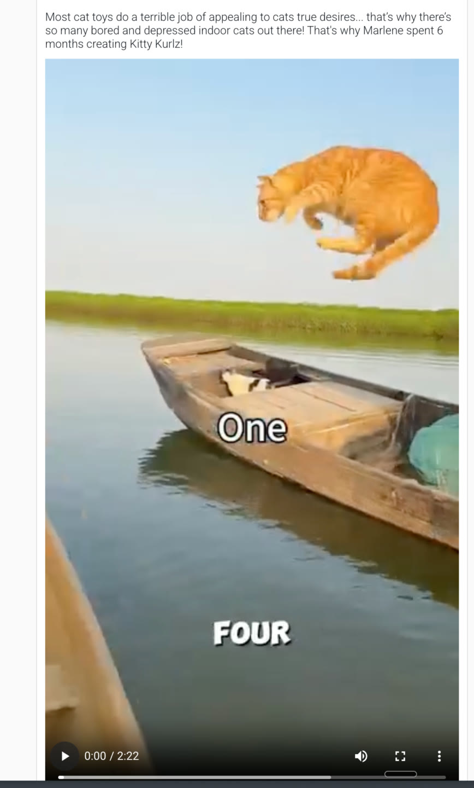
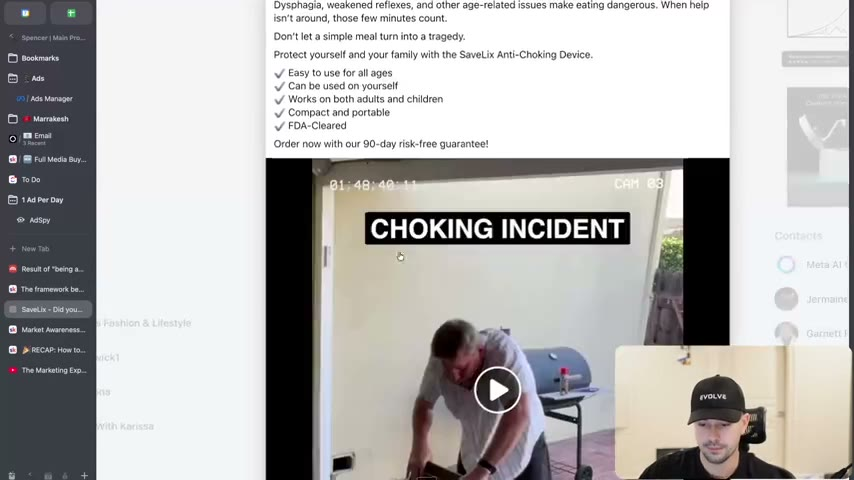
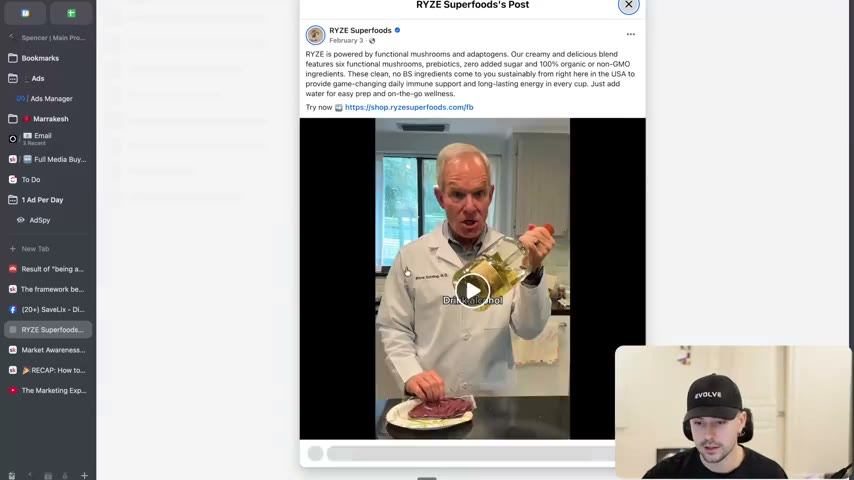
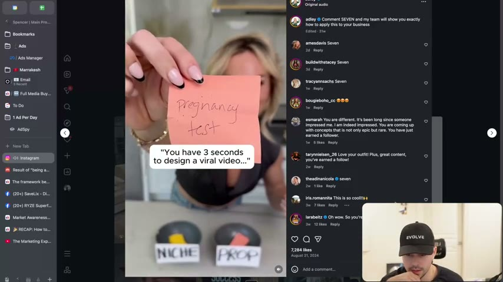
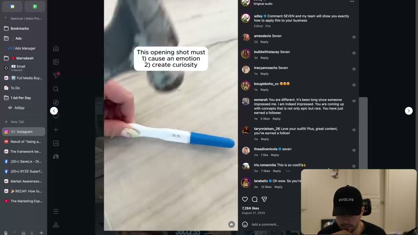

# 23. The framework behind great hooks
> The hook is the writer's number-one job; a great hook is sticky (it keeps people watching, not just biting), carries emotion + a curiosity gap + high stakes, starts in the action with zero backstory and zero chaos, and works without sound. The framework is credited to Adley of Viralish, adapted by the instructor for paid ads.

## 🤖 Agent use
- **Use when:** writing or auditing the first 3-6 seconds of a UGC video script or the first line of a static ad; tearing down a competitor hook to see why it holds attention; deciding whether a hook "bites" only or also "reels in".
- **Inputs → outputs:** a product/angle/avatar, or a competitor ad's opening → a hook scored on emotion / curiosity gap / stakes (text and visual), a rewrite that starts in the action, and a note on what the visual must carry.
- **Rules:**
  - **DO** treat the hook as the first suspect when an ad underperforms: "it is 98%, probably 99% of the time due to your hook." [00:00-00:20]
  - **DO** build a hook that is *sticky*: it "creates an itch" and the viewer "can't scratch that itch", so they keep watching. [00:20-00:48]
  - **DON'T** optimise for hook rate alone. "It doesn't matter if they don't keep watching." A hook that gets bites but loses the fish "is a terrible hook." You want sales, not bites. [01:13-01:37]
  - **DO** aim for the three must-haves: **emotion, curiosity gap, high stakes**. Not every working hook has all three, but "a lot of great hooks do." [02:56-03:25]
  - **DO** check each hook element-by-element: what emotion, what unanswered question, what is at stake. [03:25-05:39]
  - **DO** put the high stakes in the *visual* if the text cannot carry them; the visual does not have to relate to the spoken line. [05:39-06:59]
  - **DO** start in the action; even a talking-head "yap session" should open on the point, not on set-up. [06:59-08:45]
  - **DON'T** use backstory or in-jokes: viewers did not choose to watch, so if they feel they are "missing something" they scroll. [08:16-09:23]
  - **DON'T** add editing chaos or sensory overload: "a confused brain will scroll." Be curious, not confused; "when in doubt, dumb it down." [09:23-10:04]
  - **DO** make the hook understandable without sound (page text: "Straight forward"). [Skool page]
  - **IF** the product is unremarkable (e.g. a generic test kit) **THEN** wrap it in an entertainment/curiosity frame that makes it a category of one, as the "how I'm going to die" hook does. [04:16-04:48]
- **See also:** [24. The 2 types of hooks](24-the-2-types-of-hooks.md) · [25. The 2 ways to write great hooks](25-the-2-ways-to-write-great-hooks.md) · [26. How to write open loops](26-how-to-write-open-loops.md) · [Native advertising](../../../../concepts/native-advertising.md) · [UGC script writing playbook](../../../../playbooks/ugc-script-writing.md) · [Hooks library](../../../../libraries/hooks.md)

## Key ideas

### 1. The hook is the number-one job; make it sticky [00:00-01:37]
- The instructor deliberately skips a slide here ("just because we're kind of getting more into some of the tactical stuff") and works from the Skool lesson page. [00:00-00:20]
- "The hook is the number one job of the writer. If your ad is not working, it is 98%, probably 99% of the time due to your hook." (instructor claim, no data given) [00:00-00:20]
- Credit: the framework is "fully credit to Adley" (the page signs it "Adley from Viralish"; her Instagram handle on screen is "adley", and the instructor says she has 1.2 million followers, [10:34-11:07]). The instructor says he added his own examples and "stole one of hers". [01:37-02:05]
- **Fishing analogy.** A fish that bites and falls off after one reel is a worthless hook, however good at "grabbing on". The goal is to keep the fish on so you can fully reel it in. "You might have a great hook that gets a lot of bites... but you don't want bites. You want sales." [00:48-01:37]
- He admits he used to be "so obsessed with high hook rates", and says that is the trap: hook rate without retention does not matter. [01:13-01:37]

### 2. Content-creator benchmark: 90% retention for six seconds [01:37-03:25]
- Marketers have an advantage creators don't: our ads are *forced* onto the audience, while creators "compete in the freaking auction of... millions and millions of videos". [01:37-02:33]
- So creators' goal is "90% retention for the first six seconds" (page: "Content Creators Goals: 90% retention for the first 6 seconds"). The instructor calls that "astronomically high" next to what most ad accounts get. [02:33-03:25]
- His personal bar: "if I could even just get 45% of people, that's going to probably be a banging ad. But we have to strive high." (instructor's own rule of thumb, no data) [02:56-03:25]

### 3. Hook must-haves: emotion, curiosity gap, high stakes [03:25-06:59]
- Emotion is assumed known; curiosity gaps and high stakes "get their own modules" later (see [26. How to write open loops](26-how-to-write-open-loops.md)). [03:25-03:47]
- Worked examples (full breakdown in Structured units below):
  1. "This 25-year-old kid knows exactly how I'm going to die just from this." (Adley's). Fear / "how does a 25-year-old know how I'm going to die?" / death. It is "an entertainment wrapper that funnels all the way down to a genetic testing kit"; the product is ordinary, but "this one tells you how you're going to die. That is how they have positioned it." He tied it to positioning: "positioning is everything", the brand "made themselves a category of 1". The instructor says it went "super viral" but could not find the video. [03:47-04:48]
  2. "This is how my nonverbal toddler found his voice." Hope/sympathy / how did a nonverbal toddler find a voice? / a diagnosed-nonverbal child. He adds that if it works for a nonverbal toddler it will "work for ones that aren't", because the specific, high-stakes story is still relevant to a wider parent audience (instructor reasoning). [04:48-05:39]
  3. "I've had four cats in my life and I'm embarrassed to say I just learned this." Embarrassment / what did this person just learn? / the stakes are in the visual: the video opens with a man throwing four cats into a boat. [05:39-06:59]
- **High stakes can live in the visual.** The cat-throwing has "nothing to do with" the spoken line but "creates high stakes... what's going to happen to this cat?" That is why "your editors need to understand this stuff as well". He notes this may be more of a "bite hook" (people stop to check the cat is OK, then scroll) but it still shows the principle. [06:08-06:59]
- The Skool page embeds a still of this video (cat mid-air over a boat, on-screen text "One ... FOUR") with the caption: "Most cat toys do a terrible job of appealing to cats true desires... that's why there's so many bored and depressed indoor cats out there! That's why Marlene spent 6 months creating Kitty Kurlz!" So the hook is an entertainment wrapper in front of a cat-toy product (Kitty Kurlz). [Skool page image 23-img01]

### 4. Start in the action [06:59-08:45]
- "Don't overly explain what you're talking about. Just start it right in the action." This applies to "yap sessions" too. [06:59]
- **Extreme visual example (SaveLix anti-choking device):** the ad is titled "CHOKING INCIDENT" and the first ~12 seconds are a man choking; only then does the presenter say "Hey, I'm Spencer... I'm a commercial technician... I get countless emergency calls and there's one type of call that still haunts me. It's the choking one." Emotion (you're freaking out), curiosity (what's going to happen to this guy?), stakes (life), then authority introduced after. [07:19-07:58]
- **Talking-head example (RYZE Superfoods):** a man in a white coat holds a bottle and a plate of meat and opens with "Drink alcohol! [if you want to destroy your liver]", comparing pros and cons one-to-one without announcing "I'm going to explain the pros and cons". The instructor: "he just gets straight to it". [07:58-08:45] (The on-screen caption reads "Drink alcohol" at 08:01; the rest of the spoken line is as heard by the instructor.)

### 5. Zero backstory [08:45-09:23]
- "We are making videos that users were not planning on watching." They are scrolling to be entertained, and "didn't specifically go on Netflix" to learn about the topic: "you are being interrupted". [08:45-09:05]
- "You can't make them feel like they are missing something about you." No "if you know you know." The targeted person must "get it just by seeing it". [09:05-09:23]

### 6. Zero chaos: curious, not confused [09:23-10:04]
- Crazy editing, too much to focus on, sensory overload: "a confused brain will scroll." You may get bites, but confusion kills retention. [09:23-09:52]
- "We want them curious. Curious. Not confused." (He jokes he "just made up my own word" but the page says it too: "Curious NOT confused.") "When in doubt, dumb it down." [09:23-10:04]

### 7. Understandable without sound [Skool page]
- Page bullet under "Understandable Without Sound": "Straight forward". The video does not elaborate on this point; it appears only on the page.

### 8. Adley's own example: pregnancy test to gold keepsake [10:34-12:43]
- Instructor plays an Instagram video by Adley (on-screen caption over a pink sticky note: "You have 3 seconds to design a viral video..." with props labelled NICHE and PROP; a later caption: "This opening shot must 1) cause an emotion 2) create curiosity"). [10:34-11:17]
- The niche here is a jewelry business. Her voiceover as transcribed: "I'm taking something that people associate with happiness and I'm destroying it in order to stop the scroll, grab attention, immediately spark an emotion and installing a curiosity gap to keep that emotion in the forefront of their minds." She smashes a pregnancy test with a hammer. [11:07]
- Next: "I'll do something intentional like setting this aside to anchor something that will make sense later as a retention tactic" and "take the blue pieces here and drop them in something useful to me but doesn't add up yet to the viewer." Later she shows the pieces "molded into a gold setting" and a "beautiful keepsake" of "one of the most important moments in someone's life". [11:07-11:34]
- Her claim: if 99% of us mindlessly scroll and see "a girl trying to promote her small jewelry business, you're probably not going to care", but with this model "way more of us are willing to watch this video and slowly be psychologically funneled into an emotional connection with this jewelry company". [11:34-12:03]
- The instructor's takeaway: it beats "Hey, I'm Sarah and I have this jewelry company." It has emotion, a curiosity gap and high stakes, and it funnels. Because the hook relates to anyone who cares about pregnancy tests, it previews the "two types of hooks" next lesson. [12:03-12:43]
- Transferable pattern (derived): destroy or twist something people emotionally associate with the category; plant an unexplained prop (open loop); pay it off in the product reveal.

## Steps / framework
Hook scoring pass (derived from the lesson's checklist):

| Check | Question to ask | Pass if | Source |
|---|---|---|---|
| Emotion | What does the viewer feel in the first second (fear, hope, embarrassment...)? | A named emotion is triggered by text or visual | [03:25-05:39] |
| Curiosity gap | What question does the viewer need answered? | There is an unanswered question they can't resolve without watching | [03:47-05:39] |
| High stakes | What is at risk (life, child, pet, money, face)? | Stakes are visible in text or visual | [05:39-06:59] |
| Start in action | Does line 1 begin on the point or the event? | No intro, no "today I'll show you", no set-up | [06:59-08:45] |
| Zero backstory | Could a cold viewer understand it? | No "if you know you know" | [08:45-09:23] |
| Zero chaos | Is there one thing to look at? | Simple edit; no overload | [09:23-10:04] |
| Without sound | Does it work muted? | Text/visual alone communicates it | [Skool page] |
| Sticky | Does the curiosity carry past the first beat to the body? | Loop stays open until the payoff | [00:20-01:37] |

## Examples
All hook examples with their emotion/curiosity/stakes decomposition are in the Hooks table below.

**Before -> after in the lesson (implicit):** "Hey, I'm Sarah and I have this jewelry company" (what most small brands open with) -> smashing a pregnancy test and turning the pieces into a gold keepsake. [12:03-12:43] See Rewrites.

## Structured units

### Hooks
| Hook | Heuristic(s) | Emotion / zone | Self targeted | Why it works | Source |
|---|---|---|---|---|---|
| "This 25-year-old kid knows exactly how I'm going to die just from this." (Adley's example; genetic testing kit) | Curiosity gap, high stakes (death), positioning as a category of one (derived) | Fear | — | Emotion = fear; gap = how does a 25-year-old know?; stakes = death. Entertainment wrapper funnelling to a plain product, positioned as "how you're going to die". | [03:47-04:48] |
| "This is how my nonverbal toddler found his voice." | Curiosity gap, story/hope (derived) | Hope, sympathy | — | Gap = how did a nonverbal toddler find a voice?; stakes = a diagnosed-nonverbal child, high for parents. | [04:48-05:39] |
| "I've had four cats in my life and I'm embarrassed to say I just learned this." (visual: man throws four cats into a boat; product: Kitty Kurlz cat toy per Skool image caption) | Curiosity gap, visual high stakes, self-deprecating authority (derived) | Embarrassment | — | Emotion named in the line; gap = what did they just learn?; stakes in the visual (what will happen to the cat?). | [05:39-06:59] |
| "Choking incident" (ad opens on a man choking, ~12 s, then "Hey, I'm Spencer... commercial technician... one type of call that still haunts me. It's the choking one."; SaveLix anti-choking device) | Start in action, authority after the hook (derived) | Fear | — | Life-and-death visual with no preamble; authority is introduced after attention is won. | [07:19-07:58] |
| "Drink alcohol! [if you want to destroy your liver]" (RYZE Superfoods, man in white coat, pros-and-cons comparison; heard by instructor) | Start in action, authority (visual lab coat), direct comparison (derived) | — | — | Gets straight to a one-to-one comparison with no "today I'll explain" preamble. | [07:58-08:45] |
| Pregnancy-test smash + "You have 3 seconds to design a viral video..." (Adley, jewelry niche) | Pattern interrupt, open loop (derived) | Emotion from destroying something associated with happiness | — | Destroys a symbol of happiness, plants an unexplained prop, pays off with a keepsake reveal. | [10:34-12:03] |

### Rewrites
| Before | After | What changed | Source |
|---|---|---|---|
| "Hey, I'm Sarah and I have this jewelry company." (instructor's stand-in for the typical small-brand opening) | Smash a pregnancy test with a hammer; keep the blue pieces aside; reveal them set in gold as a memorial keepsake (Adley's video) | Intro -> emotional visual + curiosity gap + stakes; product revealed last | [11:07-12:43] |

### Templates
| Template | Use for | Example fill | Source |
|---|---|---|---|
| "[Unexpected person/age] knows exactly how [high-stakes outcome] just from [the product/test]." | Entertainment wrapper that elevates an ordinary diagnostic or testing product | "This 25-year-old kid knows exactly how I'm going to die just from this." | [03:47] |
| "This is how my [high-stakes person/situation] [achieved the hoped-for result]." | Hope/transformation story hook | "This is how my nonverbal toddler found his voice." | [04:48] |
| "I've had [number] [thing] in my life and I'm [emotion] to say I just learned this." | Self-deprecating curiosity hook; pair with a high-stakes visual | "I've had four cats in my life and I'm embarrassed to say I just learned this." | [05:39] |
| "[Dramatic event title], then 'Hey, I'm [name], I'm a [authority]. I get countless [calls]... one type still haunts me.'" | Start in the action, then credential | Choking incident -> Spencer, commercial technician | [07:19] |
| "[Do this bad thing] if you want [to destroy X]" then one-to-one comparison | Pros/cons talking-head without announcing the structure | "Drink alcohol if you want to destroy your liver" (RYZE) | [07:58] |

### Ad teardowns
| Brand / product (niche) | Format | Hook / opening | What works | What fails | Fix suggested | Principle | Source |
|---|---|---|---|---|---|---|---|
| SaveLix anti-choking device (health/safety) | Video (Meta ad; "Order now with our 90-day risk-free guarantee!"; checklist: easy to use for all ages, can be used on yourself, works on adults and children, compact and portable, FDA-cleared) | Title card "CHOKING INCIDENT" over a ~12 s clip of a man choking (security-camera look) | Emotion, curiosity and stakes at once; authority and explanation come after | — (not critiqued) | — | Start in the action | [07:19-07:58] |
| RYZE Superfoods (mushroom coffee/supplement) | Video, authority talking head | "Drink alcohol!" (caption), man in lab coat with bottle and meat | No preamble; one-to-one comparison | — (not critiqued) | — | Start in the action even for yap sessions | [07:58-08:45] |
| Kitty Kurlz (cat toy) | Video (entertainment wrapper) | "I've had four cats in my life, and I'm embarrassed to say I just learned this"; man throws four cats into a boat | Stakes in the visual; embarrassment emotion; curiosity | May be a "bite hook" if viewers only stay to check the cat | — (instructor flags it) | Visual high stakes | [05:39-06:59] |

## Prompts / templates (verbatim)
Page text (Skool lesson page), reproduced:
```
Hook is the #1 job of the writer.
Your hook has to be STICKY ...
When your fishing, you don't just want the fish to bite on the hook and then fall of
You want the fish to STAY on the hook so you can reel it in.
Same idea applies to your hook on ads.
You might have a great hook that gets a lot of bites
But if you can't reel it in, who cares?

Content Creators Goals: 90% retention for the first 6 seconds.

Hook Must-Haves
* EMOTION
* CURIOSITY GAP
* HIGH STAKES

Start in Action
Don't over explain it, START it right in the action (even for "yap sessions")

Have 0 backstory
We are making videos that users were NOT planning on watching
You can't make them feel like they are missing something about you

Zero Chaos
Crazy editing, too much to focus on, sensory overload, a CONFUSED brain will scroll.
Curious NOT confused.
When in doubt, dumb it down.

Understandable Without Sound
* Straight forward

- Adley from Viralish
```
Examples linked from the page under "Start in Action": "Somebody literally choking (visual)" and "Authority talking about pros & cons" (two Facebook post links; the ads themselves are shown in the video, see screenshots).

## Screenshots

*Skool page image: the "four cats" hook (cat mid-air above a boat, text "One ... FOUR") with the Kitty Kurlz cat-toy caption. High stakes live in the visual. [06:08-06:59]*


*SaveLix anti-choking device ad: "CHOKING INCIDENT" title over a man choking; the ad copy and 90-day guarantee sit above the video. The "start in the action" example. [07:19]*


*RYZE Superfoods authority ad: lab-coat presenter with caption "Drink alcohol" and a plate of meat; the pros-and-cons talking head that starts straight on the point. [08:01]*


*Adley's Instagram video: pink sticky note "Pregnancy test", props labelled NICHE and PROP, and the caption "You have 3 seconds to design a viral video...". [10:57]*


*Same video: "This opening shot must 1) cause an emotion 2) create curiosity" over the pregnancy test. The two-part rule for a hook's first shot. [11:17]*

## How to apply
- [ ] For each hook in a draft or competitor ad, fill in: emotion, curiosity gap, stakes (text and visual).
- [ ] If the text lacks stakes, specify a visual that supplies them in the creator brief (editor must understand this).
- [ ] Delete any intro line ("Hi, I'm...", "Today I'll show you...") before the first point; move authority after the hook.
- [ ] Check backstory: could a cold scroller understand line 1 with no context? If not, rewrite.
- [ ] Cut visual clutter in the first 6 seconds; one idea, one thing to look at.
- [ ] Mute the video and confirm the hook still lands.
- [ ] Judge hooks by retention past the first seconds, not hook rate alone; log both.

## Related
- Previous: [22. How to finalize your ad ideas](22-how-to-finalize-your-ad-ideas.md) · Next: [24. The 2 types of hooks](24-the-2-types-of-hooks.md)
- [Native advertising](../../../../concepts/native-advertising.md) · [Risk-reduction hooks](../../../../concepts/risk-reduction-hooks.md) · [Creative primitives](../../../../concepts/creative-primitives.md) · [UGC script checklist](../../../../rubrics/ugc-script-checklist.md)

## Sources and limitations
- Transcript: [23. The framework behind great hooks… .txt](<../../../../../raw/evolve/copywriting/_transcripts/✍️ Evolve Copywriting (NEW)/23. The framework behind great hooks ✍️ Evolve Copywriting (NEW) Evolve.txt>) · Page text: [….html.md](<../../../../../raw/evolve/copywriting/_extracted/✍️ Evolve Copywriting (NEW)/23. The framework behind great hooks_✍️ Evolve Copywriting (NEW)_Evolve.html.md>) · Skool image: `knowledge-base/raw/evolve/copywriting/linked/skool-images/23/23-img01.png`
- Machine transcription (Whisper large-v3-turbo); full recording covered (last segment 13:02 = duration). Whisper writes "Violish" and "Adley" for the page's "Viralish" and "Adley"; "phishing" means "fishing". The ad presenter name "Spencer Kelly" is as heard.
- The "98-99%" hook-causation claim, the "90% retention" creator benchmark and "45% is a banging ad" are instructor claims with no data shown. The "25-year-old... how I'm going to die" video was not shown (instructor could not find it).
- The RYZE spoken line beyond "Drink alcohol" is the instructor's paraphrase; only the on-screen caption was verified.
- Lesson page credits the framework to Adley (Viralish). The instructor's name is not stated in this lesson (unverified).
