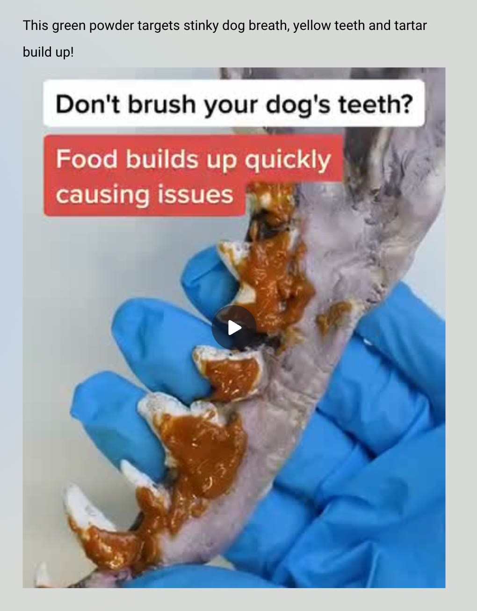
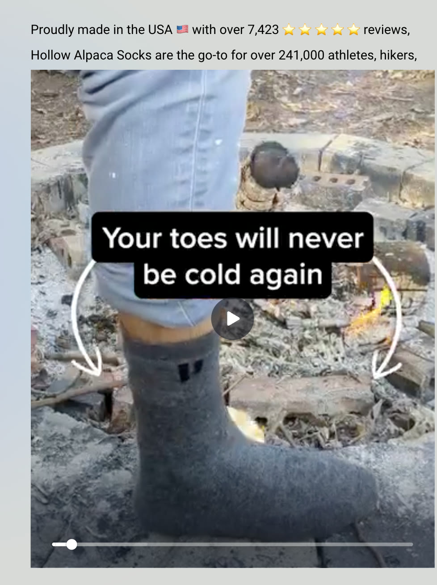
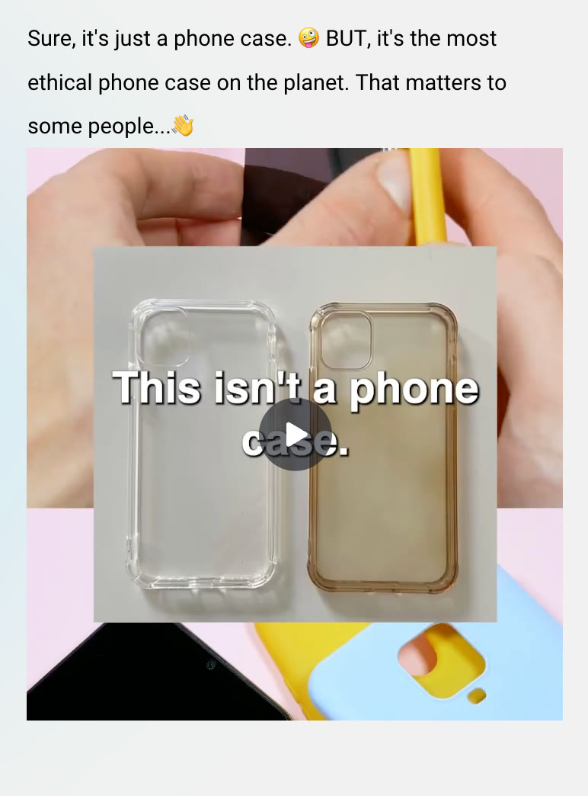
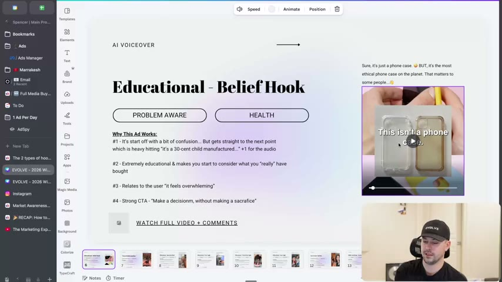
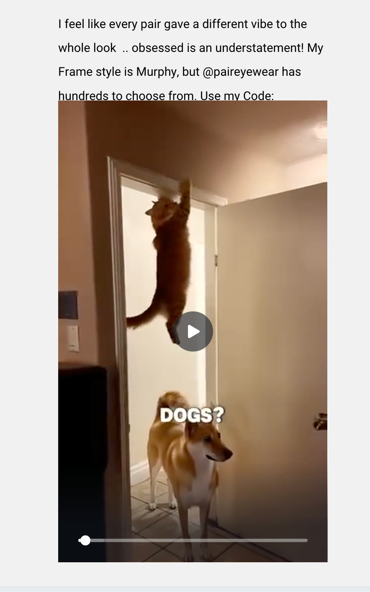
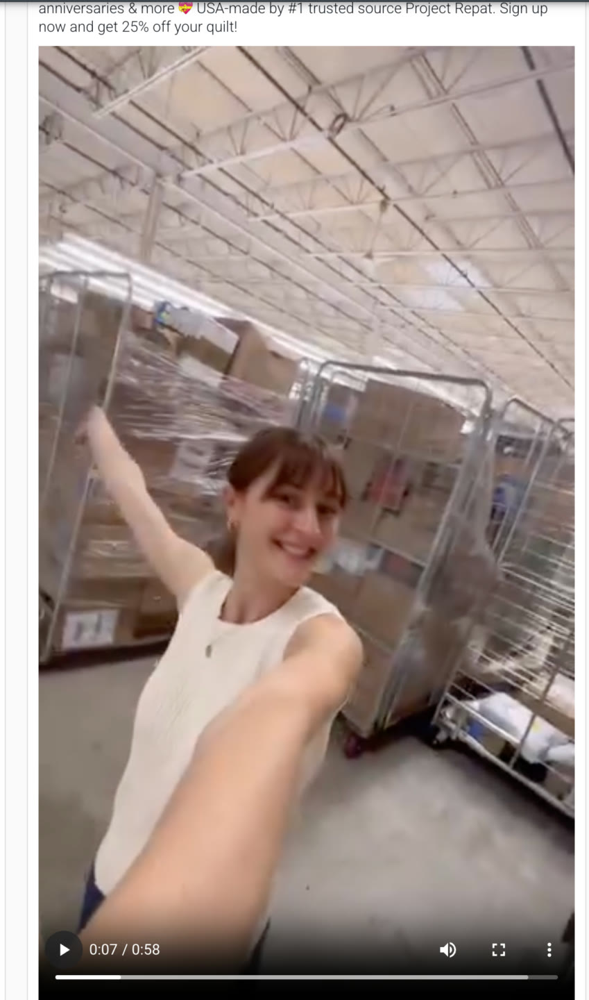
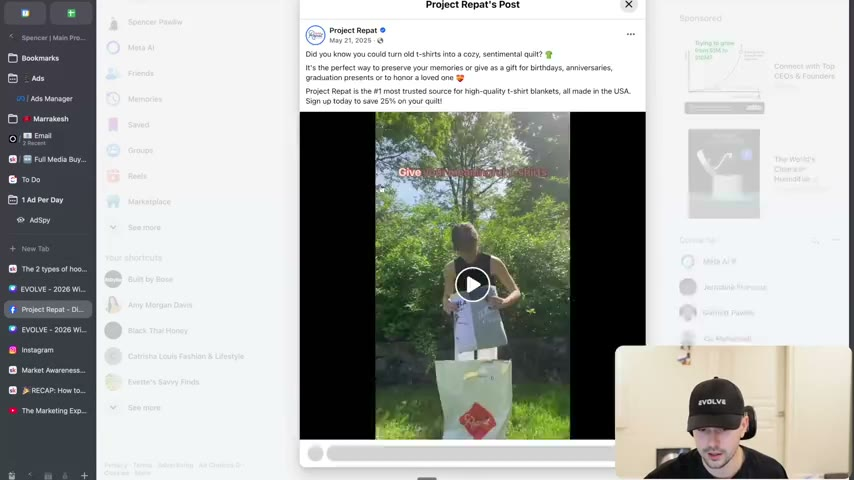

# 24. The 2 types of hooks
> Before writing, decide whether the hook is **targeted** (calls out a specific audience; easier, good for beginners) or **broad** (anyone can watch, reaches a new audience, funnels down; harder but more scalable and shareable).

## 🤖 Agent use
- **Use when:** choosing the hook strategy for a UGC script or static ad, and when classifying a competitor's hook in a teardown.
- **Inputs → outputs:** product + avatar + a hook candidate (or competitor ad) → a label (targeted or broad), the audience it filters in/out, and a rewrite in the other mode when needed.
- **Rules:**
  - **DO** ask consciously, before writing: "Am I going to write a targeted hook or a broad hook?" It "sets the basis for how you continue with writing the rest of your concept." [07:50-00:27; 07:50-08:10]
  - **DO** default to a **targeted** hook for large-product-awareness brands and for beginner writers: "it's a lot harder to grab more people's attention than it is to just grab a specific type of person." [00:27-00:59; page text]
  - **IF** the viewer isn't the avatar (no dog, no cold toes) **THEN** accept that they scroll past; that is the cost of targeted. [00:59-02:26]
  - **DO** go **broad** when you have the skill to grab everyone: speak to "the wider, more relatable thing" and then funnel down to the product. [02:26-04:21; page text]
  - **DO** make broad hooks understandable by anyone, including non-owners of the category: "Anybody can watch that." [04:49-06:59]
  - **DO** remember that broad ads travel through **shares**: viewers who are not the customer "might know someone who is" and send it. [03:07-03:28; 05:38-05:49]
  - **DON'T** assume you must call out the avatar every time: "You don't always need to go all in on your avatar all the time." [03:28-03:51; page text]
  - **DON'T** pick a broad hook with no curiosity ("here's how I make a million dollars" is "potentially not the best hook because there's not a lot of curiosity"). [03:51-04:21]
  - **DO** pair a broad hook with a curiosity gap (juxtaposition, a puzzling claim, a mystery action) so it holds attention. [04:49-06:59]
- **See also:** [23. The framework behind great hooks](23-the-framework-behind-great-hooks.md) · [25. The 2 ways to write great hooks](25-the-2-ways-to-write-great-hooks.md) · [21. Being aware of market awareness](21-being-aware-of-market-awareness.md) · [Hooks library](../../../../libraries/hooks.md) · [Angle remix playbook](../../../../playbooks/angle-remix.md)

## Key ideas

### 1. Two types: targeted vs broad [00:00-00:59]
- "There genuinely are two types of hooks that you can write. Targeted or non-targeted. Broad or specific, however you want to call it." Many writers "don't actually consciously ask" which one they're doing. [00:00-00:27]
- **#1 Targeted:** "You go specific to call out your audience." Page text: "recommended for large product awareness", "Better for beginner copywriters". The instructor adds "honestly, just any brand in general". [00:27-00:59]
- **#2 Broad:** page text: "You go VERY BROAD to call out everyone to reach a NEW audience outside of your existing and then narrow down from there." [page text; 02:26-03:07]

### 2. Targeted hook examples [00:59-02:26]
- **Dog teeth:** "Don't brush your dog's teeth? Food builds up quickly causing issues". If you don't have a dog it isn't relevant; and if you *do* brush your dog's teeth you react differently than someone who doesn't. The brand "bets on the specific audience" that more people don't brush than do, "because they've probably done research" (instructor's inference). [00:59-01:54]
- **Cold toes:** "Your toes will never be cold again." Relevant to people who have cold toes; others "probably scroll through". [01:54-02:26]
- He keeps it short: "I don't need to give you tons of examples because these ones are pretty obvious." Both appear in the course's "winning ads" deck. [01:27; 02:26]

### 3. Why go broad [02:26-04:21]
- "When I look at some of the biggest brands that crush it and spend millions of dollars a month on ads, they usually have a great product. But when it comes to the ones that have great marketing... they have the skill set to go broad. So not only do they go specific, they also go broad." (instructor claim) [02:26-02:52]
- Broad hooks reach "a new audience outside of their existing and narrowed down audience." The content "finds its way to its avatar", or the script filters toward the avatar as it goes. [02:52-03:07]
- **Shares:** you might not be the customer "but I might know someone who is and I can share it". Keep that thought while watching examples. [03:07-03:28]
- Credit to Adley (see [lesson 23](23-the-framework-behind-great-hooks.md)) "because she's someone that preaches this": you can't always go niche. [03:28-03:51]
- **Instructor's own content as a case:** his clip reviews of ads only reach people who want to learn about ads. A broader opener such as "doing this thing makes me millions of dollars" would be "wider, more relatable" and could then funnel down to "here's how I review this ad". He then caveats that "here's how I make a million dollars" lacks curiosity, but "requires a better skillset to grab attention and funnel through." [03:28-04:21]

### 4. Broad examples [04:21-06:59]
- **Phone case (eco-ethics brand):** "This isn't a phone case. It's a 30 cent child manufactured, shipped 5,000 miles, ocean polluting, toxic waste that won't re-enter the ecosystem for the next 500 years. The average person touches their phone 3,000 times a day, slowly disintegrating their case into billions of microplastics." (quoted as heard; the ad is read aloud at [04:21-04:49].) Anyone can watch because everyone has a phone; it is not "for TikTok girlies" or any identity. "This isn't a phone case. It's like, well, what?" is a juxtaposition that creates the curiosity gap. "Even if they don't have a phone, they can watch this because they probably know what phone cases are." [04:21-05:38]
  - The course's winning-ads deck card labels it "Educational - Belief Hook", "PROBLEM AWARE", "HEALTH", with "Why This Ad Works": #1 starts off with a bit of confusion but gets straight to the next point, which is heavy-hitting ("it's a 30-cent child manufactured..."), "+1 for the audio"; #2 "Extremely educational & makes you start to consider what you 'really' have bought"; #3 "Relates to the user 'it feels overwhelming'"; #4 "Strong CTA - 'Make a decisionm, without making a sacrifice'" (typo as on slide). [05:10 frame; Skool page]
- **Cats vs dogs:** the opening text is "Who has a better life, cats or dogs?" (on-screen "DOGS?" over a cat climbing a door frame and a Shiba Inu). "Who can watch that? Literally everybody." If you don't own a cat you might send it to someone who does: "Boom, share." That is why "a lot of these ads have so many shares". Skool page caption: "I feel like every pair gave a different vibe to the whole look .. obsessed is an understatement! My Frame style is Murphy, but @paireyewear has hundreds to choose from. Use my Code:" so the animal-comparison hook fronts an eyewear (Pair Eyewear) creator ad. [05:09-05:49; Skool image 24-img04]
- **T-shirt quilt (Project Repat):** "When you send us your shirts, you're trusting us with your memories." Curiosity gap: "Wait, hold on a second. Why am I sending you my shirts?" Then the video shows "the journey your t-shirts go" (transparency, a warehouse tour), and "oh, this is turning into a quilt", which is the retention. "Here's what happens when you send us your shirts. Everybody has shirts." The Facebook post copy: "Did you know you could turn old t-shirts into a cozy, sentimental quilt? It's the perfect way to preserve your memories or give as a gift for birthdays, anniversaries, graduation presents or to honor a loved one. Project Repat is the #1 most trusted source for high-quality t-shirt blankets, all made in the USA. Sign up today to save 25% on your quilt!" (post dated May 21, 2025 on screen). [05:49-06:59; frame 06:02]
  - He contrasts it with targeted variants of the same product: "if you constantly are donating shirts, try doing this" or "if you're the type of person that doesn't want to give up shirts" would isolate specific people; "here's what happens when you send us your shirt" is broad. [06:18-06:59]

### 5. Scale and funnelling [06:59-08:01]
- Targeted ads can still scale if the group is big ("a lot of people don't brush their dog's teeth, a lot of people have cold toes"). But a broad ad talks about "something that literally anybody can watch" and is "technically unaware or not going after a specific type of person", then funnels to the avatar: "That is how you can create ads that have this hyper scalability." [06:59-07:50]
- The TL;DR: decide targeted or broad first. [07:50-08:01]

## Steps / framework

| | #1 Targeted | #2 Broad |
|---|---|---|
| Definition | Go specific to call out your audience | Go very broad to call out everyone; reach a new audience; narrow down from there |
| Skill needed | Lower; better for beginners | Higher; "requires a better skillset to grab attention and funnel through" |
| Who scrolls past | Non-avatars | Few; non-customers may share |
| Typical awareness | Large product awareness brands | Technically unaware ("not going after a specific type of person") |
| Attention mechanism | Relevance / "that's me" | Curiosity gap, juxtaposition, relatable universal |
| Scale route | Big specific audience | Shares + wider reach, then funnel |
| Examples | Dog teeth; cold toes | Phone case; cats vs dogs; t-shirt quilt |

Decision flow (derived): (1) Do we know a pain/situation shared by a big specific group? -> write targeted. (2) Do we need a new audience or shareability, and can the first line hold a non-avatar with a curiosity gap? -> write broad, then funnel with a bridge ([27. How to write a bridge](27-how-to-write-a-bridge.md)).

## Examples
See the tables below. Quick contrast on the same product category (derived from the t-shirt discussion): targeted "If you keep donating old shirts, try this" vs broad "Here's what happens when you send us your shirts." [06:18-06:59]

## Structured units

### Hooks
| Hook | Heuristic(s) | Emotion / zone | Self targeted | Why it works | Source |
|---|---|---|---|---|---|
| "Don't brush your dog's teeth? Food builds up quickly causing issues" (text on a dog's jaw with tartar; ad copy: "This green powder targets stinky dog breath, yellow teeth and tartar build up!") TARGETED | Problem call-out, visual proof (derived) | Guilt/concern (derived) | — | Calls out dog owners who don't brush; visual of buildup makes the problem real. | [00:59-01:54; Skool img 24-img01] |
| "Your toes will never be cold again" (Hollow Alpaca socks; copy: "Proudly made in the USA with over 7,423 reviews, Hollow Alpaca Socks are the go-to for over 241,000 athletes, hikers,...") TARGETED | Outcome promise, social proof in copy (derived) | Comfort relief (derived) | — | Speaks to people with cold toes; stated outcome. | [01:54-02:26; Skool img 24-img02] |
| "This isn't a phone case." then "It's a 30 cent child manufactured, shipped 5,000 miles, ocean polluting, toxic waste..." BROAD | Juxtaposition, curiosity gap, education/belief shift (derived) | Confusion into concern | — | Everyone has a phone; the denial of the obvious creates a gap; deck: "it's a 30-cent child manufactured..." is the heavy hitter. | [04:21-05:38; frame 05:10] |
| "Who has a better life, cats or dogs?" BROAD | Debate/opinion prompt, shareability (derived) | Playful curiosity (derived) | — | "Who can watch that? Literally everybody"; non-owners share it with owners. | [05:09-05:49; Skool img 24-img04] |
| "When you send us your shirts, you're trusting us with your memories." BROAD | Open loop, transparency (derived) | Sentiment (derived) | — | "Why am I sending you my shirts?" gap; behind-the-scenes journey retains. | [05:49-06:59] |
| "Doing this thing makes me millions of dollars" (instructor's hypothetical broad opener for his own ad-review content) | Broad-relatable then funnel (derived) | Aspiration (derived) | — | Wider and more relatable than an ads-only audience, but weak curiosity ("good for you, buddy"). | [03:51-04:21] |

### Angles
| Angle | Core desire / pain | Heuristic(s) | Best format | Example line | Source |
|---|---|---|---|---|---|
| Ethical/eco anti-product ("this isn't a phone case") | Guilt about plastic waste; wanting to buy better | Education/belief hook (deck label) | UGC/video voiceover | "The average person touches their phone 3,000 times a day, slowly disintegrating their case into billions of microplastics." | [04:21-04:49] |
| Memory-keeping / sentimental transformation | Preserve memories in old t-shirts | Transparency; process reveal (derived) | Behind-the-scenes video | "Here's what happens when you send us your shirts." | [05:49-06:59] |

### Ad teardowns
| Brand / product (niche) | Format | Hook / opening | What works | What fails | Fix suggested | Principle | Source |
|---|---|---|---|---|---|---|---|
| Dog dental green powder (pets) | Video, text on dissected jaw | "Don't brush your dog's teeth?" | Specific call-out; gross visual | Excludes non-dog owners (by design) | — | Targeted hook | [00:59-01:54] |
| Hollow Alpaca Socks (apparel) | Video, outdoors by a fire | "Your toes will never be cold again" | Clear relevance and outcome | Irrelevant to people without cold toes | — | Targeted hook | [01:54-02:26] |
| Phone case (eco phone accessories) | Video, hands comparing two clear cases | "This isn't a phone case." | Everyone has a phone; juxtaposition; heavy-hitting facts; strong CTA | Starts with "a bit of confusion" (deck) | — | Broad hook, educational belief hook | [04:21-05:38; frame 05:10] |
| Pair Eyewear creator ad (eyewear) | UGC video, cat climbing + Shiba Inu | "Who has a better life, cats or dogs?" | Universal, shareable | — (not critiqued) | — | Broad hook, shares | [05:09-05:49] |
| Project Repat (t-shirt quilts) | Video, warehouse/process reveal | "When you send us your shirts, you're trusting us with your memories." | Curiosity gap, transparency, anyone has shirts | Not critiqued | — | Broad hook + funnel | [05:49-06:59] |

### Rewrites
| Before | After | What changed | Source |
|---|---|---|---|
| "If you constantly donate your old shirts, try this" (targeted variant, instructor illustration) | "Here's what happens when you send us your shirts." | Targeted self-selection -> broad curiosity ("why do I send them my shirt?") | [06:18-06:59] |
| "Here's how I review this ad" (instructor's niche content) | "Doing this thing makes me millions of dollars" -> then the review | Narrow audience -> broader, more relatable opener with funnel (instructor notes it lacks curiosity) | [03:51-04:21] |

### Templates
| Template | Use for | Example fill | Source |
|---|---|---|---|
| "[Don't do the common care task for your pet]? [Consequence builds up quickly]" | Targeted problem call-out | "Don't brush your dog's teeth? Food builds up quickly causing issues" | [00:59-01:54] |
| "Your [body part] will never be [bad state] again" | Targeted outcome promise | "Your toes will never be cold again" | [01:54-02:26] |
| "This isn't a [product category]. It's a [shocking description]..." | Broad juxtaposition hook | "This isn't a phone case. It's a 30 cent child manufactured..." | [04:21] |
| "Who has a better life, [A] or [B]?" | Broad shareable debate hook | "Who has a better life, cats or dogs?" | [05:09] |
| "When you send us your [item], you're trusting us with your [emotional thing]." | Broad curiosity + transparency | "When you send us your shirts, you're trusting us with your memories." | [05:49] |

## Prompts / templates (verbatim)
Skool page text:
```
#1 - Targeted
You go SPECIFIC to call out your audience (recommended for large product awareness)
^ Better for beginner copywriters

#2 - Broad
You go VERY BROAD to call out everyone to reach a NEW audience outside of your existing and then narrow down from there.
Your content will find it's way to your avatar (Shares)
You don't ALWAYS need to go to your avatar ALL the time
Speak to the WIDER more RELATABLE thing, then you can funnel down from there
^ requires a better skillset to grab attention and funnel through
```
Examples on the page link to five Canva "winning ads" cards: Not brushing dogs teeth ad; Cold toes ad; Phone Case Ad; Cat Ad; and a Facebook link for the T-shirt ad. The Canva deck itself is not in the course files (only screenshots).

## Screenshots

*Targeted hook: "Don't brush your dog's teeth? Food builds up quickly causing issues" over a tartar-covered jaw. [00:59-01:54]*


*Targeted hook: "Your toes will never be cold again" (Hollow Alpaca Socks; 7,423 reviews and 241,000 customers in the caption). [01:54-02:26]*


*Broad hook: "This isn't a phone case." with the caption "Sure, it's just a phone case. BUT, it's the most ethical phone case on the planet. That matters to some people..." [04:21-05:09]*


*Winning-ads deck card "Educational - Belief Hook / PROBLEM AWARE / HEALTH" with a four-point "Why This Ad Works". Shows how the course labels and explains a broad hook. [05:10]*


*Broad hook: "...DOGS?" over a cat climbing a door and a Shiba Inu (Pair Eyewear creator ad). [05:09-05:49]*


*Project Repat video still from the Skool page (warehouse tour, 0:07 of 0:58; caption: "USA-made by #1 trusted source Project Repat. Sign up now and get 25% off your quilt!"). [05:49-06:59]*


*The Facebook post for the t-shirt quilt ad (Project Repat, May 21, 2025) with full ad copy. [06:02]*

## How to apply
- [ ] Write one line before drafting: "This hook is TARGETED/BROAD because ...".
- [ ] For a targeted hook, name the exact person/situation the line filters in, and accept who is filtered out.
- [ ] For a broad hook, test: could someone who doesn't own the product category watch to the end? If not, rewrite.
- [ ] Add a curiosity gap to every broad hook (juxtaposition, "why would I send you my shirts?").
- [ ] Draft the bridge from broad hook to product ([lesson 27](27-how-to-write-a-bridge.md)).
- [ ] Log shares and comments for broad ads (they are the distribution signal named in the lesson).
- [ ] If the account is new or the writer is a beginner, ship targeted hooks first, then add broad hooks as capacity grows.

## Related
- Previous: [23. The framework behind great hooks](23-the-framework-behind-great-hooks.md) · Next: [25. The 2 ways to write great hooks](25-the-2-ways-to-write-great-hooks.md)
- [Creative primitives](../../../../concepts/creative-primitives.md) · [Native advertising](../../../../concepts/native-advertising.md) · [Angle rut](../../../../concepts/angle-rut.md)

## Sources and limitations
- Transcript: [24. The 2 types of hooks… .txt](<../../../../../raw/evolve/copywriting/_transcripts/✍️ Evolve Copywriting (NEW)/24. The 2 types of hooks ✍️ Evolve Copywriting (NEW) Evolve.txt>) · Page text: [….html.md](<../../../../../raw/evolve/copywriting/_extracted/✍️ Evolve Copywriting (NEW)/24. The 2 types of hooks_✍️ Evolve Copywriting (NEW)_Evolve.html.md>) · Skool images 24-img01 to 24-img05 under `knowledge-base/raw/evolve/copywriting/linked/skool-images/24/`.
- Machine transcription (Whisper large-v3-turbo); full recording covered (last segment 8:01 = duration). Whisper writes "30 cent child manufacturer" (read aloud from the ad); the deck slide text says "30-cent child manufactured". Brand names for the dog-teeth and phone-case ads are not shown; the cat ad is attributed to Pair Eyewear from the page caption only.
- The ads themselves are in the Canva "winning ads" deck (linked from the page), which is not part of the course files; only the Skool screenshots and the deck card shown on screen at 05:10 were available.
- The claim that the biggest-spending brands "go broad" is an instructor claim with no data.
