# 25. The 2 ways to write great hooks
> A hook either **makes a promise** (states the interesting thing outright; you must deliver it) or **opens a loop** (withholds information so the viewer must keep watching; it must be worth it); choose by asking which is more interesting and whether the context ("the meat") is strong enough to leave in.

## 🤖 Agent use
- **Use when:** drafting hook variants for a script, converting a promise hook into an open-loop hook (or back) to test, or classifying a competitor/viral hook.
- **Inputs → outputs:** the core fact/product/demo + a judgement of how interesting it is on its own → a **promise** version and an **open-loop** version of the hook, plus a note on what must be delivered in the video.
- **Rules:**
  - **DO** ask first: "Am I going to make a promise or am I going to open a loop?" [00:18-00:41]
  - **DO** decide by interest: "Leave in the context -> make a promise (the idea is really good and interesting). Take out the context -> open a loop." Credit: Harry Dry. [00:41-01:47; page text]
  - **IF** the context is boring ("a lot of times in advertising, our context is essentially the product") **THEN** open a loop, i.e. "delete the product" from the hook. [01:22-01:47; 10:10-10:37]
  - **DO** write a true promise as "all of the information they need": the viewer "knows exactly what they're about to watch" and still wants to. [02:30-02:52]
  - **DO** write an open loop by withholding: "just a little bit of information... not enough for people to fully understand what's going on." [03:20]
  - **DO** deliver on both: "If I don't actually test different shoes when jumping on a bed of nails, I'm going to be pissed." Opening a loop "doesn't mean that you can't deliver." [12:01-12:30]
  - **DON'T** break the promise: "you've broken my trust and I'm just going to scroll." (A deliberate, funny subversion with escalation can work as a viral rage-bait, but he warns "you have to be careful with breaking promises".) [08:30; 08:30-08:59]
  - **DO** use juxtaposition as an open-loop engine ("how is she going to do that?"; ice cubes vs scorching pan). [12:30-13:53]
  - **DO** use "watch out for" / danger-withholding language to trigger a threat check: "it automatically triggers... wait, are we in danger?" [11:15-11:36]
  - **DO** test the same idea in both forms; combined promise + loop hooks are common ("most open loops have some form of a promise inside of them"). [02:08-02:30; 12:30-15:00]
  - **DON'T** add a demographic or "why" to the hook if you can save it for the video (shade-ball example: no "California", no "to battle drought"). [17:07-17:59]
- **See also:** [23. The framework behind great hooks](23-the-framework-behind-great-hooks.md) · [24. The 2 types of hooks](24-the-2-types-of-hooks.md) · [26. How to write open loops](26-how-to-write-open-loops.md) · [Hooks library](../../../../libraries/hooks.md) · [UGC script writing playbook](../../../../playbooks/ugc-script-writing.md)

## Key ideas

### 1. Two ways: promise vs open loop [00:00-01:47]
- **#1 Make a promise (better deliver it).** "When you make a promise, that is a great way to write a hook, but you have to be able to deliver." [00:00-00:18]
- **#2 Open a loop / create an itch (better be worth it).** "I don't have all the information, I want to keep watching, but this better be worth it." [00:18-00:41]
- **How to choose** (credit Harry [Dry]; the instructor says he "always gives credit to Harry down below when he helps crystallize things"): ask "which one is more interesting". If you leave in "the meat of the ad" and it is super interesting, "just make a promise". If the meat is not interesting, open a loop. [00:41-01:47]

### 2. How to tell them apart (the confusion section) [01:47-03:49]
- The instructor says he "easily got confused": much of what is on your timeline is neither, and "most of the time open loops have some form of a promise inside of them", so both make you stop. [01:47-02:30]
- **Promise** = "you're essentially giving the person all of the information that they need in the hook." A reader can say "I know exactly what this is about to talk about and either I want to watch it or I don't." [02:30-02:52]
- **Open loop** = "more focused on withholding information". Image: promise = "here's everything"; open loop = "what's going to happen?" [02:52-03:20]
- Open loops are "a very strong way to keep people watching". [03:20]

### 3. Promise examples, each with its open-loop twin [03:20-08:59]
- **"He covered his floor with 100,000 pennies" (+ "Here's what it looks like now!")**: "no information being withheld"; 135M views (the Skool screenshot shows the title "He covered his floor with 100,000 pennies. Here's what it looks like now!" on Justin Flom's channel with hashtags #gorillatough #ad, 3.5M likes, "135M views 11 months ago"). "You promise someone that they are going to see 100,000 pennies on a floor. If I'm going to watch this, I better see 100,000 pennies. If not, you've broken my trust." "Here's what it looks like now" adds a small loop. Open-loop version (page + video): **"You'll never believe what he covered his floor with."** It works because "nobody covers their floor with 100,000 pennies"; "if I said he covered his floor with hardwood, nobody would care." [03:20-05:20]
  - **Hardwood thought experiment for boring context** (instructor's own): if you were selling hardwood, use the loop "You'll never believe what he covered his floor with", then tell the story of flying to a country for the world's finest hardwood, "thankfully you don't have to fly to France to get it. You can just buy it from us." Opening a loop "when you don't have that good of context". [04:33-05:20]
- **"Lighter VS Lollipop"** (33M views; Skool screenshot: vayn channel, on-screen "0.1 second" with lollipops and a torch lighter): "no real open loop... this is a promise... you better see a lighter and a lollipop." Open-loop version: **"I can't believe this only takes 0.1 seconds."** People "don't know what they're about to watch" but you're withholding information. [05:20-06:21]
- **"Making the world's hardest omelette without beating the eggs (day 253)"** (23M views; Omuricedaily channel): "This is the promise. I better see an omelette being made, a very hard omelette, without beating." Open-loop version: **"The omelette technique that took 253 days to master."** [06:21-06:46]
  - **Rage-bait twist:** he plays the video; the creator makes a joke of it and violently beats the eggs. The top comments quoted on screen: "For someone who wasn't going to beat the eggs, you beat the shit out of the eggs" (101K likes), "You were right. You didn't beat the eggs, you killed them", "The heavy breathing made this 10x more intense, thank you". "This is rage bait... a way to go viral." The creator "escalated it", used chopsticks instead of a whisk (props that "all made sense"). He did not deliver the promise "but obviously he did it in a way that was funny"; "you have to be careful with breaking promises." [06:46-08:59]
  - He contrasts: if he made a "lighter vs lollipop" video and then said "Hey, by the way, my name's Spencer", the effect would die; the omelette creator "made a joke of it". (The instructor says "my name's Spencer" in this hypothetical; he also calls himself "Spencer" in lesson 28, so Spencer appears to be his first name.) [07:55-08:30]
- **MrBeast = "the king of promises" (credit Harry Dry).** Titles shown: "$456,000 Squid Game In Real Life!" (911M views), "Last To Leave Circle Wins $500,000" (550M), "World's Most Expensive Flights!" (543M), "$1 vs $100,000,000 Car!" (538M), "$1 vs $1,000,000,000 Yacht!" (533M), "$10,000 Every Day You Survive In A Grocery Store" (504M), "7 Days Stranded On An Island" (475M), "Ages 1 - 100 Fight For $500,000" (457M). The instructor: "you know exactly what you're going to watch." He notes "World's Most Expensive Flights" is "potentially more of an open loop" because the flight is not named, and "$1 versus $100 million car" is a promise ("you're going to see a $1 car and a $100 million car"). [08:59-09:53]
- "If your context is good, just say it. If it's not, then we need to make more of an open loop." [09:42-10:10]

### 4. Open-loop examples (delete the product) [09:53-12:30]
- Open loops "take the context out"; Harry's phrase: "trying to basically delete the product". The reaction moves from "this is interesting, click" to "wait, what's going to happen?" [10:10-10:37; page text]
- **"Which shoes will protect your feet the most?"**: visual high stakes (a man jumps barefoot onto a bed of nails; Skool screenshot: Drew Dirksen, "132M views 9 months ago", on-screen word "shoes"). Question in the viewer's head: which one will actually protect them, and is he really going to jump? **Promise version** of the same video: **"Jumping on a bed of nails in Crocs"** (the first thing he does in the video). [10:10-11:05]
- **"Watch out for these ingredients when buying shampoo"**: viewer asks "what ingredients do I need to look out for?" instead of "what's going to happen?" Withholding potentially harmful information "is 100% going to stop their scroll"; "watch out" triggers "wait, are we in danger?"; contrast "these are the best ingredients... you probably won't care." [11:05-11:36]
- **"Watch what eggs do to your old dog's body"**: "What do eggs do?" (Skool screenshot shows it as an ad with caption "...say about what your dog really needs in their diet. The truth might".) [11:36-12:01]
- Delivery rule across all three: you must show eggs and old dogs, shampoo ingredients, different shoes on nails. [12:01-12:30]

### 5. Promise + open loop combined [12:30-15:00]
- **"Here's how to bathe your dog without water"** (juxtaposition): "If you ask yourself 'how is that possible?' or 'what do I need to look out for?' that's how you know you've created more of an open loop"; it also promises you will see how, so you must show it. (Skool screenshot: Lettuce Pets Facebook ad, created Feb 21, 2025; on-screen "Here's how to bathe your dog without water"; ad copy "Like cloud cleaning storm - 3s remove shedding hair. Mist hydrates, comb massages."; product is a mist/comb pet tool.) [12:30-13:13]
- **"How ice cubes clean a scorching pan"** (YouTube title: "Cool Science: How Ice Cubes Clean a Scorching Pan"; 29M views; on-screen "Quick clean"): juxtaposition of hot and cold; "this is more of a promise" since it states what will happen, but there is also a loop: "how does that clean it?" Cut-down version: **"Ice cubes clean a scorching pan"**, "people will just want to click it and see what happens." [13:13-14:18]
- **"Hands down the coolest kids craft"** (Cosmody, Facebook ad, created Aug 15, 2025; ad copy "Watch as every doodle, design, and masterpiece glows..."): "What's the craft?" is the open loop; "this better be a badass kids craft" is the promise (it turns out to be a glow-in-the-dark board). "In most cases, you are promising. The difference is we're withholding more information." [14:18-14:59]

### 6. Exercise from the page [14:59-16:22]
- Two top videos from the same rescue channel (Skool screenshot: "I've Never Been So Shocked By A Surrendered Dog - Poppy's Rescue..." 7.9M views; "Lucy Had Given Up On Life...Until She Met The Pack | The Asher..." 5.8M views). Page caption: "Some are clear promises, some are clear open loops, some mix both together."
  - **"I've never been so shocked by a surrendered dog"**: definitely more of an open loop: "what happened? What did the dog do? Why is he so shocked?" "If you have a lot of questions after reading a hook, that's more of an open loop." [14:59-15:29]
  - **"Lucy had given up on life until she met the pack"**: a promise: "I know what's going to happen. I know Lucy was a sad dog and after meeting the pack she's living a better life... I know what I'm going to get, but I still am very interested." [15:29-15:57]
  - "They both work." When the context is very interesting you can state it; to "keep the user guessing" use more open loops. [15:57-16:22]

### 7. Case: the power of copy on one video (Harry Dry) [16:22-17:59]
- The same reservoir story under two titles: **"California floats shade balls to battle drought"** (CBS Mornings, 300K views) vs **"Why are 96,000,000 black balls on this reservoir?"** (Veritasium, 96M views in the Skool screenshot; the instructor says "96 million views"). [16:22-16:51]
- Why the second wins: an open loop ("why are they all there?") that still carries a promise ("I better see these 96 million balls on a reservoir"); **no demographic exclusion** (the first names California, so a non-Californian thinks "I don't care"); the first also reveals the purpose ("to battle drought"), which the second withholds "for the video". [16:51-17:48]
- "That's a pretty massive difference just because of copy." He adds caveats: a better headline and a person in the visual also help ("people like to see people"). [17:48-17:59]
- Close: "copywriting is so powerful and hooks are the most powerful tool that you have." [17:59]

## Steps / framework

| Step | Action | Source |
|---|---|---|
| 1 | State the core fact/demo/context in one line | [00:41-01:47] |
| 2 | Ask: is the context itself interesting? | [00:41-01:47] |
| 3a | Yes -> **Promise hook**: state it plainly ("He covered his floor with 100,000 pennies"). Make sure the video shows it. | [02:30-03:49] |
| 3b | No -> **Open-loop hook**: delete the product/context and withhold the key info ("You'll never believe what he covered his floor with") | [09:53-10:37] |
| 4 | Add juxtaposition, danger-withholding ("watch out"), or a visual of high stakes to strengthen the loop | [10:10-14:18] |
| 5 | Remove geography/demographic/purpose details from the hook if they kill the mystery | [17:07-17:59] |
| 6 | Write the other version too and test both | [03:49-06:21] |
| 7 | Deliver exactly what the hook promised (or what the loop implied) in the first seconds of the body | [04:17; 12:01-12:30] |

Promise vs open loop at a glance:

| | Promise | Open loop |
|---|---|---|
| Information in hook | All of it ("here's everything") | Some withheld ("what's going to happen?") |
| Viewer thought | "I know exactly what this is; do I want it?" | "Wait, what? I need to know." |
| Use when | Context/meat is interesting on its own | Context is boring or the product is the context |
| Risk | Breaking the promise loses trust | Not worth the wait; reader confused |
| Test | Does the video show exactly this? | Does the viewer have many questions after the hook? |

## Examples
All examples appear in the tables below. Short list of pairs:
- Promise "He covered his floor with 100,000 pennies" / open "You'll never believe what he covered his floor with".
- Promise "Lighter VS Lollipop" / open "I can't believe this only takes 0.1 seconds".
- Promise "Making the world's hardest omelette without beating the eggs" / open "The omelette technique that took 253 days to master".
- Open "Which shoes will protect your feet the most?" / promise "Jumping on a bed of nails in Crocs".

## Structured units

### Hooks
| Hook | Heuristic(s) | Emotion / zone | Self targeted | Why it works | Source |
|---|---|---|---|---|---|
| "He covered his floor with 100,000 pennies. Here's what it looks like now!" (PROMISE; Justin Flom, #gorillatough #ad, 135M views) | Specific number, spectacle, small loop (derived) | Awe/curiosity | — | Context is interesting enough to state; viewer knows what they will see | [03:20-04:33; Skool img 25-img01] |
| "Lighter VS Lollipop" (PROMISE; vayn, 33M views) | Juxtaposition (derived) | Curiosity | — | "I better see a lighter vs a lollipop" | [05:20-05:57; img02] |
| "Making the world's hardest omelette without beating the eggs (day 253)" (PROMISE + rage bait; 23M views) | Superlative + absurd constraint; escalation (derived) | Amusement/anger | — | Clear promise; subverted for comments | [06:21-08:59; img03] |
| MrBeast titles: "$456,000 Squid Game In Real Life!", "Last To Leave Circle Wins $500,000", "World's Most Expensive Flights!", "$1 vs $100,000,000 Car!" (PROMISES) | Big numbers, contrast, named spectacle (derived) | Excitement | — | "You know exactly what you're going to watch" | [08:59-09:53; img04] |
| "Which shoes will protect your feet the most?" (OPEN LOOP; Drew Dirksen, 132M views) | High-stakes visual, comparison (derived) | Tension | — | Withholds which shoe; visual: barefoot jump onto nails | [10:10-11:05; img05] |
| "Watch out for these ingredients when buying shampoo" (OPEN LOOP) | Threat/danger withholding (derived) | Fear | — | "What ingredients do I need to look out for?"; "watch out" triggers a danger check | [11:05-11:36; img06] |
| "Watch what eggs do to your old dog's body!" (OPEN LOOP) | Danger/withholding (derived) | Concern | — | "What do eggs do?" | [11:36-12:01; img07] |
| "Here's how to bathe your dog without water" (COMBINED; Lettuce Pets) | Juxtaposition | Curiosity | — | "How is she going to do that?"; promises to show how | [12:30-13:13; img08] |
| "How ice cubes clean a scorching pan" (COMBINED, leans promise) | Juxtaposition (hot/cold) | Curiosity | — | States the premise; "how does that clean it?" | [13:13-14:18; img09] |
| "Hands down the coolest kids craft" (COMBINED; Cosmody) | Superlative + withheld object | Curiosity | Parent (derived) | "What's the craft?"; "this better be a badass kids craft" | [14:18-14:59; img10] |
| "I've never been so shocked by a surrendered dog" (OPEN LOOP; 7.9M views) | Emotional withholding | Surprise | — | Many questions: what happened? why shocked? | [14:59-15:29; img11] |
| "Lucy had given up on life until she met the pack" (PROMISE; 5.8M views) | Before-after arc | Hope | — | Viewer knows the arc yet still wants to see it | [15:29-15:57; img11] |
| "Why are 96,000,000 black balls on this reservoir?" (OPEN LOOP + promise; Veritasium, 96M views) | Surprising number, no demographics | Curiosity | — | Question implicit; withholds purpose and location | [16:22-17:59; img12] |

### Ad teardowns
| Brand / product (niche) | Format | Hook / opening | What works | What fails | Fix suggested | Principle | Source |
|---|---|---|---|---|---|---|---|
| Gorilla Tough wheelbarrow (Justin Flom, hashtags #gorillatough #ad) (tools) | Vertical video, branded content | "He covered his floor with 100,000 pennies. Here's what it looks like now!" | Interesting context + clear promise; wheelbarrow of pennies in frame | — | Open-loop variant: "You'll never believe what he covered his floor with" | Promise | [03:20-05:20; img01] |
| Lettuce Pets de-shedding mist-comb (pets) | Facebook video ad | "Here's how to bathe your dog without water" | Juxtaposition; shows the product doing it | — | — | Combined promise + loop | [12:30-13:13; img08] |
| Cosmody glow doodle board (kids) | Facebook video ad | "Hands down the coolest kids craft" | Withheld craft + superlative | Instructor warns delivering cool matters | — | Combined | [14:18-14:59; img10] |
| CBS Mornings vs Veritasium (media) | Video titles | "California floats shade balls to battle drought" (300K) vs "Why are 96,000,000 black balls on this reservoir?" (96M) | Second: open loop, no demographic exclusion, person in thumbnail | First: states location and purpose, so no loop; "I don't care if I'm not in California" | Remove location/purpose; ask the question | Open loop; no demographic exclusion | [16:22-17:59; img12] |

### Rewrites
| Before | After | What changed | Source |
|---|---|---|---|
| "He covered his floor with 100,000 pennies" (promise) | "You'll never believe what he covered his floor with" (open loop) | Removed the object -> withheld information | [04:17-04:33; page] |
| "Lighter VS Lollipop" (promise) | "I can't believe this only takes 0.1 seconds" (open loop) | Removed the objects, added a mystery measure | [05:57-06:21; page] |
| "Making the world's hardest omelette without beating the eggs (day 253)" (promise) | "The omelette technique that took 253 days to master" (open loop) | Removed the constraint, kept the effort proof | [06:46-07:21; page] |
| "Which shoes will protect your feet the most?" (open loop) | "Jumping on a bed of nails in Crocs" (promise) | Named the specific shoe and stunt | [10:37-11:05; page] |
| "How ice cubes clean a scorching pan" (combined) | "Ice cubes clean a scorching pan" (cut down; "people will just want to click it and see what happens") | Dropped "how", leaving a bare promise | [13:53-14:18] |
| "He covered his floor with hardwood" (boring promise) | "You'll never believe what he covered his floor with" + story of the world's finest hardwood | Boring context -> open loop then story | [04:33-05:20] |
| "California floats shade balls to battle drought" (300K views) | "Why are 96,000,000 black balls on this reservoir?" (96M views) | Statement -> question; removed California and drought; added number | [16:22-17:59] |

### Templates
| Template | Use for | Example fill | Source |
|---|---|---|---|
| "[Person] [did spectacular thing with specific number]. Here's what it looks like now." | Promise | "He covered his floor with 100,000 pennies. Here's what it looks like now!" | [03:49] |
| "You'll never believe what [person] [verb]." | Open-loop version of a promise | "You'll never believe what he covered his floor with." | [04:17] |
| "[Object A] VS [Object B]" | Promise via juxtaposition | "Lighter VS Lollipop" | [05:20] |
| "I can't believe this only takes [tiny time]" | Open loop | "I can't believe this only takes 0.1 seconds" | [05:57] |
| "Making the world's [superlative] [thing] without [normally required step]" | Promise with an absurd constraint | "...hardest omelette without beating the eggs" | [06:21] |
| "The [technique] that took [number] days to master" | Open-loop effort proof | "The omelette technique that took 253 days to master" | [06:46] |
| "$[amount] [challenge/contrast]" / "$1 vs $[huge]" | MrBeast-style promise | "$1 vs $100,000,000 Car!" | [09:12] |
| "Which [products] will [outcome] the most?" | Comparison open loop, pair with a high-stakes visual | "Which shoes will protect your feet the most?" | [10:10] |
| "Watch out for these [ingredients] when buying [product]" | Danger-withholding open loop | "Watch out for these ingredients when buying shampoo" | [11:05] |
| "Watch what [common thing] do[es] to your [vulnerable subject]" | Danger-withholding open loop | "Watch what eggs do to your old dog's body" | [11:36] |
| "Here's how to [do task] without [necessary thing]" | Juxtaposition (combined) | "Here's how to bathe your dog without water" | [12:30] |
| "How [cold thing] clean[s] a [hot thing]" | Juxtaposition (combined) | "How ice cubes clean a scorching pan" | [13:13] |
| "Hands down the coolest [category]" | Superlative + withheld item | "Hands down the coolest kids craft" | [14:18] |
| "Why are [big number] [odd things] on this [place]?" | Open loop without location/demographic | "Why are 96 million black balls on this reservoir?" | [16:51] |

### Rules of thumb
- **DO** write the promise or open-loop version based on how interesting the context is. [00:41-01:47]
- **DO** deliver exactly what you promised or implied. [04:17; 12:01-12:30]
- **IF** the hook states a location/demographic that excludes people **THEN** hold it for the video. [17:07-17:59]
- **IF** you break a promise **THEN** do it deliberately and with escalation/humour, and know the risk. [08:30-08:59]

## Prompts / templates (verbatim)
Skool page text, reproduced:
```
#1 - Make a Promise (better deliver it)
#2 - Open a Loop/create an itch (better be worth it)

Which one is MORE interesting?
Leave in the context -> Make a Promise (context = the idea is really good and interesting)
Take out the context -> Open Loop

IMPORTANT TO AVOID CONFUSION
Now, before I get into the examples below, I want to make it clear that most "open loops" have some form of a promises inside of them
BUT
When you "truly make a promise" in your hook, you're essentially giving them all of the information they need, but they still want to click to see it.
Again, if something is INTERESTING enough for people to stay and watch, just say it.
Opening a loop is more focused on WITHHOLDING information.
Meaning we don't give enough for people to fully know whats going on, so they have to keep watching.

Make a Promise
He covered his floor with 100,000 Pennies --> "This is interesting... Click"
Context = the 100,000 pennies = Promise (I better see 100,000 pennies)
Open Loop version --> You'll never believe what he covered his floor with

Lighter VS Lollipop --> "This is interesting... Click"
Context = lighter & the lollipop = Promise (I better see a lighter VS a lollipop)
Open Loop version --> I can't believe this only takes 0.1 seconds

Making the world's hardest omelette without beating the eggs (day 253) --> "This is interesting... Click"
Context = making an omelette without beating = Promise (I better see an omelette made without beating)
Open Loop version --> The omelette technique that took 253 days to master

The king of making promises (credit: Harry Dry)

Open Loops
Take out the context. Try to "delete" the product.
It goes from, "This is interesting" --> "Whats going to happen next?"

Which shoes will protect your feet the most? (high stakes jumping on a bed of nails) --> Which ones actually will?
Promise version --> Jumping on a bed of nails in crocs

Watch out for these ingredients when buying shampoo --> What ingredients do I need to look out for?
Watch what eggs to do to your old dogs body --> What do eggs do?

Promise/Open Loops Combined
Here's how to bathe your dog without water (juxtaposition) --> "How is she going to do that?"
But also promises you will see how to bathe a dog without water (context)

How ice cubes clean a scorching pan (juxtaposition) --> "This is interesting... Click"
Context = the ice cubes cleaning the scorching pan = Promise (I better see it clean this)
But also has an open loop of "how it cleans it"

Hands down the coolest kid's craft --> "What is the craft?"
Promise --> This better be a cool kids craft...

Some are clear promises, some are clear open loops, some mix both together.

The power of open loops in copy --> 100% Full Credit Harry Dry.

Credit:
Adley - Viralish
Harry Dry
```

## Screenshots
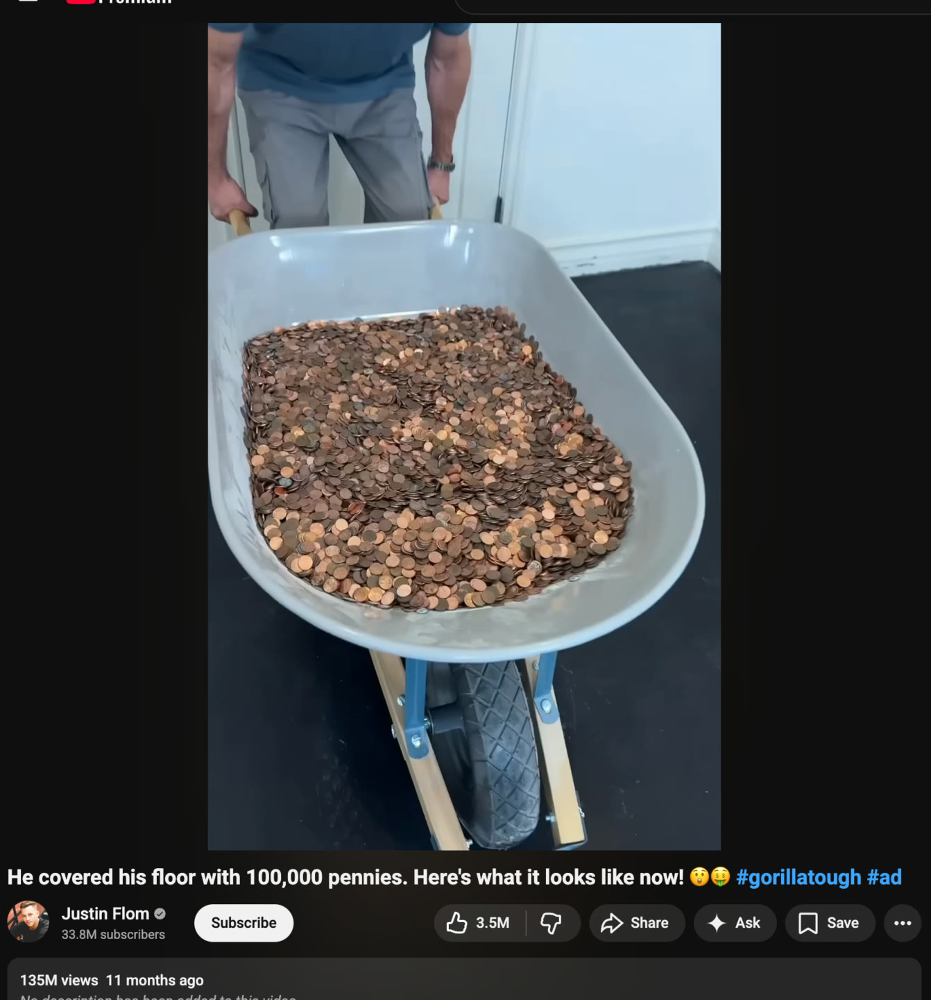
*Promise hook: "He covered his floor with 100,000 pennies. Here's what it looks like now!" (Justin Flom, #gorillatough #ad, 135M views). [03:20-04:33]*

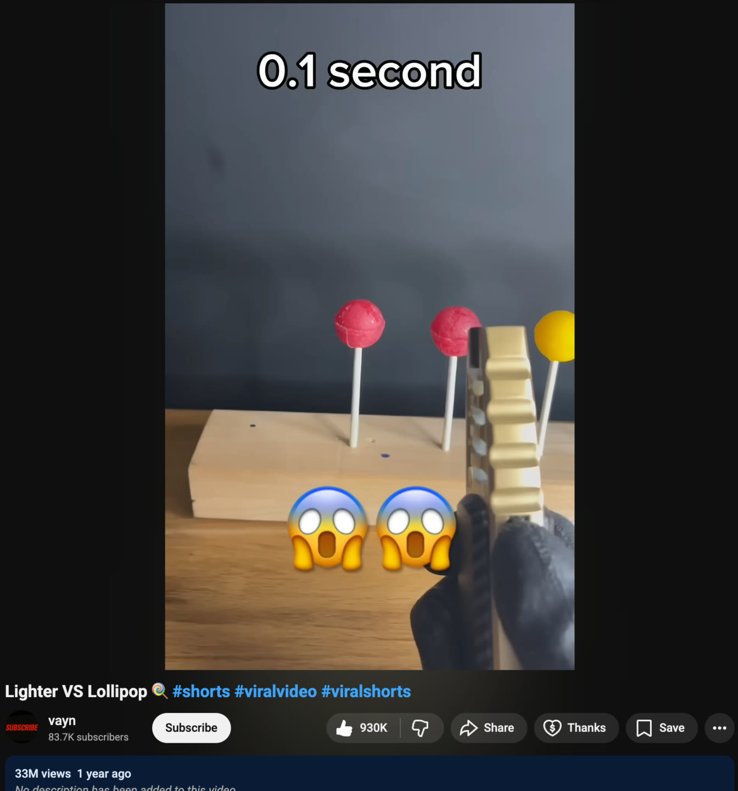
*Promise hook: "Lighter VS Lollipop", on-screen "0.1 second", 33M views. [05:20-05:57]*

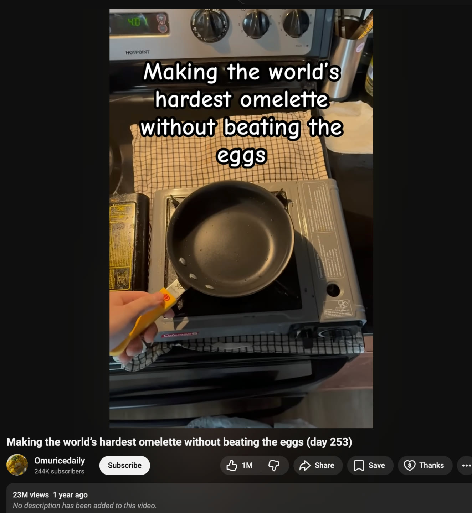
*Promise hook: "Making the world's hardest omelette without beating the eggs (day 253)", 23M views. [06:21-06:46]*

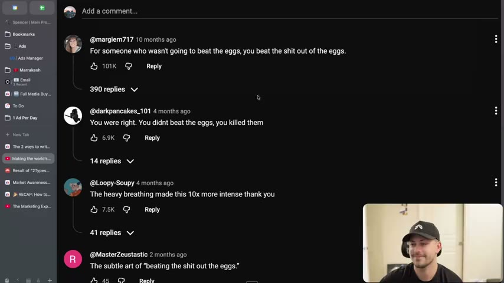
*Top comments on the omelette video ("you beat the shit out of the eggs", "You didn't beat the eggs, you killed them"): evidence that the broken promise became rage-bait engagement. [07:24]*

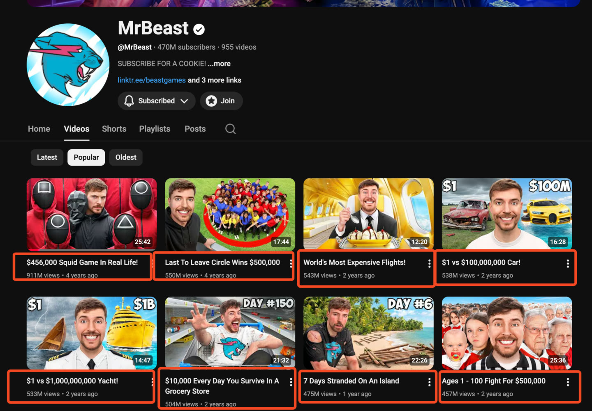
*MrBeast's most popular videos, each title a promise (boxed in red by the instructor). [08:59-09:53]*

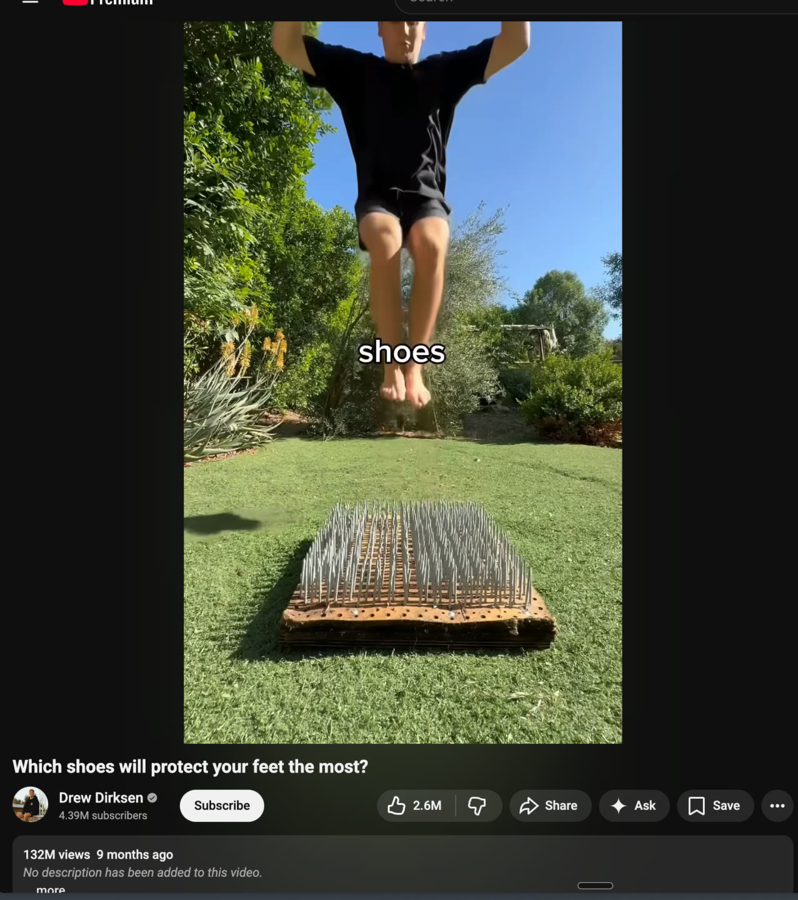
*Open loop: "Which shoes will protect your feet the most?" with a barefoot jump above a bed of nails (132M views). [10:10-11:05]*

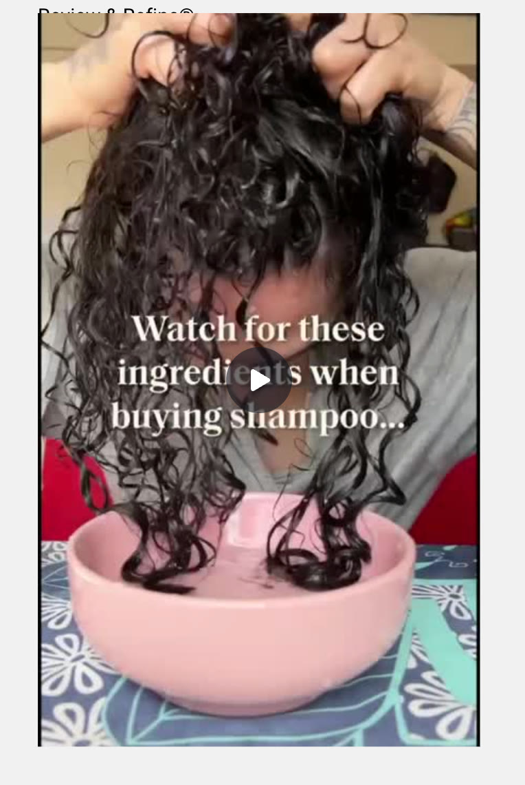
*Open loop: "Watch for these ingredients when buying shampoo..." [11:05-11:36]*

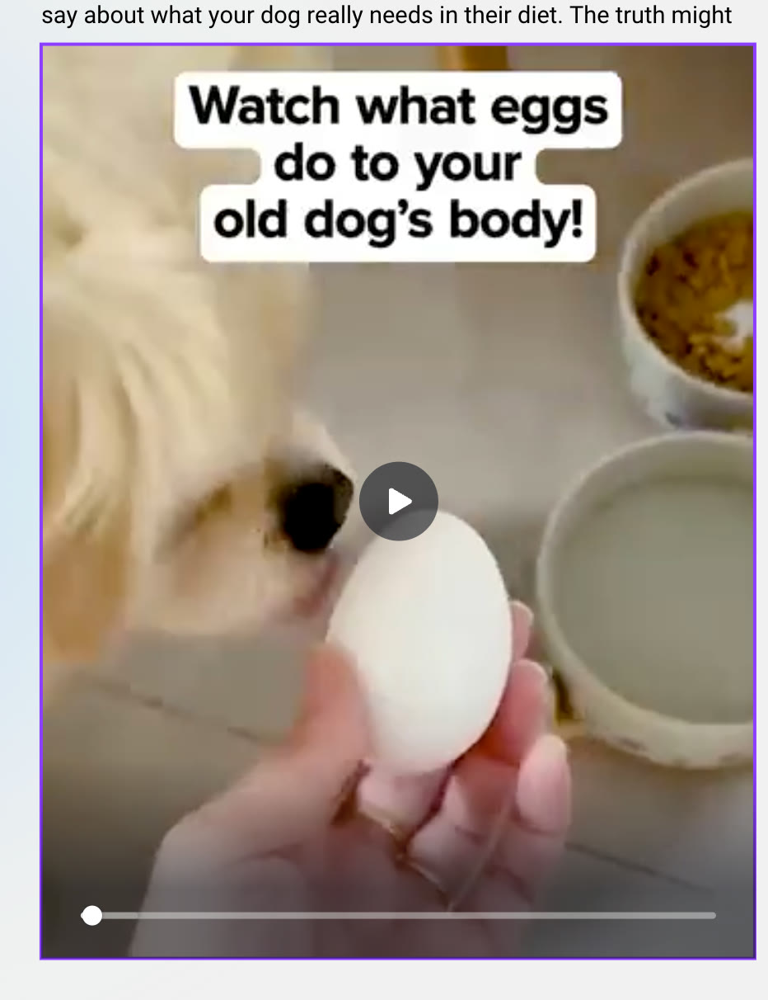
*Open loop: "Watch what eggs do to your old dog's body!" [11:36-12:01]*

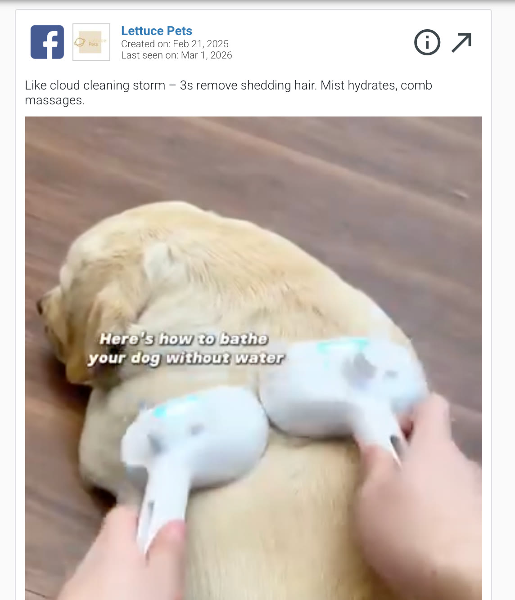
*Combined hook: "Here's how to bathe your dog without water" (Lettuce Pets, Facebook ad). [12:30-13:13]*

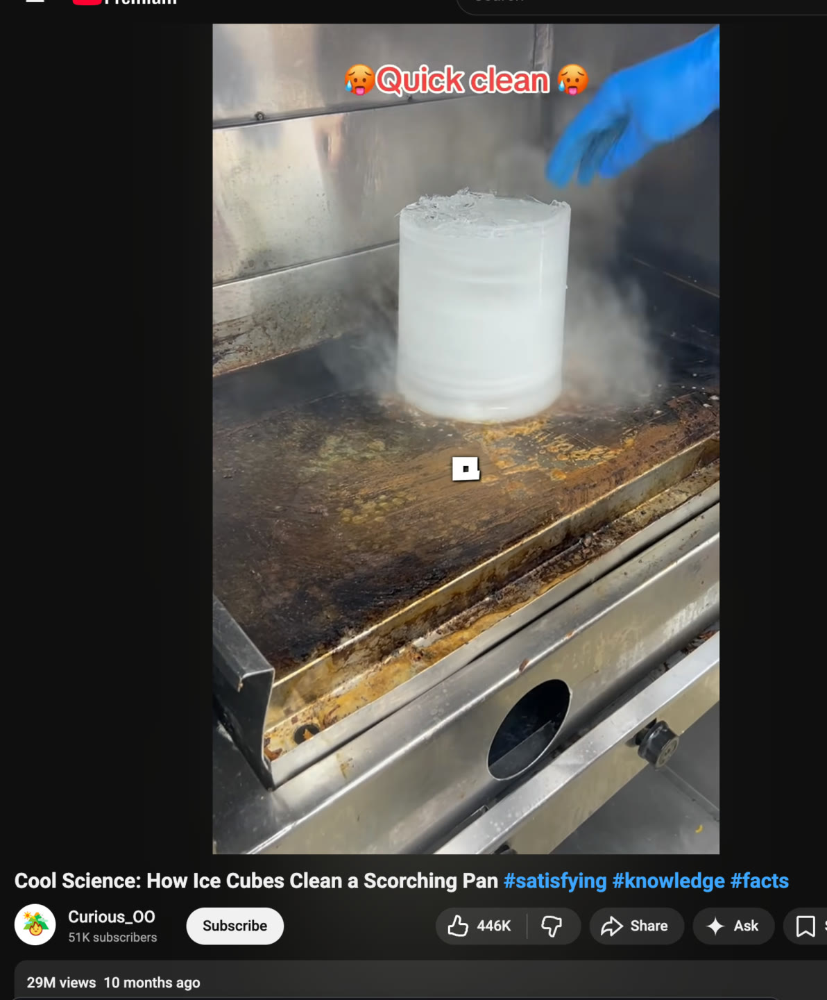
*Combined hook: "Cool Science: How Ice Cubes Clean a Scorching Pan", 29M views. [13:13-14:18]*

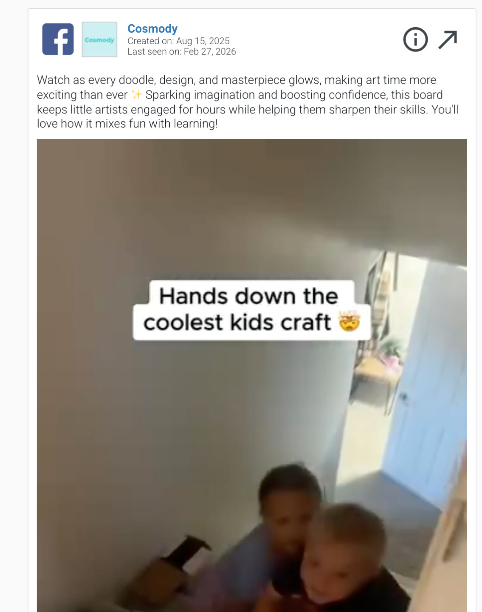
*Combined hook: "Hands down the coolest kids craft" (Cosmody Facebook ad). [14:18-14:59]*

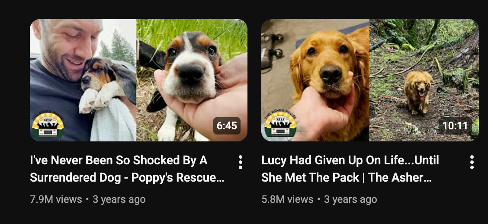
*The page exercise: which is the open loop ("I've Never Been So Shocked By A Surrendered Dog") and which the promise ("Lucy Had Given Up On Life...Until She Met The Pack")? [14:59-15:57]*

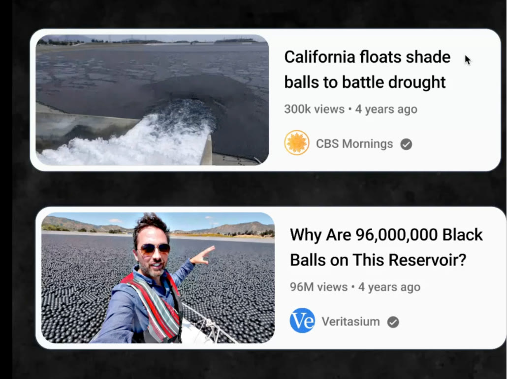
*Same story, two titles: "California floats shade balls to battle drought" (300K views) vs "Why Are 96,000,000 Black Balls on This Reservoir?" (96M views). [16:22-17:59]*

## How to apply
- [ ] For every hook idea, write both versions (promise and open loop) and label them.
- [ ] Rate the raw context 1-5 for interest. 4-5: lead with the promise. 1-3: open a loop by removing the product or key detail.
- [ ] Add one booster per open loop: juxtaposition, a danger word ("watch out"), or a high-stakes visual.
- [ ] Strip location, demographic, and purpose from the hook if the video can reveal them.
- [ ] Write the delivery beat for the first 3 seconds of the body (the thing the hook says you'll see).
- [ ] Do not subvert a promise unless it is intentional, escalated and funny; record that as a rage-bait test.
- [ ] Pull competitor hooks and classify each as promise / open loop / combined with the question it leaves in the viewer's head.

## Related
- Previous: [24. The 2 types of hooks](24-the-2-types-of-hooks.md) · Next: [26. How to write open loops](26-how-to-write-open-loops.md)
- [Risk-reduction hooks](../../../../concepts/risk-reduction-hooks.md) · [Creative primitives](../../../../concepts/creative-primitives.md)

## Sources and limitations
- Transcript: [25. The 2 ways to write great hooks… .txt](<../../../../../raw/evolve/copywriting/_transcripts/✍️ Evolve Copywriting (NEW)/25. The 2 ways to write great hooks ✍️ Evolve Copywriting (NEW) Evolve.txt>) · Page text: [….html.md](<../../../../../raw/evolve/copywriting/_extracted/✍️ Evolve Copywriting (NEW)/25. The 2 ways to write great hooks_✍️ Evolve Copywriting (NEW)_Evolve.html.md>) · 12 Skool images under `knowledge-base/raw/evolve/copywriting/linked/skool-images/25/`.
- Machine transcription (Whisper large-v3-turbo); full recording covered (last segment 18:23 = duration). "Harry" is Harry Dry (page credit); "Adley - Viralish" is credited at the end of the page. The transcript has a few "scroll"/"school" errors ("stop their school" = "stop their scroll").
- View counts are as shown on the screenshots at capture time or quoted by the instructor; the instructor says the shade-ball title got "100 million" at one point and "96 million" at another (screenshot: 96M).
- The linked YouTube/Facebook/Canva videos were not downloaded; judgements come from the screen-recorded lesson, the page text and Skool screenshots.
