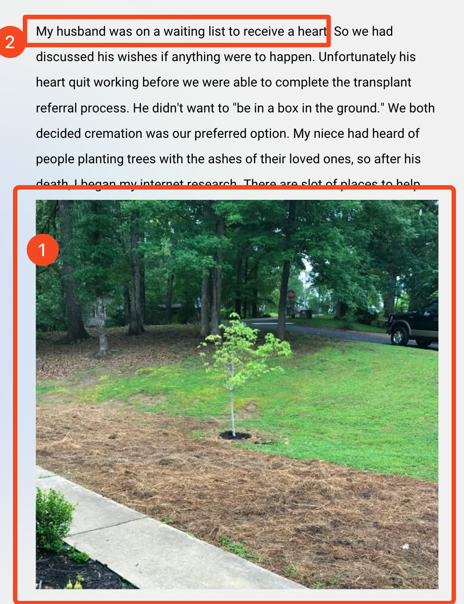
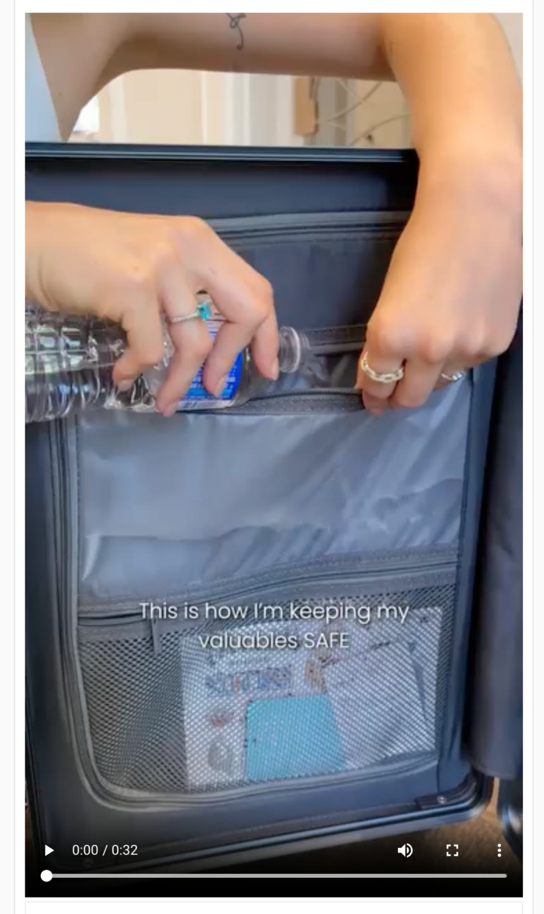
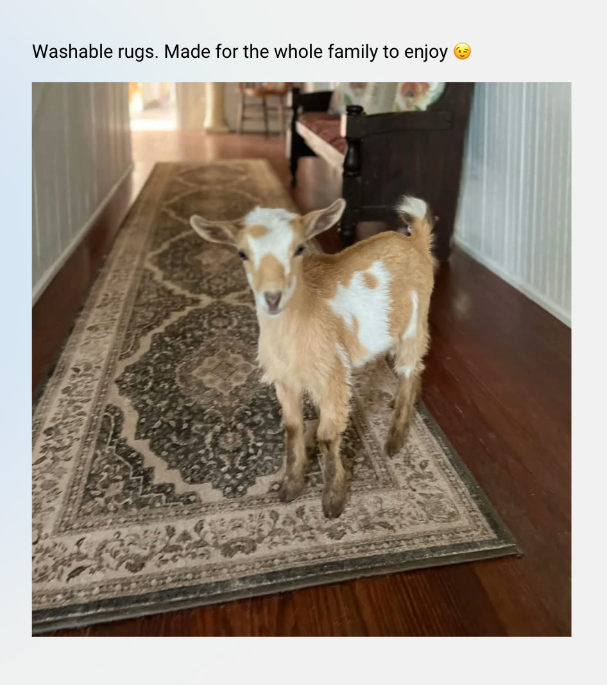
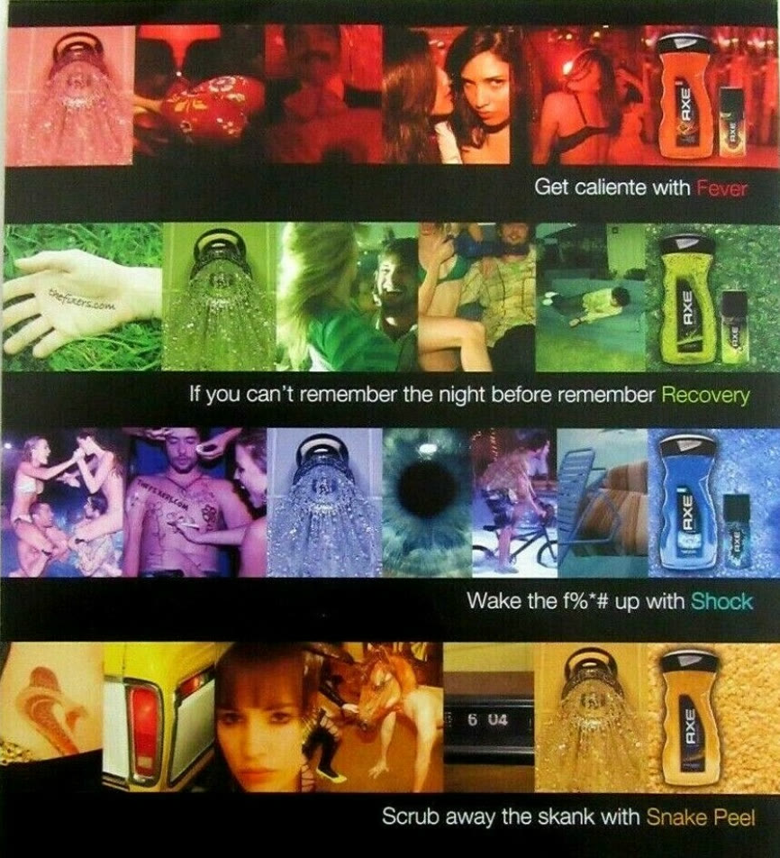
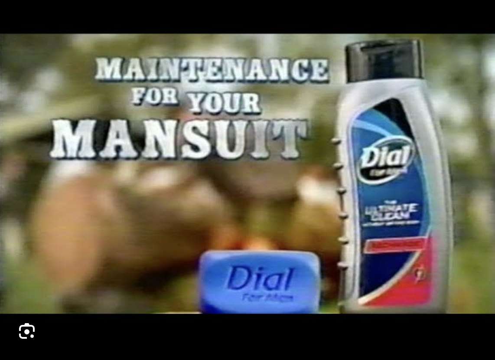
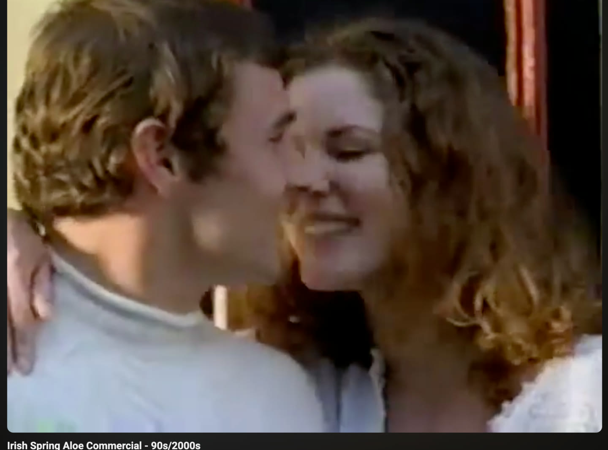
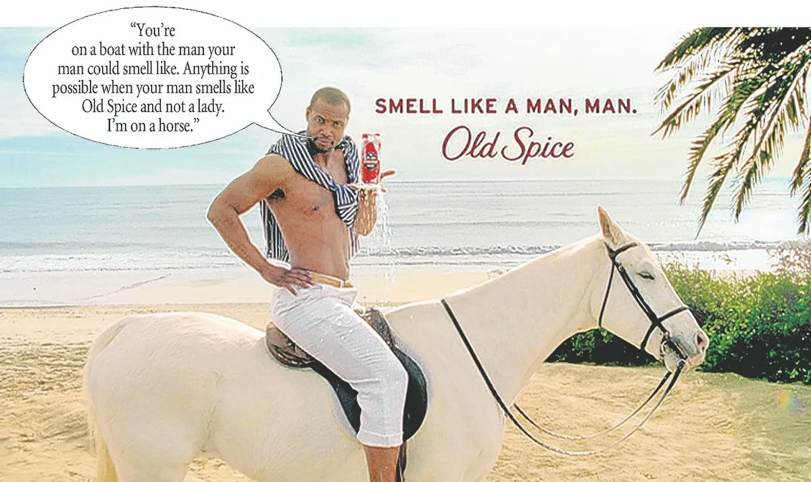
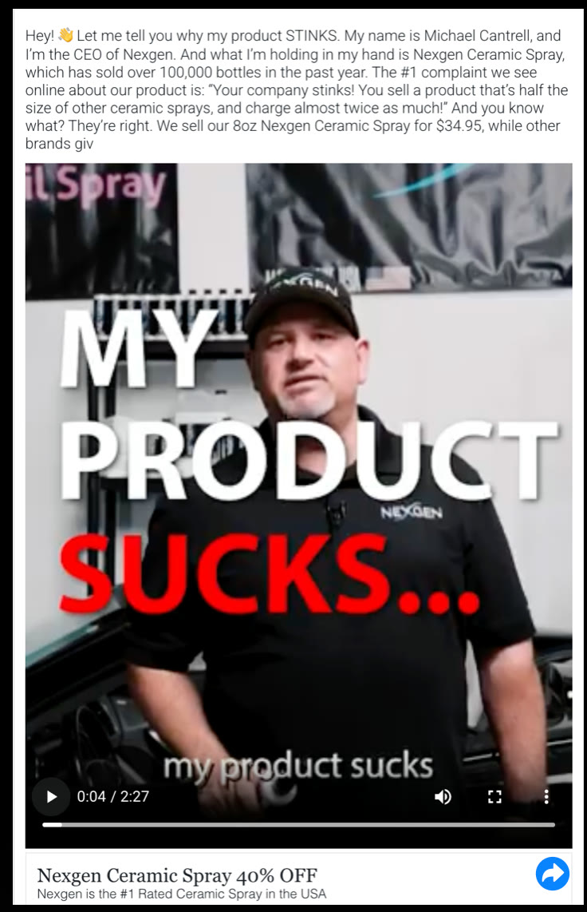

# 26. How to write open loops
> An open loop is an information gap the viewer wants to close; it is built three ways (juxtaposition / curiosity gap, ethical fear / loss aversion, and doing the opposite / pattern interrupt), opened in the first 3 seconds and closed as late as possible.

## 🤖 Agent use
- **Use when:** writing hooks, headlines, and opening beats for UGC video, image ads, and landing pages; fixing a flat hook that "just says the product is good"; planning where the payoff goes in the script.
- **Inputs → outputs:** product claim + category norms + a competitor set -> hook candidates built from (a) a hot/cold juxtaposition, (b) an ethical "watch out for" fear loop, (c) the opposite of what competitors do, each with a note on what must be paid off and when.
- **Rules:**
  - **DO** open the loop in the first 3 seconds and don't close it until the final 3 seconds (or as late as you can). "It doesn't always need to be the final three seconds", but that is how you hold the longest watch time. [00:27-01:35; page text]
  - **DON'T** close the loop the next second; "the user can then move on". Extend it with more suspense and context "in a way that isn't boring". [01:06-01:35]
  - **DO** remember the real goal: "Our goal is not watch time. Our goal is sales." Every line's job is to get the next line read. [01:47-02:22]
  - **DO** build juxtaposition from a hot and a cold: "two things together that should not go together". [02:22-03:33]
  - **DO** pair an image with a clashing line, a clip with a clashing line, or an image alone with an out-of-place subject, then **connect the two** in the ad. [05:08-07:29]
  - **DON'T** write a one-sided superlative ("the strongest coffee"): "no hot, no cold... anybody could say this." [08:11-08:45]
  - **IF** the product is a "no one else can say this" claim **THEN** frame it as a juxtaposition (Death Wish Coffee: "Live with a death wish"). [08:45-09:15]
  - **DO** use ethical fear: "Watch out for X" / "Red flags your X" / "What if everything you knew about X is wrong?" [10:40-12:30; page text]
  - **DON'T** fake or exaggerate danger: "my number one rule is just please don't be a piece of shit with this". It is short-term, and "you can get very serious legal charges" for scaring people for no reason. [09:15-09:42; 12:30-12:48]
  - **IF** everyone in the category positions the same way **THEN** do the opposite (target the other gender, admit a flaw, say what competitors never say). [12:48-15:57]
  - **DO** list what competitors say, do and target, then invert each. [14:41-15:10]
  - **DO** deliver the connection that makes the loop make sense (the suitcase water, the goat on the rug). [05:53-07:29]
- **See also:** [25. The 2 ways to write great hooks](25-the-2-ways-to-write-great-hooks.md) · [23. The framework behind great hooks](23-the-framework-behind-great-hooks.md) · [27. How to write a bridge](27-how-to-write-a-bridge.md) · [Native advertising](../../../../concepts/native-advertising.md) · [Brand enemy](../../../../concepts/brand-enemy.md) · [Hooks library](../../../../libraries/hooks.md)

## Key ideas

### 1. What an open loop is [00:00-02:22]
- "An open loop is an information gap that the reader or watcher wants to fill in their heads. You create this open task in their mind and they want to close that task." You withhold information "to create intrigue". [00:00-00:27]
- Visual: "create an itch that you don't scratch" (credit Adley, see [lesson 23](23-the-framework-behind-great-hooks.md)). Establish the itch in the first 3 seconds; don't scratch it until the final 3. [00:27-01:06; page text]
- If you close the loop at once the viewer can leave; if the loop is "significant and interesting" and you extend it by building suspense and context, "that is how you get the most effective watch time." [01:06-01:47]
- Goal is sales, not watch time, but "every single time you can get a reader to read another sentence... you are doing a good job. Eugene [Schwartz] talks about this massively": the job of one line is to get the next read. The same holds for a landing page. [01:47-02:22]

### 2. Open loop type 1: juxtaposition (aka "curiosity gap") [02:22-09:15]
- "The number one way to create open loops is juxtaposition": "two things together that should not go together." [02:22-02:47]
- "Great copywriting is just a search for juxtaposition" (Eugene Schwartz quote on the page, attributed by the instructor). [02:47]
- Harry [Dry]'s visual: **hot tap, cold tap**: "we only know hot because of cold". You need two distinct things and put them together so the viewer asks "how does that work together?" [02:47-03:33]
- **Point A -> Point Z gap:** "How a homeless person became a millionaire": broke vs millionaire, "what is this gap?" The instructor links back to the "25-year-old knows how I'm going to die" hook. [03:33-04:14]
- **Examples** (all on the page and in the video): "I quit the gym and lost 20 lbs" (people assume weight loss needs the gym); "The natural deodorant that performs like a toxic one" (natural vs toxic); "Remember everything, organize nothing"; "14+ hours, no swelling" (point A 14 hours -> point Z no swelling). [04:14-05:08]
- **Image + copy:** a photo of a young tree with the first line "My husband was on a waiting list to receive a heart". "What do these two have to do with each other?" The gap is massive and you must connect it. This is why native ads work: little context, an image clashing with a headline. (The visible text continues: his heart quit before the transplant, he wanted cremation, and the niece had heard of "planting trees with the ashes of their loved ones", so the ad appears to sell a way to turn ashes into a tree; that product is read from the screenshot, not named by the instructor.) [05:08-05:53; Skool img 26-img01]
- **Clip + copy:** a woman pours water from a bottle into a suitcase pocket under the line "This is how I'm keeping my valuables SAFE" (Skool still, 0:32 video). The instructor did not watch the rest; the best ads "connect the two together" (his guess: the pocket is waterproof so a spill won't reach valuables). Without the clip, "this is how I'm keeping my Bible safe" would be less effective. [05:53-07:00; img02]
- **Imagery alone:** a goat standing on a hallway rug; line "Washable rugs. Made for the whole family to enjoy" with a winking emoji. "A goat in a house doesn't go together"; then you get it: the rugs can be washed. "Not easy, but a very powerful thing." [07:00-07:29; img03]
- **Why it works:** "we have to pay attention to things that are unfamiliar", and two things we aren't used to seeing together "create space". "A person in his bed, the guy's in his bed... but a goat in the house, hey, a goat doesn't belong in the house." [07:29-08:11]
- **Counter-example, "The strongest coffee":** "there is no hot and cold... Everybody says this. Anybody could say this." It could work as a tested superlative claim with proof, "but as a hook, this doesn't make me want to keep watching." [08:11-08:45]
- **Death Wish Coffee: "Live with a death wish"** (rewritten by Deathwish Copy per the page): hot and cold = live and death; "no other brand can say this"; "how does this coffee allow you to live with a death wish?" [08:45-09:15]
- "Juxtapositions create space. That space is what the reader or watcher wants to continue to watch for." [09:15]

### 3. Open loop type 2: through fear, ethically (aka "loss aversion") [09:15-12:48]
- Ethics up front: "ethically" is in caps in the slide; you "can just lie", but that is short-term and "you can get very serious legal charges". [09:15-10:07]
- **Mechanism:** the subconscious alerts the conscious mind to danger "to make sure that we stay alive and that we stay safe". Analogy: locked in filming, but at a bang "I stopped everything I'm doing: what was that?" You are not making loud sounds; you communicate "potential danger ahead". [10:07-10:40]
- **Examples** (page + video): "Watch out for these ingredients when buying shampoo" ("here's the best ingredients" would get "I don't really care"; "watch out" gets "I need to make sure I'm not in danger"); "3 red flags of vitamin deficiency in kids" ("I need to watch this to make sure my kid doesn't have them"); "What if everything you knew about dandruff is wrong?" ("I need to watch this to make sure I'm not missing something"); "Watch how X stops negative thing". [10:40-11:39; page text]
- He says these are useful for product-aware ads and for unaware ads ("making people aware of specific problems"). [11:10-11:39]
- Hypothetical for this audience: "avoid making these mistakes in your ads"; "make sure you're not having brand bias": "Do I have brand bias in my ads? I better go check." [12:01-12:30]
- "We're more motivated by fear than we are by outcomes" (instructor claim). When you trigger the subconscious and genuinely help, people keep watching. [12:30-12:48]
- **My favorite hook types** (page): "Watch out for X" and "Red flags your X". **#1 rule** (page): "DON'T. BE. A. PIECE. OF. SHIT." [page text; 12:30-12:48]

### 4. Open loop type 3: do the opposite (aka "pattern interrupt") [12:48-15:57]
- "If everybody is doing the same thing, if everybody is positioning the same way, just do the opposite." Credit Harry Dry; the instructor made his own example "because I didn't want to take his". [12:48-13:28]
- **Body wash / soap case:** Axe targets men (Fever, Recovery, Shock, Snake Peel; "Get caliente with Fever", "Wake the f%*# up with Shock", "Scrub away the skank with Snake Peel" on the ad shown), Dial targets men ("Maintenance for your mansuit"), Irish Spring targets men ("keep your skin clean, get girls"; the still is from "Irish Spring Aloe Commercial - 90s/2000s"). Old Spice **targeted women**: "You're on a boat with the man your man could smell like. Anything is possible when your man smells like Old Spice and not a lady. I'm on a horse." (the Skool ad image; instructor: "this is the man that your man could smell like"). "This is a men's body wash commercial for women. Huh, interesting." [13:28-14:41; img04-07]
- Instruction: "look at what all of your competitors are doing and make a list: they say this, they do this, they go after this person. How could I do the complete opposite?" "I think not enough people do the opposite. Everybody is always copying each other." [14:41-15:10]
- **Facebook example (Nexgen Ceramic Spray):** a CEO opens with "Hey! Let me tell you why my product STINKS. My name is Michael Cantrell, and I'm the CEO of Nexgen... the #1 complaint we see online about our product is: 'Your company stinks! You sell a product that's half the size of other ceramic sprays, and charge almost twice as much!' And you know what? They're right. We sell our 8oz Nexgen Ceramic Spray for $34.95, while other brands giv[e]..." (page image, truncated). On-screen: "MY PRODUCT SUCKS... my product sucks"; footer "Nexgen Ceramic Spray 40% OFF / Nexgen is the #1 Rated Ceramic Spray in the USA"; video 2:27. Instructor: "everybody says their product's great. This guy's saying it sucks... he's just being transparent... And it's working for them." Links back to the authority lessons. [15:10-15:40; img08]
- **Anecdote (instructor claim):** a multi-nine-figure brand owner told him at the Evolve dinner: "I just look at what everybody's doing in Evolve and I just do the opposite." The instructor says it was recorded in a January podcast (Whisper heard "January of 2020"; the year is uncertain). [15:40-15:57]

### 5. Wrap-up [15:57-17:08]
- Doing the opposite and ethical fear both "open loops"; "the biggest one here that a lot of you guys need to start embracing is juxtaposition... putting two things together that should not go together. And what that will do is that will create space." [15:57-16:26]
- You can still make a promise; open loops are "a phenomenal way to maintain information and just give a little bit of information while withholding some", so the viewer watches everything "so they have enough information to actually purchase your product". [16:26-17:08]

## Steps / framework

| Step | Action | Source |
|---|---|---|
| 1 | List the claim and its "cold" opposite (e.g. natural vs toxic, quit gym vs lose weight, 14 hours vs no swelling) | [02:47-05:08] |
| 2 | Pick the loop type: juxtaposition / ethical fear / do the opposite | [02:22; 09:15; 12:48] |
| 3 | Write the hook so Point A and Point Z (or hot and cold) sit in one line | [03:33-05:08] |
| 4 | Decide the visual: image vs copy, clip vs copy, or imagery alone | [05:08-07:29] |
| 5 | Place the payoff at the end of the video/ad, not in the next sentence | [00:55-01:35] |
| 6 | Make sure the connection is actually delivered (why water in the suitcase; why the goat) | [05:53-07:29] |
| 7 | For fear loops: make sure the danger is real and the video helps the viewer avoid it | [09:15-09:42; 12:48] |
| 8 | For opposite loops: list competitor says/does/targets and invert one | [14:41-15:10] |

Three-way summary:

| Loop type | Alias on slide | Mechanism | Key phrase | Risk |
|---|---|---|---|---|
| Juxtaposition | "Curiosity gap" | Two things that should not go together; hot + cold | "Live with a death wish" | Superlatives with no contrast are flat |
| Through fear, ethically | "Loss aversion" | Subconscious danger check | "Watch out for X", "Red flags your X" | Legal/trust risk if dishonest |
| Do the opposite | "Pattern interrupt" | Break category conventions | "Why my product sucks", Old Spice to women | Must still be true to the brand |

## Examples
See tables. Quick before -> after (the instructor's own): "the strongest coffee" -> "Live with a death wish"; "best ingredients for shampoo" -> "Watch out for these ingredients when buying shampoo". [08:11-09:15; 10:40-11:10]

## Structured units

### Hooks
| Hook | Heuristic(s) | Emotion / zone | Self targeted | Why it works | Source |
|---|---|---|---|---|---|
| "How a homeless person became a millionaire" | Juxtaposition, point A -> Z | Curiosity/hope (derived) | — | Broke vs millionaire creates a gap | [03:33-04:02] |
| "I quit the gym and lost 20 lbs" | Juxtaposition | Curiosity | — | Weight loss is assumed to need the gym | [04:14-04:40] |
| "The natural deodorant that performs like a toxic one" | Juxtaposition (natural / toxic) | Curiosity | — | "How is that possible?" | [04:14-04:40] |
| "Remember everything, organize nothing" | Juxtaposition (everything / nothing) | Curiosity | — | Two things that do not go together | [04:14-04:40] |
| "14+ hours, no swelling" | Juxtaposition, A -> Z | Curiosity | — | 14 hours (A) to no swelling (Z) | [04:40-05:08] |
| Tree photo + "My husband was on a waiting list to receive a heart" | Image/copy juxtaposition (native) | Grief/curiosity (derived) | — | Photo and line clash; connection must be made | [05:08-05:53; img01] |
| Water poured into a suitcase + "This is how I'm keeping my valuables SAFE" | Clip/copy juxtaposition | Curiosity | — | Why pour water? How does that protect valuables? | [05:53-07:00; img02] |
| Goat on rug + "Washable rugs. Made for the whole family to enjoy" | Imagery juxtaposition | Amusement | Parent/pet owner (derived) | Goat in the house, then the washable-rug punchline | [07:00-07:29; img03] |
| "Live with a death wish" (Death Wish Coffee) | Juxtaposition (live / death), ownable | Edge/curiosity | — | "No other coffee brand can say this" | [08:45-09:15] |
| "Watch out for these ingredients when buying shampoo" | Loss aversion, danger | Fear | — | "Watch out" triggers a danger check; "best ingredients" is ignorable | [10:40-11:10] |
| "3 red flags of vitamin deficiency in kids" | Loss aversion | Fear/concern | Parent | "Make sure my kid doesn't have them" | [11:10-11:39] |
| "What if everything you knew about dandruff is wrong?" | Loss aversion, belief challenge | Doubt | — | "I need to make sure I'm not missing something" | [11:39-12:01] |
| "Avoid making these mistakes in your ads" / "Make sure you're not having brand bias" (instructor's hypotheticals for marketers) | Loss aversion | Concern | — | "Do I have brand bias? I better check" | [12:01-12:30] |
| "Hey! Let me tell you why my product STINKS..." / "MY PRODUCT SUCKS..." (Nexgen Ceramic Spray) | Pattern interrupt, transparency, anti-hook | Surprise | — | Opposite of "my product is great"; handles a price/size objection | [15:10-15:40; img08] |
| "You're on a boat with the man your man could smell like..." (Old Spice) | Pattern interrupt (target the other gender) | Amusement | Female buyer of men's products (derived) | Men's body wash ad aimed at women | [14:18-14:41; img07] |

### Angles
| Angle | Core desire / pain | Heuristic(s) | Best format | Example line | Source |
|---|---|---|---|---|---|
| Opposite targeting (market to the buyer's partner) | Women buy men's grooming | Pattern interrupt | Video/TV-style ad | "The man your man could smell like" | [14:18-14:41] |
| Radical transparency about a flaw | Trust; handling price/size objection | Pattern interrupt | Founder video | "Let me tell you why my product stinks" | [15:10-15:40] |
| Danger checklist | Avoid harm to self/child/pet | Loss aversion | Short video/static | "3 red flags of vitamin deficiency in kids" | [11:10-11:39] |

### Ad teardowns
| Brand / product (niche) | Format | Hook / opening | What works | What fails | Fix suggested | Principle | Source |
|---|---|---|---|---|---|---|---|
| Axe body wash (grooming) | Print/TV | "Get caliente with Fever", "Wake the f%*# up with Shock" | Category convention: get girls | Sameness across competitors (instructor's framing) | Do the opposite | Do the opposite | [13:28-13:48; img04] |
| Dial for men (grooming) | TV | "Maintenance for your mansuit" | Funny, manly-man parody | Targets men like others | — | Do the opposite (context) | [13:48-14:18; img05] |
| Irish Spring (grooming) | TV | Couple; "keep skin clean, get girls" | — | Same man-targeted pitch | — | Do the opposite (context) | [13:48-14:18; img06] |
| Old Spice (grooming) | TV/print | "The man your man could smell like" | Targets women; breaks the category | — | — | Do the opposite | [14:18-14:41; img07] |
| Nexgen Ceramic Spray (car care) | Facebook video ad, CEO to camera, 2:27 | "My product sucks..." | Transparency; frames the objection ("half the size, almost twice the price") then answers | Unknown (ad truncated) | — | Do the opposite | [15:10-15:40; img08] |
| Suitcase organiser/pocket (travel) | Video | Water pouring into suitcase; "This is how I'm keeping my valuables SAFE" | Clip + copy juxtaposition | Brand not shown; payoff not watched by the instructor | Connect the two (waterproof pocket) | Juxtaposition | [05:53-07:00; img02] |
| Washable rug brand (home) | Static | Goat on rug; "Washable rugs. Made for the whole family to enjoy" | Imagery juxtaposition then payoff | — | — | Juxtaposition | [07:00-07:29; img03] |
| Death Wish Coffee | Headline | "The strongest coffee" -> "Live with a death wish" | Rewrite adds hot/cold and ownability | "Strongest coffee" has no juxtaposition | Rewrite per Deathwish Copy | Juxtaposition | [08:11-09:15] |

### Rewrites
| Before | After | What changed | Source |
|---|---|---|---|
| "The strongest coffee" | "Live with a death wish" (Death Wish Coffee) | Superlative -> contrast (live / death); ownable | [08:11-09:15] |
| "Here's the best ingredients for shampoo" | "Watch out for these ingredients when buying shampoo" | Benefit list -> danger loop | [10:40-11:10] |
| "Axe: get girls" men's body wash ad | Old Spice "the man your man could smell like" aimed at women | Target flipped (men -> women) | [13:28-14:41] |
| "My product is great" (category norm) | "Let me tell you why my product stinks" | Boast -> admitted flaw + answer | [15:10-15:40] |
| "How I'm keeping my Bible safe" (text only) | Same line over water poured into a suitcase | Added clashing clip to create a gap | [06:41-07:00] |

### Templates
| Template | Use for | Example fill | Source |
|---|---|---|---|
| "[Two opposite words]" in one claim ("[natural] ... [toxic]") | Hot/cold juxtaposition headline | "The natural deodorant that performs like a toxic one" | [04:14] |
| "I [quit the thing people assume is required] and [got the result]" | Counter-assumption loop | "I quit the gym and lost 20 lbs" | [04:02-04:14] |
| "[Time/effort A], no [problem Z]" | A -> Z gap | "14+ hours, no swelling" | [04:40-05:08] |
| "How a [low status] became a [high status]" | Rags-to-riches gap | "How a homeless person became a millionaire" | [03:33] |
| "Live with a [dangerous word]" | Ownable contrast | "Live with a death wish" | [08:45] |
| "Watch out for these [X] when buying [Y]" | Fear loop | "Watch out for these ingredients when buying shampoo" | [10:40] |
| "[N] red flags [your X / of Y in kids]" | Fear loop | "3 red flags of vitamin deficiency in kids" | [11:10] |
| "What if everything you knew about [X] is wrong?" | Belief-challenge fear loop | "...about dandruff is wrong?" | [11:39] |
| "Watch how [X] stops [negative thing]" | Fear/curiosity loop | (page text) | [page text] |
| "Let me tell you why my [product] [stinks/sucks]" | Opposite/transparency | Nexgen CEO ad | [15:10] |
| "[Image: out-of-place subject] + [line that explains it later]" | Imagery juxtaposition | Goat + washable rugs | [07:00] |

### Rules of thumb
- **DO** open in 3 seconds, close in the last 3. [00:27-01:06]
- **DO** use hot + cold in every hook; "we only know hot because of cold". [02:47-03:16]
- **DON'T** lie or fear-monger; legal and trust cost. [09:15-09:42]
- **IF** every competitor does X **THEN** invert it. [12:48-15:10]

## Prompts / templates (verbatim)
Page text:
```
It is an information gap that the reader/watcher wants to "fill" in their head
You create an open "task" in their mind, and they want to close that task
Again, you are WITHHOLDING information to create intrigue.
You need to create an itch/open a loop in the first 3 seconds
Then do NOT scratch it/close that loop until the final 3 seconds.

#1 - Open Loops: Juxtaposition (aka "Curiosity gap")
Juxtaposition --> 2 things together that SHOULD NOT go together
"Great Copywriting is just a search for juxtaposition" - Eugene Schwartz
How can you create a HOT tap and a COLD tap
We only know HOT because of COLD
Examples:
* How a homeless person became a millionaire (We have a point A. (broke) -> Point Z (millionaire), which creates a gap and AKA opens a loop)
* I quit the gym and lost 20 lbs (how does someone quit the gym and lose weight??)
* "The natural deodorant that performs like a toxic one" (natural + toxic)
* "Remember everything, organize nothing" (everything + nothing)
* "14+ Hours, no swelling" (we have point A (14 hours) --> Point Z (no swelling) which creates a gap for how that's possible
* Juxtaposing images & copy (tree --> receive a heart?)
* Juxtaposing clips & copy (pouring water in suit case? --> keeping valuables safe?)
* Juxtaposing with just imagery (goat --> in house?)
Juxtaposition piques our interest because we have to pay attention to things that are unfamiliar.
"The strongest coffee" - There is no HOT & COLD. There is no juxtaposition. Everybody says this
But when deathwish copy rewrites: "Live with a death wish" - Death Wish Coffee
There is a hot & cold (live & death). There is a juxtaposition. No other coffee brand can say this
Juxtapositions create space... That SPACE is what the reader wants to CONTINUE watching for.

#2 - Open Loops: Through Fear ETHICALLY (aka "Loss aversion")
You can also stop hooks by focusing on triggering more of the subconscious.
The subconscious is on conscious alert to make sure that we stay alive and that we are safe
It's why you could be completely focused on something, but as soon as you hear a loud noise
You immediately alert to what is going on, and your survival instincts kick in
You can trigger this side of the brain by focusing on communicating to it and instigating that there is potential danger ahead
* "Watch out for these ingredients when buying shampoo" (watch out = I need to make sure I'm not in danger)
* "3 Red flags of vitamin deficiency in kids" (I need to watch this to make sure my kid doesn't have one of them)
* "What if everything you knew about dandruff is wrong?" (I need to watch this to make sure I'm not missing something)
* "Watch how X stops negative thing" (How does this stop this?)
My Favorite Hook Types:
"Watch out for X"
"Red flags your X"
#1 RULE --> DON'T. BE. A. PIECE. OF. SHIT.

#3 - Open Loops: Do The Opposite (aka "Pattern interrupt")
If everybody is doing the same thing
If everybody is positioning the same way
Just do the OPPOSITE
Axe: Targeting Men (get girls)
Dial: Targeting Men (mansuit)
Irish Springs: Targeting men (keep skin clean, get girls)
Old Spice: Targeting women (the man your man could smell like)
Facebook Example: [Nexgen image]
```

## Screenshots

*Image + copy juxtaposition: a young tree (numbered 1) with the first line "My husband was on a waiting list to receive a heart" (numbered 2). The numbered boxes are the course's annotation. [05:08-05:53]*


*Clip + copy juxtaposition: pouring water into a suitcase pocket under "This is how I'm keeping my valuables SAFE". [05:53-07:00]*


*Imagery juxtaposition: a goat on a rug with "Washable rugs. Made for the whole family to enjoy". [07:00-07:29]*


*Axe ad (targets men, "get girls"): Fever, Recovery, Shock, Snake Peel. The category convention to invert. [13:28-13:48]*


*Dial for Men: "Maintenance for your MANSUIT". Still targets men. [13:48-14:18]*


*Irish Spring Aloe commercial (90s/2000s) still. Targets men. [13:48-14:18]*


*Old Spice: "You're on a boat with the man your man could smell like..." The opposite move: speak to women. [14:18-14:41]*


*Nexgen Ceramic Spray Facebook video ad: CEO and "MY PRODUCT SUCKS..." with transparent price/size admission. Do the opposite of "my product is great". [15:10-15:40]*

## How to apply
- [ ] For each hook, write the "hot" and "cold" words; if one is missing, rewrite.
- [ ] Write one juxtaposition, one ethical-fear, and one do-the-opposite hook per angle; test them against each other.
- [ ] For fear hooks, confirm the danger is accurate and that the video resolves it; log the claim substantiation.
- [ ] Build the opposite list: for the top 5 competitors, record what they say/do/target, then write the inversion.
- [ ] Specify the payoff timestamp in the script (open by 0:03, close in the final seconds).
- [ ] For clip/image + copy hooks, write the connecting line that explains the clash.
- [ ] Check that no hook is a bare superlative with no contrast.

## Related
- Previous: [25. The 2 ways to write great hooks](25-the-2-ways-to-write-great-hooks.md) · Next: [27. How to write a bridge](27-how-to-write-a-bridge.md)
- [Brand enemy](../../../../concepts/brand-enemy.md) · [Risk-reduction hooks](../../../../concepts/risk-reduction-hooks.md) · [Skeptic format](../../../../frameworks/skeptic-format.md)

## Sources and limitations
- Transcript: [26. How to write open loops… .txt](<../../../../../raw/evolve/copywriting/_transcripts/✍️ Evolve Copywriting (NEW)/26. 1️⃣ - How to write open loops ✍️ Evolve Copywriting (NEW) Evolve.txt>) · Page text: [….html.md](<../../../../../raw/evolve/copywriting/_extracted/✍️ Evolve Copywriting (NEW)/26. 1️⃣ - How to write open loops_✍️ Evolve Copywriting (NEW)_Evolve.html.md>) · Skool images 26-img01 to 26-img08 under `knowledge-base/raw/evolve/copywriting/linked/skool-images/26/`.
- Machine transcription (Whisper large-v3-turbo); full recording covered (last segment 17:08 = duration). Whisper writes "Death Wish Copy"/"deathwish copy" for the copywriter/agency the page credits for the rewrite, "All Spice" for Old Spice, "Iris Springs" for Irish Spring, "not selling" for "no swelling", and "January of 2020" for an uncertain date. The instructor says "Eugene" for Eugene Schwartz; the slide quote is attributed to "Eugene Schwartz".
- The suitcase video and Nexgen ad were not fully available; only a still and caption exist in the course files. The instructor says he will "link" the Dial and suitcase ads; the links are in the Skool page as images only.
- "More motivated by fear than outcomes" and the multi-nine-figure dinner anecdote are instructor claims without data.
