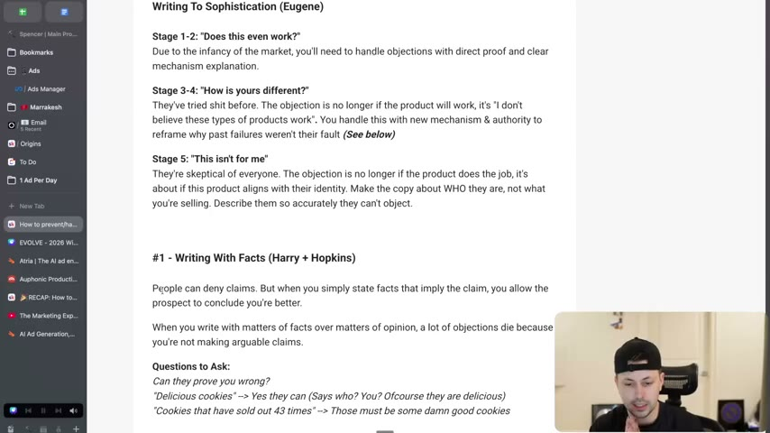
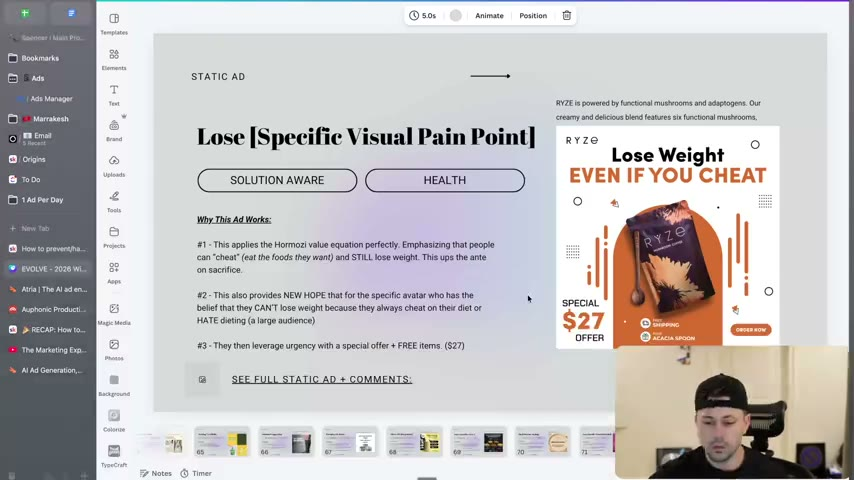
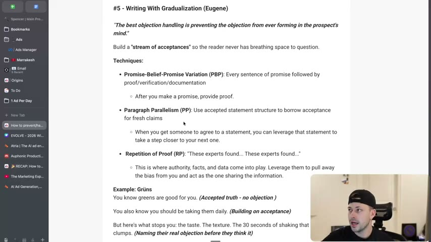
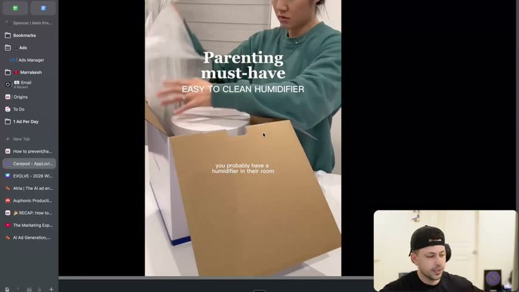

# 28. How to prevent/handle objections in writing
> Identify objections in three buckets (product/market, claim, avatar/belief) and handle them with five techniques (facts, reversals, "because", reassigning the objection, gradualization) matched to the bucket and to the market's sophistication stage; price objections are never defended, only reframed.

## 🤖 Agent use
- **Use when:** writing the body of a UGC script or static ad after hook and bridge; reviewing a competitor ad for how it disarms doubt; building an objection list and mapping each to a line of copy; writing a price/offer section.
- **Inputs → outputs:** customer-research objections + claims + market sophistication stage + available proof/mechanism -> for each objection, its bucket, the best technique, and a written line (and which beat of the script it goes in).
- **Rules:**
  - **DO** aim to prevent objections, not just handle them: "write a copy that's so good that you can just prevent them from happening in the first place." [00:00-00:29]
  - **DO** classify each objection first: product/market ("tried it before / this category doesn't work"), claim ("don't believe your promise / too good to be true"), avatar/belief ("not for me / I'm not X enough"). [00:29-03:20]
  - **DO** research the real objections; "you at least need to understand" that in stages 3-5 there are standard objections by sophistication stage. [03:20-03:50]
  - **IF** stage 1-2 **THEN** answer "does this even work?" with direct proof and a clear mechanism explanation (and authority). [03:50-04:18]
  - **IF** stage 3-4 **THEN** answer "how is yours different?" with a new mechanism and an authority that reframes why past failures weren't the customer's fault (use "because" or reassigning). [04:18-05:15]
  - **IF** stage 5 **THEN** make the copy about who they are ("This isn't for me" is the objection); lean into identity marketing and positioning. [05:15-06:14]
  - **DO** write with facts rather than opinions: "Can they prove you wrong?" If yes, it is an arguable claim. [07:06-07:35]
  - **DON'T** invent facts ("sold out five times" when it isn't): "that re-sophisticates the market." Only state facts that are "100% true" and verifiable. [08:28-09:03]
  - **DO** for avatar objections, write a reversal: make the objection the selling point ("Lose weight even if you cheat"). [09:03-11:54]
  - **DO** attach a reason to each claim with "because": "a mini proof bridge". Better logic = better handling. [11:54-15:48]
  - **DO** reassign: "remove the blame from the original generalized thing... and place it on a different target" (capsule, grain fillers). "You can't tell people that their objections are wrong." [15:48-20:22]
  - **DON'T** lecture or stack stats: "if your customer is confused and they can tell you're trying too hard to sell them, then you lose them." [20:22-21:09]
  - **DO** build a stream of acceptances (gradualization): promise-belief-promise, paragraph parallelism, repetition of proof. [23:49-26:34]
  - **DO** let authorities state the claims; the narrator only passes along information. [26:04-27:37]
  - **DON'T** defend price. "Always reframe what they're buying" (daily breakdown, expensive comparison, desire reframe). [33:17-37:00]
- **See also:** [27. How to write a bridge](27-how-to-write-a-bridge.md) · [21. Being aware of market awareness](21-being-aware-of-market-awareness.md) · [14. Why you need to use unique mechanisms](14-why-you-need-to-use-unique-mechanisms.md) · [10. Why you need to write facts](10-why-you-need-to-write-facts.md) · [Skeptic format](../../../../frameworks/skeptic-format.md) · [Validation over authority](../../../../concepts/validation-over-authority.md) · [Risk-reduction hooks](../../../../concepts/risk-reduction-hooks.md)

## Key ideas

### 1. How to identify objections: three types [00:29-03:20]
| Type | Meaning | Examples on the page | Source |
|---|---|---|---|
| 1. Product/market objections | "I've tried this product before and it didn't work" / "this category doesn't work" | "Tried before, didn't work" / "Category doesn't work" | [00:29-01:27] |
| 2. Claim objections | They don't believe your promise or it "sounds too good to be true"; they may know the category but doubt that your product does more than the one they liked | "Don't believe your promise" / "Sounds too good to be true" | [01:27-02:26] |
| 3. Avatar objections (belief) | "I'm not that type of person / this won't work for me" about themselves, unrelated to the product or claim | "I'm not X enough" / "This won't work for ME" | [02:26-03:20] |

- Instructor's example for avatar/belief: someone could believe your car-fixing product works but think "I shouldn't be anywhere near fixing a car because I don't know anything about it." [02:55-03:20]
- Questions to ask on the page: "What are customers' objections about the products?" / "What are the objections on your claims?" / "What are their personal objections? (their own beliefs)".

### 2. Writing to sophistication (Eugene Schwartz stages) [03:20-06:14]
| Stage | Objection | How to handle | Source |
|---|---|---|---|
| 1-2 | "Does this even work?" | Direct proof, clear mechanism explanation, authority. He cites a current new-product brand as the example. | [03:50-04:18] |
| 3-4 | "How is yours different?" ("They've tried shit before") | New mechanism and authority to reframe why past failures weren't their fault; use because / reassigning. The objection is no longer "does it work" but "I don't believe these types of products work". | [04:18-05:15] |
| 5 | "This isn't for me" | Identity marketing: "Make the copy about WHO they are, not what you're selling. Describe them so accurately they can't object." (page). Shoes/apparel/jewelry examples; Kizik is a case where a unique mechanism still matters (covered in the show-don't-tell module). | [05:15-06:14; page text] |

### 3. #1 Writing with facts (credit Harry [Dry]; he thinks it may come from Claude Hopkins) [06:14-09:03]
- "People can easily deny your claims... But when you simply state facts that imply a claim, you allow the prospect to create their own assumption and form their own opinions." "When you write with matters of fact over matters of opinion, objections die because you're not making arguable claims." [06:14-07:06]
- **New Balance:** "Worn by supermodels in London and dads in Ohio." "What are you going to argue with about that? ... They just stated a fact." The reader concludes the brand is diverse. [07:06-07:35]
- **Test:** "Can they prove you wrong?" "Delicious cookies": yes ("says who? You?"); "Cookies that have sold out 43 times": "those must be some damn good cookies." [07:35-07:58]
- **CarePod case:** "Some of our best ads were 'this is sold out seven or eight different times now.'" People who had never heard of the brand thought "why is this sold out eight times? This must be pretty good." (instructor claim) [07:58-08:28]
- **Warning:** if you make up a fact ("we've sold out five times"), "that re-sophisticates the market." Use facts that are 100% true and checkable (like Googling the New Balance line). [08:28-09:03]

### 4. #2 Writing reversals (credit Caples) [09:03-11:54]
- "Whatever the person's biggest objection is, you essentially just make that the selling point. You're not fighting the objection, you're agreeing with them and then solving it. You show your product was designed specifically for people with that objection." [09:03-09:27]
- **Grüns (gummy greens):** claim "The easiest way to get your kids to take their greens"; objection "My kids will know their greens and won't like them" (avatar); reversal "Kids know their greens and still love them!" [09:27-10:16]. He notes a pure fact might beat this claim headline. [09:27-09:56]
- **Red light therapy mask:** claim "This mask will tighten your skin"; objection "My skin is too damaged"; reversal "Tightens even the most damaged skin." [10:16-11:06]
- **Ryze static ad: "Lose Weight Even If You Cheat":** "You want to lose weight, but you believe you can't because you cheat on your diets... we've just reversed it: even if you cheat, we made this for people who cheat." On screen, the winning-ads deck card is labelled "STATIC AD / Lose [Specific Visual Pain Point] / SOLUTION AWARE / HEALTH" with "Why This Ad Works": #1 "applies the Hormozi value equation perfectly. Emphasizing that people can 'cheat' (eat the foods they want) and STILL lose weight. This ups the ante on sacrifice"; #2 "NEW HOPE that for the specific avatar who has the belief that they CAN'T lose weight because they always cheat on their diet or HATE dieting (a large audience)"; #3 "They then leverage urgency with a special offer + FREE items ($27)". The ad shows "RYZE... Special $27 offer". [11:06-11:54; frame 11:21]
- Reversals work "really, really well for avatar-specific objections". [10:44-11:06]

### 5. #3 Writing with "because" (credit Cialdini) [11:54-15:48]
- "People are way more open to believing what you have to say if there is a reason." The "because" creates "a mini proof bridge". [11:54-12:45]
- Applied to the Grüns claim: "...the easiest way to get your kids to take their greens because they love them even though they know that they're healthy for them." [12:45-13:14]
- **Mushroom coffee** (product objection): claim "Our mushroom coffee tastes like real coffee"; objection "I've tried mushroom alternatives, they don't taste like real coffee"; response "This coffee actually tastes like the real thing because we use decaf java bean extract. It has all the same coffee flavor, without the caffeinated crash." The instructor notes the reason is "made up" for illustration; "the more logical and the better your reason is, the better it will handle the objection." It follows promise -> proof -> promise (PBP). [13:14-14:38]
- **Easy-to-clean humidifier** (claim objection): claim "This is the world's easiest-to-clean humidifier"; objection "It can't be that easy to clean"; response "It's so easy to clean because it's made of stainless steel so you can just throw it right in the dishwasher." (He notes a duplicated phrase on the page: "proof your copy".) [14:38-15:48]
- Pattern: "whatever your claim is, just say 'because of this'"; also for the mask: "it tightens even the most damaged skin because this uses red light therapy that goes deeper than surface creams." [15:02-15:48]

### 6. #4 Reassigning the objection [15:48-21:09]
- Idea: give prospects "permission to try again" by redirecting the objection to something else instead of the broad assumption. [15:48-16:15]
- Why: "our brain likes to categorize". After one failed pee pad or gut-health supplement the brain generalises: "gut health supplements don't work". [16:15-16:44]
- You "disarm" it: "this objection you have is valid, but it actually is valid on just this thing specifically." "You're removing the blame from the original generalized thing... and placing it on a different target." "You can't tell people that their objections are wrong. You just have to break it down so we're on the same team." [16:53-17:52]
- **Gut-health probiotic** (product objection): claim "This probiotic actually works"; objection "I've taken probiotics before and nothing changed"; response "Most probiotics fail because they die in your stomach acid before reaching your intestines. These survive because of the delayed-release capsule, which is why clinical studies show 8x better colonization rates." New target: "The capsules were the issue, not the probiotics". [17:52-18:50]
- **Premium dog food** (product objection): claim "Your dog will actually eat this"; objection "I've tried premium dog foods. My dog still had digestive issues"; response "If you check the ingredients on other premium dog brands, a lot still use grain fillers that dogs can't digest. This is 80% real meat with zero grain fillers." New target: "Grain fillers were the issue, not premium dog food." The instructor says it may not be the best copy. [18:50-19:57]
- **Caution:** don't over-tactical: "stats, stats, stats... language that's hard to read"; "you can get very lecture heavy". Reassigning "does take a skillset". [20:22-21:09]
- (The numbers in these examples are illustrative page examples, not verified data; e.g. "8x better colonization rates".)

### 7. Which technique for which objection [21:09-23:49]
Ranked "from most effective to least effective" within each type, per the page and instructor:

| Objection type | Best techniques (in order given) | Doesn't work | Source |
|---|---|---|---|
| Product/market | Reassigning (blame the real villain, not the category) -> Facts (specific differentiation from what failed) -> Because (explain why this time is different) -> Reversals (position as the reason you made it) | — | [21:09-22:12] |
| Claim | Facts (visual, falsifiable, ownable proof) -> Because (mechanism validates the claim) -> Reassigning (only if explaining why past claims failed) | Reversals ("doesn't address skepticism") | [22:12-22:41] |
| Avatar | Reversals ("You don't have to be X") -> Because ("works because it doesn't require X") -> Reassigning ("You're not broken, the villain is Y") | Facts ("doesn't address internal belief") | [22:41-23:49] |

- **IM8 case:** their marketing's "big thing is just a reversal: we made this for people that actually wanted proper nutrition... we couldn't find proper daily nutrition, so we made our own." [21:39-22:12]
- Avatar reassigning line: "It has nothing to do with the fact that you can't control yourself or eat McDonald's every day (don't say that, guys)... the real villain is this." Big supplement brands do it by pointing at things like cortisol. [22:57-23:27]

### 8. #5 Writing with gradualization (Eugene Schwartz) [23:49-33:17]
- "The best objection handling is preventing the objection from ever forming in the prospect's mind." Build "a stream of acceptances" so the reader never has breathing space to question. [23:49-24:19; page text]
- **Techniques:** [24:19-25:35]
  1. **Promise-Belief-Promise (PBP):** every sentence of promise followed by proof/verification/documentation; "after you make a promise, provide proof". The coffee example ("tastes like the real thing" / "because we use decaf java bean extract" / "all the same flavor without the crash") shows it.
  2. **Paragraph Parallelism (PP):** "use accepted statement structure to borrow acceptance for fresh claims"; when someone agrees to a statement, leverage it to take them a step closer to the next.
  3. **Repetition of Proof (RP):** "These experts found... These experts found..." Authority, facts and data pull the bias away from you.
- **Repetition-of-proof anecdote:** someone in the community cracked a winning ad where the voiceover person never made a claim: "I consulted this expert and this expert told me this, so I tried it; this expert also noticed this." The instructor couldn't show the brand; he compared it to the nonverbal-girl ad ("my speech doctor recommended this because of this reason"). "Every claim was not made from the person in the voiceover. It was from the authority." [25:35-27:37]
- **Grüns script (page text with labels; instructor narration):** [27:37-30:12] "You know greens are good for you." (accepted truth, no objection) "You also know you should be taking them daily." (building on acceptance; "paragraph parallelism") "But here's what stops you: the taste. The texture. The 30 seconds of shaking that still leaves clumps." (naming their real objection before they think it; "the yes train") "That's why 74% of greens buyers quit within 3 weeks." (proof; not their fault, it's the category) "We fixed all three problems." (promise) "These greens are in gummy form." (mechanism, specific, falsifiable) "The taste? Actual freeze-dried strawberries and monk fruit. Not 'natural flavors.'" (proof through specificity) "In 60-day tests, 89% took them every single day." (proof at the moment they wonder "will I actually stick with this?") "That's 3x the adherence rate of leading greens powders." "Because the best greens formula in the world is worthless if it's sitting in your cabinet." (restating the problem they now believe you've solved). (The statistics are the page's illustrative copy; the instructor reads "68 tests" once, the page says 60-day tests.)
- **CarePod humidifier ad (shown on screen via a Frame.io link; the video file is not in the course files):** [30:12-33:17]
  - Voiceover as transcribed: "If you have a kid, you probably have a humidifier in their room. And if you have a humidifier, you probably hate cleaning it every few days. I've gone through about three different humidifier brands before I found CarePod and I could finally stop looking for a new one..." then "We have one in Olive's nursery... because obviously she deserves the best... we finally upgraded to one in our room as well" and closes "I'm just so happy it's quick and easy to clean."
  - Instructor's breakdown: "for the longest time, we didn't know why it was working so well"; the opening is a stream of acceptances ("if you have a kid" -> "yes, I do" -> humidifier -> "gosh, yes I do"); she then positions herself as an **experience-based authority** ("I've gone through about three different humidifier brands") which answers "how can I trust this girl?"; only then is the product introduced; visuals are "nothing crazy": she is just unboxing; "real proof" is showing the unit in the baby's nursery; the line "because obviously she deserves the best" adds personality. "She just disarmed all of them." On-screen text on the video: "Parenting must-have / EASY TO CLEAN HUMIDIFIER" and "you probably have a humidifier in their room". [30:12-33:17; frames 30:47, 31:27]

### 9. Price objections [33:17-37:00]
- "The number one rule is never defend price. You always reframe what they're buying." Great salespeople "are just not asking for enough money". Ridge Wallet-style brands explained why they were expensive and reframed it. [33:17-34:09]
- **Method 1: Daily breakdown + comparison.** "Not $X, it's $Y per day" or "Not $X, it's the same as a cup of coffee." Gut health: "$59/month = $1.97/day. Less than a bottle of kombucha." Weight loss: "$47/month = $1.57/day. Your Starbucks habit costs $6/day and adds pounds. This removes them." He warns that attacking something people enjoy (Starbucks) "sometimes works, sometimes it doesn't." [34:09-34:49]
- **Method 2: Expensive cost comparison** (compare up, not down). Hair loss: "Transplants cost $15,000 and don't stop future loss. This is $49/month and addresses the enzyme causing it." Dog food: "$80/month for proper nutrition VS $1,000s later in supplements & vet bills." Extend with the "raise the stakes" idea (cost in time, relationships, stress, not only dollars). [34:49-35:34]
- **Method 3: Desire reframe.** You're selling the outcome and identity (how info sellers get people with $1,000 to spend $10,000). Weight loss: "You're not buying a powder. You're buying the ability to wear the clothes in the back of your closet again." The instructor adds "You're buying proof that mom is a superhero / that mom is going to show her kids that they can do anything." Hair loss: "You're not buying a treatment. You're buying confidence in photos. You're buying the ability to finally leave the house without your hat." Use it "later in the copy"; "you can't just start a hook with this" (some test it). [35:34-37:00]

## Steps / framework
1. List objections from research (reviews, comments, call notes) and label each: product/market, claim, or avatar/belief. [00:29-03:20]
2. Note the market's sophistication stage and the stage-level objection. [03:20-06:14]
3. Choose the technique by type (table in Key ideas 7). [21:09-23:49]
4. Write it: facts (verifiable), reversal (turn the objection into the promise), because (claim + reason), reassign (new villain/target). [06:14-21:09]
5. Order the script as a stream of acceptances: accepted truth -> built-on acceptance -> name the real objection -> proof -> promise -> mechanism -> specificity -> proof at the doubt moment -> restate the solved problem. [27:37-30:12]
6. Let authorities (expert, doctor, vet, experienced user) carry the proof; the narrator only relays. [26:04-27:37]
7. Handle price last, by reframing (daily, up-comparison, desire). [33:17-37:00]
8. Re-read for "lecturing"; cut stats the viewer cannot parse. [20:22-21:09]

## Examples
All worked examples are in the tables below (claim / objection / response). Before -> after pairs:
- "Delicious cookies" -> "Cookies that have sold out 43 times". [07:35-07:58]
- "The easiest way to get your kids to take their greens" -> "Kids know their greens and still love them!" [09:27-10:16]
- "This mask will tighten your skin" -> "Tightens even the most damaged skin." [10:16-11:06]

## Structured units

### Rewrites
| Before | After | What changed | Source |
|---|---|---|---|
| "Delicious cookies" | "Cookies that have sold out 43 times" | Opinion -> arguable-proof fact; reader infers quality | [07:35-07:58; page text] |
| "The easiest way to get your kids to take their greens" | "Kids know their greens and still love them!" | Claim -> reversal of the avatar objection | [09:27-10:16] |
| "This mask will tighten your skin" | "Tightens even the most damaged skin." | Reversal of "my skin is too damaged" | [10:16-11:06] |
| "Our mushroom coffee tastes like real coffee" | "This coffee actually tastes like the real thing because we use decaf java bean extract. It has all the same coffee flavor, without the caffeinated crash." | Claim + "because" proof bridge | [13:14-14:12] |
| "This is the world's easiest-to-clean humidifier" | "It's so easy to clean because it's made of stainless steel so you can just throw it right in the dishwasher." | Claim + reason | [14:38-15:48] |
| "This probiotic actually works" | "Most probiotics fail because they die in your stomach acid before reaching your intestines. These survive because of the delayed-release capsule, which is why clinical studies show 8x better colonization rates." | Reassigned blame from the category to the capsule | [17:52-18:50] |
| "Your dog will actually eat this" | "If you check the ingredients on other premium dog brands, a lot still use grain fillers that dogs can't digest. This is 80% real meat with zero grain fillers." | Reassigned blame to grain fillers | [18:50-19:57] |
| "Lose weight" (objection: "I cheat on my diet") | "Lose weight even if you cheat" (Ryze static ad) | Objection made the promise | [11:06-11:54] |
| "$59/month" | "$1.97/day. Less than a bottle of kombucha." | Price reframe: daily breakdown | [34:09-34:25] |
| "$47/month" | "$1.57/day. Your Starbucks habit costs $6/day and adds pounds. This removes them." | Daily breakdown + comparison | [34:25-34:49] |
| "$49/month" (hair loss) | "Transplants cost $15,000 and don't stop future loss. This is $49/month and addresses the enzyme causing it." | Compare up to a far costlier alternative | [34:49-35:13] |
| "A powder" (weight loss) | "You're not buying a powder. You're buying the ability to wear the clothes in the back of your closet again." | Desire reframe | [35:34-36:10] |
| "A treatment" (hair loss) | "You're not buying a treatment. You're buying confidence in photos. You're buying the ability to finally leave the house without your hat." | Desire reframe | [36:37-37:00] |

### Templates
| Template | Use for | Example fill | Source |
|---|---|---|---|
| "[Verifiable fact that implies the claim]" (test: can they prove you wrong?) | Claim objections | "Cookies that have sold out 43 times"; "Worn by supermodels in London and dads in Ohio" | [07:06-07:58] |
| "[Objection reversed]: [Product] even if [objection]" | Avatar objections | "Lose weight even if you cheat" | [11:06-11:54] |
| "[Claim] because [mechanism/reason]" | Claim and product objections | "It's so easy to clean because it's made of stainless steel so you can throw it in the dishwasher" | [12:45-15:48] |
| "Most [category] fail because [real villain]. These [work/survive] because [differentiator], which is why [proof]." | Reassigning product objections | Probiotic delayed-release capsule | [17:52-18:50] |
| "If you check the ingredients on other [premium category], a lot still [use bad thing]. This is [good spec] with zero [bad thing]." | Reassigning product objections | Grain fillers | [19:15] |
| "[Accepted truth]. You also know [second accepted truth]. But here's what stops you: [real objections]. That's why [N]% of [buyers] [quit]. We fixed [all N] problems. [Mechanism]. [Specific proof]. [Proof at the doubt moment]. Because [restated problem now solved]." | Gradualization script (Grüns) | see Grüns script above | [27:37-30:12] |
| "If you have [identifier], you probably have [thing]. And if you have [thing], you probably [dislike an aspect]. I've gone through about [N] [products] before I found [brand]..." | Stream of acceptances + experience authority (CarePod) | CarePod humidifier voiceover | [30:12-32:47] |
| "Not $[X], it's $[Y] per day" / "Not $[X], it's the same as a cup of coffee" | Price | "$59/month = $1.97/day" | [34:09-34:25] |
| "Compared to [expensive alternative], this is nothing" | Price | "Transplants cost $15,000..." | [34:49-35:13] |
| "You're not buying [product]. You're buying [outcome/identity]." | Price (desire reframe) | "You're not buying a powder. You're buying the ability to wear the clothes in the back of your closet again." | [35:34-37:00] |

### Hooks
| Hook | Heuristic(s) | Emotion / zone | Self targeted | Why it works | Source |
|---|---|---|---|---|---|
| "Lose Weight Even If You Cheat" (Ryze static ad, $27 offer) | Reversal, new hope, urgency (deck labels: Hormozi value equation) | Hope | Chronic "cheater" dieter (derived) | Makes the avatar's objection the promise; ups the ante on sacrifice | [11:06-11:54; frame 11:21] |
| "Kids know their greens and still love them!" (response line) | Reversal | — | Parent | Pre-empts "my kids will know their greens" | [09:56-10:16] |
| "Worn by supermodels in London and dads in Ohio" (New Balance) | Facts imply claims | — | — | A checkable fact lets viewers conclude diversity | [07:06-07:35] |
| "Cookies that have sold out 43 times" / "this is sold out seven or eight times" (CarePod) | Scarcity/social proof as fact | Curiosity | — | Reader infers quality; no arguable claim | [07:35-08:28] |
| "If you have a kid, you probably have a humidifier in their room." (CarePod) | Stream of acceptances | Recognition | Parent of a young child | Instant "yes, that's me" | [30:12-31:16] |

### Ad teardowns
| Brand / product (niche) | Format | Hook / opening | What works | What fails | Fix suggested | Principle | Source |
|---|---|---|---|---|---|---|---|
| CarePod humidifier (baby/home) | UGC-style voiceover video (a community member's winning ad; shown via Frame.io link) | "If you have a kid, you probably have a humidifier in their room." | Stream of acceptances; experience authority ("three different brands"); unboxing; shows it in the nursery; personality line | — (instructor: "this chick just crushed it") | — | Gradualization (PBP, PP, RP) | [30:12-33:17; frames 30:47, 31:27] |
| Ryze (functional-mushroom blend) static ad | Static image, winning-ads deck card | "Lose Weight Even If You Cheat" | Reversal of the cheat objection; $27 special offer + free items; Hormozi value equation | — | — | Reversal | [11:06-11:54] |
| New Balance (footwear) | Ad (earlier lesson) | "Worn by supermodels in London and dads in Ohio" | Pure fact; invites the viewer's own claim | — | — | Facts over opinion | [07:06-07:35] |
| Grüns gummy greens (nutrition) | Script on the page | "You know greens are good for you." | Annotated stream of acceptances | The numbers (74%, 89%, 3x) are illustrative page copy | Replace with the real research data | Gradualization | [27:37-30:12; page text] |
| IM8 (daily nutrition) | Marketing positioning | "We made this for people that actually wanted proper nutrition... we couldn't find proper daily nutrition, so we made our own" | Reversal as brand story | — | — | Reversal | [21:39-22:12] |
| Ridge Wallet (accessories) | Brand messaging | "Yes, we're expensive" then reframed | Explain why expensive; reframe | — | — | Reframe price | [33:44-34:09] |

## Prompts / templates (verbatim)
Page text, reproduced in full:
```
How to identify objections:

1. Product Market Objections ("Tried before, didn't work" / "Category doesn't work")
* Reassigning - Blame the real villain, not the category
* Facts - Specific differentiation from what failed
* Because - Explain why this time is different
* Reversals - Position as the reason you made it
What are customers objections about the products?

2. Claim Objections ("Don't believe your promise" / "Sounds too good to be true")
* Facts - Visual, falsifiable, ownable proof
* Because - Mechanism that validates the claim
* Reassigning - Only if explaining why past claims failed
* Reversals - (X) Doesn't address skepticism
What are the objections on your claims?

3. Avatar Objections ("I'm not X enough" / "This won't work for ME")
* Reversals - "You don't have to be X"
* Because - "Works because it doesn't require X"
* Reassigning - "You're not broken, the villain is Y"
* Facts - (X) Doesn't address internal belief
What are their personal objections? (their own beliefs)

How to handle objections:

Writing To Sophistication (Eugene)
Stage 1-2: "Does this even work?"
Due to the infancy of the market, you'll need to handle objections with direct proof and clear mechanism explanation.
Stage 3-4: "How is yours different?"
They've tried shit before. The objection is no longer if the product will work, it's "I don't believe these types of products work". You handle this with new mechanism & authority to reframe why past failures weren't their fault (See below)
Stage 5: "This isn't for me"
They're skeptical of everyone. The objection is no longer if the product does the job, it's about if this product aligns with their identity. Make the copy about WHO they are, not what you're selling. Describe them so accurately they can't object.

#1 - Writing With Facts (Harry + Hopkins)
People can deny claims. But when you simply state facts that imply the claim, you allow the prospect to conclude you're better.
When you write with matters of facts over matters of opinion, a lot of objections die because you're not making arguable claims.
Questions to Ask: Can they prove you wrong?
"Delicious cookies" --> Yes they can (Says who? You? Ofcourse they are delicious)
"Cookies that have sold out 43 times" --> Those must be some damn good cookies

#2 - Writing Reversals (Caples)
Whatever their biggest objections are, make THAT your selling point. You're not fighting the objection, you're agreeing with them and then solving it. You show how your product was designed specifically for people with that objection.
Example: Grüns
Your claim: The easiest way to get your kids to take their greens
Their Objection: My kids will know their greens and won't like them (Avatar)
Your response: Kids know their greens and still love them!
Example: Red light therapy mask
Your claim: This mask will tighten your skin
Their objection: My skin is too damaged (Avatar)
Your response: Tightens even the most damaged skin.

#3 - Writing With Because (Cialdini)
People are more open to believing claims with reasons attached. If you've made a claim, provide a reason for it. The "because" creates a mini proof-bridge.
Example: Mushroom Coffee
Your claim: Our Mushroom Coffee tastes like real coffee
Their Objection: I've tried mushroom alternatives, they don't taste like real coffee (Product)
Your response: This coffee actually taste like the real thing because we use decaf java bean extract. It has all the same coffee flavor, without the caffeinated crash.
Example: Easy to clean humidifier
Your claim: This is the world's easiest-to-clean humidifier
Their Objection: It can't be that easy to clean? (Claim)
Your response: It's so easy to clean because it's made of stainless steel so you can just and you can just throw it right in the dishwasher.

#4 - Reassigning The Objection
With this technique you're giving them permission to try again by reassigning or redirecting the objection and putting the blame elsewhere. You are removing the blame from the original thing that created the objection & placing it on a different target.
Example: Gut Health Supplement
Your claim: This probiotic actually works
Their objection: I've taken probiotics before and nothing changed (Product)
Your response: Most probiotics fail because they die in your stomach acid before reaching your intestines. These survive because of the delayed-release capsule, which is why clinical studies show 8x better colonization rates.
New Target = The capsules were the issue, not the probiotics
Example: Premium Dog Food
Your claim: Your dog will actually eat this
Their objection: I've tried premium dog foods. My dog still had digestive issues (Product)
Your response: If you check the ingredients on other premium dog brands, a lot still use grain fillers that dogs can't digest. This is 80% real meat with zero grain fillers.
New Target = Grain fillers were the issue, not premium dog food

#5 - Writing With Gradualization (Eugene)
"The best objection handling is preventing the objection from ever forming in the prospect's mind."
Build a "stream of acceptances" so the reader never has breathing space to question.
Techniques:
* Promise-Belief-Promise Variation (PBP): Every sentence of promise followed by proof/verification/documentation
  + After you make a promise, provide proof.
* Paragraph Parallelism (PP): Use accepted statement structure to borrow acceptance for fresh claims
  + When you get someone to agree to a statement, you can leverage that statement to take a step closer to your next one.
* Repetition of Proof (RP): "These experts found... These experts found..."
  + This is where authority, facts, and data come into play. Leverage them to pull away the bias from you and act as the one sharing the information.

Example: Grüns
You know greens are good for you. (Accepted truth - no objection)
You also know you should be taking them daily. (Building on acceptance)
But here's what stops you: the taste. The texture. The 30 seconds of shaking that still leaves clumps. (Naming their real objection before they think it)
That's why 74% of greens buyers quit within 3 weeks. (Proof - not their fault, it's the product category)
We fixed all three problems. (Promise - now they're ready to hear how)
These greens are in gummy form. (Mechanism - specific, falsifiable)
The taste? Actual freeze-dried strawberries and monk fruit. Not "natural flavors." (Proof through specificity)
In 60-day tests, 89% took them every single day. (Proof at moment they're wondering "will I actually stick with this?")
That's 3x the adherence rate of leading greens powders.
Because the best greens formula in the world is worthless if it's sitting in your cabinet. (Restating the problem they now believe you've solved)

Example Carepod: https://f.io/4XyBmaCE

How to Handle Price Objections:
Never defend price. Reframe what they're buying.

Method 1: Daily Breakdown + Comparison
Structure: "Not $X, it's $Y per day" or "Not $X, it's the same as a cup of coffee"
Gut Health: "$59/month = $1.97/day. Less than a bottle of kombucha.
Weight Loss: "$47/month = $1.57/day. Your Starbucks habit costs $6/day and adds pounds. This removes them.

Method 2: Expensive Cost Comparison
Structure: "Compared to [expensive alternative], this is nothing"
Hair Loss: "Transplants cost $15,000 and don't stop future loss. This is $49/month and addresses the enzyme causing it."
Dog Food: "$80/month for proper nutrition VS $1,000s later in supplements & vet bills"

Method 3: Desire Reframe
Structure: You're not selling the product, you're selling the outcome/identity.
Weight Loss: "You're not buying a powder. You're buying the ability to wear the clothes in the back of your closet again."
Hair Loss: "You're not buying a treatment. You're buying confidence in photos. You're buying the ability to finally leave the house without your hat"
```

## Screenshots

*The lesson page: "Writing To Sophistication (Eugene)" with stage 1-2 / 3-4 / 5 objections and the start of #1 Writing with Facts. [06:40]*


*Winning-ads deck card for the Ryze static ad "Lose Weight Even If You Cheat", labelled SOLUTION AWARE / HEALTH, with a three-point "Why This Ad Works" (Hormozi value equation, new hope, urgency offer). The reversal example. [11:21]*


*"#5 Writing With Gradualization (Eugene)": stream of acceptances and the PBP / PP / RP techniques, followed by the annotated Grüns script. [24:06]*


*CarePod ad opening: "Parenting must-have / EASY TO CLEAN HUMIDIFIER" with the line "you probably have a humidifier in their room". Stream of acceptances begins. [30:47]*


*CarePod ad: "I've gone through about 3 different humidifier brands", the experience-authority beat before the product appears. [31:27]*

## How to apply
- [ ] Build an objection table: objection, type (product/market, claim, avatar), sophistication stage, technique, written line, script position.
- [ ] For every claim in a script, add a "because" reason or a verifiable fact; delete unprovable adjectives.
- [ ] For each avatar objection, write the reversal ("even if", "no matter how", "you don't have to be").
- [ ] For product/market objections, name the real villain (ingredient, delivery system, filler) and show the differentiator; avoid attacking the whole category.
- [ ] Open the script with accepted statements, name the unspoken objection, then give proof at the doubt moment (see the Grüns beat order).
- [ ] Put proof in an authority's or customer's mouth; the narrator relays.
- [ ] Verify every number against real data before using any template stat; never invent "sold out" counts.
- [ ] Add one price reframe line (daily, compare-up, or desire) late in the script; never a defensive "it's worth it".
- [ ] For stage 5 markets, make the line about who the viewer is.

## Related
- Previous: [27. How to write a bridge](27-how-to-write-a-bridge.md) · Next: [29. How to pitch without rejection](29-how-to-pitch-without-rejection.md)
- [Skeptic format](../../../../frameworks/skeptic-format.md) · [Creative testing system](../../../../frameworks/creative-testing-system.md) · [Perception management](../../../../concepts/perception-management.md)

## Sources and limitations
- Transcript: [28. 3️⃣ - How to prevent handle objections in writing… .txt](<../../../../../raw/evolve/copywriting/_transcripts/✍️ Evolve Copywriting (NEW)/28. 3️⃣ - How to prevent handle objections in writing ✍️ Evolve Copywriting (NEW) Evolve.txt>) · Page text: [….html.md](<../../../../../raw/evolve/copywriting/_extracted/✍️ Evolve Copywriting (NEW)/28. 3️⃣ - How to prevent_handle objections in writing_✍️ Evolve Copywriting (NEW)_Evolve.html.md>)
- This lesson has no Skool page images and no attachments. The page links one external video (CarePod ad on Frame.io, `f.io/4XyBmaCE`), which is not in the course files; the voiceover is taken from the lesson recording.
- Machine transcription (Whisper large-v3-turbo); full recording covered (last segment 37:25 = duration). Whisper hears "Spencer spelling" (likely "Spencer" self-reference), "grunts" for Grüns, "capitals" for Caples, "Caldini" for Cialdini, "Rise" for Ryze, "IM8" as "IM8"/"IM-8" (brand name spelling unverified), "Carebot" for CarePod, "68 tests" for the page's "60-day tests".
- The Grüns script statistics (74%, 89%, 3x), the probiotic "8x" and the dog food "80% real meat" are illustrative copy on the page, not verified data. The CarePod "sold out 7-8 times" result is an instructor claim.
- The instructor says "the old Evolve module" on building belief ("the yes train") and "the Evolve call" for some examples; those sources are not in this lesson's files.
