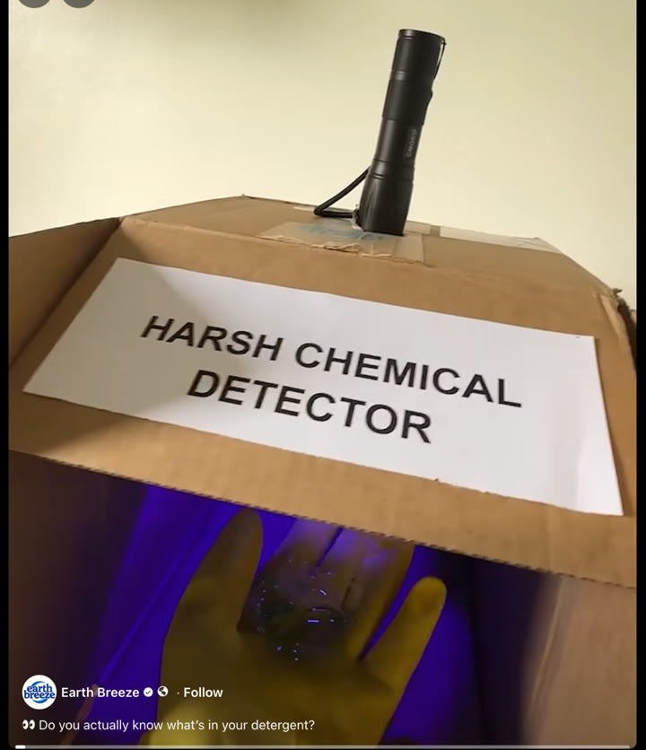
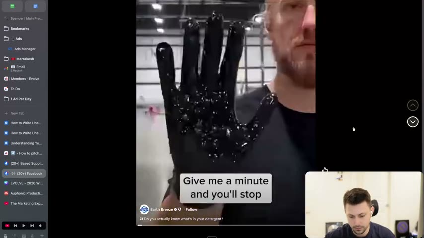
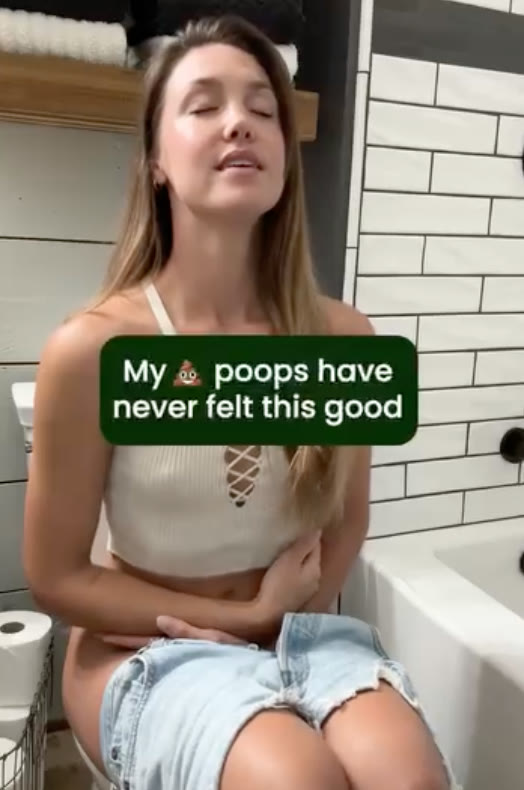
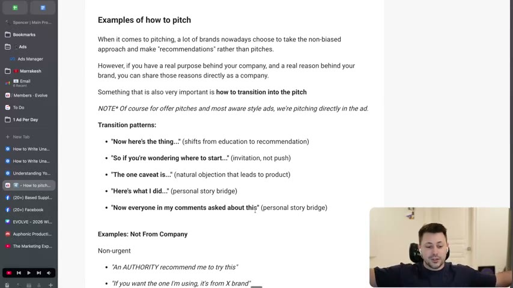
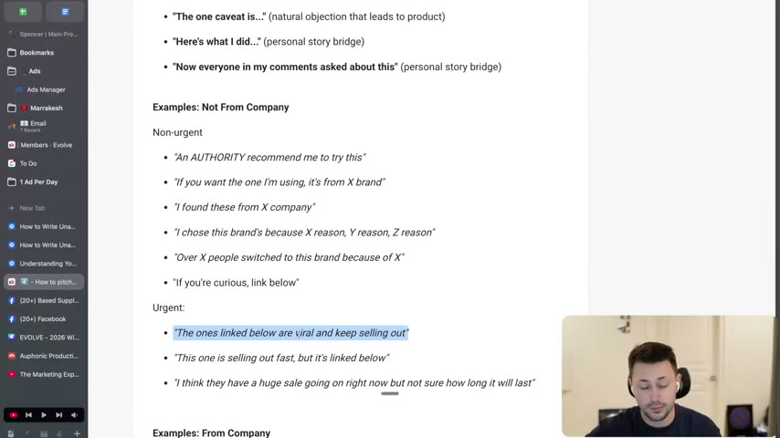

# 29. How to pitch without rejection
> Do not pitch until the ad has (1) delivered the payoff it promised and (2) built enough belief; then transition into the product as a "recommendation" (or a founder's reason), with non-urgent or urgent phrasing, using the swipe lines this lesson supplies.

## 🤖 Agent use
- **Use when:** writing the CTA / product reveal of a UGC video script or static ad, after the hook, bridge and objection handling are already written (step 4 of the course's 1-2-3-4 writing process: hooks, bridge, objections, pitch).
- **Inputs → outputs:** a draft ad body (hook + promise + proof/mechanism/objection handling) → a pitch moment that (a) is only placed after payoff and belief checks pass and (b) uses a transition line plus a recommendation-style (or company-voice) pitch line, urgent or non-urgent.
- **Rules:**
  - **DO** check before every pitch: "you have delivered your payoff or basically delivered your promise". If the hook said "four reasons why", all four are given; if a curiosity gap was opened, it is filled. [00:00-00:51]
  - **DON'T** pitch before the promised thing is delivered: "people will not buy. It just doesn't make sense." [00:51-01:44]
  - **DO** make the second check: "ensure you've established belief", which the instructor calls the second most important thing. Everything after the bridge (relatability, new mechanism, proof, authorities, objection handling) is belief-building. [06:08-07:43]
  - **IF** the market is sophisticated (late stage 4 / stage 5) **THEN** build more belief and more identity ("show them it's for them") before pitching, because "people start to buy things based off of their identity". [06:52-07:43]
  - **DO** deliver a payoff worth sharing: it gives value, makes the viewer feel they found something new first, and makes them think of someone they know who has the problem. [01:44-02:32]
  - **DO** consider putting the payoff (desired outcome) into the hook (a "flash forward"), then spend the rest of the ad explaining how you got there. [02:32-05:23]
  - **DO** transition into the pitch with a pattern line (see Templates) rather than jumping to "buy my product". [09:00-09:51]
  - **DO** prefer a non-biased "recommendation" voice for product-aware / solution-aware / unaware ads, because "people are very skeptical of buying things online. They want to be recommended things online." [08:27-09:00]
  - **IF** you are the brand and have a real purpose **THEN** state it directly in company voice: "people don't want to buy from companies, they want to buy from people." [08:27-09:00]
  - **IF** the ad is an offer ad / most-aware ad (e.g. buy one get one free) **THEN** pitch directly in the ad; the transition patterns are for product-aware / solution-aware / unaware style ads. [09:00-09:51]
- **See also:** [27. How to write a bridge](27-how-to-write-a-bridge.md) · [28. How to prevent/handle objections in writing](28-how-to-prevent-handle-objections-in-writing.md) · [26. How to write open loops](26-how-to-write-open-loops.md) · [35. How to write unaware ads (hooks)](35-how-to-write-unaware-ads-hooks.md) · [Risk-reduction hooks](../../../../concepts/risk-reduction-hooks.md)

Lesson page text credit line: "Credit: Adley - Viralish". The page text mirrors the video's outline (payoff, belief, transition patterns, examples).

## Key ideas

### 1. Check 1: deliver the payoff before you pitch [00:00-01:44]
- The instructor defines a "pitch" as essentially a CTA, the moment you introduce the product "after you've built it up". He is talking mainly about ads that have been explaining, giving new information, or showing new mechanisms (a new-mechanism reveal often reveals the product as well, so it is "kind of in a way pitching"). [00:00-00:51]
- The page text lists what "delivered" means: "You've given your 4 reasons why", "You've filled the curiosity gap", "You've delivered on your promise." [page text, "#1"]
- Even a product-aware ad needs a new mechanism or an authority to build trust and belief and must answer whatever it set up; some products "just sell themselves", but if you struggle to make winning ads, check that the promises are delivered. [00:51-01:44]

### 2. Why great payoffs get shared [01:44-02:32]
- The instructor's claim: great payoffs usually lead to shares, which is why "a lot of the times the best ads will have a lot of shares". (Instructor claim, no data given.)
- Three reasons people share (page text): they "got value", they "discovered something new (they're first)", "it could help someone they know". [01:44-02:32; page text]

### 3. Side tip: the payoff can be the hook (flash forward) [02:32-05:23]
- Credited to Adley (page text: "Credit: Adley - Viralish"). In organic, she sometimes shows the thing that is about to happen (example given: a candle explodes, then the video goes back to the person at the grocery store or sneaking into the bedroom), then fills in how we got there. Her term is "flash forward". [02:32-03:19]
- In direct response the equivalent is to "show that desired outcome first", put it right in the hook, then explain. [03:19-04:04]
- The instructor says his team "just had a spend winner" built this way (not a breakthrough), which one of the media buyers killed too early; they are retesting it. (Instructor claim; ad not shown.) [02:32-03:19]
- **Example 1, laundry detergent (Earth Breeze, per the on-screen ad):** the hook opens on a cardboard box labelled "HARSH CHEMICAL DETECTOR" with a black light and a gloved hand, a man holding up a hand with the on-screen text "Give me a minute and you'll stop" (the transcript hears "give me a minute and you'll stop using liquid laundry detergent forever"). The payoff, "laundry detergents have harsh chemicals", is shown immediately; the rest of the video explains it. The instructor also points out the hook has "a lot of weird stuff happening" (random box-and-blacklight set-up, cutting a pod with a glove) which draws attention, and that the creator sets a timeline ("give me a minute"). [03:19-04:41]
- **Example 2, a digestive/gut product (brand and product not named in the lesson):** a woman sits on a toilet with on-screen text "My [poop emoji] poops have never felt this good". The instructor: "It takes a brave creator to do that", but it is the payoff, the outcome is stated first and the rest of the video explains how she got there. [04:41-05:23]
- **Example 3, the instructor's hypothetical dog pee pad:** show the dog peeing on the pad every time, many pads "all perfectly peed right in the middle", then explain how: "I started with the best ones on Amazon that didn't work." Viewers are hooked "because they want to see how did you get to that end outcome". (Hypothetical, derived by the instructor, not a tested ad.) [05:23-06:08]
- Takeaway: before pitching, explain the harsh chemicals and why they are a problem, or how the poops "have never felt so good before", whichever payoff the hook promised. [05:23-06:08]

*Image embedded in the lesson page (Skool image 1): the "payoff in the hook" ad. A cardboard "HARSH CHEMICAL DETECTOR" with a UV light over a gloved hand; caption on the ad reads "Do you actually know what's in your detergent?" The payoff (detergent has harsh chemicals) is visible in the first second. [04:04]*

*Screen recording of the same ad: the creator holds up a hand lit blue by the black light with the text "Give me a minute and you'll stop", setting the timeline for the explanation. [04:04]*

*Image embedded in the lesson page (Skool image 2): the second "payoff in the hook" ad; on-screen text "My [emoji] poops have never felt this good". Product not named in the lesson. [04:41]*

### 4. Check 2: establish belief [06:08-08:27]
- The 1-2-3-4 process the instructor refers to: how to write hooks, how to write bridges, how to handle objections, then how to pitch. "Basically, the rest of your ad after the bridge is just building belief." [06:08-06:52]
- Belief-building tasks (page text): "You've built relatability, You've provided a new mechanism, You've provided proof, You've leveraged authorities, You've prevented/handled objections." The instructor says the hold of a video does this, and for many advertisers so does the landing page. If you only run simpler static ads, still establish belief before the pitch. [06:08-06:52]
- "If you pitch someone that doesn't believe you, they're not going to buy." Different viewers need different amounts: some need only relatability and the new mechanism; others need more proof, more authority or more objections handled. He ties this to why people click through at different points in the video. [06:52-07:43]
- "The more sophisticated your market, the more you need to build belief... and the more that you essentially need to build identity." In a late stage 4 / stage 5 market people buy on identity, so show them it is for them. [06:52-07:43] (Stages refer to market sophistication as used in the objections lesson.)
- Only after both checks "does it make sense for you to pitch. The way that you pitch matters." Later storytelling lessons will cover shifting beliefs; this lesson is about direct response. [07:43-08:27]

### 5. How to pitch: recommendations or company reasons [08:27-09:51]
- Many brands now take a non-biased approach and make "recommendations rather than pitches". Why it works (instructor claim): people are skeptical of buying online and want to be recommended things. [08:27-09:00]
- If you have a real purpose and reason behind the brand, share them directly as the company. A founder on camera makes people feel they are buying from a person. That is why brands revert to a recommendation voice or a person recommending the product in the voiceover. [09:00]
- Offer pitches and "most aware style ads" pitch directly in the ad; the lesson is about product-aware, solution-aware and unaware style ads. [09:00-09:51]

### 6. Transition patterns (swipe) [09:51-10:49]
- The instructor says this is not every transition pattern, just "a swipe file" to inspire you. The page text lists five (see Templates). Whisper mangled the spoken versions, which this page restores from the page text. [09:51-10:49; page text]
- You can transition from belief-building or objection handling into the pitch.

### 7. Recommendation-style pitch lines (not from the company) [10:49-12:25]
- Non-urgent: authority recommended it; "if you want the one that I'm using... it's from this brand"; "I found these from this X company"; reasons for choosing the brand; social proof of switching; "linked below". [10:49-11:40; page text]
- The instructor dislikes "I did research" as a pitch line: "nobody really buys that". He prefers experience-based authority such as "I've bought three or four of these and... the ones that I found from this company over here is the best one" (he refers to a "CarePod" ad on screen; Whisper's spelling, brand/product unverified). That is "establishing authority in your own way rather than saying this authority recommends." [10:49-11:40]
- Social proof wording example: "I saw that 10,000 people switch to this brand because they do this specific thing. So that's why I'd recommend this one." The number is an illustrative placeholder, not a stat. [10:49-11:40]
- Urgent: viral and selling out; selling out fast; a sale going on but unknown duration. Keep the voice of someone "just relaying the information", not part of the brand. [11:40-12:25]

### 8. Pitch lines from the company [12:25-12:58]
- Non-urgent: "We started X brand because of Y issue"; "If you want to try our products, we do have X guarantee". Urgent: "We do have a sale active right now, while supplies last"; "We have sold out X times now, so if you want to try X, link is below". [11:40-12:58; page text]
- Wrap-up: the module exists to hammer home "ensure you delivered your payoff", give hook inspiration, and establish belief; "you cannot pitch until you've done those two things." [12:25-12:58]

## Steps / framework
1. **Payoff check:** list every promise in the hook/opening (number of reasons, curiosity gap, claim). Confirm each is delivered in the body. If not, fix before pitching. [00:00-01:44]
2. **Belief check:** confirm the ad includes relatability, a new mechanism, proof, authorities, and handled objections. Raise the amount for sophisticated markets and add identity cues. [06:08-07:43]
3. **Choose the pitch voice:** (a) non-company recommendation (default for UGC); (b) company/founder voice with a real purpose; (c) direct offer pitch for most-aware ads. [08:27-09:51]
4. **Choose the energy:** non-urgent or urgent. [10:49-12:25]
5. **Write a transition line** from the patterns below, then the pitch line. [09:51-10:49]
6. **Optional hook move:** pull the payoff into the first seconds (flash forward) and let the body explain how. [02:32-05:23]

## Examples
- Earth Breeze-style laundry detergent hook: payoff shown first (harsh chemical detector with UV light); body explains why detergent has harsh chemicals. [03:19-04:41]
- Gut-product "poops have never felt so good" hook: outcome first, explanation after. [04:41-05:23]
- Hypothetical dog pee pad: show pads "all perfectly peed right in the middle" first, then explain testing the Amazon best sellers that didn't work. [05:23-06:08]
- Pitch-line example: "I've bought three or four of these and I can say the ones that I found from this company over here is the best one." [10:49] (instructor's spoken illustration; brand unspecified)
- Flash-forward in organic (Adley): a candle explodes before the video rewinds to show how it got there. [02:32-03:19]

## Structured units

### Hooks
| Hook | Heuristic(s) | Emotion / zone | Self targeted | Why it works | Source |
|---|---|---|---|---|---|
| Harsh Chemical Detector box + black light on a gloved hand, text "Give me a minute and you'll stop [using liquid laundry detergent forever]" (Earth Breeze) | Payoff-first, curiosity (derived) | Disgust / fear of chemicals (derived) | — | Payoff shown immediately; odd set-up grabs attention; time-boxed promise ("give me a minute") | [03:19-04:41] |
| "My [poop emoji] poops have never felt this good" (gut product, brand not named) | Payoff-first, curiosity gap (derived) | Relief / amusement (derived) | — | States the desired outcome in the hook; the rest explains how; instructor notes the creator is brave | [04:41-05:23] |
| Show the dog peeing perfectly on many pee pads, then "I started with the best ones on Amazon that didn't work" (hypothetical) | Payoff-first (derived) | — | — | Viewer wants the outcome and needs the explanation | [05:23-06:08] |

### Templates
| Template | Use for | Example fill | Source |
|---|---|---|---|
| "Now here's the thing..." | Shift from education to recommendation | "Now here's the thing... [recommendation]" | [09:51; page text] |
| "So if you're wondering where to start..." | Invitation, not push | "So if you're wondering where to start, [product]" | [09:51; page text] |
| "The one caveat is..." | Natural objection that leads into the product | "The one caveat is [objection], which is why I use [product]" | [09:51; page text] |
| "Here's what I did..." | Personal-story bridge | "Here's what I did: [product]" | [09:51; page text] |
| "Now everyone in my comments asked about this" | Personal-story bridge | "Now everyone in my comments asked about this, so [link below]" | [09:51; page text] |
| "An AUTHORITY recommend me to try this" | Non-urgent, non-company authority pitch | "[Authority] recommended me to try this" | [10:49; page text] |
| "If you want the one I'm using, it's from X brand" | Non-urgent recommendation | "If you want the one I'm using, it's from [brand]" | [10:49; page text] |
| "I found these from X company" | Non-urgent recommendation | — | [10:49; page text] |
| "I chose this brand's because X reason, Y reason, Z reason" | Reason-based pitch | "I choose this brand because [A], [B] and [C]" | [10:49; page text] |
| "Over X people switched to this brand because of X" | Social proof pitch | Use only a real number (instructor's "10,000" is a placeholder) | [10:49; page text] |
| "If you're curious, link below" | Soft, non-salesy pitch | — | [10:49; page text] |
| "The ones linked below are viral and keep selling out" | Urgent, non-company | — | [11:40; page text] |
| "This one is selling out fast, but it's linked below" | Urgent, non-company | — | [11:40; page text] |
| "I think they have a huge sale going on right now but not sure how long it will last" | Urgent, non-company | — | [11:40; page text] |
| "We started X brand because of Y issue" | Company voice, non-urgent | — | [11:40-12:25; page text] |
| "If you want to try our products, we do have X guarantee" | Company voice, non-urgent (risk reversal) | — | [11:40-12:25; page text] |
| "We do have a sale active right now, while supplies last" | Company voice, urgent | — | [12:25; page text] |
| "We have sold out X times now, so if you want to try X, link is below" | Company voice, urgent | Use only a real count | [12:25; page text] |

### Ad teardowns
| Brand / product (niche) | Format | Hook / opening | What works | What fails | Fix suggested | Principle | Source |
|---|---|---|---|---|---|---|---|
| Earth Breeze (laundry detergent sheets/pods; brand read from the on-screen ad) | UGC-style video | "Harsh Chemical Detector" box, UV light, "Give me a minute and you'll stop..." | Payoff in the hook; curiosity from odd set-up; time-boxed promise; body explains | — (not critiqued) | — | Payoff-as-hook / flash forward | [03:19-04:41] |
| Gut-health product (not named) | UGC-style video | "My poops have never felt this good" | Outcome stated first; bold creator; explanation follows | — (not critiqued) | — | Payoff-as-hook | [04:41-05:23] |

## Screenshots

*The lesson page on screen with the five transition patterns and the start of the non-company examples. The same lines appear in the Templates table. [09:43]*

*The page text showing "Examples: Not From Company" (urgent) and "Examples: From Company", with the instructor highlighting "The ones linked below are viral and keep selling out". [11:43]*

## How to apply
- [ ] List the promises made in the hook and confirm each has a payoff line in the body before writing the CTA.
- [ ] Check the ad body includes relatability, mechanism, proof, authority and objection handling; add whichever is missing.
- [ ] For UGC product-aware/unaware scripts, write the pitch as a personal recommendation, not a company slogan.
- [ ] Pick one transition line and one pitch line (urgent or non-urgent); do not stack many.
- [ ] Use real numbers only ("10,000 people switched", "sold out X times") if the brand can substantiate them.
- [ ] Test a version where the payoff/outcome appears in the first seconds and the body explains the "how".
- [ ] For a most-aware offer ad, pitch the offer directly and skip the transition.

## Related
- Previous: [28. How to prevent/handle objections in writing](28-how-to-prevent-handle-objections-in-writing.md) · Next: [30. How to raise the stakes](30-how-to-raise-the-stakes.md)
- [26. How to write open loops](26-how-to-write-open-loops.md) (curiosity gaps you must fill before pitching) · [27. How to write a bridge](27-how-to-write-a-bridge.md) · [Risk-reduction hooks](../../../../concepts/risk-reduction-hooks.md) · [Native advertising](../../../../concepts/native-advertising.md)

## Sources and limitations
- Transcript: [29. 4️⃣ - How to pitch without rejection….txt](<../../../../../raw/evolve/copywriting/_transcripts/✍️ Evolve Copywriting (NEW)/29. 4️⃣ - How to pitch without rejection ✍️ Evolve Copywriting (NEW) Evolve.txt>) · Page text: [29. ….html.md](<../../../../../raw/evolve/copywriting/_extracted/✍️ Evolve Copywriting (NEW)/29. 4️⃣ - How to pitch without rejection_✍️ Evolve Copywriting (NEW)_Evolve.html.md>)
- Machine transcription (Whisper large-v3-turbo). Full recording covered (last segment 12:58 of 12:58). Whisper heard "Randy setup" for what is likely "random setup" and "CarePod" for an ad whose brand is not visible; "Adley" matches the page credit "Adley - Viralish". The spoken transition patterns are garbled in the transcript; the page text is used for them. Timestamps are paragraph starts from the transcript, so ranges are approximate.
- The lesson page's two video links (a Facebook post and an Atria ad link) are not part of the course files; the ad images were taken from the Skool images.
- Brand identification of Earth Breeze comes from the on-screen ad (the poster name in the Skool image), not from the instructor's speech. The gut-health product is not named anywhere.
