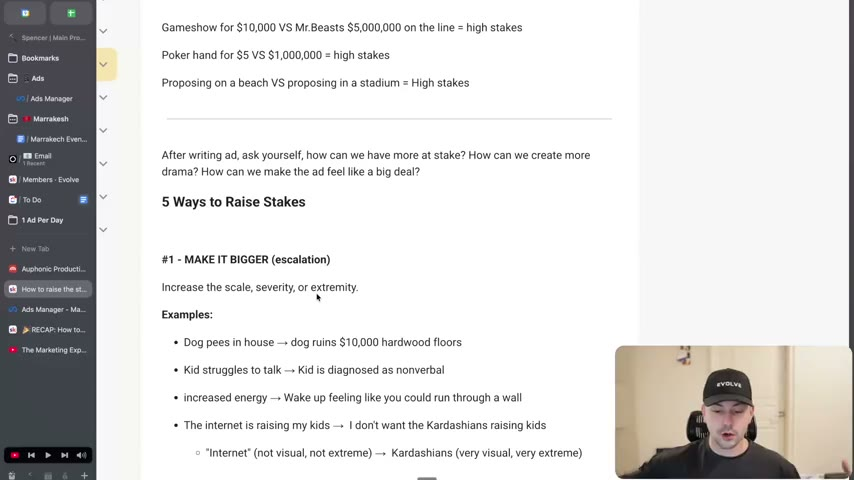
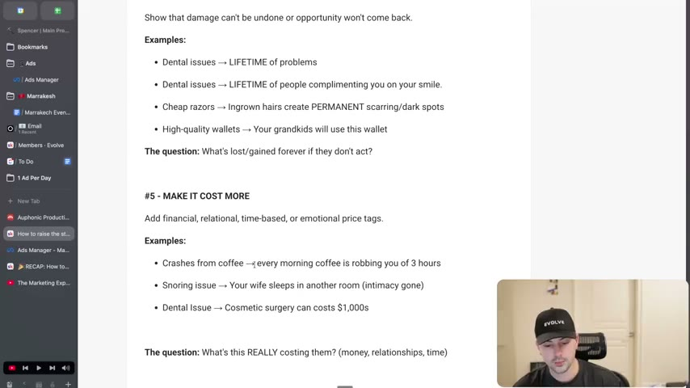
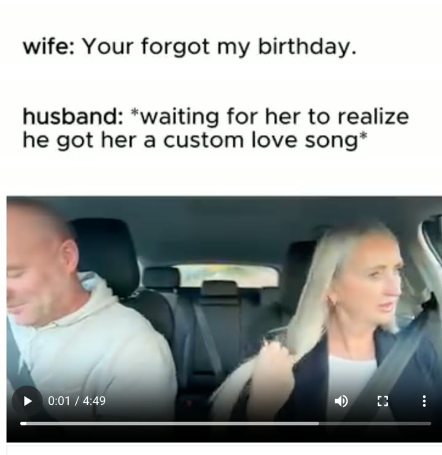
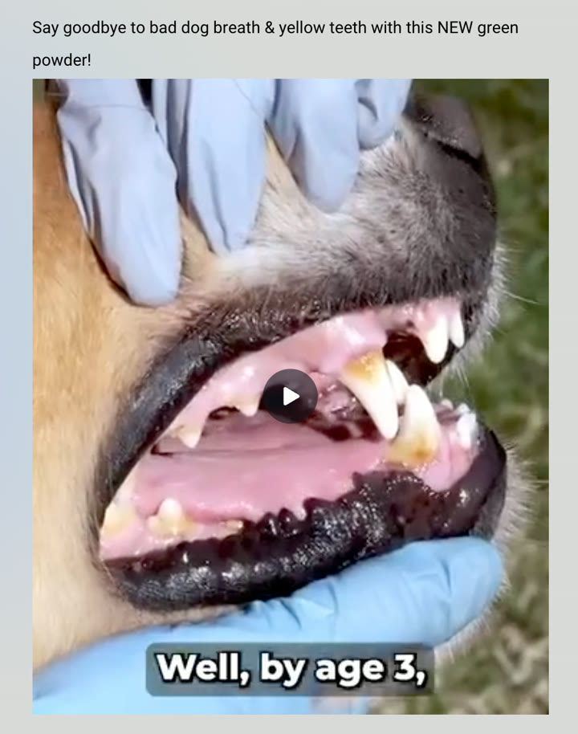
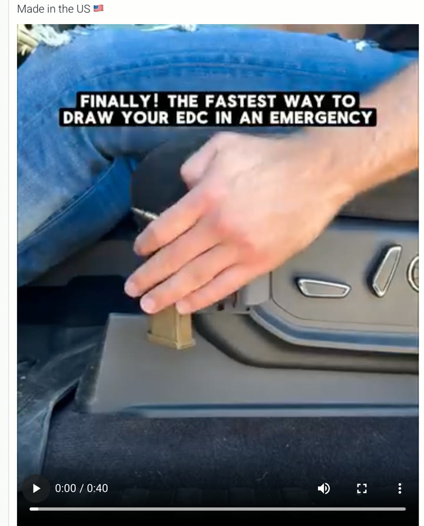
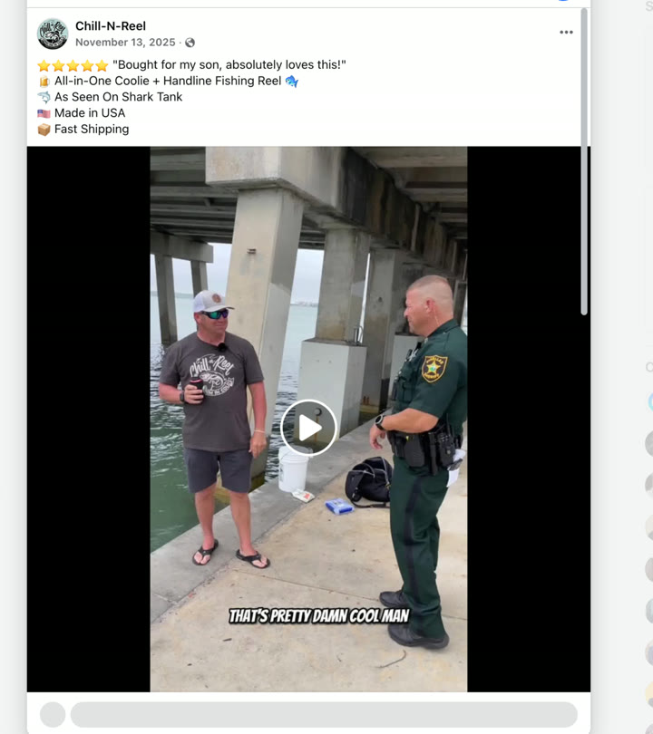
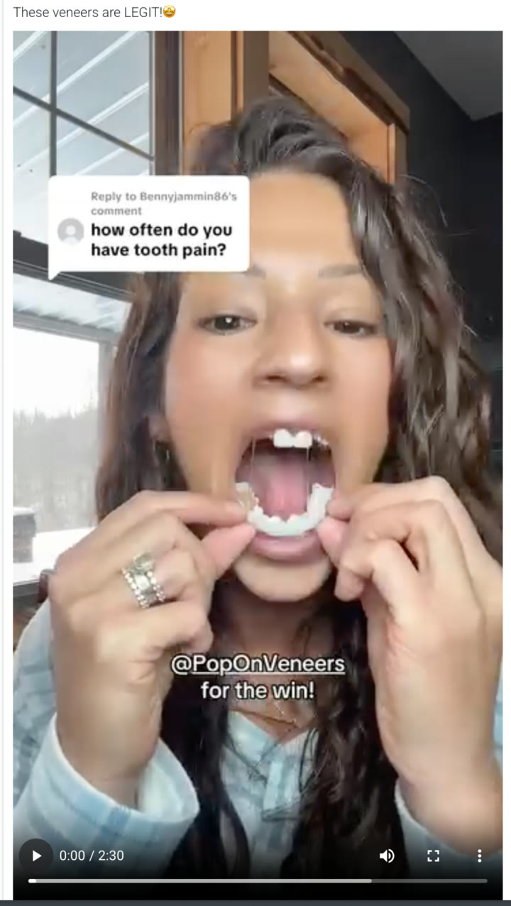

# 30. How to raise the stakes
> People pay more attention when more is at stake (more to gain or lose), so after drafting an ad, ask "how can we have more at stake?" and apply one of five levers: make it bigger, add a witness, make it urgent, make it permanent, make it cost more.

## 🤖 Agent use
- **Use when:** a hook, problem statement or product line reads flat ("low stakes") and needs more drama; when tearing down a competitor ad to find what creates its tension; when writing an iteration of an ad that is not holding attention.
- **Inputs → outputs:** a flat problem/product line (e.g. "This DNA kit tells you your heritage") → five stakes-raised rewrites, one per lever, each answering the lever's question; the strongest becomes the hook or a mid-video escalation.
- **Rules:**
  - **DO** run the stakes check after the ad is written: "how can we have more at stake? How can we create more drama? How can we make the ad feel like a big deal?" [01:27-02:26]
  - **DO** test the result by feeling it: if you "can feel that emotion", you have raised the stakes. [01:27-02:26]
  - **DO** try all five levers on the same line: bigger, witness, urgent, permanent, costs more. [02:26-09:20]
  - **DO** make it visual and extreme when escalating ("the Kardashians" beats "the internet"; "run through a wall" beats "more energy"). [03:13-04:45]
  - **DO** remember each lever works on the positive side too (gain), not only fear. [06:24-07:59]
  - **DON'T** assume the stakes must live in the hook: "Not all of this stuff is happening in the hook... a lot of this happens throughout the rest of the video as well." [10:58-11:44]
  - **IF** the lever is "make it cost more" **THEN** expect it to skew negative (low valence); flipping it to "you'll gain more than you think" is possible but less common. [07:59-08:45]
  - **IF** a product is a gadget with no inherent drama (a fishing koozie) **THEN** create the stakes with a scene (a police officer found us), not with product claims. [12:15-13:22]
- **See also:** [35. How to write unaware ads (hooks)](35-how-to-write-unaware-ads-hooks.md) · [29. How to pitch without rejection](29-how-to-pitch-without-rejection.md) · [26. How to write open loops](26-how-to-write-open-loops.md) · [Emotional zones](../../../../concepts/emotional-zones.md) · [Heuristics](../../../../concepts/heuristics.md)

Source attribution on the page: the instructor says the idea of stakes first came from Adley (Viralish) and he also heard "Harry" (surname not stated) discuss it; the five-lever list is his own: "This is just the way that I've created. I didn't learn this from either one of them." [01:27-02:26]

## Key ideas

### 1. What stakes are [00:00-01:27]
- Stake = "what you stand to gain or to lose"; the bigger the potential gain or loss, the more people pay attention. [00:00-00:52]
- Analogies: game show for $10,000 vs $5 million; poker hand for $5 vs $1 million (page text says "Mr.Beasts $5,000,000"); proposing on an empty private beach vs proposing in a stadium (50,000 people watching, so more to lose if she says no). [00:00-01:27; page text]

### 2. Why it matters for ads [01:27-02:26]
- High stakes create drama and make the ad "feel like a big deal". The test is emotional: imagine winning $5 million, or the nerves of proposing in front of 50,000 people. If you feel it, you have raised the stakes. [01:27-02:26]

### 3. Lever 1: Make it bigger (escalation) [02:26-04:45]
- Increase scale, severity or extremity. Question: "Can I make the problem or solution more extreme?" [03:58-04:45; page text]
- Before → after pairs given: dog pees in house → dog ruins $10,000 hardwood floors (or "pees in my Bugatti"); kid struggles to talk → kid is diagnosed as nonverbal; increased energy → "wake up feeling like you could run through a wall" (compared with "Red Bull gives you wings"; the instructor notes it got them "into legal trouble" so they had to add warnings, "but it works for them"); "the internet is raising my kids" → "I don't want the Kardashians raising kids" (the internet is not visual or extreme; the Kardashians are). [02:26-04:45]

### 4. Lever 2: Add a witness [04:45-05:43]
- Introduce an audience, an authority or social pressure. Question: "Who's watching? Who will see if this goes right or wrong?" [04:45-05:43; page text]
- Examples: dog pees in front of our landlord (the viewer imagines eviction); fishing under a bridge → "cop found us fishing under a bridge"; losing weight → your kids watch you do the hard thing and learn they can too. He says an authority witness especially intensifies it because of our status and social instincts. [04:45-05:43]

### 5. Lever 3: Make it urgent [05:43-06:24]
- Add time pressure or a point of no return. Question: "Why does this matter right now?" [06:24-07:09]
- Examples: improve your teeth → the damage is happening right now; dog pees in house → every pee reinforces that behavior; "now is the time to do it" (weak) → "you're at the perfect age to do this, every year it gets harder". Without urgency "I might not do it". [05:43-06:24]

### 6. Lever 4: Make it permanent [06:24-07:59]
- Show that damage cannot be undone or the opportunity will not come back. Question: "What's lost/gained forever if they don't act?" (page text). One of the instructor's favourites. [06:24-07:09]
- All five levers can be positive or negative: "dental issues, lifetime of problems" and the flip "lifetime of people complimenting you on your smile". [07:09-07:59]
- Examples: cheap razors → ingrown hairs create permanent scarring or dark spots; high-quality wallets → "your grandkids will use this wallet" (visual and permanent). [07:09-07:59]

### 7. Lever 5: Make it cost more [07:59-09:20]
- Add financial, relational, time-based or emotional price tags; mostly negative-valence. Question: "What is this really costing them?" [07:59-09:20]
- Examples: crashes from coffee → "every morning coffee is robbing you of three hours of your day" (can be exaggerated over 10-20 years of a career; the mushroom coffee is the alternative); snoring → your wife will sleep in another room, "a sleep divorce" (relational cost); dental issues → cosmetic surgery costs thousands of dollars. [08:45-09:20]

### 8. Ad-specific walkthroughs [09:20-13:59]
Each example takes a low-stakes line, makes a high-stakes line, then names the lever (full tables below). The instructor notes some stakes appear later in the video, not in the hook. [09:20-13:59]

*Lesson page on screen at the start of "5 Ways to Raise Stakes": lever #1 examples (dog $10,000 floors, nonverbal kid, run through a wall, Kardashians vs internet). [02:30]*

*Lever #4 and #5 on the lesson page, with the lever questions "What's lost/gained forever if they don't act?" and "What's this REALLY costing them? (money, relationships, time)". [08:50]*

## Steps / framework

| # | Lever | What to do | Question to ask | Flat → stakes example (source) |
|---|---|---|---|---|
| 1 | Make it bigger (escalation) | Increase scale, severity or extremity | Can I make the problem/solution more extreme? | Dog pees in house → dog ruins $10,000 hardwood floors [02:26-03:58] |
| 2 | Add a witness | Introduce an audience, authority or social pressure | Who's watching? Who will see if this goes right/wrong? | Fishing under a bridge → a cop found us fishing under a bridge [04:45-05:43] |
| 3 | Make it urgent | Add time pressure or a point of no return | Why does this matter right now? | Dog pees in house → every pee reinforces the behavior [05:43-06:24] |
| 4 | Make it permanent | Show damage cannot be undone or the opportunity won't return | What's lost or gained forever if they don't act? | Dental issues → lifetime of problems / lifetime of compliments [06:24-07:59] |
| 5 | Make it cost more | Add financial, relational, time-based or emotional price tags | What is this really costing them? | Snoring → your wife sleeps in another room [07:59-09:20] |

Procedure (derived from the lesson): write the ad, rate each key line low/high stakes, rewrite the flat lines with one lever each, keep the line that produces a felt emotion, then place it in the hook or the first escalation beat of the body.

## Examples

Ad-specific examples shown in the lesson (page text and video):

| Product | Low stakes | High stakes | What creates the stakes | Lever |
|---|---|---|---|---|
| DNA kit | "This DNA kit tells you your heritage" | "This DNA kit could predict when you might die" | You can find out when you might die; "death is a huge thing" | Make it bigger [09:20-10:11] |
| Relationship (custom love) song | "I got a custom song for my wife" | "My wife thinks I forgot her birthday" (ad shows: wife "Your forgot my birthday." / husband "*waiting for her to realize he got her a custom love song*") | Forgetting your wife's birthday could cost the relationship | Make it cost more [10:11-10:58] |
| Dog dental powder | "Dog powder helps clean your dog's teeth" | "Not cleaning your dog's teeth sets them up for a lifetime of dental issues" | The dog has a lifetime of issues; the on-screen ad line is "Well, by age 3," | Make it permanent [10:58-11:44] |
| EDC (everyday carry) kit | "EDC kit helps you draw fast" | "EDC kit helps you draw fast in an emergency" (on-screen: "FINALLY! THE FASTEST WAY TO DRAW YOUR EDC IN AN EMERGENCY") | The word "emergency" alerts the brain; this is needed in emergencies | Make it urgent [11:44-12:15] |
| Fishing koozie (Chill-N-Reel) | "This is a coozie you can fish with" | "Cop found us under a bridge again" | He got caught by the police; the instructor says the ad "is absolutely crushing" (instructor claim) | Add a witness [12:15-13:22] |
| Pop-on veneers | "Putting on veneers with teeth that are crooked" | "Putting on veneers when you have 2 teeth" | How bad her teeth are and that she is missing so many; "shock factor" | Make it bigger [13:22-13:59] |

*Skool image 1: meme-style opener, "wife: Your forgot my birthday. / husband: *waiting for her to realize he got her a custom love song*", over a couple in a car. The instructor reads this as stakes created by the cost of forgetting a birthday. [10:11]*

*Skool image 2: ad copy "Say goodbye to bad dog breath & yellow teeth with this NEW green powder!" over a dog's stained teeth, caption "Well, by age 3,". The visual and line imply a lifetime of dental issues. [10:58]*

*Skool image 3: the urgency lever in one on-screen line. The product appears to be a firearm-draw accessory (derived from "draw your EDC"); the word "emergency" is what raises the stakes. [11:44]*

*Skool image 4: Chill-N-Reel Facebook ad; the man fishing under a bridge talks to a deputy, caption "THAT'S PRETTY DAMN COOL MAN". Post copy: "Bought for my son, absolutely loves this!", "All-in-One Coolie + Handline Fishing Reel", "As Seen On Shark Tank", "Made in USA", "Fast Shipping". The witness is the police officer. [12:35]*

*Skool image 5: veneers ad ("These veneers are LEGIT!") where the creator holds the veneer tray up to a mouth missing most teeth. The instructor's point is shock and extremity, not good taste. [13:22]*

## Structured units

### Hooks
| Hook | Heuristic(s) | Emotion / zone | Self targeted | Why it works | Source |
|---|---|---|---|---|---|
| "This DNA kit could predict when you might die" | Stakes via death (derived) | Fear / curiosity (derived) | — | Raises scale to mortality | [09:20-10:11] |
| "My wife thinks I forgot her birthday" | Stakes via relational cost | Anxiety / humor (derived) | — | Forgetting a birthday could cost the relationship | [10:11-10:58] |
| "Not cleaning your dog's teeth sets them up for a lifetime of dental issues" | Permanence | Guilt / worry (derived) | — | Lifetime consequence | [10:58-11:44] |
| "EDC kit helps you draw fast in an emergency" | Urgency | Alertness (derived) | — | "Emergency" triggers attention | [11:44-12:15] |
| "Cop found us under a bridge again" | Witness / authority | Suspense (derived) | — | A police officer is the audience; viewer wonders what happens | [12:15-13:22] |
| "Putting on veneers when you have 2 teeth" | Extremity / shock | Shock (derived) | — | Visual extremity | [13:22-13:59] |
| "I don't want the Kardashians raising my kids" | Extremity, visual | Anxiety (derived) | — | A visual, extreme villain replaces the abstract "internet" | [03:58-04:45] |
| "Every morning coffee is robbing you of three hours of your day" | Cost (time) | Loss (derived) | — | Quantified time cost | [08:45-09:20] |

### Rewrites
| Before | After | What changed | Source |
|---|---|---|---|
| Dog pees in house | Dog ruins my $10,000 hardwood floors / my dog peed in my Bugatti | Intensity: dollar figure and status object | [03:13] |
| Kid struggles to talk | Kid is diagnosed as nonverbal | Intensity: diagnosis | [03:13] |
| Increased energy | Wake up feeling like you could run through a wall | Visual, more extreme | [03:13-03:58] |
| The internet is raising my kids | I don't want the Kardashians raising my kids | Visual concrete villain | [03:58-04:45] |
| Dog pees in house | Dog pees in front of our landlord | Witness | [04:45] |
| Fishing under a bridge | Cop found us fishing under a bridge | Witness (authority) | [04:45] |
| Losing weight | Your kids watch you do the hard thing and learn they can too | Witness (kids) | [05:43; page text] |
| Improve your teeth | The damage is happening right now | Urgency | [05:43] |
| Now is the time to do it | You're at the perfect age to do this, every year it gets harder | Urgency / time pressure | [05:43-06:24] |
| Dental issues | Lifetime of problems / lifetime of compliments on your smile | Permanence, both valences | [07:09-07:59] |
| Cheap razors | Ingrown hairs create permanent scarring or dark spots | Permanence | [07:59] |
| High-quality wallet | Your grandkids will use this wallet | Permanence, positive, visual | [07:59] |
| Crashes from coffee | Every morning coffee is robbing you of three hours | Time cost | [08:45] |
| Snoring issue | Your wife will sleep in another room: a "sleep divorce" | Relational cost | [08:45-09:20] |
| Dental issue | Cosmetic surgery can cost thousands of dollars | Financial cost | [09:20] |
| DNA kit tells you your heritage | DNA kit could predict when you might die | Bigger | [09:20-10:11] |
| Custom song for my wife | My wife thinks I forgot her birthday | Cost | [10:11-10:58] |
| Dog powder helps clean teeth | Not cleaning teeth sets them up for lifetime of issues | Permanent | [10:58-11:44] |
| EDC kit helps you draw fast | ... in an emergency | Urgent | [11:44] |
| Coozie you can fish with | Cop found us under a bridge again | Witness | [12:15] |
| Veneers with crooked teeth | Veneers when you have two teeth | Bigger | [13:22] |

### Ad teardowns
| Brand / product (niche) | Format | Hook / opening | What works | What fails | Fix suggested | Principle | Source |
|---|---|---|---|---|---|---|---|
| DNA kit (consumer genetics) | Concept line (page text) | "This DNA kit could predict when you might die" | Mortality raises scale | Heritage line is low stakes | Use the death line | Make it bigger | [09:20-10:11] |
| Custom love-song gift (relationship) | Meme-style video | "Wife: Your forgot my birthday. Husband: *waiting for her to realize he got her a custom love song*" | Relational cost, humor, drama | "I got a custom song for my wife" is low stakes | Frame as forgotten birthday | Make it cost more | [10:11-10:58] |
| Dog dental powder (pet) | Video; Canva mock on page | "Say goodbye to bad dog breath & yellow teeth with this NEW green powder!" / "Well, by age 3," | Lifetime consequence; the stake appears mid-video (instructor: "this is actually in the winning ad stock") | Plain "cleans teeth" claim | Show consequence | Make it permanent | [10:58-11:44] |
| EDC kit (everyday-carry gear; derived) | Short video | "FINALLY! THE FASTEST WAY TO DRAW YOUR EDC IN AN EMERGENCY" | "Emergency" adds urgency | "Draw fast" is low stakes | Add the emergency framing | Make it urgent | [11:44-12:15] |
| Chill-N-Reel fishing koozie (outdoors/novelty) | Facebook video ad | "Cop found us under a bridge again" | A witness with authority produces suspense; "this ad is absolutely crushing" (instructor claim) | "A coozie you can fish with" has no stakes | Create a scene | Add a witness | [12:15-13:22] |
| Pop-on veneers (dental/beauty) | UGC video | Creator with two teeth holding veneers | Shock factor and visual extremity | The instructor notes she probably needs dentures more than veneers | — | Make it bigger | [13:22-13:59] |

## Screenshots
Five embedded ad images (relationship song, dog powder, EDC kit, koozie, veneers) and two lesson-page frames appear above under Examples and Key ideas.

## How to apply
- [ ] After drafting, mark each line in the hook and first 20 seconds as low or high stakes.
- [ ] For each low-stakes line, write five rewrites, one per lever, using the lever's question.
- [ ] Keep rewrites that are visual and extreme; replace abstract nouns ("the internet") with concrete ones ("Kardashians").
- [ ] Use one lever in the hook and hold others for the body.
- [ ] Do not invent medical, legal or financial claims when escalating; the Red Bull "wings" comment shows risk (instructor says they had to add warnings).
- [ ] Check that a witness, deadline, permanent consequence or cost is plausible for our product and can be shown on camera.
- [ ] Log the lever used with each ad variant so test results can be read per lever.

## Related
- Previous: [29. How to pitch without rejection](29-how-to-pitch-without-rejection.md) · Next: [31. How to create ads that show, don't tell](31-how-to-create-ads-that-show-dont-tell.md)
- [26. How to write open loops](26-how-to-write-open-loops.md) · [Emotional zones](../../../../concepts/emotional-zones.md) · [Triggering events](../../../../concepts/triggering-events.md)

## Sources and limitations
- Transcript: [30. How to raise the stakes….txt](<../../../../../raw/evolve/copywriting/_transcripts/✍️ Evolve Copywriting (NEW)/30. How to raise the stakes ✍️ Evolve Copywriting (NEW) Evolve.txt>) · Page text: [30. ….html.md](<../../../../../raw/evolve/copywriting/_extracted/✍️ Evolve Copywriting (NEW)/30. How to raise the stakes_✍️ Evolve Copywriting (NEW)_Evolve.html.md>)
- Machine transcription (Whisper large-v3-turbo). Full recording covered (last segment 13:59 of 13:59). "Harry" in 01:27-02:26 is unidentified. Ad brand name "Chill-N-Reel" is read from the Skool image, not the audio. Timestamps for the ad examples are paragraph starts, so a few are approximate; the koozie and veneers sit between the 11:44 and 13:22 paragraph starts.
- Lesson page links to Facebook posts and a Canva file that are not in the course files; ad visuals come from the embedded Skool images. The page text spells "Mr.Beasts"; the audio does not say MrBeast.
- The statement that the koozie ad is "absolutely crushing" is the instructor's claim, with no metrics shown.
