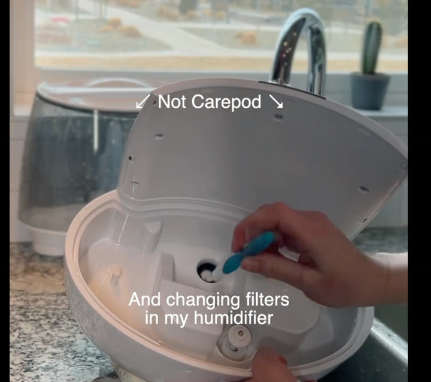
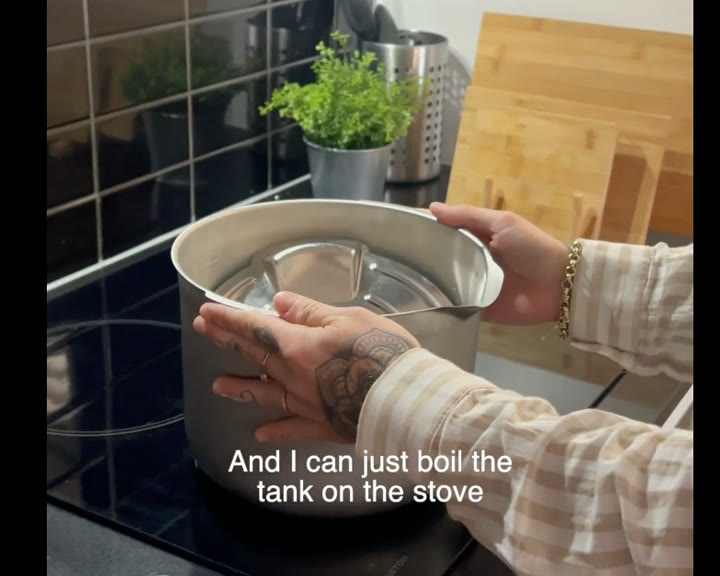
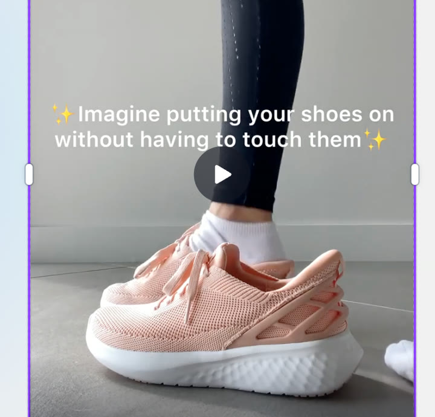
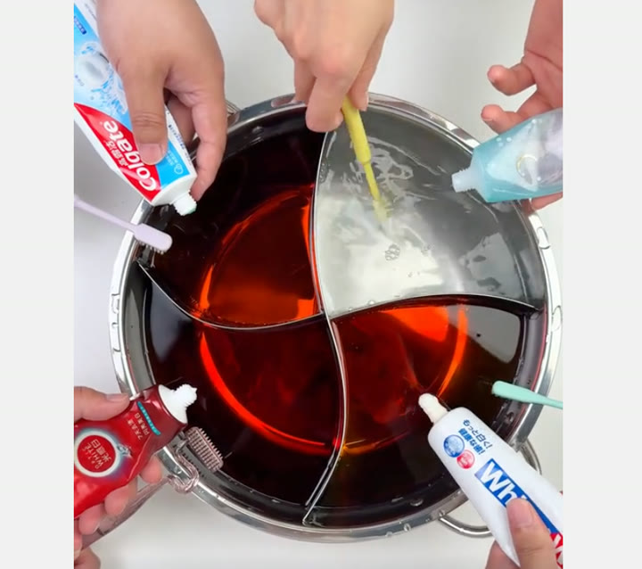
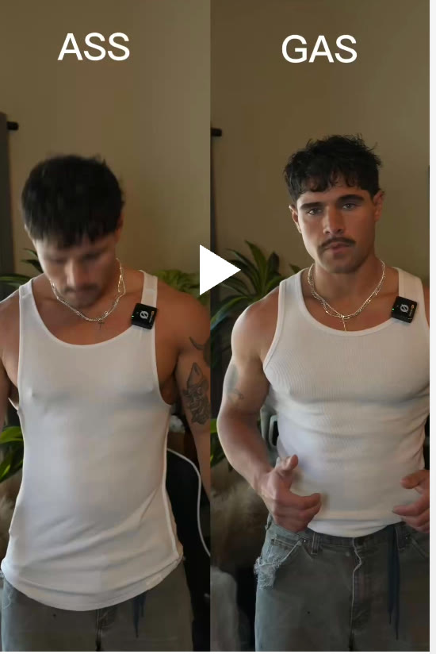
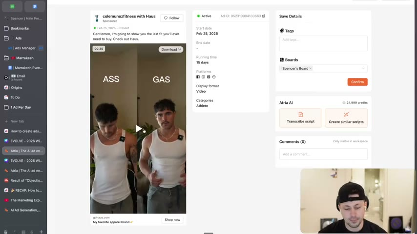
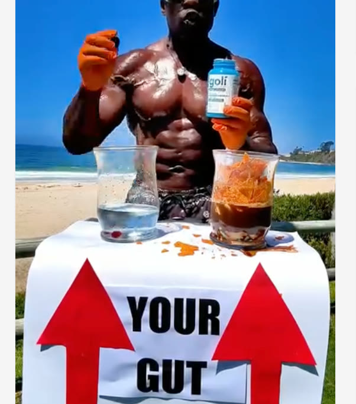
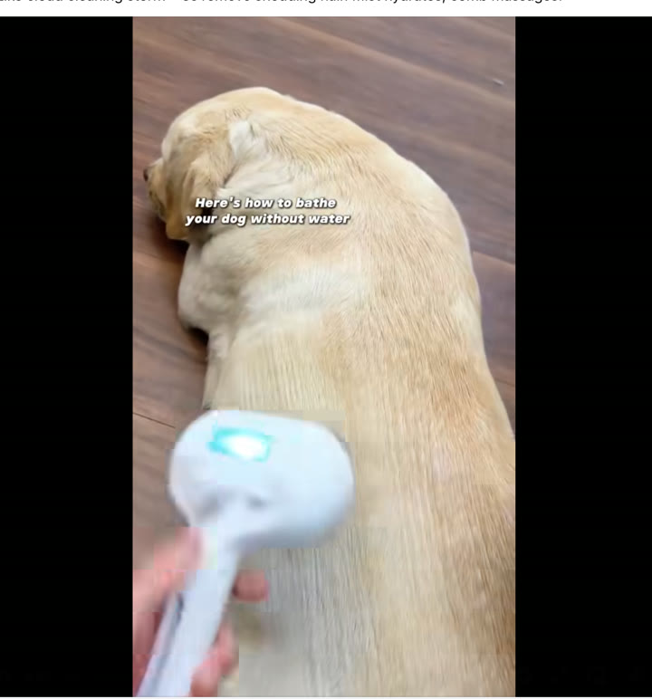

# 31. How to create ads that show, don't tell
> When a claim can be demonstrated on screen, demonstrate it instead of writing it: it is "very hard to deny things that you can see with your own eyes", so showing disarms objections, builds belief and lets the product do the selling.

## 🤖 Agent use
- **Use when:** turning a claim line ("easy to clean", "fits better", "whitens better") into a visual beat for a UGC video script, a creator brief or a static ad; tearing down a competitor ad to see which claim it demonstrates instead of states.
- **Inputs → outputs:** a list of the product's claims (the "tell" lines) → for each, one on-screen demonstration (the "show") described as a shot, plus the few words (if any) that go with it.
- **Rules:**
  - **DO** ask for every claim "how can we show that?" and, if it can be shown, show it rather than writing it. [06:10-07:33]
  - **DO** let the visual carry the claim when possible: "you do not need to over explain when the visual can say it all" (the "Mona Lisa frame"). [00:47-01:33]
  - **DO** use a before/after or comparison that makes the claim visible (a bad version vs ours; a test against competitors; a pour test). [02:11-05:18]
  - **DO** keep a few words of telling alongside the show: "are we telling while doing this? Yes, we are doing some telling, but most importantly, we are showing." [02:11-03:04]
  - **DON'T** assume you cannot show your product's benefit: even supplement brands can visualise an invisible benefit (gut) with a metaphor demonstration. [03:58-05:18]
  - **DON'T** copy a successful visual 1:1 when a competitor already owns it; think how you would show your own claim: "how can you think to show the things that you want to say?" [04:45-06:10]
  - **IF** you cannot use visuals (copy-only ad) **THEN** still "show, not tell... even with words": use concrete examples instead of claims ("James Clear: half the words, double the examples"). [06:10-07:33]
  - **IF** in doubt **THEN** "when in doubt, show it out." [07:33-08:14]
- **See also:** [32. How to write ads that show and don't tell](32-how-to-write-ads-that-show-and-dont-tell.md) · [33. How to use metaphors, similes, analogies](33-how-to-use-metaphors-similes-analogies.md) · [30. How to raise the stakes](30-how-to-raise-the-stakes.md) · [Skeptic format](../../../../frameworks/skeptic-format.md) · [Fluency mechanism](../../../../concepts/fluency-mechanism.md)

Credit on the lesson page: "Harry Dry" (the instructor says "I stole this from Harry" for the James Clear line [05:18-06:10] and calls "write with the delete key" Harry's phrase [07:33-08:14]).

## Key ideas

### 1. Seeing beats being told [00:00-00:47]
- "It's very hard to deny things that you can see with your own eyes." Example: saying "I have a phone" is believable because you can see him holding it. [00:00-00:47]
- This module is "not as much on copywriting"; it sits in the writing section to show that some things do not need to be written, and that you should think about the visual, not only the copy. [00:00-00:47]

### 2. The "Mona Lisa frame" [00:47-01:33]
- The instructor's own name: if the Mona Lisa had a caption "the woman is smiling", nobody would care; because nothing is said you wonder whether she is smirking, sad or confused; "you're just letting the visual do all of the lifting." [00:47-01:33]
- Rule: do not over-explain when the visual can say it all. [00:47-01:33]

### 3. Tell vs show pairs (the lesson's catalogue) [01:33-05:18]
See the table below. Common pattern: the "tell" is a claim sentence; the "show" is a 1-3 second action that makes the claim self-evident. The instructor repeatedly says several of them are "in the winning ad stock" (their internal winners; instructor claim, no data shown). [02:11-03:04]

### 4. Why showing works [03:04-03:58]
- "When you show rather than tell, you disarm objections, you build belief and you are essentially just letting your product do the selling for you." [03:04-03:58]
- Caveat on evidence: of the teeth-whitening dye test he says, "will this actually be proof that this could whiten your teeth? Like, I don't know if that has anything to do with it" - the demonstration persuades even when it is not strict proof. [03:04] (Agent note, derived: keep demonstrations honest and substantiated.)

### 5. Copy one level up: half the words, double the examples [05:18-07:33]
- James Clear: "half the words, double the examples" (credited via Harry). The lesson itself is structured that way: "I use two lines to explain why this matters and then the rest is just examples." [05:18-06:10]
- When writing copy, replace claims with examples: an example of destroying your gut, of why traditional tanks look terrible, of how this whitens teeth, of why it is easy to step in, of why it is easy to clean. [06:10-06:58]
- "Being a great copywriter doesn't just mean using words all the time. It usually means trying to think about how can I communicate this visual as well." [06:10-06:58]
- Old Spice thought experiment: with a scruffy man with a big gut saying "your man could look like me", "it doesn't have the same effect" - the visual matters. [06:58-07:33]
- Link to "write visually" (the copywriting-principles section's three checks): writing visually is how you show with words. Also "write with the delete key": if something can be shown, delete the sentence. [06:58-07:33]

## Steps / framework
1. List each product claim as a "tell" sentence (easy to clean, fits better, whitens better, easy to put on, calms baby, helps gut).
2. For each, ask "how can we show that?" and write the shot: the bad alternative, the side-by-side test, the sensory result, or the pour/dye/slide action.
3. Prefer a contrast: bad version labelled ("Not Carepod"), then ours. [02:11-03:04]
4. Cut the telling to a caption or a few words, or to nothing (Mona Lisa frame). [01:33-02:11]
5. If the benefit is invisible (gut health), find a visible metaphor you can stage (a drink poured into a glass). [04:45-05:18]
6. Check whether a competitor already owns the exact visual; if so, change the demonstration, not just the product. [04:45-06:10]

## Examples
Tell → show pairs from the lesson (page text and video):

| Product | Tell (claim) | Show (demonstration) | Source |
|---|---|---|---|
| Warmies (weighted, warming, lavender-scented plush) | "This will get your baby to stop crying" | Clip of a crying baby calming down, with the only words being "lavender scented" and "the power of Warmies": "It's weighted, it's warming, and it's lavender scented. That's it." No claim is made. | [01:33-02:11; page text] |
| Carepod (humidifier) | "It's so easy to clean" | "Not Carepod": a hand scrubbing the other humidifier with a toothbrush, text "And changing filters in my humidifier"; then "Carepod" you can "just put on the stove" ("And I can just boil the tank on the stove") | [02:11-03:04; page text] |
| Kiziks (shoes) | "Shoes are easy to put on" | On-screen "Imagine putting your shoes on without having to touch them" and the shoes slide in; instructor: "it's in the winning ad stock" | [02:11-03:04; page text] |
| Teeth whitening | "This whitens your teeth better than others" | A red-dyed liquid in a pot quartered by dividers; different toothpastes applied; "this is the only one that actually clears it up". He adds Hismile (Whisper: "High Smile") "famous for this": apply and wipe off, or the yellow-vs-purple colour-corrector demo, "and boom, people believe it" | [03:04-03:58; page text] |
| Tank top (Haus, per the Atria screen) | "This tank top fits better than others" | Two men in white tank tops under captions "ASS" and "GAS": the drooping one vs the covering one; instructor's second ad: a man says "this is bad" (drooping) and "this is good" (covers the whole chest), repeated | [03:58-04:45; page text] |
| Goli (gut gummies; brand read from the bottle on screen) | "Your gut is being destroyed by your diet" | A man pours chips, coffee, energy drinks etc. into a glass beside a clean glass, sign "YOUR GUT" with arrows; another creator version has donuts, coffee, energy drink, popcorn, then an egg, building a disgusting mixture; then the product is positioned as the fix. The instructor says seeing a company run the same concept across many creators "probably tells you it's working" (instructor inference) | [04:45-06:10; page text] |

*Skool image 1: the "show" for "easy to clean". The comparison first shows the other humidifier being scrubbed with a tiny brush ("Not Carepod"). [02:11]*

*Skool image 2: the second half of the same ad. Carepod's tank goes on the stove; the claim "easy to clean" is never said. [02:30]*

*Skool image 3: the "show" for "shoes are easy to put on": the shoe slides on hands-free. The text line is a prompt to picture it, not a claim. [02:50]*

*Skool image 4: red dye in a divided pot with several toothpastes applied at once; only one quadrant clears. A visual comparison instead of "whitens better". [03:04]*

*Skool image 5: the apparel "show" for "fits better than others": two fits side by side with the captions "ASS" and "GAS" (the instructor says he "says ass and gas"). [03:58]*

*Frame from the recording: the same tank top ad opened in the Atria ad-library page (creator "colemunsz fitness with Haus"). Useful as a reference to the ad's source. [04:06]*

*Skool image 6: supplement-brand "show" for "your gut is being destroyed by your diet": junk food and drink poured into a glass beside clean water, labelled "YOUR GUT". [04:45]*

*Skool image 7, "Bonus Example (added after)" on the lesson page; text overlay reads "Here's how to bathe your dog without water". It is not discussed in the video. The brand and the lesson of the example are not stated in the course files.*

## Structured units

### Rewrites
| Before | After | What changed | Source |
|---|---|---|---|
| "This will get your baby to stop crying" | Clip of baby calming + "lavender scented" / "The power of Warmies" | Claim replaced by a visual result; copy shrinks to attributes | [01:33-02:11] |
| "It's so easy to clean" | "Not Carepod" (toothbrush scrubbing) then "put Carepod on the stove" | Claim replaced by a contrast demo | [02:11-03:04] |
| "These shoes are easy to put on" | "Imagine putting your shoes on without having to touch them" + shoes sliding in | Claim replaced by an effortless action | [02:11-03:04] |
| "This whitens your teeth better than others" | Dye test comparing toothpastes | Claim replaced by a side-by-side test | [03:04-03:58] |
| "This tank top fits better than others" | Drooping fit labelled bad vs full coverage labelled good | Claim replaced by a before/after fit comparison | [03:58-04:45] |
| "Your gut is being destroyed by your diet" | Pour chips/coffee/energy drinks into a glass, "YOUR GUT" | Abstract harm made visibly gross | [04:45-06:10] |

### Hooks
| Hook | Heuristic(s) | Emotion / zone | Self targeted | Why it works | Source |
|---|---|---|---|---|---|
| "Not Carepod" overlay, toothbrush scrubbing a humidifier (open on the pain) | Contrast demo (derived) | Disgust / frustration (derived) | — | Shows the pain of the alternative immediately | [02:11-03:04] |
| "Imagine putting your shoes on without having to touch them" | Visual imagination (derived) | Delight / ease (derived) | — | Invites the viewer to picture it while the clip shows it | [02:11-03:04] |
| Sign "YOUR GUT" with a glass of junk food poured in | Gross-out demonstration (derived) | Disgust (derived) | — | The harm is visible and instantly understood | [04:45-05:18] |

### Ad teardowns
| Brand / product (niche) | Format | Hook / opening | What works | What fails | Fix suggested | Principle | Source |
|---|---|---|---|---|---|---|---|
| Warmies (baby/comfort plush) | Video | Baby crying then calming; "lavender scented" | The whole ad "said nothing"; no claim made | — | — | Mona Lisa frame | [01:33-02:11] |
| Carepod (humidifier) | Video | "Not Carepod" scrub scene | Contrast shows pain of cleaning | The ad still tells a little | Accepted by instructor ("most importantly, we are showing") | Show with a bad alternative | [02:11-03:04] |
| Kiziks (slip-on shoes) | Video | Shoes slide on hands-free | Effortless action; "in the winning ad stock" (instructor claim) | — | — | Show the benefit | [02:11-03:04] |
| Teeth-whitening toothpaste (brand not named; Hismile mentioned as a known user of the format) | Video | Dye test of toothpastes | Comparative visual | Instructor doubts the dye test is real proof of whitening | Use a demonstration that corresponds to the actual mechanism (derived) | Show, disarm objections | [03:04-03:58] |
| Haus (tank tops) | UGC video | "ASS" / "GAS" side-by-side | Visual fit comparison in a bad vs good format | — | — | Show vs tell | [03:58-04:45] |
| Goli (gut gummies) | UGC video | Pour test | Invisible benefit made visible; run across many creators (a signal it works, instructor inference) | Concept is taken; "Goli has already kind of got this" | Find your own visual, don't copy 1:1 | Show with metaphor | [04:45-06:10] |

## Screenshots
Seven ad images from the lesson page and one recording frame appear above in Examples.

## How to apply
- [ ] Extract the product's claims and mark each as tell or show.
- [ ] For each tell, write the shot that demonstrates it (alternative vs ours; test; before/after).
- [ ] For invisible benefits, brainstorm a staged visual metaphor, then check it does not overclaim.
- [ ] Reduce on-screen words; check the video makes sense on mute.
- [ ] Check competitor ads for the same demonstration; vary the visual if it is already owned.
- [ ] In copy-only ads, swap each claim for a concrete example ("half the words, double the examples").
- [ ] Describe shots and on-screen text in the creator brief so the creator can film the demonstration.

## Related
- Previous: [30. How to raise the stakes](30-how-to-raise-the-stakes.md) · Next: [32. How to write ads that show and don't tell](32-how-to-write-ads-that-show-and-dont-tell.md)
- [33. How to use metaphors, similes, analogies](33-how-to-use-metaphors-similes-analogies.md) · [Skeptic format](../../../../frameworks/skeptic-format.md) · [Creative primitives](../../../../concepts/creative-primitives.md)

## Sources and limitations
- Transcript: [31. How to create ads that show, don't tell….txt](<../../../../../raw/evolve/copywriting/_transcripts/✍️ Evolve Copywriting (NEW)/31. How to create ads that show, don't tell ✍️ Evolve Copywriting (NEW) Evolve.txt>) · Page text: [31. ….html.md](<../../../../../raw/evolve/copywriting/_extracted/✍️ Evolve Copywriting (NEW)/31. How to create ads that show, don't tell_✍️ Evolve Copywriting (NEW)_Evolve.html.md>)
- Machine transcription (Whisper large-v3-turbo). Full recording covered (last segment 8:14 of 8:14). Whisper heard "Kizix" (page: "Kiziks"), "Goalie" (bottle on screen reads "goli"), "High Smile" (likely "Hismile"), "Haas" (screen: Haus), "CarePod" (page: "Carepod"). The speaker says "Harry"; the page credit reads "Harry Dry". The Warmies "show" is a Canva link (not in the course files); its description is from the instructor's narration only.
- Brand identifications for Goli and Haus come from on-screen labels. Claims about "winning ad stock" are the instructor's, with no numbers.
