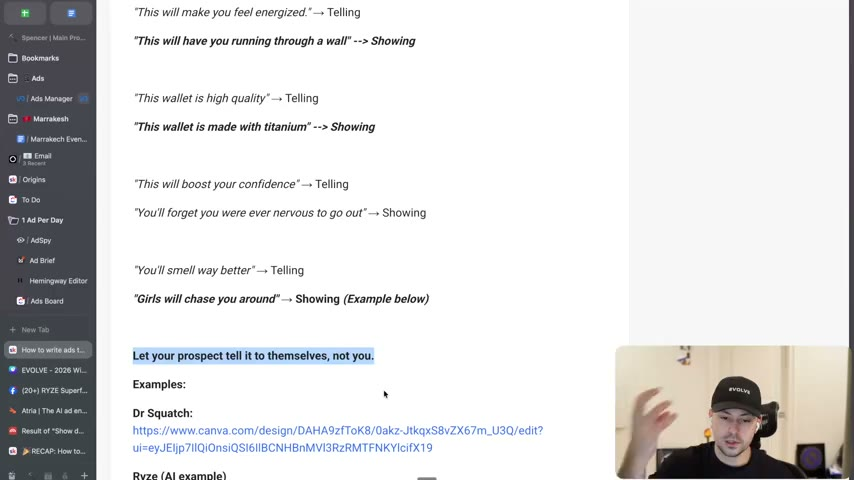
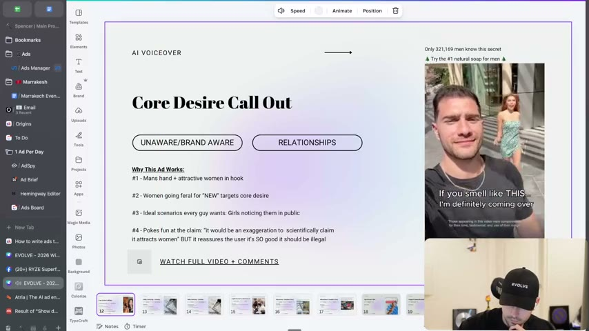
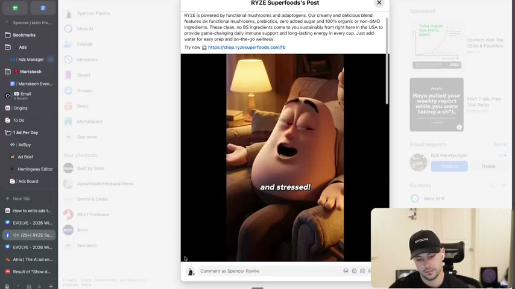
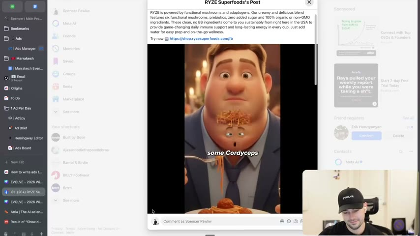

# 32. How to write ads that show and don't tell
> When you cannot demonstrate the benefit on camera, write it visually: replace abstract benefit claims ("makes you feel energized") with concrete experiences, behaviours and desires ("have you running through a wall") so the prospect "tells it to themselves" instead of you telling them.

## 🤖 Agent use
- **Use when:** polishing hook lines, body copy, on-screen text and voiceover where a benefit is stated abstractly; writing UGC script lines that put the desire or experience into words.
- **Inputs → outputs:** a draft line that claims a benefit ("builds confidence", "high quality", "smells better") → a concrete rewrite that shows the behaviour or fact that implies it ("you'll forget you were ever nervous to go out", "made with titanium", "girls will chase you around").
- **Rules:**
  - **DO** write "the experience, write the behavior, write the new desire". [00:00-00:53]
  - **DO** stop writing abstract benefits: "telling will trigger the logical brain" (skepticism); showing lets the prospect "make the assumption". [00:00-02:35]
  - **DO** state concrete facts that imply the benefit ("made with titanium" implies high quality). [01:45-02:35]
  - **DO** ask of every line "how could I write this more visually... in a way where people can see it?" and "am I telling here or am I showing?" [02:35-05:50]
  - **DO** write the outcome scenario as a conditional ("If you smell like this, I'm definitely coming over", "I will hunt you down"). [03:33-04:31]
  - **IF** an outrageous claim makes the ad memorable **THEN** neutralise it with an acknowledgement ("that would be an exaggeration") while keeping the vivid outcome. [03:33-04:31]
  - **IF** the benefit is invisible **THEN** consider personifying the body part or problem (AI-animated organs speaking to the viewer). [04:31-05:50]
  - **DON'T** assume you cannot show the benefit; if you are creative enough you can find a way (as in the previous lesson). [00:00-00:53]
- **See also:** [31. How to create ads that show, don't tell](31-how-to-create-ads-that-show-dont-tell.md) · [10. Why you need to write facts](10-why-you-need-to-write-facts.md) · [33. How to use metaphors, similes, analogies](33-how-to-use-metaphors-similes-analogies.md) · [Fluency mechanism](../../../../concepts/fluency-mechanism.md)

Credits on the lesson page: "Kyle Miligan, Harry Dry". The instructor says "credit to Harry as always" and that Harry calls this writing "more concrete". [00:00-00:53]

## Key ideas

### 1. The problem: telling benefits triggers the logical brain [00:00-00:53]
- "Most of you copywriters will tell benefits." Page text: "telling triggers the logical brain (skepticism)". [00:00-00:53; page text]
- The fix is to "write visually": "Write the experience, write the behavior, write the new desire." TL;DR: "stop writing so abstract and stop telling benefits and just write the benefits out." [00:00-00:53]
- He frames "I can't show it" as a limiting belief; he points back to the Goli example in the previous lesson ("as you saw with Gully", Whisper's spelling) to say creative advertisers find a way to show. [00:00-00:53]

### 2. Tell → show pairs [00:53-02:35]
- "This will make you feel energized" (telling: "I don't know what that means") → "This will have you run through a wall" (showing). It also suggests a video: someone drinking the drink or scooping the powder, then sprinting through a wall; "You can use AI if you want to be creative." The viewer assumes the person is energized, feels strong, "maybe they're kind of crazy". [00:53-01:45]
- "The wallet is high quality" (telling) → "The wallet is made with titanium" (showing). "This is a great example of why facts are so important": state the fact and "people will create the assumption that it's high quality". [01:45-02:35]
- "This will boost your confidence" (telling) → "You'll forget you were ever nervous to go out" (showing); the person is not nervous, so they are confident. [01:45-02:35]
- "You'll smell way better" (telling) → "Girls will chase you around" (showing); the Dr. Squatch example comes next. [02:35]
- Principle: "Let your prospects tell it to themselves, not you." [02:35]

*The lesson page on screen with the paired lines: energized / run through a wall, wallet / titanium, confidence / forget you were nervous, smell better / girls will chase you around, and the line "Let your prospect tell it to themselves, not you." [02:40]*

### 3. Example: Dr. Squatch cologne ad (Whisper heard "Dr. Squash") [02:35-04:31]
- Opening line the instructor reads out: "Packs of women are going feral for this new Dr. Squatch scent." "Think about how visual this is." [02:35-03:33]
- The ad transcript he plays (machine-transcribed, with errors): "If you smell like this, I'm definitely coming over. I will hunt you down. ... What if I told you there was a cologne scientifically proven to attract women? That would be an exaggeration, obviously. But this Dr. Squatch cologne smells so good, it should be illegal." [02:35-03:33]
- What he likes: (a) the outrageous claim is undercut with "obviously that would be an exaggeration" but "it should be illegal" keeps the vivid line; (b) the on-screen words are about outcomes: "If you smell like this, I'm definitely coming over" / "I will hunt you down" - "They're writing the desire. They're writing the experience. They're not just saying you're going to smell better." [03:33-04:31]
- His own teardown slide (in the course's example deck) lists "Why This Ad Works": #1 man's hand + attractive woman in hook; #2 women going feral for "NEW" targets core desire; #3 ideal scenarios every guy wants: girls noticing them in public; #4 pokes fun at the claim: "it would be an exaggeration to scientifically claim it attracts women" but it reassures the user it's so good it should be illegal. Tags: UNAWARE/BRAND AWARE; RELATIONSHIPS; "Core Desire Call Out"; "AI VOICEOVER". [03:18, slide]

*A teardown slide from the instructor's deck, opened in Canva: "Core Desire Call Out", tags UNAWARE/BRAND AWARE and RELATIONSHIPS, four "Why This Ad Works" points, and the hook frame "If you smell like THIS... I'm definitely coming over". The ad's overlay text beside the video reads "Only 321,169 men know this secret" and "Try the #1 natural soap for men". [03:18]*

### 4. Example: Ryze Superfoods AI ad (Whisper heard "Rise") [04:31-05:50]
- He calls it a "phenomenal example of just taking things to the highest extreme of writing visually and also showing visually", "using AI to make ads that only AI can make". Brand name is read from the on-screen post title "RYZE Superfoods' Post" and the lesson page "Ryze (AI example)". [03:33-04:31]
- Format: animated organs and body parts speak to the viewer in first person and ask for a specific ingredient. Lines from the played clip (machine-transcribed): "Stop starving me. You're making things worse. I'm chubby because your cortisol is high and now you're spiking it even higher because I'm hungry and stressed. I'm gonna keep on clinging on to all this belly fat until I feel safe again. Please give me some reishi and I'll get rid of all this stuff."; "Stop scraping me with that hard metal thing. You don't need to do all of that to see your jawline again. Our lymphatic system is backed up. Please just give me some cordyceps to help get rid of all that trap fluid."; "I'm not gonna tell you to lay off the alcohol because you're an adult, but I'm gonna keep getting darker unless I get some support. If you wanna help me out, give me some shiitake to support." [03:33-05:01]
- He says the version with the droopy eyes is "even better". [05:01-05:50]
- Why: people can literally see the insecurity speaking ("please help me"); the format is an animated joke; "Objections become slightly less" and you are "forcing the person to categorize what this means rather than you categorizing it for them". [05:01-05:50]

*Frame from the Ryze AI ad (the post is opened in a Facebook viewer titled "RYZE Superfoods' Post"): an animated character talks in first person; subtitle "and stressed!". [04:31]*

*Second Ryze frame: an animated man's face asks for "some Cordyceps". The ingredient request is the pitch inside the personification. [04:51]*

### 5. Why showing converts [05:01-05:50]
- Rule of thumb: "the more that you can show rather than tell, the better you are going to be." [05:01-05:50]
- When people can see themselves in a line it "triggers more of the emotional brain rather than the logical brain". People "are always going to assume that you're going to tell them that your thing is better, faster, bigger and easier", so showing stands out. [05:50-06:16]

## Steps / framework
1. Underline every benefit word in the draft (energized, confident, quality, better, easy).
2. For each, write: the behaviour the person does afterwards, the experience they have, or the fact that implies the benefit.
3. Prefer facts and scenes over adjectives ("titanium", "girls will chase you around", "forget you were nervous").
4. Phrase outcomes as conditionals or short scenes ("If you smell like this...").
5. If the claim is outrageous, add a self-aware line that defuses it.
6. Optional: for invisible/internal problems, personify the body and let it speak (AI-generated).

## Examples
| Telling | Showing | Source |
|---|---|---|
| "This will make you feel energized." | "This will have you running through a wall." | [00:53-01:45; page text] |
| "This wallet is high quality." | "This wallet is made with titanium." | [01:45-02:35; page text] |
| "This will boost your confidence." | "You'll forget you were ever nervous to go out." | [01:45-02:35; page text] |
| "You'll smell way better." | "Girls will chase you around." | [01:45-02:35; page text] |
| (Dr. Squatch) "smells good" | "If you smell like this, I'm definitely coming over. I will hunt you down." / "Packs of women are going feral for this new [Dr. Squatch] scent" | [02:35-04:31] |
| (Ryze) "reishi supports stress/cortisol" | "Stop starving me... I'm gonna keep on clinging on to all this belly fat until I feel safe again. Please give me some reishi" | [04:31-05:01] |

## Structured units

### Hooks
| Hook | Heuristic(s) | Emotion / zone | Self targeted | Why it works | Source |
|---|---|---|---|---|---|
| "Packs of women are going feral for this new Dr. Squatch scent." | Desire call-out; novelty ("new") | Desire / social status (derived) | — | Visual, specific, scene-like | [02:35-03:33] |
| "If you smell like THIS... I'm definitely coming over" (on-screen) | Outcome conditional | Desire (derived) | — | Writes the desired experience, not "smell better" | [03:33-04:31] |
| "What if I told you there was a cologne scientifically proven to attract women? That would be an exaggeration, obviously. But this... smells so good, it should be illegal." | Claim + defuser | Amusement (derived) | — | Outrageous claim made safe with humour | [03:33-04:31] |
| "Stop starving me. You're making things worse." (body speaking) | Personification | Guilt / humour (derived) | — | Insecurity becomes a character; AI-only visual | [04:31-05:01] |

### Rewrites
| Before | After | What changed | Source |
|---|---|---|---|
| "This will make you feel energized" | "This will have you running through a wall" | Abstract feeling → vivid behaviour | [00:53-01:45] |
| "This wallet is high quality" | "This wallet is made with titanium" | Adjective → fact | [01:45-02:35] |
| "This will boost your confidence" | "You'll forget you were ever nervous to go out" | Trait → behaviour | [01:45-02:35] |
| "You'll smell way better" | "Girls will chase you around" | Benefit → social outcome | [01:45-02:35] |

### Ad teardowns
| Brand / product (niche) | Format | Hook / opening | What works | What fails | Fix suggested | Principle | Source |
|---|---|---|---|---|---|---|---|
| Dr. Squatch (men's soap/cologne) | Video, AI voiceover (per slide) | Man's hand + attractive woman; "If you smell like this, I'm definitely coming over" | Core desire call-out; outcome-writing; self-aware exaggeration line | — | — | Show the desire | [02:35-04:31; slide] |
| Ryze Superfoods (functional mushrooms and adaptogens, per the post text on screen) | AI-animated video | Animated belly/jaw/liver speak: "Stop starving me" | Visualised insecurities; ingredient pitch inside the joke | — | — | Show visually, "ads that only AI can make" | [04:31-05:50] |

### Templates
| Template | Use for | Example fill | Source |
|---|---|---|---|
| "This will have you [extreme visible behaviour]" | Replace "feel [adjective]" | "...running through a wall" | [00:53] |
| "This [product] is made with [specific fact]" | Replace "high quality" | "...titanium" | [01:45] |
| "You'll forget you were ever [negative state]" | Replace "boost your [trait]" | "...nervous to go out" | [01:45] |
| "If you [do X], [desired outcome in someone else's words]" | Outcome conditional | "If you smell like this, I'm definitely coming over" | [03:33] |
| "[Body part] speaking: 'Stop [harmful habit]... Please give me some [ingredient]'" | AI personification of an internal problem | Ryze ad | [04:31] |

## Screenshots
Four frames are embedded above (tell/show list, Dr. Squatch slide, two Ryze frames). The Dr. Squatch ad's own video clip is only partly visible in the recording.

## How to apply
- [ ] Highlight abstract benefit words in each draft and rewrite each as a behaviour, fact or scene.
- [ ] Add at least one fact that implies the benefit (material, number, test).
- [ ] For hooks, write the outcome as a short conditional or scene.
- [ ] If the claim is exaggerated, add a line of self-awareness; keep real claims substantiated.
- [ ] For invisible benefits, brief an AI-animated personification variant and test it against a talking-head variant.
- [ ] Record which lines were "showing" vs "telling" in the test log.

## Related
- Previous: [31. How to create ads that show, don't tell](31-how-to-create-ads-that-show-dont-tell.md) · Next: [33. How to use metaphors, similes, analogies](33-how-to-use-metaphors-similes-analogies.md)
- [10. Why you need to write facts](10-why-you-need-to-write-facts.md) · [35. How to write unaware ads (hooks)](35-how-to-write-unaware-ads-hooks.md) · [Heuristics](../../../../concepts/heuristics.md)

## Sources and limitations
- Transcript: [32. How to write ads that show and don't tell….txt](<../../../../../raw/evolve/copywriting/_transcripts/✍️ Evolve Copywriting (NEW)/32. How to write ads that show and don't tell ✍️ Evolve Copywriting (NEW) Evolve.txt>) · Page text: [32. ….html.md](<../../../../../raw/evolve/copywriting/_extracted/✍️ Evolve Copywriting (NEW)/32. How to write ads that show and don't tell_✍️ Evolve Copywriting (NEW)_Evolve.html.md>)
- Machine transcription (Whisper large-v3-turbo). Full recording covered (last segment 6:16 of 6:16). Whisper heard "Dr. Squash" for Dr. Squatch, "Rise" for Ryze, "Gully" for Goli, "Ten out of time, guys" (unclear audio from the clip). The ad quotations are the recording's played audio, transcribed by machine, not the brand's script.
- The "Why This Ad Works" points come from an on-screen slide that is only partly legible; the page text links to the Canva deck and Facebook post, neither of which is in the course files.
