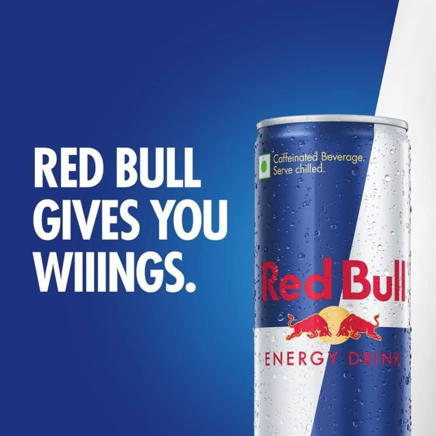
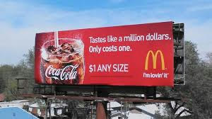
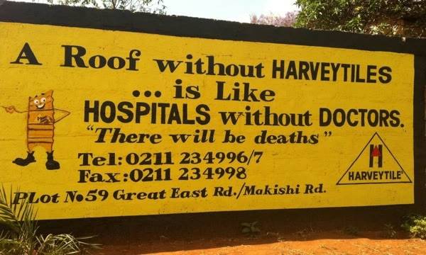
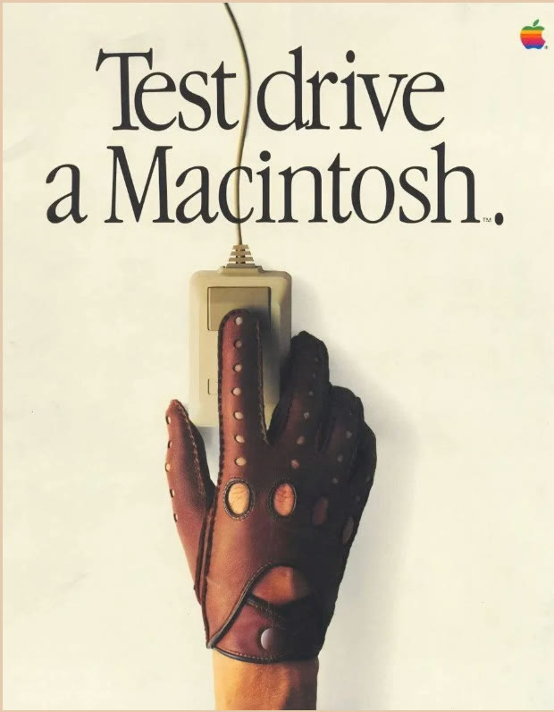
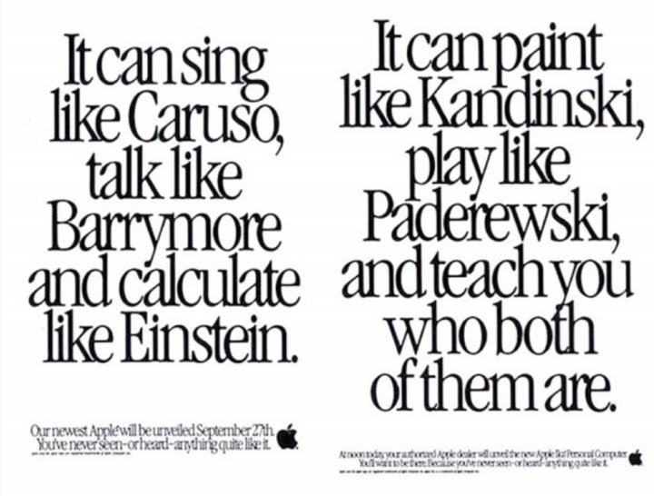
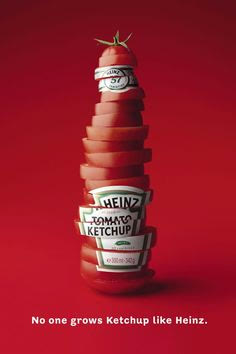
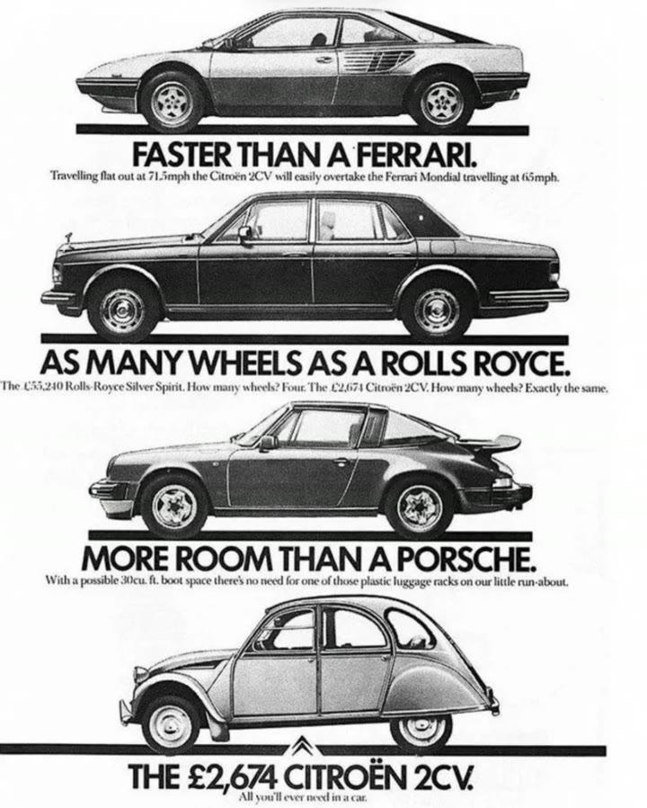

# 33. How to use metaphors/similes/analogies
> Comparisons let you borrow context and credibility from something the customer already understands, make complex things simple, and reframe why old solutions fail; the instructor defines metaphor, simile and (in his non-poet version) analogy and walks through classic print and billboard examples.

## 🤖 Agent use
- **Use when:** a claim is abstract, technical or easy to doubt; writing hooks and body lines that must be understood in one beat; explaining a mechanism or an ingredient; reframing why a customer's current solution fails.
- **Inputs → outputs:** a plain claim or mechanism ("fits well", "this enzyme does X", "pee pads don't work") → three variants (metaphor, simile, analogy) plus a pick, each pointing to a familiar thing with the right valence (positive for the product, extreme for the problem).
- **Rules:**
  - **DO** use a comparison to "allow the customer to get context from their own brain and from their own experiences". [00:00-01:17]
  - **DO** use comparisons to make complex science simple: "this little enzyme is like [familiar thing]". [12:44]
  - **DO** use them to reframe why old solutions fail (escalate the comparison: traditional pee pads "like walking in the Amazon barefoot"). [12:44-13:29]
  - **DO** make the customer feel smart; "You don't want to talk to your customer like they're dumb." [00:41-01:17]
  - **DO** choose the associated thing for its feeling: a million dollars is great; flying a plane without a license is severe. [04:15-04:57; 06:29-07:15]
  - **IF** you want a softer, less claim-like line **THEN** use a metaphor ("a glove for your foot"): skepticism rises less than with a direct claim. **IF** you want clarity **THEN** use a simile ("fits like a glove"). [02:45-03:27]
  - **DON'T** use a poetic analogy form ("A is to B as C is to D"): "Nobody would ever say this." Use the practical form: "X is like Y". [03:27-04:15]
  - **DON'T** treat a comparison as strict proof; it creates an association, so pick a good one: "We want to create a good association." [05:36]
  - **IF** you search for inspiration **THEN** look at what big brands did when they were "on the come up" (older print ads), not what they do now, because today they "just reinforce position". [07:15-08:06]
- **See also:** [31. How to create ads that show, don't tell](31-how-to-create-ads-that-show-dont-tell.md) · [32. How to write ads that show and don't tell](32-how-to-write-ads-that-show-and-dont-tell.md) · [14. Why you need to use unique mechanisms](14-why-you-need-to-use-unique-mechanisms.md) · [Perception management](../../../../concepts/perception-management.md) · [Fluency mechanism](../../../../concepts/fluency-mechanism.md)

Credit on the lesson page: "Sarah Levinger" (the instructor says "credit to Sarah" for the shoe-ad glove example [01:17-01:51]); ad inspiration credit: https://www.playforthoughts.com/blog/the-best-print-ads. The instructor describes himself as not an English major and says he uses analogies "the logic way", not as a poet. [00:00]

## Key ideas

### 1. Why use them [00:00-01:17]
- "Some of the best marketing that has ever been done has come from leveraging metaphors and... similes and analogies." [00:00-00:41]
- They let you "borrow credibility in a weird way just by comparing it to something" and let the customer supply context from their own brain; "sometimes very complex things sound simple". [00:00-00:41]
- Page-text summary: use them to (1) provide context for the brain to draw from, (2) make complex science simple, (3) reframe why old solutions failed. [page text; 01:17]

### 2. Definitions with the shoe example [01:17-03:27]
- **Metaphor:** a symbolic comparison saying one thing is another: "A glove for your foot" (from a shoe ad, credit Sarah). The shoe is obviously not a glove; "what is your copy communicating? Not what does your copy say?" Metaphors take "a little bit more brainpower" but often beat blatant claims because the reader makes the claim in their own mind ("a glove for your foot, oh, they must fit really good"). [01:17-02:45]
- **Simile:** a direct comparison using "like" or "as": "Fits your foot like a glove". It is clearer but "becomes more of a claim"; "my skepticism raises when I see this claim versus this one". The choice is up to you. [02:45-03:27]
- **Analogy:** strictly "A is to B as C is to D" ("a sock is to a foot as a glove is to a hand"); the problem is "we're not doing poetry". His working definition: an analogy is metaphor and simile combined into a statement such as "This shoe fits your foot like a glove fits your hand". [03:27-04:15]
- Better, relatable analogy: "Trying to write winning ads without copywriting fundamentals is like trying to fly a plane without a license." The brain assumes severity and "I'm able to pull this kind of severity or... authority" from the comparison; "just like how you need a license to fly a plane, you need copywriting fundamentals to make winning ads." [04:15-05:36]
- Summary line (page text, also spoken): "The metaphor version requires an extra mental step, but all versions allow our brain to compare to something it knows and is familiar with to create an association with your product." [05:36]

### 3. The worked examples (page images) [05:36-12:00]
- **Red Bull, "gives you wings":** metaphor, wings = energy. The instructor notes they got sued and had to add disclaimers, but it is "phenomenal branding... great positioning and great marketing". [05:36-06:29]
- **McDonald's, "Tastes like a million dollars. Only costs one." ($1 any size, with a Coca-Cola):** simile; a million dollars is a good thing; the juxtaposition ("tastes like a million, only costs one") creates a big gap that the Coke fills. [06:29-07:15]
- **Harvey Tiles billboard, "A roof without Harvey Tiles is like hospitals without doctors. There will be deaths":** analogy for the importance of tiles. The transcript has "There will be dust", which is likely a Whisper mishearing; the billboard as pictured reads "There will be deaths". Extreme and visual; it makes you curious about the tiles. [06:29-07:15]
- **Apple, "Test drive a Macintosh":** metaphor; test drive is associated with cars, a premium, big-investment purchase, so the premium feeling transfers to a computer. [07:15-08:48]
- **Apple, "It can sing like Caruso, talk like Barrymore, and calculate like Einstein... paint like Kandinsky, play like Paderewski, and teach you who both of them are":** "simile on simile on simile", creating a visual and teaching you what the machine does. The instructor says Apple had to draw from things people knew to explain a new thing. [08:48-09:26]
- **Heinz, "No one grows ketchup like Heinz":** a visual metaphor; the ketchup bottle is a sliced tomato with a stem on top (made with real tomatoes = quality ingredients), plus the headline signals category dominance. Page: "Line + Visual = Quality ingredients + category dominance". [09:26-10:18]
- **Citroen 2CV, "Faster than a Ferrari / As many wheels as a Rolls Royce / More room than a Porsche":** simile series; borrows authority from famous brands and jokes; "The £2,674 Citroen 2CV. All you'll ever need in a car." The instructor says $55,000 and $2,600 and "2.6 thousand pound"; the ad image shows GBP prices (£55,240 and £2,674). [10:18-12:00]

### 4. Applying it now [12:00-13:58]
- "Making a complex science simple": "this specific enzyme does this thing" becomes "this little enzyme is like this thing for a car" (hypothetical, instructor says there are many such examples "in the winning ads doc"; not shown). [12:00-12:44]
- "Reframing why old solutions failed": "using traditional pee pads, that's like walking in the Amazon barefoot" with escalation. [12:44-13:29]
- Big brands run whole campaign series on this contrast: an insurance company ad where the character made a great decision to switch car insurance but "didn't make a great decision by leaving the gate open for the bull at my barn" (told from memory; brand not named). [13:29-13:58]

## Steps / framework
1. Pick the claim to land (fit, energy, quality, importance, difficulty).
2. Find a familiar thing whose known feeling matches: comfortable glove, wings, million dollars, hospital without doctors, test drive.
3. Choose the form: metaphor (X is Y, more skeptical-proof), simile (X like Y, clearer), analogy (X without Y is like [extreme thing]).
4. For problems, escalate the comparison (see [30. How to raise the stakes](30-how-to-raise-the-stakes.md)); for products, pick a positive association.
5. Pair the line with a visual when possible (Heinz tomato bottle; Harvey Tiles sign).
6. Check what the copy communicates, not only what it says. [01:51]

| Form | Definition (instructor) | Example from the lesson | Effect |
|---|---|---|---|
| Metaphor | Symbolic comparison; one thing is another | "A glove for your foot"; "Red Bull gives you wings"; "Test drive a Macintosh" | Takes an extra mental step; reader makes the claim themselves |
| Simile | Direct comparison with "like" or "as" | "Fits your foot like a glove"; "Tastes like a million dollars"; "It can sing like Caruso..." | Clearer, but reads more like a claim |
| Analogy | Metaphor + simile in one statement (relationship between relationships) | "This shoe fits your foot like a glove fits your hand"; "like trying to fly a plane without a license"; "like hospitals without doctors" | Escalates severity or borrows authority |

## Examples
Every comparison from the lesson is in the table above and in the ad table below.

*Skool image 1: the Red Bull metaphor ad (headline as pictured: "RED BULL GIVES YOU WIINGS."). Wings = energy. [05:55]*

*Skool image 2: McDonald's billboard, "Tastes like a million dollars. Only costs one. $1 ANY SIZE", with a Coca-Cola cup. A simile with a price juxtaposition. [06:15]*

*Skool image 3: "A roof without HARVEYTILES is like HOSPITALS without DOCTORS. There will be deaths." Analogy through extreme comparison. [06:50]*

*Skool image 4: Apple print ad "Test drive a Macintosh." (a driving glove holding a mouse). Metaphor: test drive = premium, big-purchase experience. [07:50]*

*Skool image 5: Apple text ad with a chain of similes ("It can sing like Caruso, talk like Barrymore and calculate like Einstein. It can paint like Kandinsky, play like Paderewski, and teach you who both of them are."). [08:48]*

*Skool image 6: Heinz visual metaphor, a ketchup bottle formed from sliced tomato with the line "No one grows ketchup like Heinz." Quality ingredients plus category dominance. [09:26]*

*Skool image 7: the Citroen 2CV print ad with the Ferrari, Rolls Royce and Porsche rows; "THE £2,674 CITROEN 2CV. All you'll ever need in a car." Borrowed authority through humorous similes. [10:40]*

## Structured units

### Templates
| Template | Use for | Example fill | Source |
|---|---|---|---|
| "A [familiar object] for your [thing]" (metaphor) | Fit/comfort/protection | "A glove for your foot" | [01:17] |
| "[Product] [verb] like [familiar thing]" (simile) | Clear, positive association | "Fits your foot like a glove"; "Tastes like a million dollars" | [02:45; 06:29] |
| "[Doing X] without [Y] is like [extreme familiar bad thing]" (analogy) | Severity, importance, reframing | "Writing winning ads without copywriting fundamentals is like flying a plane without a license"; "A roof without Harvey Tiles is like hospitals without doctors" | [04:15; 06:29] |
| "[Verb]-ing with [old solution] is like [absurd activity]" | Reframe why old solutions fail | "Using traditional pee pads is like walking in the Amazon barefoot" | [12:44] |
| "[Faster/more/as many] than [famous bigger thing]" | Borrowed authority with humour | "Faster than a Ferrari" | [10:18] |
| "[Verb] a [product]" with a premium-context verb | Metaphor of an experience | "Test drive a Macintosh" | [07:15] |

### Ad teardowns
| Brand / product (niche) | Format | Hook / opening | What works | What fails | Fix suggested | Principle | Source |
|---|---|---|---|---|---|---|---|
| Red Bull (energy drink) | Print/outdoor | "Red Bull gives you wings" | Wings = energy; instantly visual | Legal pushback; disclaimers added (instructor claim) | Avoid literal health overclaims (derived) | Metaphor | [05:36-06:29] |
| McDonald's (fast food) | Billboard | "Tastes like a million dollars. Only costs one." | Positive simile plus price gap | — | — | Simile | [06:29-07:15] |
| Harvey Tiles (roofing) | Billboard | "A roof without Harvey Tiles is like hospitals without doctors" | Extreme, visual severity | — | — | Analogy | [06:29-07:15] |
| Apple Macintosh (computers) | Print | "Test drive a Macintosh" | Premium purchase context transferred | — | — | Metaphor | [07:15-08:48] |
| Apple Macintosh | Print | "It can sing like Caruso..." | Chain of similes, teaches what the product does | — | — | Simile chain | [08:48-09:26] |
| Heinz (ketchup) | Print | "No one grows ketchup like Heinz" | Visual metaphor; quality and dominance | More complex than the others (instructor) | — | Visual metaphor | [09:26-10:18] |
| Citroen 2CV (cars) | Print | "Faster than a Ferrari" | Humorous similes borrow authority | — | — | Simile with borrowed authority | [10:18-12:00] |

### Hooks
| Hook | Heuristic(s) | Emotion / zone | Self targeted | Why it works | Source |
|---|---|---|---|---|---|
| "Trying to write winning ads without copywriting fundamentals is like trying to fly a plane without a license" | Severity analogy (derived) | Alarm (derived) | — | Imports the danger of an unlicensed pilot | [04:15-05:36] |
| "Test drive a Macintosh" | Premium framing (derived) | Aspiration (derived) | — | Transfers car-buying seriousness | [07:15-08:48] |

## Screenshots
Seven ad images are embedded above in Examples.

## How to apply
- [ ] For each abstract claim, write a metaphor, a simile and an analogy; choose one.
- [ ] Check the comparison point has the right valence and is familiar to the target avatar.
- [ ] For product-vs-old-solution lines, escalate the old solution ("like walking in the Amazon barefoot") rather than attacking by name.
- [ ] Add a visual that makes the comparison literal when possible.
- [ ] Avoid overclaims that create legal or regulatory exposure (Red Bull example).
- [ ] When researching, look at older ads of brands that were growing, not current maintenance advertising.

## Related
- Previous: [32. How to write ads that show and don't tell](32-how-to-write-ads-that-show-and-dont-tell.md) · Next: [34. How to write with labels & customer language](34-how-to-write-with-labels-customer-language.md)
- [10. Why you need to write facts](10-why-you-need-to-write-facts.md) · [Native advertising](../../../../concepts/native-advertising.md)

## Sources and limitations
- Transcript: [33. How to use metaphors similes analogies….txt](<../../../../../raw/evolve/copywriting/_transcripts/✍️ Evolve Copywriting (NEW)/33. How to use metaphors similes analogies ✍️ Evolve Copywriting (NEW) Evolve.txt>) · Page text: [33. ….html.md](<../../../../../raw/evolve/copywriting/_extracted/✍️ Evolve Copywriting (NEW)/33. How to use metaphors_similes_analogies_✍️ Evolve Copywriting (NEW)_Evolve.html.md>)
- Machine transcription (Whisper large-v3-turbo). Full recording covered (last segment 13:57 of 13:58). Whisper wrote "Harvey tiles" (the sign reads HARVEYTILES), "Paterwisky" (the ad reads Paderewski), "Citra on" and "Citron" for Citroen, "assembly for it tastes great" (likely "a simile for it tastes great"). The Citroen row prices are in pounds in the ad image; the instructor reads dollars.
- Image timestamps are the moments the lesson text describes each example and are approximate. The "winning ads doc" and the "where to find great ads" site he mentions are not part of this lesson's files.
