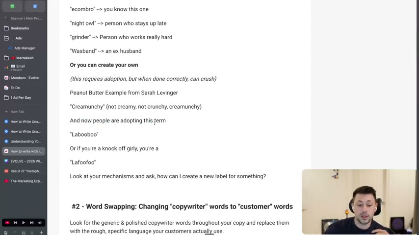
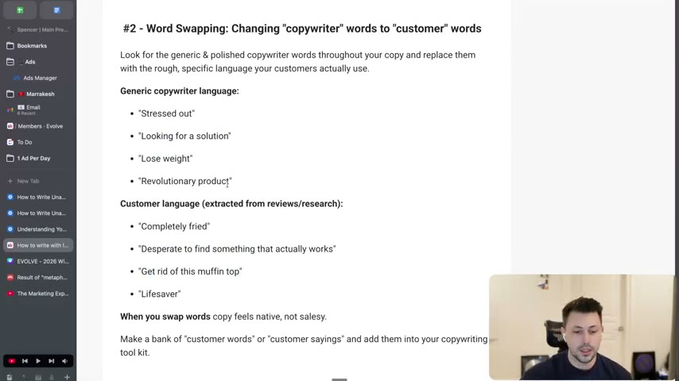
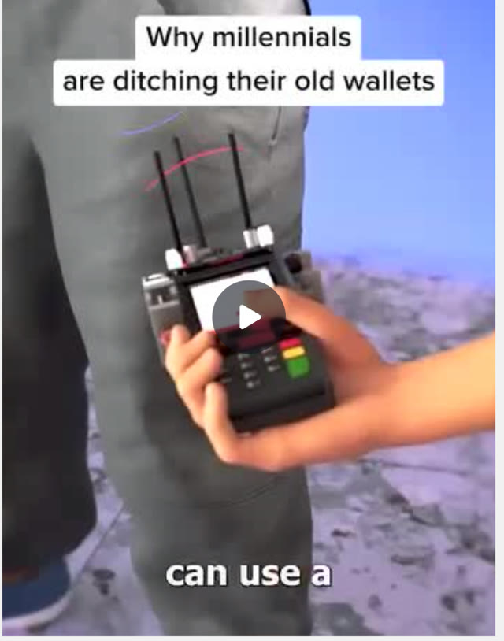
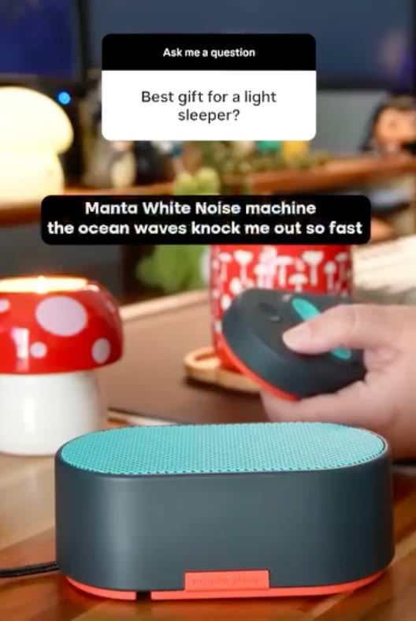
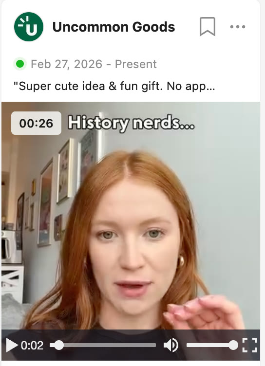
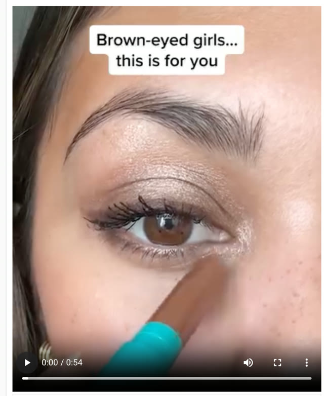
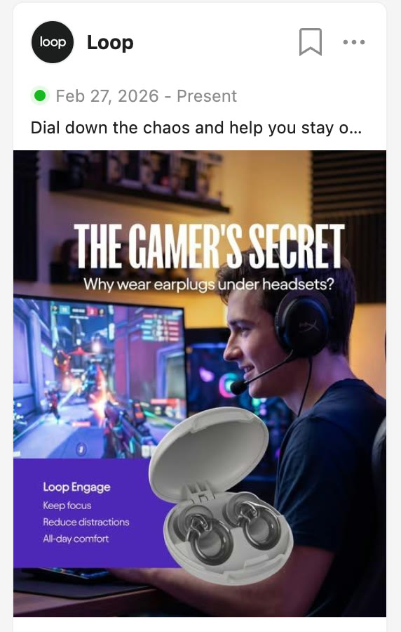

# 34. How to write with labels & customer language
> Stop writing "copywriter language": call out the audience with the labels they use for themselves (in the hook), invent your own label when you can, and swap polished generic words for the rough words customers actually use, which builds trust and grabs attention.

## 🤖 Agent use
- **Use when:** writing hooks and body copy for a defined avatar; proofing a draft for generic copywriter phrases; building a customer-language bank from reviews, Reddit and comments; naming a mechanism or avatar.
- **Inputs → outputs:** avatar/niche + customer research (reviews, Reddit threads, comments, survey answers) → (a) a list of self-identifying labels (found and coined), (b) a customer-language bank (generic copywriter word beside real customer wording), (c) rewritten copy using them.
- **Rules:**
  - **DO** write with customer quotes, not a thesaurus: "You shouldn't use a thesaurus to sound smarter. You should use customer quotes to sound more like them." [00:00-00:53]
  - **DO** use customer words because two things happen: trust ("You're speaking their dialect. So you're one of them, not selling them") and attention ("Their brain lights up when they see familiar language"). [00:53-02:21; page text]
  - **DO** call out the avatar with a label, ideally in the hook; labels also work inside the copy. [02:21; 06:51-07:36]
  - **DO** find labels (e.g. SAHM, ecom bro, night owl, grinder, wasband) or create your own from your mechanism, accepting that a coined label "requires adoption". [03:17-05:07]
  - **DO** run a word-swap pass after writing: find generic polished words and replace them with rough, specific customer language. [05:07-06:51]
  - **DO** keep a bank of customer words and sayings; "you'll start to notice that you'll start to talk like these customers". [06:51]
  - **DO** jot down any term you do not recognise during manual research: "If you don't recognize something, probably means you should jot it down." [08:08-08:57]
  - **DON'T** fear repelling people: labels "will definitely repel a lot of people but you'll also attract that specific group". [07:36-08:08]
  - **IF** a label stops the scroll **THEN** the bridge becomes important, to carry the person from the callout into the ad. [07:36-08:08]
- **See also:** [27. How to write a bridge](27-how-to-write-a-bridge.md) · [35. How to write unaware ads (hooks)](35-how-to-write-unaware-ads-hooks.md) · [17. Being aware of avatars](17-being-aware-of-avatars.md) · [Customer research stack](../../../../frameworks/customer-research-stack.md) · [Three selves](../../../../concepts/three-selves.md)

Credits in the video and page text: the instructor credits Harry (Dry) for the door-to-door-salesman point and "throw out the thesaurus", and Sarah (Levinger) for the labels material and the Creamunchy peanut-butter example. [00:00-00:53; 03:17-04:11; page text]

## Key ideas

### 1. Copywriter language vs customer language [00:00-00:53]
- "One of the biggest mistakes that I feel like copywriters make is writing in copywriter language instead of customer language." [00:00]
- Harry's door-to-door-salesman test: you would not say "the revolutionary all-in-one", you would say "plug this thing in and put it at the sky and it'll give you internet". [00:00-00:53]
- "Throw out the thesaurus": use your customer's language and "you'll probably write more effective copy". [00:00-00:53]

### 2. Why it works: trust and attention [00:53-02:21]
- Customers already have words for their problems, desires and identities. Using them yields (1) trust, speaking their dialect, and (2) attention, because familiar language lights up the brain ("those are my people"). [00:53-01:38; page text]
- Analogies he uses: answering a Dubai waiter in Arabic; bonding over "I used to play Fortnite" or "I'm an e-com". [00:53-02:21]

### 3. Way 1: labels (direct callouts, usually in the hook) [02:21-05:07]
- Labels = "the names that prospects had given themselves or basically the names that they identify as"; ask "what are the terms that these people own?" [02:21-03:17; page text]
- People love labels because (1) it is their identity/ego, (2) it builds community ("these are my people"), (3) the brain loves labels because they make communication easy. [02:21-03:17; page text]
- **Found labels** he lists: "SAHM" (stay-at-home mom; the page shows "sohm" and Whisper heard "SOM... stay at home month"), "ecom bro", "night owl" (stays up late; broader than the niche ones), "grinder" (works very hard), "wasband" (ex-husband; Whisper heard "husband"). [03:17-04:11; page text]
- **Created labels** need adoption "but when done correctly, it can crush": Creamunchy peanut butter ("not creamy, not crunchy, creamunchy", spoken as "curmunchy"; example from Sarah Levinger) and Labubu (with "Lafufu" for the knock-off). Labubu is the toy brand that made up its term; "now it's this identity... it's this label that people resonate with". [04:11-05:07; page text]
- Prompt to self: "Look at your mechanisms and ask, how can I create a new label for something?" [05:07; page text]


*Lesson page on screen: "You can either FIND labels" (sohm, ecombro, night owl, grinder, Wasband) and "Or you can create your own" (Creamunchy, Labubu, Lafufu). [04:30]*

### 4. Way 2: word swapping [05:07-06:51]
- After writing, proof the copy: find "the generic and polished copywriter words" and "replace them with the rough, specific language and customer quotes that your potential customers actually use". [05:07-06:00]
- Generic → customer pairs (page text; instructor reads them at 06:00): "Stressed out" → "Completely fried"; "Looking for a solution" → "Desperate to find something that actually works"; "Lose weight" → "Get rid of this muffin top"; "Revolutionary product" → "Lifesaver". [06:00; page text]
- Use AI for this: give Claude your brief and ask for generic copywriter words and customer-research-based replacements. "When words feel native and not salesy, they're just going to convert better." [06:00-06:51]
- Build a customer-words bank and plug words in when stuck. [06:51]


*Lesson page: "#2 - Word Swapping: Changing 'copywriter' words to 'customer' words", with the generic list (Stressed out, Looking for a solution, Lose weight, Revolutionary product) above the customer list (Completely fried, Desperate to find something that actually works, Get rid of this muffin top, Lifesaver). [06:00]*

### 5. Label examples from live ads [06:51-07:36]
- Ridge Wallet: "Why millennials are ditching their old wallets" (label: millennials).
- Manta Sleep: "Best gift for a light sleeper?" with "Manta White Noise machine, the ocean waves knock me out so fast" (label: light sleeper).
- Uncommon Goods: "History nerds..." (label: history nerds).
- Thrive Cosmetics: "Brown-eyed girls... this is for you" (label: brown-eyed girls).
- Loop: "The gamer's secret. Why wear earplugs under headsets?" (label: gamers). [06:51-07:36]
- These are "more direct avatar call-outs"; also seen: "moms of 15 year olds". [07:36-08:08]

### 6. Where to find labels and customer language [08:08-09:25]
- **Urban Dictionary** is "one of the most interesting places" to find labels. Prompt 1 tells Claude to search it and source the labels. [08:08-08:57]
- **Prompt 2** has Claude scour the internet (Amazon reviews, Reddit, comments) for customer language and labels; you can also paste Facebook comments into Claude and ask it to identify customer language or labels. [08:08-08:57]
- "It's not a very complex prompt": insert your niche and avatar, "let it do its thing", get labels "that you can at least test" and customer language to jot down. [08:57-09:25]
- During manual research and avatar building, write down terms and labels you see. [08:08-08:57]

## Steps / framework
1. Identify the avatar and mechanism (see [17](17-being-aware-of-avatars.md) and [19](19-being-aware-of-mechanisms.md)).
2. Run Prompt 1 (labels from Urban Dictionary) and Prompt 2 (internet research) from this page; add your own manual notes.
3. Pick one label for the hook call-out; test a coined label only if it is easy to adopt.
4. Write the ad; then run a word-swap pass: list generic phrases; replace each with a customer phrase from the bank.
5. Add the bridge after the call-out so the reader keeps going. [07:36-08:08]
6. Save new phrases to the customer-language bank for the next brief.

## Examples
| Brand | Label | On-screen line | Source |
|---|---|---|---|
| Ridge Wallet (wallets) | millennials | "Why millennials are ditching their old wallets" | [06:51; page text] |
| Manta Sleep (sleep masks / white noise) | light sleeper | "Best gift for a light sleeper?" | [07:00; page text] |
| Uncommon Goods (gifts) | history nerds | "History nerds..." | [07:10; page text] |
| Thrive Cosmetics (makeup) | brown-eyed girls | "Brown-eyed girls... this is for you" | [07:20; page text] |
| Loop (earplugs) | gamers | "The gamer's secret: why wear earplugs under headsets?" | [07:30; page text] |


*Skool image 1: Ridge Wallet video frame, text "Why millennials are ditching their old wallets" (label: millennials). [06:51]*


*Skool image 2: Manta Sleep video frame, "Ask me a question: Best gift for a light sleeper?" followed by "Manta White Noise machine the ocean waves knock me out so fast". [07:00]*


*Skool image 3: Uncommon Goods ad (Feb 27, 2026 - Present), video caption "History nerds..." with a gift pitch in the ad text. [07:10]*


*Skool image 4: Thrive Cosmetics video frame, text "Brown-eyed girls... this is for you". [07:20]*


*Skool image 5: Loop static ad, "THE GAMER'S SECRET - Why wear earplugs under headsets?", ad text "Dial down the chaos and help you stay o...". [07:30]*

## Structured units

### Hooks
| Hook | Heuristic(s) | Emotion / zone | Self targeted | Why it works | Source |
|---|---|---|---|---|---|
| "Why millennials are ditching their old wallets" | Label call-out + switching (derived) | Curiosity (derived) | — | Names the group and a behaviour change | [06:51] |
| "Best gift for a light sleeper?" | Label call-out | — | — | Self-identifying label (light sleeper) | [07:00] |
| "History nerds..." | Label call-out | — | — | Ownable tribe name | [07:10] |
| "Brown-eyed girls... this is for you" | Label call-out | — | — | Direct identity call-out | [07:20] |
| "The gamer's secret: Why wear earplugs under headsets?" | Label call-out | — | — | Names the avatar and a specific situation | [07:30] |

### Rewrites
| Before | After | What changed | Source |
|---|---|---|---|
| Stressed out | Completely fried | Customer wording | [06:00; page text] |
| Looking for a solution | Desperate to find something that actually works | Customer wording, more emotion | [06:00; page text] |
| Lose weight | Get rid of this muffin top | Specific, visual | [06:00; page text] |
| Revolutionary product | Lifesaver | Customer wording, no hype | [06:00; page text] |
| "the revolutionary all-in-one" | "plug this thing in and put it at the sky and it'll give you internet" | Door-to-door salesman voice | [00:00] |

### Templates
| Template | Use for | Example fill | Source |
|---|---|---|---|
| "[Label], this is for you" | Label call-out hook | "Brown-eyed girls... this is for you" | [07:20] |
| "Best gift for a [label]?" | Gift/label hook | "Best gift for a light sleeper?" | [07:00] |
| "Why [label] are ditching their old [product]" | Switching hook | "Why millennials are ditching their old wallets" | [06:51] |

## Prompts / templates (verbatim)
Source: the DOCX attachment (identical to the linked Google Doc `34-document-1DSuZsQFbT`, except that the Google Doc export omits the "Prompt For Internet" heading line). Square brackets mark placeholders for the user. Literal asterisks are in the source (Markdown-style bold) and are kept.

### Prompt For Labels
```text
You are a cultural language researcher specializing in online subcultures and identity terminology. I need you to search Urban Dictionary (https://www.urbandictionary.com/) and identify the most relevant **self-identifying label terms** that people in the **[INSERT AVATAR/NICHE]** community use to describe themselves.

Your goal is to surface the specific words, nicknames, slang, and identity terms that members of this group genuinely "own" — terms they use to self-identify, signal tribal membership, or describe their lifestyle/situation.

**What makes a strong label:**
- It's a term people use *about themselves*, not a term outsiders use to describe them
- It creates an "oh, that's me" recognition moment when someone reads it
- It signals community belonging (others are in my tribe)
- It's compact and memorable — often an acronym, portmanteau, or slang shorthand

**Reference examples of strong labels from other niches:**
- "SAHM" → stay-at-home mom
- "night owl" → person who stays up late
- "grinder" → someone who works relentlessly hard
- "wasband" → an ex-husband

**Your research task:**
Search Urban Dictionary for terms connected to [INSERT AVATAR/NICHE] and return a curated list of the strongest self-identifying labels you find. For each term include: the label itself, its definition, and a one-sentence note on why someone in this niche would proudly claim it as their own identity.

Prioritize terms with high upvotes on Urban Dictionary, as these signal genuine cultural adoption rather than fringe usage.
```

### Prompt For Internet
```text
You are a copywriting research specialist with deep expertise in voice-of-customer analysis and consumer psychology. Your task is to conduct live research across Reddit, online forums, review sites, and community spaces to build a practical copywriting intelligence report for my brand.

Your research has two distinct deliverables:

---

**PART 1: LABELS**

Search Reddit (relevant subreddits), Facebook groups, niche forums, and community spaces to identify the self-identifying terms, nicknames, and tribal labels my target audience uses to describe themselves.

For each label you find:
- State the label (e.g., "SAHM," "night owl," "grinder")
- Note where it appears and how frequently
- Explain what identity or community it signals
- Flag its copywriting application—how grabbing this label in a headline or hook would make the reader say *"that's me"*

Then, based on patterns you observe in the language and mechanisms these communities use, propose 2–3 **original labels I could create and own**—new terms that don't yet exist but would resonate deeply with this audience and have adoption potential. For each coined label, explain the insight behind it.

---

**PART 2: CUSTOMER WORDS & SAYINGS**

Search product reviews (Amazon, Reddit threads, forum posts, comment sections) for the raw, unpolished language real people use when describing their problem, their frustration, their desired outcome, and their experience with solutions.

Build a **Customer Language Bank** organized into categories:
- How they describe their pain/problem
- How they describe their ideal outcome
- How they describe products that worked or failed
- Repeated phrases, idioms, or sayings that show up organically

For each entry, show the **generic copywriter version** alongside the **real customer version** so the contrast is clear and the swap is obvious.

---

**HOW TO CONDUCT THE RESEARCH**

Use web search to pull live data. Prioritize:
- Reddit threads and comment sections in relevant subreddits
- Forum discussions (Quora, niche community boards)
- Amazon or product review sections if applicable
- Social media comment threads where the audience congregates

Cite your sources so I can verify and dig deeper.

The final output should be a ready-to-use copywriting swipe file—not an academic summary. Every label and phrase should be something I can drop directly into headlines, hooks, or ad copy.

**My brand/niche:** [INSERT YOUR BRAND, PRODUCT, OR TARGET AUDIENCE HERE]
```

### Word-swap prompt suggested in the video (not a written prompt)
The instructor suggests, in speech only, giving Claude your brief and asking "what are some of the generic copywriter words" and which words based on your customer research "sound more like our customer". [06:00-06:51] No exact wording is supplied; do not treat this as verbatim.

## Screenshots
Seven images are embedded above (two lesson-page frames, five ad images).

## How to apply
- [ ] Run Prompt For Labels and Prompt For Internet with the avatar/niche filled in; keep outputs as a labelled bank with source links.
- [ ] Choose one label for the hook; check that the avatar really uses it about themselves (not an outsider term).
- [ ] After drafting, list every generic phrase and replace it with a customer phrase from reviews/comments.
- [ ] Keep a running customer-language bank per avatar.
- [ ] For a coined label, plan how it will be repeated across ads to be adopted; test it as a separate variant.
- [ ] Add a bridge line right after a label call-out.

## Related
- Previous: [33. How to use metaphors, similes, analogies](33-how-to-use-metaphors-similes-analogies.md) · Next: [35. How to write unaware ads (hooks)](35-how-to-write-unaware-ads-hooks.md)
- [37. Evolve Writing Prompts](37-evolve-writing-prompts.md) · [Customer research stack](../../../../frameworks/customer-research-stack.md)

## Sources and limitations
- Transcript: [34. How to write with labels & customer language….txt](<../../../../../raw/evolve/copywriting/_transcripts/✍️ Evolve Copywriting (NEW)/34. How to write with labels & customer language ✍️ Evolve Copywriting (NEW) Evolve.txt>) · Page text: [34. ….html.md](<../../../../../raw/evolve/copywriting/_extracted/✍️ Evolve Copywriting (NEW)/34. How to write with labels & customer language_✍️ Evolve Copywriting (NEW)_Evolve.html.md>) · DOCX: [34. ….docx.md](<../../../../../raw/evolve/copywriting/_extracted/✍️ Evolve Copywriting (NEW)/34. How to write with labels & customer language.docx.md>) · Linked Google Doc (duplicate of the DOCX): [34-document-1DSuZsQFbT.docx.md](<../../../../../raw/evolve/copywriting/_extracted/_linked/google/34-document-1DSuZsQFbT.docx.md>)
- Machine transcription (Whisper large-v3-turbo). Full recording covered (last segment 9:25 of 9:25). Whisper heard "Ashley" for the credited name (likely "Harry"/"Sarah"; not resolved), "curmunchy"/"Cremontri" for Creamunchy, "SOM... stay at home month" for SAHM, "husband" for wasband, "Loop" and the others correctly. Spoken "Labubus" and "Lafufu" match the page.
- The prompts are copied from the DOCX XML, so the line breaks and the Markdown-style asterisks match the original; the DOCX heading "Prompt For Labels" is not shown in the pandoc conversion but is in the document. The instructor's frame at about 9:00 shows the Google Doc still loading; no screenshot is used.
