# 35. How to write unaware ads (hooks)
> Unaware ads target the 60%+ of the market not looking for a solution; they start with an identity-driven, product-free hook (hidden fear, hidden desire, "did you know", or debate), are camouflaged as content, and walk the viewer through problem, solution and product awareness inside one ad.

## 🤖 Agent use
- **Use when:** writing top-of-funnel hooks for cold traffic, scaling past a saturated problem-aware/solution-aware angle, tearing down competitor ads whose first seconds do not mention the product, or planning UGC/story ads where the opening must earn attention without selling.
- **Inputs → outputs:** an avatar/identity + a hidden fear, hidden desire, surprising fact or debate question related to the product's problem → 3-10 unaware hook options (each tagged with its opener type), plus the bridge path from hook to problem to solution to product.
- **Rules:**
  - **DO** forget the product in the hook: "forget about your product and concentrate just on your potential customer"; price, product name and benefits "mean nothing to them yet". [03:42-04:40]
  - **DO** make the hook's only job to "sell the remainder of the ad itself": get the person to keep watching or reading. [03:42-04:40; 05:55-06:44]
  - **DO** write the hook as the prospect's own headline, problem or state of mind "even if they don't know it's a problem yet", giving words to something they feel but have not articulated. [02:58-03:42]
  - **DO** pick an opener from the four types: hidden fear, hidden desire, did you know, debate. [06:44-07:42]
  - **DO** use the sequence in one ad: identity hook (unaware) -> problem/future problem (problem aware) -> types of solutions (solution aware) -> your product as best solution (product aware) -> an offer that makes impulse buying easy (most aware). [04:40-05:55]
  - **DO** make it feel like content (educational, entertaining, a story, information people want): "they don't feel like an ad when they start". [02:06-02:58; 20:02-20:38]
  - **DON'T** equate camouflage with unaware: "Not every single ad that is camouflaged... is unaware." Camouflaged problem-aware ads exist; the difference is what you camouflage around. [02:58-03:42]
  - **DON'T** confuse unaware with problem aware: problem-aware people know they have a problem but it is not painful enough; unaware people "don't even realize it's a problem". [01:26-02:06]
  - **DON'T** expect unaware ads to appeal to everyone: "just because the ad is unaware doesn't mean it has to appeal to everyone... just to resonate with a specific identity." [13:28-14:25]
  - **IF** the hook is a visual **THEN** pair it with an authority or story that makes the unconscious fear concrete (choking video then a fireman). [14:25-14:59]
  - **IF** you expect high difficulty **THEN** accept it: unaware ads are "the hardest to create" but "when you crack them, they can become the most scalable ads in your account". [00:00-00:38]
- **See also:** [21. Being aware of market awareness](21-being-aware-of-market-awareness.md) · [23. The framework behind great hooks](23-the-framework-behind-great-hooks.md) · [24. The 2 types of hooks](24-the-2-types-of-hooks.md) · [27. How to write a bridge](27-how-to-write-a-bridge.md) · [Native advertising](../../../../concepts/native-advertising.md) · [Risk-reduction hooks](../../../../concepts/risk-reduction-hooks.md) · [Creative primitives](../../../../concepts/creative-primitives.md)

Attribution: the instructor builds on Eugene Schwartz's "Breakthrough Advertising" (page: "to quote Eugene") and gives "my simplified strategies" ("Evolve Simplified Strategies For Unaware Ads"). He credits Hormozi for the "did you know" format (Whisper: "Hermosi") [06:44-07:42] and refers to the course's "winning ads doc" for most examples [page text].

## Key ideas

### 1. Why unaware: the largest market, the hardest ad [00:00-01:26]
- "Unaware ads appeal to the largest market but are the hardest to create... when you crack them, they can become the most scalable ads in your account and convert the largest percentage of the market." [00:00-00:38]
- The Buyer's Pyramid (a standard diagram): top 3% ready to buy now; next 7% open to buying; next 30% not thinking about it; next 30% think they are not interested; bottom 30% definitely not interested. "These percentages will change", but "60% or more" of the market sits in the unaware stage depending on how you group it (page: "nearly 60%+... depending who you considered can be sold"). [00:38-01:26; page text]

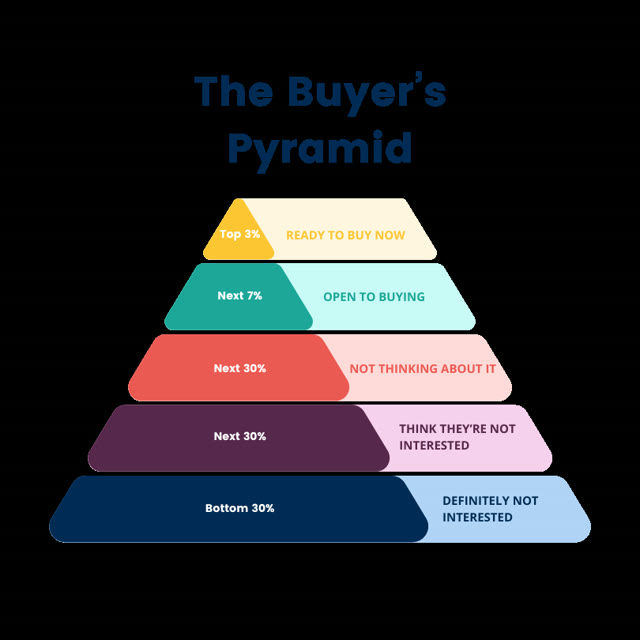
*Skool image 1: The Buyer's Pyramid: Top 3% ready to buy now; Next 7% open to buying; Next 30% not thinking about it; Next 30% think they're not interested; Bottom 30% definitely not interested. The instructor treats the lower 60% as the unaware pool. [00:38]*

### 2. What unaware ads are [01:26-02:58]
- They target people not actively seeking a solution because they (1) do not recognise a problem or (2) do not realise a new way to satisfy a specific desire. [01:26-02:06; page text]
- Schwartz quote read out: these are "logical prospects for your product and yet in their own minds are hundreds of miles away from accepting that product." [02:06; page text]
- Mechanism: by identifying with the prospect in the hook, they become aware of the problem or of a way to satisfy the desire as they watch or read. [02:06-02:58]

### 3. Characteristic 1: camouflage (but camouflage is not unaware) [02:06-03:42]
- It "doesn't look, feel, or sound like an ad": educational or entertaining content, a story someone is sharing, or information people want to consume. Some unaware ads are clearly ads but still work as unaware. [02:06-02:58]
- Camouflaged ads can start problem-aware, solution-aware or product-aware; "a lot of the times people get these confused." [02:58-03:42]

### 4. Characteristic 2: identity over product [02:58-04:40]
- The hook is "their headline, their problem, their state of mind"; price, product name and product benefits all "mean nothing to them yet", so "forget about your product and concentrate on the prospect's identity". [02:58-04:40; page text]
- Hook and headline exist to "sell the remainder of the ad itself", i.e. "literally your entire job is just to get people to watch the video". [03:42-04:40]

### 5. Characteristic 3: the sequence [04:40-05:55]
1. **Unaware:** grab attention with an identity-driven hook/headline.
2. **Problem aware:** make them aware of a desire, a problem, or a future problem they will have; "this is a problem and this is something worth solving".
3. **Solution aware:** show what types of solutions exist (and things they may have tried).
4. **Product aware:** introduce the product (or category) and position it as the best fit based on what you have said.
5. **Most aware:** an offer that makes an impulse buying decision easy.
- "You take them through each and every single stage... in one swoop and kind of in one ad, which is again what makes it so hard to do." The instructor warns the waters get muddied when people introduce the product too early. [04:40-05:55]

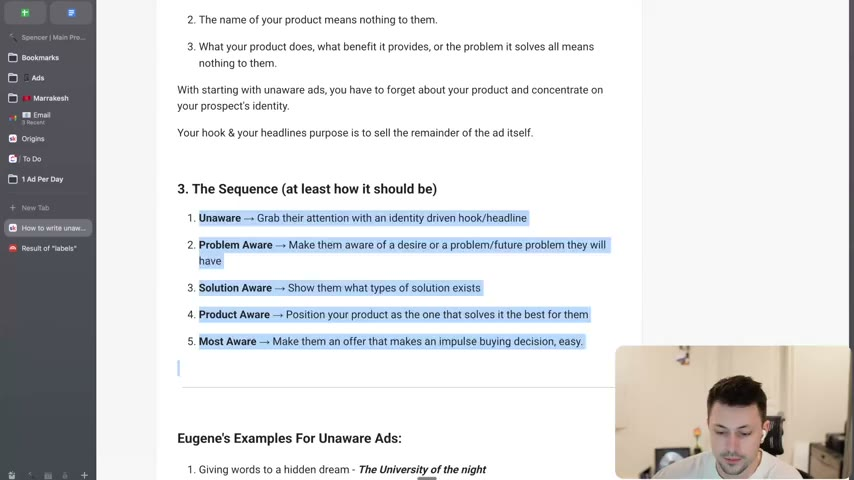
*Lesson page on screen, "3. The Sequence (at least how it should be)": Unaware -> Problem Aware -> Solution Aware -> Product Aware -> Most Aware, each with a one-line job. [05:30]*

### 6. Eugene Schwartz's unaware headline examples [05:55-06:44]
Read on the page (the instructor reads a few and tells you to read the rest): none of them mention a product; "the goal of these headlines is to get the person to read the next line". [05:55-06:44]

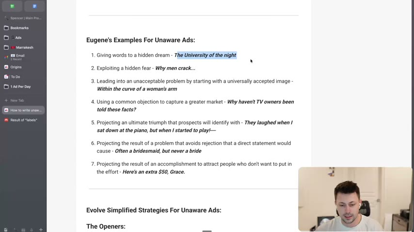
*Lesson page on screen: "Eugene's Examples For Unaware Ads" (seven headline types) followed by "Evolve Simplified Strategies For Unaware Ads: The Openers: 1. Hidden Fear...". [06:00]*

### 7. The four Evolve openers [06:44-08:00]
- **Hidden fear:** fears everyone shares but doesn't talk about daily. Structure: lead with the fear, tell a story around it, bridge to your solution. [06:44]
- **Hidden desire:** desires everyone shares but doesn't think about daily; "rather than 'this product will deliver this desire', you're starting with... 'imagine if'"; focus on identity. Structure: lead with the desire, tell a story, bridge. [06:44-07:42]
- **Did you know:** taps genuine curiosity ("people just want to learn things"). Structure: lead with a question, stat or story that can be bridged to the problem, then bridge. The instructor associates it with Hormozi. [07:42]
- **Debate:** taps the urge to take sides. Structure: lead with an open-ended question or comparison, then bridge. The instructor has "only one example of this" and says "we're going to start pushing a little bit more of" it. [07:42]
- "The big three are hidden fear, hidden desire, and did you know." [07:42-08:00]

### 8. Walkthrough of 14 examples [08:00-20:02]
See the Hooks table below; each has an on-screen ad image. Key per-ad commentary:
- **Dog owners / safe buckle:** a stat opener ("did you know") with a visual of a stuffed dog flying to the front of the car; they give away Safe Buckle dog leashes to raise awareness; "this ad absolutely crushed" (instructor claim). [07:42-08:36]
- **China's track team "legally cheated" in 1993:** "we actually made" this one; "there's nothing here that really talks about this being an ad. This is essentially just a 'hey, this is an interesting story'", then tied back to the product (product not named). [08:36-09:33]
- **Cats vs dogs debate:** "like if you were gonna do a poll"; an open-ended question with no right answer; it also works as did-you-know. [09:33-10:32]
- **3 red flags of vitamin deficiency in kids:** hidden fear; doesn't call out the product or the problem until later; works on parents not even thinking their kid has a deficiency; curiosity gap. [09:33-10:32]
- **3 signs your hair is actually wavy:** hidden desire; "anybody can watch this even if they're not essentially in the market"; they may not be solving a problem, but like how wavy hair looks. [10:32-11:12]
- **"My husband was on a waiting list to receive a heart":** hidden fear (death); story-heavy raw testimonial; the problem emerges ("he didn't want to be a box in the ground"), the solution (plant him as a tree) is found through internet research, then the product appears. Contrast: a straight "turn your loved one into a tree" ad would be problem/solution/product aware. [11:12-12:53]
- **"Watch what eggs do to your old dog's body":** from the winning ad stock; hidden fear and hidden desire (watching the ad shows eggs are actually good for dogs); they're not selling eggs. [12:53-13:28]
- **"Three foods that are bad for dogs and three that are amazing":** hidden fear and desire together. [13:28]
- **"I've had four cats in my life and I'm embarrassed to say I just learned this":** an identity callout (four cats means he knows cats) plus new-information curiosity ("what did this guy just learn?"). [13:28-14:25]
- **Choking visual (CHOKING INCIDENT):** hidden fear; "we know what choking is" but don't think about it; positioned as someone choking "when they least expect it", then an authority (a fireman) says it is the worst call they get because it happens when people least expect it; the brand is "scaling this out really hard". A product pitched as a choking device would otherwise meet "I'm not going to choke". [14:25-14:59]
- **"If you have a cat older than seven, you'll want to hear this" (Smalls):** hidden fear plus identity; the bridge leads to the desire "your cat can live longer"; "the goal of the bridge [is] to keep the person there". [14:59-15:56]
- **"If you have pets, your washer is growing something inside of it":** hidden fear; identity (pets) callout; "did you know" as much as fear; the brand likely also runs problem- and solution-aware ads. [15:56-16:38]
- **"This is your foot hitting the pavement every single step" (insoles):** did you know; inspired by the Purple mattress egg test: eggs dropped on insoles, calling out Nike; eggs break on the rival, bounce on theirs. It goes quickly into the product. Show-don't-tell: people are not looking for insoles. [16:38-18:08]
- **"What is the number one ingredient in most chocolate bars? I'll give you a hint. It is not cacao.":** the instructor says "this ad actually made me buy"; the girl tells a story that sugar and candy bars are the enemy and positions an all-natural chocolate bar; "this brand is absolutely murdering, they have 700 plus ads running" (instructor claim). Schwartz-style: some context is allowed (TV owners, the piano) as long as you share information. [18:08-19:32]
- Wrap-up: unaware ads go with "a broad hook versus a specific hook", though identity is still present (pets, choking can happen to anybody, everybody walks, many eat chocolate). They are "hyper scalable because they don't feel like an ad when they start". [19:32-20:38]

## Steps / framework
1. Choose the avatar and the identity that unites them (not the product).
2. List hidden fears and hidden desires related to the product's problem that the avatar does not consciously think about; list surprising facts/stats/stories (did you know) and open questions (debate).
3. Write hooks that do not mention the product, price or benefit; use identity callouts ("if you have pets", "if you have a cat older than 7") or concrete visuals.
4. Draft the path: hook -> story/problem -> why old solutions fail -> solution category -> our product -> offer. Place the bridge so interest carries from the hook to the problem. [04:40-05:55]
5. Check that the first seconds read like content, not an ad. [02:06-02:58]
6. Tag each ad with its opener type for later iteration (see [Creative testing system](../../../../frameworks/creative-testing-system.md)).

| Opener | Core move | Hook structure (page text) |
|---|---|---|
| Hidden fear | Tap a shared, unspoken fear | Lead with the fear, tell a story around it, then bridge to your solution |
| Hidden desire | Tap a shared, unspoken desire | Lead with the desire, tell a story around it, then bridge to your solution |
| Did you know | Tap genuine curiosity | Lead with a question, stat or story that can be bridged to the problem |
| Debate | Tap the love of taking sides | Lead with an open-ended question/comparison, bridge to the problem |

## Examples
All 14 ad examples, each with an image. Page example numbers are the lesson page's own numbering (it repeats #3 and #4).

| Page ex. | Ad / niche | Hook (as on page/screen) | Opener | Source |
|---|---|---|---|---|
| 1 | Safe Buckle dog leash giveaway (pet) | "Over half of dog owners don't restrain their beloved animal" | Did you know | [07:42-08:36] |
| 2 | Instructor's team ad (product not named) | "How China's Track Team 'LEGALLY Cheated' in 1993" | Did you know | [08:36-09:33] |
| 3 | Winning ads doc (pet) | "Who has a better life, cats or dogs?" | Debate | [09:33-10:32] |
| 3 (second) | Winning ads doc (kids' health) | "3 red flags of vitamin deficiency in kids" | Hidden fear | [09:33-10:32] |
| 4 | Winning ads doc (hair care) | "3 signs your hair is actually wavy" | Hidden desire | [10:32-11:12] |
| 4 (second) | Winning ads doc (tree burial/memorial) | "My husband was on a waiting list to receive a heart." | Hidden fear | [11:12-12:53] |
| 5 | Winning ads doc (dog food/eggs) | "Watch what eggs do to your old dog's body!" | Hidden fear (and desire) | [12:53-13:28] |
| 6 | Winning ads doc (dog food) | "3 foods that are bad for dogs and 3 that are amazing" | Hidden fear and desire | [13:28] |
| 7 | Cat product (not named) | "I've had four cats in my life, and I'm embarrassed to say I just learned this" | Hidden fear (page) / did you know-ish | [13:28-14:25] |
| 8 | Choking-rescue device (not named) | Visual: someone choking ("CHOKING INCIDENT") | Hidden fear | [14:25-14:59] |
| 9 | Smalls (cat food) | "If you have a cat older than 7, you'll want to hear this." | Hidden fear + identity | [14:59-15:56] |
| 10 | Washer cleaner (not named) | "If you have pets, your washer is growing something inside of it." | Hidden fear (page) / did you know | [15:56-16:38] |
| 11 | Insoles (brand not remembered by the instructor) | "This is your foot hitting the pavement every single step" | Did you know | [16:38-18:08] |
| 12 | Natural chocolate bar (brand not named) | "What is the number one ingredient in most chocolate bars? I'll give you a hint. It is not cacao." | Did you know | [18:08-19:32] |

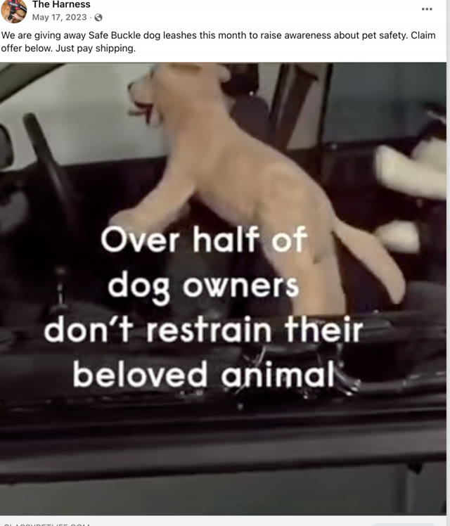
*Ex 1 (Skool image 2): Facebook post, "We are giving away Safe Buckle dog leashes this month to raise awareness about pet safety. Claim offer below. Just pay shipping." Video text: "Over half of dog owners don't restrain their beloved animal" with a stuffed dog flying forward in a car. [07:50]*

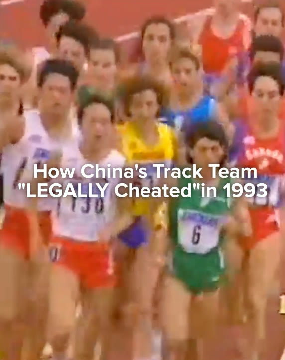
*Ex 2 (image 3): archive footage of a pack of runners with the text "How China's Track Team 'LEGALLY Cheated' in 1993". A story hook that looks like content. [08:36]*

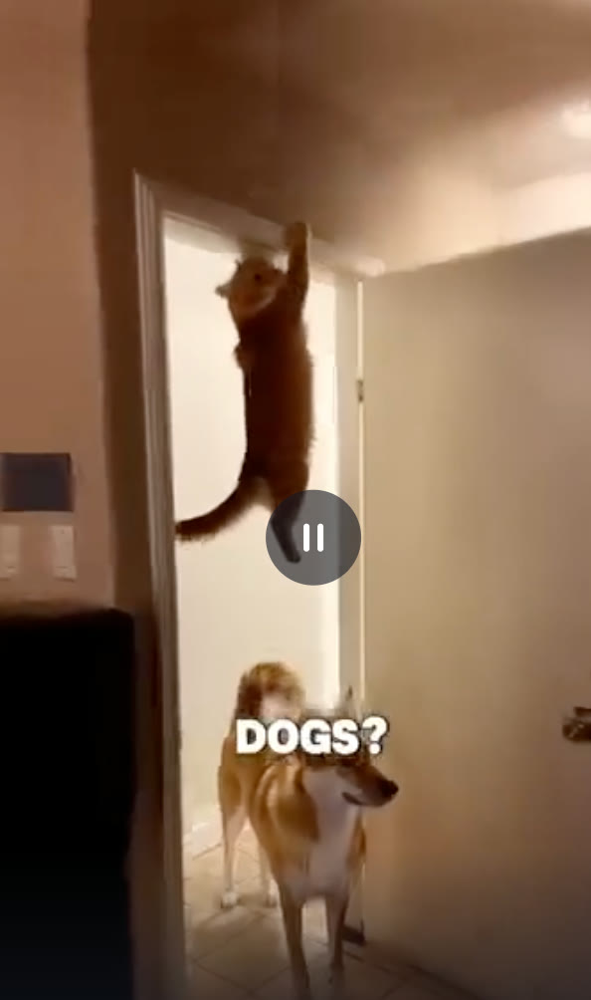
*Ex 3 (image 4): a cat on a door frame above a dog, with the text "DOGS?" (the hook is "who has a better life, cats or dogs?"). The debate opener. [09:33]*

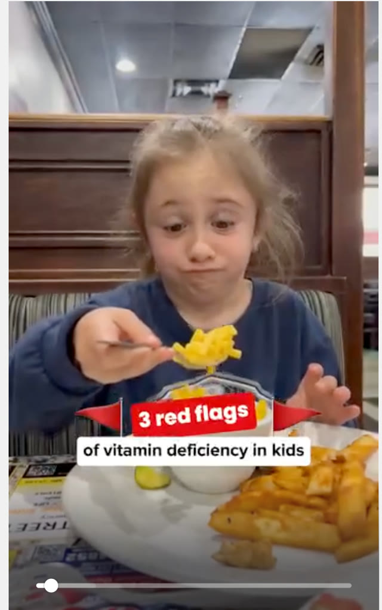
*Ex 3 second (image 5): a child eating macaroni; banner "3 red flags of vitamin deficiency in kids". Hidden-fear opener with a curiosity gap. [10:00]*

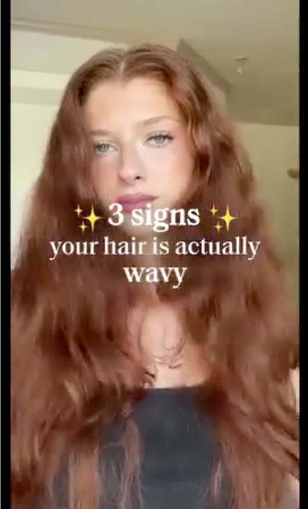
*Ex 4 (image 6): creator with long wavy hair, text "3 signs your hair is actually wavy". Hidden-desire opener. [10:32]*

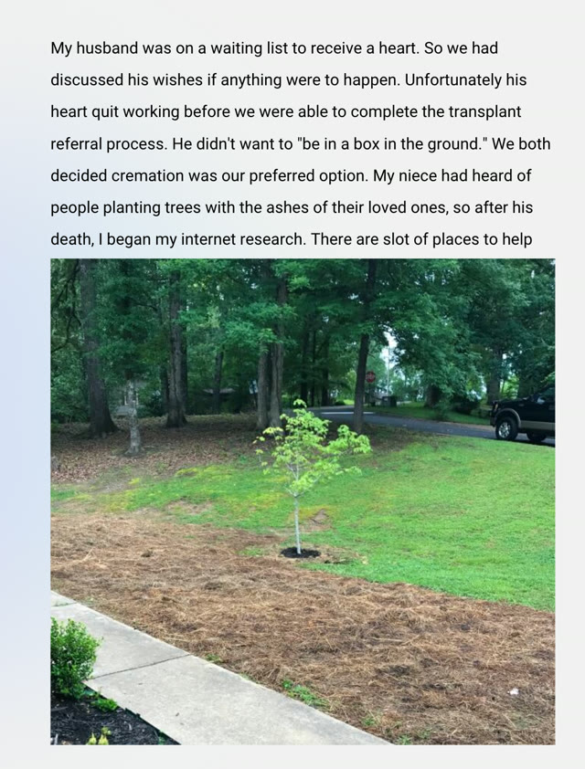
*Ex 4 second (image 7): story ad text, "My husband was on a waiting list to receive a heart. So we had discussed his wishes... He didn't want to 'be in a box in the ground'... people planting trees with the ashes of their loved ones, so after his death, I began my internet research", over a photo of a sapling. [11:12]*

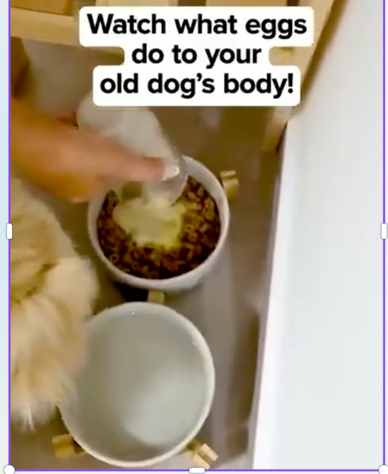
*Ex 5 (image 8): text "Watch what eggs do to your old dog's body!" over an egg being cracked into a dog bowl. [12:53]*

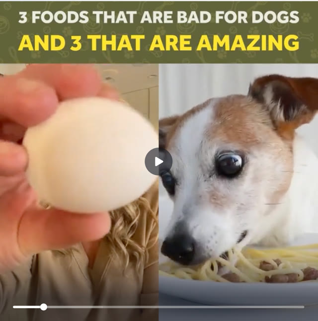
*Ex 6 (image 9): header "3 foods that are bad for dogs and 3 that are amazing", a hand holding an egg next to a dog eating pasta. [13:28]*

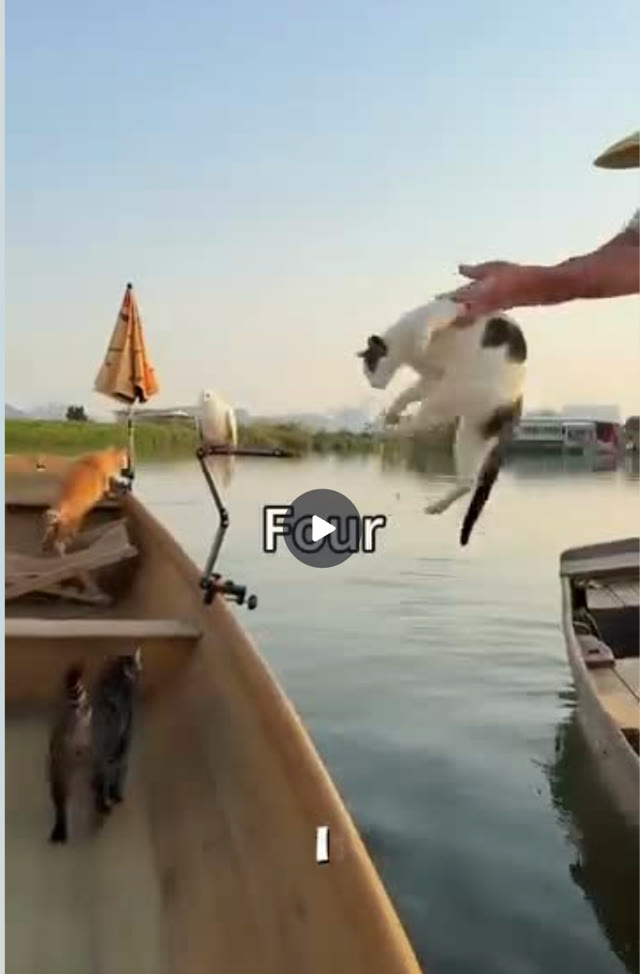
*Ex 7 (image 10): a cat being tossed from a boat to the water with the text "Four" (the first word of the hook, "I've had four cats in my life..."). [13:40]*

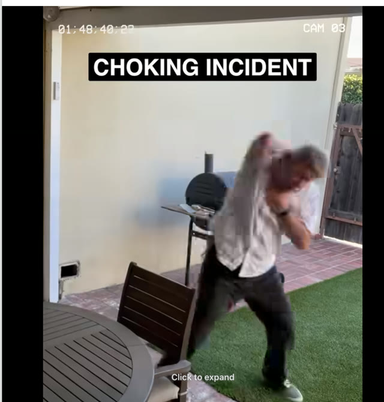
*Ex 8 (image 11): security-camera-style footage labelled "CHOKING INCIDENT" of a man choking in a backyard. Hidden-fear visual. [14:25]*

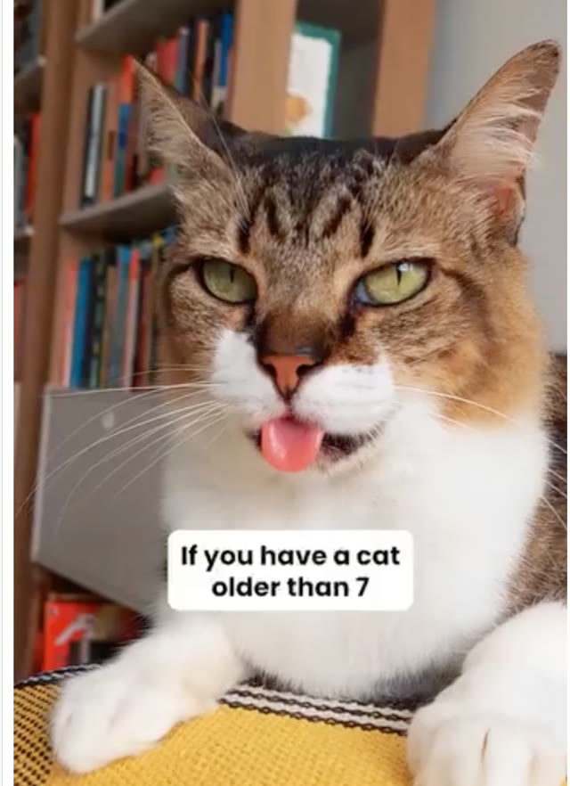
*Ex 9 (image 12): a cat on a bookshelf background, text "If you have a cat older than 7". Identity-driven hidden-fear opener (Smalls). [14:59]*

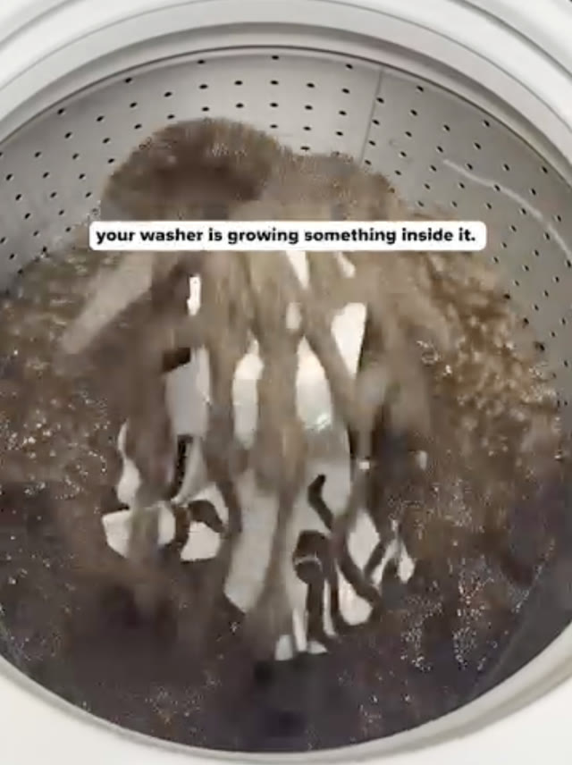
*Ex 10 (image 13): the inside of a washing machine drum, text "your washer is growing something inside it." [15:56]*

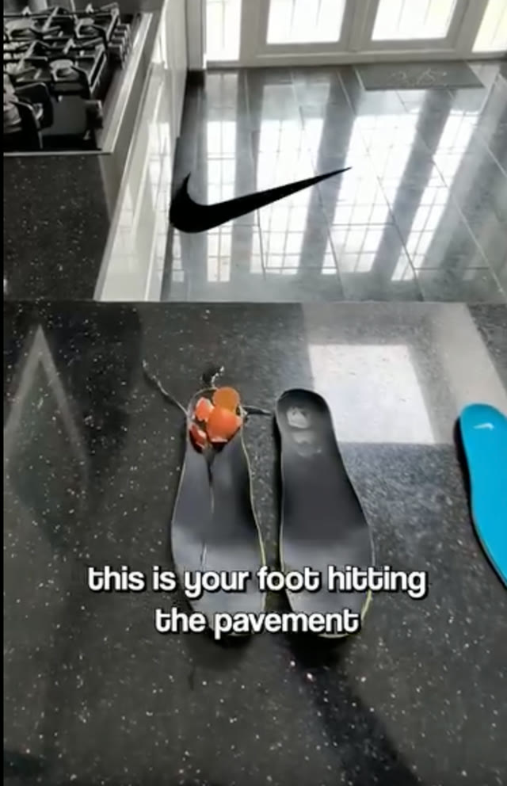
*Ex 11 (image 14): a pair of insoles beside a Nike logo with an egg; text "this is your foot hitting the pavement". The egg-drop demonstration calls out Nike. [16:38]*

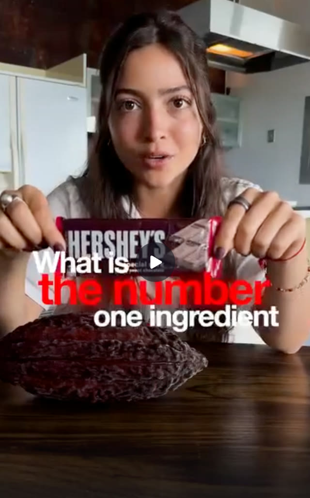
*Ex 12 (image 15): a woman holding a Hershey's bar beside cacao, text "What is the number one ingredient". [18:08]*

## Structured units

### Hooks
(Heuristic / Emotion / Self columns are "derived" where filled; the opener type comes from the lesson.)

| Hook | Heuristic(s) | Emotion / zone | Self targeted | Why it works | Source |
|---|---|---|---|---|---|
| "Over half of dog owners don't restrain their beloved animal" (Did you know) | Stat + visual | Fear (derived) | Dog owner | New information with a scary visual (a stuffed dog flies to the front); giveaway offer follows | [07:42-08:36] |
| "How China's Track Team 'Legally Cheated' in 1993" (Did you know) | Story curiosity | Curiosity | — | Reads as an interesting story, not an ad; tied to the product later | [08:36-09:33] |
| "Who has a better life, cats or dogs?" (Debate) | Pick-a-side | Curiosity / identity (derived) | Cat or dog owners | Open-ended question like a poll; no right answer | [09:33-10:32] |
| "3 red flags of vitamin deficiency in kids" (Hidden fear) | Curiosity gap | Fear | Parents | Works on parents who weren't thinking about it; product not named until later | [09:33-10:32] |
| "3 signs that your hair is actually wavy" (Hidden desire) | Curiosity gap | Desire | People who like wavy hair | Anyone can watch even if not in the market | [10:32-11:12] |
| "My husband was on a waiting list to receive a heart." (Hidden fear) | Story / testimonial | Fear of death / loss | Bereaved or planning families | Product-free raw story; solution emerges later | [11:12-12:53] |
| "Watch what eggs do to your old dog's body." (Hidden fear/desire) | Curiosity + fear | Fear / curiosity | Owners of older dogs | Watchable whether or not they feed eggs; reveal is positive | [12:53-13:28] |
| "Three foods that are bad for dogs and three that are amazing." (Hidden fear and desire) | List | Fear + desire | Dog owners | Both avoidance and gain in one list | [13:28] |
| "I've had four cats in my life and I'm embarrassed to say I just learned this." | Identity + new info | Curiosity / mild shame | Cat owners | "What did he learn?" - anyone into cats can watch | [13:28-14:25] |
| Visual of someone choking (Hidden fear) | Visual shock + authority | Fear | Everyone | Unconscious fear made vivid; fireman authority follows | [14:25-14:59] |
| "If you have a cat older than 7, you'll want to hear this." (Hidden fear / identity) | Identity call-out | Worry | Older-cat owners | Identity filter; bridge to "your cat can live longer" | [14:59-15:56] |
| "If you have pets, your washer is growing something inside of it." (Hidden fear) | Identity call-out + gross visual | Disgust / fear | Pet owners | Unconscious problem made visible | [15:56-16:38] |
| "This is your foot hitting the pavement every single step." (Did you know) | Demonstration | Concern | Walkers | Shows the pressure; egg test on insoles; goes quickly into the product | [16:38-18:08] |
| "What is the number one ingredient in most chocolate bars? I'll give you a hint. It is not cacao." (Did you know) | Quiz question | Curiosity | Chocolate eaters | Anyone can watch; leads to the sugar-as-enemy story | [18:08-19:32] |

### Eugene Schwartz's unaware headline types (page text, "Eugene's Examples For Unaware Ads")
| # | Type | Example headline | Source |
|---|---|---|---|
| 1 | Giving words to a hidden dream | "The University of the night" | page text; [05:55] |
| 2 | Exploiting a hidden fear | "Why men crack..." | page text; [05:55] |
| 3 | Leading into an unacceptable problem by starting with a universally accepted image | "Within the curve of a woman's arm" | page text; [05:55] |
| 4 | Using a common objection to capture a greater market | "Why haven't TV owners been told these facts?" | page text; [05:55] |
| 5 | Projecting an ultimate triumph that prospects will identify with | "They laughed when I sat down at the piano, but when I started to play!" | page text; [05:55] |
| 6 | Projecting the result of a problem that avoids the rejection a direct statement would cause | "Often a bridesmaid, but never a bride" | page text |
| 7 | Projecting the result of an accomplishment to attract people who don't want to put in the effort | "Here's an extra $50, Grace." | page text |

### Angles
| Angle | Core desire / pain | Heuristic(s) | Best format | Example line | Source |
|---|---|---|---|---|---|
| Hidden fear (shared but unspoken) | Fear of harm to self/loved ones or pets | Fear / loss (derived) | UGC story, visual shock | "If you have pets, your washer is growing something inside of it." | [06:44; 15:56] |
| Hidden desire | Desire not consciously voiced | Aspiration (derived) | UGC | "3 signs that your hair is actually wavy" | [06:44; 10:32] |
| Did you know | Curiosity | Novelty (derived) | Story/stat video | "What is the number one ingredient in most chocolate bars?" | [07:42; 18:08] |
| Debate | Taking sides | Identity (derived) | Poll-like video/static | "Who has a better life, cats or dogs?" | [07:42; 09:33] |
| Sugar/chocolate as the enemy (chocolate ad) | Avoid unhealthy candy | Enemy framing (derived) | UGC story | "What is the number one ingredient in most chocolate bars?" | [18:08-19:32] |

### Ad teardowns
| Brand / product (niche) | Format | Hook / opening | What works | What fails | Fix suggested | Principle | Source |
|---|---|---|---|---|---|---|---|
| Safe Buckle dog leashes (pet safety) | Video + giveaway | "Over half of dog owners don't restrain their beloved animal" | Stat plus scary visual; giveaway for awareness; "absolutely crushed" (instructor claim) | — | — | Did you know | [07:42-08:36] |
| Smalls (cat food) | UGC video | "If you have a cat older than 7, you'll want to hear this." | Identity filter; fear then desire in the bridge ("your cat can live longer") | — | — | Hidden fear + bridge to desire | [14:59-15:56] |
| Choking device brand (not named) | Video | Someone choking, then fireman authority | Unaware visual; authority; "scaling this out really hard" | A standard "choking device" opener meets "I won't choke" | Start unaware | Hidden fear | [14:25-14:59] |
| Washer cleaner (not named) | Video | "If you have pets, your washer is growing something inside of it." | Identity callout, gross visual | — | — | Hidden fear | [15:56-16:38] |
| Insole brand (name forgotten by the instructor) | Demonstration video | "This is your foot hitting the pavement every single step" | Visual egg test that calls out Nike (inspired by Purple's egg test); show-don't-tell | Goes quickly into product | — | Did you know + demo | [16:38-18:08] |
| All-natural chocolate bar (not named) | UGC story | "What is the number one ingredient in most chocolate bars?" | Anyone can watch; story positions sugar as the enemy; "700 plus ads running" (instructor claim); "this ad actually made me buy" | — | — | Did you know + enemy | [18:08-19:32] |
| Tree-burial/memorial (not named) | Testimonial story | "My husband was on a waiting list to receive a heart." | Product-free raw story that bridges to the product | — | — | Hidden fear with story | [11:12-12:53] |

## Screenshots
Seventeen images are embedded above under Key ideas and Examples (pyramid, sequence slide, Schwartz list, and all 14 ads).

## How to apply
- [ ] For each product, list 5 hidden fears, 5 hidden desires, 5 surprising facts and 2 debate questions for the target avatar.
- [ ] Write hooks with no product, price or benefit; test an identity callout version ("If you have [X]...").
- [ ] Add a visual or authority that makes the hidden fear concrete (shock visual + expert).
- [ ] Map the full path hook -> problem -> solutions -> product -> offer; write the bridge that keeps viewers watching.
- [ ] Verify the first seconds look like content, not an ad.
- [ ] Label each concept by opener type and test one opener type against another with the same body.
- [ ] For teardowns, write: opener type, identity targeted, where the product first appears, and how the bridge works.

## Related
- Previous: [34. How to write with labels & customer language](34-how-to-write-with-labels-customer-language.md) · Next: [36. What about AI/](36-what-about-ai.md)
- [21. Being aware of market awareness](21-being-aware-of-market-awareness.md) · [26. How to write open loops](26-how-to-write-open-loops.md) · [30. How to raise the stakes](30-how-to-raise-the-stakes.md) · [Emotional zones](../../../../concepts/emotional-zones.md)

## Sources and limitations
- Transcript: [35. How to write unaware ads (hooks)….txt](<../../../../../raw/evolve/copywriting/_transcripts/✍️ Evolve Copywriting (NEW)/35. How to write unaware ads (hooks) ✍️ Evolve Copywriting (NEW) Evolve.txt>) · Page text: [35. ….html.md](<../../../../../raw/evolve/copywriting/_extracted/✍️ Evolve Copywriting (NEW)/35. How to write unaware ads (hooks)_✍️ Evolve Copywriting (NEW)_Evolve.html.md>)
- Machine transcription (Whisper large-v3-turbo). Full recording covered (last segment 20:37 of 20:38). Whisper heard "Hermosi" (likely Hormozi), "underwear hook" (for "unaware hook"), "Conciliate" (consolidate), "on a wire hook" (likely "open with a visual hook"). The instructor's example numbering ("example number seven/eight/nine/ten/eleven/twelve") matches the page's 7-12; the page numbers two examples as #3 and two as #4.
- The percentages in the Buyer's Pyramid are as shown and spoken; the instructor says they "will change". Claims of ad performance ("absolutely crushed", "700 plus ads running", "made me buy", "spend winner") are the instructor's, with no data shown.
- Many ads are not named in the lesson; where a brand appears here it was read from on-screen text (Safe Buckle on the post text, Hershey's bar in the chocolate frame; Smalls was named by the instructor). The "winning ads doc" Canva deck and Facebook/Frame.io links are not in the course files.
