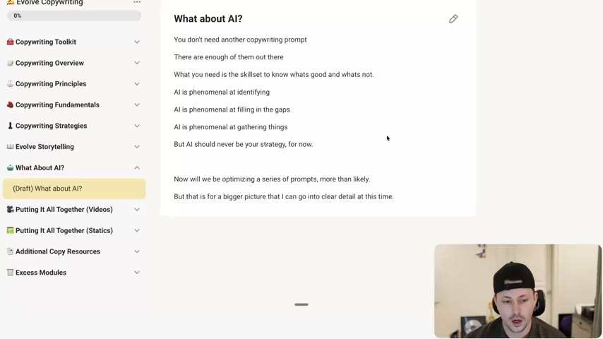

# 36. What about AI?
> The course deliberately gives no copy-and-paste prompts: AI predicts words and is great at identifying, filling gaps and gathering, but strategy and judgment ("the skillset to know whats good and whats not") must come from the copywriter, who then uses the course vocabulary to direct and optimize AI output.

## 🤖 Agent use
- **Use when:** deciding how much to delegate to an AI agent in copy work; reviewing an AI-written script; briefing an agent to revise a draft with named techniques.
- **Inputs → outputs:** an AI-written script or hook list + the course's technique names (raise the stakes, bridge stickiness, show don't tell, labels) → a targeted optimization instruction per weakness, instead of "make it better".
- **Rules:**
  - **DO** use AI for what it is good at: "identifying things", "filling in the gaps", "gathering things". [00:44-01:25]
  - **DON'T** make AI "your sole strategy or your relied upon strategy, at least for now". [00:44-01:25]
  - **DO** review every AI draft with the course techniques and instruct specific fixes: "I need to raise the stakes here" or "the bridge here is lacking the stickiness that is needed to keep the person watching the rest of the ad. Let's re-optimize the bridge." [01:25-02:19]
  - **DO** know why a line works before asking AI to produce it: "you know why things work and you're able to look at them in a different lens compared to your competition". [02:19-03:02]
  - **DON'T** assume a prompt can replace judgment: the instructor expects most people would "copy the prompt" and not retain the teaching. [01:25-02:19]
  - **IF** you need prompts **THEN** use the prompts the course does supply elsewhere, e.g. [34. labels and customer language](34-how-to-write-with-labels-customer-language.md) and [37. Evolve Writing Prompts](37-evolve-writing-prompts.md); the instructor says an optimized series of prompts around the program is likely coming. [00:44-01:25]
- **See also:** [37. Evolve Writing Prompts](37-evolve-writing-prompts.md) · [34. How to write with labels & customer language](34-how-to-write-with-labels-customer-language.md) · [30. How to raise the stakes](30-how-to-raise-the-stakes.md) · [27. How to write a bridge](27-how-to-write-a-bridge.md) · [Validation over authority](../../../../concepts/validation-over-authority.md)

## Key ideas

### 1. Why there are no prompts in the course [00:00-00:44]
- Students keep asking "where's all the prompts? Why don't I have a storytelling prompt? ... a direct response [prompt]?" The point of the program "was not to give you another copywriting prompt. Because if you ask me, there's enough of them out there." [00:00-00:44]
- "To some extent, all of these prompts will relatively arrive at the same thing", because "AI in general is a predictive model... it predicts words." (Instructor claim, stated without evidence.) [00:00-00:44]

### 2. What AI is good and bad at [00:44-01:25]
- "It's phenomenal at identifying things. It's phenomenal at filling in the gaps. And it's amazing at gathering things." The Skool page text says the same in list form. [00:44-01:25; page text]
- "AI should just never be your sole strategy or your relied upon strategy, at least for now." (Page: "But AI should never be your strategy, for now.") [00:44-01:25; page text]
- Caveat: "we will be likely optimizing a series of prompts around this copywriting program", with "a much bigger picture for this that I can't really go into... because we're still sorting it out". The page text repeats this and says the details cannot be shared "at this time". [00:44-01:25; page text]

### 3. The skill is directing AI with the right language [01:25-02:19]
- After AI writes a script, you now "have the knowledge to be able to optimize things", e.g. say "I need to raise the stakes here" or re-optimize the bridge for stickiness; "you can start to learn how to communicate with AI the right way as a result of the information in here." [01:25-02:19]
- His goal is not "another thing that you can copy and paste and not think about"; if he gave a prompt after each lesson "it wouldn't stick what I'm teaching you". [01:25-02:19]

### 4. The goal: information and a trained eye [02:19-03:02]
- "The goal was to give you information so that way you know this information so that when you use your prompts or when you write your scripts or when you look at your ads, you know why things work." Students may turn their notes into their own prompts. "You know how to speak the language of copy." [02:19-03:02]

*The Skool lesson page as shown at the start of the video: "You don't need another copywriting prompt / There are enough of them out there / What you need is the skillset to know whats good and whats not. / AI is phenomenal at identifying / ...filling in the gaps / ...gathering things / But AI should never be your strategy, for now." The sidebar shows the module "What About AI?" and the lesson still marked "(Draft)". [00:00]*

## Steps / framework
Derived from the lesson, for agent workflows:
1. Let AI gather (research, comments, reviews), identify (patterns, labels, angles) and fill gaps (variants).
2. A human or a rules-based review uses the course techniques to judge the draft.
3. Feed back named, specific optimization instructions ("raise the stakes in the hook", "make the bridge stickier").
4. Repeat; decide strategy (angle, positioning, what to test) outside the AI draft.

## Examples
- Instruction example, from the speaker: "hey, I need to raise the stakes here. Or hey, the bridge here is lacking the stickiness that is needed to keep the person watching the rest of the ad. Let's re-optimize the bridge." [01:25]

## Structured units
### Rules of thumb
- **DO** use AI for identifying, filling gaps and gathering. [00:44]
- **DON'T** let AI be the strategy, "for now". [00:44]
- **DO** optimize AI output with specific technique names. [01:25]
- **IF** no prompt exists for the task **THEN** write a request using the course's own terms (stakes, bridge, labels, mechanisms) (derived).

## How to apply
- [ ] Do not ask an agent to "write the best ad"; first set strategy (avatar, angle, awareness level) from research.
- [ ] After a first draft, run a technique checklist (hook, stakes, bridge, objections, pitch, show-don't-tell, labels) and send named fixes back to the agent.
- [ ] Keep research/gathering tasks (reviews, Reddit, comments) with AI; keep selection and positioning decisions reviewed against data.
- [ ] Treat any prompt library as a starting point, not a substitute for knowing why lines work.

## Related
- Previous: [35. How to write unaware ads (hooks)](35-how-to-write-unaware-ads-hooks.md) · Next: [37. Evolve Writing Prompts](37-evolve-writing-prompts.md)
- [01. Overview of the copywriting program](01-overview-of-copywriting-program.md) (the instructor says he mentioned in the overview that AI predicts words)

## Sources and limitations
- Transcript: [36. What about AI….txt](<../../../../../raw/evolve/copywriting/_transcripts/✍️ Evolve Copywriting (NEW)/36. What about AI ✍️ Evolve Copywriting (NEW) Evolve.txt>) · Page text: [36. What about AI….html.md](<../../../../../raw/evolve/copywriting/_extracted/✍️ Evolve Copywriting (NEW)/36. What about AI__✍️ Evolve Copywriting (NEW)_Evolve.html.md>)
- Machine transcription (Whisper large-v3-turbo). Full recording covered (last segment 3:02 of 3:02). No examples, ads or numbers are given in this lesson.
- The lesson page is marked "(Draft)" in the sidebar, and the instructor says the optimized prompt series is not yet defined. Later lessons (e.g. 65, 70) and the prompts listed in lesson 37 do supply prompts, which is in tension with "not giving prompts" (cross-lesson observation, derived).
