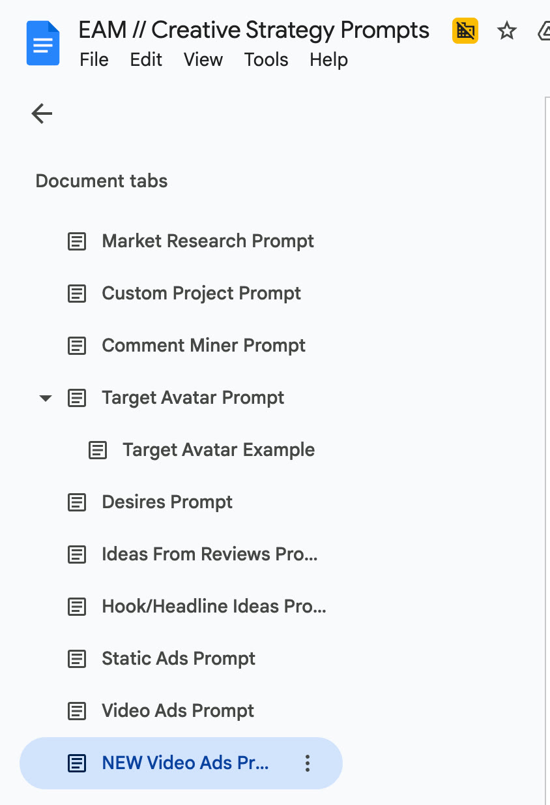

# 37. Evolve Writing Prompts
> A resource page (no video) holding one full "Project Goal" system prompt for building a data-driven ad-agency AI project, plus an index of links to the course's other prompt documents (desires, new information, new mechanism, angles, static ads, video script, ad-learnings call analysis).

## 🤖 Agent use
- **Use when:** setting up an AI project/assistant for an e-commerce brand (research, ideation, scripting, ad-performance review), or when you need to know where the course's other prompt documents live and which of them are available in this knowledge base.
- **Inputs → outputs:** brand name + brand website + a knowledge base of attached files (customer surveys, personas, competitor data, and the book "Breakthrough Advertising") → a custom AI project whose answers are grounded in those files and cover customer understanding, competitive analysis, creative ideation, scriptwriting and post-launch ad review.
- **Rules:**
  - **DO** copy the Project Goal Prompt below exactly, replacing only `BRAND` and `YOURWEBSITE`. (Page: "Project Goal Prompt", brand/website placeholders.)
  - **DO** attach the knowledge-base files before asking questions. The prompt tells the project to use them as its "primary knowledge base" and to ground every answer in them. (Prompt: "Knowledge Base" paragraph.)
  - **DO** use the ad-review function with concrete metrics: the prompt names "ad spend, ROAS, hook rate, hold rate, CTR" and asks for "actionable takeaways from winning and losing ads" to close the feedback loop. (Prompt: "Ad Review & Performance Feedback Loop".)
  - **DON'T** treat the other prompt links as available text. Only four of the linked documents were exported into this knowledge base (see the table in Sources). The others are listed as "not included in the course files".
  - **IF** you need the angle, static-ad or video-script prompt **THEN** read the exported copies under lessons 65, 67 and 70 (links in the table below) rather than guessing their wording.
  - **IF** you are tempted to let an AI project decide strategy **THEN** re-read [36. What about AI?](36-what-about-ai.md): the instructor says AI "should never be your strategy, for now".
- **See also:** [36. What about AI?](36-what-about-ai.md) · [35. How to write unaware ads (hooks)](35-how-to-write-unaware-ads-hooks.md) · [Customer research stack](../../../../frameworks/customer-research-stack.md) · [Creative testing system](../../../../frameworks/creative-testing-system.md)

## Key ideas
### What this page is (from the lesson text and DOCX)
- The Skool lesson page contains only a note and one link. The note reads (verbatim): "Note - as mentioned above we are working on new prompts trained through the copywriting program with Claude Skills". The link points to the Google Doc that is also provided as the DOCX attachment (Skool page text: first paragraph).
- The DOCX and the exported Google Doc are the same content (the exported Google Doc `37-document-1wco7k1qt5` matches the DOCX attachment, with the same prompt and link list). Do not treat them as two sources.
- Each prompt entry in the document pairs a **Video** link (a Skool classroom lesson that is not part of these files) with a **Prompt** link (a Google Doc).
- Only the **Project Goal Prompt** is written out in full inside the document. Everything else is a link.

### The Project Goal Prompt: what it sets up (derived summary of the verbatim text below)
- It asks an AI tool to "create a custom project tailored to assist our marketing agency in creating more effective, data-driven ads for our client, an E commerce Brand".
- It defines five functions: (1) Customer Understanding & Market Trends, (2) Market Research & Competitive Analysis, (3) Creative Ideation & Strategy, (4) Scriptwriting & Copy Development, (5) Ad Review & Performance Feedback Loop.
- It tells the project to use attached files as its primary knowledge base and to highlight recommendations based on specific insights, "especially when drawing on 'Breakthrough Advertising.'"
- It instructs the project to back suggestions with data and keep them relevant to the brand's audience.

### The other prompts listed (names and what is available)
The document lists these prompts by name only; each is a Google Doc link. Their text is **not included** in lesson 37's files unless marked otherwise.

| Prompt (name on page) | Link label | Text available in this KB? |
|---|---|---|
| Project Goal Prompt | (inline) | Yes, in full below |
| Desires Prompt | "Evolve - Desire AI Prompts" | No (Google Doc not exported) |
| New Info Prompt | "New Information Prompt Document" | No (not exported) |
| New Mechanism Prompt | "New Mechanism Prompt Document" | No (not exported) |
| Angles Prompt | "Evolve Enhanced - Angle Identifier" | Yes, exported under lesson 67: [`67-document-1apOBJnwgJ.docx.md`](<../../../../../raw/evolve/copywriting/_extracted/_linked/google/67-document-1apOBJnwgJ.docx.md>) |
| Static Ads Prompt | "$100k Static Ads - Full EVOLVE Prompts" | Yes, exported under lesson 65: [`65-document-1uarIpWx86.docx.md`](<../../../../../raw/evolve/copywriting/_extracted/_linked/google/65-document-1uarIpWx86.docx.md>) |
| Video Ads Prompt (labelled "Older Video") | "Evolve - Video Script Prompt" | Yes, exported under lessons 70/71/72: [`70-document-11fMpEFheB.docx.md`](<../../../../../raw/evolve/copywriting/_extracted/_linked/google/70-document-11fMpEFheB.docx.md>) (identical export reused for 71 and 72) |
| Ads Call Analysis Prompt (video "From Chef Karlo") | "Ad Learnings Call Analysis Prompt" | No (not exported) |
| Alex Cooper's Prompts | (no prompt link, only a Skool call-recording link) | No |
| Evolve AI - Prompts | (pointer to the "Evolve AI program, courtesy of Karlo") | No, outside this course |

(The exported angle, static-ad and video-script documents are the same Google Docs; confirming the identity from the labels and URLs in the linked-index is derived: the URLs for `1apOBJnwg…`, `1uarIpWx8…` and `11fMpEFheB…` appear in this document's link list.)

### Access notes stated on the page
- Alex Cooper's prompts: "This is for EVOLVE ACCESS ONLY (in case this doc gets leaked)". "If you are new, call recordings will unlock in 30 days (not 42 days)". Alex's Notion "and everything else he shared on the call" is in the Skool items below the call recording.
- "The remaining AI Prompts & other AI tools we use are found in the Evolve AI program, courtesy of Karlo". None of that is in these files.

## Steps / framework
Using the Project Goal Prompt (derived from the document's structure):
1. Create a new custom project / assistant in your AI tool.
2. Paste the Project Goal Prompt; replace `BRAND` and `YOURWEBSITE`.
3. Attach the brand's knowledge-base files (customer surveys, personas, behavioural data, competitor data, "Breakthrough Advertising").
4. Ask tasks by function: survey insights, competitor/differentiation analysis, new creative concepts, script drafts and critiques, post-launch metric review.
5. After launch, paste metrics (ad spend, ROAS, hook rate, hold rate, CTR) and ask for learnings and next-step takeaways.

## Examples
- No ad examples appear in this resource. The page is prompts and links only.

## Prompts / templates (verbatim)

### Project Goal Prompt
Reproduced from the DOCX attachment. Markdown bold markers in the text conversion were removed; the original is one unbroken paragraph with no line breaks. Placeholders to replace: `BRAND`, `YOURWEBSITE`. The closing quotation mark is present in the source and is kept. The apostrophe in "brand's" is garbled in the raw DOCX text extraction and is restored here as an ordinary apostrophe.

```text
Hello, I would like to create a custom project tailored to assist our marketing agency in creating more effective, data-driven ads for our client, an E commerce Brand. Brand name: BRAND Brand website: YOURWEBSITE The purpose of this custom project is to support the following key marketing functions for this brand: Customer Understanding & Market Trends: Analyze customer surveys, buyer personas, and behavioral data to uncover customer preferences, pain points, and purchasing motivations.Identify market trends and audience segments relevant to this brand's products. Market Research & Competitive Analysis: Gather and analyze data on competitors and broader industry trends. Identify opportunities for differentiation in brand's positioning and advertising strategies. Creative Ideation & Strategy: Generate new creative concepts and strategies for ad campaigns based on insights from market data, customer feedback, and competitive analysis. Provide feedback on existing ideas, suggesting improvements grounded in customer insights and market trends. Scriptwriting & Copy Development: Assist with crafting persuasive, targeted scripts for ads and other marketing materials. Review and critique copy-writing to ensure it resonates with the target audience, incorporating customer pain points and desires. Ad Review & Performance Feedback Loop: Assist in analyzing post-launch ad performance by reviewing metrics such as ad spend, ROAS, hook rate, hold rate, CTR, etc. Provide insights on why certain ads performed well or underperformed, identifying key learnings from each campaign. Close the feedback loop by suggesting actionable takeaways from winning and losing ads, incorporating these learnings into future creative strategies. Knowledge Base: This project should use the attached files as its primary knowledge base and refer to the information within when providing insights or recommendations. Whenever this project provides an answer, it should be informed by the content within the knowledge base. It should autonomously apply the insights from the attached files to ensure all responses are grounded in data and relevant context. Key Responsibilities: Interpret customer feedback and survey data to identify trends and actionable insights. Suggest ad strategies, creative angles, and copy that align with market research and customer insights. Ensure all insights, scripts, and suggestions are data-driven and relevant to brand's target audience, drawing on the knowledge base provided. Analyze ad performance post-launch, using key metrics to provide insights into ad success or failure. Instructions: Always ground your responses in the content within the knowledge base. Highlight any recommendations based on specific insights or principles from the provided data or resources, especially when drawing on "Breakthrough Advertising." Prioritize relevance to brand's audience, and use data to back up your suggestions."
```

### Prompt index as written in the document (link labels, verbatim)
```text
Desires Prompt
Video: https://www.skool.com/evolve-8484/classroom/fc758841?md=8decdfed5f15476a89aa8db727ff153a
Prompt: Evolve - Desire AI Prompts
  https://docs.google.com/document/d/1x6hmEDV5wtdIWO8ErHoktf8CSG_obfTTwddOAo9Dfm0/edit?usp=sharing

New Info Prompt
Video: https://www.skool.com/evolve-8484/classroom/fc758841?md=7d9c9eab12d44136956da3db820460d7
Prompt: New Information Prompt Document
  https://docs.google.com/document/d/18cxeIZ8Zv8INHyQsCEP6t8jHj14s13JvqUrc3CYwAwY/edit?tab=t.0

New Mechanism Prompt
Video: https://www.skool.com/evolve-8484/classroom/fc758841?md=b3b1c0ae3db14c368453214db7989630
Prompt: New Mechanism Prompt Document
  https://docs.google.com/document/d/1naBDlH29gpvxp8tZFhbTHnJmqC9m9cUss9tuDij6iRs/edit?usp=sharing

Angles Prompt
Video: https://www.skool.com/evolve-8484/classroom/fc758841?md=789f1a823fb344cd853be54bbefc1627
Prompt: Evolve Enhanced - Angle Identifier
  https://docs.google.com/document/d/1apOBJnwgJriNRV38PA4t445pRVH0ZiQNDq4NYKlP7pI/edit?usp=sharing

Static Ads Prompt
Video: https://www.skool.com/evolve-8484/classroom/9917539c?md=4be11f3d66ef46efb8ef9280726caaae
Prompt: https://www.skool.com/evolve-8484/classroom/fc758841?md=505f26bc3fca41c98fa8b0ba3b58cd1c
  $100k Static Ads - Full EVOLVE Prompts
  https://docs.google.com/document/d/1uarIpWx86Ih6yOe0i2pWon7i8Homx9oHM5wufgK-fYA/edit?usp=sharing

Video Ads Prompt
Older Video: https://www.skool.com/evolve-8484/classroom/9917539c?md=7630ea8648994b0e87adc46ea81c0fe2
Prompt: Evolve - Video Script Prompt
  https://docs.google.com/document/d/11fMpEFheBCONwW2xW7e11C-NzXHIWVhiviqcgWF0m3w/edit?usp=sharing

Ads Call Analysis Prompt
Video (From Chef Karlo): https://www.skool.com/evolve-8484/classroom/fc758841?md=a142814a717d4d28b0e8441666c5c916
Prompt: Ad Learnings Call Analysis Prompt
  https://docs.google.com/document/d/1Zfc9_Gu2Hm9FOTDHaLf5N_fd1PE-99yrhpQzCwtgCTo/edit?usp=sharing

Alex Cooper's Prompts
This is for EVOLVE ACCESS ONLY (in case this doc gets leaked)
If you are new, call recordings will unlock in 30 days (not 42 days)
Alex's notion and everything else he shared on the call can be found in the items below this call recording in Skool:
https://www.skool.com/evolve-8484/classroom/67ce5630?md=36c02fddbc81496c92b6ce1e8a0221e7

Evolve AI - Prompts
The remaining AI Prompts & other AI tools we use are found in the Evolve AI program, courtesy of Karlo:
```
(The document's layout is a heading line, a "Video" link and a "Prompt" link per entry. The block above flattens that layout and adds the Google Doc URL under each link label; the link labels and URLs themselves are verbatim. The Project Goal Prompt entry also carries a "Video" link, `https://www.skool.com/evolve-8484/classroom/fc758841?md=f49ffa01a9214d169e61d85042fbc229`.)

## Screenshots

*Image embedded at the bottom of the DOCX/Google Doc, showing the tab list of a Google Doc titled "EAM // Creative Strategy Prompts" (Market Research Prompt, Custom Project Prompt, Comment Miner Prompt, Target Avatar Prompt with a Target Avatar Example sub-tab, Desires Prompt, Ideas From Reviews Prompt, Hook/Headline Ideas Prompt, Static Ads Prompt, Video Ads Prompt, NEW Video Ads Prompt). It sits under the line "The remaining AI Prompts & other AI tools we use are found in the Evolve AI program", so it appears to show what that other prompt set contains. Those tabs' text is not in the course files.* [DOCX, final image]

## How to apply
- [ ] Paste the Project Goal Prompt into a new AI project; replace `BRAND` and `YOURWEBSITE`; do not alter the rest.
- [ ] Attach customer research, personas, competitor data and "Breakthrough Advertising" before asking anything.
- [ ] For angles, static ads and video scripts, open the exported documents under lessons 67, 65 and 70 and use their text, not a paraphrase.
- [ ] When a needed prompt (desires, new information, new mechanism, ad-learnings call analysis) is not in the KB, say it is not included in the course files; do not invent it.
- [ ] Log which prompt produced which output so the ad-review loop can attribute results.

## Related
- Previous: [36. What about AI?](36-what-about-ai.md) · Next: [38. Why storytelling is so powerful](38-why-storytelling-is-so-powerful.md)
- [34. How to write with labels & customer language](34-how-to-write-with-labels-customer-language.md) (customer-language research feeds the knowledge base this prompt expects)

## Sources and limitations
- Page text: [37. Evolve Writing Prompts….html.md](<../../../../../raw/evolve/copywriting/_extracted/✍️ Evolve Copywriting (NEW)/37. Evolve Writing Prompts_✍️ Evolve Copywriting (NEW)_Evolve.html.md>) · DOCX: [37. Evolve Writing Prompts.docx.md](<../../../../../raw/evolve/copywriting/_extracted/✍️ Evolve Copywriting (NEW)/37. Evolve Writing Prompts.docx.md>) · Linked Google Doc export (same content as the DOCX): [37-document-1wco7k1qt5.docx.md](<../../../../../raw/evolve/copywriting/_extracted/_linked/google/37-document-1wco7k1qt5.docx.md>)
- No video. All Google Doc links in the list except those exported for lessons 65, 67 and 70 were not fetched; their prompts are not in the course files.
- Extraction detail: the pandoc conversion drops line breaks inside the Project Goal Prompt (e.g. "motivations.Identify" is joined in the source too) and garbles apostrophes (shown as a replacement character); the text above is restored from the DOCX XML. Wording is otherwise unchanged.
- The Skool page says "we are working on new prompts trained through the copywriting program with Claude Skills"; those new prompts are not part of the files.
