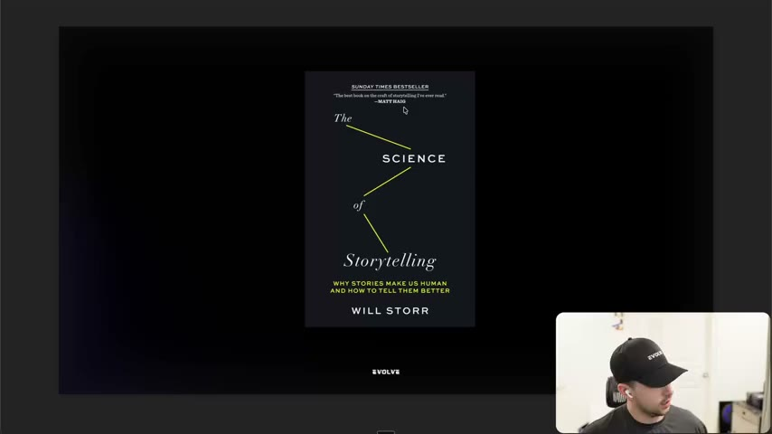
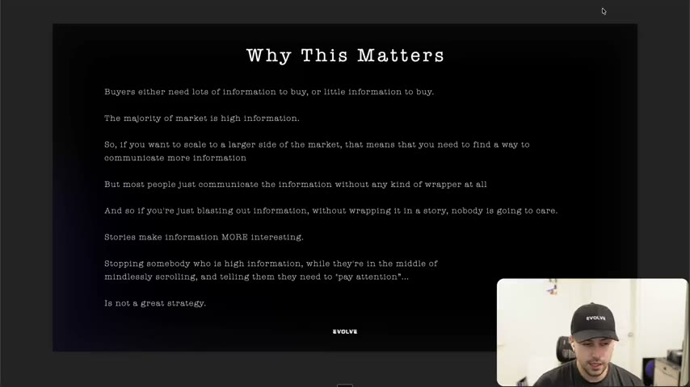
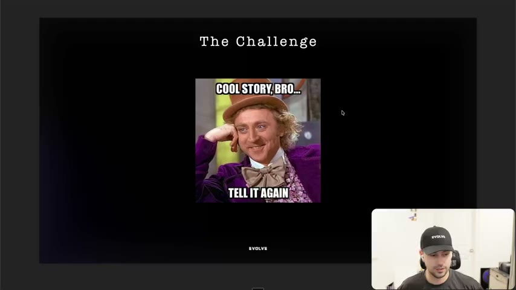

# 38. Why storytelling is so powerful
> Buyers are better split into "high information" and "low information" than "logical" and "emotional"; most of the market is high information, so to scale you must deliver more information, and a story is the wrapper that makes that information worth attending to (but a story alone is not enough).

## 🤖 Agent use
- **Use when:** deciding whether an ad should carry education or information, why a cold-traffic ad is not landing, or framing the brief for any story-led UGC script or static.
- **Inputs → outputs:** product, the information a skeptical or unaware buyer still needs, and the draft ad → a decision on whether the information is wrapped in a story, plus a check that the story is interesting to the *prospect*, not to us.
- **Rules:**
  - **DON'T** classify an audience as "logical" or "emotional" buyers. The instructor calls that distinction "too vague" and not actionable; "nobody just buys out of pure emotion and nobody buys out of pure logic." [02:32]
  - **DO** classify buyers as **high information** (need lots of information and more convincing) or **low information** (need little to decide). [02:32–03:23]
  - **DO** assume the majority of the market is high information, and to scale to more of it "you need to find a way to communicate more information". [03:23–04:01]
  - **DON'T** blast information at a scrolling prospect with no wrapper. "Nobody is going to care." [04:45]
  - **DO** wrap information in a story: "stories are what actually make information more interesting." [04:45]
  - **DON'T** assume that telling a story makes it interesting. Telling stories "is not enough". [05:33]
  - **IF** a story is interesting to us because we are at the centre of it **THEN** test it against the prospect: can *they* see themselves in it? The instructor's picture is telling a homeless person about your Ferrari paddle shifter. [06:17–06:57]
  - **DO** expect early story drafts to "just suck"; the fix is learning what makes a story interesting (lessons 40-44). [06:17]
- **See also:** [39. Why you can't just rely on education](39-why-you-cant-just-rely-on-education.md) · [40. What makes a great story](40-what-makes-a-great-story.md) · [Story frameworks for ads (Tether Lab)](../../../../frameworks/story-frameworks-for-ads.md) · [Creative testing system](../../../../frameworks/creative-testing-system.md)

Lesson page text: only a credit block, "Will Storr" and "Hormozi" (the slide quote and the buyer-types idea, respectively).

## Key ideas

### 1. "The brain is a story processor, not a logic processor" [00:00–01:45]
- Opening slide quote: "the brain is a story processor, not a logic processor", which the instructor attributes to **Will Storr**. He shows the book on camera ("the Science of Storytelling", cover visible on the slide at 00:20) and says he recently finished it. It is "pretty dense" and "more made for ... filmmakers". [00:00–00:58]
- His takeaway from the book: "literally everything we tell ourselves is just a story", and we "shape reality around the story that we ... tell ourselves": we convince ourselves life events happened for a specific reason. [00:00–00:58]
- Practical consequence: understanding how the brain makes stories explains why some stories are "so powerful" and why others, if they "go against certain beliefs the wrong way", "can completely flop". [00:58]
- The next idea is from a different source ("somebody who you're probably familiar with", credited on the lesson page as Hormozi). The instructor says it bridges to "logical versus emotional wires". [00:58–01:45]

*Slide showing the cover of Will Storr's "The Science of Storytelling" while the instructor introduces the "story processor" quote. [00:20]*

### 2. Logical vs emotional buyers is the wrong split [01:45–03:23]
- Setup: "True or false: some buyers are logical, some are emotional." The instructor says he would have answered true a few months ago. [01:45]
- Test: "Can you show me a logical buyer versus an emotional one?" Typical answers (logical buyers ask logical questions; emotional ones ask what it can do for them) don't hold. [01:45–02:32]
- Verdict on the slide: "This distinction is too vague and not actionable." Spoken: "Nobody just buys out of pure emotion and nobody buys out of pure logic. They're always together." [02:32]

### 3. High-information vs low-information buyers [02:32–04:01]
- Slide: "Buyers are better categorized as 'high information' or 'low information'", based "on their natural decision-making tendencies with purchases" and past purchase experiences. [02:32–03:23]
- Low-information buyers are "probably more emotional" in the old language: they already have the information they need or don't need much to decide. High-information buyers "need a lot more information and likely need a lot more convincing before they actually buy". [02:32]
- The instructor names the source of this framing as "Mosey" (Whisper's rendering; the lesson page credits **Hormozi**, so the name is probably Hormozi). [03:23]

### 4. Why this matters: scale means serving high-information buyers [03:23–05:33]
- Slide "Why This Matters": buyers need lots or little information; "the majority of market is high information"; to scale "to a larger side of the market" you must "find a way to communicate more information"; most people communicate it "without any kind of wrapper at all"; if you blast information without a story "nobody is going to care"; "stories make information MORE interesting"; stopping a high-information person mid-scroll and telling them to "pay attention" "is not a great strategy". [03:23–05:33]
- Without ads, such buyers consume information "a little bit here, a little bit there" over time until they have enough. Direct-response advertisers "want people to buy today", so the ad has to deliver the information in the ad. [04:01]
- "Even some of the best direct response ads won't work" on a high-information person who simply isn't ready to buy. [04:45]
- The challenge has two parts: **grab** attention, then **keep** it, "not just of low information people ... but even more so for those who are high information". [05:33]

*Slide "Why This Matters": the majority of the market is high information, so information must be wrapped in a story to hold attention. [03:50]*

### 5. A story is necessary but not sufficient [05:33–08:24]
- "Just telling a story is not enough" (slide "The Challenge"). The "Cool story, bro" meme makes the point: a flat story gets that reaction. [05:33–06:17]
- "When you're new to storytelling, you're going to write stories that just suck." Most people's stories "are just not that interesting" because they "don't understand what makes an interesting story". [06:17]
- Bias: "a lot of people have this bias that because they tell a story that it automatically is interesting because they're at the center of it." [06:17–06:57]
- Example: telling a homeless man that your Ferrari paddle shifter got stuck. "That homeless person cannot visualize themselves at all in that story ... you've probably just pissed them off." [06:57]
- Rule: "just because you find a story interesting doesn't mean that your prospects will find it interesting." [06:57–07:41]
- Framing for the rest of the section: the goal is to communicate information; stories are the best way; but "just because you're telling a story doesn't mean that people will care." The following modules cover information/education (39) then what makes a story work (40-44), so you can write stories that "shift beliefs" and drive purchases "in world record time". [07:41–08:24]

*"The Challenge" slide with the "Cool story, bro... tell it again" meme: a story is not automatically interesting to the listener. [06:20]*

## Steps / framework

| Step | Rule | Agent version (derived) |
|---|---|---|
| 1. Segment by information need | High vs low information, not logical vs emotional | Tag each target avatar/angle with how much information they need before buying; default to high |
| 2. Decide what information must travel | The majority is high information, so more must be communicated | List the facts, proofs, mechanism steps and belief shifts the ad must deliver |
| 3. Wrap it | Information needs a story wrapper | Choose a story form (lessons 40-44) instead of listing facts |
| 4. Check relatability | Prospect must see themselves in it | Re-read the draft as the avatar. Cut anything that is only interesting to the brand |

## Examples
- **Weak storyteller, wrong audience:** telling a homeless man you were in your Ferrari when the paddle shifter stuck. Not relatable, "read the room". [06:57]
- **Cool story, bro:** a story that is about the teller, with no stake for the listener, flops. [06:17]
- The lesson contains no ad teardowns or rewrites; the story examples come in lessons 40-44.

## Structured units

### Rules of thumb
- **DO** use "high information / low information" as the audience lens. [02:32]
- **DON'T** deliver information without a wrapper. [04:45]
- **DON'T** treat "it has a story" as proof the ad works. [05:33–06:57]
- **IF** you're at the centre of the story **THEN** check it is relatable to the prospect. [06:17–06:57]

## Prompts / templates (verbatim)
None in this lesson. The prompts for finding story material are in [44. Prompts to help you storytell](44-prompts-to-help-you-storytell.md).

## Screenshots
Three slides are embedded above (book cover 00:20, "Why This Matters" 03:50, "The Challenge" meme 06:20). The remainder of the video is a title card, short quote slides and a talking head.

## How to apply
- [ ] For each avatar and angle, write down whether they are high or low information. Default to high.
- [ ] List what information the ad must communicate, then choose the story that carries it (see [40](40-what-makes-a-great-story.md)).
- [ ] Read the draft story from the prospect's seat. If they can't see themselves in it, rewrite.
- [ ] (derived) For UGC scripts, put the information inside what happens to the creator, not in a spoken fact list.

## Related
- Previous: [37. Evolve Writing Prompts](37-evolve-writing-prompts.md) · Next: [39. Why you can't just rely on education](39-why-you-cant-just-rely-on-education.md)
- [Story frameworks for ads (Tether Lab)](../../../../frameworks/story-frameworks-for-ads.md): another creator's story-structure toolkit. The Evolve section here argues for *why* to wrap information in a story first, then teaches what makes a story work; Tether Lab picks a named structure per job.
- [Native advertising](../../../../concepts/native-advertising.md)

## Sources and limitations
- Transcript: [38. Why storytelling is so powerful… .txt](<../../../../../raw/evolve/copywriting/_transcripts/✍️ Evolve Copywriting (NEW)/38. Why storytelling is so powerful ✍️ Evolve Copywriting (NEW) Evolve.txt>) · Page text: [….html.md](<../../../../../raw/evolve/copywriting/_extracted/✍️ Evolve Copywriting (NEW)/38. Why storytelling is so powerful_✍️ Evolve Copywriting (NEW)_Evolve.html.md>)
- Machine transcription (Whisper large-v3-turbo). Full recording covered (last segment 8:34 of 8:34).
- Source attribution is partly unclear: the instructor says the "story processor" quote is Will Storr's, and the page credits Hormozi for the buyer split. The audio at 00:58 is muddled ("this is actually not from the book") and at 03:23 Whisper heard "Mosey". Treat the Hormozi attribution as likely, not confirmed.
- "Ferrari / homeless man" and "Cool story, bro" are illustrations, not ads.
