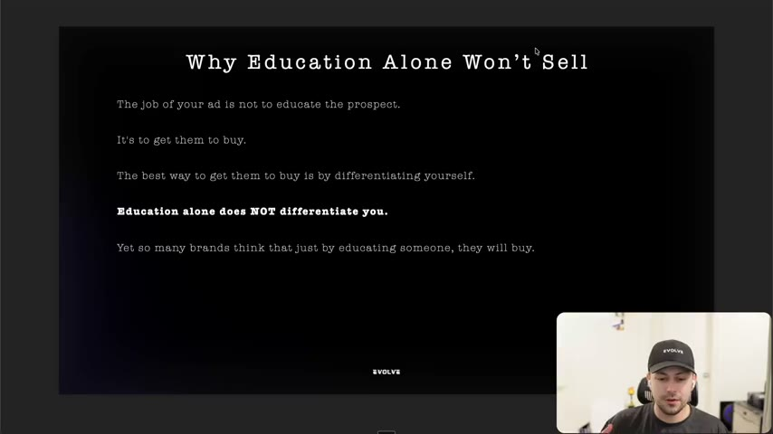
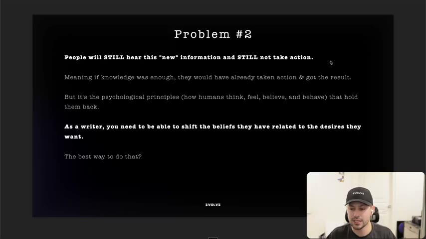
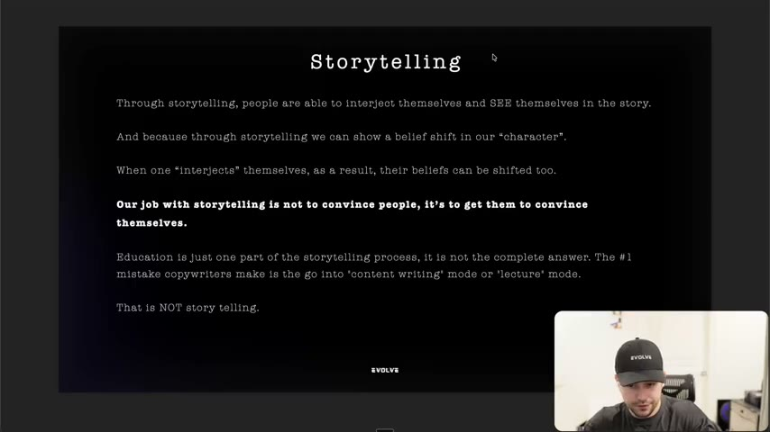
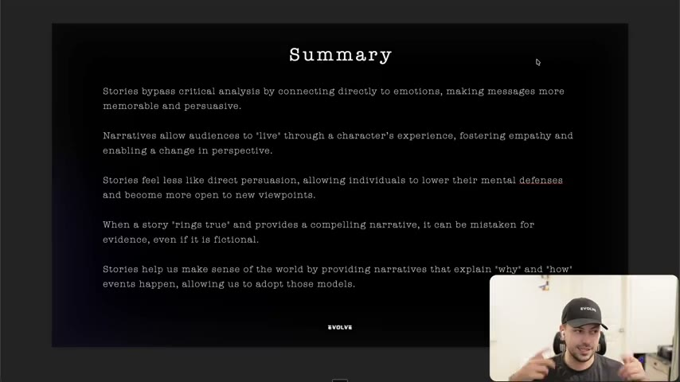

# 39. Why you can't just rely on education
> Sharing information, even new information, does not differentiate a brand or move people to buy; the writer's job is to shift beliefs, and the way to do that is a story that lets the viewer convince themselves.

## 🤖 Agent use
- **Use when:** an ad or script is a list of facts, studies or "did you know" claims; a competitor ad is "educational" and we need to decide whether to copy the mechanism; or we are choosing between an educational hook and a story hook.
- **Inputs → outputs:** a draft that educates (basic or new information) plus the avatar's blocking belief → a rewrite where a character like the avatar goes through a belief shift, so the viewer reaches the conclusion themselves.
- **Rules:**
  - **DO** remember the ad's job: "not to educate people. The job of your ad is to get them to buy right now." [00:47]
  - **DON'T** rely on education to differentiate: "education alone is the least effective way to differentiate yourself" (quote attributed to Jason Fladlien). [00:00–00:47]
  - **DON'T** lead with basic information the avatar already knows ("no shit, Sherlock"). Example: sleep 8 hours, hydrate, avoid processed food, 10,000 steps for weight loss. [01:39–02:32]
  - **IF** you use new information (e.g. "it's not overeating, it's cortisol from constant stress") **THEN** treat it as objection re-assigning, and know it can still fail to trigger action. [02:32–04:03]
  - **DO** identify the psychological blocker (how the avatar thinks, feels, believes and behaves), not just the missing fact. [04:03]
  - **DO** write stories where a character like the viewer shifts a belief, so the viewer "interjects" themselves and their belief shifts too. [04:50]
  - **DO** aim for "get them to convince themselves"; **DON'T** try to convince them directly. [05:32]
  - **DON'T** slide into "content writing" or "lecture" mode. "That in itself is not storytelling." [06:14]
- **See also:** [38. Why storytelling is so powerful](38-why-storytelling-is-so-powerful.md) · [40. What makes a great story](40-what-makes-a-great-story.md) · [15. Why you need to understand beliefs](15-why-you-need-to-understand-beliefs.md) · [Validation over authority](../../../../concepts/validation-over-authority.md)

Lesson page text: one line, "Your brain is triggered more when listening to stories VS being told things.", and the credit "Jason Fladlien".

## Key ideas

### 1. Education alone does not differentiate [00:00–01:39]
- Quote on the slides: "Education alone is the least effective way to differentiate yourself" (- Jason Fladlien). The instructor says it comes from "a guy named Jason" who "worked with guys like Iman Gadzhi, Alex Hormozi" and is "the webinar kind of godfather". (Whisper heard "Flateline", "Iman Godzi" and "Alex Ramosi"; the slide spells Fladlien.) [00:00–00:47]
- He calls this "one of the number one mistakes" he sees. Sharing information, even from you, doesn't make you special or make people believe you. [00:00–00:47]
- Slide "Why Education Alone Won't Sell": "The job of your ad is not to educate the prospect. It's to get them to buy. The best way to get them to buy is by differentiating yourself. Education alone does NOT differentiate you. Yet so many brands think that just by educating someone, they will buy." [00:47–01:39]
- Education can get some people to buy, but "we're trying to make ads that are just ... massive breakthroughs". Information alone will not create one. [01:39]

*Slide "Why Education Alone Won't Sell": the ad's job is to get them to buy, which requires differentiating. [01:20]*

### 2. Problem #1: basic information [01:39–02:32]
- Slide example (weight loss): an ad saying "studies have proven" that 8 hours of sleep, staying hydrated, avoiding processed foods and 10,000 steps a day "are all crucial to losing weight". Slide caption: "People already know all of this." [01:39–02:32]
- Spoken: many people already know this "but even then, they still aren't losing weight and they're most importantly not taking action." The question is why. [01:39–02:32]

### 3. Problem #2: new information [02:32–04:03]
- Slide example (weight loss again): "Studies have proven that the reason your overweight is not due to overeating, it's due to high cortisol from constantly being stressed." [02:32]
- To some this is new and "can definitely work better": new information "gives you essentially new hope". It is "an objection handling thing": "we're essentially just reassigning the objection". [03:05]
- But the slide says people "will STILL hear this 'new' information and STILL not take action." "If knowledge was enough, they would have already taken action & got the result." [03:05–04:03]

*Slide "Problem #2": new information is still not enough; psychological principles hold people back and the writer must shift beliefs tied to desires. [03:40]*

### 4. What actually holds people back: psychological principles [04:03–04:50]
- Defined by the instructor (crediting Jason again): "how humans think ... how they feel ... what they believe ... how they behave". These are what hold buyers back. [04:03]
- "As a writer, you need to be able to shift the beliefs they have related to the desires they want." Do that and "you will be very rich" (Jason's line as relayed, an instructor claim). [04:03]
- The best way to shift beliefs is storytelling. [04:03–04:50]

### 5. Storytelling: get them to convince themselves [04:50–06:14]
- Through a story, people "interject" themselves into the character and see themselves in it. A story can show a belief shift in the character. When the viewer has stepped into that character and sees what happened, "their beliefs start to shift too". [04:50]
- The line to remember (bolded on the slide): "Our job with storytelling is not to convince people, it's to get them to convince themselves." [05:32]
- Why it works: you aren't the one saying their beliefs are wrong or raising "red flags that you're doing this because of your benefit". You show "how a person just like them went through all of these trials and all these tribulations", and the story does the convincing. [05:32–06:14]
- Education is "just one part of the storytelling process. It is not the complete answer." The #1 copywriter mistake is going into "content writing" or "lecture" mode. [06:14]

*Slide "Storytelling": interject yourself, belief shift in the character, "get them to convince themselves", and the lecture-mode warning. [05:00]*

### 6. Summary (AI-generated, with the instructor's caveat) [06:14–08:57]
The instructor says he "generated the summary from Google" and found it "bang on", while admitting it is also "the story that I'm creating for myself" because he has some proof of it. [06:14] Slide text, in full:
- Stories "bypass critical analysis by connecting directly to emotions, making messages more memorable and persuasive."
- Narratives let audiences "live" through a character's experience, "fostering empathy and enabling a change in perspective."
- Stories "feel less like direct persuasion, allowing individuals to lower their mental defenses and become more open to new viewpoints."
- When a story "rings true" and gives a compelling narrative, it can be "mistaken for evidence, even if it is fictional."
- Stories help us make sense of the world "by providing narratives that explain 'why' and 'how' events happen".

Spoken additions: brand-shared information makes people think "you're saying that because you want me to buy" (even with percentages), while in a story "the mental barrier, the mental defenses are down because they're essentially just experiencing it through this character." [07:11–08:01] (The "mistaken for evidence" and other summary claims are not backed by cited research in the lesson.)

*The five-point summary slide on why stories bypass critical analysis. [06:50]*

- Close: "the brain is a story processor, not a logic processor" and storytelling is "a handshake with the brain". Next module: "the nuts and bolts" of what makes great stories and the pitfalls. [08:01–09:37]

## Steps / framework

| Step | What to do | Agent version (derived) |
|---|---|---|
| 1. Spot the education trap | Is the ad a list of facts or studies? | Flag ads whose hook is "studies show", stat lists or tips |
| 2. Classify the information | Basic (already known) or new | Basic: cut or reduce. New: use as a belief re-assignment inside a story |
| 3. Name the belief | What belief about the desired outcome blocks action? | Pull it from reviews and research. See [15](15-why-you-need-to-understand-beliefs.md) |
| 4. Build the belief shift | A character like the avatar goes through the shift | Use the story arcs in [43](43-the-storytelling-arcs-plots.md) |
| 5. Let them conclude | No lecture; viewer convinces themselves | Remove "you need to know" sentences, replace with what happened |

## Examples
| Example | What it shows | Source |
|---|---|---|
| Weight loss ad: "studies have proven getting eight hours of sleep, staying hydrated, avoiding processed food, and 10,000 steps a day are all crucial" | Problem #1, basic information everyone knows. People still don't act | [01:39–02:32] |
| Weight loss ad: "studies have proven that the reason why you're overweight is not due to overeating. It's actually due to high cortisol from constantly being stressed" | Problem #2, new information gives hope and reassigns the objection but may still not trigger action | [02:32–04:03] |

## Structured units

### Rewrites (before to after)
The lesson shows no storytelling rewrite of these two ads; the following is a derived illustration only.
| Before | After (derived, not from the course) | What changed | Source |
|---|---|---|---|
| "Studies have proven the reason you're overweight is high cortisol from constant stress" | A creator tells what happened when she stopped blaming overeating and found the stress link | Information becomes a character's belief shift; viewer concludes themselves | Derived from [04:50–06:14] |

### Rules of thumb
- **DON'T** let the ad lecture. [06:14]
- **DO** differentiate; education does not. [00:47]
- **IF** the information is new **THEN** it is an objection reassignment, not the whole ad. [03:05]
- **DO** let the viewer reach the conclusion. [05:32]

## Prompts / templates (verbatim)
None in this lesson.

## Screenshots
Four slides embedded above (01:20, 03:40, 05:00, 06:50). The rest is a title card, quote slides and a talking head.

## How to apply
- [ ] Mark every sentence in a draft as basic information, new information or story. Cut the first, wrap the second.
- [ ] State the one belief that stops the avatar from acting; write the character who holds it and then drops it.
- [ ] Make sure the ad never says "you need to know" and then lists facts.
- [ ] (derived) For a UGC script: open on a moment the creator held the avatar's belief, not on a fact.

## Related
- Previous: [38. Why storytelling is so powerful](38-why-storytelling-is-so-powerful.md) · Next: [40. What makes a great story](40-what-makes-a-great-story.md)
- [Story frameworks for ads (Tether Lab)](../../../../frameworks/story-frameworks-for-ads.md) · [Validation over authority](../../../../concepts/validation-over-authority.md)

## Sources and limitations
- Transcript: [39. Why you can't just rely on education… .txt](<../../../../../raw/evolve/copywriting/_transcripts/✍️ Evolve Copywriting (NEW)/39. Why you can't just rely on education ✍️ Evolve Copywriting (NEW) Evolve.txt>) · Page text: [….html.md](<../../../../../raw/evolve/copywriting/_extracted/✍️ Evolve Copywriting (NEW)/39. Why you can't just rely on education_✍️ Evolve Copywriting (NEW)_Evolve.html.md>)
- Machine transcription (Whisper large-v3-turbo). Full recording covered (577.62 s). Names corrected from the slides and page credit: "Fladlien" (Whisper "Flateline"), "Iman Gadzhi" and "Alex Hormozi" (Whisper "Iman Godzi", "Alex Ramosi"; the instructor says "I butcher his last name").
- "You will be very rich" and the "bypass critical analysis / mistaken for evidence" claims are the instructor's / an AI summary's claims without cited evidence.
