# 40. What makes a great story
> A story is conflict, and every strong ad story has five building blocks (change, withholding information, stakes + drama, tension + suspense held together with "but" and "so", and cause and effect), which the instructor then finds line by line in four real ads (The Conscious Bar, Aviorra live-translation earbuds, Humby Organics hair-growth, plus Grüns and Liquid Death as positioning-versus-story examples).

## 🤖 Agent use
- **Use when:** tearing down a story-led competitor ad (video or static) to see *why* it holds attention; writing or auditing a UGC script, founder story or customer-story ad; deciding whether a draft is a story or a "shopping list".
- **Inputs → outputs:** a competitor ad transcript or our draft script → a five-block audit (change, withholding, stakes + drama, tension + suspense with the but/so chain, cause and effect) with the exact line that delivers each block, and a list of missing blocks to add.
- **Rules:**
  - **DO** add conflict to any flat line. "You don't have a story unless you have conflict." [00:00] Example: "The man worked at his desk" becomes "The man worked at the *boss's* desk". [01:31]
  - **DO** know the problem and category deeply before writing a story; the principles "will not fix your ability to story tell if you have nothing to talk about". [03:13–04:05]
  - **DON'T** substitute adjectives for knowledge: "In the absence of knowledge, you will be doomed to rely more and more on adjectives. Always a mistake." (Bob Levenson.) [05:50]
  - **DO** separate position from story: positioning is "we do X", story is "why we do X", storytelling is "getting that why inside the customer's head". [05:50–06:52]
  - **DO** build in all five blocks. "If you're writing your story and it doesn't have one of these five things, it's not going to be as powerful." [11:12–12:16]
  - **DO** open with a moment of unexpected change or an information gap, "and ideally both". [17:07]
  - **DO** follow the 80/20 rule for hooks: tell 80% of the story, leave 20% to work out. **DON'T** leave so much unresolved that people give up. [14:00]
  - **DO** aim for the middle of the curiosity curve: viewers think they have some idea but aren't quite sure. [14:53–15:39]
  - **DO** prefer abnormal, high-stakes situations over normal ones. "People are interested in abnormal things, not normal things." [18:37]
  - **DO** connect every beat with an imaginary "but" (change direction) or "so" (progress). **DON'T** connect with "and": that is "a shopping list". [19:20–21:10]
  - **DO** keep cause and effect clear so the viewer can insert themselves. [21:10–21:59]
  - **IF** a story can blame an industry, hidden ingredient or "they" rather than the buyer **THEN** do it: the buyer feels better about themselves and trusts you more. [25:35; 27:56–28:52]
  - **DO** ask: "how can I fit my product into my avatar's life?" and "how can I fit my product in a story that people will care about?" [35:03]
- **See also:** [41. The laws of story telling](41-the-laws-of-story-telling.md) · [42. The three enemies of storytelling](42-the-three-enemies-of-storytelling.md) · [43. The storytelling arcs/plots](43-the-storytelling-arcs-plots.md) · [44. Prompts to help you storytell](44-prompts-to-help-you-storytell.md) · [Story frameworks for ads (Tether Lab)](../../../../frameworks/story-frameworks-for-ads.md) · [Brand enemy](../../../../concepts/brand-enemy.md)

Lesson page text: only a credit block, "Harry Dry" and "Will Storr". The instructor repeatedly says the principles are not his own: "massive credits owed to both Harry and Will", and names Laura Ries and Jack Trout among others he learned from. [35:03]

## Key ideas

### 1. Story = conflict, and two practice exercises [00:00–03:13]
- Slide: "Story = Conflict" and "All writing can benefit from more conflict." (credited to Harry Dry). [00:00–00:49]
- **Exercise 1:** make "The man worked at his desk" more of a story. The instructor's answer: "The man worked at the **boss's** desk." It raises questions (why is he there; is he in trouble, promoted, the new boss?). "Add a little bit more conflict to your writing to make it more interesting." [00:49–02:12]
- **Exercise 2:** make "Create unaware ads" more interesting. His answer: "Creating unaware ads on Meta is the easiest way to legally print money." It is an actual tweet of his (May 9, 2025) with "over 120,000 impressions" (the slide shows 123.8K views, the instructor's reported figure). Why it works: "legally print money" juxtaposes something illegal with "legally", and "easiest way" adds a value word. [02:12–03:13]

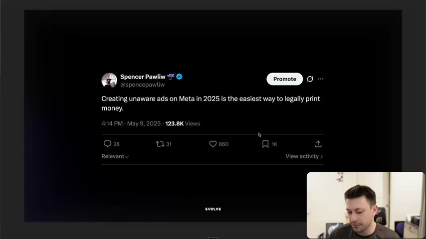
*The tweet slide for exercise 2: "Creating unaware ads on Meta in 2025 is the easiest way to legally print money." The juxtaposition ("legally print money") is the small dose of conflict. [02:40]*

### 2. The truth about storytelling: you need something to say [03:13–06:52]
- Slide (Harry Dry): "If you want to be great at storytelling, you need to have a story to tell. To have a story to tell, you need to know more about your problem and your category than anybody else. You should know so much ... that you could write a book on it." [03:13]
- The instructor ties this to "Evolve 1.0" (the original version of the course), which worked for people with baseline copywriting skill because it made them knowledgeable about the problem, category and product (instructor claim). He says "30 to 50 modules" teach this. [04:05]
- Harry's related point: do the research work "so that when you go to sit down, it just flows"; if you can't flow, "you probably don't know enough yet". [04:05]
- Warning for AI users: those "trying to replace a lot of the stuff with AI" will find it "very hard to actually storytell the right way" without knowing the subject themselves. [05:05–05:50]
- Quote: "In the absence of knowledge, you will be doomed to rely more and more on adjectives. Always a mistake." from Bob Levenson (Whisper: "Levinson"), described as the writer of the Volkswagen "Think Small" ad. The instructor says he got it via Harry. [05:50]

### 3. Position vs story vs storytelling [05:50–11:12]
- Slide "Definitions": **Positioning = WE do X. Story = WHY we do X. Storytelling = getting that WHY inside the customer's head.** [05:50–06:52]
- **Grüns.** Position (instructor's reading, "not their actual position statement"): "We are the easiest way to take greens (enemy = powder greens)". Story on slide: "We were disappointed. There's an infinite number of 'nutrition' companies, all focused on what's best for them, not what's best for you. So we decided it was time to fix it. No more choking on and popping pills like a pharmacy. No more clean-up and disgust from gross powders. Grüns is comprehensive nutrition, made convenient and delicious." [06:52–07:49]
  - Storytelling example played: founder Chad's video, which opens by spitting out green powders ("how disgusting it is"), then says the gummy is backed by "over 35,000 research publications and clinical studies" with "60 whole food and nutrient-dense ingredients". The ad "got over 3.6 million views" (instructor claim; the slide shows a count of about 3.6M highlighted in red) during the 2022-2023 launch period. The ad "emphasize[s] that story" of why they exist. [07:49–08:47]
- **Liquid Death.** Position: "The rebellious water in a can (enemy = Plastic)". Story on slide: "Liquid Death will not kill you. But make no mistake, our infinitely recyclable cans of premium low-calorie beverages will absolutely murder your thirst. And it doesn't stop there. After twerking on your thirst's grave, these ruthless cans will actually donate a portion of the proceeds to help kill plastic pollution." Why: "For centuries, all the funniest and coolest marketing and branding was only done for unhealthy products like beer, fast food, candy, and junk food. But those days are over." [08:47–09:38]
  - Storytelling example played: the "Liquid Death Recycled Plastic Surgery Center" ad with comedian Whitney Cummings as a "board certified plastic surgeon" ("Research shows that only about 5% of plastic actually gets recycled ... but now it can wind up in you"; the instructor warns it shows "butt cheeks" and is "hilarious"). It tells the plastic story in an escalated, funny way. He also mentions their kids-drinking-tall-boys and pregnant-woman "relax, it's just water" ads as the same upbeat branding. [09:38–11:12]
- Takeaway slide: "You have a story, and you need to tell it again, and again, and again." The same story can be told through different ads (plastic, recyclable cans, etc.). [11:12]

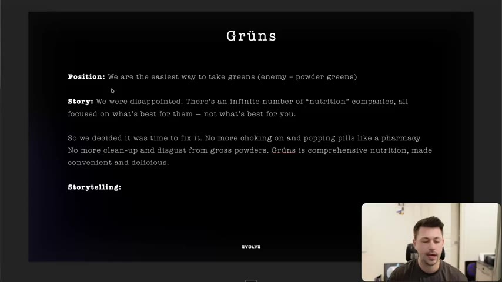
*Grüns: position ("easiest way to take greens", enemy = powder greens) and the founder-disappointment story. [07:00]*

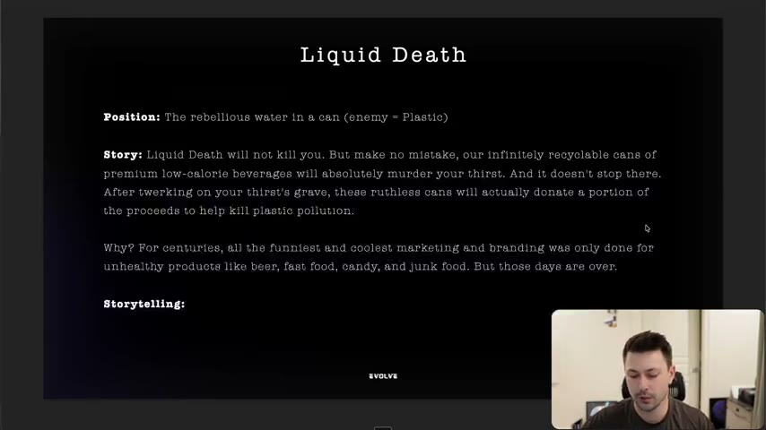
*Liquid Death: position ("rebellious water in a can", enemy = plastic) and the story text. [10:49]*

### 4. Building block #1: Change [11:12–13:18]
- Source: Will Storr, *The Science of Storytelling*. Slide: "Every story you'll ever hear amounts to something changed. Our brain basically doesn't work unless there is change detected. Unexpected change is a doorway through which danger arrives, and paradoxically, where opportunity arrives. Change is hope. Change is promise." [11:12–12:16]
- "Great storytellers create moments of unexpected change that seize the attention of their viewers." [12:16]
- Slide examples of lines that imply change: "That spot, he hasn't eaten his supper. Where can he be?" and "When I wake up, the other side of the bed is cold." (the second is from The Hunger Games, instructor says "I believe"). Both = "Something changed". [12:16–13:18]
- "These lines create curiosity by describing specific moments of change, but they also hint at more change to come. The threat of change is a highly effective technique for creating & keeping curiosity." [13:18]

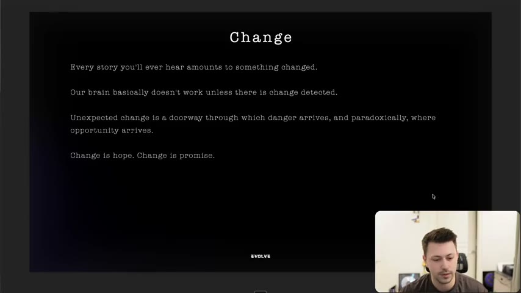
*Building block #1, Change: "Every story you'll ever hear amounts to something changed." [12:10]*

### 5. Building block #2: Withholding information [13:18–17:07]
- Distinction the instructor makes: change alludes to something that is going to change; withholding information is not telling everything. [13:18–14:00]
- Slide: "Storytelling is the ART of withholding information." **80/20 rule:** "A good hook tells you 80% of the story, but leaves 20% for you to work out. If there is TOO much of the story left for the person to sort out, they may not watch." He adds that this is a direct-response caution: too big a gap and viewers may not keep watching. [14:00–14:53]
- **Curiosity is shaped like a lowercase "n":** weakest when people have no idea what will happen, also weakest when they are "entirely convinced they know", strongest in the middle: "when people think they have some idea but aren't quite sure." Give enough that they feel they know what's going on but are not quite sure. [14:53–15:39] The slide adds "We crave to know the answer in the story in the way we might crave drugs or sex or chocolate" (Will Storr).
- **Three ways of "involuntarily introducing curiosity"** (each marked "covered" earlier in the course): [15:39–17:07]
  1. Pose a question or juxtapose: ask a question or create a gap ("did you know" unaware ads; "legally printing money").
  2. Do the opposite: do something that doesn't match the pattern (Liquid Death looks like an energy drink or beer, not water).
  3. Let them know you learned a secret: point to knowledge someone else has (authority, insiders). Running-shoes example on the slide: "Elite marathon runners size their shoes differently than what the store recommends."
- Conclusion: "A story begins with a moment of unexpected change or with the opening of an information gap, and ideally both." [17:07]

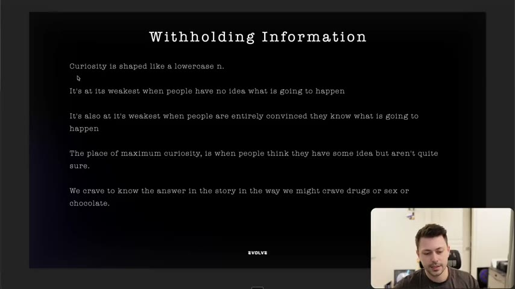
*"Curiosity is shaped like a lowercase n": weakest at no idea and at total certainty, peak in the middle. [14:50]*

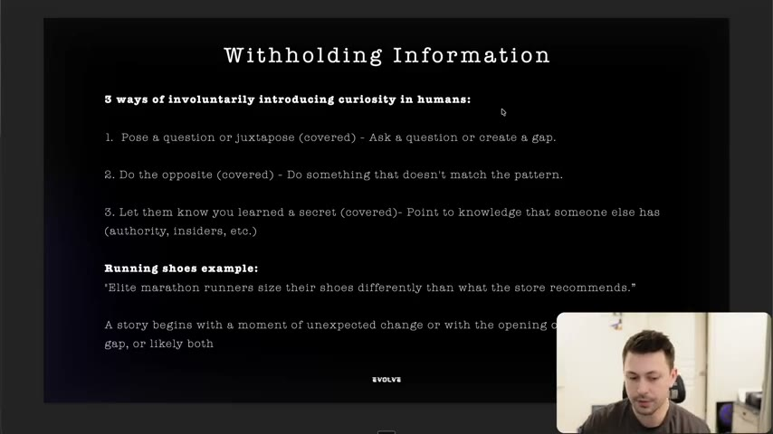
*Three ways of involuntarily introducing curiosity: pose a question/juxtapose, do the opposite, let them know you learned a secret, with the marathon-shoes example. [16:10]*

### 6. Building block #3: Stakes + drama [17:07–18:37]
- Slide: "Every great story has stakes, it has drama. As we already discussed previously, raising the stakes is crucial. A lot of the time, the more DRAMA your story has, the BETTER the story will perform." [17:07] (Refers back to the raising-the-stakes lesson, [30. How to raise the stakes](30-how-to-raise-the-stakes.md).)
- Grocery-store test: "How he went to the grocery store, got groceries, and drove back home" vs "How he went to the grocery store with his ex, and ran into his girlfriend, and they drove back home... Now it's much more interesting." (The instructor notes he swapped the order on purpose to be more dramatic.) [17:52–18:37]
- "People are interested in the ABNORMAL, not the NORMAL." [18:37]

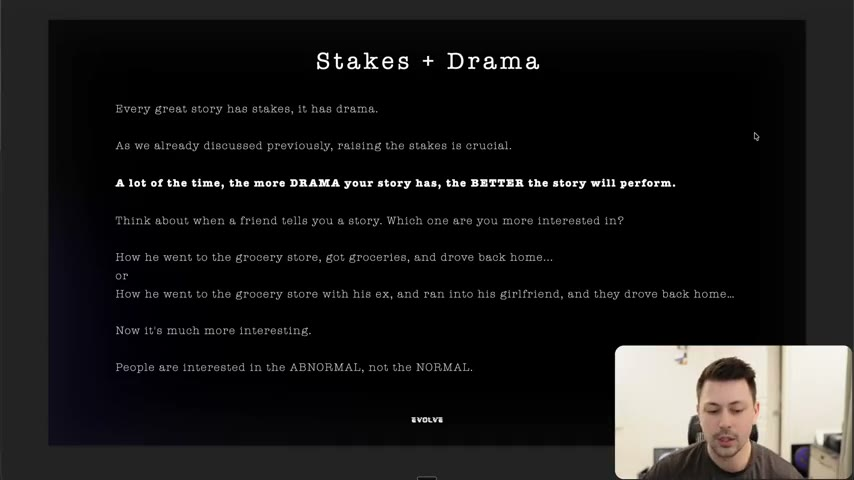
*Stakes + Drama: the grocery-store comparison and "interested in the ABNORMAL, not the NORMAL". [17:41]*

### 7. Building block #4: Tension + suspense, and "but / so, never and" [18:37–21:10]
- "Create unresolved tension, and then resolve it. That's your story." (Harry Dry; slide.) [18:37]
- Suspense = viewers feel "the curiosity gap you created in the hook could be revealed at any second" and "change could happen at any moment". [18:37–19:20]
- Between beats, connect lines with two words: **BUT** "to change direction in a story", **SO** "to progress the direction in a story". "'But', 'So' NEVER 'And'." [19:20–20:03]
- Slide: "When writing stories think: 'Yes, But...'. Put imaginary 'But's' and 'So's' between your points and see how they connect. 'If you're writing your story and it all feels like "AND" it's not a story. It's a SHOPPING LIST... It's boring' (Harry Dry)." The instructor says Harry credits a South Park writer for this. [20:03–21:10]
- Clarification (repeated at 27:04): you do not literally write "but" and "so"; they are connective tissue "between all of the points" (the ad does say "but then sugar entered and everything changed"). [27:04–27:56]

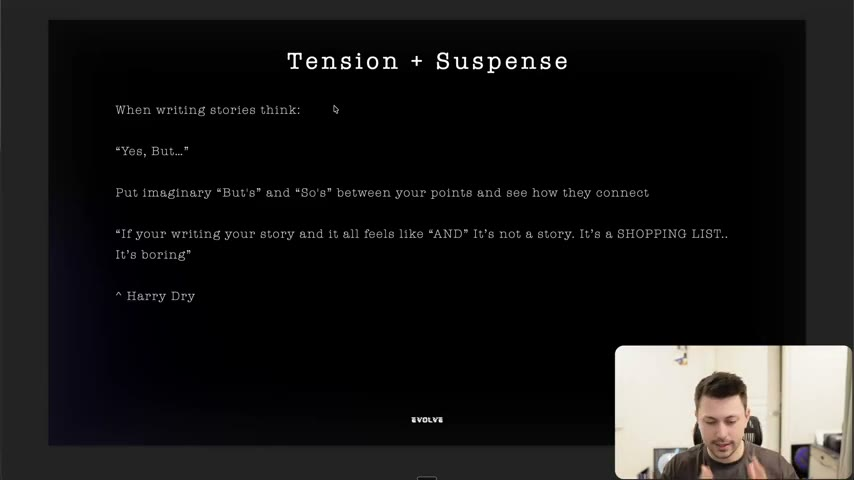
*Tension + Suspense: think "Yes, but...", put imaginary buts and sos between points, and "and" makes a shopping list. [20:11]*

### 8. Building block #5: Cause and effect [21:10–22:46]
- Slide: "We're very interested in the cause and effect of other people. Why did they do that irrational, unpredictable, dangerous, incredible thing. Ads without cause and effect tend to be boring. People should be free to anticipate what's coming next and be able to insert their own feelings and interpretations into why that just happened and what it all means." Then: "That 'insertion' of self is what makes stories so powerful." [21:10–21:59]
- When people insert themselves, "their preconceptions, their values, their memories, their connections, their emotions, their desires" become part of the story; you want them to see themselves in it "because you've likely gone through a similar experience". [21:59]

### 9. Teardown 1: The Conscious Bar (chocolate) [22:46–28:52]
Ad text (spoken, abridged from the transcript): opens "What is the number one ingredient in most chocolate bars? I'll give you a hint. It is not cacao." The cacao pod "started off as medicine", "40 times more antioxidants than blueberries", "some of the highest magnesium", boosts serotonin and dopamine, "But then sugar entered the picture and everything changed... Today, some bars are over 50% sugar by weight. One in two Americans now lives with a chronic illness. And it's been proven that sugar is to blame ... and it's hidden in almost every single chocolate bar." Then: "So we asked ourselves, what would happen if instead we paired this magical superfood with nature's most nutrient-dense sweetener, organic dates?" ... "rich, fudgy, and unbelievably delicious ... Just cacao and dates. That's it." CTA: "Click below to get 20% off your first order." [22:46–23:43]
- Instructor: "when I watched that ad, I literally bought" (Whisper garbles the rest, "from the sad guys"; probably "from the ad/brand"); "when an ad works on me, it's a great ad", partly because it was relevant to him. [23:43]
- Breakdown (slides at 24:31-28:01, spoken 24:42-28:52): see the teardown table below.
- Extra point: "they have not put the blame on the person eating the chocolate bar" but on the companies that hid sugar. "If you can make your customer feel good about themselves, they are more likely to trust you" (compliment analogy). This is "still to do with storytelling, but also a lot to do with belief." [28:52; 27:56–28:52]

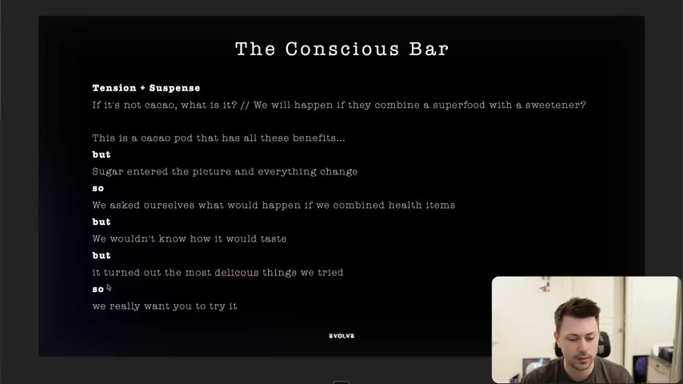
*The Conscious Bar broken into "but"/"so" connectors: cacao benefits, *but* sugar entered, *so* we combined health items, *but* we didn't know the taste, *but* it turned out delicious, *so* we want you to try it. [26:21]*

### 10. Teardown 2: Aviorra live-translation earbuds [28:52–31:31]
- Framed as "pretty sure it's a dropshipper" to show "storytelling exists on all levels"; a "one take UGC video", "not as elegant, not as crazy". The product (live translation earbuds, 134 languages) is only revealed late. [28:52–31:31]
- Ad script (UGC, woman in a car): "I thought girls enjoyed going to the nail salon... They were talking so bad about this girl getting the pedicure ... they were saying she had fungus under her nails ... They thought I was just listening to music ... The whole time it's translating what they're saying right into English in my ear." Friend: "Did they say anything about you?" "Yeah, when I went to pay at the end ... $10 tip, really? That's not even 20%." "You have got to get a pair of these ... How many languages ... 134." [28:52–29:46]
- Breakdown at 29:46-31:31 and in the table below. The pitch only starts after the story ("now obviously we're getting into the pitch here"). [29:46]

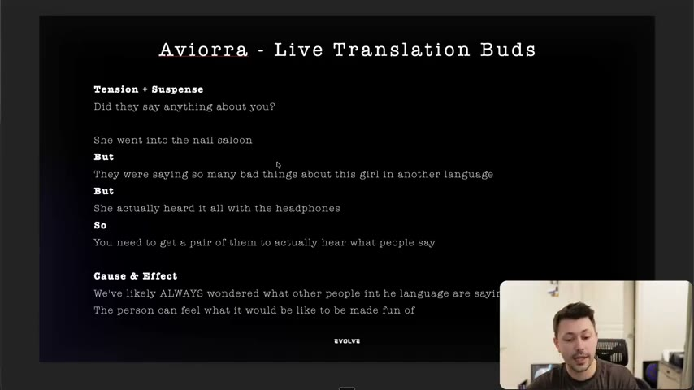
*Aviorra: tension + suspense ("Did they say anything about you?") and the chain "She went into the nail saloon / But they were saying so many bad things / But she actually heard it all with the headphones / So you need to get a pair". [31:01]*

### 11. Teardown 3: Humby Organics hair growth [31:31–35:03]
- Ad (spoken by a Humby team member): "We got this review from one of our customers last week, and it made everyone in our office cry. So Dawna was going through chemo... After about two weeks, she had to shave her whole head... she asked us if we had any shampoo bars that she could use for hair growth, and that's when we sent her some blueberry field bars for free... Usually it's impossible to grow hair in active chemo. But to everyone's surprise, within one month, her hair started to grow back." Close: "please take Dawna's story as a sign of hope. It is possible to grow more hair." (Whisper "Dawn/Donna" and "Boopy Fields"; the slides spell "Dawna".) [31:31–33:13]
- Instructor: the opening line "made everyone in our office cry" is stakes and drama "before she even mentioned the story". "That wasn't about the product. That was about Dawna and her story... the product just happened to be one of the things that helped." [33:13–35:03]
- Link to lesson 44: the customer-focused prompt (find "story starters in your reviews") is the same move. [44. Prompts to help you storytell](44-prompts-to-help-you-storytell.md)

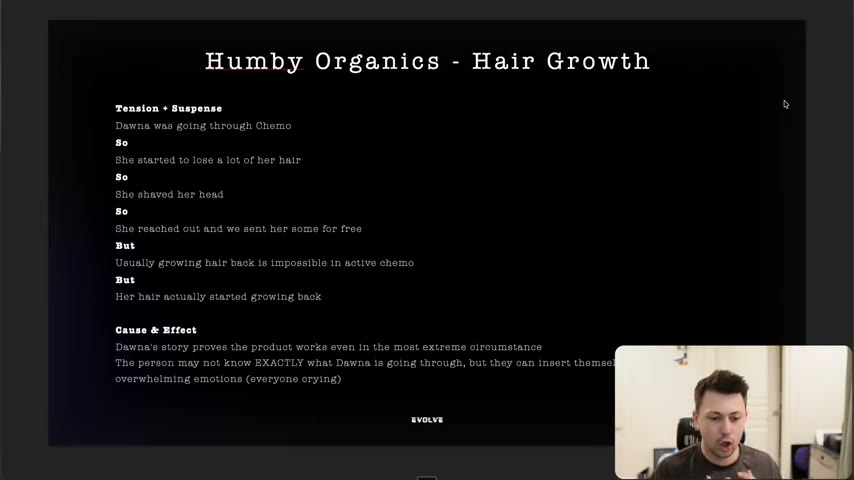
*Humby Organics: "Dawna was going through Chemo / So... So... So... But usually growing hair back is impossible in active chemo / But her hair actually started growing back". [34:49]*

### 12. Closing questions [35:03–36:26]
- "How can I fit my product into my avatar's life?" All the examples do this (the Conscious Bar is "a little bit more of an educational story ... about the industry in general" but still reaches the person via "one in two Americans"). "If you can really figure out how to fit your product into your avatar's life and create a story around it, it just makes it such an easier way to sell." [35:03]
- "How can I fit my product in a story that people will care about?" [35:03]
- Credits: Harry Dry and Will Storr. [35:03–36:11]

## Steps / framework

### The five building blocks (audit checklist)
| # | Block | Test question | Source |
|---|---|---|---|
| 1 | **Change** | Does something specific change (before/after, unexpected moment), and does the opening hint at more change? | [11:12–13:18] |
| 2 | **Withholding information** | Is there a question, juxtaposition, opposite-of-pattern or secret that leaves ~20% unsaid? Is the viewer in the middle of the "n" (some idea, not sure)? | [13:18–17:07] |
| 3 | **Stakes + drama** | Is the situation abnormal and high stakes (health, family, safety, humiliation), or normal and flat? | [17:07–18:37] |
| 4 | **Tension + suspense** | Can the gap/change be "revealed at any second"? Do beats connect with but/so, never and? | [18:37–21:10] |
| 5 | **Cause and effect** | Does each line lead to the next, so the viewer can insert their own feelings? | [21:10–22:46] |

### Exercise (from the lesson): add conflict to a flat sentence
1. Write the flat line.
2. Change one noun or modifier so it implies conflict (the man worked at the *boss's* desk). [01:31]
3. Or juxtapose two things that shouldn't go together ("legally print money"), and add a value word ("easiest way"). [02:12]

### Derived UGC script skeleton (derived from the five blocks and the Aviorra / Humby teardowns; not a template the instructor supplies)
Use for a first-person creator video. Beat labels are mine; the but/so connectors come from the lesson.
| Beat | Job | Block | Line pattern (derived) |
|---|---|---|---|
| 1. Hook | Open on a moment of change or a gap, mid-event | Change + Withholding | "I thought [normal belief]... [something just happened]" |
| 2. Stakes | State what was at risk (embarrassment, health, family, money) | Stakes + drama | "They were [saying/doing the abnormal thing]" |
| 3. But | Reverse the direction | Tension | "But [the unexpected fact]" |
| 4. So | Advance | Tension / cause-effect | "So [what the creator did]" |
| 5. But | Second reversal or obstacle | Tension | "But [it should not have worked / I doubted it]" |
| 6. Payoff | Resolve the gap, show effect | Cause and effect | "[result the viewer can picture themselves having]" |
| 7. Pitch | Product only after the story | Cause and effect | "That's why [product]; [CTA]" |
Check before shooting: no "and then" connectors, the product appears late, and the blame (if any) lands on a hidden industry cause, not the viewer.

## Examples

### Ad teardowns
| Brand / product (niche) | Format | Hook / opening | What works | What fails | Fix suggested | Principle | Source |
|---|---|---|---|---|---|---|---|
| The Conscious Bar (chocolate, cacao + dates) | Talking-to-camera UGC with B-roll, CTA "20% off" | "What is the number one ingredient in most chocolate bars? I'll give you a hint. It is not cacao." | Withholding + juxtaposition ("did you know" unaware hook); change (cacao was medicine, sugar entered); stakes (40x antioxidants of blueberries, 1 in 2 Americans chronic illness); but/so chain; blame moved to the industry ("hidden") | Instructor: "not as much about a person ... more a story about the industry"; no flaw called out beyond that | None; use as the model for an educational-story hybrid | Withholding + change + stakes + but/so + cause-effect | [22:46–28:52; 35:03] |
| Aviorra live translation earbuds (gadget, probable dropshipper per instructor) | One-take UGC, woman in car | "I thought girls enjoyed going to the nail salon" | Opens mid-story with a question ("why didn't she?"); drama (mocked at a salon); suspense ("Did they say anything about you?"); cause-effect ("we've likely always wondered what other people in another language are saying"); product revealed only after the story | "Not as elegant, not as crazy" | Product pitch comes in only at the end | In-story reveal, but/so | [28:52–31:31] |
| Humby Organics shampoo bars (hair growth during chemo) | Founder/team talking to camera, review story | "We got this review from one of our customers last week, and it made everyone in our office cry." | Stakes stated before the story; withheld info ("hair growth in chemo?"); change; hope; "Dawna's story proves the product works even in the most extreme circumstance"; viewer inserts into the emotion | None noted | None | Customer-story, stakes, cause-effect | [31:31–35:03] |
| Grüns (gummy greens) | Founder UGC ("Chad") | Founder spits out green powders | Dramatises the "gross powders" enemy; story = why the company exists; "over 3.6 million views" (instructor-reported) | n/a | n/a | Position vs story | [06:52–08:47] |
| Liquid Death (canned water) | Skit ad, "Recycled Plastic Surgery Center" | "Do you want the ultimate beach body? Well, luckily there's an infinite supply of plastic right here at the beach." | Pattern-break; story ("kill plastic") told through escalating humour; "only about 5% of plastic actually gets recycled" is stated in the ad | n/a | n/a | Do the opposite; brand enemy | [08:47–11:12] |

### Rewrites
| Before | After | What changed | Source |
|---|---|---|---|
| "The man worked at his desk" | "The man worked at the boss's desk" | Adds implied conflict and questions | [00:49–02:12] |
| "Create unaware ads" | "Creating unaware ads on Meta is the easiest way to legally print money" | Juxtaposition (legally print money) plus a value word ("easiest way") | [02:12–03:13] |
| "How he went to the grocery store, got groceries, and drove back home" | "How he went to the grocery store with his ex, and ran into his girlfriend, and they drove back home" | Normal becomes abnormal; adds stakes and drama | [17:52–18:37] |

## Structured units

### Hooks
| Hook | Heuristic(s) | Emotion / zone | Self targeted | Why it works | Source |
|---|---|---|---|---|---|
| "What is the number one ingredient in most chocolate bars? I'll give you a hint. It is not cacao." | Curiosity gap, juxtaposition (derived) | — | — | Unaware "did you know" hook; withholds the answer and challenges an assumption | [22:46–24:42] |
| "I thought girls enjoyed going to the nail salon." (on-screen text) | Open loop (derived) | — | — | Contradiction implies something happened; "why didn't she?" | [29:46–30:31] |
| "We got this review from one of our customers last week, and it made everyone in our office cry." | Stakes up front (derived) | — | — | Emotional stakes stated before the story | [33:13–34:09] |
| "Creating unaware ads on Meta is the easiest way to legally print money." | Juxtaposition (derived) | — | — | "Legally" + "print money" is a built-in conflict | [02:12–03:13] |
| "Elite marathon runners size their shoes differently than what the store recommends." | Secret / authority (derived) | — | — | Points to knowledge someone else has | [16:21–17:07] |

### Angles
| Angle | Core desire / pain | Heuristic(s) | Best format | Example line | Source |
|---|---|---|---|---|---|
| The industry hid the problem | Relief of not being to blame | — | Educational story UGC | "It's hidden in almost every single chocolate bar" (Conscious Bar) | [25:35] |
| Overheard truth | Fear of what others say about us | — | One-take UGC | "They were saying so many bad things about this girl in another language" (Aviorra) | [30:31] |
| Impossible result, real person | Hope | — | Review-story talking head | "Usually growing hair back is impossible in active chemo" (Humby) | [33:13–34:09] |

### Rules of thumb
- **DO** add conflict first; **DON'T** add adjectives. [01:31; 05:50]
- **DO** write "but" and "so" between beats. **DON'T** use "and". [19:20–21:10]
- **IF** the hook gives away everything **THEN** withhold; **IF** it withholds too much **THEN** add the 80%. [14:00–15:39]
- **DO** put the product late in the story. [29:46]

## Prompts / templates (verbatim)
None in the lesson. (The slides' Harry Dry quotes and the five-block checklist are above; story prompts are in [44](44-prompts-to-help-you-storytell.md).)

## Screenshots
Eleven slides are embedded above (tweet 02:40, Grüns 07:00, Liquid Death 10:49, Change 12:10, curiosity "n" 14:50, three ways 16:10, stakes 17:41, yes-but 20:11, Conscious Bar 26:21, Aviorra 31:01, Humby 34:49). The ad videos themselves play inside the recording; stills of the Conscious Bar, Aviorra and Humby ads are in the frames used for timing but not embedded.

## How to apply
- [ ] Run the five-block audit on any competitor story ad and write the line that delivers each block. Missing block = test idea.
- [ ] Replace every "and" between beats with an imagined "but" or "so", then re-read for flow.
- [ ] Add one abnormal, higher-stakes detail (health, family, safety, humiliation) to the opening.
- [ ] Withhold about 20%; check the viewer is in the middle of the curiosity curve.
- [ ] Hold the product until the story pay-off; put any blame on a hidden industry cause, not the viewer.
- [ ] Answer the two closing questions in the brief: how does the product fit the avatar's life; what story would they care about?
- [ ] (derived) Pull stakes/drama material from reviews (see [44](44-prompts-to-help-you-storytell.md)).

## Related
- Previous: [39. Why you can't just rely on education](39-why-you-cant-just-rely-on-education.md) · Next: [41. The laws of story telling](41-the-laws-of-story-telling.md)
- [30. How to raise the stakes](30-how-to-raise-the-stakes.md) · [Story frameworks for ads (Tether Lab)](../../../../frameworks/story-frameworks-for-ads.md): Tether Lab's named frameworks (Pixar, Hero's Journey, etc.) are templates for sequencing beats; this Evolve lesson instead gives the quality tests (five blocks, but/so) any sequence must pass. They are compatible: pick a Tether Lab framework for structure, then audit with the five blocks.
- [Brand enemy](../../../../concepts/brand-enemy.md) · [Native advertising](../../../../concepts/native-advertising.md)

## Sources and limitations
- Transcript: [40. What makes a great story… .txt](<../../../../../raw/evolve/copywriting/_transcripts/✍️ Evolve Copywriting (NEW)/40. ⭐️ What makes a great story ✍️ Evolve Copywriting (NEW) Evolve.txt>) · Page text: [….html.md](<../../../../../raw/evolve/copywriting/_extracted/✍️ Evolve Copywriting (NEW)/40. ⭐️ What makes a great story_✍️ Evolve Copywriting (NEW)_Evolve.html.md>)
- Machine transcription (Whisper large-v3-turbo). Full recording covered (last segment 36:26 of 36:26). Fixes from slides: "Aviorra" (Whisper "Aviora"), "Dawna" (Whisper "Dawn/Donna"), "Humby Organics" (Whisper "Humby/Boopy Fields" for the product), "Grüns" (Whisper "Grunz/Gruens"), "Levenson" (Whisper "Levinson"), "Whitney Cummings". One garbled phrase at 23:43 ("I literally bought from the sad guys") is left uninterpreted.
- Timestamps are the 30-second paragraph starts from the transcript, so a range such as [14:00–14:53] covers that paragraph.
- Several claims are the instructor's and are unverified: 3.6M views for the Grüns ad, 120k impressions for the tweet, "Evolve 1.0 has been successful for people", Aviorra being a dropshipper, and the research stats read out in the ads.
- The Conscious Bar, Aviorra, Humby, Grüns and Liquid Death video ads play inside the recording; the quotes above are from the machine transcript of that audio. No ad links are given on the lesson page.
