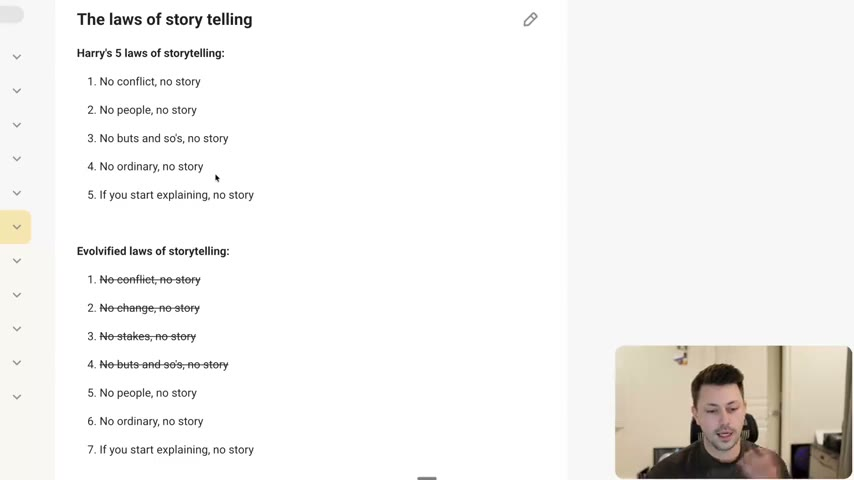
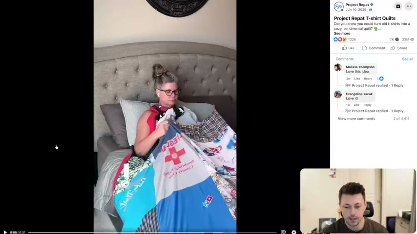
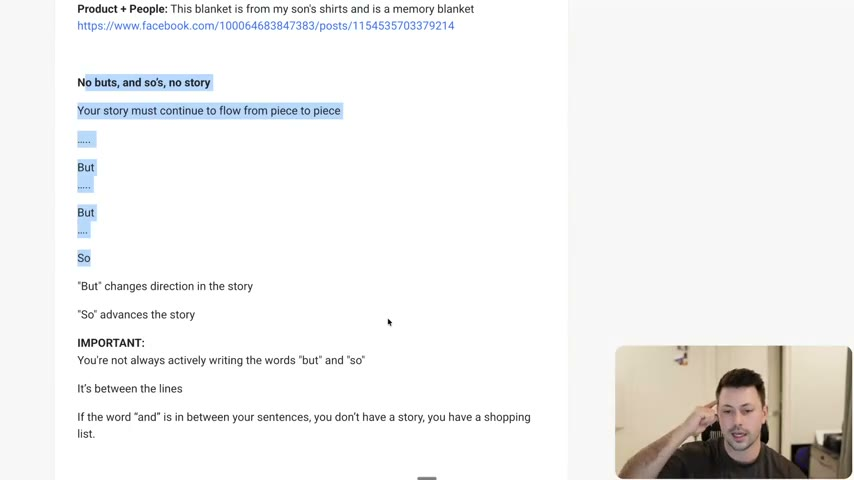
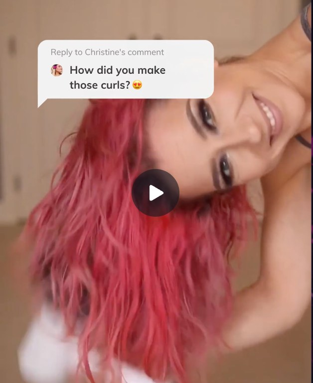
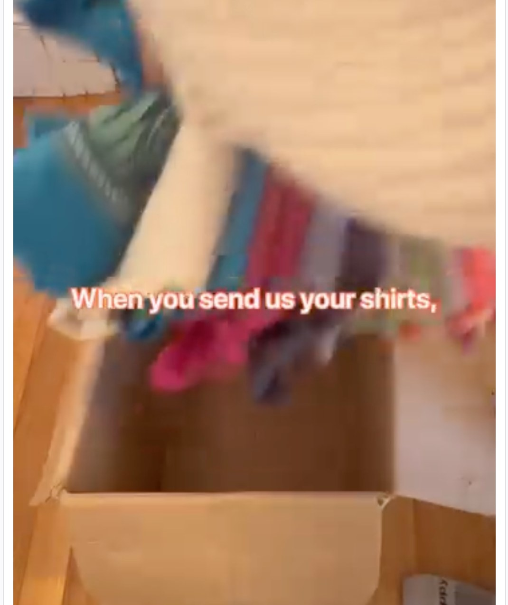
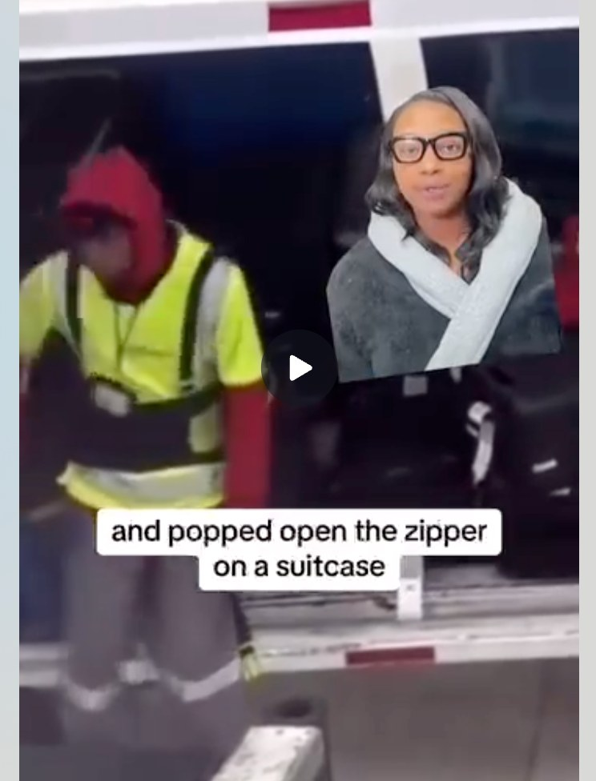

# 41. The laws of story telling
> Harry Dry's five laws of storytelling, with four already covered in lesson 40 (conflict, change, stakes, buts and sos), so this lesson goes deep on the other three: no people, no story (put a human into the product), no ordinary, no story (start small and relatable, not with a big brag), and if you start explaining, no story (delete the explanation, show an example).

## 🤖 Agent use
- **Use when:** converting a product-feature or brag claim into a story hook, turning a customer review into a story ad, or editing a script that explains instead of shows.
- **Inputs → outputs:** a draft claim ("billions of negative ions", "millions of shirts made") or a review quote → a human-centred, small and relatable version, with each explanation replaced by an example or visual.
- **Rules:**
  - **DO** put people into every story: "stories are about people". The product alone ("a t-shirt blanket") has no people; the person version ("this blanket is from my son's shirts and is a memory blanket") does. [00:40–03:33]
  - **DO** turn a customer review into a storytelling ad (the easiest route to a people story). [01:35]
  - **IF** a story is about an industry or an ingredient **THEN** weave people back in (e.g. "ancient tribes" in the Conscious Bar). [03:33]
  - **DO** connect beats with imaginary "but" and "so"; "and" between sentences = "a shopping list". [03:33–04:29]
  - **DO** make it relatable. "It's easier to make something small feel big rather than the other way around." [04:29]
  - **DON'T** open with a big number or brag ("billions of negative ions", "millions of shirts"); open with the small, ordinary thing and let it become big. [04:29–06:40]
  - **DO** delete any sentence that explains and replace it with an example or footage. "The more examples that you can give, the better it will be." [06:40–07:32]
  - **DON'T** just explain: "if I didn't have these examples for you guys to kind of hit home ... it just doesn't land the same." [07:32]
- **See also:** [40. What makes a great story](40-what-makes-a-great-story.md) · [42. The three enemies of storytelling](42-the-three-enemies-of-storytelling.md) · [31. How to create ads that show, don't tell](31-how-to-create-ads-that-show-dont-tell.md) · [44. Prompts to help you storytell](44-prompts-to-help-you-storytell.md) · [Story frameworks for ads (Tether Lab)](../../../../frameworks/story-frameworks-for-ads.md)

## Key ideas

### 1. The laws, and which are "evolvified" [00:00–01:35]
- Harry Dry's five laws (slide and page text): 1. No conflict, no story. 2. No people, no story. 3. No buts and so's, no story. 4. No ordinary, no story. 5. If you start explaining, no story. [00:00]
- Evolve's seven ("evolvified laws"): No conflict, No change, No stakes, No buts and so's (all four struck through on the page because they were covered in [lesson 40](40-what-makes-a-great-story.md)), then **No people, No ordinary, If you start explaining**. The instructor says "no change" and "no stakes" are the two he added to Harry's list. [00:40–01:35]
- This lesson covers the three not struck through. [00:40–01:35]


*The lesson page: Harry's 5 laws, and the "Evolvified" 7 laws with the four already-covered ones struck through. [00:40]*

### 2. No people, no story [01:35–03:33]
- "Stories are about people." The easiest route: "take a customer review and turn it into a storytelling ad." [01:35]
- Review → ad example (page text): the review "Started this product in October when chemo was wrapping up. My hair isn't falling out anymore. Every day I see more hair coming back, and that I contribute solely to your shampoo bars." The instructor says this is the same Humby Organics ad already analysed in lesson 40 ("this is the exact ad that we just went through"). [01:35]
- **Project Repat (t-shirt blankets)** is, in his words, "a phenomenal example of how they do brand story, how they do market story, as well as how they do people stories or ... customer stories". [01:35–02:31]
  - Product alone: "This is a blanket made from t-shirts (no people)".
  - Product + people: "This blanket is from my son's shirts and is a memory blanket."
  - The ad (played in the lesson, transcript): "I lost my son Preston in 2021. You know, like a lot of moms, I held on to his shirts. And then I found Project Repat. They take your loved one's old t-shirts and they turn them into custom memory blankets. It's simple. You just send the shirts in and they do." [02:31]
  - The instructor's reading: "a heavy stakes drama story ... very kind of low valence high intensity" (his words, using the course's emotion model). "When we wrap it in a narrative ... it's not just a t-shirt blanket. It's a memory blanket. Now there's just more to it." [02:31–03:33]
- A story need not revolve around one person but "needs to involve people". Conscious Bar example: the cacao line about "ancient tribes" brings people in. [03:33]


*The Project Repat "T-shirt Quilts" Facebook video ad (a mother with a memory blanket). The product plus a person, not just "a t-shirt blanket". [02:29]*

### 3. No buts and so's (recap) [03:33–04:29]
- You don't write the words; they live "between the lines". "If the word 'and' is in between your sentences ... you don't have a story, you have a shopping list." (Harry). Page template: the story "must continue to flow from piece to piece": ... But ... But ... So; "But" changes direction, "So" advances. [03:33–04:29]


*Page text with the but/so chain highlighted: "But changes direction in the story / So advances the story". [04:05]*

### 4. No ordinary, no story: relatable beats big [04:29–06:40]
- The instructor's takeaway: "this needs to be relatable." Harry: "it's easier to make something small feel big rather than the other way around. It's very hard to make something big feel small." [04:29]
- "You don't need to make it big in actual. You essentially want to make it feel small ... it's actually better if you just start small and show how this small thing can become a big thing, because we still want this to be a big thing, but it doesn't mean we have to start it as a big thing." [04:29]
- **Laifen** (hair-styling product): [05:35]
  - Big brag: "Billions of negative ions". Instructor: "what does that mean? What does that do for me?... so hard to comprehend".
  - Small and ordinary: "How to make curls". "It's much simpler to answer how to make curls and make that a big thing about how it can bring your confidence back, how you can feel exactly how you want to feel, how you can have the hair that you've always dreamed of."
  - The skool image is a video still with a viewer comment "How did you make those curls?" (Whisper's "example life in" at 05:05 is probably "Laifen". The audio there is garbled; it sounds as if he is describing an ad he imagined around "billions of negative ions" as the contrast, but that is not certain.)
- **Project Repat:** [05:35–06:40]
  - Big brag: "Millions of shirts turned into blankets".
  - Small and ordinary: "Send us your old shirts" ("send us some of your old shirts and we'll turn it into a memory that can last a lifetime"). The brag, 1,000,000 shirts, is "much harder to simplify for how it benefits the customer".


*Skool image for the Laifen example: the ordinary question "How did you make those curls?" as the way in, not "billions of negative ions". [lesson page image, 05:05–06:40]*


*Skool image for Project Repat: the on-screen line "When you send us your shirts," (the simple, ordinary action) in place of a "millions of shirts" brag. [lesson page image, 05:35–06:40]*

### 5. If you start explaining, no story [06:40–07:32]
- "Every time you explain something, just look at it and be like, am I explaining here? ... Let me just delete it and give an example instead." [06:40]
- Page template: "Every time you explain something, just delete it and give an example. The example will explain more than you can."
- Example: explaining "People will steal your luggage because zippers aren't secure enough" vs showing footage of "this guy taking a pen and popping open the zipper on a suitcase". [06:40–07:32]
- The instructor says all the stories in the section (Humby, Liquid Death, Grüns, Project Repat, Conscious Bar) "gave so many examples". This "dips into a little bit of the show, don't tell". [06:40–07:32]


*Skool image for "show, don't explain": the clip of a baggage handler and the line "and popped open the zipper on a suitcase" instead of the sentence about insecure zippers. The brand is not named in the lesson. [07:00]*

### 6. Credit to Harry Dry [07:32–09:49]
- Over two minutes of credit. The instructor says these principles come from Harry Dry ("the absolute goat"), "he is a mastermind behind this, and I'm simply passing along his teachings into e-comm". He says applying them to his own brands led to "more winners". (Instructor claim.) The page text repeats the credit. [07:32–09:23]

## Steps / framework

| Law | How to apply | Agent version (derived) |
|---|---|---|
| No people | Take a review, or add a person to the product description | Rewrite the claim as "this [thing] is from [person's situation]" |
| No ordinary | Replace a big number or brag with the small, relatable act | Strike metrics from the hook; use the simple action ("send us your shirts", "how to make curls") |
| No explaining | Delete explanation, show an example or footage | For each explanatory sentence in the script, specify a shot or action that proves it |
| No buts and so's | Connect beats with but/so | See [40](40-what-makes-a-great-story.md) |

## Examples

### Rewrites
| Before | After | What changed | Source |
|---|---|---|---|
| "T-shirt blanket" (product) | "This blanket is from my son's shirts and is a memory blanket" | Adds a person and emotional stakes; product becomes a memory | [01:35–03:33] |
| Customer review: "Started this product in October when chemo was wrapping up. My hair isn't falling out anymore..." | A story ad from the same review (the Humby ad, lesson 40) | Review turned into a person's story | [01:35] |
| "Billions of negative ions" (Laifen) | "How to make curls" | Big brag becomes small, relatable, answerable | [04:29–05:35] |
| "Million shirts turned into blankets" (Project Repat) | "Send us your old shirts" | Big brag becomes the ordinary first step | [05:35–06:40] |
| "People will steal your luggage because zippers aren't secure enough" | Footage: a man takes a pen and pops the zipper open on a suitcase | Explanation becomes an example | [06:40–07:32] |

### Ad teardowns
| Brand / product (niche) | Format | Hook / opening | What works | What fails | Fix suggested | Principle | Source |
|---|---|---|---|---|---|---|---|
| Project Repat t-shirt quilts (memory blankets) | Customer-story video ad | "I lost my son Preston in 2021." | A real person with high stakes; product reframed as a memory blanket | The claim "millions of shirts" is cited as the weak alternative | Lead with the ordinary action ("send us your shirts") | No people / no ordinary | [01:35–03:33; 05:35–06:40] |
| Laifen (hair styler) | UGC video with comment reply | "How did you make those curls?" (on-screen comment) | Starts with an ordinary question | The "billions of negative ions" version (the lesson's contrast, possibly hypothetical) is hard to relate to | Use the how-to-make-curls frame | No ordinary | [05:05–05:35] |
| Unnamed luggage-security product | UGC split-screen, voiceover plus footage | "...and popped open the zipper on a suitcase" (caption) | Shows the zipper being opened instead of explaining | n/a | n/a | Don't explain, show | [06:40–07:32] |

### Hooks
| Hook | Heuristic(s) | Emotion / zone | Self targeted | Why it works | Source |
|---|---|---|---|---|---|
| "I lost my son Preston in 2021." | — | Low valence, high intensity (instructor's words) | — | A person and a heavy stake before the product appears | [02:31–03:33] |
| "How did you make those curls?" | — | — | — | An ordinary, relatable question | [05:05–05:35] |

## Prompts / templates (verbatim)
Page text, verbatim (the lesson's template for the three laws):
```
No people, no story
Stories are about people
Taking a customer review and turning it into a storytelling ad

No buts, and so's, no story
Your story must continue to flow from piece to piece
.....
But
.....
But
....
So
"But" changes direction in the story
"So" advances the story
IMPORTANT: You're not always actively writing the words "but" and "so". It's between the lines
If the word "and" is in between your sentences, you don't have a story, you have a shopping list.

No ordinary, no story (needs to be relatable)
It's easier to make something small feel big than the other way around.
You don't need to make it "BIG" in actual, you just want to make it feel small
It's actually better if you just start small and you can show how this small thing is BIG.

If you start explaining, no story
Every time you explain something, just delete it and give an example.
The example will explain more than you can.
```

## Screenshots
Six images embedded above: the laws list (00:40), Project Repat ad (02:29), but/so (04:05), and the three Skool lesson-page images (Laifen, Project Repat, luggage zipper).

## How to apply
- [ ] For each feature or statistic in the hook, ask: does a person (the avatar) appear? If not, write the person version.
- [ ] Replace big numbers or brag claims in hooks with the small action or question the buyer recognises.
- [ ] Mark every explanatory sentence and replace it with a shot, demonstration or example.
- [ ] Pull a review that contains a person, a stake and a change; use it as the story spine (see [44](44-prompts-to-help-you-storytell.md)).
- [ ] (derived) In a UGC script, make beat 1 something a normal viewer says or does ("How did you make those curls?"), not a spec.

## Related
- Previous: [40. What makes a great story](40-what-makes-a-great-story.md) · Next: [42. The three enemies of storytelling](42-the-three-enemies-of-storytelling.md)
- [Story frameworks for ads (Tether Lab)](../../../../frameworks/story-frameworks-for-ads.md) (overlap: both stress emotion and a concrete character; difference: Tether Lab chooses a named structure per funnel job, here the "laws" are tests any structure must pass) · [Emotional zones](../../../../concepts/emotional-zones.md)

## Sources and limitations
- Transcript: [41. The laws of story telling… .txt](<../../../../../raw/evolve/copywriting/_transcripts/✍️ Evolve Copywriting (NEW)/41. The laws of story telling ✍️ Evolve Copywriting (NEW) Evolve.txt>) · Page text: [….html.md](<../../../../../raw/evolve/copywriting/_extracted/✍️ Evolve Copywriting (NEW)/41. The laws of story telling_✍️ Evolve Copywriting (NEW)_Evolve.html.md>) · Skool images: [41-img01](../../../../../raw/evolve/copywriting/linked/skool-images/41/41-img01.png) · [41-img02](../../../../../raw/evolve/copywriting/linked/skool-images/41/41-img02.png) · [41-img03](../../../../../raw/evolve/copywriting/linked/skool-images/41/41-img03.png)
- Machine transcription (Whisper large-v3-turbo). Full recording covered (589.55 s). Whisper garbles: "when Kimo was wrapping up" (the page text has "when chemo was wrapping up"), "Humvee Organics" (Humby Organics), "example life in" (Laifen), "butts and sews" (buts and so's), "Groons" (Grüns).
- The two Facebook post links on the lesson page (Humby review ad and Project Repat) were not fetched; the Project Repat ad was seen in the recording. The three skool images are stills from the lesson page, with no captions beyond the on-screen text.
- The lesson page has the Laifen example as a contrast of "billions of negative ions" vs "how to make curls"; whether Laifen ever ran the "billions of ions" ad is not stated.
