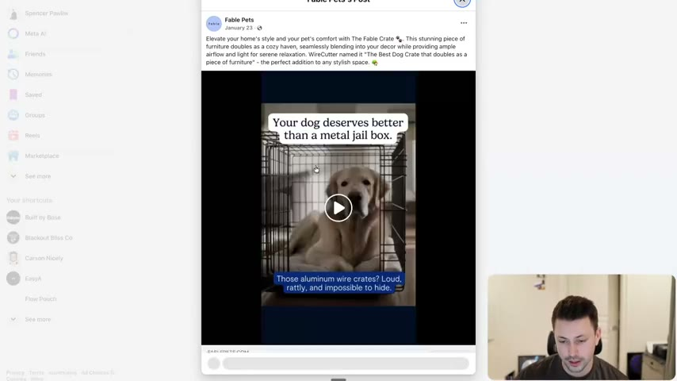
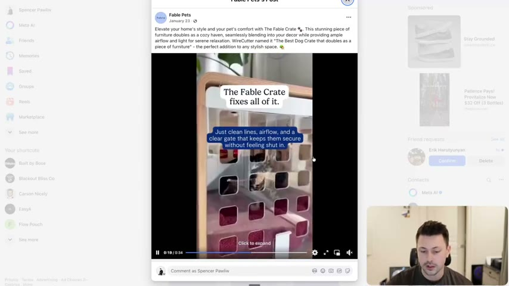
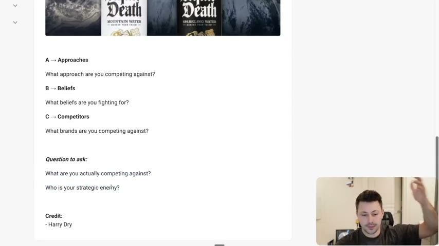

# 42. The three enemies of storytelling
> Story needs conflict, and conflict needs an enemy; Harry Dry's three kinds of enemy, the ABCs, are the Approach you compete against, the Beliefs you stand against, and the Competitors you name, and every story ad should be able to point at one.

## 🤖 Agent use
- **Use when:** a story, UGC script or static has no conflict; picking an angle for a story ad; tearing down a competitor ad to name the enemy it fights.
- **Inputs → outputs:** brand/product, category, competitors, and the brand's beliefs → one named enemy (approach, belief or competitor) with a one-line conflict statement ("their X, our Y") to anchor the story.
- **Rules:**
  - **DO** create conflict by choosing an enemy. "Stories equal conflict." [00:00]
  - **DO** classify the enemy as **Approaches** (a different way of solving the problem), **Beliefs** ("we believe") or **Competitors** (direct brands) - the ABCs. [03:40]
  - **DON'T** call yourself "better" than a direct competitor without a "why". The instructor says many brands have no differentiation or story for why they are better. [00:50]
  - **DO** use the enemy not just in positioning but in the story and "everything that you do around your story". [00:00]
  - **IF** you stand for a belief **THEN** state it as "we believe..." because it "resonates with identities and people buy based off of their identity". [02:44]
  - **DO** ask: "What are you actually competing against? Who is your strategic enemy?" [03:40]
  - **DO** make the conflict explicit in the first lines (Fable: "Your dog deserves better than a metal jail box."). [00:50–01:44]
- **See also:** [Brand enemy](../../../../concepts/brand-enemy.md) · [40. What makes a great story](40-what-makes-a-great-story.md) · [41. The laws of story telling](41-the-laws-of-story-telling.md) · [Story frameworks for ads (Tether Lab)](../../../../frameworks/story-frameworks-for-ads.md) · [Switching behaviour](../../../../concepts/switching-behavior.md)

Lesson page text: "Again, story = conflict" plus Harry's 3 enemies with examples and links (reproduced in the table below), and the credit "Harry Dry".

## Key ideas

### 1. Why enemies [00:00–00:50]
- The instructor credits a book by **Laura Ries** (Whisper: "Laura Rice"): world-class 20th and 21st century brands "all have a strategic enemy". "When you see multiple people who are very smart talking about the same thing, it's probably important." [00:00]
- So "not only do enemies matter in your positioning ... they matter in your storytelling". These are "Harry's kind of three simplified ways to create conflict". [00:00–00:50]

### 2. Enemy type 1: Direct competitors [00:50–01:44]
- Many brands say "we're better" with no product differentiation and no "why": "You don't actually have the story around why you're better." [00:50]
- **Fable (dog crates) vs ordinary dog crates.** Page text: "The competitors are jail crates, ours feel safe." The ad (shown in the recording): "Your dog deserves better than a metal jail box. Those aluminum wire crates? Loud, rattly, and impossible to hide." Then: "The Fable Crate fixes all of it. Just clean lines, airflow, and a clear gate that keeps them secure without feeling shut in." Instructor's reading: "a modern side table and a calm den-like space for your dog". [00:50–01:44]
- Verdict: "not the best example of storytelling specifically because they kind of just cut straight to the product", but it shows a **direct competitor** conflict: "you're putting your dog in a jail crate where ours makes them feel safe." They "both sell the exact same dog crates". [00:50–01:44]


*Fable Pets Facebook video ad opening: "Your dog deserves better than a metal jail box. Those aluminum wire crates? Loud, rattly, and impossible to hide." The enemy is the ordinary wire crate. [01:16]*


*Same ad, next beat: "The Fable Crate fixes all of it. Just clean lines, airflow, and a clear gate that keeps them secure without feeling shut in." [01:36]*

### 3. Enemy type 2: Competing approaches [01:44–02:44]
- A competing approach is "a different way of solving a problem". [01:44]
- **Grüns vs AG1.** Page text: "The approach of taking greens is wrong, take a gummy instead." The instructor concedes you could call them direct competitors (both sell greens) but the ad's enemy is the approach: the founder spits out green powder and says "you're taking greens wrong ... take this gummy instead" (the ad shown in lesson 40). Grüns' approach is gummies, AG1's is powder. [01:44–02:44]
- **Client slide board vs Peloton.** A client sold "one of these like slide boards"; an ad (the instructor "broke down a long time ago") competed against Peloton: "you could bike all day long, or you could slide ... it's better on your knees, it's easier." Same problem, different approach. [02:44]

### 4. Enemy type 3: Beliefs you stand against ("We believe") [02:44–03:40]
- Conflict through "the beliefs that you stand against ... This is the we believe this." It is powerful "because it resonates with identities and people buy based off of their identity." [02:44]
- **Comfrt vs mental health stigma** (page text: "We donate and fight for those who struggled with mental health"). [02:44]
- **Liquid Death vs plastic** ("Death to plastic"), and also vs "boring ... yoga mom water marketing". Belief: plastic is bad for the environment and we should use recyclable cans. [02:44–03:40]


*Skool lesson image: Liquid Death "DEATH TO PLASTIC" over mountain water and sparkling water cans. The enemy is a belief/practice (plastic), not a brand. [lesson page image; seen at 03:42-04:02]*

### 5. The ABCs and the question to ask [03:40–04:34]
- Harry's mnemonic, per the page: **A: Approaches** (what approach are you competing against?), **B: Beliefs** (what beliefs are you fighting for?), **C: Competitors** (what brands are you competing against?). [03:40]
- "Question to ask: What are you actually competing against? Who is your strategic enemy?" The instructor notes much of this is covered in the positioning section. [03:40]


*The page's ABC list: A Approaches, B Beliefs, C Competitors, and the question "What are you actually competing against? Who is your strategic enemy?" [04:22]*

### 6. Enemies in the earlier examples [03:40–05:14]
- **The Conscious Bar:** the enemy is "regular chocolate bars that have way too much sugar" (lesson 40). [03:40–04:34]
- **Aviorra live-translation earbuds:** the enemy is "these people talking in another language making fun of others" (lesson 40). [04:34]
- In all, "there's some kind of conflict and there's an enemy there", whether competitor, approach, or belief. Beliefs are "the open one where a lot of those will fall under specific beliefs". Done well, this "will reinforce your positioning". [04:34]

## Steps / framework

| Step | Question | Output |
|---|---|---|
| 1. Name the enemy | What are you actually competing against? | One enemy |
| 2. Classify (A/B/C) | Approach, belief, or competitor? | Enemy type |
| 3. State the conflict | "Their [thing] is [bad], ours [better because]" | One-line conflict (e.g. "The competitors are jail crates, ours feel safe") |
| 4. Open the story on the conflict | Use the enemy in the first lines | Hook / first beat |

### Derived UGC script skeleton (derived; the lesson only gives the ABC categories, not a script)
| Enemy type | Beat 1 (hook) | Beat 2 | Beat 3 |
|---|---|---|---|
| Competitor | Name the ordinary alternative as a problem ("[Alternative] is [loud / rattly / ugly]") | Show it failing in a real moment | Show our product fixing it |
| Approach | "You're [doing the usual method] wrong" | Do the wrong method on camera (like spitting out the powder) | Show the alternative method |
| Belief | "I'm done with [practice]" or "We believe [belief]" | Show why the belief matters to the person | Tie the product to the belief |

## Examples

### Ad teardowns
| Brand / product (niche) | Format | Hook / opening | What works | What fails | Fix suggested | Principle | Source |
|---|---|---|---|---|---|---|---|
| Fable Pets, The Fable Crate (dog crates) | Video ad with on-screen text | "Your dog deserves better than a metal jail box." | Names the enemy (aluminum wire crates) with sensory words "loud, rattly, impossible to hide"; positions the product as furniture and a calm den | Cuts straight to the product; "not the best example of storytelling" | Add a story beat before the product | Enemy = direct competitor | [00:50–01:44] |
| Grüns vs AG1 (greens gummies vs powder) | Founder UGC | Founder spits out green powder | Enemy is the approach (powder); "take a gummy instead" | n/a | n/a | Enemy = competing approach | [01:44–02:44] |
| Client slide board vs Peloton (fitness) | Ad (not shown) | "You could bike all day long, or you could slide" | Different approach to the same exercise problem | Not shown on screen | n/a | Enemy = competing approach | [02:44] |
| Comfrt (apparel) | Brand stance | "We donate and fight for those who struggled with mental health" | Stands against stigma, identity-based | Not shown | n/a | Enemy = belief | page text; [02:44] |
| Liquid Death (canned water) | Brand/campaign | "Death to plastic" | Belief plus rebellious brand | n/a | n/a | Enemy = belief | [02:44–03:40] |

### Angles
| Angle | Core desire / pain | Heuristic(s) | Best format | Example line | Source |
|---|---|---|---|---|---|
| "Ordinary X is a jail" | Pet owner's guilt and wanting calm | — | Video with on-screen text | "Your dog deserves better than a metal jail box." | [00:50–01:44] |
| "You're doing it wrong" | Wanting an easier method | — | Founder UGC | "Take this gummy instead" | [01:44–02:44] |
| "We believe" | Identity | — | Brand story | "Death to plastic" | [02:44–03:40] |

## Structured units
### Rules of thumb
- **DO** name the strategic enemy before writing the story. [03:40]
- **DON'T** claim "we're better" without the "why". [00:50]
- **IF** direct competitor comparison is weak **THEN** compete against an approach or a belief. [01:44–03:40]

## Prompts / templates (verbatim)
Page text (the lesson's ABC template):
```
A → Approaches
What approach are you competing against?

B → Beliefs
What beliefs are you fighting for?

C → Competitors
What brands are you competing against?

Question to ask:
What are you actually competing against?
Who is your strategic enemy?
```

## Screenshots
Four images embedded above (two Fable ad beats, Liquid Death skool image, ABC list). The page lists three Facebook ad links; they were not opened.

## How to apply
- [ ] Write the enemy in one line, tagged A, B or C.
- [ ] If the enemy is a competitor, state why they are worse in sensory terms; if an approach, show the approach failing; if a belief, state "we believe".
- [ ] Put the conflict in the first line of the script or static headline.
- [ ] Re-check the positioning section's strategic enemy and keep it consistent across ads.

## Related
- Previous: [41. The laws of story telling](41-the-laws-of-story-telling.md) · Next: [43. The storytelling arcs/plots](43-the-storytelling-arcs-plots.md)
- [Brand enemy](../../../../concepts/brand-enemy.md) · [Story frameworks for ads (Tether Lab)](../../../../frameworks/story-frameworks-for-ads.md): Tether Lab's Hero's Journey/Pixar structures assume a villain implicitly; Evolve names three concrete enemy types to start from. · [Perception management](../../../../concepts/perception-management.md)

## Sources and limitations
- Transcript: [42. The three enemies of storytelling… .txt](<../../../../../raw/evolve/copywriting/_transcripts/✍️ Evolve Copywriting (NEW)/42. The three enemies of storytelling ✍️ Evolve Copywriting (NEW) Evolve.txt>) · Page text: [….html.md](<../../../../../raw/evolve/copywriting/_extracted/✍️ Evolve Copywriting (NEW)/42. The three enemies of storytelling_✍️ Evolve Copywriting (NEW)_Evolve.html.md>) · Skool image: [42-img01](../../../../../raw/evolve/copywriting/linked/skool-images/42/42-img01.png)
- Machine transcription (Whisper large-v3-turbo). Full recording covered (314.67 s). Whisper hears "Grooms" for Grüns, "Laura Rice" (likely Laura Ries), "comfort" for Comfrt.
- The "Comfrt vs mental health" example is only stated in the page text and audio; no ad is shown. The slide-board vs Peloton ad is only described.
- The page's "Grüns vs AG1" link points to a Facebook video; the recording shows the lesson-40 Grüns ad rather than playing it again.
