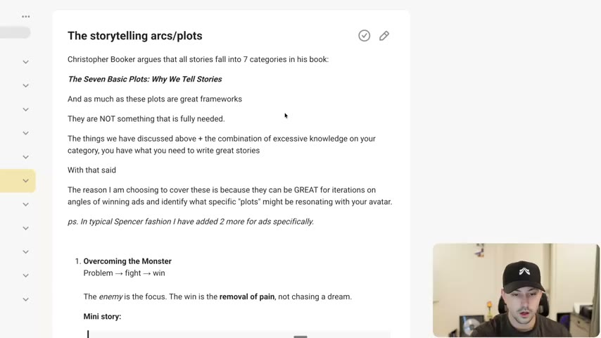
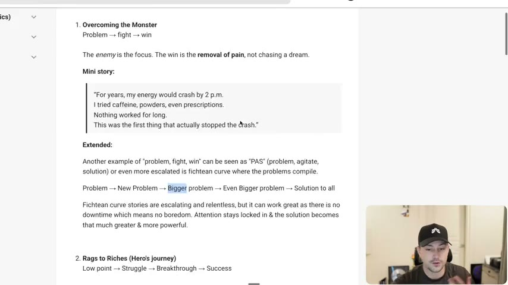
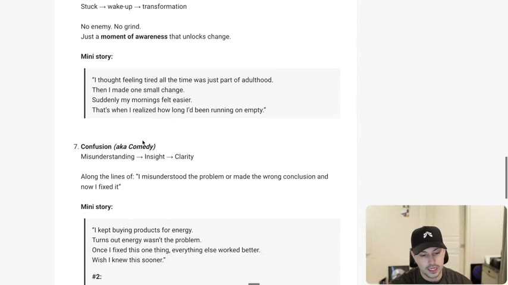
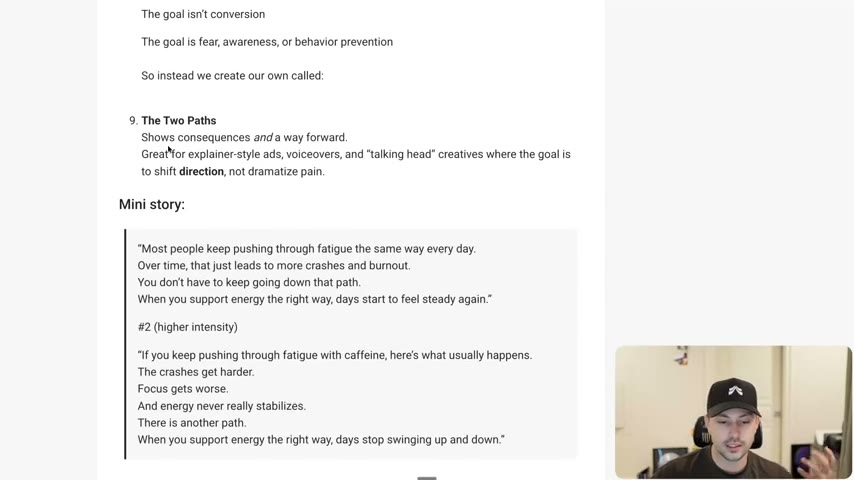

# 43. The storytelling arcs/plots
> Christopher Booker's seven basic plots, plus two the instructor adds for ads (In Media Res and The Two Paths, which replaces Tragedy), each with a "mini story" template for an energy supplement; they are not what makes a story work, but they are a fast way to iterate winning angles into new story shapes.

## 🤖 Agent use
- **Use when:** you already have a winning angle or ad and want new story shapes for the same angle and avatar; or you are choosing the plot for a UGC or voiceover script.
- **Inputs → outputs:** a proven angle + avatar + the story-quality checks from lessons 40-42 → a list of up to nine arc variants, each with a 4-line mini story and a UGC beat outline, to test as iterations.
- **Rules:**
  - **DON'T** treat a plot as the story. "Just by writing a story a specific way is not what actually makes it work." The plot needs change, withheld information, cause and effect, tension and stakes. [00:00–01:40]
  - **DON'T** assume "problem, fight, win" is storytelling; it is a plot the words follow. [00:58–01:40]
  - **DO** use the arcs for **iteration**: "great for iterations on angles of winning ads" and for seeing which "plots" resonate with the avatar. [15:44–16:29]
  - **IF** a winning ad is "problem, new problem, bigger problem, solution", **THEN** test In Media Res, Confusion, or Two Paths on the same angle. [15:44]
  - **IF** the audience is skeptical **THEN** try Voyage and Return ("I tried the extreme path so you don't have to"). [10:17]
  - **IF** the market is sophisticated or has misunderstandings/objections **THEN** try Confusion. [12:50]
  - **IF** the buyer is unaware or stuck accepting the situation **THEN** try Rebirth. [11:58]
  - **DO** make the hero relatable to the avatar. [04:15–06:09]
  - **DO** start an In Media Res ad on the thing the viewer most wants to see, then add context. [07:08–08:47]
  - **DON'T** run Tragedy in DTC; use The Two Paths instead. [12:50–13:45]
  - **DO** write the Fichtean version of Overcoming the Monster with escalating problems. [02:35–04:15]
- **See also:** [40. What makes a great story](40-what-makes-a-great-story.md) · [41. The laws of story telling](41-the-laws-of-story-telling.md) · [42. The three enemies of storytelling](42-the-three-enemies-of-storytelling.md) · [44. Prompts to help you storytell](44-prompts-to-help-you-storytell.md) · [Story frameworks for ads (Tether Lab)](../../../../frameworks/story-frameworks-for-ads.md) · [Iteration vs variation](../../../../concepts/iteration-vs-variation.md)

Lesson page text: the full nine-plot list with mini stories (reproduced verbatim below) and a YouTube link for the "Pixar framework" masterclass (https://www.youtube.com/watch?v=-7e6g11BJc0). The video is not part of the course files and its content was not seen.

## Key ideas

### 1. Seven plots, and why they are optional [00:00–01:40]
- Booker categorised all plots into seven in *The Seven Basic Plots: Why We Tell Stories* (page text). The instructor: "kind of a controversial thing ... as much as these plots are a great framework, they are not something that is really needed." [00:00]
- For a beginner it "can be helpful" for thinking through the plot, but "it comes down to you having excessive knowledge on your category and knowing what actually goes into making a great story." [00:00–00:58]
- "In typical Spencer fashion" he adds two for ads (In Media Res, The Two Paths). [00:58]
- "Thinking about the change, the withholding information, the cause and effect, the tension, the stakes, all of those things, that is what is the most important piece." [00:58–01:40]
- The reason to cover them: "great for iterations on angles of winning ads" and for identifying "what specific 'plots' might be resonating with your avatar" (page text). [15:44–16:29]


*The lesson page: Booker's seven categories, "NOT something that is fully needed", and "for iterations on angles of winning ads". [15:44]*

### 2. The nine arcs [01:40–15:44]
All mini stories are the lesson's energy-supplement examples ("whatever that may be"), shown in full in the verbatim section. Each beat chain is as on the page.

| # | Arc | Beat chain | Instructor's point | Source |
|---|---|---|---|---|
| 1 | **Overcoming the Monster** (also "PAS") | Problem → fight → win | Enemy is the focus; the win is the "removal of pain, not chasing a dream". "Very typical", "doesn't work all the time" unless the earlier principles are in it. The stronger variant is the **Fichtean curve** (problem → new problem → bigger problem → even bigger problem → solution to all): "relentless" escalation means "no downtime which means no boredom", so the solution feels bigger. Analogy: Creed ("problem fight lose, problem fight lose ... then problem fight and they actually win") | [01:40–04:15] |
| 2 | **Rags to Riches** (Hero's journey) | Low point → struggle → breakthrough → success | "Not about beating one problem. It's about becoming a new person." Heroes work better when relatable: "the other person needs to see themselves as the same person" or see someone at an even lower point succeed (the chemo hair-growth ad, lesson 40). Spider-Man starts with a family death and a bad life, which is why he's a powerful hero | [04:15–07:08] |
| 3 | **In Media Res** (credited to "Sarah", Whisper "Sarah Levenger") | Important moment/action → discovery → reinforcing win | Start in the action. He says a fully in-media-res ad he made spent "over a million" and is "still spending a ton of money" (instructor claim). Edit test: write hook, bridge, ad; find where you "get to the point", cut and start there | [06:09–08:47] |
| 4 | **The Quest** | Goal → obstacles → discovery → win | Hook is "aspirational, not desperate"; product helps reach a desired state, not escape a monster | [08:47–10:17] |
| 5 | **Voyage & Return** | Normal → chaos → realization → better normal | "I tried the extreme path so you don't have to." "Very powerful for skeptical buyers"; builds authority by going through chaos | [10:17–11:12] |
| 6 | **Rebirth** | Stuck → wake-up → transformation | "No enemy. No grind." A moment of awareness; fits "slightly unaware" people who accept their situation | [11:12–11:58] |
| 7 | **Confusion (aka Comedy)** | Misunderstanding → insight → clarity | "I misunderstood the problem or made the wrong conclusion and now I fixed it." Good for sophisticated markets and overcoming objections. He doesn't know why Booker calls it "confusion" | [11:58–12:50] |
| 8 | **Tragedy** | Downward spiral, decline without redemption | "Not for DTC": used in anti-smoking, anti-drunk-driving, environmental and charity ads; goal is "awareness or behavior prevention", not conversion | [12:50–13:45] |
| 9 | **The Two Paths** (Evolve's replacement for Tragedy) | Consequences of the current path + a way forward | For explainer ads, voiceovers, and talking-head creatives, "to shift direction and not really dramatize pain". "Also known as the Pixar framework" (instructor's words) and "future pace" the ad | [13:45–15:44] |


*Plot 1 on the page, with the Fichtean curve extension "Problem → New Problem → Bigger problem → Even Bigger problem → Solution to all". [16:00]*


*Plot 7, Confusion (aka Comedy): "Misunderstanding → Insight → Clarity", with the two energy mini stories. [12:10]*


*Plots 8 and 9: Tragedy ("not for DTC") and the Evolve replacement, The Two Paths, with its mini story. [14:00]*

### 3. How Two Paths differs from Fichtean [14:45–15:44]
- Fichtean/problem escalation: "I had this problem and then I led to another problem..." (a story the narrator lived). Two Paths: "future pacing": "if you keep doing this, this is what's going to end up happening. But there is a better way." [14:45–15:44]
- He points to a Google ad as a "masterclass" in future pacing (the lesson page's YouTube link); not seen. [15:44]

### 4. Use arcs to iterate [15:44–17:17]
- "If you identify that maybe you're on this problem, new problem, bigger problem, solution to all kind of story type ... in one of your winning ads, why don't you try one that's maybe a little bit different?" e.g. Confusion or In Media Res. "It's helpful for just trying different ways of saying the same thing." [15:44]
- Final warning: do not forget conflict, enemies and the laws; the arcs are "an extra piece of information". Example thought: "this looks like it's more of a rags to riches plot. I wonder if we maybe start this as a two paths". Goal: "squeeze the most out of the angle and the avatar that I have working." [16:29]

## Steps / framework

### Using the arcs on a winning ad (iteration procedure, from [15:44–17:17]; steps are paraphrased)
1. Identify which arc the winning ad follows (e.g. problem → new problem → bigger problem → solution = Fichtean).
2. Keep the angle, avatar and proof. Choose a different arc from the table.
3. Rewrite the beats in the new arc's order, keeping all the quality checks from lessons 40-42 (change, withholding, stakes, but/so, cause and effect, enemy).
4. Test as an iteration of the same angle (see [Iteration vs variation](../../../../concepts/iteration-vs-variation.md)).

### Derived UGC script skeletons per arc (derived; the course gives only 4-line mini stories, not shot-by-shot scripts)
Placeholders in brackets; use the course's mini stories in the verbatim section as wording models.
| Arc | Hook (0-3s) | Middle | Close (CTA) |
|---|---|---|---|
| Overcoming the Monster | "[Specific recurring pain] hit me every [time]" | List what you tried, each failing (escalate, Fichtean) | "This was the first thing that stopped it" + CTA |
| Rags to Riches | Show the low-point state ("I used to [exhausted routine]") | Struggle, breakthrough moment | Show the new normal, "I don't recognise the old me" + CTA |
| In Media Res | Open on the win ("It's [time] and I just [outcome]") | Flashback: "I used to [bad state]"; the discovery | Reinforce the win + CTA |
| Quest | "I've always wanted [desired state]" with no stimulants/shortcuts | Digging/research, obstacles, discovery | "First time my days feel the way I wanted" + CTA |
| Voyage & Return | "I went all in on [extreme approach]" | It made things worse | "Stripped back to one simple change" + CTA |
| Rebirth | "I thought [problem] was just part of life" | One small change | The realization moment + CTA |
| Confusion | "I kept [buying/doing X]" | "Turns out [X] wasn't the problem" | "Once I fixed [real cause]..." + CTA |
| Two Paths | "Most people keep [current behaviour]" (voiceover or talking head) | Path 1: consequences. Path 2: "there is another path" | Path 2 outcome + CTA |
(Tragedy is excluded for DTC per the lesson.)

## Examples

### Rewrites
| Before | After | What changed | Source |
|---|---|---|---|
| Problem → fight → win mini story ("For years, my energy would crash by 2 p.m...") | Same angle as Fichtean: problem → new problem → bigger problem → solution | Problems escalate; no downtime | [02:35–04:15] |
| Rags to riches ("I used to wake up exhausted...") | In Media Res ("It's 3pm and I just crushed my biggest task...") | Starts at the win, then flashback | [06:09–08:47] |
| Rags to riches / PAS | Two Paths ("Most people keep pushing through fatigue...") | From past story to a future-paced fork | [13:45–15:44] |

### Ad teardowns
| Brand / product (niche) | Format | Hook / opening | What works | What fails | Fix suggested | Principle | Source |
|---|---|---|---|---|---|---|---|
| Humby Organics hair growth during chemo (from lesson 40) | Review story ad | "...it made everyone in our office cry" | Rags to riches at an extreme low point; builds belief in viewers at a less-low point | Not relatable for everyone | n/a | Hero at a lower point than the viewer | [05:14–06:09] |
| Unnamed million-dollar In Media Res ad (energy-type example, brand not named) | Not shown | Starts in the action | Instructor says it spent over $1M | No details given | n/a | In Media Res | [06:09–07:08] |
| Google ad (YouTube link on page) | Video ad | — | Used as a "masterclass" in future pacing / "Pixar framework" | Not seen | n/a | Two Paths / future pacing | [14:45–15:44] |

### Hooks (mini stories' first lines)
| Hook | Heuristic(s) | Emotion / zone | Self targeted | Why it works | Source |
|---|---|---|---|---|---|
| "For years, my energy would crash by 2 p.m." | — | — | — | Overcoming the Monster: problem first | [01:40] |
| "I used to wake up exhausted no matter how much I slept." | — | — | — | Rags to Riches: low point | [04:15] |
| "It's 3pm and I just crushed my biggest task of the day with no brain fog, no caffeine crash, nothing." | — | — | — | In Media Res: the win first | [07:08] |
| "I've always wanted steady energy all day — no crashes, no burnout." | — | — | — | Quest: aspirational | [09:33] |
| "I went all-in trying to fix my energy." | — | — | — | Voyage and Return | [10:17] |
| "I thought feeling tired all the time was just part of adulthood." | — | — | — | Rebirth (unaware) | [11:12] |
| "I kept buying products for energy." / "I thought I needed more energy." | — | — | — | Confusion | [11:58] |
| "Most people keep pushing through fatigue the same way every day." / "If you keep pushing through fatigue with caffeine, here's what usually happens." | — | — | — | Two Paths | [13:45] |

## Structured units

### Angles
| Angle | Core desire / pain | Heuristic(s) | Best format | Example line | Source |
|---|---|---|---|---|---|
| "I tried the extreme path so you don't have to" | Skeptic wanting the shortcut without the risk | — | Talking head | "Biohacks, extreme routines, supplements stacked on supplements. It actually made things worse." | [10:17–11:12] |
| "You've misdiagnosed it" | Wanting the real cause | — | UGC/story | "Turns out energy wasn't the problem." | [11:58–12:50] |
| "Two roads from here" | Direction change | — | Explainer/voiceover | "There is another path." | [13:45–15:44] |

### Rules of thumb
- **DON'T** rely on the arc; **DO** use it to iterate. [00:58; 15:44]
- **DO** keep the hero relatable. [04:15–06:09]
- **DON'T** use Tragedy in DTC. [12:50]

## Prompts / templates (verbatim)
Page text, verbatim (the nine plots with mini stories), copied from the lesson page.

```
1. Overcoming the Monster
Problem → fight → win
The enemy is the focus. The win is the removal of pain, not chasing a dream.
Mini story:
"For years, my energy would crash by 2 p.m.
I tried caffeine, powders, even prescriptions.
Nothing worked for long.
This was the first thing that actually stopped the crash."
Extended:
Another example of "problem, fight, win" can be seen as "PAS" (problem, agitate, solution) or even more escalated is fichtean curve where the problems compile.
Problem → New Problem → Bigger problem → Even Bigger problem → Solution to all
Fichtean curve stories are escalating and relentless, but it can work great as there is no downtime which means no boredom. Attention stays locked in & the solution becomes that much greater & more powerful.

2. Rags to Riches (Hero's journey)
Low point → Struggle → Breakthrough → Success
This isn't about beating one problem — it's about becoming a new person.
Mini story:
"I used to wake up exhausted no matter how much I slept.
I planned my day around naps and coffee.
Now I wake up clear-headed and focused.
I honestly don't recognize the old version of me."
Extended:
People love heroes, but they love heroes even more who are relatable.
If you can create a hero that was just like them, that went through and did the thing and now has the better life as a result using your process, it can help show them what they want is possible. But again, it needs to be relatable. The other person needs to see themselves as the "same person" as the hero to actually be effective.
Spider-Man doesn't start out as this stud who has everything.
He starts out with a family member passing away, with his life going to shit, and then all of a sudden he becomes this hero.
That relatability is what makes it such a powerful superhero int he movies.
It's what also makes them powerful in ads.

3. In Media Res
Important moment/action → Discovery → Reinforcing Win
Start in the middle of the action to capture attention immediately.
Provide the additional context and fill in the points after
Mini story:
"It's 3pm and I just crushed my biggest task of the day with no brain fog, no caffeine crash, nothing.
I used to be useless by this time.
That's when I realized: this energy thing actually works.
I'd been chasing the wrong solutions for years.
Now every afternoon feels like a win."

4. The Quest
Goal → Obstacles → Discovery → Win
The hook is aspirational, not desperate.
The product helps reach a desired state, not escape a monster.
Mini story:
"I've always wanted steady energy all day — no crashes, no burnout.
I didn't want stimulants or shortcuts.
After digging into how energy actually works, I found this.
This is the first time my days feel the way I always wanted them to."

5. Voyage & Return
Normal → Chaos → Realization → Better normal
This story says: "I tried the extreme path so you don't have to."
Very powerful for skeptical buyers.
Mini story:
"I went all-in trying to fix my energy.
Biohacks, extreme routines, supplements stacked on supplements.
It actually made things worse.
Once I stripped it back to this one simple change, everything stabilized."

6. Rebirth
Stuck → wake-up → transformation
No enemy. No grind.
Just a moment of awareness that unlocks change.
Mini story:
"I thought feeling tired all the time was just part of adulthood.
Then I made one small change.
Suddenly my mornings felt easier.
That's when I realized how long I'd been running on empty."

7. Confusion (aka Comedy)
Misunderstanding → Insight → Clarity
Along the lines of: "I misunderstood the problem or made the wrong conclusion and now I fixed it"
Mini story:
"I kept buying products for energy.
Turns out energy wasn't the problem.
Once I fixed this one thing, everything else worked better.
Wish I knew this sooner."
#2:
"I thought I needed more energy.
So I kept buying energy products.
Turns out that wasn't the issue at all.
Once I fixed this, everything else started working."

8. Tragedy
Downward spiral. Also know as a decline without redemption
This one specifically is not for DTC as it actually ends in a tragedy, and all of our ads are to be more positive, not negative
this is previously used in companies like: Anti-smoking campaigns, Anti-drunk driving ads, Environmental campaigns ("If we don't act, this is the future."), Some charity / nonprofit ads (starving, abuse, addiction)
The goal isn't conversion
The goal is fear, awareness, or behavior prevention
So instead we create our own called:

9. The Two Paths
Shows consequences and a way forward.
Great for explainer-style ads, voiceovers, and "talking head" creatives where the goal is to shift direction, not dramatize pain.
Mini story:
"Most people keep pushing through fatigue the same way every day.
Over time, that just leads to more crashes and burnout.
You don't have to keep going down that path.
When you support energy the right way, days start to feel steady again."
#2 (higher intensity)
"If you keep pushing through fatigue with caffeine, here's what usually happens.
The crashes get harder.
Focus gets worse.
And energy never really stabilizes.
There is another path.
When you support energy the right way, days stop swinging up and down."

This strategy is also known as the "Pixar Framework" but the idea is to future paced the ad.
It talks about what happens and shows how things progress.
```
Note: on the page, the Voyage & Return mini story ends at "everything stabilized." In the video the instructor reads a longer ending ("and now I have the outcome that I want"), so only the page version is verbatim here.

## Screenshots
Four page images are embedded above. The remaining video is the instructor scrolling the page.

## How to apply
- [ ] Label the arc of every winning story ad in the account (monster, rags to riches, media res, quest, voyage, rebirth, confusion, two paths).
- [ ] For each winner, write at least two other-arc versions of the same angle and avatar.
- [ ] Match arc to audience: skeptic = Voyage and Return, unaware = Rebirth, sophisticated/objection-heavy = Confusion, aspirational = Quest.
- [ ] Before shipping, run the lesson 40 five-block check and the lesson 41-42 laws on the new version.
- [ ] Never ship Tragedy in DTC; use Two Paths.

## Related
- Previous: [42. The three enemies of storytelling](42-the-three-enemies-of-storytelling.md) · Next: [44. Prompts to help you storytell](44-prompts-to-help-you-storytell.md)
- [Story frameworks for ads (Tether Lab)](../../../../frameworks/story-frameworks-for-ads.md): **overlaps:** both name In Medias Res, the Fichtean Curve, the Seven Basic Plots, the Pixar-style structure and PAS; the instructor here credits "Sarah" for In Media Res, plausibly the Tether Lab instructor Sarah Levinger (not confirmed on screen). **Differences:** Tether Lab picks a framework per funnel job and feeds the steps to ChatGPT; it was "untested" on Seven Basic Plots for Sarah; Evolve treats plots as optional iteration tools after conflict, change, stakes and but/so are in place, adds "The Two Paths" and says PAS = Overcoming the Monster. Evolve also describes Two Paths as "also known as the Pixar framework" (future pacing), whereas Tether Lab's Pixar framework is "Once upon a time... Every day... One day... Because of that... Until finally..." Treat the shared "Pixar" label as unresolved. See [contradiction note](#sources-and-limitations).
- [Iteration vs variation](../../../../concepts/iteration-vs-variation.md) · [Creative testing system](../../../../frameworks/creative-testing-system.md)

## Sources and limitations
- Transcript: [43. The storytelling arcs plots… .txt](<../../../../../raw/evolve/copywriting/_transcripts/✍️ Evolve Copywriting (NEW)/43. The storytelling arcs plots ✍️ Evolve Copywriting (NEW) Evolve.txt>) · Page text: [….html.md](<../../../../../raw/evolve/copywriting/_extracted/✍️ Evolve Copywriting (NEW)/43. The storytelling arcs_plots_✍️ Evolve Copywriting (NEW)_Evolve.html.md>)
- Machine transcription (Whisper large-v3-turbo). Full recording covered (1037.74 s). Whisper writes "fictian curve" (Fichtean), "Sarah Levenger" (probably Levinger), "Christopher Booker" correctly. The instructor reads the page almost line by line.
- Possible naming conflict: the instructor says the Two Paths strategy is "kind of known as the Pixar framework"; Tether Lab's Pixar framework is a different beat sequence. No resolution is offered in either course.
- "Over a million dollars" spend on the In Media Res ad is the instructor's claim; the ad is not shown. The Google ad / YouTube masterclass was not accessed.
- The mini stories are generic energy-supplement examples, not real ads; his remark: "this is the best example. Not really."
