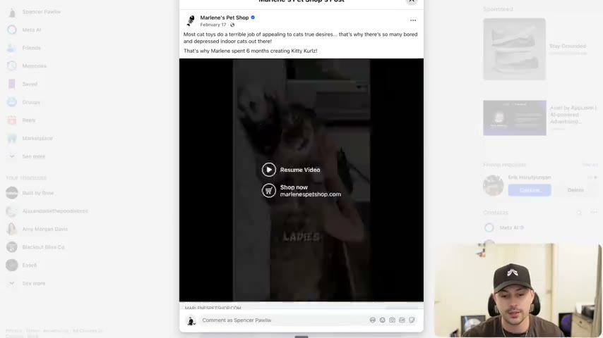
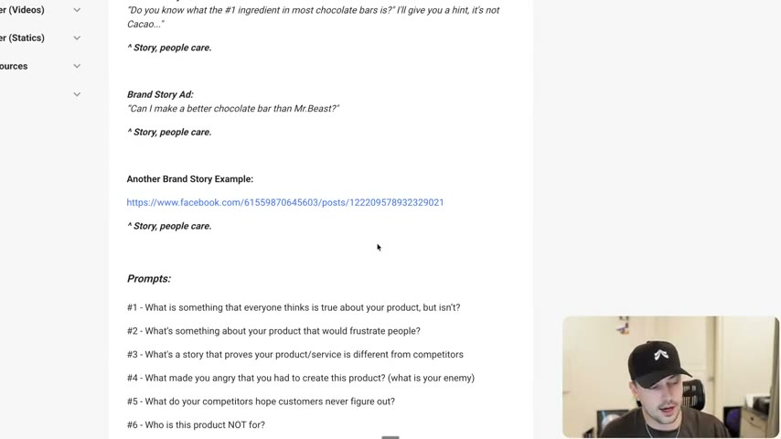
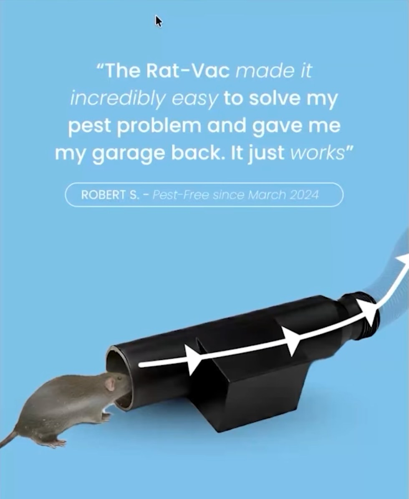
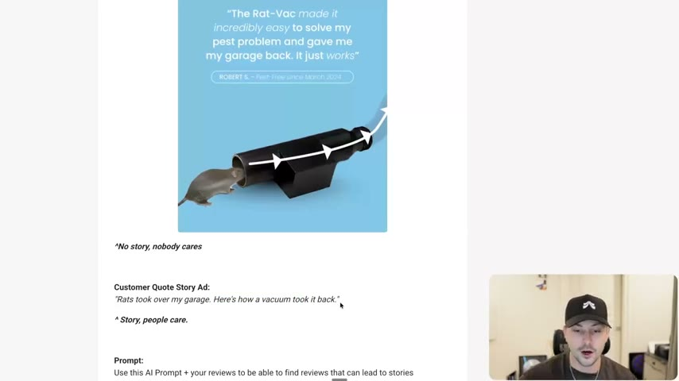

# 44. Prompts to help you storytell
> Two prompt sets finish the storytelling section: six brand/market questions that surface a story about the product or category (credited to Davie Fogarty), and a long AI prompt that scores customer reviews for story potential and returns the best ones with hook angles.

## 🤖 Agent use
- **Use when:** you need story material for a UGC script or static and only have a product, a brand element, or a pile of customer reviews; or you must convert a flat customer quote or brand claim into a curiosity-driven hook.
- **Inputs → outputs:** (a) brand elements, competitor and category knowledge → answers to six story prompts; (b) the full review set + the review-scoring prompt → ranked reviews with a Story Score 1-10, key story elements, 2-3 hook angles, emotional stakes and a one-line "why it works".
- **Rules:**
  - **DON'T** write a brand-claim ad ("We use all natural ingredients to make a better chocolate bar for you"): "No story, nobody cares." [00:00–00:51]
  - **DO** pair the brand element with something going on in the market (an enemy) to make a **market story** ad: "Do you know what the #1 ingredient in most chocolate bars is? I'll give you a hint, it's not Cacao..." [00:51–01:44]
  - **DO** make a **brand story** with curiosity and a gap: "Can I make a better chocolate bar than Mr.Beast?" [01:44–02:43]
  - **DON'T** paste a review straight into an ad: "nine times or 99 times out of 100, probably 999 times out of 1000, it doesn't work." [05:34]
  - **DO** find the interesting part of a review ("gave me my garage back") and turn it into a story hook with a gap: "Rats took over my garage. Here's how a vacuum took it back." [05:34–06:20]
  - **DO** run the review-scoring prompt over all reviews, ranked best first, and write the story from the top result. [06:20]
  - **DON'T** expect prompts to work without the earlier lessons: "these prompts don't mean anything" without conflict, stakes and the rest. [07:18]
  - **DO** keep asking "how can you fit your product in your avatar's life?" and wrap it in a narrative. [07:18]
- **See also:** [40. What makes a great story](40-what-makes-a-great-story.md) · [41. The laws of story telling](41-the-laws-of-story-telling.md) · [42. The three enemies of storytelling](42-the-three-enemies-of-storytelling.md) · [43. The storytelling arcs/plots](43-the-storytelling-arcs-plots.md) · [26. How to write open loops](26-how-to-write-open-loops.md) · [Story frameworks for ads (Tether Lab)](../../../../frameworks/story-frameworks-for-ads.md) · [Customer research stack](../../../../frameworks/customer-research-stack.md)

Lesson page text credits "Davie Fogarty". The linked Google Doc (…/document/d/1OGUHfnnGAgM5eAadg-1BLx_fFaGi0EvALOw13YvRzNo) is a duplicate of the course DOCX "44. Prompts to help you storytell.docx": the two extractions are identical apart from heading formatting.

## Key ideas

### 1. Two kinds of prompt [00:00–00:51]
- "Brand slash market focused": human question prompts that "could prompt you to tell a story". Customer focused: "an AI prompt that you can give to the AI with all of your reviews to have it search for specific stories". [00:00]

### 2. Brand/market story vs brand claim: chocolate bar [00:00–02:43]
Page template and instructor's reading:
| Element | Text | Verdict | Source |
|---|---|---|---|
| Brand element | Chocolate bar using all natural ingredients | | [00:00] |
| Brand ad | "We use all natural ingredients to make a better chocolate bar for you" | "No story, nobody cares." Only a niche looking for all-natural would respond | [00:00–01:44] |
| Market story ad | "Do you know what the #1 ingredient in most chocolate bars is? I'll give you a hint, it's not Cacao..." | "Story, people care." Brand element + the market's problem (the enemy: regular chocolate/candy bars) = the Conscious Bar hook from lesson 40 | [00:51–01:44] |
| Brand story ad | "Can I make a better chocolate bar than Mr.Beast?" | "Story, people care." The original hook from the open-loop section; "be careful with name dropping" | [01:44–02:43] |
- Brand-story logic: "I'm John and I made this chocolate bar" could be a story, but "when we position it where it's like, can I make a better chocolate bar than this person, ... we create some curiosity. We create a gap." [01:44–02:43]
- Page link "Another Brand Story Example" is a Marlene's Pet Shop Facebook post (below). [02:43]


*Marlene's Pet Shop Facebook post (the lesson page's "Another Brand Story Example"): "Most cat toys do a terrible job of appealing to cats true desires... that's why there's so many bored and depressed indoor cats out there! That's why Marlene spent 6 months creating Kitty Kurlz!" [03:06]*

### 3. Marlene's Pet Shop: another brand story [02:43–03:44]
- Spoken ad: "Sometimes crazy cat ladies aren't so crazy after all. This is how Marlene, a cat mom of 17 years, created a new toy that changes how we think about cat playtime." (Whisper-transcribed from the video; on-screen caption words "SOMETIMES", "AREN'T", "MARLENE'S".) [02:43]
- Instructor: "We could have easily started with like, oh, here's this cat toy that's great for cats. But ... sometimes crazy cat ladies are actually right. Boom, curiosity... Now we start to get into the story ... people care more to learn about the cat toy versus 'here's our cat toy. It's the best.'" [02:43]

### 4. The six brand/market prompts (credit: Davie Fogarty) [02:43–04:43]
The instructor says he is crediting Davey Fogarty's storytelling video ("a bunch of really good prompts ... examples ... breaks down some of the science ... what happens to the brain"). Prompts #1 and #2 are "a direct one from him". [02:43–03:44]

| # | Prompt (verbatim from the page) | Instructor's note | Source |
|---|---|---|---|
| 1 | What is something that everyone thinks is true about your product, but isn't? | From Davie | [02:43–03:44] |
| 2 | What's something about your product that would frustrate people? | From Davie | [02:43–03:44] |
| 3 | What's a story that proves your product/service is different from competitors | "Product is different from competitor": focuses the enemy | [03:44] |
| 4 | What made you angry that you had to create this product? (what is your enemy) | "What is your enemy that you're going after? Make a story about it." | [03:44] |
| 5 | What do your competitors hope customers never figure out? | "What are your competitors hiding?" Example: Jacob's protein bars ("none of this, none of this... we're the cleanest protein bar... calling out our competitors"); RXBAR "put their ingredients right on the front of the bar... we have nothing to hide." Whisper wrote "RX bar" and "Jacob's protein" | [03:44–04:43] |
| 6 | Who is this product NOT for? | "Sometimes by saying who your product is not for, you can create a story and you can find an identity ... and attract more people that way." | [04:43] |
- Extras he names but are not on the list: a **current events** prompt ("what's something recent that's happened in your space that you could talk about", also from Davie), and a **founder's ad** ("why did you create your product in the first place"). [04:43]


*The lesson page with the six brand/market prompts under "Prompts:". [04:57]*

### 5. Customer-focused: story starters in reviews [04:43–07:18]
- Quote (page): "The rat-vac made it incredibly easy to solve my pest problem and gave me my garage back. It just works." The page shows it as a static (Rat-Vac, "ROBERT S. - Pest-Free since March 2024"): "No story, nobody cares." [04:43–05:34]
- Why pasting it fails: "this quote is just in itself ... not that interesting." The interesting part: "gave me my garage back". [05:34]
- **Customer quote story ad (page):** "Rats took over my garage. Here's how a vacuum took it back." The gap: "how does a vacuum take back a garage?" It now has "a plot ... a story". [05:34–06:20]


*Skool lesson image: the Rat-Vac customer-quote static ("The Rat-Vac made it incredibly easy to solve my pest problem and gave me my garage back. It just works"), labelled "No story, nobody cares". [lesson page image, 06:07]*


*Page view: the Rat-Vac quote ad, then "Customer Quote Story Ad: Rats took over my garage. Here's how a vacuum took it back." [06:07]*

### 6. The AI review-scoring prompt [06:20–07:18]
- "Use this AI prompt + your reviews": give it to "your cloud project" (Whisper; means a Claude project) or, with Claude Code, "plugged into your computer and plugged into your files", with the reviews downloaded. It will "rank the best reviews for you". [06:20]
- He used it on a newer brand: "I have an insane idea for a story that I want to write" (not shown). [06:20]
- Full prompt reproduced verbatim below (from the DOCX and the Google Doc).

### 7. Wrap-up [07:18–08:08]
- Storytelling "takes a lot more effort ... more thought process" but "you can wrap your product in a narrative." Recall "how can you fit your product in your avatar's life?" If there's no narrative or none of the earlier lessons is in the draft, "these prompts don't mean anything". "It's not just about writing a story. It's about writing a good story ... It takes reps." [07:18–08:08]

## Steps / framework

### Workflow: reviews to story ad (derived from the lesson; step order is mine)
1. Export all customer reviews into a file or project. [06:20]
2. Run the review-scoring prompt (verbatim below). Take the top-scoring reviews and any marked [PRIORITY].
3. For each, pick the interesting line (e.g. "gave me my garage back") and the hook angles the prompt returns. [05:34]
4. Rewrite as a story hook with a gap ("Rats took over my garage. Here's how a vacuum took it back."). [05:34–06:20]
5. Check the draft against the five story blocks ([40](40-what-makes-a-great-story.md)), the laws ([41](41-the-laws-of-story-telling.md)) and the enemy ([42](42-the-three-enemies-of-storytelling.md)).
6. Choose an arc to tell it in ([43](43-the-storytelling-arcs-plots.md)).

### Derived UGC script skeleton from a scored review (derived, not from the course)
| Beat | Source in the prompt output | Pattern |
|---|---|---|
| Hook | "Potential Hook Angles" (pick one) | "[Rewritten review line with a gap]" e.g. "[Threat] took over my [place]. Here's how [product] took it back." |
| Stakes | "Emotional Stakes" | State what the reviewer stood to lose or gain |
| But/so chain | "CHANGE", "CAUSE & EFFECT", "TENSION" elements found | "I tried [other things]. But... So... But..." |
| Payoff | The review's result | Show the after |
| CTA | — | Product + offer |

## Examples

### Rewrites
| Before | After | What changed | Source |
|---|---|---|---|
| "We use all natural ingredients to make a better chocolate bar for you" | "Do you know what the #1 ingredient in most chocolate bars is? I'll give you a hint, it's not Cacao..." | Brand claim to market story: question, withheld answer, enemy in the market | [00:00–01:44] |
| "We use all natural ingredients to make a better chocolate bar for you" | "Can I make a better chocolate bar than Mr.Beast?" | Brand claim to brand story: challenge and curiosity gap | [01:44–02:43] |
| "The rat-vac made it incredibly easy to solve my pest problem and gave me my garage back. It just works." | "Rats took over my garage. Here's how a vacuum took it back." | Quote to story: names the threat and the stake, opens a gap | [05:34–06:20] |
| "Here's our cat toy. It's the best." (instructor's illustrative contrast) | "Sometimes crazy cat ladies aren't so crazy after all. This is how Marlene, a cat mom of 17 years, created a new toy..." | Product claim to a person-and-mystery opening | [02:43] |

### Hooks
| Hook | Heuristic(s) | Emotion / zone | Self targeted | Why it works | Source |
|---|---|---|---|---|---|
| "Do you know what the #1 ingredient in most chocolate bars is? I'll give you a hint, it's not Cacao..." | Curiosity gap (derived) | — | — | Withholds the answer; challenges a belief | [00:51] |
| "Can I make a better chocolate bar than Mr.Beast?" | Authority borrowing (derived) | Curiosity (derived) | — | Challenger vs a famous name; creates a gap | [01:44] |
| "Sometimes crazy cat ladies aren't so crazy after all." | Reversal (derived) | — | — | Reverses a stereotype; "what do you mean by that?" | [02:43] |
| "Rats took over my garage. Here's how a vacuum took it back." | Open loop (derived) | — | — | Threat + surprising solution | [05:34] |

### Ad teardowns
| Brand / product (niche) | Format | Hook / opening | What works | What fails | Fix suggested | Principle | Source |
|---|---|---|---|---|---|---|---|
| Rat-Vac (pest control vacuum trap) | Static customer-quote ad | "The Rat-Vac made it incredibly easy to solve my pest problem and gave me my garage back. It just works." | A real quote with a name and "Pest-Free since March 2024" | "No story, nobody cares"; a flat testimonial | Rewrite as "Rats took over my garage. Here's how a vacuum took it back." | Quote needs a gap and a threat | [04:43–06:20] |
| Marlene's Pet Shop, Kitty Kurlz (cat toy) | Video with kinetic captions | "Sometimes crazy cat ladies aren't so crazy after all." | Curiosity first, then a person (Marlene, cat mom of 17 years) | n/a | n/a | Brand story | [02:43–03:44] |
| Jacob's Protein bars | Not shown; instructor describes the packaging | "none of this, none of this ... the cleanest protein bar" | Calls out what competitors hide | Not shown | n/a | Prompt #5 | [03:44] |
| RXBAR | Packaging | Ingredients on the front of the bar | "We have nothing to hide" | n/a | n/a | Prompt #5 | [03:44] |

### Angles
| Angle | Core desire / pain | Heuristic(s) | Best format | Example line | Source |
|---|---|---|---|---|---|
| What the market hides | Distrust of industry | — | Educational/UGC | "The number one ingredient isn't cacao" | [00:51] |
| What competitors hope you never figure out | Fear of being deceived | — | Label/ingredient teardown | "None of this, none of this... the cleanest protein bar" | [03:44] |
| Who this is not for | Identity | — | Brand story | (prompt #6) | [04:43] |

## Structured units

### Rules of thumb
- **DON'T** state a brand fact; **DO** state the market problem that makes the fact matter. [00:51]
- **DON'T** paste a review; **DO** rewrite its interesting line as a story hook. [05:34]
- **DO** answer all six prompts for every product and keep the answers as story starters. [02:43–04:43]

## Prompts / templates (verbatim)

### A. Six brand/market story prompts (lesson page, verbatim)
```
#1 - What is something that everyone thinks is true about your product, but isn't?
#2 - What's something about your product that would frustrate people?
#3 - What's a story that proves your product/service is different from competitors
#4 - What made you angry that you had to create this product? (what is your enemy)
#5 - What do your competitors hope customers never figure out?
#6 - Who is this product NOT for?
```

### B. AI prompt to find story-worthy reviews (DOCX "44. Prompts to help you storytell.docx"; identical to the linked Google Doc; verbatim)
```
You are a direct response copywriter and story analyst specializing in identifying high-converting customer narratives for paid advertising.

# Task

Analyze each customer review to score its story potential and extract the elements that make it compelling enough to anchor an ad.

# Context

Not all reviews are equal. The ones that perform in ads share specific structural qualities: transformation, emotional stakes, tension, and curiosity gaps. Your job is to surface which reviews have these qualities and explain exactly why they'd make someone stop scrolling.

# Instructions

**Story Elements to Evaluate Against:**

- **CHANGE** — Did something transform? Identify the explicit before/after. Specific moments of unexpected change create curiosity.

- **STAKES + DRAMA** — How high were the stakes? Health, family, home, safety, money, relationships? The abnormal outperforms the normal.

- **CAUSE & EFFECT** — Is there a clear progression? Did they try other things first? Can a reader insert themselves into the emotional journey?

- **WITHHOLDING INFORMATION** — Does the review create a curiosity gap? Is there something unexpected or counterintuitive that makes you want to know more?

- **TENSION + SUSPENSE** — Are there imaginary "buts" or "sos" that change direction in the review? Was there doubt, struggle, or a turning point?

**For each review, output:**

- **Story Score (1–10):** How strong is the story potential?

- **Full Customer Quote:** The complete, verbatim review text

- **Key Elements Present:** Which of the five story elements does it contain?

- **Potential Hook Angles:** 2-3 different ways this story could open an ad (rewritten/adapted versions that create curiosity gaps)

- **Emotional Stakes:** What did the reviewer stand to lose or gain?

- **Why It Works:** One sentence on why this could make people care.

**Prioritization rules:**

- Lead with the highest-scoring reviews

- Flag any review with extreme situations, unexpected transformations, or unusually high emotional stakes as **[PRIORITY]**

- If a review scores below a 4, briefly note what's missing rather than building out the full analysis
```
(The five scoring elements match the five blocks taught in [lesson 40](40-what-makes-a-great-story.md).)

### C. Page text for the two example sets (verbatim)
```
Brand Element: Chocolate bar using all natural ingredients
Brand Ad: "We use all natural ingredients to make a better chocolate bar for you" ^No story, nobody cares
Market Story Ad: "Do you know what the #1 ingredient in most chocolate bars is?" I'll give you a hint, it's not Cacao..." ^ Story, people care.
Brand Story Ad: "Can I make a better chocolate bar than Mr.Beast?" ^ Story, people care.

Customer Quote: "The rat-vac made it incredibly easy to solve my pest problem and gave me my garage back. It just works."
Customer Quote Ad: ^No story, nobody cares
Customer Quote Story Ad: "Rats took over my garage. Here's how a vacuum took it back." ^ Story, people care.
```

## Screenshots
Four images embedded above (Marlene's post, the six-prompt list, the Rat-Vac story-ad page, the Skool Rat-Vac image). The Google Doc itself is not shown in the video.

## How to apply
- [ ] Answer the six brand/market prompts for the product and log each answer with the enemy it exposes.
- [ ] Export every review and run prompt B; keep the top five and every [PRIORITY].
- [ ] For each, write three hook rewrites that name the threat and open a gap; test them as hooks.
- [ ] Reject any hook that is only a product or ingredient claim.
- [ ] Verify the story against lessons 40-43 before writing the script.
- [ ] (derived) Tell the agent explicitly to quote the review verbatim and never invent reviews; only use real customer text.

## Related
- Previous: [43. The storytelling arcs/plots](43-the-storytelling-arcs-plots.md) · Next: [45. Overview of the iteration section](45-overview-of-iteration-section.md)
- [Story frameworks for ads (Tether Lab)](../../../../frameworks/story-frameworks-for-ads.md): Tether Lab feeds a named story structure plus the avatar to ChatGPT ("the prompt recipe"); Evolve's prompt B instead scores real reviews first and builds the story from the highest-scoring one. They combine well: use prompt B to choose the review, then a Tether Lab framework (or lesson 43 arc) to write it. · [Customer research stack](../../../../frameworks/customer-research-stack.md) · [Risk reduction hooks](../../../../concepts/risk-reduction-hooks.md)

## Sources and limitations
- Transcript: [44. Prompts to help you storytell… .txt](<../../../../../raw/evolve/copywriting/_transcripts/✍️ Evolve Copywriting (NEW)/44. Prompts to help you storytell ✍️ Evolve Copywriting (NEW) Evolve.txt>) · Page text: [….html.md](<../../../../../raw/evolve/copywriting/_extracted/✍️ Evolve Copywriting (NEW)/44. Prompts to help you storytell_✍️ Evolve Copywriting (NEW)_Evolve.html.md>) · DOCX: [44. Prompts to help you storytell.docx.md](<../../../../../raw/evolve/copywriting/_extracted/✍️ Evolve Copywriting (NEW)/44. Prompts to help you storytell.docx.md>) · Linked Google Doc export (duplicate of the DOCX): [44-document-1OGUHfnnGA.docx.md](../../../../../raw/evolve/copywriting/_extracted/_linked/google/44-document-1OGUHfnnGA.docx.md) · Skool image: [44-img01](../../../../../raw/evolve/copywriting/linked/skool-images/44/44-img01.png)
- Machine transcription (Whisper large-v3-turbo). Full recording covered (487.94 s). Whisper writes "Davey Fogarty" for Davie Fogarty (page text), "cloud project" for Claude project, "past problem" for pest problem, "Mr. Beast" for MrBeast, and "Jacob's protein" and "RX bar" (brand spellings uncertain).
- The spoken-ad transcription of the Marlene's Pet Shop video (02:43) is the audio of the Facebook ad; the post caption is as shown on screen.
- The DOCX contains the prompt only; no images or sheets. The page's second Facebook link (Marlene's Pet Shop) was seen in the recording but not independently fetched.
- Sourcing: the instructor credits Davie Fogarty's storytelling video for the prompts; that video is not part of the course files. Whether the review-scoring prompt (B) is Fogarty's or Spencer's own is not stated (the page credits Fogarty overall).
