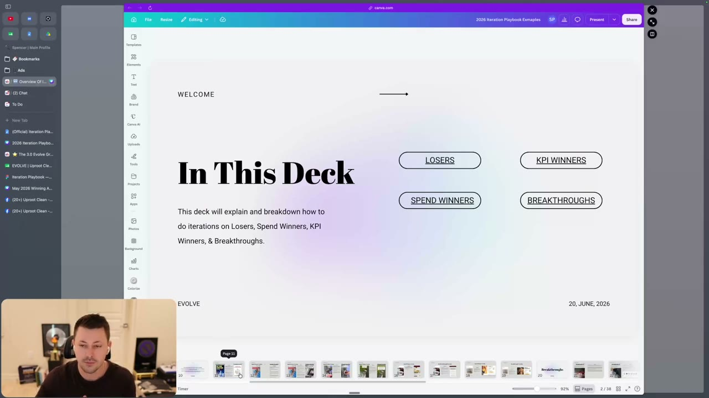

# 45. Overview Of Iteration Section
> Every tested ad lands in one of four outcomes (loser, KPI winner, spend winner, breakthrough), and you must name the outcome before you iterate, because what you change depends on which one you have.

## 🤖 Agent use
- **Use when:** an ad (ours or a client's) has finished a test window and you must decide what to do next; before reading lessons 46-54.
- **Inputs → outputs:** ad spend, campaign spend over the same period, whether the ad hit the account KPI → one of four labels (loser / KPI winner / spend winner / breakthrough) that routes to the matching iteration lesson.
- **Rules:**
  - **DO** classify every ad into exactly one of four outcomes before iterating: losing ad, KPI winner, spend winner, breakthrough. [01:29]
  - **DO** define "majority of spend" relative to account size: "if you're at a lot of spend, it's going to be a smaller percentage. If you're at lower spend, it's going to be a higher percentage." [01:29]
  - **DO** apply the outcome tests exactly as stated below (table in Key ideas). [01:29-02:24]
  - **DON'T** iterate without a clear process for identifying the outcome of the ad: "the most crucial thing that you need to do when it comes to iteration is you need to have a clear process on actually identifying what is the outcome of your ad." [00:00-00:57]
  - **DO** communicate the four definitions to yourself and your team before starting the process. [01:29]
  - **IF** you hit a breakthrough **THEN** iterate on it immediately, because the instructor claims another breakthrough usually follows in "one to two weeks". [03:10-03:45] (instructor claim)
- **See also:** [46. The 10 step iteration process](46-the-10-step-iteration-process.md) · [48. Losing ads](48-how-to-iterate-on-losing-ads.md) · [49. KPI winners](49-how-to-iterate-on-kpi-winners.md) · [50. Spend winners](50-how-to-iterate-on-spend-winners.md) · [51. Breakthroughs](51-how-to-iterate-on-breakthroughs.md) · [Iteration vs variation](../../../../concepts/iteration-vs-variation.md)

Lesson page text: two links only. The Canva deck "The Iteration Playbook Examples & Breakdowns" (https://canva.link/rla2o4gfzashvxf) and a Skool classroom link to "the newest definitions" ("make sure that you are caught up on the newest definitions that you can find here"). The definitions page itself is not included in the course files for this lesson.

## Key ideas

### Why this section exists [00:00-00:57]
- Aimed at advertisers who "have made enough money with your e-com brand" and "probably have something working" but do not know how to scale it. [00:00]
- Typical (insufficient) behaviours the instructor lists: testing many new hooks; putting the same hook on many holds; building ads for the same avatar in different formats; or the same format/script across different avatars. "Those are definitely things that can work." The missing piece is a process for identifying the outcome of each ad. [00:00]
- Effort claim: the underlying analysis took "over a month's worth of analysis and probably closer to two months total". [00:57] (instructor claim)
- Status of the definitions at recording: the original aim was "exact percentages". Definitions exist for accounts at "500K plus and zero to 100K" monthly spend, but "we're still coming up with the exact definitions for people that are in the 100 to 500K per month range." [00:57] The exact percentages are not given in this lesson.

### The four outcomes [01:29-02:24]
| Outcome | Hits the KPI? | Pulls the majority of spend? | Notes from the instructor |
|---|---|---|---|
| **Losing ad** | No | No | "ads that don't hit your KPI and don't pull a majority of spend" |
| **KPI winner** | Yes | No | "ads that hit your KPI, but they're just not pulling majority of spend" |
| **Spend winner** | No | Yes | "do hit the majority spend threshold, but they are not hitting your KPI and they are not allowing you to scale your account" |
| **Breakthrough** | Usually yes ("most of the time they usually do") | Yes ("hit your breakthrough levels of spend or ... pull majority of spend") | "allow you to scale and increase your ad spend" |

- Majority-of-spend threshold by account size: stated only as a range. A KPI winner is "not pulling anywhere from 10 to, for some smaller accounts, 60, 70% of spend." So the share of campaign spend that counts as "majority" runs from about 10% (large accounts) to 60-70% (small accounts). [01:29-02:24] No other numeric thresholds are given here; see lessons 46-51 for more.
- A breakthrough qualifies by spend alone: it may or may not hit the KPI, though it usually does. [02:24]

### How the section is organised [02:24-03:45]
- Compare losers against actual breakthroughs "so you can see the differences"; same for spend winners and KPI winners. [02:24]
- The deck shows what was changed, not just a diagnosis. Example given: instead of "this ad is lacking authority", the deck shows what lacking authority looks like. [03:10]
- The Canva deck "2026 Iteration Playbook Examples" opens with an "In This Deck" slide linking four buckets: LOSERS, KPI WINNERS, SPEND WINNERS, BREAKTHROUGHS ("explain and breakdown how to do iterations on Losers, Spend Winners, KPI Winners, & Breakthroughs"). Dated 20 June 2026 on the slide. [03:00]

### Breakthrough claim [03:10-03:45]
- "Probably like 99.9% of the time we hit a breakthrough for an account, it is almost guaranteed that we find another breakthrough within like one to two weeks" if you iterate the right way. [03:10-03:45] (instructor claim, no data shown)

### Call to action [03:45-04:29]
- "Come into this with an open mind"; the goal is action, not watching: "I didn't want to have more modules than necessary because I don't want you guys to just watch all this and then be like, okay, that's great." [03:45]

## Steps / framework
Route by outcome:

| Label | Go to |
|---|---|
| Loser | [48. How to iterate on losing ads](48-how-to-iterate-on-losing-ads.md) |
| KPI winner | [49. How to iterate on KPI winners](49-how-to-iterate-on-kpi-winners.md) |
| Spend winner | [50. How to iterate on spend winners](50-how-to-iterate-on-spend-winners.md) |
| Breakthrough | [51. How to iterate on breakthroughs](51-how-to-iterate-on-breakthroughs.md) |
| Any (process for all) | [46. The 10 step iteration process](46-the-10-step-iteration-process.md), [47. Claude Code version](47-claude-code-10-step-iteration-process.md) |

## Examples
No ad examples are shown in this overview; they are walked through in lessons 48-51.

## Structured units
None (no ads or hooks are analysed in this lesson).

## Screenshots

*The "2026 Iteration Playbook Examples" Canva deck, slide 2 "In This Deck": the four outcome buckets the rest of the section is organised around. [03:00]*

## How to apply
- [ ] For each ad past its test window, record ad spend, campaign spend for the same period, and whether it hit the KPI.
- [ ] Label it Loser / KPI winner / Spend winner / Breakthrough using the table above (majority-of-spend threshold set per account size).
- [ ] Open the matching lesson (48-51) and follow its iteration list.
- [ ] If the account is in the 100-500K/month range, note that the instructor says exact definitions for that range were not finished at recording time; use judgment and state the assumed threshold.

## Related
- Previous: [44. Prompts to help you storytell](44-prompts-to-help-you-storytell.md) · Next: [46. The 10 step iteration process](46-the-10-step-iteration-process.md)
- [Iteration vs variation](../../../../concepts/iteration-vs-variation.md) · [Creative testing system](../../../../frameworks/creative-testing-system.md)

## Cross-course notes
- Tether Lab ([Iteration vs variation](../../../../concepts/iteration-vs-variation.md)) iterates on a winning *message* by changing one primitive or format; Evolve's section adds an outcome taxonomy (four classes) that decides what to iterate, which Tether Lab's three buckets (experiment / scaling / variation) do not.
- Both courses say to iterate on winners; Evolve says to do so quickly after a breakthrough (1-2 weeks claim), Tether Lab says scale budget slowly (+10% every other day, see [Creative testing system](../../../../frameworks/creative-testing-system.md)). These address different things (creative iteration vs budget scaling) and do not conflict.

## Sources and limitations
- Transcript: [45. Overview Of Iteration Section….txt](<../../../../../raw/evolve/copywriting/_transcripts/✍️ Evolve Copywriting (NEW)/45. 🆕 Overview Of Iteration Section ✍️ Evolve Copywriting (NEW) Evolve.txt>) · Page text: [….html.md](<../../../../../raw/evolve/copywriting/_extracted/✍️ Evolve Copywriting (NEW)/45. 🆕 Overview Of Iteration Section_✍️ Evolve Copywriting (NEW)_Evolve.html.md>)
- Machine transcription (Whisper large-v3-turbo); full recording covered (last segment 4:29 of 4:29). Whisper writes "cloud" for "Claude" elsewhere in this section.
- The linked "newest definitions" Skool page and the exact spend-share percentages are not in the course files; do not invent them.
