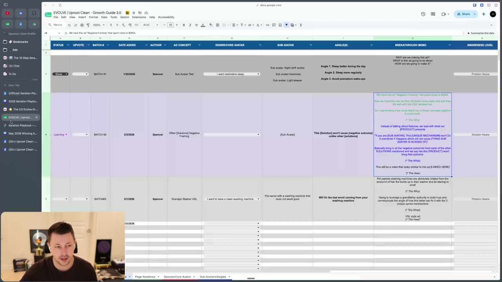

# 46. The 10 Step Iteration Process
> Before you iterate on any ad, run a fixed 10-step learning process (batch, outcome, ad type, hooks verbatim, component check, hypothesis, links, visual playbook, playbook, naming) so you iterate on understanding, not on hope.

## 🤖 Agent use
- **Use when:** an ad has run long enough to be labelled and you are about to plan iterations; also when setting up ad naming/tracking so an agent can later find the ad and count iterations.
- **Inputs → outputs:** ad in Meta Ads Manager + the Growth Guide row for its batch + spend numbers → a completed learning record (outcome, ad type, verbatim hooks, component audit, hypothesis, iteration ideas, links) → a named, numbered iteration ready to launch.
- **Rules:**
  - **DO** run the steps in order and do not start iterating until step 9. "We have eight steps before we even get to step nine, which is actually doing the iterations ... that is what will make your iterations work." [18:54-19:46]
  - **DO** name ads with at least the batch number: "the only bare minimum that you need to do is you need to at least have the batch number." [01:14-02:05]
  - **DO** run learnings after an ad has run **at least 7 days** and has an outcome label. [02:05-02:40]
  - **IF** an ad clearly looks like a breakthrough/spend winner within **2-3 days** (it starts scaling the account) **THEN** start the iteration process early. [02:40-03:31]
  - **DO** record ad spend (from the ad set) and campaign spend for the same period. [03:31-04:14]
  - **DO** record the ad type: ideation (idea from research), imitation (idea from another brand's ad), iteration (idea from one of your own existing ads). It is about where the *idea* came from, not the finished ad. [04:14-06:33]
  - **DO** write every hook verbatim (on-screen text hook AND voiceover hook if different), with hook rate and hold rate only if spend was significant (recommendation on the page: $1k minimum after 7 days). [06:33-08:00]
  - **DO** check each ad against what was planned in the Growth Guide (awareness, valence/intensity, desire, avatar, angle, mechanism, belief, positioning, urgency). [08:42-12:49]
  - **DON'T** treat your hypothesis as fact: "this is a hypothesis. This is not fact." It becomes a learning only when the iteration built on it pops. [14:17-15:40]
  - **DO** name and number every iteration before launch, at file, ad name and ad set level. [18:54-21:22]
  - **DON'T** iterate "empty": "if you're just doing empty iterations, you're just hoping for the best." [13:34]
- **See also:** [47. Claude Code version](47-claude-code-10-step-iteration-process.md) · [45. Overview](45-overview-of-iteration-section.md) · [48-51 outcome lessons](48-how-to-iterate-on-losing-ads.md) · [Iteration vs variation](../../../../concepts/iteration-vs-variation.md) · [Creative testing system](../../../../frameworks/creative-testing-system.md)

## Key ideas

### Intro and positioning of the Claude skill [00:00-01:14]
- The process "will include a Claude skill" for people who already have Claude Code on desktop (not just browser). A video from "Zach", described as CTO and head of AI, covers setup. [00:00]
- You can do the process without the skill. The skill is recommended because it "stores your data, stores your learnings", visualises learnings and "automatically write[s] them in your growth guide", and lets you "talk to the AI about why you think your learnings are good rather than trying to format them properly". [00:36]
- The page text says: "You can do this on your own, or you can do this with the assistance of claude code (next module)".

### Step 1: Identify the batch number [01:14-02:05]
- Without a naming scheme "AI is not really going to be able to help you". Naming templates live in the "how to run ads" section (naming templates module; not in these files). [01:14]
- Even if the full scheme is too complex, use "batch number one, batch number two" labels; the Growth Guide also tracks batches (BATCH #1, #2, #3...). That is "how we are going to track everything, especially with an AI". [02:05]
- Page text: "Pull up the batch in your account. Find the ad in Meta before moving on."

### Step 2: Identify the outcome [02:05-04:14]
- Outcomes (page text): Breakthrough, Spend Winner, KPI Winner, Loser. Definitions: [45](45-overview-of-iteration-section.md).
- Timing: learnings and iterations happen "after an ad has been running for at least seven days and we've clearly marked it with an outcome". [02:05]
- Exception: if within "two to three days" an ad "starts ripping and it starts scaling the entire account" you can start early. "A lot of times the breakthroughs will show themselves early. Now, sometimes they break through and then they come crashing down" (what to do then: see [51](51-how-to-iterate-on-breakthroughs.md)). [02:40-03:31]
- Record: total spend the ad got (copy the **ad set** spend) and total spend of the **campaign** over the same period (copy the campaign spend). This tells the AI how much spend the ad got and lets it check against the outcome rules. [03:31-04:14]

### Step 3: Identify the ad type [04:14-06:33]
Why it matters: a new-idea loser is usually iterated on; an imitation loser often is not ("that format just didn't really work"), though "there are times where we might". [04:14]

| Type | Definition (instructor) | Example given |
|---|---|---|
| Ideation | The idea came from research | Reddit research shows moms complaining their washing machine smells; idea = ad about how to fix a smelly washing machine. Still ideation even if you then put it in a found template. [04:55] |
| Imitation | The idea (format or angle) came from another brand's ad | Scrolling Atria or TrendTrack, see a static you want to copy the format of; or seeing a competitor run a smelly-washing-machine ad and imitating their angle. [05:47] |
| Iteration | The idea came from one of your own existing ads | "There's not much more than that." [05:47] |

- Include ideation/imitation/iteration in the naming scheme. If confused, the instructor points to the "how to plan ad" section and the growth guide overview. [06:33]

### Step 4: Identify the hooks verbatim [06:33-08:00]
- "Write out exactly ... every hook exactly as it appears in the ad. So don't just summarize it." If there is a text-on-screen hook and a different voiceover hook, list both. [06:33]
- Note whether hook rate and hold rate were good. Reason: most people "make losers and KPI winners" far more often than spend winners or breakthroughs, and "a lot of the times ads are losers or KPI winners because of the hook". [07:18]
- Significant spend caveat: "if your ad spent $2 and it says it has a 70% hook rate ... It needs more data". The page text gives a recommendation of "$1k in spend minimum after 7 days" for counting hook/hold rate. [07:18-08:00]
- "Verbatim" because the instructor does not want alterations to the hooks at this stage. [08:00]
- Mentioned: a hook library is in progress ("take all the top owning ads and turn them into hooks"). Not included in these files. [06:33]

### Step 5: Verify components against the Growth Guide and fill in the rest [08:00-12:49]
- This step was changed from the original in the Iteration Playbook; the video and the Google/Skool page are now identical. [08:00]
- It exposes whether you really prepare ads: if you only have a single ad idea and a vague "here's why this will be good", this step reveals the hole. [08:42]
- Go to the Growth Guide row for the batch ("batch number three") and pull sub-avatar, angle, memo, awareness level. Then read the actual ad and check it matches. [09:20]
- Example given: you planned a problem aware ad but the finished copy reads product aware, solution aware or unaware. "This is where a lot of you guys are like throwing out angles or like saying that your idea didn't work when it just wasn't even executed properly." "Our team has done this before. I have done this before." [09:20]
- The nine components, with the checking question (page text, step 5 list, extended by the video):

| # | Component | Check |
|---|---|---|
| 1 | Market awareness level | Does the copy match what you had planned? |
| 2 | Valence + intensity | What zone is it? Over time compare against your winners (e.g. "high valence, high intensity" ad when every winner is low valence, low intensity) [10:15] |
| 3 | Desire | Does the outcome match? (e.g. status desire: are you actually intensifying it?) [10:15] |
| 4 | Avatar | Does the copy communicate to them? [10:58] |
| 5 | Angle (the reason someone will buy) | Is the reason clear? [10:58] |
| 6 | Mechanism | Is there a new mechanism communicated, i.e. how it's different? [10:58] |
| 7 | Belief | What are we doing to build trust? Clear authority or strategic copy? Instructor renamed "authority" to "belief"; "this belief component is a huge piece of why so many ads fail." [10:58] |
| 8 | Positioning | What are we doing that's different, how have we separated ourselves? If you feel you do the same as competitors, "this breakthrough ad might not last that long because I'm just gonna get copied back". [11:51] |
| 9 | Urgency (new) | What reason(s) must someone take action today? Re-added because "the urgency that these breakthrough ads have is real". [11:51] |

- The Claude skill pulls what the Growth Guide held into a visual FigJam sheet, "but it's important that you check ... that these components were actually executed properly based off what you planned" (page text, step 5 warning). [12:49]
- Reason for the breakdown: these are the components you do research for and must consider when writing ads (desire, angle, avatar, zone, mechanism "providing hope", believability, differentiation, urgency). [12:49]

### Step 6: Write your hypothesis + ideas for iterations [12:49-16:23]
- "You can't do iterations without learning your ad first." Break the ad apart so you know what to iterate on. [13:34]
- Write: why did the ad perform as it did; what specifically worked or did not. Judge through the lens of the copywriting lessons (is it a good hook, bridge, objection handling...). [14:17]
- Page text adds: "Consider what is working in your other ads / winning ads in general to avoid making false learnings." and "Be specific."
- Biggest rule: "this is a hypothesis. This is not fact." Example of treating it as fact: "the reason why this ad didn't work is because I use this mechanism when I need to use this mechanism instead." That is "a guess ... a very educated guess". Only when you recreate the ad with a newer mechanism and "it pops" can you say "that was a clear learning". Otherwise "this is what I think. Not this is what is". Remind the AI and the team. [14:17-15:40]
- While scanning components your brain should go creative: "I don't actually have a good mechanism", "I have no authority in this ad", "I have no urgency in this ad whatsoever" -> list iteration ideas. The AI will suggest some too. [15:40-16:23]

### Step 7: Link the original files [16:23-17:02]
- Store the link to the ad file so it can be found later (page: "Ad file (Frame.io or Drive)"). The Growth Guide also has a link-to-ad column. [16:23]

### Step 8: Confirm it's in the visual playbook [16:23-17:59]
- The ad should already be in the "Iteration Playbook FigJam" (the page links "Iteration Playbook - Ad Diagnostics" on figma.com). A paid Figma license is needed (from the instructor's understanding) if connecting it to the AI. [17:02]
- Credit: a visual-style learnings growth guide from older members "Daniel Pizzi and his brother" inspired it. [17:02]
- The board stores learnings, iterations, desire, avatar, angle, awareness, ad type, mechanism, belief, plus hook text variations with valence and intensity, so you can compare which hook version worked, and compare breakthroughs vs losers side by side. [17:02-17:59]

### Step 9: Follow the iteration playbook [17:59-18:54]
- Using the outcome from step 2, go to that part of the Iteration Playbook (the Canva deck; see [48](48-how-to-iterate-on-losing-ads.md), [49](49-how-to-iterate-on-kpi-winners.md), [50](50-how-to-iterate-on-spend-winners.md), [51](51-how-to-iterate-on-breakthroughs.md)) and identify the iterations to run. [17:59]
- The video is split: how to do all of this in Claude Code is lesson 47. [17:59]

### Step 10: Name the iteration and track it [18:54-21:22]
- New rule, possibly not in the existing naming scheme: before launching any iteration, name it so you can find it later and count how many iterations you've done on a concept. [18:54]
- "If I said, how many times have you iterated on this ad? You'd be like, we've iterated a ton. I'd be like, how many? And you wouldn't be able to answer." [18:54]
- Thresholds / heuristics: if you have done 30 iterations without finding another winner or breakthrough "I would start to be very concerned that the iterations that you're doing are not in depth and they're not with intent". [19:46]
- Anecdote: after a breakthrough a month went by; the team said they had iterated "twice", and one of the two was another breakthrough. "Why aren't we iterating more?" Tracking showed the real count; by the 8th or 9th iteration you can also see when you are repeating iteration #1. [19:46-21:22]

Naming format (page text, verbatim):
- Include `ITER#[N]_BATCH#[ORIG#]` right after the concept name at every level.
- N = which iteration this is (1st, 2nd, 3rd...). BATCH#[ORIG#] = the batch number you're iterating on.
- Example in the video: iteration 2 of batch 3 means "second iteration for batch number three". [19:46]

## Steps / framework

| Step | Action | Output |
|---|---|---|
| 1 | Identify the batch number. Pull up the batch, find the ad in Meta | batch # |
| 2 | Identify the outcome (Breakthrough / Spend Winner / KPI Winner / Loser); note ad spend and campaign spend in the same period | outcome + two $ figures |
| 3 | Identify ad type (Ideation / Imitation / Iteration) | type |
| 4 | Identify hooks verbatim (text + voiceover); hook rate and hold rate if spend is significant (recommendation: $1k after 7 days) | hook list + rates |
| 5 | Verify components against the Growth Guide and fill in the rest (9 components) | discrepancy notes |
| 6 | Write hypothesis + iteration ideas | hypothesis (not fact) |
| 7 | Link the original files (Frame.io or Drive) | links |
| 8 | Confirm it is in the visual playbook (FigJam) | placed ad |
| 9 | Follow the iteration playbook for the outcome | iteration list |
| 10 | Name the iteration and track it | named ads, iteration count |

## Examples
- **Ideation vs imitation (smelly washing machine):** Reddit research on moms whose washing machine smells -> ad about fixing it = ideation. Seeing a competitor's smelly-washing-machine ad and copying the angle = imitation. Copying a static format from Atria/TrendTrack = imitation. [04:55-05:47]
- **Growth Guide row on screen:** "EVOLVE | Uproot Clean - Growth Guide 3.0" (Google Sheet) with columns Status, Upvote, Batch #, Date added, Author, Ad concept, Desire/Core avatar, Sub avatar, Angle(s), Breakthrough memo, Awareness level, etc. Rows shown: BATCH #1 "Sub Avatar Test" (desire "I want restorative sleep", sub-avatars night shift worker / insomniac / light sleeper, angles "Sleep better during the day", "Sleep more regularly", "Avoid premature wake-ups", awareness "Problem Aware"); BATCH #2 "Other [Solutions] Negative Framing" (angle "This [Solution] won't cause [negative outcome] unlike other [solutions]", awareness "Solution Aware", memo says "We have this ad 'Negative Framing' that spent close to $280k" and plans to blend two concepts); BATCH #3 "Grandpa Washer VSL" (desire "I want to have a clean washing machine", sub-avatar "Pet owner with a washing machine that does not smell good", angle "Will fix the bad smell coming from your washing machine", awareness "Problem Aware"; memo: leverage "a grandfather authority to build trust" with "the 3 unique uproot mechanisms", "VSL style ad"). [09:17 on-screen]
- **Naming:** see Step 10 and the screenshot below.

## Structured units

### Templates
| Template | Use for | Example fill | Source |
|---|---|---|---|
| `File: Client - Batch#[NEW] - [Concept] - ITER#[N]_BATCH#[ORIG#] - Format - Editor - CS - V#` | File name of an iteration | N=2, ORIG=3 -> `...- ITER#2_BATCH#3 - ...` | page text step 10 |
| `Ad name: Batch#[NEW]_[Concept]_ITER#[N]_BATCH#[ORIG#]_URL_Format_Editor_CS_V#_C_#_H_#` | Meta ad name | | page text step 10 |
| `Ad set: EAM BATCH#[NEW] - ITER#[N]_BATCH#[ORIG#] - [Concept] - [targeting]` | Meta ad set name | | page text step 10 |

### Rules of thumb
- **DO** wait 7 days to label an ad, unless a spend winner/breakthrough is obviously taking the account (2-3 days). [02:05-03:31]
- **DON'T** read hook rate on trivial spend ("$2 ... 70% hook rate"). [07:18]
- **DO** list both the text-on-screen hook and the voiceover hook. [06:33]
- **IF** a planned awareness level does not match the finished copy **THEN** the angle was not really tested. [09:20]
- **IF** 30 iterations pass without another winner **THEN** suspect shallow iterations, not the concept. [19:46]

## Prompts / templates (verbatim)
Naming scheme from the lesson page (verbatim):

```
Include ITER#[N]_BATCH#[ORIG#] right after the concept name at every level:

File: Client - Batch#[NEW] - [Concept] - ITER#[N]_BATCH#[ORIG#] - Format - Editor - CS - V#
Ad name: Batch#[NEW]_[Concept]_ITER#[N]_BATCH#[ORIG#]_URL_Format_Editor_CS_V#_C_#_H_#
Ad set: EAM BATCH#[NEW] - ITER#[N]_BATCH#[ORIG#] - [Concept] - [targeting]

N = which iteration this is (1st, 2nd, 3rd...)
BATCH#[ORIG#] = the batch number you're iterating on
```

Step 5 component checklist (verbatim from the page):

```
Market awareness level → Does the copy match what you had planned?
Valence + Intensity → What zone is it?
Desire → Does the outcome match?
Avatar → Does the copy communicate to them?
Angle (the reason someone will buy) → Is the reason clear?
Mechanism → Is there a new mechanism communicated?
Belief → What are we doing to build trust? Is there a clear authority or strategic copy?
Positioning → What are we doing that's different? How have we separated ourselves?
Urgency → What is the reason(s) that someone needs to take action today?
```

## Screenshots

*The Growth Guide 3.0 sheet used in step 5: one row per batch with desire, sub-avatar, angle(s), breakthrough memo and awareness level to compare against the finished ad. [09:17]*


*Steps 7-10 on the lesson page, with the highlighted ITER#[N]_BATCH#[ORIG#] token and the file / ad name / ad set patterns. [20:16]*

## How to apply
- [ ] Open the batch in Meta; confirm the ad's batch number in the name (add one if missing).
- [ ] Wait until 7 days of data, or 2-3 days if it is plainly scaling the account.
- [ ] Log ad spend and campaign spend for the same window; assign the outcome label.
- [ ] Tag ideation / imitation / iteration by origin of the idea.
- [ ] Copy each hook word for word, text and voiceover; add hook/hold rate only if spend is meaningful.
- [ ] Compare the finished ad with the Growth Guide row on the nine components; note every mismatch.
- [ ] Write hypothesis (labelled as a guess) and 3+ specific iteration ideas.
- [ ] Link the ad file; confirm it is on the FigJam; open the outcome section of the playbook.
- [ ] Name each new iteration with ITER#N_BATCH#ORIG# at file, ad name and ad set levels and log the count.

## Related
- Previous: [45. Overview of iteration section](45-overview-of-iteration-section.md) · Next: [47. Claude Code - 10 step iteration process](47-claude-code-10-step-iteration-process.md)
- [Iteration vs variation](../../../../concepts/iteration-vs-variation.md) · [Creative testing system](../../../../frameworks/creative-testing-system.md)

## Cross-course notes
- Tether Lab's [Creative testing system](../../../../frameworks/creative-testing-system.md) also iterates a proven winner one variable at a time and builds up in small batches; Evolve adds a mandatory pre-iteration diagnosis (steps 1-8), outcome-specific iteration lists, and iteration-count tracking in the file name.
- Evolve treats hypotheses as unproven until an iteration "pops"; Tether Lab's "split why did it win into hypothesis threads" is the same idea.
- Different: Evolve says check the ad against its *planned* components (execution vs idea). Tether Lab has no equivalent execution audit.

## Sources and limitations
- Transcript: [46. The 10 Step Iteration Process….txt](<../../../../../raw/evolve/copywriting/_transcripts/✍️ Evolve Copywriting (NEW)/46. 🆕 The 10 Step Iteration Process ✍️ Evolve Copywriting (NEW) Evolve.txt>) · Page text: [….html.md](<../../../../../raw/evolve/copywriting/_extracted/✍️ Evolve Copywriting (NEW)/46. 🆕 The 10 Step Iteration Process_✍️ Evolve Copywriting (NEW)_Evolve.html.md>)
- Machine transcription. Whisper writes "cloud"/"Claude" interchangeably and "stigma file" where the speaker means the FigJam/visual playbook file; "owning ads" probably means "winning ads". "Memo" in step 5 refers to the Growth Guide "Breakthrough memo" column.
- Full recording covered (last segment 21:39 of 21:39).
- The Skool "naming templates" page, the Growth Guide overview and the FigJam board are linked but not included in the course files.
