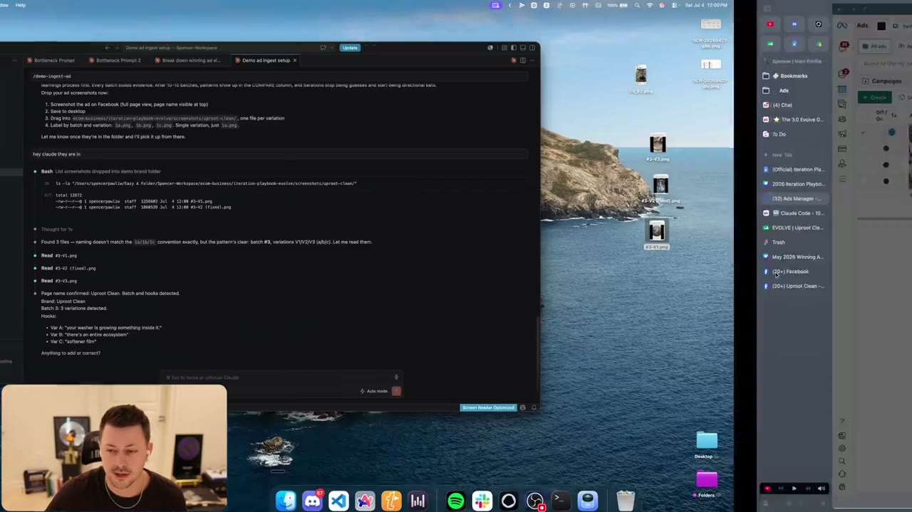
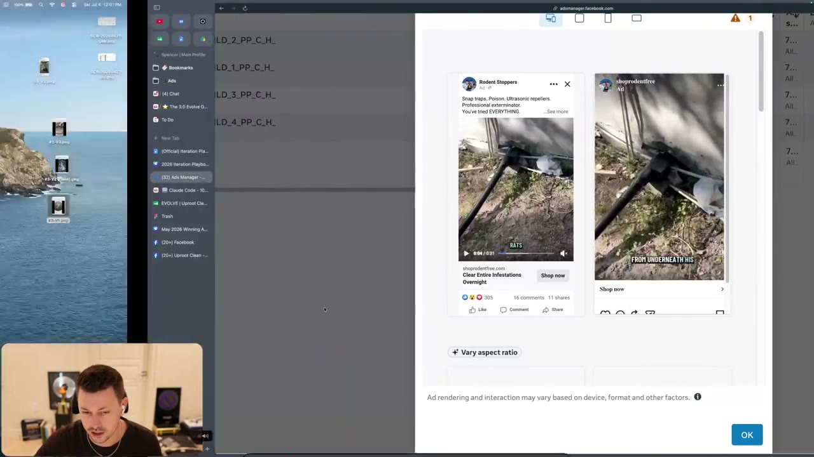
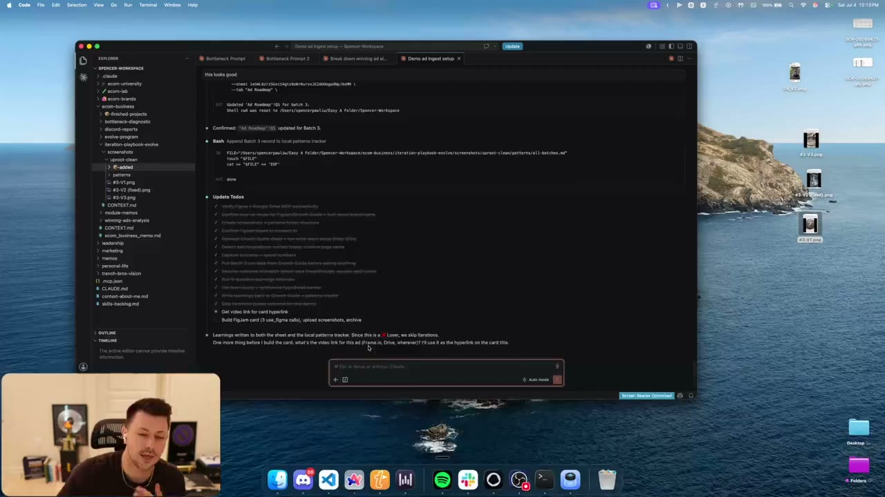

# 47. Claude Code - 10 Step Iteration Process
> A live demo of a Claude Code skill (the page calls it `/ad-iteration`; the demo copy is `/demo-ingest-ad`) that walks you through the learnings steps for one ad and writes the result into the Growth Guide, a local patterns folder and a FigJam board, plus a DOCX "Video Ad Winner - Iteration Playbook" listing 22 named iterations with priorities.

## 🤖 Agent use
- **Use when:** you want an agent to run the learnings half (steps 1-8) of [the 10 step process](46-the-10-step-iteration-process.md) for an ad, store the learnings, and propose iterations; or you need the canonical list of iterations for a winning video ad.
- **Inputs → outputs:** screenshots of the ad (one file per hook variation, labelled by batch/variation), outcome, ad spend, campaign spend, Growth Guide row (Google Sheet), optional FigJam board and video link → learnings written to the Growth Guide and a local `patterns` tracker, a card on the FigJam board, and (for winners) an iteration list drawn from the DOCX playbook.
- **Rules:**
  - **DO** have two things before starting: the Growth Guide (Google Sheet, or the same data in ClickUp/Notion via MCP) and a paid Figma account if you want the FigJam board built by the agent. [00:00-01:32]
  - **DO** screenshot the ad from Ads Manager preview (full page view, page name visible at top), once per hook variation, and rename each file by batch and variation, e.g. batch 59 hook two = `59_v2`. [00:58-01:32; screenshot at 04:05]
  - **DO** tell the agent every hook verbatim, including any voiceover hook that differs from the on-screen text; the agent reads on-screen text from screenshots and asks whether other hooks (e.g. voiceover) were present. [03:17-04:41]
  - **DO** give outcome, ad spend (from the ad) and campaign spend (from the campaign level). Demo values: ad "$500", campaign "$25,000". [04:41-05:12]
  - **DON'T** trust the agent blindly: "Claude is not always 100% right". Example: the Growth Guide planned problem aware; the agent said the hook reads unaware; the instructor commented that "your washer is growing something inside of it" is more of an unaware hook (Whisper wrote "underwear") and accepted the move to unaware. He also noted the agent only sees the screenshot and hook, so it is testing and questioning you. [05:12-05:55]
  - **DO** use this full 9-question review for spend winners and breakthroughs; on losing ads you may tell the agent to skip steps and give a "brain dump" instead. [08:14]
  - **DON'T** let the agent skip iterations just because the ad is a loser: "You're not going to always skip iterations just because it's a loser." (see [48](48-how-to-iterate-on-losing-ads.md)). [09:07]
  - **DO** store learnings in a `patterns` folder so later script-writing can mine them. [10:59-11:46]
  - **DO** keep client information out of shared skills: the demo skill is a re-created copy because the original surfaced client data (NDAs). [00:00]
- **See also:** [46. The 10 step process](46-the-10-step-iteration-process.md) · [48. Losing ads](48-how-to-iterate-on-losing-ads.md) · [49. KPI winners](49-how-to-iterate-on-kpi-winners.md) · [50. Spend winners](50-how-to-iterate-on-spend-winners.md) · [51. Breakthroughs](51-how-to-iterate-on-breakthroughs.md) · [Iteration vs variation](../../../../concepts/iteration-vs-variation.md)

Lesson page text: Canva deck link; the Claude skill folder on Google Drive ("Claude Skill (Now called: /ad-iteration)"); a Claude Code setup video (YouTube, by "Zach"); and "Video I Mentioned Of Me Actually Doing The Learnings on the ad" (YouTube). The skill files themselves are not in the course files; the DOCX is.

## Key ideas

### Demo setup [00:00-01:32]
- Recorded as "a cold start": a copy of the skill named `/demo-ingest-ad` ("the actual skill will be slash ingest add"). The page says the skill is now called `/ad-iteration`. [00:00]
- Prerequisite 1: the Growth Guide, "the number one tool that is going to unlock growth for you". If you don't have it, watch "how to plan ads". Other tools can connect via MCP. [00:00-00:58]
- Prerequisite 2 (optional): a paid Figma account; "Claude will prompt you on how to do that". [00:58]
- Pull the ad from your ad account: click Preview, watch it zoomed in, play it, take a photo (screenshot) at the hook, save, and rename by your Meta naming scheme. "This would be batch number 59 v2 because it's hook two", i.e. `59_v2`; repeat for all three hook variations. [00:58-01:32]
- Demo brand: Uproot Clean (instructor says they don't actually work with them; it is a demo brand). [01:32]

### What the skill does, in order [01:32-11:46]
1. **MCP check.** It checks you have the right MCP servers set up (Figma, Google Drive) and walks you through setup if not. [01:32]
2. **Folder creation.** Creates local folders: a `screenshots` folder, the brand folder (`uproot-clean`), an `added` folder (archive) and a `patterns` folder. [02:28]
3. **Connect FigJam and Growth Guide.** Asks whether to reuse the Figma board (creates one if you have none) and for the Growth Guide share link (already connected in the demo). [02:28]
4. **Reminder.** Says to do learnings before iterations, then asks you to drop screenshots (instructions below). [02:28-03:17]
5. **Hook extraction.** Reads the hooks off the screenshots ("your washer is growing something inside of it") and asks "were there any other hooks on screen at this point?". You add voiceover hooks verbatim, e.g. "ultimate way to get rid of rat infestation" and "this homeowner didn't believe it was going to suck out all of the rats". [03:17-04:41]
6. **Outcome and spend.** "What was the outcome of this batch?" (demo answer: loser, though the instructor thinks it was actually a breakthrough), "how much did it spend?" ($500) and campaign spend ($25,000), pulled from the ad account at ad and campaign level. [04:41-05:12]
7. **Component review against the Growth Guide.** Pulls the batch row, then asks one question per component with "planned vs hypothesis". Demo outcomes: [05:12-08:14]
   - Awareness: planned problem aware, agent hypothesis "reads more unaware" -> instructor agrees, "this was a mistake", moves to unaware. [05:12-05:55]
   - Valence and intensity: agent says negative valence, moderate-high intensity from hook and bridge tone; instructor agrees "zone two rather than zone four". [06:31]
   - Desire: planned clean washing machine; agent says ad promises protecting your health ("health and safety that's fine"); aligned. [06:31]
   - Avatar: planned "a pet owner with a washing machine that smells bad"; hook speaks more broadly; the rest of the ad may speak to pet owners. [06:31-07:22]
   - Angle, mechanism, belief ("the grandfather authority figure"), positioning (skipped as an advanced item), urgency ("strong because we say it will get worse later in the ad"). [07:22-08:14]
8. **Brain dump.** You type your raw learnings; the agent "will correct the hypothesis and kind of condense it" into a clean learning, which you approve ("this looks good") before it writes it. The instructor pasted notes from a transcript of his own review (video on YouTube). [08:14-09:07]
9. **Write-back.** With the MCP set up, learnings are automatically added to the Growth Guide sheet; also appended to a local patterns tracker. Then "the learnings are written ... we skip iterations because this is a loser". [09:07-09:41]
10. **Video link and FigJam card.** Asks for the video link (Frame.io or Drive) so it can be the card hyperlink, then builds a card on the FigJam board in the section for the outcome (loser section here). If the format is off, "take a screenshot of this and say 'hey Claude reference this'". [09:41-10:59]
11. **Housekeeping.** Screenshots are moved into the `added` folder so you can drag in the next ad's screenshots; learnings are stored in `patterns`. Ask "did you store my learnings in the patterns folder?" if you don't see it. Patterns are intended for later script writing. [10:59-11:46]

### Ad shown [04:34]
- Facebook preview of a pest/rat product ad used as the demo ad: a two-frame video preview with on-screen text "ULTIMATE WAY TO GET RID OF A RAT INFESTATION!" (a different ad from the one reviewed; the instructor says "these are just random screenshots which is why these hooks are weird"). [04:05-04:41]

### Closing [11:46-12:46]
- "This is the only cloud code video I did for now." Next lessons break down each outcome type. He says he is still learning, the skill may need scrubbing for security. [11:46-12:46]

## Steps / framework

Workflow of the skill (derived from the demo; step names from the skill's on-screen to-do list, partly blurred):

| # | To-do item shown on screen (legible parts) | Maps to course step |
|---|---|---|
| 1 | Verify Figma + Google Drive MCP connectivity | setup |
| 2 | Confirm new-vs-reuse for FigJam / Growth Guide + lock demo brand name | setup |
| 3 | Create screenshots + patterns folder structure | setup |
| 4 | Confirm FigJam board to connect to | step 8 |
| 5 | Connect Growth Guide sheet + run write-back setup | step 5 |
| 6 | Detect batch/variations, extract hooks, confirm page name | steps 1, 4 |
| 7 | Capture outcome + spend numbers | step 2 |
| 8 | Pull Batch 3 row data from Growth Guide before asking anything | step 5 |
| 9 | Resolve outcome mismatch (sheet says Breakthrough, session said Loser) | step 2 |
| 10 | Run 9-question learnings interview | step 5 |
| 11 | Get brain dump + synthesize hypothesis banner | step 6 |
| 12 | Write learnings back to Growth Guide + patterns tracker | step 6 |
| 13 | Skip iterations (loser outcome for this demo) | step 9 (not recommended for losers) |
| 14 | Get video link for card hyperlink | step 7 |
| 15 | Build FigJam card (3 use_figma calls), upload screenshots, archive | step 8 |

### Winning video ad iteration playbook (DOCX "Video Ad Winner - Iteration Playbook")
First the identify block, then three groups of iterations. The identify block is filled in for the Uproot Clean video (Facebook reel https://www.facebook.com/reel/944136188548580).

**Identify (8 questions):** desire; avatar; angle (the problem we are solving); mechanism; authority building trust; market awareness level; emotion (valence + intensity); what we are doing differently (positioning).

**Uproot Clean video worked example (DOCX):**

| Question | Answer in the DOCX |
|---|---|
| Desire | "I want to have a clean washing machine → Why? → Because it's making my clothes smell bad → Why (do you care if they smell bad)? → Because the whole point of cleaning your clothes is for them to smell good → Why? → well if they smell bad, that could be a sign of a health hazard" |
| Avatar | Pet owner with a washing machine that does not smell good. Experiences: clothes musty for months; house smells like damp fur. Behaviors: trying different detergents; scrubbing the inside rubber with bleach; hot cycles with vinegar; extra rinse cycles; they tried SPECIFIC BRAND. Emotions: frustrated, gross. Demographic: pet owner |
| Angle | Will fix the bad smell coming from your washing machine |
| Mechanism | Enzyme Tablet -> further explained as well |
| Authority | The 30-year washing machine Grandpa; the language used; unaware parts in the video (explaining the deep-down details) |
| Awareness | Solution Aware -> Unaware parts later in the video |
| Emotion | Low Valence, Low Intensity |
| Positioning | The enemy is surface-level washing machine cleaners; positioning is first-and-only enzyme-based cleaning tablet |

**Hook & Script Iterations** (all text from the DOCX; priority as marked):

| # | Name | Description | Priority |
|---|---|---|---|
| 1 | Winning Hook Remake | Remake with the winning hook in the ad account. Keep what worked, fix what was sloppy. | High |
| 2 | Extended Problem Section | Create a version with a longer problem/agitation section. Go deeper on the pain, add more specific pain points, make the viewer feel it more before presenting the solution. | High |
| (unnumbered) | Awareness levels test | Create variations for higher/lower awareness levels | (none) |
| 3 | In media res | Start the ad with the unique mechanism (show don't tell). Get straight to the point in the first 5 seconds of the ad, start with the ideal outcome, then start explaining how we got there | Medium |
| 3 | Overcoming Objections | Pull real objections from comments under the ad. Create a new variation that naturally overcomes those objections within the script - don't make it obvious, just weave them in. | High |
| 4 | Comment Reply Hook | Use a real comment or objection as the hook (screenshot of the comment), then play the winning ad as the "reply." | High |
| 5 | Dumber Version | Convert the script to natural spoken language. Add filler words, pauses, casual phrasing. Make the script way dumber - it should feel too simple. | Medium |
| 6 | Add Soft CTAs | Add soft CTAs throughout the ad | Medium |
| 7 | Negative Framing | Flip the entire ad to argue AGAINST the product sarcastically, "Honestly, don't buy this. Here's why..." then disprove each point. | Medium |
| 8 | Turn Script Into Framework, Test diff sub avatars | Keep the winning script but rewrite/adjust for a completely different customer avatar (different age, life stage, use case). | Medium |

**Format & Style Iterations**

| # | Name | Description | Priority |
|---|---|---|---|
| 9 | VO <-> Text-on-Screen | If original had voiceover, test a text-on-screen only version. If original was text-on-screen, test a voiceover version. | High |
| 10 | Organic/Ugly Edit | Re-edit the ad with ugly, simple editing like a normal person would make. Raw, native, unpolished. | High |
| 11 | VSL Expansion | Expand the core idea into a longer-form VSL style ad. Go deeper on education, mechanism, and proof. | High |
| 12 | AI Animation Version | Take the winning script and create an AI-animated version. Different visual style, same message. | Medium |
| 13 | Podcast Style | Reformat the winning script into a podcast-style conversation between two people discussing the topic. | Medium |
| 14 | New Location/Setting/Vibe | Same script and concept, different visual environment. New room, outdoor vs. indoor, different backdrop. | Medium |

**Scaling & Stacking Iterations**

| # | Name | Description | Priority |
|---|---|---|---|
| 15 | Stack Winners Mega-Ad | Combine 3-4 winning video clips/hooks into one longer compilation ad. | Medium |
| 16 | UGC Creators | Get 2-3 different creators to execute the same winning concept & script in their own style. Vary age, gender, energy. | High |
| 17 | Founder/Authority Delivery | Have the brand founder or an authority figure (vet, doctor, expert) deliver the winning script. | Medium |

**Emotional Testing**

| # | Name | Description | Priority |
|---|---|---|---|
| 18 | Valence/Intensity Test | Shift the emotional tone of the winning ad. If positive → try fear/guilt. If negative → try aspirational. If intense → dial it down. If mild → crank it up. | High |
| (unnumbered) | Self discrepancy test | Create variations for the different versions of self (ideal self, ought self, actual self) | (none) |

**Cross-Format Iterations**

| # | Name | Description | Priority |
|---|---|---|---|
| 19 | Static Ad Extraction | Pull the single strongest moment/claim from the video and turn it into a static ad. | High |
| 20 | First Frame Static Ad | Take the first frame of the ad, come up with some copy based on the script, and turn that into a static ad | Medium |
| 21 | Native Ad | Create a static ad with primary copy that mirrors the winning video script. Feels like organic content, not an ad. | Medium |
| 22 | Static Ad + Congruent LP | Create a static version of the winning concept AND build a landing page that matches the specific angle/messaging. | High |

## Examples
- **Hook read from screenshots (demo, batch 3, 3 variations):** Var A "your washer is growing something inside it."; Var B "there's an entire ecosystem"; Var C "softener film". [04:05 screen; transcript names only the first]
- **Voiceover hook added by the user:** "ultimate way to get rid of rat infestation"; "this homeowner didn't believe I was going to suck out all of the rats". [04:05-04:41]
- **Mismatch caught:** growth guide planned problem aware; agent says "this one reads more unaware" -> instructor: "this was a mistake". [05:12-05:55]
- **Growth Guide rows on screen** (Uproot Clean Growth Guide 3.0): batch 3 "Grandpa Washer VSL", sub-avatar "Pet owner with a washing machine that does not smell good", angle "Will fix the bad smell coming from your washing machine", awareness "Problem Aware"; batch 2 memo notes "Negative Framing" ad "that spent close to $280k". [00:37 on-screen]

## Structured units

### Ad teardowns
| Brand / product (niche) | Format | Hook / opening | What works | What fails | Fix suggested | Principle | Source |
|---|---|---|---|---|---|---|---|
| Uproot Clean (enzyme washing-machine tablet, home cleaning) | Video (VSL-style UGC; Facebook reel) | Hook varies by variation; "your washer is growing something inside it" (Var A) | Grandpa authority (30-year washing machine expert); enzyme-tablet mechanism; low valence, low intensity; enemy = surface-level cleaners; first-and-only enzyme tablet positioning; urgency "it will get worse" | In the demo: awareness drift (planned problem aware, hook reads unaware); hook speaks broadly rather than to pet owners | Move awareness label to unaware for that hook; carry pet-owner call-out further into the ad | Check execution against plan before judging the idea | DOCX identify block; [05:12-07:22] |

### Rewrites
| Before | After | What changed | Source |
|---|---|---|---|
| Winning script as is | Same script voiced by founder/vet/doctor | Authority/speaker | DOCX #17 |
| Polished winning video edit | Ugly, simple, native re-edit | Production style | DOCX #10 |
| Voiceover ad | Text-on-screen only (or reverse) | Delivery channel | DOCX #9 |
| Positive tone ad | Fear/guilt version (or negative -> aspirational; intense -> mild; mild -> intense) | Valence / intensity | DOCX #18 |

### Rules of thumb
- **DO** list the planned component values in the Growth Guide before launch so there is something to check against. [08:42-09:20]
- **IF** you have a loser **THEN** still run the review or give the agent a brain dump; "the process ... really is for spend winners and breakthroughs" but use it on losers too if you struggle to make winners. [08:14]
- **DO** treat the agent's hypotheses as suggestions to accept, edit or reject. [05:12-06:31]

## Prompts / templates (verbatim)
Skill invocation as shown on screen (first screenshot is `/demo-ingest-ad`; the page names the production skill `/ad-iteration`):

```
/demo-ingest-ad
```

Skill message at [04:05] (read from the screenshot; the first line is cut off at the top of the frame):

```
... learnings process first. Every batch builds evidence. After 10-15 batches, patterns show up in the COMPARE column, and iterations stop being guesses and start being directional bets.
Drop your ad screenshots now:
1. Screenshot the ad on Facebook (full page view, page name visible at top)
2. Save to desktop
3. Drag into ecom-business/iteration-playbook-evolve/screenshots/uproot-clean/, one file per variation
4. Label by batch and variation: 1a.png, 1b.png, 1c.png. Single variation, just 1a.png.
Let me know once they're in the folder and I'll pick it up from there.
```

User reply on screen: `hey claude they are in`. Skill reply (verbatim from screen): "Found 3 files - naming doesn't match the 1a/1b/1c convention exactly, but the pattern's clear: batch #3, variations V1/V2/V3 (a/b/c). Let me read them." then "Page name confirmed: Uproot Clean. Batch and hooks detected. Brand: Uproot Clean / Batch 3: 3 variations detected. Hooks: Var A: "your washer is growing something inside it." Var B: "there's an entire ecosystem" Var C: "softener film" / Anything to add or correct?"

File structure shown in the editor explorer [09:41] (workspace root "Spencer-Workspace"):

```
ecom-business/
  iteration-playbook-evolve/
    screenshots/
      uproot-clean/
        added/            (archive of processed screenshots; shown as "-added")
        patterns/
          all-batches.md  (appended by the skill per batch)
        #3-V1.png
        #3-V2 (fixed).png
        #3-V3.png
    CONTEXT.md
```

Command the skill ran to append the batch record (verbatim from screen, partial):

```
FILE="/Users/spencerpawliw/Easy A Folder/Spencer-Workspace/ecom-business/iteration-playbook-evolve/screenshots/uproot-clean/patterns/all-batches.md"
touch "$FILE"
cat >> "$FILE" << 'EOF'
```

The sheet write used `--tab "Ad Roadmap"` ("Updated 'Ad Roadmap'!Q5 for batch 3."). The skill's own prompt text (SKILL.md) is not in the course files (it is in the linked Google Drive folder).

## Screenshots

*The `/demo-ingest-ad` skill: screenshot instructions, file naming, folder path, and the detected hooks Var A/B/C. [04:05]*


*Ads Manager preview of the demo ad (a different pest-control video ad), the kind of frame you screenshot for the hook. [04:34]*


*End of the skill run: completed to-do list (outcome mismatch, 9-question learnings interview, write-back, build FigJam card) and the local folder layout. [09:41]*

## How to apply
- [ ] Install/obtain the skill (Drive folder linked on the lesson page) and connect the Google Sheet and Figma MCPs, or replicate the steps manually via [46](46-the-10-step-iteration-process.md).
- [ ] Screenshot each hook variation; name files `<batch>_v<n>`; drop into the brand's screenshots folder.
- [ ] Supply verbatim hooks (text + voiceover), outcome, ad spend, campaign spend.
- [ ] Answer the nine component questions against the Growth Guide row; correct the agent where it misreads awareness or avatar.
- [ ] Give a brain dump; approve the condensed learning before write-back.
- [ ] For winners, pick iterations from the DOCX table in priority order (High first); for losers see [48](48-how-to-iterate-on-losing-ads.md).
- [ ] Confirm learnings landed in `patterns/`.

## Related
- Previous: [46. The 10 step iteration process](46-the-10-step-iteration-process.md) · Next: [48. How to iterate on losing ads](48-how-to-iterate-on-losing-ads.md)
- [Iteration vs variation](../../../../concepts/iteration-vs-variation.md) · [Creative testing system](../../../../frameworks/creative-testing-system.md)

## Cross-course notes
- The DOCX list mixes Tether Lab-style moves (valence/intensity test, "self discrepancy test" = ideal/ought/actual self, see [Three selves](../../../../concepts/three-selves.md)) with Evolve's own (remake, extended problem, ugly edit, VSL expansion). Tether Lab ([Iteration vs variation](../../../../concepts/iteration-vs-variation.md)) keeps the *core message* fixed and varies format/primitive; Evolve's list also changes the message structure (negative framing, new sub-avatar, extended problem). Treat Evolve's list as broader.
- Both say static -> video and video -> static moves are valid iteration paths (Evolve #19-22; Tether format ladder in [Creative testing system](../../../../frameworks/creative-testing-system.md)).
- Evolve adds "dumber version" (script should feel "too simple") and "ugly edit", which echo its writing rules; Tether Lab does not prescribe these.

## Sources and limitations
- Transcript: [47. Claude Code - 10 Step Iteration Process….txt](<../../../../../raw/evolve/copywriting/_transcripts/✍️ Evolve Copywriting (NEW)/47. 🆕 Claude Code - 10 Step Iteration Process ✍️ Evolve Copywriting (NEW) Evolve.txt>) · Page text: [….html.md](<../../../../../raw/evolve/copywriting/_extracted/✍️ Evolve Copywriting (NEW)/47. 🆕 Claude Code - 10 Step Iteration Process_✍️ Evolve Copywriting (NEW)_Evolve.html.md>) · DOCX: [47. How To Do Iterations + Long Q&A.docx.md](<../../../../../raw/evolve/copywriting/_extracted/✍️ Evolve Copywriting (NEW)/47. How To Do Iterations + Long Q&A.docx.md>)
- Machine transcription: "cloud code"/"clause skill" = Claude Code/skill; "slash demo ingest add" = `/demo-ingest-ad`; "prom aware" = "problem aware"; "Chad way" probably "chat way"; "underwear hook" probably "unaware hook".
- Full recording covered (last segment 12:45 of 12:46).
- The terminal text in the video is small and partly blurred by the instructor (client information). Only text legible at zoom in frames at 04:05 and 09:41 is reproduced; the middle of the review dialogue (05:12-08:14) is covered from narration only. Parts of the to-do list are struck-through and low contrast, so wording there may be slightly off.
- Pandoc dropped the DOCX header/empty cells: the extraction `.md` showed empty "Scaling & Stacking", "Emotional Testing", "Cross-Format" tables, but their rows are present in the DOCX XML and are reproduced above from the original file. The DOCX title says "Long Q&A", but the file contains no Q&A section.
- Not included in the course files: the skill's SKILL.md and the YouTube videos linked on the page.
