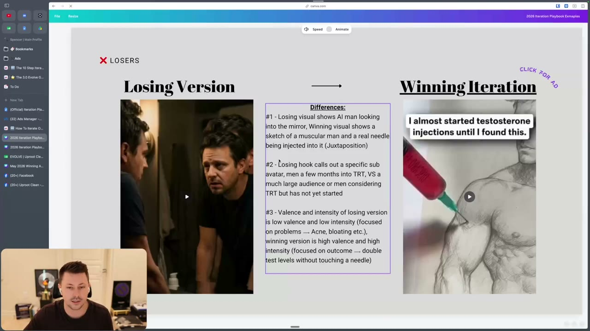
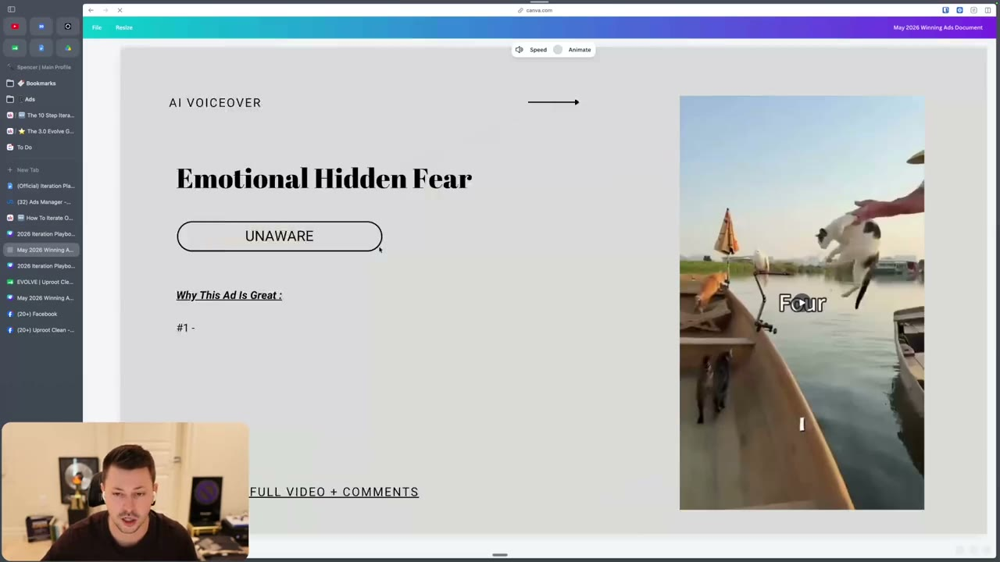
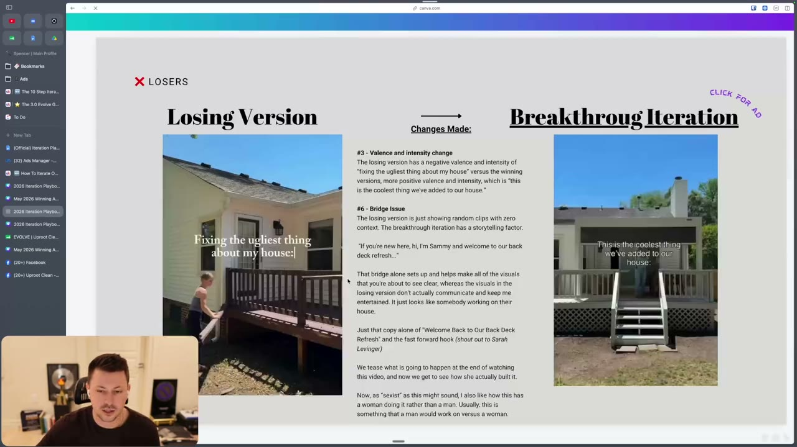
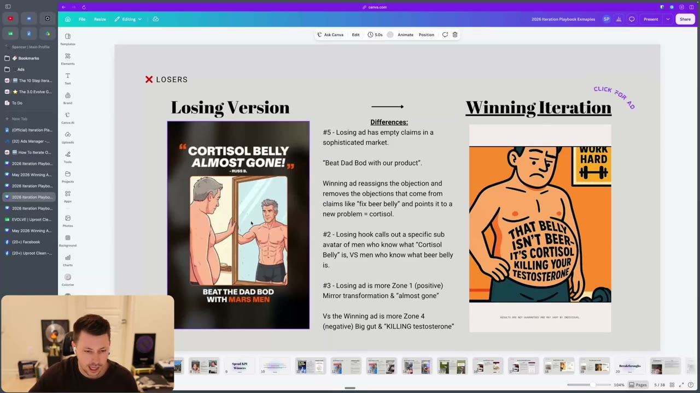
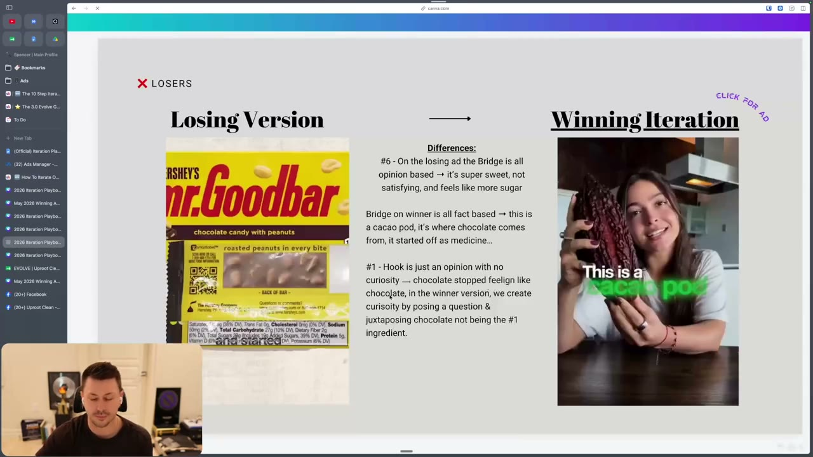
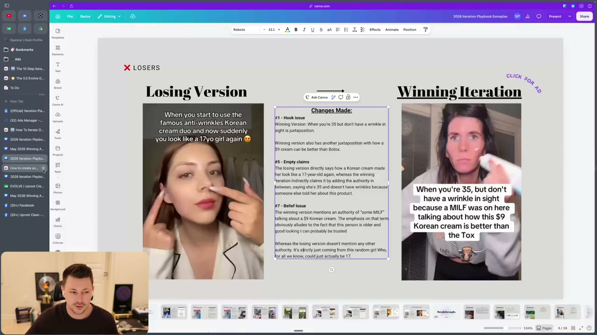

# 48. How To Iterate On Losing Ads
> A loser is an ad with no significant spend and no KPI hit, usually because the hook did not stop the scroll; diagnose which of eight issues (hook, TAM, too broad, valence/intensity, audience-signalling visuals, empty claims, bridge, belief, offer) caused it, and only re-make it when you have evidence for a specific fix.

## 🤖 Agent use
- **Use when:** an ad is labelled a loser (see [45](45-overview-of-iteration-section.md)) and you must decide whether to iterate it and what to change; also when auditing a draft hook/bridge before launch.
- **Inputs → outputs:** the loser's hook (verbatim), hook rate, learnings from [46](46-the-10-step-iteration-process.md), ad type (ideation / iteration / imitation) → decision (iterate or move on) + a short list of fixes from the eight issue types, each with a before/after.
- **Rules:**
  - **DO** define a loser as an ad that "doesn't pull significant spend and also doesn't hit KPI". Meta did not want to spend on it and even the little spend did not purchase: "nobody cared about the ad". [00:39]
  - **DO** assume the hook first: "the majority of time when you create a losing ad, it's due to the fact that the hook just simply did not grab the person's attention." [00:00-00:39]
  - **DO** treat **hook rate below 30%** as "it just didn't grab a person's attention". The instructor's benchmark is "less than 30%", but "we have had breakthroughs with 30% hook rates", so soft metrics are not "the end all be all". [00:39-01:27]
  - **IF** the ad is an **ideation** loser **THEN** you may re-try the idea 2-3 more times, but only with new evidence of why it failed and how the new execution differs. [02:18-03:11]
  - **IF** the ad is an **iteration** (from a winner) and it lost **THEN** compare against the winning original and identify what went wrong in execution: "regardless of how you feel, you made the ad worse, or you didn't make it different enough for Meta to really care." Keep iterating; one failed iteration does not end it. [03:11-04:00]
  - **IF** an iteration of a losing ad also loses **THEN** ask whether you have new evidence; if not, stop. [04:00]
  - **DON'T** iterate losing **imitations** ("we usually do not do iterations on losing imitation ads, especially if it's a visual thing"); move on. It is a habit, not a ban: "it doesn't mean you can't". [04:00-04:59]
  - **DON'T** iterate if you did not do the learnings: "If you didn't do learnings, don't do another iteration. It doesn't make sense." [04:59]
  - **DO** put smaller-TAM angles in a separate campaign (CBO or ABO) so they do not compete with the big-TAM scaling angles, but only if you spend at scale (lesson page: below $3k/day it is "likely cope"; video suggests 10k/day is a better benchmark). [06:43-08:31]
  - **DON'T** go broad unless your direct response copy is strong; sub-$100-200K/month brands should go narrower. [08:31-09:17]
- **See also:** [46. The 10 step process](46-the-10-step-iteration-process.md) · [49. KPI winners](49-how-to-iterate-on-kpi-winners.md) · [Hook framework](23-the-framework-behind-great-hooks.md) · [Beliefs](15-why-you-need-to-understand-beliefs.md) · [Bridge](27-how-to-write-a-bridge.md) · [Iteration vs variation](../../../../concepts/iteration-vs-variation.md)

## Key ideas

### What a loser is and why ads lose [00:00-02:18]
- Page text, "Problem We're Trying To Solve: The ad isn't getting breakthrough levels of spend or hitting KPI." Video: "this ad isn't getting any spend. It's not hitting KPI". [00:00]
- Most common reasons (page text list, expanded in the video): [01:27]
  1. Hook did not grab attention (usually less than 30% hook rate).
  2. The overall angle was off: too niche, too broad, "nobody cares", though "a lot of the times it's not an angle issue. It's an execution issue". [00:39-01:27]
  3. **Unaware:** "too much of a wild card ... a really big swing" with execution not good enough to land. [01:27]
  4. **Problem/Solution aware:** the hook was not relatable, the problem was not painful enough, or the copy was "super basic". Example: for low testosterone, a hook "do you have low testosterone?" is "the most obvious thing that people think of", not creative, especially without a good visual. [01:27]
  5. **Product/Most aware:** the offer is not competitive and the differentiation is not clear. [01:27]

### Which loser types get iterated [02:18-04:59]
| Ad type | Iterate on a loser? | Condition |
|---|---|---|
| Ideation | Yes, "2-3 more times" | Must have evidence for a new version, e.g. learnings show "no authority", "entire ad is opinionated, there's no facts"; new evidence needed each time |
| Iteration (of a spend winner or breakthrough) | Yes | Identify what went wrong in execution vs the winner |
| Imitation | Usually no | "We just haven't seen winners come from trying different versions of imitations"; e.g. a FaceTime format that failed: don't try another version |

### The eight issue types (names as on the lesson page) [04:59-19:00]
The instructor works through each with a Canva slide pair "Losing Version -> Winning Iteration" from the "2026 Iteration Playbook Examples" deck. Details in Examples and Ad teardowns below.

| # | Issue | Fix to try | Example pair |
|---|---|---|---|
| 1 | Hook issue #1 (hook not engaging; visual neither contrasts nor matches the message) | Make the hook more engaging; use visuals that contrast with or are congruent with the message to create curiosity ("the number one reason why ads are losers is usually because the hook") | TRT: AI man in mirror vs sketch of needle into a muscular man [05:39] |
| 2 | TAM issue (angle/messaging/labels too niche) | Widen to a larger TAM, or run the niche angle in a separate CBO/ABO campaign | "Men on TRT not happy" vs "men considering TRT" [06:43] |
| 2.5 | Broad issue (too broad and copy not strong enough) | Narrow, or upgrade DR copy and visuals | Weak: "For men who struggle with hair loss you need this!", "Want to lose weight? This is the #1 doctor recommended". Strong broad: cat-rescue ad "I've had four cats in my life" [08:31-10:49] |
| 3 | Valence & intensity issue | Flip valence (positive <-> negative), dial intensity up or down | TRT negative vs positive; deck "ugliest thing" vs "coolest thing" [10:49-12:57] |
| 4 | Hook issue #2 (visuals/messaging don't tell Meta which audience to serve) | Use visuals that make the audience obvious; "much more common now with Andromeda" | mirror man vs needle + muscular man [12:57] |
| 5 | Empty claims in a sophisticated market | Replace the claim with new information/redirect a prior belief | "Beat the dad bod" vs "That belly isn't beer, it's cortisol killing your testosterone" [13:54-14:51] |
| 6 | Bridge issue | Replace opinion with facts that keep the hooked viewer | Chocolate: opinions vs cacao pod facts [14:51-16:50] |
| 7 | Belief issue | Add authority and/or script to prevent objections and earn trust | Korean cream: "some MILF" authority [16:50-18:22] |
| 8 | Offer issue | Study price objections and the offer training; price-to-value is off | not an ad edit, "an iteration outside of the ad" [18:22-19:00] |

### 1. Hook issue #1 [04:59-06:43]
- Instructor's pair: losing visual is "AI man looking into a mirror" with text "I was four months into TRT"; the winner shows "a needle going into this jack dude. That's a sketch" with "I almost started testosterone injections until I found this". "There's curiosity, there's juxtaposition ... suspense for someone to watch the rest of the video." [05:39-06:43]
- He uses other brands' ads because client ads can't be shown anymore. [05:53]
- Training reference: "the entire Evolve hook training" ([23](23-the-framework-behind-great-hooks.md), [24](24-the-2-types-of-hooks.md), [25](25-the-2-ways-to-write-great-hooks.md)). [05:39]

### 2. TAM issue and the separate-campaign note [06:43-08:31]
- Narrow angle resonates with some people but "probably too narrow of a group to scale or it's too narrow in comparison to what you already have scaling in your account". [06:43]
- Note: if the niche angle can scale but "just won't be able to scale as far as your current winners", test it in a separate CBO or ABO "so it's not competing with your way bigger TAM or way more at-scale campaign". [06:43]
- Applicability: "this is really only for people that are at more scale. I say 3k per day, but I would say, you know, even like 10k per day is probably a better benchmark." Reason: "if you have an angle that's at 10k or 15k per day, you should probably still focus on that angle". His brands spend "40, 50K a day on a specific angle", so another product/angle may be segmented. [07:41-08:31] The page text says: "if you are not spending at least $3k/day, this is likely cope."
- TRT logic: men considering TRT (not on it) is a much bigger group than men already on it; "four months in" is also very specific. [08:31]

### 2.5 Broad issue [08:31-10:49]
- Too broad "and your copy is not strong enough to capture attention of the masses": "If you are not confident in your direct response copy skills, do not go this broad." That is why the course has avatar training and why brands "sub 100K per month, sub 200K per month" are told to go narrower (narrow works better with weaker copy; broad "does work for brands at much more scale"). [08:31]
- Unaware or broad promo ads "are very hard to create". [09:17]
- Strong broad example: a cat ad opening "I've had four cats in my life and I'm embarrassed to say I just learned this" with a video of a man throwing cats into a boat. Copy is "optimized and dialed", the visual "is going to grab a lot of attention". Slide: "Emotional Hidden Fear", market awareness UNAWARE, AI voiceover, from "May 2026 Winning Ads Document". [09:17-10:49; slide 09:51]

### 3. Valence and intensity [10:49-12:57]
- Credit: Sarah Levinger (page text spells "Levinger"; the audio says "Levenger"). "This is when your ad could be saying the right thing, but it isn't converting because it just doesn't feel right to the customer." [10:49]
- Rules: positive ad -> try the inverse (more negative; page: fear/guilt); negative ad -> try feel-good/aspirational; super intense -> dial down; boring (very common) -> crank up intensity, raise the stakes. [10:49]
- TRT pair: "Four months into TRT when I caught my reflection and didn't recognize the guy looking back. Acne across my shoulders. Face looked bloated." (negative, sad) vs "I almost started testosterone injections until I found this. Let me show you how I doubled my testosterone levels without touching a needle." (more exciting, positive). [10:49-11:46]
- Winners often cluster in a valence/intensity level; if you have a winner, "you can try to just stay in that zone, especially for that specific avatar". [11:46-12:18]
- Deck pair: "Fixing the ugliest thing about my house" (negative, boring) vs "This is the coolest thing we've added to our house" (positive, high intensity). "Even just adding a word like 'ever' can make it even more intense" (he is paraphrasing "coolest thing we've ever added"). [12:18-12:57]
- Follow-up call recording on valence/intensity is linked from the page (not in these files).

### 4. Hook issue #2: tell the algorithm who to serve [12:57-13:54]
- "You didn't use proper visuals and messaging to tell Meta's algorithm and the delivery system which audience to serve your ad to. This is much more common now with Andromeda." Mirror man "could be anything"; needle into a muscular man "is going to be about muscles and steroids". [12:57]

### 5. Empty claims [13:54-14:51]
- "Probably one of the biggest things, especially if you have a decent hook rate or your hook has stopped someone, but it's just not converting." Claims with zero proof/facts/authority in a sophisticated market will not be believed even if it is exactly what people want. [12:57-13:54]
- Pair: "Beat the dad bod with Mars Men" (a claim) vs a static that makes no claim: "That belly isn't beer. It's cortisol killing your testosterone": new information so "now they want to learn more". Claims come later in the advertorial. [13:54-14:51]

### 6. Bridge issue [14:51-16:50]
- A great hook but an awkward bridge loses the attention. "The bridge section is usually a make or break on how much of that attention stays on the ad." [14:51]
- Chocolate pair: losing bridge is all opinion ("chocolate is way too sweet. It's not really satisfying. It feels more sugary" which he mocks: "Whenever I eat a Snickers, I'm pretty happy"); winning bridge is fact-based ("this is a cacao pod, this is where chocolate comes from. It started as medicine", "What is the number one ingredient in most chocolate bars? I'll give you a hint. It's not cacao."). [15:30-16:18]
- Why it works: early in an ad "someone's looking for a reason to scroll off ... they want a reason to object because they know it's an ad". Facts teach, opinions invite objection. [16:18-16:50] (see [27](27-how-to-write-a-bridge.md), [10](10-why-you-need-to-write-facts.md))

### 7. Belief issue [16:50-18:22]
- "A majority of the time ads fail because they are lacking trust, aka belief." Fix by "adding more authority and/or optimizing your script to prevent objections/earn trust". [16:50] (see [15](15-why-you-need-to-understand-beliefs.md))
- Pair: winner "When you're 35, but don't have a wrinkle in sight because a MILF was on here talking about how this $9 Korean cream is better than the Tox"; the loser "When you start to use the famous anti-wrinkles Korean cream duo and now suddenly you look like a 17yo girl again". The winner's authority is "some MILF" (older, kids, good-looking), the claim does not come from the speaker herself; the loser's speaker "for all we know is actually 17" and makes a direct claim. "That one word is the authority. That's what builds the trust." [17:23-18:22]

### 8. Offer issue [18:22-19:35]
- Study price objections, overcome/prevent them with better offers; offer training is in the Origins program inside Evolve (not in these files). If an ad gets lots of spend but a very low conversion rate, it may be an offer issue. The offer issue "is not really an iteration on the ad. It's more of an iteration outside of the ad." [18:22-18:56]

## Steps / framework
1. Confirm outcome = loser (no significant spend, no KPI hit). [45](45-overview-of-iteration-section.md)
2. Run learnings ([46](46-the-10-step-iteration-process.md)); no learnings -> no iteration.
3. Check ad type: imitation -> usually move on; ideation -> up to 2-3 more tries with new evidence; iteration -> compare to the winning original.
4. Check hook rate (< 30% = hook problem), then go down the issue list in order: hook visual/words (#1), audience signal to Meta (#4), TAM (#2) / broad (#2.5), valence-intensity (#3), claims (#5), bridge (#6), belief (#7), offer (#8).
5. Write the specific change as a hypothesis; launch with the ITER# naming.

## Examples
| Slide | Losing version | Winning/iterated version | Changes named by the instructor |
|---|---|---|---|
| TRT (testosterone) | AI man looking into a mirror; "I was 4 months into TRT" | Sketch of a muscular man with a real needle injected; "I almost started testosterone injections until I found this." | #1 visual juxtaposition; #2 losing hook calls out specific sub-avatar (men a few months into TRT) vs much larger audience of men considering TRT; #3 losing = low valence, low intensity (problems: acne, bloating), winning = high valence, high intensity (outcome: double test levels without a needle) |
| Deck refresh (home improvement) | "Fixing the ugliest thing about my house:" random clips, no context | "This is the coolest thing we've added to our house:" with bridge "If you're new here, hi, I'm Sammy and welcome to our back deck refresh..." | #3 valence/intensity; #6 bridge: losing "just showing random clips with zero context", winner "has a storytelling factor" that "sets up and helps make all of the visuals ... clear"; "welcome back to our back deck refresh" + fast-forward hook (credit Sarah Levinger); teases the end result; woman doing it rather than a man |
| Mars Men dad bod (men's health) | Static "CORTISOL BELLY ALMOST GONE!" - Russ B., mirror transformation, "BEAT THE DAD BOD WITH MARS MEN" | Illustrated static "THAT BELLY ISN'T BEER. IT'S CORTISOL KILLING YOUR TESTOSTERONE" | #5 empty claim vs reassigning the objection and pointing to a new problem = cortisol; #2 losing hook calls a sub-avatar of men who know "cortisol belly" vs men who know what beer belly is; #3 losing is more Zone 1 (positive), winning is Zone 4 (negative) |
| Chocolate (Mr Goodbar vs cacao) | Opinion-based hook and bridge ("chocolate stopped feeling like chocolate, started feeling like candy") | Woman holding a cacao pod: "This is a cacao pod"; "What is the number one ingredient in most chocolate bars? ... It's not cacao" | #6 opinion bridge vs fact bridge; #1 hook is an opinion with no curiosity vs a question juxtaposing chocolate not being the #1 ingredient |
| Korean cream (skincare) | "When you start to use the famous anti-wrinkles Korean cream duo and now suddenly you look like a 17yo girl again" | "When you're 35, but don't have a wrinkle in sight because a MILF was on here talking about how this $9 Korean cream is better than the Tox" | #1 hook (juxtaposition 35 / no wrinkle; $9 cream better than Botox); #5 indirect claim via someone else; #7 authority "some MILF" |

## Structured units

### Ad teardowns
| Brand / product (niche) | Format | Hook / opening | What works | What fails | Fix suggested | Principle | Source |
|---|---|---|---|---|---|---|---|
| TRT / testosterone product (men's health; competitor ad used as example) | Video | Loser: AI man in mirror, "I was 4 months into TRT"; winner: sketch of needle into muscular man, "I almost started testosterone injections until I found this." | Winner: juxtaposition, curiosity, high valence/high intensity, outcome focus, broad TAM, clear audience signal | Loser: unspecific visual, sub-avatar too narrow (4 months in), low valence/low intensity, problem-focused | Curious/contrast visual; address men considering TRT; "doubled my testosterone levels without touching a needle" | Hook + TAM + valence/intensity | [05:39-12:57]; Canva "Losing Version -> Winning Iteration" |
| Home deck refresh (DIY/home) | Video (UGC) | Loser "Fixing the ugliest thing about my house:"; winner "This is the coolest thing we've added to our house:" | Positive, high intensity; bridge sets up the story | Negative, boring tone; random clips, zero context | Add a tease + intro bridge ("welcome back to our back deck refresh") | Valence/intensity; bridge | [12:18-12:57]; slide at 12:27 |
| Mars Men (men's health, cortisol belly) | Static | Loser "Beat the dad bod with Mars Men"; winner "That belly isn't beer. It's cortisol killing your testosterone" | New information instead of a claim; reassigns objection; names a sub-avatar who knows cortisol belly | Empty claim in a sophisticated market; Zone 1 mirror transformation | Redirect the prior belief ("not beer, cortisol") | Empty claims | [13:54-14:51]; slide at 14:41 |
| Chocolate brand (cacao pod ad) | Video (UGC) | Loser "chocolate stopped feeling like chocolate..."; winner "This is a cacao pod" + question | Fact-led bridge, curiosity question | Opinion hook and opinion bridge | Facts and juxtaposition | Bridge | [15:30-16:50]; slide at 15:27 |
| Korean cream (skincare) | Video (UGC) | Winner "When you're 35 but don't have a wrinkle in sight because a MILF was on here ... $9 Korean cream is better than the Tox" | Third-party authority, juxtaposition ($9 vs Botox) | Loser: speaker claims it herself, no authority (could be 17) | Add authority via "some MILF" | Belief | [17:23-18:22]; slide at 18:58 |
| Cat rescue ad (pet; "Emotional Hidden Fear", unaware) | Video (AI voiceover) | "I've had four cats in my life and I'm embarrassed to say I just learned this." | Broad but strong DR copy; visual of a man throwing cats into a boat grabs attention | n/a (positive example of going broad) | n/a | Broad requires skill | [09:17-10:49]; slide at 09:51 |

### Rewrites
| Before | After | What changed | Source |
|---|---|---|---|
| "I was four months into TRT" (AI man in mirror) | "I almost started testosterone injections until I found this." | visual (juxtaposition), promise (outcome), audience (wider), valence/intensity (high/high) | [05:39-06:43] |
| "Four months into TRT when I caught my reflection and didn't recognize the guy looking back. Acne across my shoulders. Face looked bloated." | "I almost started testosterone injections until I found this. Let me show you how I doubled my testosterone levels without touching a needle." | valence negative -> positive, more exciting | [10:49-11:46] |
| "Fixing the ugliest thing about my house" | "This is the coolest thing we've added to our house" | valence negative -> positive, intensity up ("coolest") | [12:18-12:57] |
| "Beat the dad bod with Mars Men" | "That belly isn't beer. It's cortisol killing your testosterone" | claim -> new information; Zone 1 -> Zone 4 | [13:54-14:51] |
| "Chocolate is way too sweet. It's not really satisfying. It feels more sugary." | "This is a cacao pod, this is where chocolate comes from, it started as medicine..." | opinion -> fact | [15:30-16:18] |
| "...famous anti-wrinkles Korean cream duo and now suddenly you look like a 17yo girl again" | "When you're 35, but don't have a wrinkle in sight because a MILF was on here talking about how this $9 Korean cream is better than the Tox" | direct claim -> third-party authority + juxtaposition | [17:23-18:22] |
| "For men who struggle with hair loss you need this!" / "Want to lose weight? This is the #1 doctor recommended" | (labelled as weak broad copy; no rewrite given) | too broad and weak | page text, #2.5 |

### Hooks
| Hook | Heuristic(s) | Emotion / zone | Self targeted | Why it works | Source |
|---|---|---|---|---|---|
| "I almost started testosterone injections until I found this." | Juxtaposition; curiosity gap (derived) | Positive, high intensity (instructor) | — | Visual contrast plus open question | [05:39] |
| "That belly isn't beer. It's cortisol killing your testosterone" | New information; belief redirection | Zone 4 negative (instructor) | — | Gives info instead of a claim; reader wants to learn more | [14:51] |
| "I've had four cats in my life and I'm embarrassed to say I just learned this." | Curiosity; confession | Emotional hidden fear, unaware (slide) | — | Broad, relatable to any cat owner, with a striking visual | [10:00] |
| "When you're 35, but don't have a wrinkle in sight because a MILF was on here talking about how this $9 Korean cream is better than the Tox" | Authority borrowing; juxtaposition | — | — | Third-party authority and price-vs-Botox contrast | [18:22] |

### Rules of thumb
- **DO** read the hook first for every loser. [00:39]
- **DON'T** iterate on a loser without evidence of what to change. [02:18-03:11]
- **DO** swap opinion for fact in hooks and bridges. [15:30-16:18]
- **IF** hook rate is decent but spend/conversion is poor **THEN** suspect empty claims, bridge, belief or offer. [12:57-13:54, 18:56]
- **IF** a high-spend ad has very low conversion rate **THEN** suspect offer. [18:56]

## Screenshots

*Losing vs winning iteration for the TRT ads: differences #1-#3 (visual juxtaposition, sub-avatar vs wider audience, valence/intensity). [05:40]*

*"Emotional Hidden Fear", UNAWARE, AI voiceover: the broad-but-strong example. [09:51]*

*"Fixing the ugliest thing about my house" vs "coolest thing we've added" with the bridge change written out. [12:27]*

*Empty claim (#5) vs reassigning the objection to cortisol; zones 1 vs 4. [14:41]*

*Bridge issue (#6): opinion-based losing ad vs fact-based winner. [15:27]*

*Changes made: hook issue, empty claims, belief issue (authority "some MILF"). [18:58]*

## How to apply
- [ ] Confirm the ad is a loser and the ad type (imitation -> usually stop).
- [ ] Log hook rate; if < 30%, rewrite the hook first (contrast/curiosity visual, audience-signalling visual).
- [ ] Walk the eight issues in order and tick the ones the ad fails; write one specific fix each.
- [ ] Replace any bare claim with new information or a third-party authority; replace opinion lines in the bridge with facts.
- [ ] Check valence and intensity against your winners; flip or shift one of them.
- [ ] Only run a niche-TAM angle in its own campaign if spend is at scale (>= $3k/day per the page; ~$10k/day per the video).
- [ ] Log the iteration with `ITER#N_BATCH#ORIG#` ([46](46-the-10-step-iteration-process.md)).

## Related
- Previous: [47. Claude Code - 10 step iteration process](47-claude-code-10-step-iteration-process.md) · Next: [49. How to iterate on KPI winners](49-how-to-iterate-on-kpi-winners.md)
- [Iteration vs variation](../../../../concepts/iteration-vs-variation.md) · [Creative testing system](../../../../frameworks/creative-testing-system.md) · [Emotional zones](../../../../concepts/emotional-zones.md)

## Cross-course notes
- Valence/intensity credit goes to Sarah Levinger, who also teaches the Tether Lab zones ([Emotional zones](../../../../concepts/emotional-zones.md)); Evolve uses them as an iteration lever (flip valence, move intensity) which matches Tether Lab's advice to diversify zones, not just formats ([Iteration vs variation](../../../../concepts/iteration-vs-variation.md)).
- Evolve's "do not iterate losing imitations" has no Tether Lab counterpart. Tether Lab says iterate winners one variable at a time; Evolve iterates losers too, but only with evidence.
- Difference: Tether Lab ([Creative testing system](../../../../frameworks/creative-testing-system.md)) warns against blending several changes; Evolve's example pairs change several things at once (visual + hook + valence), and simply names them.
- Evolve's "attach authority to a third party" (MILF) echoes the borrowed-authority hook in [03](03-how-to-guarantee-you-get-better-at-copywriting.md) and the validation-over-authority idea ([Validation over authority](../../../../concepts/validation-over-authority.md)).

## Sources and limitations
- Transcript: [48. How To Iterate On Losing Ads….txt](<../../../../../raw/evolve/copywriting/_transcripts/✍️ Evolve Copywriting (NEW)/48. 🆕 How To Iterate On Losing Ads ✍️ Evolve Copywriting (NEW) Evolve.txt>) · Page text: [….html.md](<../../../../../raw/evolve/copywriting/_extracted/✍️ Evolve Copywriting (NEW)/48. 🆕 How To Iterate On Losing Ads_✍️ Evolve Copywriting (NEW)_Evolve.html.md>)
- Machine transcription: "Cloud Goat"/"cloud" = Claude Code; "TAM" sometimes "time"; "Sarah Levenger" vs page "Levinger"; "Marsman"/"Mars Men" (slide reads MARS MEN); the video text-to-speech of the ads is not transcribed in full. The instructor says "MILF" for the winning authority; reproduced verbatim as in the ad.
- Full recording covered (last segment 19:35 of 19:35).
- Canva example links on the page (canva.link/...) are not included in the course files; the slides above were read from screen frames. The second TRT slide (valence), the cat-slide "Why this ad is great" notes, and the full ads' voiceover are not visible.
- Hook-rate threshold (< 30%) and the TAM spend benchmark ($3k/day page, ~$10k/day video) are instructor numbers without supporting data.
