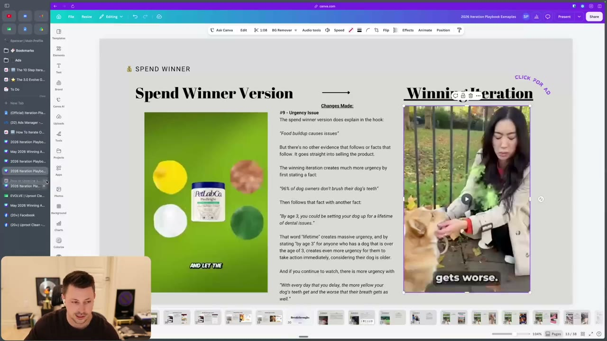
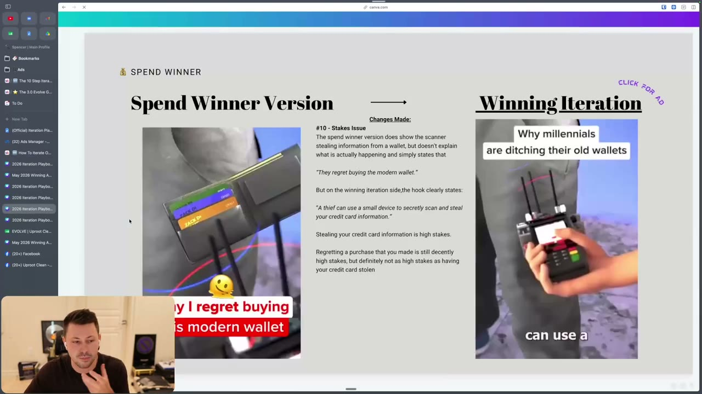
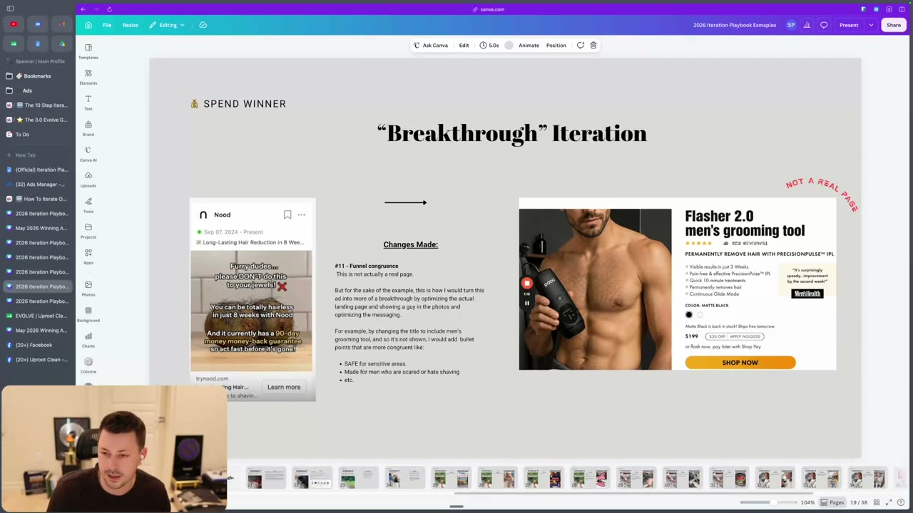
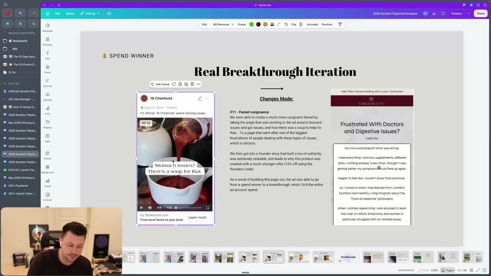
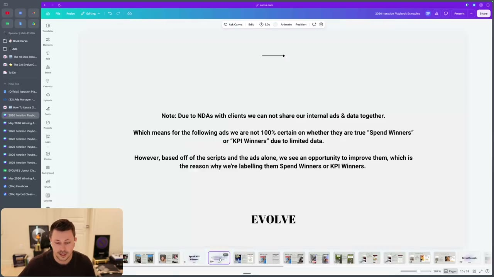
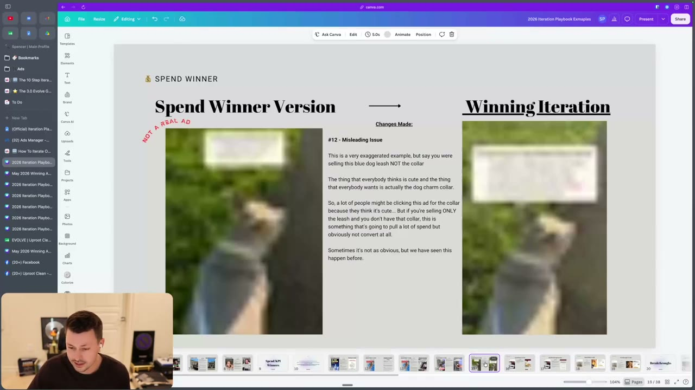

# 50. How To Iterate On Spend Winners
> A spend winner pulls breakthrough-level spend but misses KPI or does not scale the account; because Meta is already stopping people with it, the gap is almost always conversion (belief, urgency, stakes, funnel congruence, misleading engagement), not the hook's attention, so fix those before changing format or hold.

## 🤖 Agent use
- **Use when:** an ad is taking a large share of spend but its ROAS/CPA is worse than the account and it is not scaling the account.
- **Inputs → outputs:** ad metrics vs account (CPM, CPC/CTR, CVR, AOV, hook rate, hold rate, hook-to-hold, avg play time, frequency, % new visitors, breakdowns by age/gender/placement/platform), the ad script, the landing page → a diagnosis among 12 numbered issues and specific script/page changes to turn it into a breakthrough.
- **Rules:**
  - **DO** define a spend winner as an ad hitting breakthrough levels of spend whose KPI is below account average and that did not scale the account. [00:00]
  - **DO** treat it as a sign you "did something right": the algorithm sees the ad as scalable "aka pushing it towards colder and colder audiences". [00:00]
  - **DON'T** treat all spend winners alike: a 0.2-0.3x ROAS spend winner means "something is clearly wrong. We're misleading ... you could probably turn that off"; a "1.x ROAS when your target's a 2" spend winner may be "keeping up your entire account" but "doesn't have that extra efficiency power that a breakthrough ad will have". (Page text: 1.8x vs 2.00x target.) [00:35]
  - **DO** compare against the account and find which of CPM, CPC, CVR, AOV is lacking. Most often "usually the cost per click and the CTR are good", and the issue is conversion rate or AOV. [01:15; 02:38]
  - **DO** check the ad's lower-level metrics now that spend is meaningful: hook rate, hold rate, hook to hold ("what % of people who got hooked watched 15 seconds or more", page text), average play time, frequency, % new visitors (Northbeam / Triple Whale), and breakdowns by age, gender, placement, platform. [01:15]
  - **DON'T** fall into "hold iteration mode" (assuming the hook works, so testing formats and holds). The hook itself may cause the non-conversion: "just because your hook is stopping people ... doesn't mean that it's going to get them to purchase." Goal: "attention that will actually buy". [03:29-04:46]
  - **DO** first fix belief (add authority, facts, vulnerability), urgency, stakes and funnel congruence; "if you fix these issues and then you even just keep the same format and you just slightly adjust the script ... a lot of the times you'll actually turn that ad into a breakthrough". [17:18]
  - **IF** a new-idea ad gets spend **THEN** "we'll always try that idea three to five more times", but you must have a direction for a better execution. [05:23]
  - **IF** an imitation ad is working **THEN** try 2-3 more executions of it (page text; the video says "a few"). [05:23]
  - **IF** a spend winner iteration stays a spend winner **THEN** find why: still the hook? not enough belief? still no urgency? [05:23]
  - **IF** the winning ad has a new angle different from your other winners **THEN** suspect funnel/congruence and check the landing page first. [12:15]
  - **IF** an ad has high engagement and cheap clicks but poor conversion **THEN** suspect a misleading ad; Meta may not pull spend fast enough, so turn it off yourself. [14:43]
- **See also:** [48. Losing ads](48-how-to-iterate-on-losing-ads.md) · [51. Breakthroughs](51-how-to-iterate-on-breakthroughs.md) · [30. How to raise the stakes](30-how-to-raise-the-stakes.md) · [15. Beliefs](15-why-you-need-to-understand-beliefs.md) · [16. Authority](16-why-you-need-to-understand-authority.md) · [Native advertising](../../../../concepts/native-advertising.md) · [Iteration vs variation](../../../../concepts/iteration-vs-variation.md)

## Key ideas

### Problem statement and anatomy [00:00-02:38]
- "The ad is hitting breakthrough levels of spend, but is not hitting KPI or is not scaling the ad account" (page text; "mainly the latter here of not scaling the account"). [00:00]
- "Either way, the ad is not scaling your account, which is the TLDR." Check which ROAS component is weak vs the account. [01:15]
- Most of the time, based on the instructor's internal learnings comparing spend winners to breakthroughs, the missing pieces are, in order: **trust (belief)**, fix by adding authority/optimising copy to be more believable; **urgency**, fix by escalating the problem and making people realise what happens if they don't act today; and (less often) a **funnel issue**, fix by optimising the landing page. [02:02-02:38]
- Signal: "it will have a lower conversion rate compared to the account." Meta forces spend because "they're driving a lot of traffic, but then there's an issue with that traffic": viewers are stopped and watch but are not convinced. [02:38-03:29]
- Example of funnel need: a winning static ("beer belly is actually cortisol belly") sent to a product page "is just probably not going to convert"; it needs an advertorial or listicle. "Until I optimize a LP for it, it might not be a full breakthrough." [02:38]

### Hook trap [03:29-04:46]
- "Sometimes although you think your hook is the reason why the ad's working, it's actually the reason why it's not working." Crazy hooks or visuals that cannot be tied back to the rest of the ad get attention but do not set the viewer up to learn more or buy. [04:07]

### Most common reasons ads are spend winners (page text, read at 04:46) [04:46-05:23]
1. The hook is misleading: disconnect between what people expect from the ad and what's on the page.
2. You grabbed attention, they like your claims, but do not believe them.
3. Going after a broader/colder audience but lacking conversion factor (funnel or hold issue).
4. The ad lacks urgency or a strong CTA: no reason for cold people to act now.
5. People do not see the value in your offer (price-to-value off).
6. You failed to close open loops from earlier in the ad; viewers were intrigued but unsatisfied or not sold.

### Which ads get iterated [05:23-06:17]
| Ad type | Rule |
|---|---|
| Ideation that gets spend | "we always try the idea 3-5 more times" (page text adds: must still have a direction for a better execution) [05:23] |
| Iteration | Identify what went wrong in execution vs the winner; if the iteration of a spend winner stays a spend winner, diagnose why [05:23] |
| Imitation that works | Try the idea 2-3 more times (page); "a few different executions", either angle or format [05:23] |

### What holds spend winners back from being breakthroughs
The playbook numbers continue from the losers list (#2.5, #7) and add #9-#12.

**#2.5 Broad issue (spend-winner version)** [06:17-07:04]
- Different from the losers explanation: here the copy "was likely strong enough to capture attention of the masses, which is why Meta is forcing spend on it, but it is not strong enough to ultimately convert those masses". "You've become a good enough copywriter to get the attention of the masses, but you haven't become a good enough copywriter to funnel that attention down." Apply belief, urgency and funnel congruence. [06:17]

**#7 Belief issue (spend-winner version)** [07:04-08:35]
- You resonated and grabbed attention but "they just don't believe or trust your claims". Iteration: find where in the script to add authority and "use more facts or show vulnerability". [07:04]
- Vulnerability example (instructor's hypothetical): a phone-speed brand replaces "if your phone is loading really slow, we can help you" with "if your phone is an iPhone 12 or below, like we can't help you. But if you have a 13 or a 14 or a 15, we 100% ... will help you increase the speed on your phone." Admitting it does not work for everyone "can also build trust". [07:04-07:40]

**#9 Urgency issue (new)** [07:40-10:58]
- Not "sale ends tonight or limited quantities left"; urgency = "WHY DOES THE CONSUMER NEED TO BUY THIS NOW". If the ad lacks "at least one reason why they need to take action on this quickly" or does not "explain what could potentially happen if they don't take action", "you do not have true urgency". [07:40-08:35]
- Example (dog dental powder, see teardown): spend-winner version says "Don't brush your dog's teeth. Food builds up quickly causing issues" with no follow-up; the iteration adds "96% of dog owners don't brush their dog's teeth daily", "by age three, you could be setting your dog up for a lifetime of dental issues", "every day you delay is another day your dog's teeth start to become more yellow and their breath gets worse". [08:35-10:58]
- "That word lifetime creates massive urgency"; "by age 3" adds more for owners of dogs over three. [10:04]

**#10 Stakes issue (new)** [10:58-12:15]
- "A lot of the best breakthroughs will have high stakes and will make it feel much more important"; raising stakes "can actually increase the urgency massively as well (2 for 1)". Learn more in "How to raise the stakes" ([30](30-how-to-raise-the-stakes.md)). [10:58]
- Example (modern wallet): "Here's why I regret buying this modern wallet" vs "A thief can use a small device to secretly scan and steal your credit card information." Regret over a purchase is "decently high stakes" but not as high as having your credit card stolen. [11:34-12:15]

**#11 Funnel / congruence issue (new)** [12:15-14:43]
- If a new spend winner has a new angle versus other winners, "there's a high likelihood that you have a congruence or funnel issue": the ad goes to a generic page that "doesn't complete the customer journey", or one tailored to a different avatar/angle, or an offer that doesn't make sense for this person. [12:15]
- "The majority of the time, the reason why spend winners aren't breakthroughs is because they lack conversion rate, not CTRs." Optimise the post-click experience (listicle, advertorial, offer). [12:15-13:14]
- Example 1: an ad for men (hair-removal) landing on a page with a girl shaving her arm; the mock fix is "Flasher 2.0 men's grooming tool" with a man holding the device. Slide says "NOT A REAL PAGE" and that the instructor would match the title to men's grooming and add congruent bullet points ("SAFE for sensitive areas", "Made for men who are scared or hate shaving"). [13:14]
- Example 2 (real, from the CRO program): ad "Stomach issues? There's a soup for that." sent to a homepage that said "delicious gourmet soups tailored to enhance your healthy lifestyle"; replaced by a landing page "Frustrated With Doctors and Digestive Issues? I was too." with a founder story ("No one could pinpoint what was wrong. I tried everything, doctors, supplements, different diets ..."). The slide credits the page with taking the ad "from a spend winner to a breakthrough, which 3x'd the entire ad account spend" and mentions a stronger offer (15% off using the founder's code). It was "more of a KPI winner" before, per the instructor. [13:14-14:43]

**#12 Misleading issue (new)** [14:43-17:18]
- Belief: "Meta prioritizes engagement over anything else" is true "to an extent. However, over the longterm, it will always optimize for purchases." High-engagement / cheap-CPC ads pull spend but if they are not a breakthrough or "holding ROAS" Meta will not sustain it; "meta doesn't pull away fast enough", so you have to step in and turn it off. [14:43]
- Typical sources: native ads (many click "see more" and read the whole story but do not buy) and controversial angles (people comment and take sides). The instructor's team does not run many native ads "due to our stance of them not really being good long-term winners" and cannot share client examples. [15:21-15:55]
- Slide: "NOT A REAL AD" exaggerated example, "five reasons why you need this dog leash" where the star is the charm collar; people click for the cute collar, but you are selling the leash only; "pull a lot of spend but obviously not convert at all." "Where am I potentially misleading?" [16:30-17:18]

### Format changes come last [17:18-18:15]
- The next lessons list format/script changes (see [52](52-the-iteration-playbook-script.md)/[53](53-the-iteration-playbook-formats-styles.md)). But for spend winners, "just moving [an AI voiceover video] into a native ad or ... an AI animated ad is not going to make it work all of the time" and "changing the script blindly is not going to make it work". Fix urgency, funnel, stakes, belief; even in the same format, a slight script adjustment can produce a breakthrough, "which then you get to have way more fun on turning breakthroughs into other iterations". [17:18]

## Steps / framework
1. Confirm spend winner: breakthrough-level share of spend, KPI below account, not scaling.
2. Triage by ROAS: 0.2-0.3x -> likely misleading; consider turning off. ~1.8x vs 2x target -> iterate to unlock efficiency.
3. Compare CPM, CPC/CTR, CVR, AOV with the account; pull hook rate, hold rate, hook-to-hold, avg play time, frequency, % new visitors, and age/gender/placement/platform breakdowns.
4. If CTR is fine and CVR low, check in order: belief (#7), urgency (#9), stakes (#10), funnel/congruence (#11), misleading (#12), broad (#2.5), offer, open loops.
5. Re-write the script section (or landing page) for the failing issue, keep the format and hook unless the hook misleads.
6. Name and track the iteration ([46](46-the-10-step-iteration-process.md)); if it stays a spend winner, diagnose again.

## Examples
- **Dog dental powder (urgency):** spend winner opens "Don't brush your dog's teeth. Food builds up quickly causing issues." then "This new powder for clean dog teeth can help. This incredible, easy to use powder targets tartar buildup and stinky dog breath all without a toothbrush. Simply sprinkle one scoop of it onto your dog's food". Iteration: "Dental powder cleans dog teeth fast. Are you one of the 96% of dog owners who don't brush their dog's teeth daily? Well, by age three, you could be setting your dog up for a lifetime of dental issues. While traditional teeth cleaning techniques can be challenging, every day you delay is another day your dog's teeth start to become more yellow and their breath gets worse." [09:33-10:58]
- **Modern wallet (stakes):** see #10. [11:34]
- **Grooming tool and soup (funnel):** see #11.
- **Dog charm collar (misleading, fictional):** see #12.

## Structured units

### Ad teardowns
| Brand / product (niche) | Format | Hook / opening | What works | What fails | Fix suggested | Principle | Source |
|---|---|---|---|---|---|---|---|
| PetLabCo dental powder (pet dental) | Video (UGC / AI visuals) | "Don't brush your dog's teeth. Food builds up quickly causing issues." | Gets spend; "quickly" implies a timeline | No further evidence or consequences; "Not a lot of urgency" | Lead with the fact "96% of dog owners don't brush daily", add "by age three ... lifetime of dental issues" and "every day you delay ..." | Urgency = reason to act now | [08:35-10:58]; slide at 11:23 |
| Modern wallet with card scanner demo (wallets) | Video | "Here's why I regret buying this modern wallet" | Shows the scanner stealing card data | Doesn't explain what is happening; low stakes (regret) | "A thief can use a small device to secretly scan and steal your credit card information." (slide label: "Why millennials are ditching their old wallets") | Raise stakes | [11:34-12:15]; slide at 11:38 |
| Nood (hair removal; competitor ad on Meta, "Furry dudes... please DON'T do this to your jewels", 90-day guarantee) -> mock "Flasher 2.0 men's grooming tool" page | Video ad + landing page | "Furry dudes, please DON'T do this to your jewels" | Strong hook for men | Landing page showed a girl shaving her arm (incongruent) | Re-title and re-image page for men; congruent bullets | Funnel congruence | [13:14]; slide at 13:17 |
| 18 Chestnuts (soups) | Video + landing page | "Stomach issues? There's a soup for that." | New angle with spend | Sent to generic homepage ("delicious gourmet soups tailored to enhance your healthy lifestyle") | Founder-story landing page "Frustrated With Doctors and Digestive Issues? I was too." with offer (15% off with founder code) | Funnel congruence | [13:14-13:54]; slide at 14:07 |
| Dog leash / charm collar (pet) (not a real ad) | Native-style | "Five reasons why you need this dog leash" with collar as visual star | n/a | Clicks come from the cute collar; the product is the leash | Make the visual match the product being sold | Misleading engagement | [16:30-17:18]; slide at 16:17 |
| Dad bod static (men's health) | Static | "That belly isn't beer. It's cortisol killing your testosterone" | Wins attention | Needs an advertorial/listicle, not a PDP | Build landing page that explains cortisol belly | Funnel | [02:38] (see also [48](48-how-to-iterate-on-losing-ads.md)) |

### Rewrites
| Before | After | What changed | Source |
|---|---|---|---|
| "Don't brush your dog's teeth. Food builds up quickly causing issues." | "Dental powder cleans dog teeth fast. Are you one of the 96% of dog owners who don't brush their dog's teeth daily? Well, by age three, you could be setting your dog up for a lifetime of dental issues." + "every day you delay is another day your dog's teeth start to become more yellow" | urgency (fact, deadline, daily cost) | [09:33-10:58] |
| "Here's why I regret buying this modern wallet" | "A thief can use a small device to secretly scan and steal your credit card information." | stakes up | [11:34-12:15] |
| "Hey, if your phone is loading really slow, we can help you" (hypothetical) | "If your phone is an iPhone 12 or below, we can't help you. But if you have a 13 or a 14 or a 15, we 100% ... will help" | claim -> qualified claim (vulnerability) | [07:04-07:40] |
| Generic page "delicious gourmet soups tailored to enhance your healthy lifestyle" | "Frustrated With Doctors and Digestive Issues? I was too." founder page | landing page congruent with angle | [13:14-13:54] |

### Templates
| Template | Use for | Example fill | Source |
|---|---|---|---|
| "If [you have X], we can't help you. But if [Y], we 100% [result]." | Vulnerability/qualifier to build belief | iPhone 13/14/15 phone speed | [07:04-07:40] |
| "[Stat: X% of <audience> don't do Y]. By [age/time], you could be setting [them/pet] up for a lifetime of [problem]. Every day you delay ..." | Urgency | dog teeth | [09:33-10:58] |

### Rules of thumb
- **DO** diagnose using CTR vs CVR before editing; "majority of the time ... lack conversion rate, not CTRs". [12:15]
- **DON'T** assume hook = good because spend; the hook can be the cause. [03:29-04:46]
- **IF** ROAS is 0.2-0.3x **THEN** turn it off (misleading). [00:35]
- **IF** the ad introduces a new angle **THEN** build or adapt the landing page to that angle. [12:15]
- **DON'T** change format first. [17:18]

## Screenshots

*#9 Urgency: "96% of dog owners don't brush their dog's teeth", "by age 3 ... lifetime of dental issues", "with every day that you delay ...". [11:23]*

*#10 Stakes: "regret buying" vs "A thief can use a small device to secretly scan and steal your credit card information." [11:38]*

*#11 Funnel congruence: an ad for men sending to a mismatched page; a mock congruent page (labelled "NOT A REAL PAGE"). [13:17]*

*Real example: the "Stomach issues? There's a soup for that" ad paired with a founder-story landing page that turned a spend winner into a breakthrough. [14:07]*

*Caveat slide: because of client NDAs the spend-winner and KPI-winner examples are not confirmed true spend/KPI winners; they were labelled so from scripts and ads alone. [16:12]*

*#12 Misleading: an exaggerated, AI-made, "NOT A REAL AD" example where the visual star is not the product sold. [16:17]*

## How to apply
- [ ] Pull account-vs-ad CPM, CPC, CTR, CVR, AOV and hook/hold metrics before editing.
- [ ] If ROAS is very low (0.2-0.3x), check for a misleading ad and consider turning it off.
- [ ] Score the script for belief (authority, facts, vulnerability), urgency (a reason to act now), stakes (what is lost).
- [ ] Open the landing page: does it speak to this ad's angle and avatar? If not, fix it first.
- [ ] Keep the winning hook unless it misleads; avoid format changes until the five issues are fixed.
- [ ] Relaunch as `ITER#N_BATCH#ORIG#` and watch whether it becomes a breakthrough.

## Related
- Previous: [49. How to iterate on KPI winners](49-how-to-iterate-on-kpi-winners.md) · Next: [51. How to iterate on breakthroughs](51-how-to-iterate-on-breakthroughs.md)
- [Iteration vs variation](../../../../concepts/iteration-vs-variation.md) · [Creative testing system](../../../../frameworks/creative-testing-system.md) · [Risk reduction hooks](../../../../concepts/risk-reduction-hooks.md)

## Cross-course notes
- Tether Lab ([Creative testing system](../../../../frameworks/creative-testing-system.md)) diagnoses failing videos in the order speed, hook, story, visuals/creator; Evolve's spend-winner diagnosis starts post-hook (belief, urgency, stakes, funnel) because the hook already earns the spend. Different problem states, not a contradiction.
- Agreement: both warn that engagement is not conversion (Evolve #12 misleading; Tether Lab on messaging matching the frame).
- Evolve's "reason to act today" urgency (not sale/scarcity) extends Tether Lab heuristics on scarcity; see [Heuristics](../../../../concepts/heuristics.md) (derived).

## Sources and limitations
- Transcript: [50. How To Iterate On Spend Winners….txt](<../../../../../raw/evolve/copywriting/_transcripts/✍️ Evolve Copywriting (NEW)/50. 🆕 How To Iterate On Spend Winners ✍️ Evolve Copywriting (NEW) Evolve.txt>) · Page text: [….html.md](<../../../../../raw/evolve/copywriting/_extracted/✍️ Evolve Copywriting (NEW)/50. 🆕 How To Iterate On Spend Winners_✍️ Evolve Copywriting (NEW)_Evolve.html.md>)
- Machine transcription: "spin winner" = spend winner; "LP" etc. as spoken; "list school" = listicle. Slide reads "PetLabCo" on the dog powder jar (partly legible) so brand is approximate.
- Full recording covered (last segment 18:15 of 18:15).
- The instructor says the spend- and KPI-winner examples are not confirmed true spend/KPI winners (NDAs; slide at 16:12). Treat teardown "what fails" claims as his hypotheses.
- Slide frames at 11:23 and 11:38 are captured after the discussion of the urgency video; the slides were on screen earlier.
- Canva example links on the page are not included in the course files; slides were read from screen frames.
