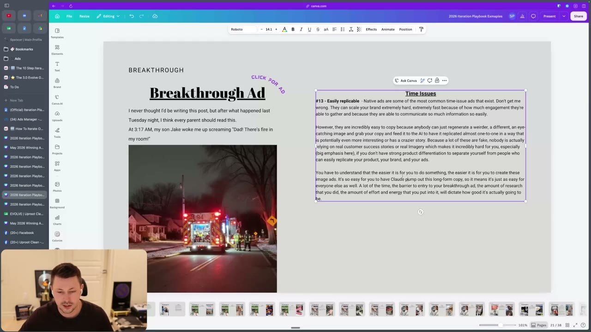
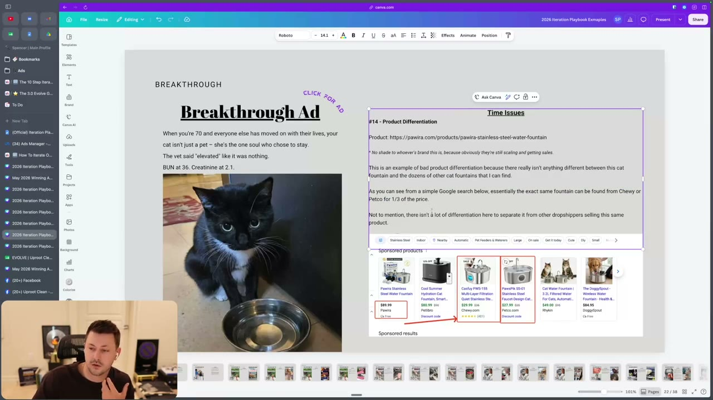
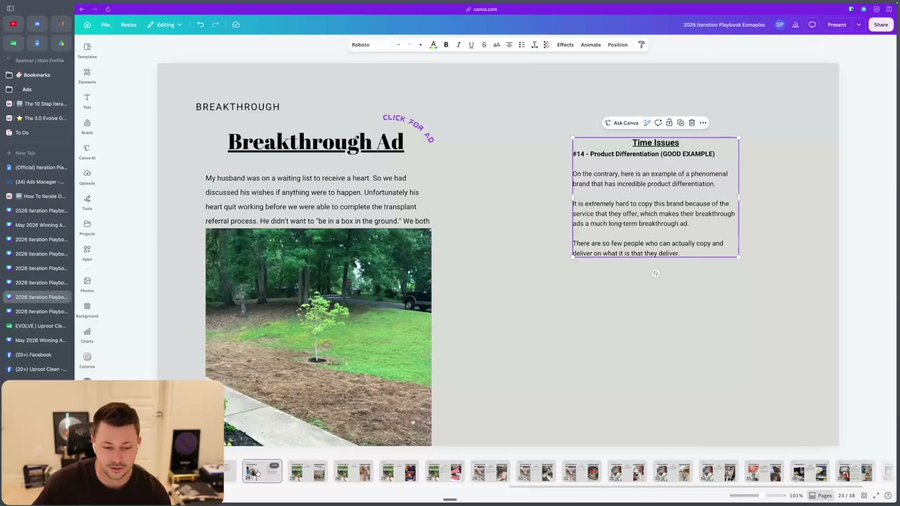
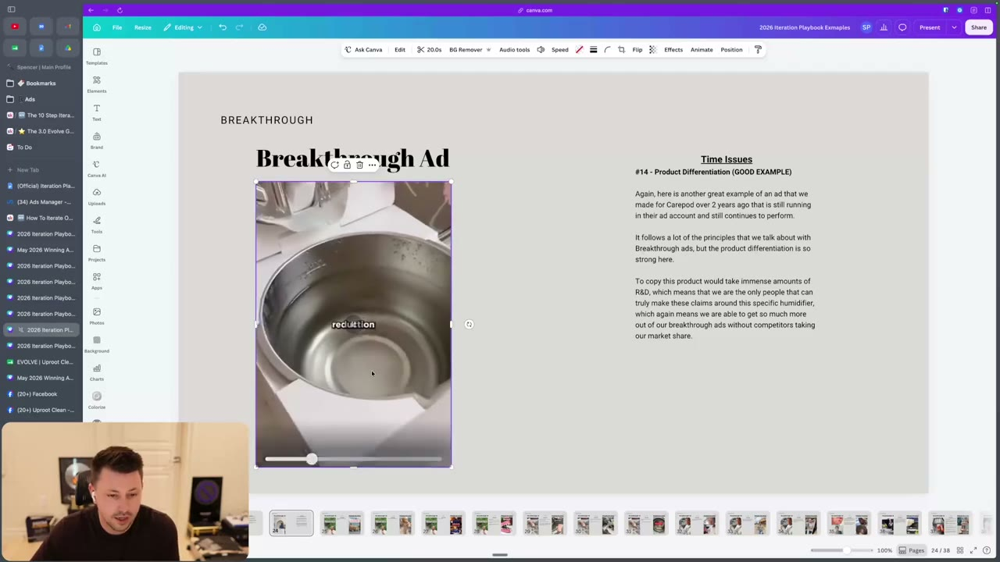

# 51. How To Iterate On Breakthroughs
> A breakthrough is step one of scaling; the job now is to keep it alive (do not turn it off after a few bad days), understand why breakthroughs die fast (easy to copy, copied from a competitor, niche TAM, offer-only, seasonality, no product differentiation) and dissect it so one breakthrough produces many.

## 🤖 Agent use
- **Use when:** an ad has become a breakthrough (breakthrough-level spend, usually hitting KPI) and you must decide whether to keep it on, estimate how long it will last, and plan iterations; also when judging whether a competitor's winning ad is likely to last.
- **Inputs → outputs:** breakthrough ad + its run history (days at scale, KPI at scale, recent bad days), ad format (native/AI UGC/real), product differentiation, angle TAM, season → decision to keep/scale back/not turn off, a lifespan-risk list, and a mandate to run the full iteration process ([46](46-the-10-step-iteration-process.md)) and the script/format iterations ([52](52-the-iteration-playbook-script.md), [53](53-the-iteration-playbook-formats-styles.md)).
- **Rules:**
  - **DO** celebrate, then "study the ... out of that ad and learn why it is working to correct your lens and make better ads". [00:51-01:44]
  - **DO** remember the two variables that make a breakthrough: "Is this angle scalable? And is the way that I'm communicating this angle right?" [00:51-01:44]
  - **DON'T** turn a breakthrough off after a few bad days: "your ads earn respect". An ad that has ripped "for a month plus" gets leeway; "sometimes we let breakthrough ads run for a week" of bad performance. [03:25-05:36]
  - **IF** an ad has been crushing for three weeks and then has one bad week **THEN** leave it on; **IF** it "skyrockets for three days and then crashes for a week" **THEN** it has earned less leeway. Every week at scale and KPI "earns more of its stripes". [04:52-05:36]
  - **DON'T** forget the consequence: if you turn off the only ad that got you to the new spend level and have no other winners, "you're just going to go back down to your pre-breakthrough levels". [05:36]
  - **DON'T** react to a dying breakthrough by "spamming hook iterations or format iterations that you think are better, but they don't convert." Dissect first. [03:25]
  - **DO** iterate on all three ad types of breakthrough (ideation, iteration, imitation): "Always". [11:22; page text]
  - **IF** the breakthrough is a native / easy-to-make / AI UGC ad **THEN** expect a short life unless you have a real process and product differentiation; plan the next breakthrough early. [05:36-07:09]
  - **IF** your breakthrough is offer-only or bottom-of-funnel **THEN** expect it to fall to KPI winner once you "clear out that funnel"; that is acceptable if you keep finding other breakthroughs. [08:44-09:40]
  - **DO** check seasonality and outdated visuals before blaming the creative. [09:40]
  - **DO** dissect the breakthrough "to identify all the components so you can create more ads with those components"; one breakthrough "can lead to multiples of others". [10:28-11:22]
- **See also:** [46. 10 step process](46-the-10-step-iteration-process.md) · [47. Claude Code version](47-claude-code-10-step-iteration-process.md) · [50. Spend winners](50-how-to-iterate-on-spend-winners.md) · [52. Playbook: script](52-the-iteration-playbook-script.md) · [53. Playbook: formats & styles](53-the-iteration-playbook-formats-styles.md) · [Native advertising](../../../../concepts/native-advertising.md) · [Iteration vs variation](../../../../concepts/iteration-vs-variation.md)

## Key ideas

### Problem statement [00:00-01:44]
- Page text: "The ad is a breakthrough, but it is dying too fast AND you aren't sure on how to actually dissect and iterate on the ad to create more breakthroughs." The number one breakthrough issue is time. [00:00]
- Illustration of a breakthrough: "an ad that took us from $2,000 a day in spend to 2.5K per day ... or 4K ... or 5K per day". [00:00-00:51]
- Breakthrough = "step one of scaling your brand" (page text). All the research and execution work "is going to go to waste unless you actually learn how to analyze your ad correctly". [00:51-01:44]
- Iteration modules (script and format) follow in lessons [52](52-the-iteration-playbook-script.md) and [53](53-the-iteration-playbook-formats-styles.md). [18:29]

### Ad fatigue (the "time issue") [01:44-05:36]
- Ads die faster than before: "in the last year and a half ... ads die way faster than how it used to be. In like 2023, 2024, we would have breakthroughs that would last an entire year." [01:44-02:33] (instructor claim)
- Range seen: some breakthroughs "continued to get spend and performance for six plus months", others "lasted two to three weeks before they start to come crashing down". [02:33]
- Worked illustration: spending 2K/day at 2x ROAS; a new ad lifts ROAS to 3.5, you double the budget to 5K; "two to three weeks go by" and you must scale back down to 2.5K as the breakthrough dies. [02:33-03:25] (illustrative numbers)
- Number one mistake: "They see the ROAS drop, they see the CPA inflate, they turn off the breakthrough." Page text: "These breakthrough ads, as you scale them, will naturally come down in performance. However, turning them off completely can be catastrophic to the account." [03:25]
- "Your ads earn respect. ... Your ad earns respect by ripping in your ad account for a month plus. If it has a few bad days ... you let it have those few bad days and you see if it could pick itself back up." [04:22]
- Anecdote: after bad days or a bad week "we do nothing. And then the next week, performance jumps back up." [04:52]
- Ad-account logic: leave a long-running ad "a little bit more leeway before you turn it off". [05:36]

### Why breakthroughs die fast (page text list, expanded in the video) [05:36-10:28]
| # | Cause | Explanation (instructor) | Source |
|---|---|---|---|
| 1 | Easily copied / low barrier (AI UGC, native ads) | "When ads are easy to make, it means they're easy to replicate" (e.g. "give me a random image, Claude, take this script from these other winning native ads ... and write me my own script"). Brands in Evolve with a "dialed process" for native/AI UGC have strategy and are not copy-paste. Faster if you lack product differentiation. | [05:36-07:09] |
| 2 | Copied from a direct competitor | If you do not make it your own and "just claw and make this for me", competitors copy you back and pull share: "a heavyweight bout" of back-and-forth winning ads. | [07:09-08:01] |
| 3 | Niche sub-avatar/angle without scalable TAM | Not bad, but only scales "so far"; "which is why iterations become very important". | [08:01-08:44] |
| 4 | Purely offer-focused / most aware | May work for days or a week then falls once the funnel is cleared. Instructor anecdote: an unnamed-client offer ad "collected $27,000 in spend the first day it was launched, and our budget for that campaign was $28,000 ... like 98% of spend", then "fell off a cliff" two or three days later because bottom-of-funnel had been neglected. (instructor claim) Offer ads can also stay as strong KPI winners. | [08:44-09:40] |
| 5 | Seasonality / outdated visuals | Humidifier brand: "January and February ... 60K a day"; "July ... lucky if they spent 6K a day". Gifting angles that crack on Black Friday die in Q1; winter-shot creator ads die in summer. | [09:40-10:28] |

### What to do next [10:28-11:22]
- Begin the iteration process ([46](46-the-10-step-iteration-process.md)): break down the ad, identify the components making it work, "strategically applying them or optimizing them in other formats and in the script". "You have no excuse to not dissect the hell out of your breakthrough." [10:28]
- Claim: one breakthrough can lead to others "that could scale you way past 100K days"; examples from the instructor's YouTube channel (page text says "$100k/day podcast"): "first hit their 100K per day, and then a week or two weeks later, they go from 100K per day to 150K, 200K, 250K". [10:28-11:22] (instructor claim, no data in course files)

### What holds breakthroughs back [11:22-18:29]

**#2 TAM issue (breakthrough version)** [11:22-12:19]
- A breakthrough on a niche angle may not last or grow: Mars Men has a breakthrough on the "considering TRT" angle, "However, that might not be as big as their breakthrough on their beer belly angle. As I would assume, again, I haven't done the facts, but more men are probably dealing with the issue of having a beer belly than considering TRT." "Some angles are just going to be able to be more scalable than others." Slides: Cortisol angle breakthrough and Considering TRT breakthrough (Canva links; not in files). [11:22-12:19]

**#13 Easily replicable (new)** [12:19-14:45]
- Native ads "can scale your brand extremely hard ... extremely fast because of how much engagement they get" but "are incredibly easy to copy because anybody can just regenerate a weirder, a different, more eye-catching image and grab your copy and feed it to AI". Many are fake (no real customer stories or imagery). If you don't have strong product differentiation, you cannot separate from people who copy. [12:19-13:12]
- Slide: a native ad "I never thought I'd be writing this post, but after what happened last Tuesday night, I think every parent should read this. At 3:17 AM, my son Jake woke me up screaming 'Dad! There's fire in my room!'" with a fire-engine photo. Instructor: "I could just take this ad and ... put up some more warning tape or let me make this house look like it's falling apart. Maybe I put this house on fire." Dropshippers "will do crazier shit than you ... and they're going to get more attention." [13:12-14:00]
- Rule: "The easier it is for you to do something ... the more easy it is for someone else". The effort and differentiation in your creation process dictates longevity. [14:00]
- Upside of native ads: if you learn to dissect them, "you're going to have a huge advantage because your competitor doesn't know how to do that": crack a winning native ad then re-do it as "AI voiceover, AI animated ad, text on screen" hitting the same components. [14:45]

**#14 Product differentiation (new)** [14:45-18:29]
- "Especially with AI nowadays, it doesn't take long for someone to build a store, copy your ads and launch the exact same product inside of Facebook and steal market share." Without a strong brand or clear differentiation "breakthrough ads will die faster than usual". [14:45-15:28]
- Bad example: a native ad for a stainless-steel cat water fountain (pawira.com product). The cat-fountain slide's own text: "This is an example of bad product differentiation because there really isn't anything different between this cat fountain and the dozens of other cat fountains" and the exact fountain "can be found from Chewy or Petco for 1/3 of the price". Prices on the Google result: $89.99 for this one vs $29.99 and $27.99 elsewhere. "No shade to whoever's brand this is ... they're still scaling and getting spent." Ad opening on slide: "When you're 70 and everyone else has moved on with their lives, your cat isn't just a pet - she's the one soul who chose to stay. The vet said 'elevated' like it was nothing. BUN at 36. Creatinine at 2.1." [15:28-16:59; slide 16:19]
- Contrast: "Pet Me Bro" brand "developed their own cat phones" (visually different, other components like monitoring cat health). [16:14-16:59]
- Long-term cost: "you're in this constant cycle of chasing this next best native ad, next best native ad, or next best product". "Sometimes this is a great way to stack up some cash but if you're tired of dealing with this ... it's maybe time to add some differentiation to your product and improve your ad process." [16:59]
- Good example 1: a real-story native ad for urn-to-tree/plant products: "My husband was on a waiting list to receive a heart. So we had discussed his wishes if anything were to happen. Unfortunately his heart quit working before we were able to complete the transplant referral process. He didn't want to 'be in a box in the ground.' We both ..." with a photo of a young tree. Slide: "phenomenal brand that has incredible product differentiation ... extremely hard to copy this brand because of the service that they offer, which makes their breakthrough ads a much long-term breakthrough ad." [16:59-17:47; slide 17:50]
- Good example 2: CarePod humidifier, "a breakthrough ad that lasted for over two years" which the team made. The nurse recommends the product; own content, not AI; branded, award-winning, "immense amounts of R&D"; slide: "the only people that can truly make these claims around this specific humidifier, which again means we're able to get so much more out of our breakthrough ads without competitors taking our market share." Instructor concedes AI may soon replicate such an ad one-to-one but the product and brand moat remain. [17:47-18:29; slide 18:20]

## Steps / framework
1. Mark the ad as a breakthrough; log date, spend level, KPI.
2. Run the 10-step learnings ([46](46-the-10-step-iteration-process.md)); store components.
3. Set a keep-on rule: do not turn off for a few bad days; scale budget back instead if needed; apply more leeway the longer it has run at scale.
4. List lifespan risks: easily copied? copied from competitor? niche TAM? offer-only? seasonal? product differentiated?
5. Run iterations (script and format; see [52](52-the-iteration-playbook-script.md), [53](53-the-iteration-playbook-formats-styles.md)), applying the same components to new ads. All three ad types (ideation, iteration, imitation) are always iterated.
6. Keep hunting new breakthroughs so no single ad carries the account.

## Examples
| Example | Type | Takeaway | Source |
|---|---|---|---|
| Mars Men: "considering TRT" vs "beer belly / cortisol" breakthroughs | Angle TAM | The beer-belly angle likely has the bigger TAM (assumption by instructor) | [11:22-12:19] |
| Fire-engine parent post (native) | Easily replicable | Anyone can regenerate and out-crazy it | [12:19-14:00] |
| Stainless-steel cat fountain native ad | Bad product differentiation | Same product at 1/3 price at Chewy/Petco; $89.99 vs $27.99-$29.99 | [15:28-16:59] |
| Urn-to-tree memorial native ad | Good differentiation | Real story; unusual service not on Alibaba | [16:59-17:47] |
| CarePod humidifier nurse ad | Good differentiation | Ran 2+ years; R&D, branding | [17:47-18:29] |
| Humidifier brand seasonality | Seasonality | $60K/day in Jan-Feb vs ~$6K/day in July | [09:40] |

## Structured units

### Ad teardowns
| Brand / product (niche) | Format | Hook / opening | What works | What fails | Fix suggested | Principle | Source |
|---|---|---|---|---|---|---|---|
| Unnamed native "house fire" story (home safety / parenting) | Native static / story | "I never thought I'd be writing this post, but after what happened last Tuesday night, I think every parent should read this. At 3:17 AM, my son Jake woke me up screaming 'Dad! There's fire in my room!'" | High engagement, fast scale | Easily replicated by AI; fake stories; no differentiation | Dissect components and redo as AI voiceover / animated / text-on-screen; build product differentiation | Easily replicable = short life | [12:19-14:45]; slide at 14:07 |
| Pawira stainless-steel cat fountain (pet) | Native ad (real-story style) | "When you're 70 and everyone else has moved on with their lives, your cat isn't just a pet - she's the one soul who chose to stay. The vet said 'elevated' like it was nothing. BUN at 36. Creatinine at 2.1." | Still scaling and getting spend | Identical product sold at 1/3 price elsewhere; no visual differentiation | Own design / features (like Pet Me Bro cat phones) | Product differentiation | [15:28-16:59]; slide at 16:19 |
| Urn-to-tree memorial brand (funeral/memorial) | Native real-story ad | "My husband was on a waiting list to receive a heart ..." | Real story; hard-to-copy service | n/a | n/a | Good differentiation | [16:59-17:47]; slide at 17:50 |
| CarePod (humidifier) | Video, nurse recommendation (made in-house, not AI) | Nurse recommends this product | Authority + R&D moat; ran 2+ years | n/a | n/a | Good differentiation | [17:47-18:29]; slide at 18:20 |
| Mars Men (men's health) | Video / static | "Considering TRT" angle vs "beer belly / cortisol" angle | Both breakthroughs | TRT angle smaller TAM (assumption) | Prefer scaling the bigger-TAM angle | TAM | [11:22-12:19] |

### Rules of thumb
- **DON'T** turn off a breakthrough because of a few bad days or even a bad week if it has run well for 3+ weeks. [04:52-05:36]
- **DO** treat each additional week at scale as more leeway. [04:52]
- **IF** the ad is a native/AI UGC ad **THEN** assume copyability and document your differentiating process. [05:36-07:09]
- **IF** it's an offer/BOF breakthrough **THEN** expect it to settle as a KPI winner. [08:44-09:40]
- **IF** the product is the same as dozens of others **THEN** differentiate the product, not just the ad. [15:28-16:59]
- **DO** iterate on every breakthrough, whatever its ad type. [11:22]

## Screenshots

*#13 Easily replicable: native "3:17 AM ... Dad! There's fire in my room!" ad and the written explanation of why native ads are easy to copy. [14:07]*

*#14 Product differentiation (bad example): the same cat fountain at $27.99-$29.99 at Chewy/Petco vs $89.99. [16:19]*

*#14 (good example): a real-story native ad whose service is hard to copy. [17:50]*

*#14 (good example): CarePod, "over 2 years", R&D moat. [18:20]*

## How to apply
- [ ] When an ad crosses the breakthrough threshold, log the date and spend level, then start step 1 of [46](46-the-10-step-iteration-process.md).
- [ ] Add a "do not turn off for bad days" rule: require a multi-week bad trend or a clear loss before pausing.
- [ ] Score the breakthrough on the five lifespan risks and write a differentiation plan for each risk present.
- [ ] Break the ad into components and rebuild them in other formats and scripts ([52](52-the-iteration-playbook-script.md), [53](53-the-iteration-playbook-formats-styles.md)).
- [ ] Check season fit; if the angle is seasonal, plan the off-season angle.
- [ ] Keep other candidates in test so the account is not dependent on one ad.

## Related
- Previous: [50. How to iterate on spend winners](50-how-to-iterate-on-spend-winners.md) · Next: [52. The iteration playbook - script](52-the-iteration-playbook-script.md)
- [Iteration vs variation](../../../../concepts/iteration-vs-variation.md) · [Creative testing system](../../../../frameworks/creative-testing-system.md) · [Native advertising](../../../../concepts/native-advertising.md)

## Cross-course notes
- **Agreement with Tether Lab:** do not abandon a winner just because it looks tired. Tether Lab: frequency of 2 is not fatigue; vary the product treatment ([Creative testing system](../../../../frameworks/creative-testing-system.md), [Iteration vs variation](../../../../concepts/iteration-vs-variation.md)). Evolve: don't switch off a breakthrough after a few bad days.
- **Difference:** Tether Lab scales a winner slowly (+10% every other day, up to 10-15%/day); Evolve describes the budget jumping on a breakthrough (e.g. 2K to 5K/day) and then scaling back if it dies, and does not give a budget-raise rule in this lesson.
- **Difference on volume:** Tether Lab warns against volume-based testing below 8 figures; Evolve warns that easy-to-make native/AI ads are quickly copied but recommends re-using the same components across multiple formats (similar to Tether's format ladder).
- **Agreement:** both advise iterating on the core message/components rather than starting from scratch each time.

## Sources and limitations
- Transcript: [51. How To Iterate On Breakthroughs….txt](<../../../../../raw/evolve/copywriting/_transcripts/✍️ Evolve Copywriting (NEW)/51. 🆕 How To Iterate On 🏆 Breakthroughs ✍️ Evolve Copywriting (NEW) Evolve.txt>) · Page text: [….html.md](<../../../../../raw/evolve/copywriting/_extracted/✍️ Evolve Copywriting (NEW)/51. 🆕 How To Iterate On 🏆 Breakthroughs_✍️ Evolve Copywriting (NEW)_Evolve.html.md>)
- Machine transcription: "SVJ" (a sports-car slang used by the speaker for wealth), "Higgs field" = Higgsfield, "claw" = Claude, "Marsman" = Mars Men, "Pet Me Bro" probably a brand name misheard (not verified), "cat phones" probably "cat fountains" or similar (unverified), "weeder" probably "weirder".
- Full recording covered (last segment 18:49 of 18:50).
- Numeric claims (27K spend day on a 28K budget; 60K vs 6K/day humidifier; "ads die faster", 100K to 250K days) are instructor claims without supporting data. The unnamed client for the 27K anecdote is not identified.
- Canva example links on the page and the TAM slides (Cortisol angle breakthrough, Considering TRT breakthrough) are not available in the course files; the slides shown were read from screen frames.
- No exact numeric threshold for what counts as a breakthrough is given in this lesson (see [45](45-overview-of-iteration-section.md)).
