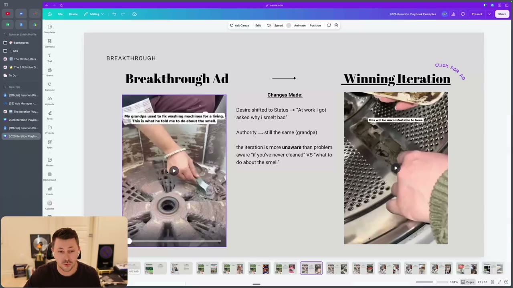
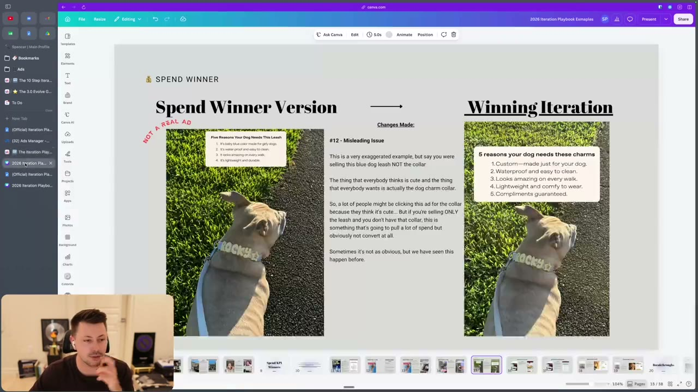
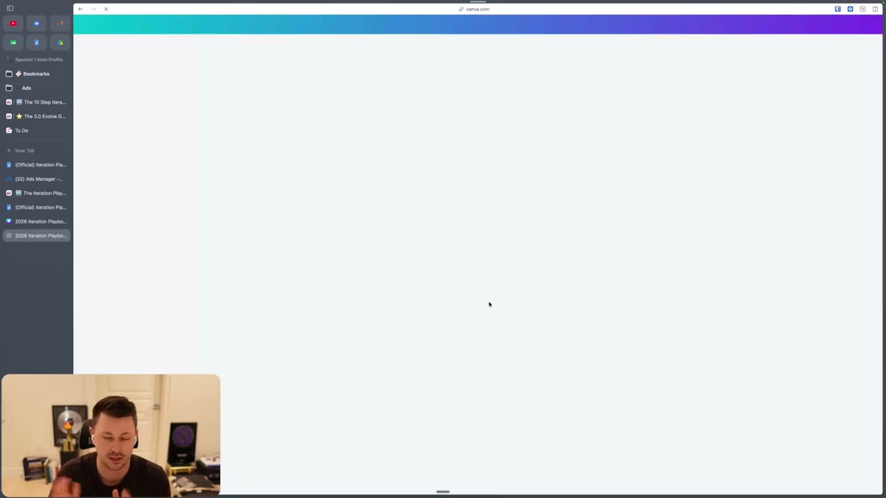
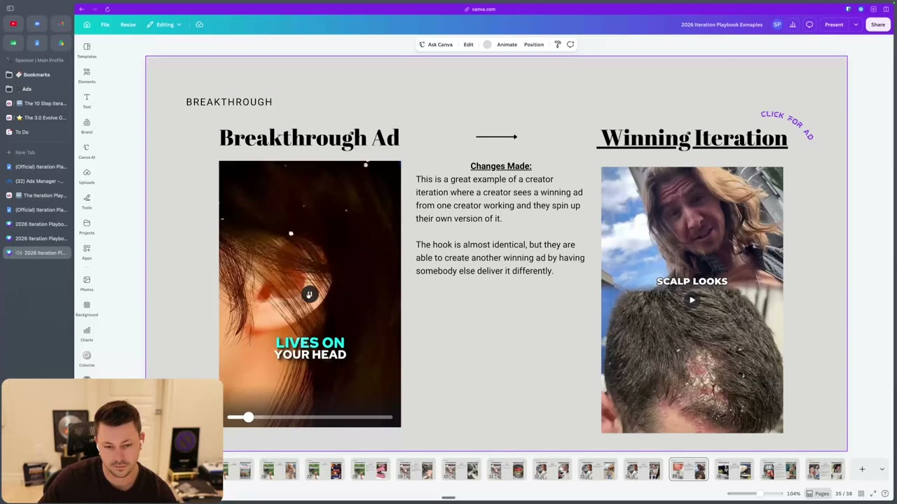
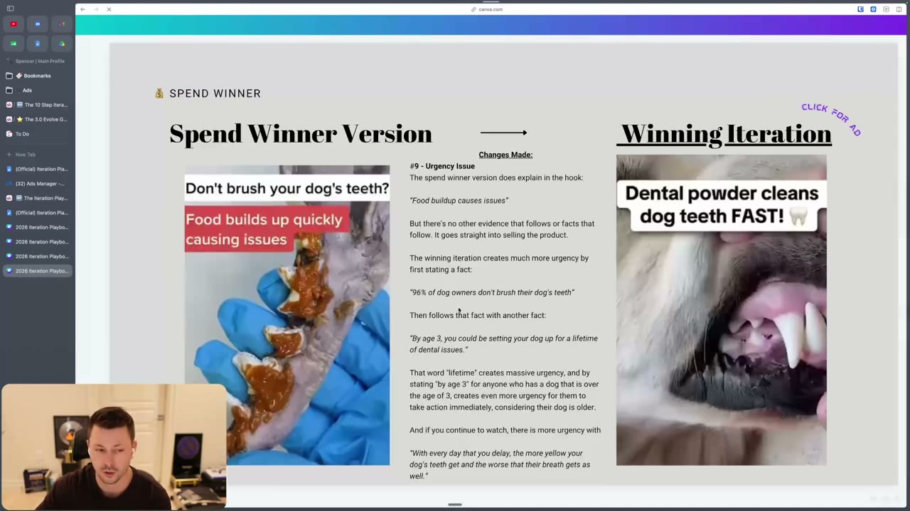
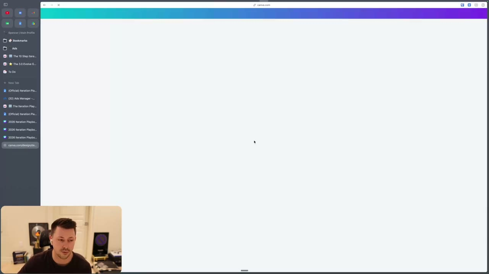
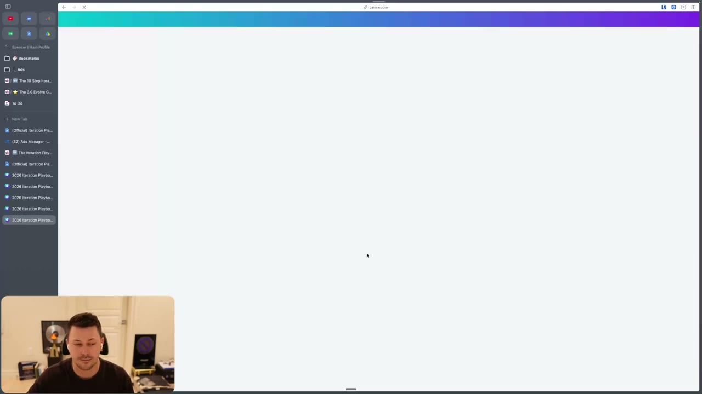
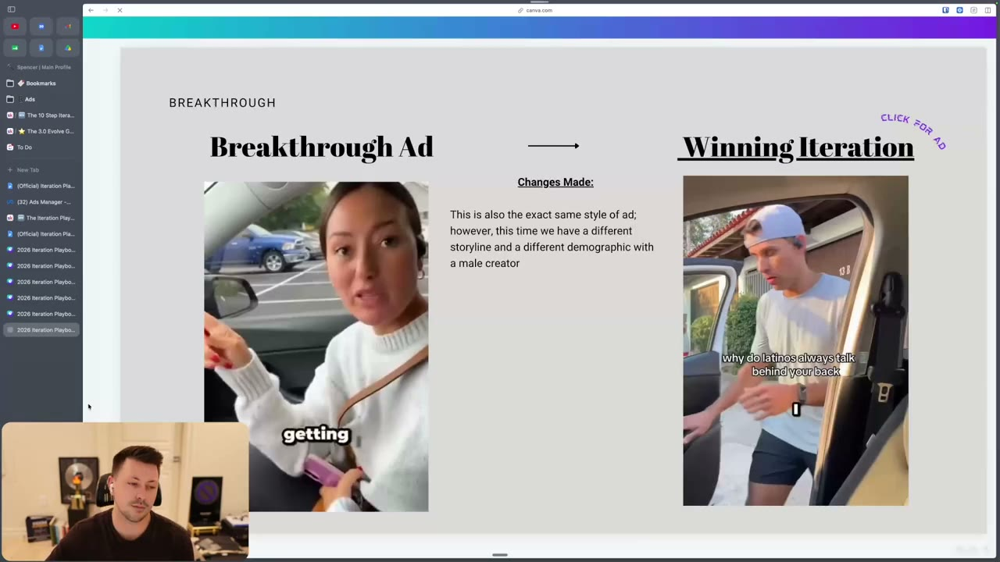

# 52. The Iteration Playbook - Script
> Nine script-level iterations you can run on a spend winner or breakthrough ad (components rewrite, emotional hook testing, bridge remake, in media res, extended problem, awareness-level test, overcoming objections, negative framing, different sub-avatar), each shown with a real before/after ad.

## 🤖 Agent use
- **Use when:** an ad is already proven (a "spend winner" that gets budget, or a "breakthrough" ad) and we need the next batch of script versions that keep the winning idea but execute it differently. Also use it to classify what a competitor's "same ad, new version" actually changed.
- **Inputs → outputs:** the winning ad's transcript/script plus its nine components (desire, avatar, angle, mechanism, authority, market awareness, emotion, positioning, urgency) + comments under the ad → a short list of script iterations, each named by type (1-9 below), with the component that changed and the new hook/bridge/problem section.
- **Rules:**
  - **DO** run iterations only on spend winners and breakthroughs. For losers and KPI winners "what you're trying to do is you're just trying to fix those ads", which is a different job. [00:00]
  - **DO** break the winner into its components first; "it's like building blocks... you can just play Tetris". Mark each component as working, improvable, or missing. [00:00-01:37]
  - **IF** a component is missing (no mechanism, no real authority) **THEN** write a version that adds it, "without again, bloating it or making it worse". [01:37-02:19]
  - **DO** keep the facts true: "always take the facts and tell the truth." Do not invent authority stories (the grandpa example is an illustration, not a claim about the brand). [02:19]
  - **DO** raise intensity/stakes in the hook or bridge when a breakthrough needs more urgency; the page adds "BE ETHICAL". [05:51-06:39; page #2]
  - **DO** make the bridge more visual and higher-stakes rather than reassuring ("it's extremely common" lowers urgency). [07:24-10:40]
  - **DO** pull real objections from the ad's comments and answer them in the script or in a comment-reply hook. [15:11-16:05]
  - **DON'T** copy a script verbatim to a different sub-avatar; check that the authority and setting still make sense for that person. [17:32-18:32]
  - **IF** an ad crushes at one awareness level **THEN** write the same idea starting at the next level up or down. [13:01-14:30]
- **See also:** [46. The 10-step iteration process](46-the-10-step-iteration-process.md) · [50. How to iterate on spend winners](50-how-to-iterate-on-spend-winners.md) · [51. How to iterate on breakthroughs](51-how-to-iterate-on-breakthroughs.md) · [53. Playbook - Formats & Styles](53-the-iteration-playbook-formats-styles.md) · [54. Iteration examples walkthrough](54-iteration-examples-breakdowns-walkthrough.md) · [Iteration vs variation](../../../../concepts/iteration-vs-variation.md)

## Key ideas

### Purpose: spend winners to breakthroughs, one breakthrough to many [00:00-00:55]
- Page text: the problem is "how to turn spend winners into breakthroughs and how to turn a single breakthrough into multiple breakthroughs that can scale further." Many iteration options "might feel overwhelming, okay? But that is a good thing." [00:00]
- Spend winners and breakthroughs are the targets "because these have proven that, hey, these are getting spent. People give a shit about this." [00:00]
- The lesson is the script half of the "iteration playbook"; formats come next in [53](53-the-iteration-playbook-formats-styles.md). [19:07]

### #1 Components rewrite (the biggest one) [00:55-05:51]
- Break the current winner into the **nine components** (see the template below), then "identify what is working, what can be optimized and how you can execute the same components differently." [00:55-01:37]
- Includes testing an optimized hook, bridge and hold. Hook, bridge, objection-handling and pitch processes are taught in the copywriting program (other lessons of this course). [01:37]
- Look for gaps: no mechanism, no authority, or an authority that could be stronger ("my dad used to fix washing machines" becoming "my grandpa used to [repair] washing machines"). The instructor stresses he does not know the real brand facts (Uproot), so this is an illustration. [01:37-02:19]
- **Same angle, new execution (airport):** same angle, issue, stakes and authority theme (TSA/airport), but a different hook and visuals. Original: "I saw a video where someone took a pen and popped open the zipper on a suitcase." Iteration: "Airport thieves are now stealing your stuff with just a pen." The instructor says this is more intense (airport thieves vs "I saw a video"). [02:19-04:22]
- **Same authority, new core desire (washer):** the broken-down Uproot ad focused on a health desire ("so unsanitary"). A different ad for the same type of product keeps the "grandpa" authority but opens on status: "Do your clothes always smell like this?" He had never seen it before breaking down the original, and says it shows "hopefully people that are good at marketing think alike." [04:22-05:51]
  - Slide text for this pair: "Desire shifted to Status -> 'At work I got asked why i smelt bad'"; "Authority -> still the same (grandpa)"; "the iteration is more unaware than problem aware 'if you've never cleaned' VS 'what to do about the smell'". [04:47 slide]
- **Spend winner lacking urgency (Pet Lab Co):** he mentions a favorite where "this spend winner was really lacking urgency. And so we recreated it in a way that had a lot of great urgency." [03:00] The Canva deck shows an "#9 - Urgency Issue" slide (dental powder, below); the spoken part does not state that this is the same ad, so treat the link as likely, not confirmed.

### #2 Emotional hook testing [05:51-07:24]
- You should already have identified the ad's valence and intensity (component 7). Instead of keeping the same level, test different valence/intensity. "A lot of times we notice that breakthrough ads can benefit from more intensity... you will likely increase the urgency and raise the stakes." [05:51]
- Example: "If your dog eats grass, do this every day" (neutral, "no man's land") becomes "Dog trainer says why your dog's grass eating isn't normal." The change raises intensity, lowers valence (more negative), and adds an authority ("random guy -> Dog Trainer"). [06:39-07:24]
- For valence/intensity theory, the page links to a Skool call recording (not in the course files). See [valence](../../../../concepts/valence.md) and [intensity](../../../../concepts/intensity.md).

### #3 Bridge remake [07:24-11:25]
- Goal: the bridge "establish more trust, create more urgency and keep the audience hooked in." Attention-grabbing hook alone is not enough: "that bridge section is a make or break on whether or not they actually stay." Improve it by adding authority and/or raising the stakes. [07:24-08:08]
- **Before** (bridge of the original, scalp/beard ad): "It's not dry skin, it's fungus. And although it sounds gross, it's pretty common." Instructor: "There's not really a lot of like urgency there." [08:08]
- **After** (winning iteration): "It's not dry scalp. That's a yeast problem on your head. And it's feeding on your scalp like a buffet. Every flake you see is proof that it's alive, growing, and throwing a party on your head." The instructor: it is "so visual", "higher stakes", and "Now that you're telling me that's common, I'm not as worried. Scroll" is what the old bridge triggers. [08:08-10:40]
- **Audio counts:** the winner uses dark piano music, which "just makes me feel like something bad is gonna happen"; the same words with no music are "just a guy talking to the camera". "Your audio also plays into the valence and intensity factor", so brief editors on it. [09:46-10:40]
- Context: same hook, different creator; the iteration "is basically ripping this guy's script because this is the ad that's actually ripping" (Whisper: "ripping" is probably "ripping/running" in the sense of performing; read as the original ad is the one performing). The creator swap is covered in [53](53-the-iteration-playbook-formats-styles.md). [08:57]

### #4 In media res (credit: Sarah Levinger per page text) [11:25-12:22]
- Cut the winning ad so it starts "right in the action", e.g. at the mechanism or at a different solution level, instead of a traditional hook that "sets up" the ad ("here's three reasons why"). [11:25-12:22]
- Works well for longer ads; the Uproot ad "could cut this so many different ways and start it at so many different places and it could go after an entire different audience." [11:25]
- Evidence (instructor claim): "we literally had an ad with three different cuts. One of them was a breakthrough. The other two completely flopped." One of their biggest breakthroughs, "that has spent over two million dollars", "goes straight in the action". The page says the strategy "has gone on to spend over $2,000,000". [11:25-12:22; page #4]
- Links to the writing technique "show rather than tell" (a module in the copywriting program: [32. How to write ads that show and don't tell](32-how-to-write-ads-that-show-and-dont-tell.md)). The instructor files it here because it is "essentially cutting the script... starting the script at a different spot", though "somewhat more of a format thing". [12:22]
- The Loom with the in-media-res example is not in the course files.

### #5 Extended problem section [12:22-13:43]
- "One of the first iterations that we do on any winning ads that we find." Create a version with a longer problem/agitation section: go deeper on the pain, add more specific pain points, make the viewer feel it before presenting the solution. [page #5; 12:22]
- Show how problems compound: "one problem leads to another problem... it stacks and compounds", so the viewer realizes it is "a worse problem than they thought". Important for unaware and problem-aware ads. [13:01]
- Page example: a spend-winner iteration that sits in the problem longer, "creating more urgency & building more relatability". [page #5]

### #6 Awareness-level test [13:43-14:30]
- Make variations for higher or lower awareness; "you can go up or down both ways." Problem aware -> try solution aware; solution aware -> try unaware. [13:01-13:43]
- Washer example: original (problem aware) "My grandpa used to fix washing machines for a living. This is what he told me to do about the smell." Solution-aware iteration: "What's actually in the washing machine cleaner you're using? Let me show you." Slide: "Went from problem aware hook to solution aware. Same emphasis on mechanisms." [13:43]
- Going lower in the funnel is useful "if you crack authority, especially if you crack your mechanism... you're starting at the thing that's actually working." [14:30]
- End-to-end written ladder (cat toy, "that famous ad, the pet ad"): see the Templates table.

### #7 Overcoming objections [14:30-16:05]
- A traction ad collects comments and objections; analyze the real objections and write variations that handle them. Also test "comment reply" hooks (comment on screen, ad answers it); recommended when many people post the same objection. [15:11]
- Two scripted fixes (page and video): comment "Does it work for X type of person, like me?" -> add "it even works for X" to the script. Comment "I've tried X before and this is the same thing. It won't work" -> screenshot it into the hook as a comment response, or write "I used to think X was the same as this, but here's how it's actually different." [15:11-16:05]
- Especially good in a product-aware market, "which most of you do[es]": start at the objection, then show the mechanism that proves it. [16:05]

### #8 Negative framing [16:05-17:32]
- Flip the entire ad to argue against the product, sarcastically: "Honestly, don't buy this. Here's why..." then disprove each point. Relates to "a skeptical crowd". [page #8; 16:05]
- Example: "Why I regret buying this modern wallet": "People are looking for drama. They want stakes... why does someone regret this? What went wrong?" The ad continues the bit, "I try to break it and it won't break", i.e. shows the mechanism comedically. [16:05-16:51]
- Even admitting a flaw can work: the Buckley's cough syrup line, "it tastes like shit, but it works" (the instructor says they have discussed it before in the course). [16:51]

### #9 Optimize for a different sub-avatar [17:32-19:07]
- "Requires a bit more skill": people copy the exact script and format to a new sub-avatar and make it worse. Understand the components, then rewrite those that don't fit. [17:32]
- Authority example: a tattoo artist's authority "probably won't work as much" for a sub-avatar without tattoos. [17:32]
- Shown pair: same style and storyline-type of ad with a different avatar and a male creator; he notes the authority/setting changed (the original's "nail salon" prop establishes why she overheard; the new one cannot use it: "if he was coming back from the nail salon, it wouldn't make sense"). "That's why you guys need to use your brain." [17:32-18:32]
- Closing priority: "the biggest one is this components rewrite, break down your components, look for where you're missing on things, add those in, and then... go through different types of executions." [19:07]

## Steps / framework

| # | Iteration | What you change | Trigger / when | Source |
|---|---|---|---|---|
| 1 | Components rewrite | Any of the 9 components (hook, bridge, hold, mechanism, authority, desire, avatar...) | Always first; fill missing components | [00:55-05:51] |
| 2 | Emotional hook testing | Valence and intensity (usually raise intensity / lower valence), often adding authority | Breakthrough that needs more urgency or stakes | [05:51-07:24] |
| 3 | Bridge remake | Bridge copy: add authority, raise stakes, make it visual | Hook gets attention but viewers leave after it | [07:24-10:40] |
| 4 | In media res | Start the cut at the action/mechanism | Long ads; ad has several strong middle moments | [11:25-12:22] |
| 5 | Extended problem section | Longer, compounding problem/agitation | One of the first iterations on any winner | [12:22-13:43] |
| 6 | Awareness-level test | Starting awareness level (up and down) | Ad is crushing at one level | [13:01-14:30] |
| 7 | Overcoming objections | Script or comment-reply hook answers real objections | Ad has comments with repeated objections | [14:30-16:05] |
| 8 | Negative framing | Invert the angle ("don't buy this, here's why") | Skeptical audience | [16:05-17:32] |
| 9 | Different sub-avatar | Avatar, authority, setting, creator | Winner exists; sub-avatar plausible | [17:32-18:32] |

## Examples
All "Breakthrough"/"Spend Winner Version" vs "Winning Iteration" pairs are slides from the instructor's Canva deck "2026 Iteration Playbook Examples" (link targets are `canva.link` URLs on the page; the clips themselves are not in the course files). See the Ad teardowns and Rewrites tables.

## Structured units

### Ad teardowns
Brand names are the ones the instructor or slides name; otherwise the product is described by what is on screen.

| Brand / product (niche) | Format | Hook / opening | What works | What fails | Fix suggested | Principle | Source |
|---|---|---|---|---|---|---|---|
| Unnamed luggage-security product (travel), breakthrough ad | UGC-style video with found footage | "I saw a video where someone took a pen and popped open the zipper on a suitcase." Caption: "and popped open the zipper on a suitcase" | Same angle/issue/stakes; authority theme of TSA/airport | Framed as "I saw a video" (lower intensity, secondhand) | Iteration: "Airport thieves are now stealing your stuff with just a pen" | Same idea, different hook and visuals; upped intensity | [03:00-04:22]; slide at 02:44 |
| Uproot Clean (washing-machine cleaner tablets), breakthrough | UGC video, expert-story authority | "My grandpa used to fix washing machines for a living. This is what he told me to do about the smell." | Authority (grandpa); mechanism; unaware parts later (per DOCX) | Health-focused desire only; "you've never cleaned" angle absent | Iteration shifts desire to status: "Do your clothes always smell like this?"; more unaware than problem aware | Shift core desire; keep authority | [04:22-05:51]; slide 04:47 |
| Uproot Clean, solution-aware iteration | UGC video | "What's actually in the washing machine cleaner you're using? Let me show you." | Starts at the mechanism, skips the smell-problem setup | - | Same emphasis on mechanism; solution-aware start | Awareness-level test | [13:43]; slide 13:59 |
| Dog-training / grass-eating ad (pets), breakthrough | Talking-head with text hook | "IF YOUR DOG EATS GRASS, DO THIS EVERY DAY!" (random man on camera) | Clear hook | Neutral emotion ("no man's land"), no authority | Iteration: "DOG TRAINER SAYS: WHY YOUR DOG'S GRASS EATING ISN'T NORMAL" with a gross-teeth visual | Raise intensity, lower valence, add authority | [06:39-07:24]; slide 06:53 |
| Scalp/beard fungus remedy (hair/scalp care), original | UGC talking-head | "If your scalp looks like this and your beard looks like this, it's probably not dry skin. It's probably fungus." | Strong hook | Bridge: "It sounds gross, but it's actually extremely common" lowers urgency | Rewrite bridge (see Rewrites) + dark audio + different creator | Bridge remake | [08:08-10:40]; slide 08:57 |
| Dental powder for dogs (pets), spend winner "Don't brush your dog's teeth? Food builds up quickly causing issues" | Video with text hook | "Don't brush your dog's teeth? Food builds up quickly causing issues" | Gets spend | Slide "#9 Urgency Issue": no evidence or fact follows the claim; goes straight to selling | Iteration hook "Dental powder cleans dog teeth FAST!" with facts first: "96% of dog owners don't brush their dog's teeth"; "By age 3, you could be setting your dog up for a lifetime of dental issues"; "With every day that you delay, the more yellow your dog's teeth get and the worse that their breath gets as well" (slide text, instructor commentary on slide only) | Fact -> second fact -> compounding urgency; the "96%" figure is the slide's stated stat, unverified | on-screen only; slide 12:59 (spoken context 12:22-13:43) |
| Modern wallet / RFID card blocker (accessories), spend winner | Video with hook text | "Why I regret buying this modern wallet" | Drama: viewers ask what went wrong | Slide "#10 Stakes Issue": shows a scanner stealing info but doesn't explain what is happening | Iteration hook "Why millennials are ditching their old wallets" / "A thief can use a small device to secretly scan and steal your credit card information" ("stealing your credit card information is high stakes") | Higher stakes; also used spoken as a negative-framing example | [16:05-16:51]; slide 16:42 |
| Blue dog leash/charms, "NOT A REAL AD" spend winner | Static-style product video | "Five Reasons Your Dog Needs This Leash" (text overlay) | - | Slide "#12 Misleading Issue": the cute thing people want is the charm collar, so clicks won't convert to leash buyers | Iteration shows "5 reasons your dog needs these charms" | Match the offer to what attracts clicks | on-screen only; slide 05:42 |
| Overheard-in-a-language ad (female creator, car), breakthrough | UGC story | Overheard people speaking about her ("They were talking so bad about this girl getting..." per transcript) | Story-style hook | - | Same style, new storyline and male creator; slide caption "why do latinos always talk behind your back"; setting prop changed (salon -> a race remark) | Different sub-avatar needs new authority/setting | [17:32-18:32]; slide 18:07 |
| Cat toy (pets), written ladder | Written hooks | See Templates | - | - | - | Awareness ladder | [14:30] |

### Rewrites
| Before | After | What changed (verb / visual / promise / self / intensity) | Source |
|---|---|---|---|
| "I saw a video where someone took a pen and popped open the zipper on a suitcase" | "Airport thieves are now stealing your stuff with just a pen" | Intensity up; threat named (thieves) vs secondhand sighting; same mechanism | [03:00-04:22] |
| Health desire: washer so unsanitary | "Do your clothes always smell like this?" / "At work I got asked why i smelt bad" | Core desire health -> status; same authority (grandpa); more unaware | [04:22-05:51] |
| "If your dog eats grass, do this every day!" | "Dog trainer says why your dog's grass eating isn't normal" | Authority added, valence lower, intensity higher | [06:39-07:24] |
| "It's not dry skin, it's fungus. Sounds gross but it's actually extremely common." | "It's not dry scalp. That's a yeast problem on your head and it's feeding on your scalp like a buffet." | Calm reassurance -> visual, high-stakes image | [08:08-08:57] |
| "My grandpa used to fix washing machines for a living. This is what he told me to do about the smell." | "What's actually in the washing machine cleaner you're using? Let me show you." | Problem aware -> solution aware; starts at the mechanism | [13:43] |
| "Don't brush your dog's teeth? Food builds up quickly causing issues" | Fact-led urgency ("96% of dog owners don't brush..."; "By age 3...lifetime of dental issues") | Added facts and a time-bound consequence (slide text) | slide 12:59 |
| "Why I regret buying this modern wallet" | "A thief can use a small device to secretly scan and steal your credit card information" | Regret (medium stakes) -> theft (high stakes) | slide 16:42 |

### Templates
| Template | Use for | Example fill | Source |
|---|---|---|---|
| Awareness ladder: one idea written at four levels | Awareness-level test (#6) | Product aware: "The most addicting cat toy"; Solution aware: "I tried everything to keep my cat busy"; Problem aware: "I didn't realize my cat being bored could take years off its life..."; Unaware: "Who has a better life... Cats or dogs?" | [13:43-14:30]; page #6 |
| Objection -> script patch | Overcoming objections (#7) | Comment "Does it work for X type of person, like me?" -> "it even works for X" | [15:11]; page #7 |
| Objection -> comment-reply hook | #7 | Comment "I've tried X before and this is the same thing. It won't work" -> put the comment on screen, then "I used to think X was the same as this, but here are the differences" | [15:11-16:05] |
| Negative-frame opener | #8 | "Honestly, don't buy this. Here's why..." then disprove each point | page #8 |
| Bridge upgrade formula (derived) | #3 | Replace "it's [common/normal]" reassurance with "it's not [mild name], it's [vivid, active, visual threat]" | derived from [08:08-08:57] |

## Prompts / templates (verbatim)
The DOCX "52. Example Here" (identical to the linked Google Doc "🏆 Breakthrough Ad Winner - Example") is a filled-in component breakdown of the Uproot Clean ad. The nine questions are the component checklist. The urgency answer (#9) is blank in both files.

```text
🏆 Breakthrough Ad Winner — Example

Call Recording: https://www.skool.com/evolve-8484/classroom/67ce5630?md=0a50b76d4d5d45dba6e3cf195b0a0bbd
Uproot Clean Ad: https://www.facebook.com/100065144395753/posts/1322630186585115
Ad Outcome: 🏆Breakthrough Ad (we believe)

Identify:
1. What is the desire?
2. Who is the avatar?
3. What is the angle? (What is the problem we are solving)
4. What is the mechanism?
5. What is the authority building trust?
6. What is the market awareness level?
7. What is the emotion of the ad? (Valence + Intensity)
8. What are we doing that's different? (positioning)
9. 🆕What is the reason(s) that someone needs to take action today? (urgency)
```

Filled answers for the Uproot ad (verbatim from the DOCX):

| Component | Answer |
|---|---|
| 1. Desire | "I want to have a clean washing machine -> Why? -> Because it's making my clothes smell bad -> Why (do you care if they smell bad)? -> Because the whole point of cleaning your clothes is for them to smell good -> Why? -> well if they smell bad, that could be a sign of a health hazard (Health Core Desire)" |
| 2. Avatar | "Pet owner with a washing machine that does not smell good." Experiences: clothes have smelled musty for months; house smells like damp fur; they tried SPECIFIC BRAND. Behaviors: trying different detergents; scrubbing the inside rubber with bleach; hot cycles with vinegar; the extra rinse cycles. Emotions: Frustrated; Gross. Demographic: Pet owner |
| 3. Angle | "Will fix the bad smell coming from your washing machine" |
| 4. Mechanism | "Enzyme Tablet -> further explained as well" |
| 5. Authority | "The 30-year washing machine Grandpa"; "The language being used Unaware parts in the video (explaining the deep down details)" |
| 6. Awareness | "Solution Aware -> Unaware parts later in the video" |
| 7. Emotion | "Low Valence, Low Intensity" |
| 8. Positioning | "The enemy is surface level washing machine cleaners. Their positioning is they are the first-and-only to create an enzyme based cleaning tablet" |
| 9. Urgency | (blank in the file) |

The lesson page also gives verbatim text patterns: "Honestly, don't buy this. Here's why..." (#8) and the two example comments in #7 (see Templates).

## Screenshots

*Canva slide "Breakthrough Ad -> Winning Iteration": "popped open the zipper on a suitcase" vs "Airport thieves are now stealing your stuff". Slide note: same angle and issue, different hook and visuals. [02:44]*


*Uproot-style washer pair. Changes Made: "Desire shifted to Status", authority still the grandpa, the iteration is "more unaware than problem aware". [04:47]*


*"#12 - Misleading Issue" (marked NOT A REAL AD): ad bait is the charm collar, product is the leash, so spend does not convert. Shown on screen but not discussed in the audio. [05:42]*


*Hook remake: "If your dog eats grass, do this every day" becomes "Dog Trainer says your dog's grass eating isn't normal"; authority increased (random guy to Dog Trainer). [06:53]*


*Scalp ad pair: a creator sees a winning ad and spins up their own version; hook almost identical, delivered by a different person. [08:57]*


*"#9 - Urgency Issue": spend winner goes straight to the product; the iteration states a fact, a second fact, then "With every day that you delay..." [12:59]*


*"Went from problem aware hook to solution aware. Same emphasis on mechanisms": "What's actually in the washing machine cleaner". [13:59]*


*"#10 - Stakes Issue": "They regret buying the modern wallet" vs "A thief can use a small device to secretly scan and steal your credit card information." [16:42]*


*Same ad style, different storyline and demographic with a male creator. [18:07]*

## How to apply
- [ ] Confirm the ad is a spend winner or breakthrough; if not, use the loser/KPI-winner lessons ([48](48-how-to-iterate-on-losing-ads.md), [49](49-how-to-iterate-on-kpi-winners.md)).
- [ ] Fill the nine-component sheet from the ad; mark missing components.
- [ ] Write iteration #1 first (add what is missing, strengthen authority/mechanism), then pick 2-3 of #2-#9 that match the diagnosis.
- [ ] For each version, record which component changed in a "Changes Made" line (the instructor's slide format).
- [ ] Raise intensity or stakes only with true facts; keep claims verifiable.
- [ ] Mine the winning ad's comments for objections before writing #7.
- [ ] When changing sub-avatar, rewrite the authority and setting for that person before reusing lines.
- [ ] Brief the editor on audio (music mood) when the bridge or hook intensity changes.

## Related
- Previous: [51. How to iterate on breakthroughs](51-how-to-iterate-on-breakthroughs.md) · Next: [53. The Iteration Playbook - Formats & Styles](53-the-iteration-playbook-formats-styles.md)
- [45. Overview of iteration section](45-overview-of-iteration-section.md) · [Creative testing system](../../../../frameworks/creative-testing-system.md) · [Format variation ladder](../../../../frameworks/format-variation-ladder.md) · [Valence-intensity diagnostic](../../../../frameworks/valence-intensity-diagnostic.md)

## Sources and limitations
- Transcript: [52. The Iteration Playbook - Script .txt](<../../../../../raw/evolve/copywriting/_transcripts/✍️ Evolve Copywriting (NEW)/52. 🆕 The Iteration Playbook - Script ✍️ Evolve Copywriting (NEW) Evolve.txt>) · Page text: [52 ….html.md](<../../../../../raw/evolve/copywriting/_extracted/✍️ Evolve Copywriting (NEW)/52. 🆕 The Iteration Playbook - Script_✍️ Evolve Copywriting (NEW)_Evolve.html.md>) · DOCX: [52. Example Here.docx.md](<../../../../../raw/evolve/copywriting/_extracted/✍️ Evolve Copywriting (NEW)/52. Example Here.docx.md>) · Linked Google Doc (identical to the DOCX): [52-document-1GfqPd4bNj.docx.md](../../../../../raw/evolve/copywriting/_extracted/_linked/google/52-document-1GfqPd4bNj.docx.md)
- Machine transcription (Whisper large-v3-turbo); full recording covered (last segment 19:34 of 19:34). Whisper wrote "Prom aware" for "Problem aware", "wash washing machines" for "[repair/fix] washing machines", and "hookup" for "hook up"; the "ripping" sentence at 08:57 is unclear. The video plays several ad clips whose audio is transcribed inline (airport, washer, scalp, wallet, nail-salon ads); those lines are the ads' words, not the instructor's.
- Not in the course files: the Canva iteration decks (`canva.link` URLs), the Loom (in media res), the Skool call recordings, the YouTube version, the Uproot Facebook ad, the speaker's name (not stated in this lesson; the on-screen browser profile reads "Spencer", and in [55](55-why-you-need-to-position-your-brand.md) the speaker says "Spencer flex" and the page note is signed "- Spencer", so he is probably the same person, but instructor stays "unverified" here).
- The "$2,000,000" and "three cuts, one breakthrough" figures, and the dental ad's "96%" stat, are instructor/slide claims with no proof offered.
