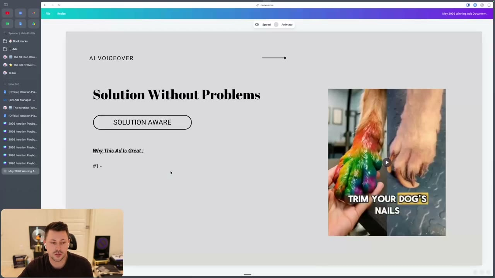
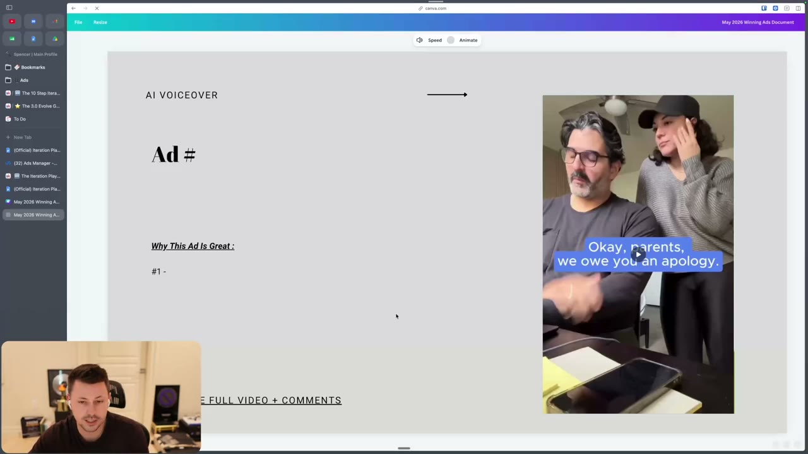
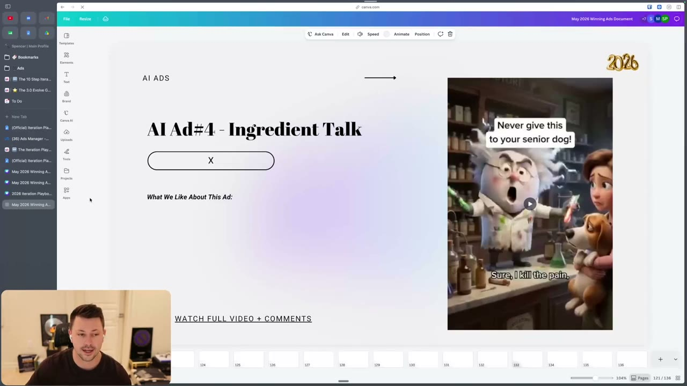
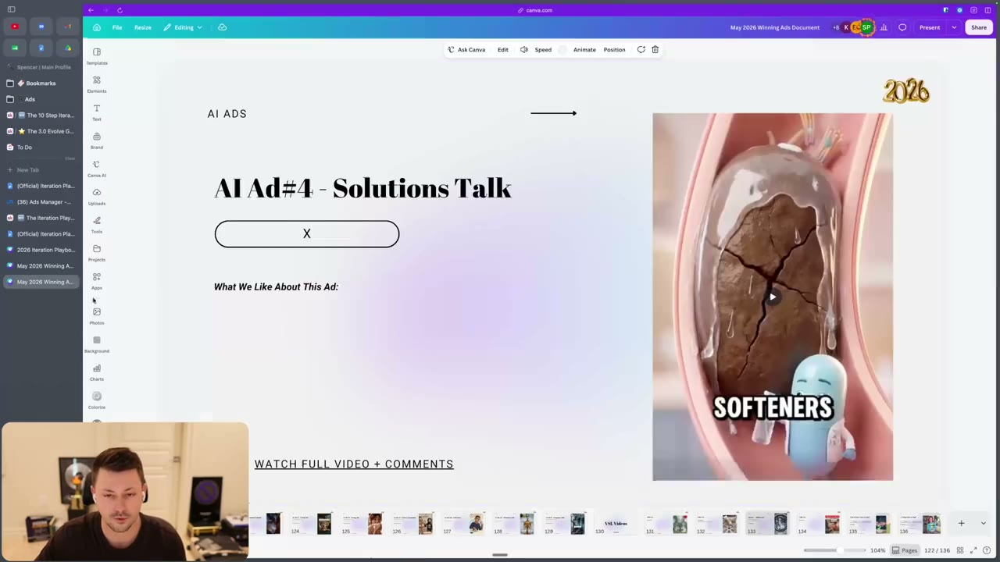
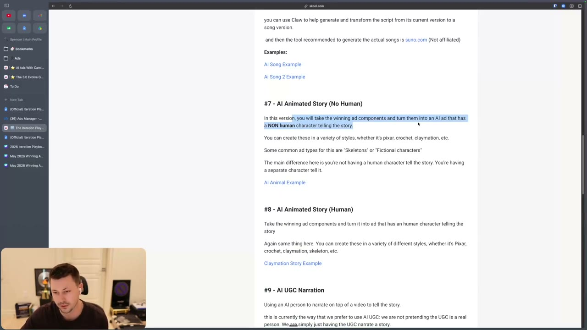
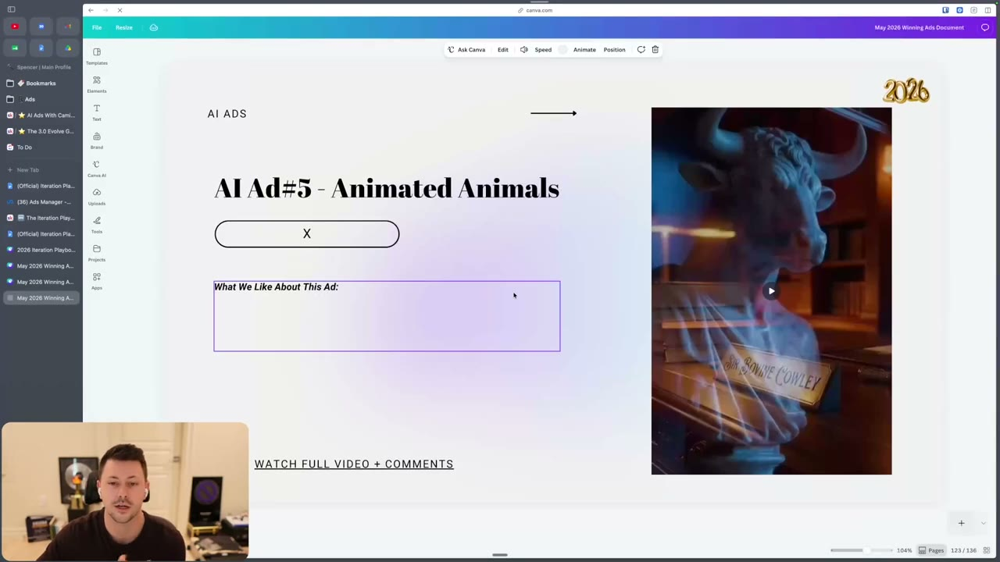
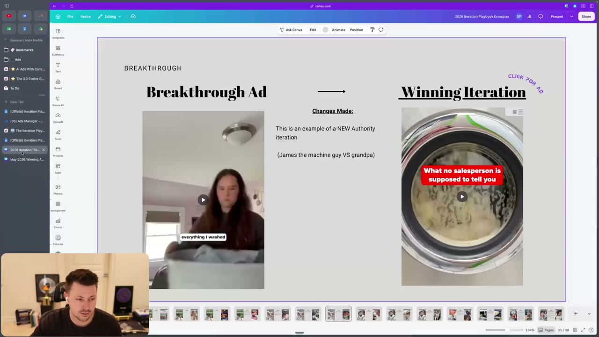
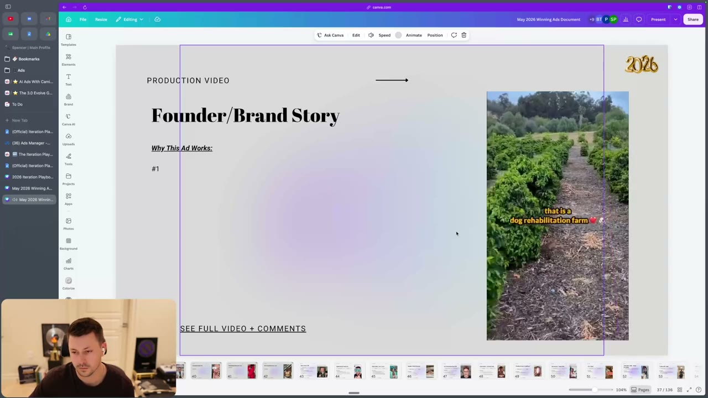
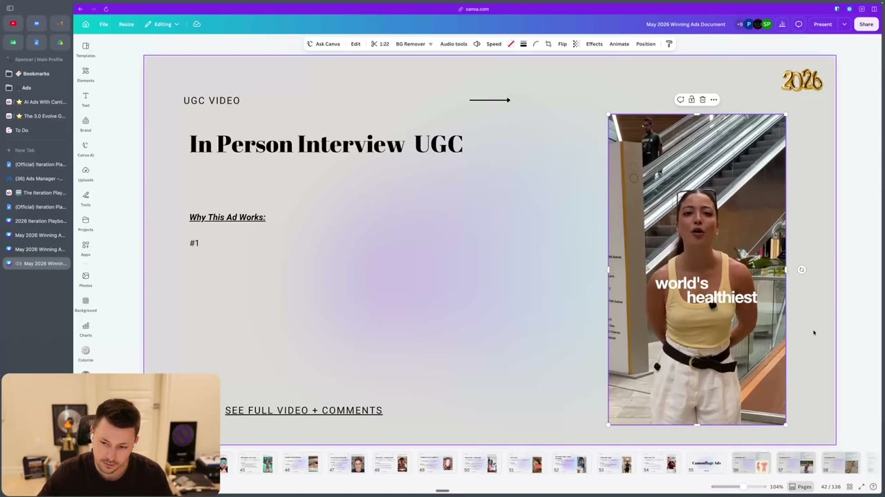
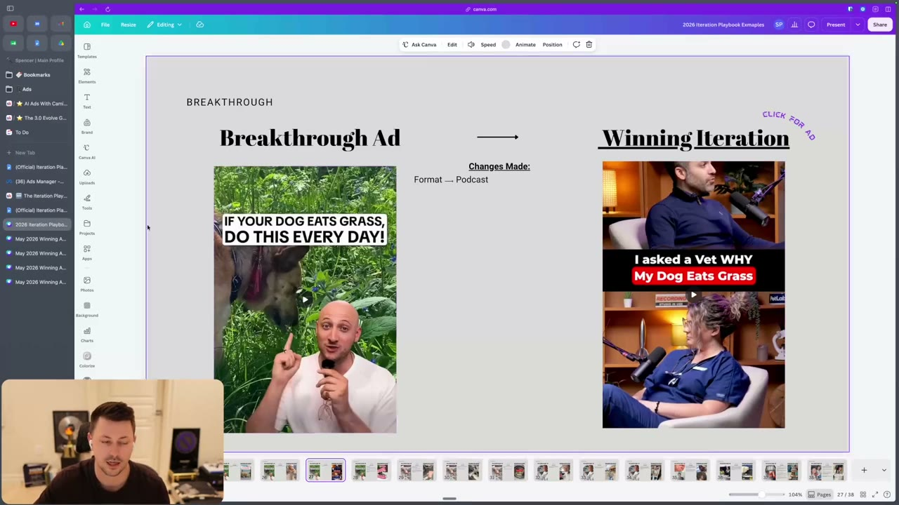

# 53. The Iteration Playbook - Formats & Styles
> Fifteen ways to re-execute a winning ad's components in a different format or style (voiceover vs text, multiple real UGC creators, five kinds of AI-animated ads, AI narration, VSL, native, founder/authority, street interview, podcast, stacked mega-ad), with when each is worth using.

## 🤖 Agent use
- **Use when:** a spend winner or breakthrough ad exists and the next test is a different *format* or *style* of the same script/components, not new copy. Also use it to name the format of a competitor ad before remixing it.
- **Inputs → outputs:** the winning ad's components (hook, mechanism, authority, awareness level, valence/intensity; see [52](52-the-iteration-playbook-script.md)) + available resources (creators, founder/expert access, AI tools, budget) → a ranked shortlist of format iterations with the component each must preserve and the production note.
- **Rules:**
  - **DO** break the ad into components first, then "optimize scripts for different formats. It just absolutely crushes." [00:00]
  - **IF** the original has a voiceover **THEN** test text-on-screen, and vice versa; the same script with different emotional music changes valence/intensity. [00:00-01:23]
  - **DO** give the same concept (and script if possible) to 2-3 real UGC creators; copy the winning hook word for word at least once. [01:23-03:13]
  - **IF** the mechanism, ingredients or competing solutions are hard to explain **THEN** personify them in AI animation: make the mechanism or ingredient the hero and "villainize" other solutions. [03:58-05:36]
  - **IF** you have new information about the cause of the problem **THEN** let a body part or hormone say it. [05:36-06:32]
  - **DO** keep AI "UGC" honest: the instructor prefers an AI person as narrator, "a visual AI voiceover", "we are not pretending the UGC is a real person". [08:51-09:37]
  - **IF** you have an identified authority in the script **THEN** have the real authority (founder, doctor, specialist, the actual expert) deliver it; "the authority is actually delivering it. Not someone who knows the authority". [11:13-13:09]
  - **DON'T** make a VSL just by making the ad longer: "you're not just making it longer for the sake of making it longer." [10:17-11:13]
  - **DON'T** reuse a creator's setting prop across avatars without checking it fits (a guy in a nail salon "doesn't make sense"; use a bar or barber shop). [03:13-03:58]
- **See also:** [52. Script iterations](52-the-iteration-playbook-script.md) · [54. Iteration examples walkthrough](54-iteration-examples-breakdowns-walkthrough.md) · [Native advertising](../../../../concepts/native-advertising.md) · [Format variation ladder](../../../../frameworks/format-variation-ladder.md) · [Iteration vs variation](../../../../concepts/iteration-vs-variation.md)

## Key ideas

### Framing [00:00]
- "The final boss of format and styles"; the instructor says it is what viewers most want, and "when you guys are able to... break down your ad into its components... and then optimize scripts for different formats. It just absolutely crushes." [00:00]
- Problem statement (page): turn spend winners into breakthroughs, and one breakthrough into several that scale. Page title: "Breakthrough Ad Format / Ad Style Iterations". The numbers are "in no particular order... the order in which we have things", though harder ones were pushed to the bottom. [13:47]
- The next video is a full walkthrough of all iteration types: [54](54-iteration-examples-breakdowns-walkthrough.md). [15:49]

### Formats using humans (#1, #2, #12, #13, #14) [00:00-03:58; 11:59-15:16]
- **#1 Voiceover vs text on screen:** "very standard ads that you guys see us make all the time." Example shown: a voiceover ad ("Here's how to safely trim your dog's nails without fear") and a no-voiceover text-on-screen ad. He admits these were not exact A/B pairs of the same ad. [00:00-01:23]
- **#2 Real UGC creators:** hand the components to multiple creators. Example of a creator who did a poor job because "this was a losing ad"; another keeps the same components with an older vs younger demographic ("I am never coming back to this nail salon again. I just heard everything."). [01:23-02:37]
- Lukas Pakter (Haus, "$5M/mo founder" per page; Whisper heard "Lucas") recommends three videos per new creator: (1) copy the top winning script, word for word if possible, (2) iterate on the top winning ad (identify components, write a new script), (3) imitate top daily viral ads. [02:37-03:13; page #2]
- Why copy word for word: it "lower[s] the potential errors". He says copying the top winning hook "kind of word for word" recently "led to a new breakthrough ad for us." (instructor claim) [02:37]
- Brands that scale "just follow the same script" with many creators (instructor names Comfort, Haus, "even Bloom" as heard; Whisper spellings uncertain). The same script resonates differently by viewer: "if I see a guy that looks more like me talking about the same script... that is great". [03:13-03:58]
- **#12 Founder/authority delivery:** "one of my favorite iterations... if you want to create ads that can't be copied." A founder film "creates authority that no one else can copy", or a doctor/specialist/expert delivers the winning script or a new script built on the components. Recent win: they "identified an authority in our script" and had that authority do a similar script. [11:59-12:29]
  - Examples shown: a doctor-style talking-head ad on a pharmacy topic (the instructor says "He could just be an actor. We don't know."); an appliance-store worker: "I work at an appliance store and I need to tell you something about your washer that no salesperson is supposed to say."; a coffee-farm founder (dog rehabilitation farm) as a founder video that "doesn't need to be overly intense". [12:29-13:47]
  - The washer pair is the authority swap of the grandpa ad: grandpa -> "James the machine guy" (slide "NEW Authority iteration"). He wanted a grandpa to film it but "finding a grandpa to actually film the video might be hard." [12:29]
- **#13 Street interview:** harder; "you're probably going to need to get a street interview agency." The example is the chocolate-bar creator now interviewing: "Today, I'm asking strangers to guess the ingredients in the world's healthiest chocolate bar. And if they guess correctly, I'm giving them $20 in cash." Raise stakes with larger prizes ($10,000 mentioned); agencies exist (he knows people in Evolve who used them but cannot recommend them). [13:47-14:22]
- **#14 Podcast style:** reformat the script into a conversation between two people; "provides a completely different visual". Example: "If your dog eats grass, do this every day" becomes "I asked a Vet WHY My Dog Eats Grass" in a podcast set (slide: "Format -> Podcast"). [14:22-15:16]

### AI-animated formats (#3-#9) [03:58-09:37]
- **#3 Animated ingredients/mechanisms:** personify the mechanism or ingredients "to communicate the same angle"; "turning your mechanism or ingredient into a hero is what converts best." Example ad (dog joint supplement): animated drug says "Sure, I kill the pain, but I can also destroy their liver, their stomach, and their kidneys. One bad reaction and your dog's gone." Ingredient characters answer "I'm Glucamine. And I'm Conjotin. We rebuild your dog's joint tissue." (Whisper spellings; the ingredients are presumably glucosamine and chondroitin.) The instructor calls the intensity "borderline being kind of a piece of shit" (an ethics flag). "This style crushes... one of the ads formats that are working the best for us." [03:58-04:48]
- **#4 Animated solutions:** personify other solutions in the market; "villainizing the other solutions and then showing yours as the hero." Example: one of their top ads, "spent, I think over like 500, $600,000 already" (instructor claim), with characters like "Hi, I'm fiber. And all I do is this... I don't actually help anything." On-screen characters: "Waste", "Softeners". [04:48-05:36]
  - Why it works: complicated ingredients and mechanisms become interesting and easier to visualize; "when you're writing about what it does in your script, nobody really cares. But when you're able to AI animate it... I'm kind of learning something." [05:36]
- **#5 Animated body parts or hormones:** words come from body parts "will immediately stop the scroll just due to the juxtaposition". Pair it with *new information* about the real cause (stomach, dog, chin talking, "come clean"). He notes the format "is still relatively new" and may need updating "depending on when you're watching this". He says Ryze (Whisper: "rise") makes many. [05:36-06:32]
- **#6 AI singing:** have Claude convert the script into a rhyming song, then generate the song with Suno (suno.com, "not affiliated", recommended by Camilo, who has a call recording and "AI Ads With Camilo" module). Slides: "AI Ads #7 - AI Song Ads", "A song for dogs growing old". [06:32-08:03]
- **#7 AI animated story, no human:** a non-human character (Pixar, crochet, claymation styles; common: skeletons, fictional characters) tells the story; "very obvious that it's AI, but it makes it more interesting." Example: a giant buffalo/minotaur-like character ("The world's forgotten what's real. So we, the founding others...", slide "AI Ad #5 - Animated Animals"). [08:03-08:51]
- **#8 AI animated story, with a human:** same styles; example is a claymation founder-story ad ("This is Sana, founder of Jawahir. Sana noticed that the UK market was..."), useful "for some of you who don't want to get on camera". [08:51-09:37]
- **#9 AI UGC narration:** "Using an AI person to narrate on top of a video"; "we are not really into pretending that the AI UGC is a real person... Do what you want. You have your own moral compass." Example: an AI woman on screen says "I saw a video where someone took a pen..." and he notes "you're an AI. We know you didn't see it", so change the script so it does not claim a human experience. [08:51-09:37]

### Long and mixed formats (#10, #11, #15) [09:37-11:13; 15:16-15:49]
- **#10 VSL expansion:** go deeper on education, mechanism and proof, usually at a higher level of awareness or an unaware style. "Much more labor intensive", needs "a lot of copy that isn't just fluff", and you "might find yourself with... a mini VSL that's like two three four minutes long" by expanding the problem, answering objections, raising stakes and creating urgency (script iterations from [52](52-the-iteration-playbook-script.md)). Study the VSL slides in the "Winning Ads" Canva doc (not in course files). He mentions one VSL of "about five minutes" and another of about four minutes with different authorities. He has no direct before/after VSL example. [10:17-11:13]
- **#11 Native/camouflage static:** "Create a static ad with primary copy that mirrors the winning ad script and components. Feels like organic content, not an ad." He wants to see native ads "turn[ed] into all these other formats by breaking down the actual components". Page: "Although I do sometimes talk down on these native ads, they are good ad types to test as well, especially if you have a breakthrough." [11:13; page #11]
- **#15 Stack winners mega-ad:** stitch 2-4 winning clips/hooks from different breakthrough ads (same angle) into a longer compilation; "you gotta edit it and flow it to make sense". They have done it and it won, but client NDAs prevent sharing and he found no public example. [15:16-15:49]

## Steps / framework
Choosing a format iteration (derived from the lesson):
1. List the components that must survive (angle, mechanism, authority, hook idea, valence/intensity).
2. Check resources: creators available? founder or expert on camera? AI animation and music tools? Agencies/budget for interviews or sets?
3. Pick formats by constraint using the table below. Easy first (#1, #2, #11), AI-animated next (#3-#9), production-heavy last (#12-#14), wild card (#15).
4. Brief each execution with the winning script or component sheet and the line "same components, new format".
5. Record in the test sheet which component each new version keeps (format vs script iteration, see [iteration vs variation](../../../../concepts/iteration-vs-variation.md)).

### Format and style chooser
| # | Format / style | What it is | Use when | Needs | Example named in lesson | Source |
|---|---|---|---|---|---|---|
| 1 | Voiceover <-> text-on-screen | Same script delivered by voiceover or on-screen text; change music for valence/intensity | You only have one of the two versions | Editor | Dog nail trimming VO vs text-on-screen | [00:00-01:23] |
| 2 | REAL UGC creators video | 2-3 creators recreate the concept/script in their own style | Winning concept exists; you want fewer errors and different avatars | Several creators | Nail-salon overheard ad, two female creators (older and younger) | [01:23-03:58] |
| 3 | Animated ingredients, mechanisms | Mechanism/ingredients as hero characters | Mechanism is complex or ingredients are the story | AI animation | Dog joint ad: drug vs Glucamine/Conjotin | [03:58-04:48] |
| 4 | AI animated solutions | Other market solutions personified and villainized, yours the hero | Competing solutions are the enemy | AI animation | "Hi, I'm fiber... I don't actually help anything"; Waste; Softeners | [04:48-05:36] |
| 5 | AI animated body parts / hormones | Body parts speak and reveal the real cause | You have new information on the cause | AI animation | Talking stomach, dog, chin | [05:36-06:32] |
| 6 | AI singing version | Script becomes a rhyming song, animated | Story or vibe-friendly angle | Claude + Suno + animation | "A song for dogs growing old" | [06:32-08:03] |
| 7 | AI animated story (no human) | Non-human character tells it (Pixar, crochet, claymation, skeletons) | You want a clearly AI, interesting narrator | AI animation | Buffalo/minotaur character; "Sir Bovine Cowley" nameplate on screen | [08:03-08:51] |
| 8 | AI animated story (human) | Human character tells it, stylized | Founder won't go on camera | AI animation | Claymation founder story (Jawahir) | [08:51-09:37] |
| 9 | AI UGC narration | AI person narrates over footage ("visual AI voiceover") | You want a face without pretending it is real | AI avatar | AI woman narrating the pen/suitcase script | [09:37] |
| 10 | VSL expansion | Longer ad with education, mechanism, proof | Strong problem, objections and urgency material; higher-awareness or unaware start | Heavy copy skill | 4-5 minute VSL ads in the winning-ads doc | [10:17-11:13] |
| 11 | Native / camouflage ad | Static whose primary copy mirrors the script; looks organic | Breakthrough exists; test static | Designer / copy | Native examples (not shown in video) | [11:13] |
| 12 | Founder / authority delivery | Founder or real expert delivers the script | An authority was identified as a working component | Access to founder/expert | Pharmacist-type doctor; appliance-store worker; coffee-farm founder | [11:59-13:47] |
| 13 | Street interview | Interviews of strangers following the winning components | Capital and an interview agency available | Agency or bold creator | Chocolate-bar "guess the ingredients, win $20" | [13:47-14:22] |
| 14 | Podcast style | Two people discuss the topic on a set | You can film in person, even on a set | Set, two people | "I asked a Vet WHY My Dog Eats Grass" | [14:22-15:16] |
| 15 | Stack winners mega-ad | Stitch 2-4 winning clips/hooks into one long ad | Several breakthroughs around the same angle | Editor | None public; client work under NDA | [15:16-15:49] |

## Examples
See the format table and the Ad teardowns table. Key before -> after format pairs: dog-grass talking head -> vet podcast set; washer grandpa -> appliance-store worker; chocolate-bar UGC -> street interview; pen/suitcase UGC -> AI narrator.

## Structured units

### Ad teardowns
| Brand / product (niche) | Format | Hook / opening | What works | What fails | Fix suggested | Principle | Source |
|---|---|---|---|---|---|---|---|
| Dog nail trimming product (pets), slide "Solution Without Problems / SOLUTION AWARE" | AI voiceover video | "Here's how to safely trim your dog's nails without fear." Text on slide: "TRIM YOUR DOG'S NAILS" | Shown as a plain voiceover example | Not an A/B twin of the text version (instructor says so) | Test the text-on-screen version and different music | Voiceover <-> text | [00:00-01:23] |
| Parent/kid ad "Okay, parents, we owe you an apology." | Text-on-screen (no voiceover) | On-screen text hook | Shows the text-on-screen format | Not the same ad as the VO example | - | Voiceover <-> text | [00:41-01:23] |
| Nail-salon overheard ad (beauty/lifestyle, product not named), creator copies | Real UGC, two female creators | "I am never coming back to this nail salon again. I just heard everything." | Same components, different age demographic | One version was a loser, not done well | Use multiple creators; keep script word for word | Real UGC creators | [01:23-02:37] |
| Dog joint supplement (pets) | AI animated ingredients | "Your vet prescribed me for your dog's joint issues. Sure, I kill the pain, but I can also destroy their liver, their stomach, and their kidneys. One bad reaction and your dog's gone. I'm Glucamine. And I'm Conjotin. We rebuild your dog's joint tissue." (as transcribed) | Mechanism made visual; ingredient heroes vs villain drug | Instructor: very intense "borderline being kind of a piece of shit" | Keep claims true; tone down fear if not supportable (derived) | Ingredients as heroes | [03:58-04:48] |
| Fiber/digestive product (health; niche inferred from the slide, product not named) | AI animated solutions | "Hi, I'm fiber. And all I do is this... I don't actually help anything." | Villainizes other solutions; one of their top ads, "$500-600K" (instructor claim) | - | - | Solutions talk | [04:48-05:36] |
| Dog song ad | AI song | Slide: "A song for dogs growing old" | Music/story vibe | Instructor: "I'm not entirely sure because I didn't get all the way through the recording" of the creator call on AI singing | - | AI singing | [07:29] |
| Coffee farm brand (Flip Coffee as heard; dog rehabilitation farm) | Founder video | "We have a coffee farm in Southern California that is a dog rehabilitation farm. We rehabilitate dogs." | Founder story, mission; "doesn't need to be overly intense" | - | - | Founder delivery | [13:09-13:47] |
| Appliance-store worker washer ad | Authority-delivered UGC | "I work at an appliance store and I need to tell you something about your washer that no salesperson is supposed to say." Slide: "What no salesperson is supposed to tell you" | Real authority speaking; "NEW Authority iteration (James the machine guy VS grandpa)" | - | - | Real authority | [12:29-13:09]; slide 12:56 |
| Chocolate bar (food), creator interview | Street interview | "Today, I'm asking strangers to guess the ingredients in the world's healthiest chocolate bar. And if they guess correctly, I'm giving them $20 in cash." | New format on the same creator/components; stakes raised via cash prizes | Hard to execute | Use agency | Street interview | [13:47-14:22] |
| Dog grass-eating ad (pets) | Podcast style | "I asked a Vet WHY My Dog Eats Grass" | Authority (vet) and new visual | - | - | Podcast format | [14:22-15:16]; slide 15:12 |

### Rewrites
| Before | After | What changed (verb / visual / promise / self / intensity) | Source |
|---|---|---|---|
| "If your dog eats grass, do this every day!" (man on camera) | "I asked a Vet WHY My Dog Eats Grass" (podcast set, two people) | Format -> podcast; authority and visual changed | [14:22-15:16] |
| Grandpa washer-repair authority | "I work at an appliance store..." / "What no salesperson is supposed to tell you" | Authority swapped to a real insider | [12:29-13:09] |
| UGC chocolate-bar claims | "Guess the ingredients, win $20" street interview | Format + stakes (cash prize) | [13:47-14:22] |
| AI avatar saying "I saw a video where someone took a pen" | Avatar narrates without claiming a human experience (instructor's point, derived fix) | Removes a false first-person claim from AI UGC | [09:37] |

### Templates
| Template | Use for | Example fill | Source |
|---|---|---|---|
| 3-video creator brief (Lukas Pakter via instructor) | New UGC creators | 1 video: copy the top winning script word for word; 1 video: iterate on the top winning ad (identify components, new script); 1 video: imitate from the top daily viral ads | page #2; [02:37] |
| Solutions-talk opener | AI animated solutions | "Hi, I'm [competing solution]. And all I do is [thing]. I don't actually help anything." | [04:48] |
| Ingredient-hero drama | AI animated ingredients | Villain: "Sure, I [benefit], but I can also [harm]." Heroes: "I'm [ingredient]. We [do the mechanism]." | [03:58] |
| Street-interview opener | Street interview | "Today, I'm asking strangers to guess [hero claim]. And if they guess correctly, I'm giving them $[amount]." | [13:47] |
| Authority opener | Authority delivery | "I work at [relevant place] and I need to tell you something about [product category] that no [role] is supposed to say." | [12:29] |

## Prompts / templates (verbatim)
No prompts are supplied. The only tool instructions are: "have Claude turn it into a rhyming song with AI animation" and "the tool recommended to generate the actual songs is suno.com (Not affiliated)" (page #6). The instructor refers to Camilo's call recording for how to build the AI ads; it is not in the course files.

The page's numbered list (verbatim headings):

```text
#1 - Voiceover <-> Text-on-Screen
#2 - REAL UGC Creators Video
#3 - Animated Ingredients, Mechanisms
#4 - AI Animated Solutions
#5 - AI Animated Body Parts or Hormones
#6 - AI Singing Version
#7 - AI Animated Story (No Human)
#8 - AI Animated Story (Human)
#9 - AI UGC Narration
#10 - VSL Expansion
#11 - Native/Camouflage Ad
#12 - Founder/Authority Delivery
#13 - Street Interview Style
#14 - Podcast Style
#15 - Stack Winners Mega-Ad
```

## Screenshots

*Canva "May 2026 Winning Ads Document" slide "Solution Without Problems / SOLUTION AWARE" used as the voiceover example (dog nail trimming). [00:38]*


*Text-on-screen example, "Okay, parents, we owe you an apology." [00:48]*


*"AI Ad #4 - Ingredient Talk": an animated senior-dog scientist character, "Never give this to your senior dog!" [04:17]*


*"AI Ad #4 - Solutions Talk": anthropomorphized "Softeners" in a digestive tract. [06:36]*


*"AI Ads #7 - AI Song Ads": "A song for dogs growing old". [08:09]*


*"AI Ad #5 - Animated Animals": the non-human character example. [08:34]*


*"This is an example of a NEW Authority iteration (James the machine guy VS grandpa)": "What no salesperson is supposed to tell you". [12:56]*


*"Founder/Brand Story" production-video example (coffee farm). [13:40]*


*"In Person Interview UGC" slide: "world's healthiest". [14:16]*


*"Format -> Podcast": dog-grass talking head becomes "I asked a Vet WHY My Dog Eats Grass". [15:12]*

## How to apply
- [ ] Name the format of the winning ad and the formats not yet tested.
- [ ] Always include #1 and #2 (cheap, low-risk) in the first batch of format tests.
- [ ] For AI ads, state which of the five AI types applies and what the mechanism/ingredient/solution/body-part character says.
- [ ] If using an AI narrator, remove first-person claims the AI cannot have had (e.g. "I saw a video").
- [ ] When changing creator or avatar, check props and settings still make sense (nail salon -> bar/barber).
- [ ] Verify all health, safety or "your dog is gone" claims are true and supportable before animating a fear hook.
- [ ] Send creators the three-video brief (copy / iterate / imitate).

## Related
- Previous: [52. The Iteration Playbook - Script](52-the-iteration-playbook-script.md) · Next: [54. Iteration Examples & Breakdowns (Walkthrough)](54-iteration-examples-breakdowns-walkthrough.md)
- [Creative testing system](../../../../frameworks/creative-testing-system.md) · [Skeptic format](../../../../frameworks/skeptic-format.md)

## Sources and limitations
- Transcript: [53. ... Formats & Styles .txt](<../../../../../raw/evolve/copywriting/_transcripts/✍️ Evolve Copywriting (NEW)/53. 🆕 The Iteration Playbook - Formats & Styles ✍️ Evolve Copywriting (NEW) Evolve.txt>) · Page text: [53 ….html.md](<../../../../../raw/evolve/copywriting/_extracted/✍️ Evolve Copywriting (NEW)/53. 🆕 The Iteration Playbook - Formats & Styles_✍️ Evolve Copywriting (NEW)_Evolve.html.md>)
- Machine transcription (Whisper large-v3-turbo); full recording covered (last segment 16:12). Uncertain: "Lucas"/"Lukas Pakter", "Haas"/Haus, "Comfort", "Bloom", "Rise" (Ryze?), "Remedil", "Glucamine/Conjotin" (read from the ad audio), "Croatian" (crochet), "Manator". Video text includes audio from the played ads (not the instructor).
- The Canva decks (`canva.link`) and the "Winning Ads Doc" are not in the course files; slide text above comes from screen frames only. Camilo's AI-ad call recording and the Daily Virals video are not included.
- Dollar figures ("$500, $600,000", "$5M/mo") are instructor/page claims.
