# 54. Iteration Examples & Breakdowns (Walkthrough)
> A slide-by-slide walkthrough of about 25 real before/after ad pairs (losers, KPI winners, spend winners, breakthroughs), each labelled with the issue that was fixed (hook, sub-avatar, valence/intensity, empty claims, bridge, belief, offer, urgency, stakes, funnel congruence, misleading, easily replicable) and what the iteration changed.

## 🤖 Agent use
- **Use when:** diagnosing why an ad underperforms or why a competitor's "version 2" works, and choosing which iteration to write. Treat the Ad teardowns and Rewrites tables here as a pattern library of "issue -> fix".
- **Inputs → outputs:** an ad (script, visuals, landing page, comments) plus its tier (loser, KPI winner, spend winner, breakthrough) -> a diagnosis using the issue codes below, and an iteration (new hook, bridge, offer line, format, authority, avatar, or landing page).
- **Rules:**
  - **DO** label every change you make ("Changes Made") and keep track when you change several things at once (e.g. format and awareness level). [08:49]
  - **IF** the ad's hook is an opinion with no curiosity **THEN** juxtapose or ask a question, e.g. "chocolate stopped feeling like chocolate" -> "This is a cacao pod" (slide #1/#6). [01:18-02:09; slide 1:52]
  - **IF** a loser's claim is empty ("Beat Dad Bod with our product") **THEN** reassign the objection, name a new cause and make the hook land with a more specific sub-avatar. [01:18; slide 1:31]
  - **DO** replace an opinion-based bridge with a fact-based or story-based one; a bridge "just sets up this story, which kind of makes it more interesting". [01:18-02:09]
  - **DON'T** state the offer up front ("save up to 25%"); show vulnerability and urgency instead ("Too good not to share. Even if it hurts our margins."). [03:02-03:53]
  - **IF** a spend winner jumps straight to the product **THEN** add a "not for everyone" line (script trust) or a first-person authority line ("I forgot to brush my dog's teeth for 4 years") before the product. [03:53-04:46]
  - **IF** the stakes are vague **THEN** state the concrete threat ("A thief can use a small device to steal your credit card information"). [04:46-05:32]
  - **DO** match the landing page to the ad angle (funnel congruence); the example went from a spend winner to a breakthrough that "3X'd the entire ad account spend" (instructor claim). [05:32-06:23]
  - **IF** the visual itself is weird (eggs dropped on insoles) **THEN** a visual-only hook can work; **IF** the visual is ordinary (a woman fixing her house) **THEN** a story voiceover or bridge is better. [14:36-15:21]
  - **DO** use hooks that make the viewer want to check something ("Three red flags of vitamin deficiencies in kids") or that show the problem and then label it ("This is what a nutrient deficiency looks like in a kid"). [15:21-17:37]
- **See also:** [52. Script iterations](52-the-iteration-playbook-script.md) · [53. Formats & styles](53-the-iteration-playbook-formats-styles.md) · [48. Iterate on losing ads](48-how-to-iterate-on-losing-ads.md) · [49. KPI winners](49-how-to-iterate-on-kpi-winners.md) · [50. Spend winners](50-how-to-iterate-on-spend-winners.md) · [51. Breakthroughs](51-how-to-iterate-on-breakthroughs.md) · [Competitor ad teardown playbook](../../../../playbooks/competitor-ad-teardown.md)

Lesson page text: only a link to the Canva deck "The Iteration Playbook Examples & Breakdowns" (`canva.link/rla2o4gfzashvxf`, not in the course files) and a note to catch up on the newest definitions (a Skool page, not in the files).

## Key ideas

### Purpose and deck structure [00:00-00:36; 18:10]
- Final part of the iteration series: walk through the deck "so you guys can see a little bit more about some of these iterations", for losers, KPI winners, spend winners and breakthroughs. [00:00]
- The deck has four sections (title slide: LOSERS, KPI WINNERS, SPEND WINNERS, BREAKTHROUGHS) and "30 plus examples" (38 pages). [00:00; 18:10]
- Numbers on slides are issue codes from the iteration doc ("these numbers are all in coordination to these iteration things"). Codes as they appear on the slides: #1 Hook issue; #2 TAM issue (instructor audio "tan issue"; slide text contrasts a specific sub-avatar with a larger audience); #3 Valence & intensity; #5 Empty claims; #6 Bridge issue; #7 Belief issue; #8 Offer issue (and "Belief issue" on the dental slide); #9 Urgency issue; #10 Stakes issue; #11 Funnel congruence; #12 Misleading issue; #13 Time issues / easily replicable. The full doc is not in the course files. [00:36; slides]
- Caveat: because of NDAs "we can not share our internal ads & data together", so "Spend/KPI winners" are labelled on limited data: "I don't have 100% data that says this is definitely a KPI winner... I'm relatively confident". [02:09-03:02; slide 3:04]
- He cannot show scripts written for clients; the follow-up he is working on is hook templates built from breakthroughs (see [57](57-100-hook-templates-form-winning-ads-deck.md)). [18:10]

### Valence and intensity: any zone can win [01:18-02:09]
- "Valence and intensity rather doesn't always dictate; there are winning ads in every single zone" (high intensity / high valence, or high intensity / low valence); low valence / low intensity can sometimes work. "The intensity exists on a scale where you can go way too intense... and then you can also go so little intense that it's just boring." [01:18]
- See [valence](../../../../concepts/valence.md) and [intensity](../../../../concepts/intensity.md).

### Losers -> winning iterations [00:00-03:02]
- Men's testosterone ad (TRT): visuals, sub-avatar and valence/intensity changed. [00:00-01:18]
- Cortisol-belly static: empty claim replaced by a reassigned objection and a new problem. [01:18]
- Chocolate: opinion bridge -> fact bridge, opinion hook -> curiosity hook. [01:18-02:09]
- Back-deck story: random clips -> a story bridge. [02:09-03:02]
- Korean cream: juxtaposition hook plus a stand-in authority. [02:09; slide]

### Spend/KPI winners -> iterations [03:02-06:23]
- Offer vulnerability (glow bundle), bridge belief ("this might not be for everyone", dog dental), stakes (wallet), misleading issue (dog leash), funnel congruence (gut-health soup; hair-removal landing page). [03:02-06:23]

### Breakthroughs -> iterations [06:23-17:37]
- Format changes (claymation, Pixar, podcast), hook remake with authority, desire shift (health -> status), awareness change (problem -> solution aware), authority change (grandpa -> appliance-store worker), new story same format (nail-salon variants), new creator, visual-only hook, and a direct-visual hook (vitamin deficiency). See tables. [06:23-17:37]
- Same breakthrough, multiple iterations: "This is Pet Lab Co. They sold for hundreds of millions of dollars. So these guys probably know what they're doing." (instructor claim) [08:49]

## Steps / framework
Diagnose-then-iterate sequence (derived from the walkthrough):
1. Identify the ad tier (loser / KPI winner / spend winner / breakthrough) and the data confidence.
2. Check each issue code in order: hook (#1), sub-avatar/TAM (#2), valence & intensity (#3), empty claims (#5), bridge (#6), belief (#7), offer (#8), urgency (#9), stakes (#10), funnel congruence (#11), misleading (#12), easily replicable (#13).
3. Write one iteration per issue, label "Changes Made" on a slide-style card.
4. For a breakthrough, change format, awareness, authority, desire, creator or story while keeping the angle and mechanism; record every change.

## Examples
See the two tables below for every ad pair with its slide text and the transcript commentary. "Source" shows the transcript time and the deck slide where the frame is the only evidence.

## Structured units

### Ad teardowns
Niches/products are named only when the slide, audio or on-screen text names them; otherwise described. Slide text is quoted from the Canva deck frames.

| Brand / product (niche) | Format | Hook / opening | What works | What fails | Fix suggested | Principle | Source |
|---|---|---|---|---|---|---|---|
| Men's testosterone-support product (men's health), LOSER | Video ads (AI visual) | Losing: AI man looking into a mirror | - | #1 hook issue; #2 hook calls out a narrow sub-avatar (men a few months into TRT with a negative experience, per audio); #3 low valence / low intensity, focused on problems (acne, bloating) | Winning: sketch of a muscular man with a real needle being injected, text "I almost started testosterone injections until I found this." High valence/high intensity, outcome focus: "double test levels without touching a needle" | Juxtaposition; broader audience (men considering TRT, scared of injections); outcome over problem | [00:00-01:18]; slide 0:51 |
| Mars Men (cortisol-belly men's product), LOSER | Static image ad | "CORTISOL BELLY ALMOST GONE!" - Russ B. / "BEAT THE DAD BOD WITH MARS MEN" | - | #5 empty claims in a sophisticated market ("Sure, buddy."); #2 hook only reaches men who know "Cortisol Belly"; #3 Zone 1 (positive) mirror transformation | Winning: "THAT BELLY ISN'T BEER - IT'S CORTISOL KILLING YOUR TESTOSTERONE" (cartoon figure, "WORK HARD"): reassigns the objection, points to a new problem (cortisol), Zone 4 (negative) big gut and "KILLING testosterone" | Name a new cause; negative zone | [01:18]; slide 1:31 |
| Chocolate bar / cacao (food), LOSER | Video, Mr. Goodbar-style wrapper visual | Losing hook: opinion ("chocolate stopped feeling like chocolate") | - | #6 bridge all opinion ("super sweet, not satisfying, feels like more sugar"); #1 hook is an opinion with no curiosity | Winning: creator holds a cacao pod, "This is a cacao pod"; bridge is fact: "it's where chocolate comes from, it started off as medicine"; curiosity via a question and "chocolate not being the #1 ingredient" | Fact bridge; curiosity gap | [01:18-02:09]; slide 1:52 |
| Back-deck refresh (DIY/home), LOSER -> BREAKTHROUGH iteration | Creator video | Losing: person working on a deck, "fixing the ugliest thing about my house"; Winning: "This is the coolest thing we've added to our house:" | Winning bridge: "If you're new here, hi, I'm Sammy and welcome to part three of our back deck refresh. So far, we've replaced some boards." + a tease of the end result + fast-forward hook (credit: Sarah Levinger on slide) | #3 negative valence; #6 losing clips "zero context" | Story bridge + positive valence/intensity; woman doing the project (instructor: "sexist as it sounds" it works because viewers expect a man) | Bridge as story setup; tease the payoff | [02:09-03:02]; slide 2:14 |
| Korean $9 anti-wrinkle cream (skincare), LOSER | UGC video | Losing: the cream made her look "like a 17-year-old again" | - | #5 empty claim; #7 belief: no other authority than a random girl "who, for all we know, could just actually be 17" | Winning: #1 hook "When you're 35 but don't have a wrinkle in sight" (juxtaposition), "$9 cream can be better than Botox" (juxtaposition), authority "some MILF" talking, implying older, good-looking, trustworthy | Juxtaposition + authority by implication | [02:09]; slide 2:47 (transcript only says "empty claims, belief issue") |
| Glow-back skincare bundle (skincare), KPI WINNER | Static image | "GET YOUR GLOW BACK, SAVE UP TO 25%" | - | #8 offer stated up front, "a very empty claim and everybody does this" | Winning: "Too good not to share. Even if it hurts our margins." "Our best bundle. Ever. This is your only chance to get it." The offer is not stated; vulnerability and urgency build belief without authority ("#7 belief") | Vulnerable offer framing | [03:02-03:53]; slide 3:24 |
| Dog dental powder (pets; slide notes it is not a real ad iteration), SPEND WINNER | Video | "Don't brush your dog's teeth? Food builds up quickly causing issues" / "This new powder for clean dog teeth can help" | Gets spend | #8 belief: goes straight to the product, no earning of trust. (From the lesson-52 slide: #9 no facts follow the claim) | Script version: "Depending how bad your dog's buildup is, this new powder for clean dog teeth may still be able to help." (earn trust by saying it is not for everyone). Authority version: "I forgot to brush my dog's teeth for 4 years, but this new powder for clean dog teeth was able to help." Instructor extends it: "I would know because I didn't brush my dog's teeth for the first four years..." | Earn trust; first-person authority | [03:53-04:46]; slides 4:04, [52](52-the-iteration-playbook-script.md) 12:59 |
| Modern wallet / card-blocking wallet (accessories), SPEND WINNER | Video | "Why I regret buying this modern wallet" | Drama | #10 stakes: shows a scanner stealing info but never says what is happening; regret is "decently high stakes, but definitely not as high" | Winning: "Why millennials are ditching their old wallets" because "thieves can use a small device to steal your credit card information" | State the threat; higher stakes | [04:46-05:32]; slide [52](52-the-iteration-playbook-script.md) 16:42 |
| Blue dog leash vs charm collar (pets, "NOT A REAL AD"), SPEND WINNER | Static/video | "Five Reasons Your Dog Needs This Leash" | - | #12 misleading: the cute thing people want is the dog charm collar, so clicks do not convert to leash buyers | Winning: "5 reasons your dog needs these charms" | Match the product shown to what attracts the click | [05:32]; slide [52](52-the-iteration-playbook-script.md) 5:42 |
| 18 Chestnuts (gut-health soups), SPEND WINNER -> breakthrough | Video ad + landing page | "Stomach issues? There's a soup for that." | Working angle (stomach and gut issues) | #11 funnel congruence: ad went to a basic page | New page: "Frustrated With Doctors and Digestive Issues? I was too." with a real founder story ("you wouldn't believe it, it's a real story"), relatable and authority-building, then the product origin; stronger offer (15% off with the founders code). Result: spend winner -> breakthrough, "3X the entire ad account spend" (instructor claim; live case study in the CRO program) | Congruent funnel from the ad angle | [05:32-06:23]; slide 6:27 |
| Nood (men's hair-removal tool; landing page "The Flasher 2.0"), SPEND WINNER (page mismatch) | Video ad + page | "Furry dudes... please DON'T do this to your jewels! You can be totally hairless in just 8 weeks with Nood... 90-day money-back guarantee" | Ad targets men for sensitive areas | #11 landing page hero shows a woman and no mention of male grooming; found "from a multi-eight-figure brand" (slide claim) | "Not a real page" mock: "Flasher 2.0 men's grooming tool", male model, bullets "SAFE for sensitive areas", "Made for men who are scared or hate shaving" | Page matches avatar and angle | [06:23]; slides 6:47 |
| Fire-in-the-bedroom native post (news-style story), BREAKTHROUGH | Native text + image | "I never thought I'd be writing this post, but after what happened last Tuesday night, I think every parent should read this. At 3:17 AM, my son Jake woke me up screaming 'Dad! There's fire in my room!'" | Scales fast: high engagement, much information communicated easily | #13 easily replicable: anyone can regenerate a weirder image and copy and feed it to AI; stories are often fake so no real customer imagery | Needs strong product differentiation, effort and research as barriers to copying | Native ads are quick to copy | [06:23]; slide 6:50 |
| Dog-grass talking-head ad (pet supplement; Pet Lab Co), BREAKTHROUGH | UGC with hook text | "If your dog eats grass, do this every day!" | Breakthrough | - | See iterations below | - | [06:23-10:24]; slide 6:50-7:00 |
| Dog-grass: claymation | AI claymation (non-human) | "If your dog eats grass, do this every day. Now, most owners don't know this, but eating grass is a common behavior across dogs with fluctuations in their gut." | Same script, new format; "winning iteration that is working for them" | - | Format change -> AI claymation (non-human) | Format only | [06:23-07:18]; slide 7:00 |
| Dog-grass: Pixar story (human) | AI Pixar | "Our dogs can't talk to us when they feel off on the inside. Instead, they show us through weird behaviors that we usually just laugh off. Now, most owners don't know this, but eating grass is a common behavior across dogs with fluctuations in their gut health." | Same script body; hook and format changed; "up[s] the awareness level" | - | Format change -> AI Pixar story (human); also problem aware -> more unaware | Format + awareness (tracked) | [07:18-08:49]; slide 7:50 |
| Dog-grass: vet podcast | Podcast set | "My dog eats grass all the time. Every day. Yeah. And you still think that's normal. It's just grass, isn't it? So what's the big deal? Well, grass eating is actually a dog's instinctive behavior to try to balance the bacteria in there." Text "I asked a Vet WHY My Dog Eats Grass" | Authority (a vet) + new visual; not word for word, "optimized to fit this format" | - | Format -> podcast; authority added | Format + authority | [08:49-09:39]; slide [53](53-the-iteration-playbook-formats-styles.md) 15:12 |
| Dog-grass: dog-trainer hook remake | UGC | "I'm a dog trainer and this is why your dog's grass eating habit isn't normal. Most owners don't know this." | Goes "into the exact same hole" with a different hook | - | Authority added; valence/intensity changed ("Now I'm a little bit more worried") | Hook + authority + intensity | [09:39-10:24]; slide [52](52-the-iteration-playbook-script.md) 6:53 |
| Washing-machine cleaner (Uproot-type; home) , BREAKTHROUGH -> desire/awareness iteration | UGC, expert story | Original: "My grandpa used to fix washing machines for a living. This is what he told me to do about the smell." Iteration: "If you've never cleaned your washer, this will be uncomfortable to hear." then "my grandpa is a retired washing machine repairman" | Same authority retained | - | Desire health -> status; more unaware than problem aware | Keep authority, change desire/awareness | [10:24-11:18]; slide 10:30 |
| Washer cleaner: solution-aware | UGC | Hook moves to what is in the cleaner ("Amylase, protease, lipase" enzymes) | Same mechanism, communication style and authority | - | Problem aware -> solution aware, "going lower" | Awareness level | [10:24-11:18]; slide 11:10 |
| Washer cleaner: appliance-store authority | UGC | "I work at an appliance store and I need to tell you something about your washer that no salesperson is supposed to say." | Stakes and curiosity ("What aren't they telling me?"); good for a 4-minute ad: "These guys are masters of being able to create attention and create hooks that can maintain attention" | - | Authority: grandpa -> insider salesperson ("James the machine guy") | Authority swap | [11:18-12:08]; slide 12:00 |
| Nail-salon overheard story (female creator, car), BREAKTHROUGH | UGC post-event debrief | "Absolutely insane" (original) | - | - | Iteration: same "post event debrief" style, new story: "Oh my, that was disgusting. I went up to pay at the register and he told the guy in the back office, oh, there's a cute girl here with nice legs. Come look." Goes after a different fear (men gawking) than the original (women talking badly about her) | New story, same format | [12:08-12:55]; slide 12:10 |
| Nail-salon: new creator | UGC | Creator in a parking lot: "This is why they speak in code language" | Same storyline; new creator and setting; instructor notes another version with a male creator ("Latinos were talking shit about him") | - | Different creator | Creator swap | [12:55]; slide 13:00 |
| Scalp/beard fungus remedy (hair/scalp), BREAKTHROUGH | UGC | Original bridge "it's actually extremely common" | - | Original bridge lowers urgency | Iteration bridge "much more urgency... more intensity... more visual"; creator-swap slide: "a creator sees a winning ad... and they spin up their own version" | Bridge intensity; creator swap | [12:55]; slide 13:10 |
| Steppers viral insoles (footwear/insoles), BREAKTHROUGH | Visual-hook video | Original: "This is your foot hitting the pavement every single step. This is steppers, the viral insoles that relieve your foot pain." | Explains what it demonstrates | - | Iteration: same visual style but no message; a guy drops eggs on insoles ("YOUR FOOT" on screen): leaves curiosity open; "oddly satisfying", payoff comes later | Visual-only hook works when the visual is weird | [12:55-14:36]; slide 14:10 |
| Kid vitamin-deficiency ad (children's nutrition), BREAKTHROUGH | UGC / clip montage | Original: "Three red flags of vitamin deficiencies in kids. Only wanting chicken nuggets." | Makes parents stop to check their own kid | - | Iteration: direct visual (screaming kid, ear-popping audio) with hook "This is what a nutrient deficiency looks like in a kid." + "most parents never connect the dots" + facts ("Did you know that a child's brain is still developing well into their school years?") | Label the problem the viewer already sees | [15:21-17:37]; slide 16:30 |

### Rewrites
| Before | After | What changed (verb / visual / promise / self / intensity) | Source |
|---|---|---|---|
| AI man looking in the mirror (TRT loser) | Sketch of muscular man with a real needle; "I almost started testosterone injections until I found this." | Juxtaposition visual; wider sub-avatar; high valence/intensity | [00:00-01:18] |
| "CORTISOL BELLY ALMOST GONE!" / "Beat the Dad Bod with Mars Men" | "THAT BELLY ISN'T BEER - IT'S CORTISOL KILLING YOUR TESTOSTERONE" | Claim -> new cause; positive zone -> negative zone | [01:18] |
| Opinion hook "chocolate stopped feeling like chocolate"; bridge "super sweet, not satisfying" | "This is a cacao pod"; bridge "it's where chocolate comes from, it started off as medicine" | Opinion -> fact; curiosity question | [01:18-02:09] |
| "fixing the ugliest thing about my house" + random clips | "This is the coolest thing we've added to our house:" + "If you're new here, hi, I'm Sammy and welcome to part three of our back deck refresh. So far, we've replaced some boards." | Negative -> positive valence; random clips -> story bridge | [02:09-03:02] |
| Korean cream made her "look like a 17-year-old" | "When you're 35 but don't have a wrinkle in sight" + "$9 cream can be better than Botox" + older authority | Claim -> juxtaposition + authority | slide 2:47 |
| "GET YOUR GLOW BACK, SAVE UP TO 25%" | "Too good not to share. Even if it hurts our margins." / "Our best bundle. Ever." | Stated discount -> vulnerable, urgent best-bundle frame | [03:02-03:53] |
| "This new powder for clean dog teeth can help" | "Depending how bad your dog's buildup is, this new powder for clean dog teeth may still be able to help." | Overpromise -> qualified, "not for everyone" trust line | [03:53-04:46] |
| "This new powder for clean dog teeth can help" | "I forgot to brush my dog's teeth for 4 years, but this new powder for clean dog teeth was able to help." | Adds first-person authority | [04:46] |
| "I regret buying this wallet" | "Millennials are ditching their old wallets because thieves can use a small device to steal your credit card information." | Regret -> concrete threat | [04:46-05:32] |
| Ad -> basic landing page | Ad angle -> "Frustrated With Doctors and Digestive Issues? I was too." founder-story page + stronger offer | Funnel congruence | [05:32-06:23] |
| Hair-removal ad -> hero image of a woman, generic tool page | "Flasher 2.0 men's grooming tool", male hero, "SAFE for sensitive areas" bullets | Landing page congruence (mock) | [06:23]; slide 6:47 |
| "If your dog eats grass, do this every day!" | "Our dogs can't talk to us when they feel off on the inside..." (Pixar) | Hook rewrite + format + awareness up | [07:18-08:49] |
| "If your dog eats grass, do this every day!" | "I'm a dog trainer and this is why your dog's grass eating habit isn't normal." | Authority + intensity | [09:39-10:24] |
| Health desire for washer smell | "If you've never cleaned your washer, this will be uncomfortable to hear." | Desire -> status; awareness -> unaware | [10:24-11:18] |
| Grandpa-repairman authority | "I work at an appliance store and I need to tell you something about your washer that no salesperson is supposed to say." | Authority swap | [11:18-12:08] |
| Overheard-at-nail-salon story | "he told the guy in the back office, oh, there's a cute girl here with nice legs." | New story, same format, different fear | [12:08-12:55] |
| Insole ad with explanatory voiceover/text | Eggs dropped on insoles with no message | Explain -> curiosity; weird visual only | [12:55-15:21] |
| "Three red flags of vitamin deficiencies in kids. Only wanting chicken nuggets." | "This is what a nutrient deficiency looks like in a kid. And most parents never connect the dots." | Checklist hook -> direct visual + label + facts | [15:21-17:37] |

## Prompts / templates (verbatim)
No prompts are given in this lesson. The lesson page contains only the deck link and a pointer to definitions. The fix patterns above (script version of earning trust, authority version of earning trust) come from the slide "Changes To Make It a Breakthrough" and are in the rewrites table verbatim.

## Screenshots
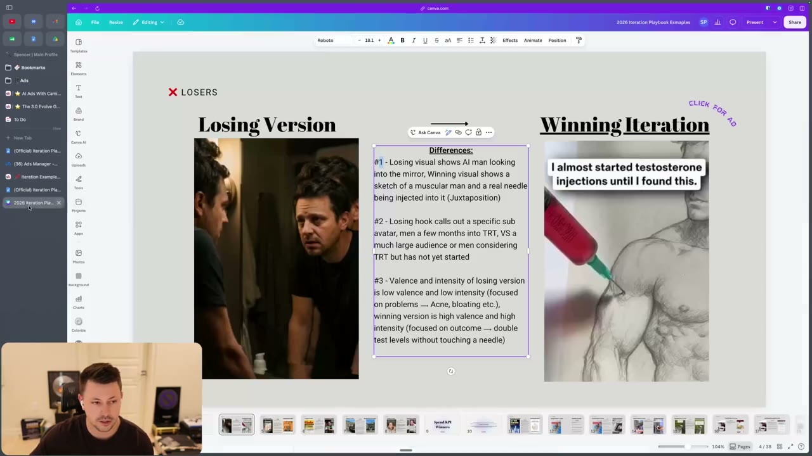
*Loser slide 1: differences listed as #1 hook (juxtaposition), #2 sub-avatar, #3 valence & intensity. [00:51]*

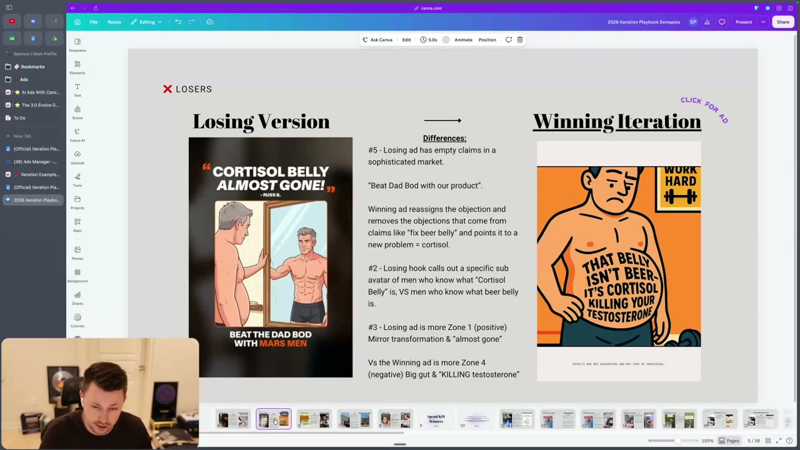
*"Beat the Dad Bod" empty claim vs "That belly isn't beer. It's cortisol killing your testosterone". [01:31]*

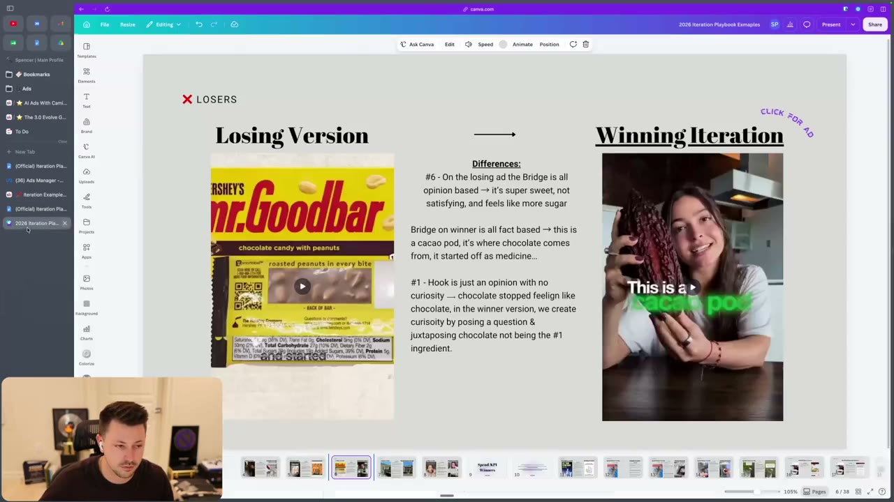
*Opinion-based bridge vs fact-based bridge ("this is a cacao pod"). [01:52]*

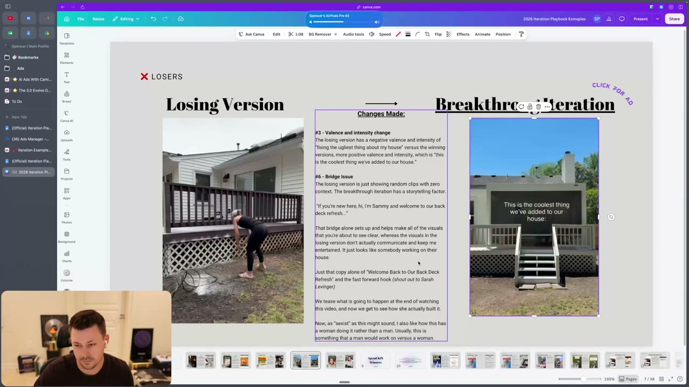
*Bridge issue: random clips vs "welcome to part three of our back deck refresh". [02:14]*

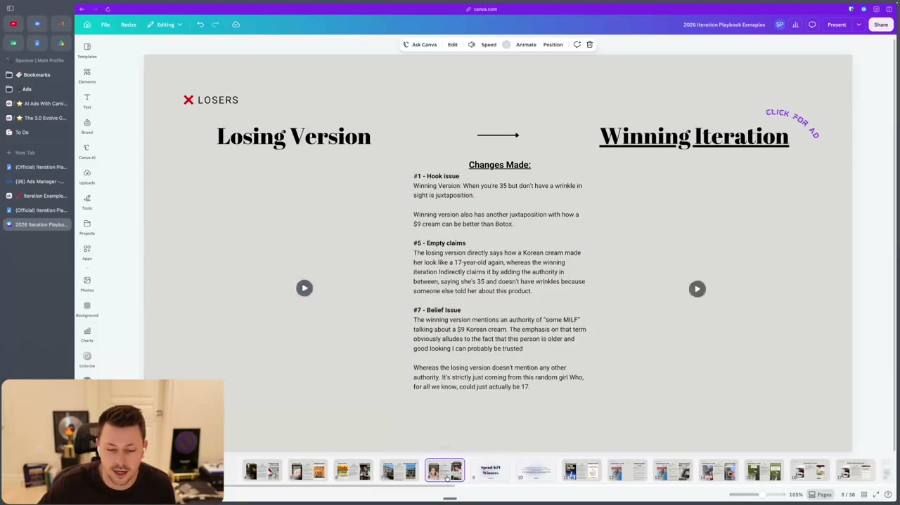
*Hook, empty-claim and belief issues for the $9 Korean cream ad (videos not loaded in this frame). [02:47]*

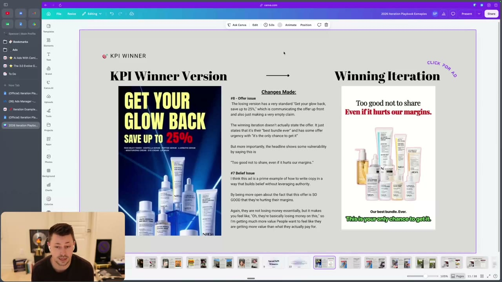
*KPI winner: "Save up to 25%" vs "Too good not to share. Even if it hurts our margins." [03:24]*

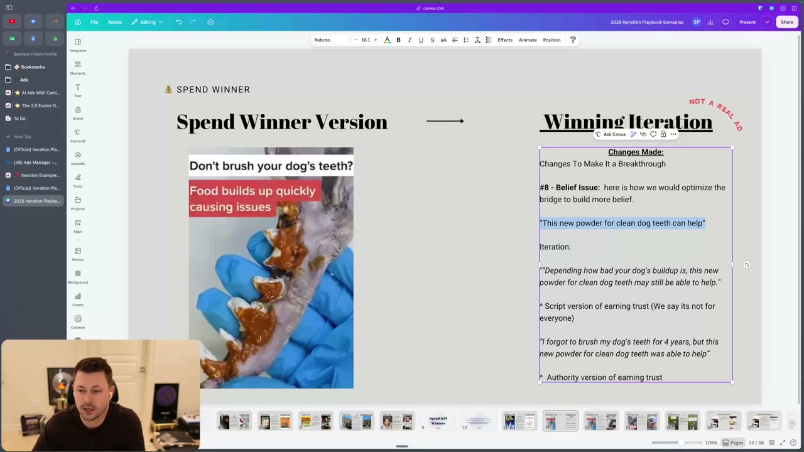
*Belief issue: the "script version" and "authority version" of earning trust. [04:04]*

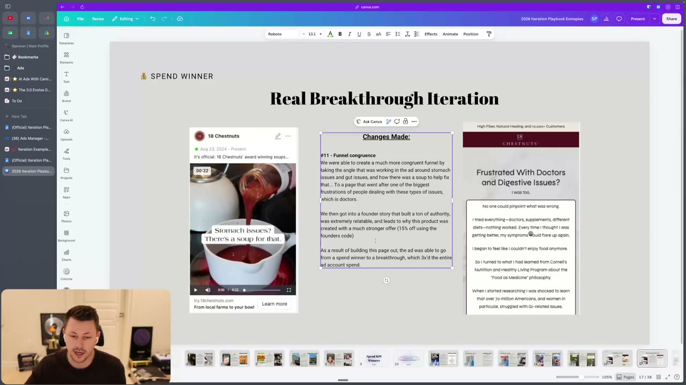
*"Real Breakthrough Iteration": the changed landing page and the result (3X account spend, instructor claim). [06:27]*

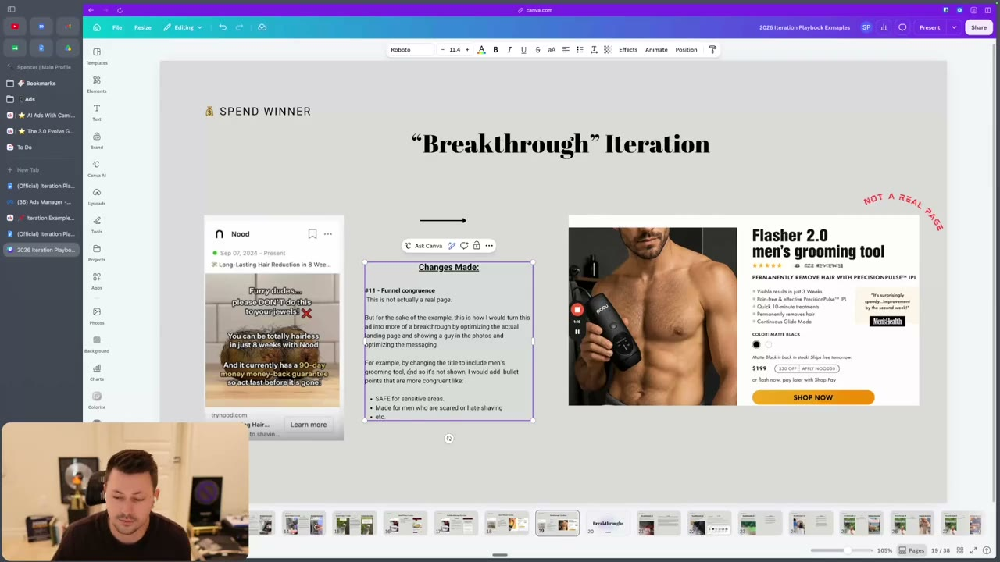
*Mock page fix for a men's hair-removal ad that landed on a woman-focused product page. [06:47]*

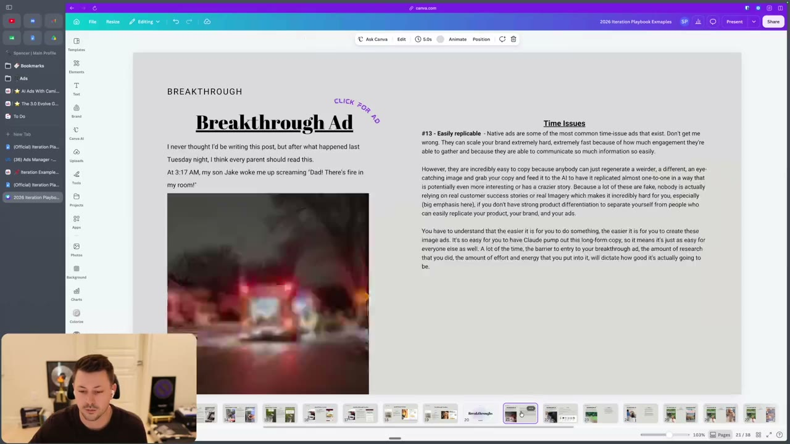
*#13 "Easily replicable": why native ads are easy to copy and what protects you. [06:50]*

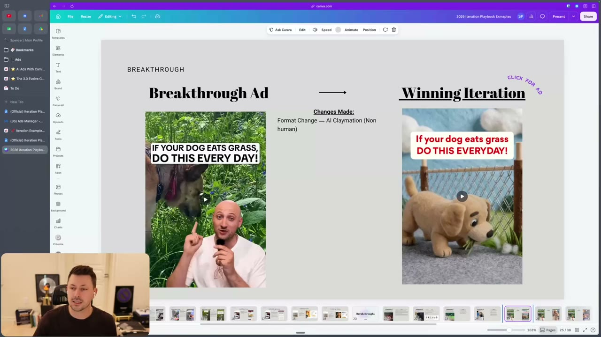
*Same script as a claymation ad: "Format Change -> AI Claymation (Non human)". [07:00]*

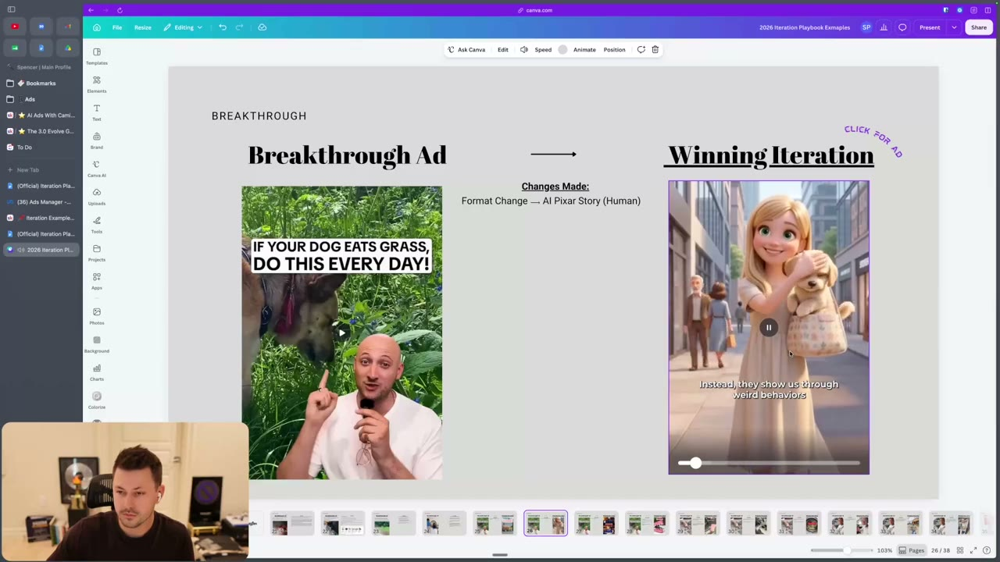
*"Format Change -> AI Pixar Story (Human)" with a more unaware hook. [07:50]*

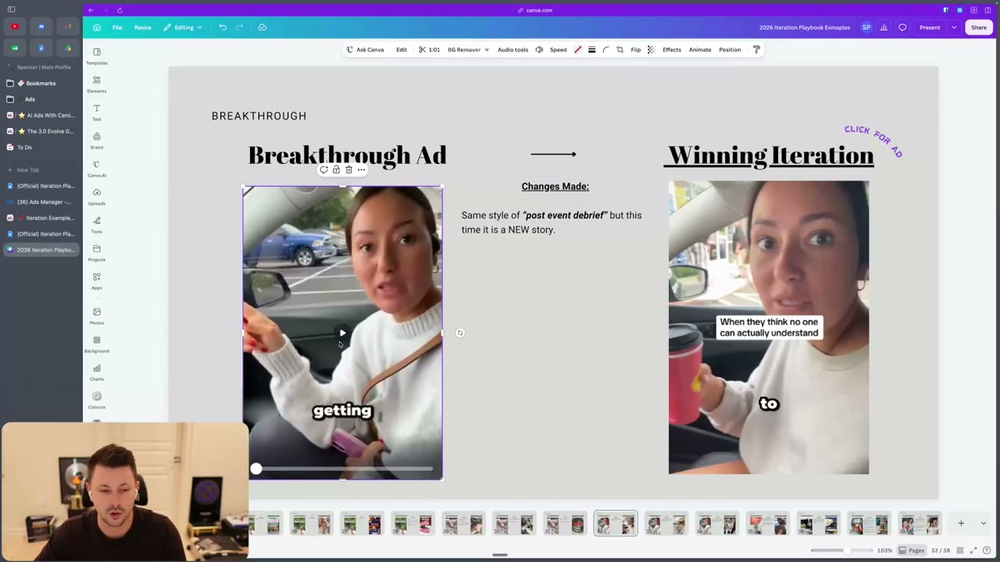
*Same "post event debrief" style, new story. [12:10]*

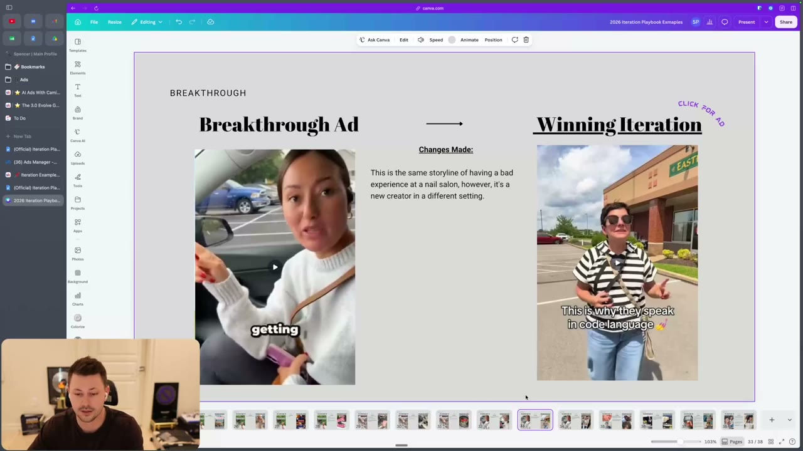
*Same storyline, new creator, different setting. [13:00]*

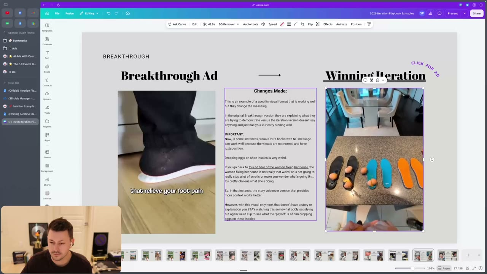
*Eggs on insoles: when a visual-only hook works and when it does not (back-deck contrast). [14:10]*

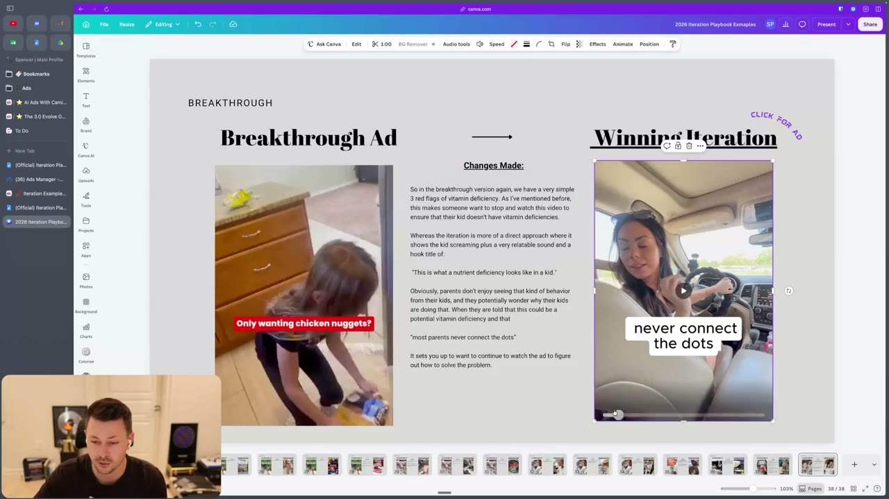
*"Three red flags" vs "This is what a nutrient deficiency looks like in a kid." [16:30]*

## How to apply
- [ ] Tag the ad's tier and data confidence before choosing an iteration.
- [ ] Run the issue-code checklist (#1-#13) and write one "Changes Made" line per fix.
- [ ] For offers: remove the explicit discount from the headline in one version and test a vulnerable/urgent frame.
- [ ] For trust: add a "this might not be for everyone" version and a first-person authority version of the bridge.
- [ ] Check the landing page against the ad angle and avatar; create a congruent version for any spend winner.
- [ ] When using a visual-only hook, check that the visual is unusual enough to carry curiosity.
- [ ] When copying a creator's story to a new avatar, change the setting (the original place may not fit).
- [ ] Log every simultaneous change (format, awareness, authority) separately.

## Related
- Previous: [53. The Iteration Playbook - Formats & Styles](53-the-iteration-playbook-formats-styles.md) · Next: [55. Why you need to position your brand](55-why-you-need-to-position-your-brand.md)
- [Iteration vs variation](../../../../concepts/iteration-vs-variation.md) · [Creative testing system](../../../../frameworks/creative-testing-system.md) · [Valence-intensity diagnostic](../../../../frameworks/valence-intensity-diagnostic.md)

## Sources and limitations
- Transcript: [54. ... Walkthrough .txt](<../../../../../raw/evolve/copywriting/_transcripts/✍️ Evolve Copywriting (NEW)/54. 📌 Iteration Examples & Breakdowns (Walkthrough) ✍️ Evolve Copywriting (NEW) Evolve.txt>) · Page text: [54 ….html.md](<../../../../../raw/evolve/copywriting/_extracted/✍️ Evolve Copywriting (NEW)/54. 📌 Iteration Examples & Breakdowns (Walkthrough)_✍️ Evolve Copywriting (NEW)_Evolve.html.md>)
- Machine transcription (Whisper large-v3-turbo); full recording covered (last segment 19:00). Whisper heard "tan issue" (TAM), "balance and intensity" (valence and intensity), "palm aware" (problem aware), "Sammy" (as spoken in the ad). Quoted ad audio (back-deck, nail-salon, steppers, vitamin clips) is the ads' words, not the instructor's.
- The Canva deck itself and the "iteration doc" with numbered issue types are not in the course files. Slide text above was read from screen frames; the Korean-cream slide's videos did not load, and the transcript says little about it ("empty claims belief issue"). The Goodbar-style wrapper and Mars Men/18 Chestnuts/Nood/Steppers names are read from on-screen text.
- Spend-winner and KPI-winner labels in the deck are the instructor's belief on limited data; "3X", "multi-eight-figure" and "sold for hundreds of millions" are instructor claims.
- The overlap with [52](52-the-iteration-playbook-script.md) (dog grass, washer, wallet, dental, scalp, nail salon) is intentional: this lesson adds the loser and KPI-winner slides, the funnel-congruence pages, and the claymation/Pixar/visual-only/vitamin-kid examples.
